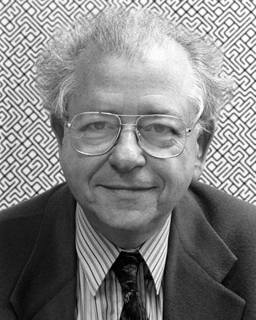

<!-- year: 1928 -->
<!-- page: sirds -->
<!-- after: the abstract (still empty); once the page has text, after the paragraph that introduces random-dot stereograms -->
### Béla Julesz und Christopher Tyler

<strong>Béla Julesz</strong> (1928–2003, im Bild), ungarisch-amerikanischer Wahrnehmungsforscher, ließ 1959 bei den Bell Labs einen Computer zwei Bilder aus zufälligen Punkten zeichnen, gleich bis auf eine Fläche, deren Punkte im einen Bild ein Stück verschoben waren. Jedes Bild allein zeigt nur Rauschen. Sieht aber jedes Auge eines davon, schwebt die Fläche vor dem Rest: Das Gehirn sieht Tiefe, ohne vorher in einem der Bilder eine Form zu erkennen.

Sein früherer Student <strong>Christopher Tyler</strong> brachte 1979 beides in ein einziges Bild, programmiert von Maureen Clarke auf einem Apple II in BASIC: das erste Autostereogramm aus zufälligen Punkten. In den 1990er Jahren verkauften sich bunte Autostereogramme als Magic-Eye-Bücher millionenfach.

Foto: Rutgers University, CC BY 2.5, zugeschnitten (<a href='https://commons.wikimedia.org/wiki/File:B%C3%A9la_Julez.jpg'>Wikimedia Commons</a>)

