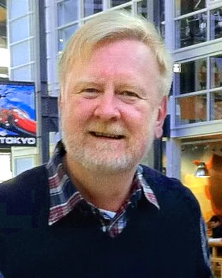

<!-- year: 1951 -->
<!-- page: feuerwerk -->
<!-- after: Alle Funken sind etwa gleich schnell. -->
### William Reeves

<strong>William Reeves</strong> (geboren 1951), kanadischer Informatiker. Bei Lucasfilm sollte er für den Film <em>Star Trek II</em> (1982) eine Feuerwand bauen, die über einen ganzen Planeten rollt. Er baute sie aus Funken: Jeder bekam eine Position, eine Geschwindigkeit, eine Farbe und eine Lebenszeit, flog, kühlte ab und verlosch. 1983 beschrieb er das als <em>Particle System</em>, und in demselben Aufsatz stehen Bilder von Feuerwerk.

Die Feuerwand bestand am Ende aus über 750 000 Partikeln. Ihre Farben verglühten wie heißes Metall: Grün und Blau fielen schnell ab, Rot langsam. Später ging Reeves zu Pixar und gewann mit John Lasseter einen Oscar für <em>Tin Toy</em> (1988), den ersten Oscar für einen Film ganz aus dem Computer.

Foto: Jeff Kays, 2011, CC BY 2.0, zugeschnitten (<a href='https://commons.wikimedia.org/wiki/File:William_%22Bill%22_Reeves_Pixar.jpg'>Wikimedia Commons</a>)

