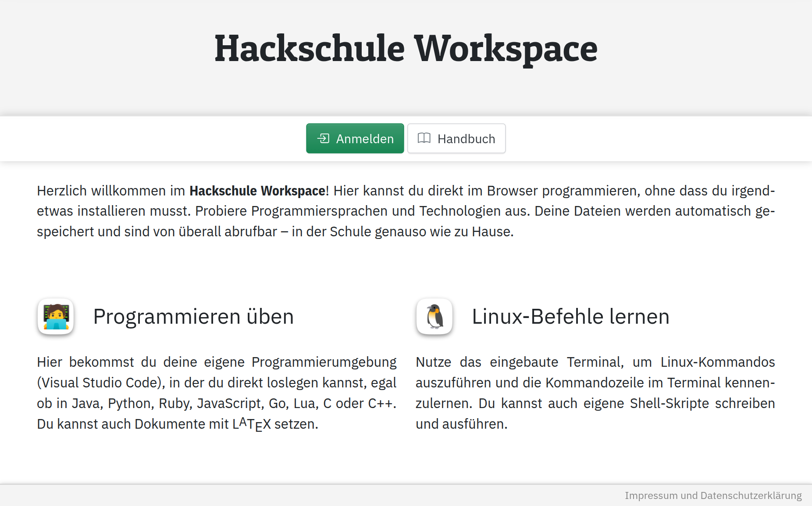
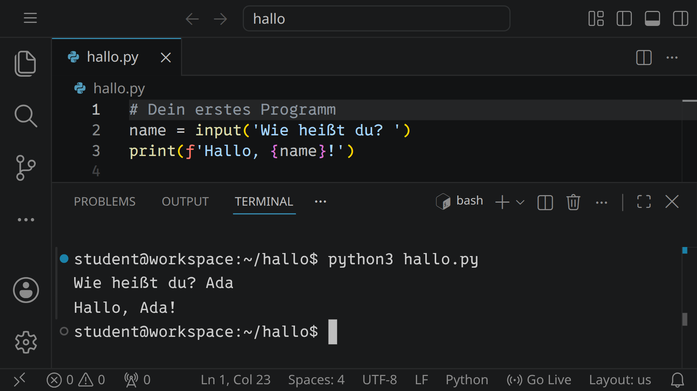
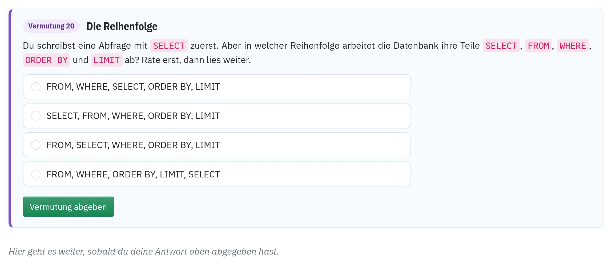
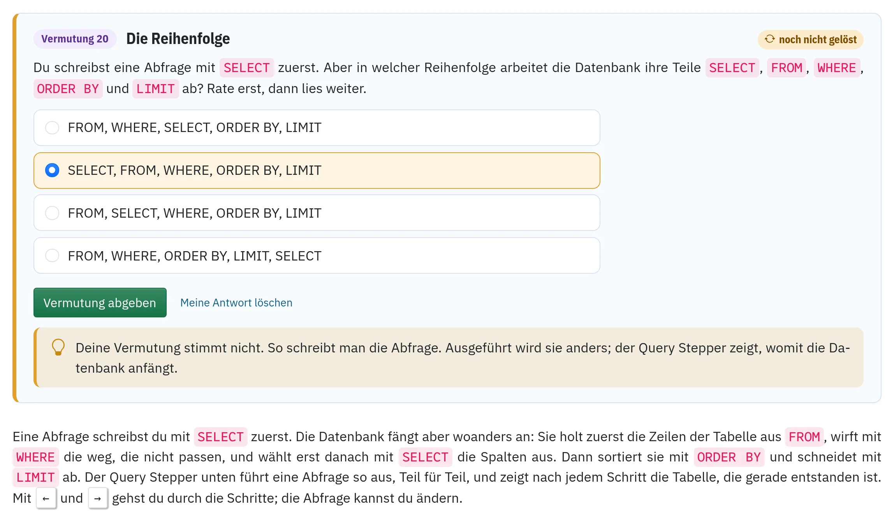
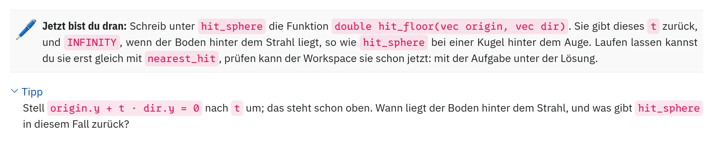
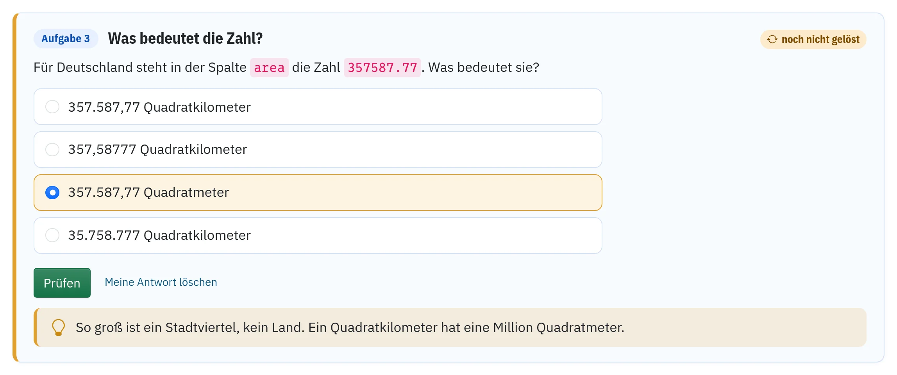
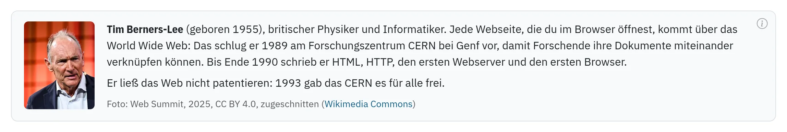

image: start-page.webp:50:0
image_alt: "Die Startseite des Workspace mit einem kurzen Text, daneben VS Code mit einem kleinen Python-Programm im Terminal"
kind: grundlagen
curriculum: "Sek I: Informatiksysteme (Bedienen von Hard- und Software); Oberstufe: Grundlagen informatischen Arbeitens (Arbeitsumgebung im Rechnernetz)"
topics: [betriebssystem]

# Was ist der Hackschule Workspace?

Der Hackschule Workspace ist eine Programmierumgebung, die direkt im Browser läuft. Du kannst damit programmieren, Webseiten bauen und neue Technologien ausprobieren, ohne vorher Software installieren oder einrichten zu müssen.

Im Mittelpunkt steht **Visual Studio Code**, ein Editor, der auch in der professionellen Softwareentwicklung weit verbreitet ist. Dazu kommen ein Terminal und viele bereits eingerichtete Programmiersprachen, Werkzeuge und Erweiterungen.

Jeder Workspace ist persönlich: Deine Dateien bleiben erhalten und du kannst sowohl in der Schule als auch zu Hause daran weiterarbeiten.

## Für Schülerinnen und Schüler

Im Workspace kannst du direkt loslegen. Du kannst zum Beispiel Programme schreiben und ausführen, Webseiten entwickeln, mit Datenbanken arbeiten oder ganz neue Programmiersprachen und Technologien kennenlernen.

Auf dieser Website findest du dazu Tutorials, Beispiele und kleine Projekte. Sie sollen dir einen Einstieg geben – nicht jede einzelne Funktion erklären.

Programmieren lernt man vor allem durchs Ausprobieren. Wenn etwas nicht funktioniert, gehört das dazu: Fehlermeldungen lesen, nachforschen, verändern und noch einmal ausprobieren ist ein wichtiger Teil des Programmierens.

Eine kurze Einführung in die wichtigsten Funktionen des Workspaces findest du unter [»Basics«](/basics).

## Für Lehrkräfte

Der Hackschule Workspace ist für den Einsatz im Informatikunterricht, in Workshops und in Arbeitsgemeinschaften gedacht. Die notwendige Software ist bereits vorbereitet, sodass Unterricht nicht damit beginnen muss, Entwicklungsumgebungen auf unterschiedlichen Rechnern zu installieren und einzurichten.

Der Workspace ist dabei bewusst keine einzelne Lernumgebung für eine bestimmte Programmiersprache. Er stellt eine gemeinsame technische Grundlage bereit, auf der ganz unterschiedliche Unterrichtsprojekte laufen können – von ersten HTML-Seiten und kleinen Programmen bis zu Datenbanken, Grafik, Spielen und weiteren Themen.

Die Tutorials auf dieser Website können direkt verwendet, als Ausgangspunkt für eigene Aufgaben genutzt oder einfach zum Entdecken neuer Themen eingesetzt werden. Wie eine Aktivität aufgebaut ist und warum, steht unten unter [»Was eine Aktivität ausmacht«](#was-eine-aktivität-ausmacht).

### Mit deiner Klasse arbeiten

Du kannst den Workspace auf zwei Wegen mit deinen Lernenden nutzen.

**Hier, auf dieser Installation.** Schreib an <a href='mailto:${contact_email}'>${contact_email}</a>, an welcher Schule du unterrichtest und mit welchen Klassen du arbeiten möchtest. Wenn es passt, lädt dich die Administration als Lehrkraft ein. Dann legst du unter »Klassen« deine Gruppen an und lädst deine Schülerinnen und Schüler mit ihren E-Mail-Adressen ein; nach der Anmeldung zeigt dir die Seite »Einstieg für Lehrkräfte« die erste Stunde Schritt für Schritt. Ob der Workspace im Unterricht eingesetzt wird, entscheidet deine Schulleitung; was sie dafür braucht, steht im nächsten Absatz.

**Datenschutz.** Wer diese Installation betreibt, wo die Daten liegen, was gespeichert wird und wann es gelöscht wird, steht öffentlich in der [Datenschutzerklärung](/impressum#datenschutz); dort steht auch, auf welcher Grundlage die Schulen den Workspace nutzen. Die Unterlagen für die Schule (die Entscheidung für die Schulleitung, eine Prüfübersicht für die Datenschutzbeauftragte Stelle, die Vereinbarung zur Auftragsverarbeitung, ein Elternbrief) sind nicht öffentlich: Sie gehen als Dateien oder ausgedruckt an die Schulleitung. Möchte deine Schulleitung sie sehen, auch bevor du ein Konto hast, schreib an <a href='mailto:${contact_email}'>${contact_email}</a>.

**Auf einem eigenen Server.** Der Quelltext des Workspace ist öffentlich: [github.com/specht/workspace](https://github.com/specht/workspace). Du kannst ihn für deine Schule selbst betreiben, auf einem Rechner der Schule oder auf einem gemieteten Server. Der Server sollte nur für den Workspace da sein, denn der Webserver darf dort Container starten und stoppen. Wie viel Leistung nötig ist, hängt davon ab, wie viele gleichzeitig arbeiten: Ein gemieteter Server mit 4 Kernen und 8 GB RAM reicht für wenig Betrieb, für mehrere Klassen gleichzeitig eher ein Server mit 16 Kernen und 32 GB RAM. Wie die Installation geht, steht im [README](https://github.com/specht/workspace#betrieb-auf-einem-server), mit einer [Schnellstart-Anleitung für einen gemieteten Server](https://github.com/specht/workspace/blob/main/bootstrap/README.hetzner.centos.md).

## Los geht's

Melde dich an und klicke oben auf »Workspace öffnen«. Der Workspace wird bei Bedarf gestartet und öffnet sich anschließend in einem neuen Browser-Tab.

Danach kannst du entweder einem Tutorial folgen oder direkt ein eigenes Projekt beginnen.

<!-- tutorial-screenshot
# Die Startseite, nicht angemeldet
open-site: /
tab: preview
viewport: 1029x640
hook: guest
sleep: 1
variants: dark
-->

<!-- tutorial-screenshot
# Für die Startseite (index.html, front_picture_html): ein aufgeräumter Workspace mit einem kleinen Programm und einem Lauf im Terminal.
# zoom: Das Bild ist auf der Startseite nur etwa halb so breit wie die anderen Screenshots; etwas größer gezoomt bleibt es lesbar.
# viewport: 16:9, damit es neben dem Text der Startseite nicht höher ist als der Text.
viewport: 1029x579
zoom: 1.6
write-file: hallo/hallo.py <- file:hallo.py
press: Control+K
press: Control+O
wait-for-input-value: /workspace/
type: hallo
press: Enter
wait-for-input-value: /workspace/hallo/
press: Enter
wait-for-text: hallo.py
open-file: hallo.py
hide-left-sidebar
terminal-open
terminal-run: clear
terminal-run: python3 hallo.py
sleep: 1
type: Ada
press: Enter
terminal-wait-for-prompt
move-mouse: selector:.terminal
-->

## Was eine Aktivität ausmacht

Eine Aktivität ist kein Text mit ein paar Beispielen, sondern eine Folge von Schritten, die Lernende in ihrem eigenen Workspace selbst gehen: eine Webseite bauen, einen Webserver schreiben, eine Datenbank abfragen. Die Seite erklärt, was neu ist, aber vor allem lässt sie die Lernenden etwas tun und sagt ihnen, ob es stimmt. Das Muster dahinter heißt in der Informatikdidaktik PRIMM: erst vermuten, dann ausführen, untersuchen, ändern und am Ende selbst schreiben (Predict, Run, Investigate, Modify, Make; [Sentance, Waite und Kallia 2019](https://doi.org/10.1080/08993408.2019.1608781)). Die meisten Bilder in diesem Kapitel stammen aus [»Einführung in SQL«](/mysql), die Tipps aus der Fortsetzung [»SQL: Gruppieren und Verbinden«](/sql-joins).

### Echte Dateien, echte Werkzeuge

Gearbeitet wird in Visual Studio Code, mit Dateien, Terminal und Git, so wie in der Softwareentwicklung; die Abfragen der SQL-Aktivitäten laufen in einer eigenen MySQL-Datenbank. Was entsteht, gehört den Lernenden: Sie arbeiten zu Hause daran weiter, und eine Abgabe ist eine Kopie, über die sie selbst bestimmen. Nichts wird versteckt: Pfade, Befehle und Adressen stehen im Text, wie sie sind. Was beim ersten Mal ausführlich erklärt wird, steht danach in einer Zeile mit einem Link ins Handbuch.

### Erst vermuten, dann ausprobieren

Bevor etwas ausgeführt wird, fragt die Seite oft, was gleich passieren wird, in der Einführung in SQL zum Beispiel, in welcher Reihenfolge die Datenbank die Teile einer Abfrage abarbeitet. Was die Antwort verraten würde, ein Bild vom Ergebnis oder der Absatz, der es erklärt, erscheint erst, wenn die Vermutung abgegeben ist, ob richtig oder falsch. Wer sich erst festgelegt hat, schaut beim Ausprobieren genau hin. Lehrkräfte und Gäste sehen alles sofort; so wie hier sehen es nur Lernende.

Wer die Reihenfolge wählt, in der man eine Abfrage schreibt, bekommt eine Rückmeldung genau zu diesem Irrtum, und darunter erscheint die Erklärung:

### Selbst schreiben statt abtippen

In den Programmierprojekten schreiben die Lernenden eine kleine Funktion zuerst selbst, sobald die Seite erklärt hat, was sie tun soll (»Jetzt bist du dran«); der Code der Seite kommt erst danach. Prüft eine Aufgabe die eigene Funktion, in Ruby, Python oder C, ruft der Workspace sie mit ein paar Eingaben auf, und wer sie so gelöst hat, kann den Code der Seite sofort aufklappen und vergleichen. Bei SQL schreiben die Lernenden ohnehin jede Abfrage selbst.

Wer hängen bleibt, holt sich Tipps in Stufen: erst zum Verstehen, dann zum Weg, dann ein Gerüst mit Lücken, nie die ganze Lösung. Der nächste Tipp erscheint erst eine Minute, nachdem der vorige aufgeklappt wurde, ohne Uhr, damit man mit jedem arbeitet, statt bis zum letzten durchzuklicken. Welche Tipps jemand gebraucht hat, merkt sich nur der eigene Browser; keine Lehrkraft sieht es.

### Aufgaben, die nachsehen

Aufgaben stehen dort, wo die Lernenden gerade etwas getan haben, nicht gesammelt am Ende. Viele vergleichen nicht nur eine Antwort, sondern sehen nach: Eine SQL-Abfrage läuft in der eigenen Datenbank der Lernenden, und andere Aufgaben prüfen, ob eine Datei richtig liegt, ob das HTML einer Seite stimmt, ob alles committet ist, was eine selbst geschriebene Funktion zurückgibt oder ob der eigene Server antwortet. Dabei lesen sie nur und ändern nichts.

Die Rückmeldung nennt den typischen Fehler, nicht bloß »falsch«. Wer bei den fünf größten Ländern das `DESC` vergisst, liest »Das sind die fünf kleinsten«, und auch beim Ankreuzen hat jede falsche Antwort ihre eigene Rückmeldung. Die Erklärung zur Lösung erscheint erst nach einer richtigen Antwort.

### Die Menschen hinter einer Sache

Hinter jeder Erfindung stehen Menschen. Wer ein Verfahren, eine Sprache oder ein Format erfunden hat, um das es in einem Abschnitt geht, bekommt dort einen kurzen Kasten: ein freies Foto, wenn es eines gibt, und zwei, drei Sätze, die an das anknüpfen, was die Lernenden gerade tun. Wo ein Abschnitt mit einem berühmten Aufsatz anfängt, verweist die Seite auf ihn, beim Raytracer etwa auf den von Turner Whitted aus dem Jahr 1980, und wo ein Buch genau dort weitermacht, wo die Seite aufhört, auch auf das Buch. Alle Personen stehen gesammelt im Handbuch unter [»Personen«](/reference/personen).

### Was die Lehrkraft davon hat

Auf der Klassenseite sieht die Lehrkraft, wer welche Aufgabe gelöst hat, wie viele Versuche es waren und bei welcher Aufgabe gerade viele falsch liegen: ein guter Moment, kurz für alle zu erklären. Zu jeder Aktivität gibt es eine Notiz für Lehrkräfte mit dem Ablauf je Doppelstunde und dem, was oft schiefgeht. Baut eine Aktivität ein Programm Schritt für Schritt auf, kopiert ein Knopf unter den Bildern das ganze Programm bis zu dieser Stelle. Lernende sehen weder Notiz noch Knopf.

### Was eine Aktivität nicht ist

Sie ersetzt keinen Unterricht. Die Aktivitäten sind für eine Klasse mit einer Lehrkraft gedacht, die erklärt, hilft und mit den Lernenden spricht; sie nehmen ihr ab, jeden Handgriff einzeln vorzumachen. Schwierige Teile bleiben ausgearbeitete Beispiele, die die Seite erklärt. Und die Tipps sind eine Einladung, kein Schloss: Wer die Lösung unbedingt sucht, findet sie.

Wer selbst eine Aktivität schreiben möchte, findet die Anleitung im Repository: [»Eine Aktivität mit Aufgaben schreiben«](https://github.com/specht/workspace/blob/main/docs/aktivitaet-schreiben.md).
