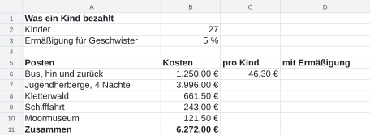
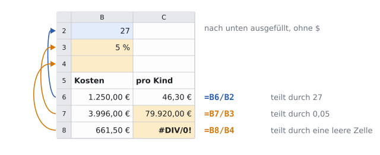
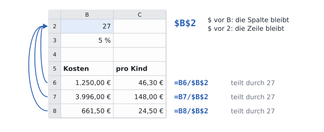
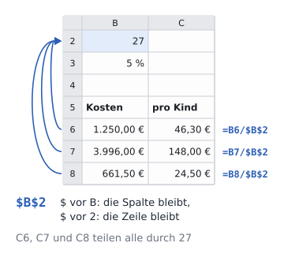

image: teaser.webp
image_alt: "Was ein Kind für die Klassenfahrt bezahlt, als Tabelle: die Kosten jedes Postens, der Anteil pro Kind und mit Ermäßigung, darunter die Summen"
kind: labor
duration: 1 Stunde (45 Minuten)
curriculum: "Sek I: Standardsoftware (Tabellenkalkulation)"
topics: [standardsoftware]
language: LibreOffice / Excel / Nextcloud Office
languages: [libreoffice, word, nextcloud]
office: sheet
requires: [number-formats]
reference: []

# Feste Bezüge

Manche Zellen soll eine Formel auch nach dem Ausfüllen noch finden: die Zahl der Kinder, die Ermäßigung. Du hältst sie mit dem Dollarzeichen fest und rechnest aus, was ein Kind für die Klassenfahrt bezahlt.

Wie viel kostet die Klassenfahrt ein Kind? Das Elternteil, das die Kasse
führt, hat die Kosten der Kinder zusammengestellt; die der beiden Lehrkräfte
bezahlen nicht die Familien. Über der Tabelle stehen die Zahl der Kinder (in
B2) und die Ermäßigung für Geschwister (in B3), damit jede Formel sie dort
findet. In C6 hat das Elternteil schon den Anteil für den Bus ausgerechnet:
`=B6/B2`, die Kosten geteilt durch die Zahl der Kinder. Den Rest will es
nach unten ausfüllen.

_task(vorher)

## Der Bezug wandert mit

Hol dir die Tabelle und öffne sie:

<a class='document-starter btn btn-primary' href='/absolute-references/03%20Anteile.xlsx' download><i class='bi bi-file-earmark-spreadsheet' aria-hidden='true'></i>Vorlage herunterladen:03 Anteile.xlsx</a>

<!-- after: vorher -->
Im ersten Blatt hast du gesehen: Eine Formel merkt sich nicht die Adressen,
sondern den Weg zu ihnen. Für C6 heißt B2 »vier Zeilen über mir, eine Spalte
links«. In C7 führt derselbe Weg zu B3, in C8 zu B4. Bei den Kosten in Spalte B
ist das richtig: Jede Zeile soll ihre eigenen Kosten teilen. Bei der Zahl der
Kinder ist es falsch: Sie steht nur einmal da, in B2.

<!-- /after -->

**Jetzt bist du dran:** Füll in der Vorlage die Formel aus C6 nach unten aus,
bis C10, und sieh dir an, was herauskommt.

_task(zeigt)

<!-- after: zeigt -->
Eine Zelle, die durch eine leere Zelle teilt, zeigt `#DIV/0!`: Durch null
kann man nicht teilen. Eine, die durch einen Text teilt, zeigt `#WERT!`. Am
gefährlichsten ist C7: Sie zeigt keinen Fehler, nur eine falsche Zahl. Mach
das Ausfüllen rückgängig (<kbd>Strg</kbd>+<kbd>Z</kbd>), sodass wieder nur in
C6 eine Formel steht.
<!-- /after -->

## Das Dollarzeichen

Ein **Dollarzeichen** in einem Bezug hält fest, was beim Ausfüllen nicht
wandern soll: `$B$2` bleibt B2, egal wohin du die Formel ziehst. Das `$` vor
dem B hält die Spalte fest, das `$` vor der 2 die Zeile. Ein Bezug mit `$`
heißt **absolut**, einer ohne **relativ**: Er wandert relativ zur Zelle mit,
in der die Formel steht.

<!-- language: libreoffice -->
Die Dollarzeichen kannst du tippen. Schneller geht es in der **Eingabezeile**:
Setz den Cursor in den Bezug, etwa hinter B2, und drück
<kbd>Shift</kbd>+<kbd>F4</kbd>. Jedes Drücken wechselt zwischen `$B$2`,
`B$2`, `$B2` und `B2`.
<!-- /language -->
<!-- language: word -->
Die Dollarzeichen kannst du tippen. Schneller geht es in der
**Bearbeitungsleiste**: Setz den Cursor in den Bezug, etwa hinter B2, und drück
<kbd>F4</kbd>. Jedes Drücken wechselt zwischen `$B$2`, `B$2`, `$B2` und `B2`.
<!-- /language -->
<!-- language: nextcloud -->
Die Dollarzeichen tippst du in Nextcloud Office selbst: Klick in die Zelle, in
der Zeile über der Tabelle vor das B und vor die 2.
<!-- /language -->

Ziehst du eine Formel nur nach unten, genügt `B$2`: Die Spalte ändert sich
dabei ohnehin nicht. `$B$2` hält beides fest und ist auf der sicheren Seite.

**Jetzt bist du dran:** Schreib in C6 `=B6/$B$2` und füll die Formel nach
unten aus, bis C10. In C11 kommt die SUMME der Anteile. Ändere B2 auf 26 und
sieh nach, ob alle Anteile mitrechnen; setz B2 danach wieder auf 27.

_task(rechts)

<!-- after: rechts -->
Ein Bezug ohne `$` wandert in jede Richtung mit: nach unten um Zeilen, nach
rechts um Spalten. Deshalb steht vor B6 kein Dollarzeichen: Jede Zeile soll ihre
eigenen Kosten teilen.
<!-- /after -->

## Die Ermäßigung

Geschwister zahlen 5 % weniger. 5 % weniger heißt: 95 % des Betrags, also
der Betrag mal 0,95, oder mit der Zelle B3: mal (1 − B3). Steht die
Ermäßigung in einer Zelle und nicht in jeder Formel, ändert sie sich an einer
einzigen Stelle, wenn der Förderverein der Schule nächstes Jahr mehr gibt.

**Jetzt bist du dran:** Schreib in D6 den Anteil mit Ermäßigung,
`=C6*(1-$B$3)`, und füll ihn nach unten aus, bis D10. In D11 kommt die
SUMME. Gib C6 bis D11 das Format Währung.

<strong>Zeile 1, Spalte 1</strong>, 1982. Die Adressen A1, B2, C3 stammen von VisiCalc. Microsoft gab seiner ersten Tabellenkalkulation, Multiplan, 1982 eine andere Schreibweise: R1C1, »row 1, column 1«, Zeile 1, Spalte 1. Ein Bezug, der beim Ausfüllen mitwandert, hieß dort so, wie er gemeint ist: <code>RC[-1]</code>, »diese Zeile, eine Spalte links«. Den Weg, den sich eine Formel merkt, sah man ihr also an. Multiplan verkaufte sich über eine Million Mal, kam aber gegen Lotus 1-2-3 nicht an. Excel löste es ab und kann die Schreibweise bis heute; in den Optionen heißt sie auf Deutsch Z1S1.

_person(simonyi)

## Prüfen

Speichere die Tabelle und lass sie prüfen. Die Prüfung ändert in ihrer Kopie
die Zahl der Kinder und die Ermäßigung und rechnet neu: Rechnen alle Anteile
mit, stimmt alles.

_task(anteile)

<!-- after: anteile -->

<strong>Ausprobieren:</strong> Schreib in E6 <code>=$B6</code> und füll die Formel nach rechts und nach unten aus, ein paar Zellen weit. Achte darauf, welcher Teil des Bezugs sich ändert und welcher nicht.

<!-- /after -->
