<div class='meta'>
image: 3d-torus-anaglyph.webp
kind: projekt
language: Anaglyph-Viewer
template: https://github.com/specht/anaglyph.git
template_name: der Anaglyph-Vorlage
reference: [farben]
</div>

<div
    class="autotoc-secondary-trigger"
    data-title="Auf dieser Seite"
    data-levels="h2,h3">
</div>

# 3D-Grafik mit Anaglyphen

<p class='abstract'>
Anaglyphen sind Bilder, bei denen zwei Bilder in verschiedenen Farben übereinandergelegt werden, um einen 3D-Effekt zu erzeugen. Farbfilter in der 3D-Brille trennen die beiden Bilder, sodass jedes Auge nur eines der Bilder sieht. Dadurch entsteht der Eindruck von Tiefe und räumlicher Wahrnehmung. In diesem Tutorial lernst du, wie du verschiedene Körper in 3D mit Anaglyphen darstellen kannst.
</p>

## Vorbereitung

### Repository klonen

Für diese Anleitung brauchst du die Vorlage des Anaglyph-Viewers:

_include(workspace#repository-klonen)

Wenn du auf der linken Seite im Explorer nun die Datei `scene.ini` siehst, hast du alles richtig gemacht. Öffne sie mit einem Klick: Sie enthält die Anweisungen für die 3D-Szene, die du erstellen wirst.

<!-- tutorial-screenshot
# Klonen wie im Handbuch »Workspace« (oben eingebunden), dann das
# geöffnete Anaglyph-Projekt im Explorer
show-left-sidebar
clone-start: https://github.com/specht/anaglyph.git @ c2ac11e67cd0f53cde3447a28b830f08f2dc086a
press: Enter
wait-for-input-value: /workspace/
press: Enter
wait-for-text: Would you like to open the repository?
click: Open
wait-for-text: scene.ini
open-file: scene.ini
sleep: 1
-->

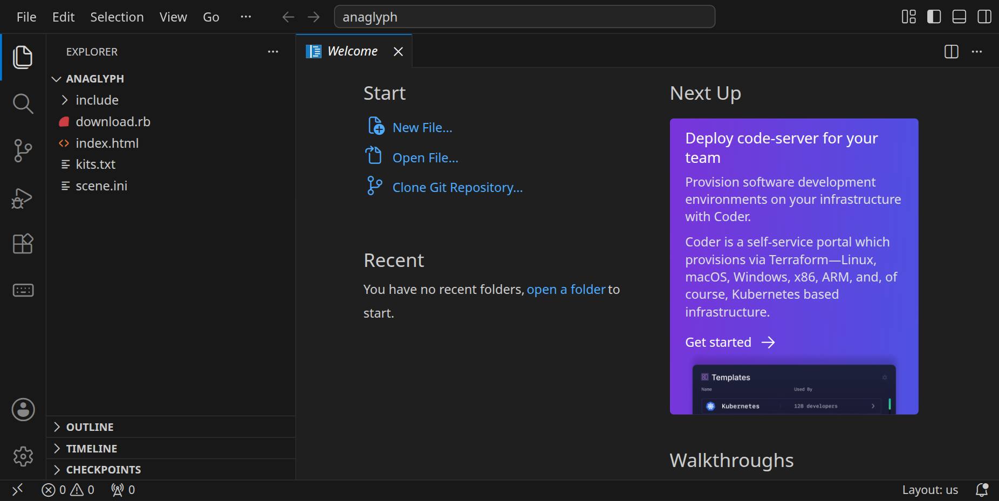

### Vorschau starten


Im Workspace ist bereits die Erweiterung »Live Server« installiert. Unten rechts findest du den Eintrag »Go Live«. Klicke darauf, um die Vorschau zu starten. Es öffnet sich ein neuer Tab in deinem Browser mit deiner 3D-Szene, die anfangs nur aus einem einzigen Würfel besteht.

<div style='clear: both;'></div>

<div class='hint'>
Tipp: Ziehe deinen Workspace und die Vorschau nebeneinander, damit du deine Änderungen live sehen kannst.
</div>

Unten links in der Vorschau findest du die Buttons »Reset Camera« (um die Ansicht zurückzusetzen), »Kamera kopieren« (die Ansicht als Zeile für deine Szene, mehr dazu bei der Abgabe), »Anaglyph 3D« (für die Rot-Cyan-Brille), »Dunkel« (für einen dunklen Hintergrund) und »Achsen« (zum Einblenden der Koordinatenachsen).

<div class='hint'>
Ist dir der weiße Hintergrund zu hell? Klicke auf »Dunkel«. Die Bilder auf dieser Seite passen sich von selbst an, je nachdem ob du die Webseite hell oder dunkel eingestellt hast. Wenn du eine 3D-Brille hast, klicke auf das Brillen-Symbol <svg class='icon-3d-glasses' viewBox='0 0 24 24' aria-hidden='true'><path d='M1.5 8.5H22.5V15a1.5 1.5 0 0 1-1.5 1.5H15.2l-1.6-2.4a1.9 1.9 0 0 0-3.2 0L8.8 16.5H3A1.5 1.5 0 0 1 1.5 15Z' fill='none' stroke='currentColor' stroke-width='1.5' stroke-linejoin='round'/><rect x='3.6' y='10.1' width='6.2' height='4.4' rx='0.8' fill='#e0342c'/><rect x='14.2' y='10.1' width='6.2' height='4.4' rx='0.8' fill='#19b6c8'/></svg> in der Ecke eines Bildes: Dann siehst du alle Bilder so, wie sie mit »Anaglyph 3D« aussehen.
</div>

## Körper platzieren

Eine Szene besteht aus Körpern. Du wählst ihre Form und verschiebst, drehst und skalierst sie, bis sie dort stehen, wo du sie haben möchtest.

### Geometrische Objekte

Du solltest einen Würfel sehen, der in der Mitte des Bildschirms schwebt. Benutze die Maus, um die Szene zu drehen und zu zoomen.

<!-- tutorial-screenshot
# erste Vorschau: der Würfel aus scene.ini, mit Anaglyph-Farben
go-live
tab: preview
variants: dark anaglyph
# Your browser window for the hand-made shots: 1906 CSS pixels wide
zoom: 0.54
move-mouse: selector:canvas#defaultCanvas0
sleep: 0.5
hook: camera 20 20 -420
crop-top: 27%
crop-bottom: 27%
-->

<div style='text-align: center; margin: 1em 0;'>

</div>


Schau dir noch einmal `scene.ini` an. Bisher steht dort nur eine Zeile:

```ini
shape = box
```

Ändere den Wert `box` in `sphere`, um den Würfel durch eine Kugel zu ersetzen:

```ini
shape = sphere
```

Speichere die Datei mit <kbd>Strg</kbd><kbd>S</kbd> und schaue dir die Vorschau an. Du solltest nun eine Kugel sehen:

<!-- tutorial-scope -->
<!-- tutorial-screenshot
# Kugel
write-file: scene.ini <- previous-code
sleep: 1
preview-reload
tab: preview
variants: dark anaglyph
# Your browser window for the hand-made shots: 1906 CSS pixels wide
zoom: 0.54
hook: camera 20 20 -450
crop-top: 27%
crop-bottom: 27%
-->

<div style='text-align: center; margin: 1em 0;'>

<!-- /tutorial-scope -->
</div>

<div class='hint'>
Falls sich die Vorschau nicht automatisch aktualisiert, klicke auf den »Refresh«-Button in deinem Browser oder drücke <kbd>F5</kbd>.
</div>

Damit der Workspace deine Szene prüfen kann, lass die Kugel für den Moment in `scene.ini` stehen:

_task(kugel)

Probiere auch andere Formen aus, indem du den Wert für `shape` änderst. Hier sind die Formen, die du verwenden kannst:

- `box` für einen Würfel
- `sphere` für eine Kugel
- `cylinder` für einen Zylinder
- `cone` für einen Kegel
- `torus` für einen Torus (Ring)
- `teapot` für den [Utah Teapot](https://de.wikipedia.org/wiki/Utah_teapot)
- `plane` für ein Quadrat

Zusätzlich zu den geometrischen Körpern kannst auch ein Gitter anzeigen, indem du `shape = grid` einfügst:

```ini
shape = grid
shape = sphere
```

<!-- tutorial-scope -->
<!-- tutorial-screenshot
# Kugel über dem Gitter
write-file: scene.ini <- previous-code
sleep: 1
preview-reload
tab: preview
variants: dark anaglyph
# Your browser window for the hand-made shots: 1906 CSS pixels wide
zoom: 0.54
hook: camera 20 20 -450
crop-top: 27%
crop-bottom: 27%
-->

<div style='text-align: center; margin: 1em 0;'>
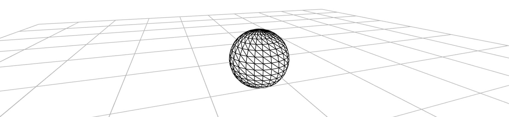
<!-- /tutorial-scope -->
</div>


Du kannst auch mehrere Formen kombinieren, indem du sie untereinander schreibst. Zum Beispiel:

```ini
shape = torus
shape = sphere
```

<!-- tutorial-scope -->
<!-- tutorial-screenshot
# Ring um eine Kugel
write-file: scene.ini <- previous-code
sleep: 1
preview-reload
tab: preview
variants: dark anaglyph
# Your browser window for the hand-made shots: 1906 CSS pixels wide
zoom: 0.54
hook: camera 20 20 -450
crop-top: 27%
crop-bottom: 27%
-->

<div style='text-align: center; margin: 1em 0;'>

<!-- /tutorial-scope -->
</div>

### Objekte verschieben

Um Objekte zu verschieben, kannst du den Befehl `move` verwenden:

```ini
shape = grid

shape = box
move = 100, 0, 0
```

<!-- tutorial-scope -->
<!-- tutorial-screenshot
# verschobener Würfel
write-file: scene.ini <- previous-code
sleep: 1
preview-reload
tab: preview
variants: dark anaglyph
# Your browser window for the hand-made shots: 1906 CSS pixels wide
zoom: 0.54
hook: camera 20 20 -420
crop-top: 27%
crop-bottom: 27%
-->

<div style='text-align: center; margin: 1em 0;'>
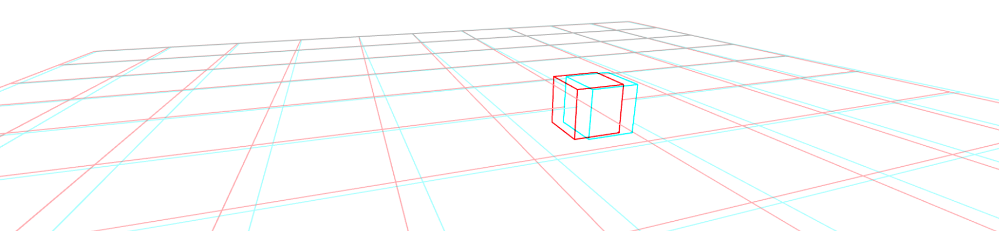
<!-- /tutorial-scope -->
</div>

Dabei gibt `move = 100, 0, 0` an, dass das Objekt um 100 Einheiten nach rechts verschoben wird. Die drei Werte stehen für die Verschiebung in den X-, Y- und Z-Richtungen.

Die Richtungen sind wie folgt:

- die X-Achse verläuft von links nach rechts
- die Y-Achse verläuft von unten nach oben
- die Z-Achse verläuft von hinten nach vorn

Ein positiver Wert verschiebt das Objekt also nach rechts (X), nach oben (Y) oder nach vorne (Z), während ein negativer Wert es nach links, nach unten oder nach hinten verschiebt.

Ab jetzt baust du jede Szene in einer eigenen Datei, dann bleiben alle erhalten. Lege dafür eine neue Datei an (»File« / »New Text File«) und speichere sie mit <kbd>Strg</kbd><kbd>S</kbd> im Ordner `anaglyph` unter dem Namen aus der Aufgabe, hier also als `/workspace/anaglyph/vier-wuerfel.ini`. Damit die Vorschau diese Datei zeigt, trägst du unten im Textfeld der Vorschau `vier-wuerfel.ini` statt `scene.ini` ein.

**Aufgabe:** Versuche, die folgende Szene zu erstellen, indem du vier Würfel erstellst:

- ein Würfel in der Mitte
- ein Würfel rechts daneben
- ein Würfel darüber
- ein Würfel davor

<div class='hint'>
Tipp: Du musst die Szene mit der Maus ein bisschen drehen, um alle Würfel gut zu sehen.
</div>

<div style='display: none;'>

```ini
shape = grid

shape = box

shape = box
move = 100, 0, 0

shape = box
move = 0, 100, 0

shape = box
move = 0, 0, 100
```

</div>

<!-- tutorial-scope -->
<!-- tutorial-screenshot
# vier Würfel (Lösung der Aufgabe)
write-file: scene.ini <- previous-code
sleep: 1
preview-reload
tab: preview
variants: dark anaglyph
# Your browser window for the hand-made shots: 1906 CSS pixels wide
zoom: 0.54
hook: camera 30 -45 -550 50 40 50
# the cube on top needs room above it
crop-top: 10%
crop-bottom: 22%
-->

<div style='text-align: center; margin: 1em 0;'>
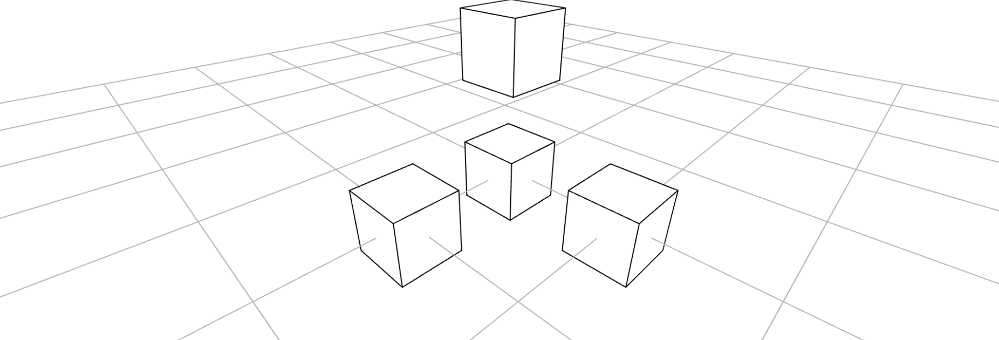
<!-- /tutorial-scope -->
</div>


_task(vier-wuerfel)

### Objekte rotieren

Um Objekte zu drehen, kannst du den Befehl `rotate` verwenden:

```ini
shape = grid

shape = box
rotate = 0, 30, 0
move = -100, 0, 0

shape = box

shape = box
rotate = 30, 0, 0
move = 100, 0, 0
```

<!-- tutorial-scope -->
<!-- tutorial-screenshot
# gedrehte Würfel
write-file: scene.ini <- previous-code
sleep: 1
preview-reload
tab: preview
variants: dark anaglyph
# Your browser window for the hand-made shots: 1906 CSS pixels wide
zoom: 0.54
hook: camera 20 20 -430
crop-top: 27%
crop-bottom: 27%
-->

<div style='text-align: center; margin: 1em 0;'>
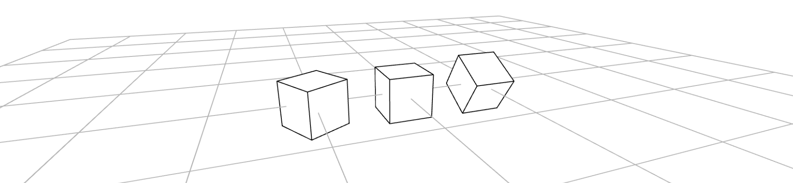
<!-- /tutorial-scope -->
</div>

Du siehst hier ein Gitter und drei Würfel:

- der erste Würfel ist um 30 Grad um die Y-Achse gedreht und nach links verschoben
- der zweite Würfel ist ganz normal in der Mitte
- der dritte Würfel ist um 30 Grad um die X-Achse gedreht und nach rechts verschoben

**Aufgabe:** Versuche, die folgende Szene zu erstellen, indem du drei Würfel erstellst und rotierst:

<div style='display: none;'>

```ini
shape = box
rotate = 0, 0, -30

shape = box
rotate = 0, 0, 0

shape = box
rotate = 0, 0, 30
```
</div>

<!-- tutorial-scope -->
<!-- tutorial-screenshot
# Würfelstern (Lösung der Aufgabe)
write-file: scene.ini <- previous-code
sleep: 1
preview-reload
tab: preview
variants: dark anaglyph
# Your browser window for the hand-made shots: 1906 CSS pixels wide
zoom: 0.54
hook: camera 20 20 -420
crop-top: 27%
crop-bottom: 27%
-->

<div style='text-align: center; margin: 1em 0;'>

<!-- /tutorial-scope -->
</div>


_task(wuerfelstern)

### Objekte skalieren

Um die Größe von Objekten mit einem Faktor zu multiplizieren, kannst du den Befehl `scale` verwenden:

```ini
shape = grid

shape = sphere
scale = 0.5
move = -100, 0, 0

shape = sphere
move = 0, 0, 0

shape = sphere
scale = 1.8
move = 100, 0, 0
```

In diesem Beispiel siehst du ein Gitter und drei Kugeln:

- die erste Kugel ist halb so groß wie die normale Kugel und nach links verschoben
- die zweite Kugel ist normal groß und in der Mitte
- die dritte Kugel ist 1,8-mal so groß wie die normale Kugel und nach rechts verschoben

<div class='hint books'>
Achtung: Beim Programmieren musst du meistens Kommazahlen mit einem Punkt schreiben, also <code>1.8</code> und nicht <code>1,8</code>. Wenn du ein Komma eingibst, werden die Nachkommastellen ignoriert und die Zahl wird als ganze Zahl interpretiert.
</div>

<!-- tutorial-scope -->
<!-- tutorial-screenshot
# skalierte Kugeln
write-file: scene.ini <- previous-code
sleep: 1
preview-reload
tab: preview
variants: dark anaglyph
# Your browser window for the hand-made shots: 1906 CSS pixels wide
zoom: 0.54
hook: camera 20 20 -400
crop-top: 27%
crop-bottom: 27%
-->

<div style='text-align: center; margin: 1em 0;'>
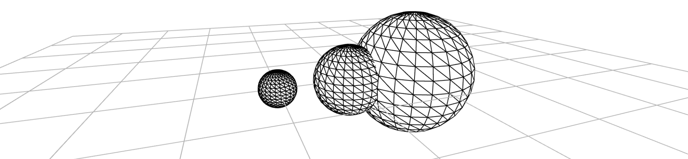
<!-- /tutorial-scope -->
</div>

Du kannst ein Objekt auch in alle drei Richtungen unterschiedlich skalieren, indem du drei Werte angibst:

```ini
shape = grid

shape = sphere
scale = 1, 0.2, 1
```

Hier wurde eine Kugel nur in der Y-Richtung verkleinert (auf 20%), sodass sie wie eine Scheibe aussieht:

<!-- tutorial-scope -->
<!-- tutorial-screenshot
# flache Kugel
write-file: scene.ini <- previous-code
sleep: 1
preview-reload
tab: preview
variants: dark anaglyph
# Your browser window for the hand-made shots: 1906 CSS pixels wide
zoom: 0.54
hook: camera 20 20 -560
crop-top: 27%
crop-bottom: 27%
-->

<div style='text-align: center; margin: 1em 0;'>
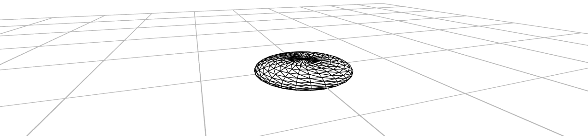
<!-- /tutorial-scope -->
</div>

**Aufgabe:** Versuche, die folgende Szene zu erstellen, indem du eine Box erstellst und sie auf die zehnfache Breite skalierst. Verschiebe die Box anschließend um 25 Einheiten nach oben, so dass sie auf dem Gitter aufliegt:

<div style='display: none;'>

```ini
shape = grid

shape = box
scale = 10, 1, 1
move = 0, 25, 0
```

</div>

<!-- tutorial-scope -->
<!-- tutorial-screenshot
# Balken (Lösung der Aufgabe)
write-file: scene.ini <- previous-code
sleep: 1
preview-reload
tab: preview
variants: dark anaglyph
# Your browser window for the hand-made shots: 1906 CSS pixels wide
zoom: 0.54
hook: camera 20 20 -450
crop-top: 27%
crop-bottom: 27%
-->

<div style='text-align: center; margin: 1em 0;'>
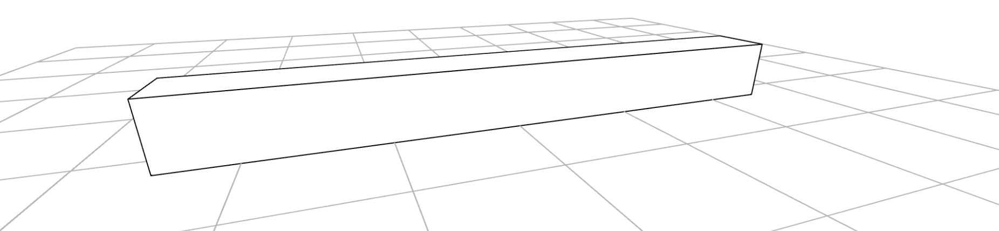
<!-- /tutorial-scope -->
</div>

_task(balken)

### Transformationen kombinieren

Verschiebungen, Drehungen und Skalierungen nennt man auch Transformationen. Du kannst mehrere Transformationen kombinieren, indem du sie hintereinander schreibst. Zum Beispiel:

```ini
shape = grid

shape = box
rotate = 0, 0, 45
move = 100, 0, 0
```

Hier wurde ein Würfel zuerst um 45 Grad um die Z-Achse gedreht und dann um 100 Einheiten nach rechts verschoben. Das Ergebnis sieht so aus:

<!-- tutorial-scope -->
<!-- tutorial-screenshot
# erst drehen, dann verschieben
write-file: scene.ini <- previous-code
sleep: 1
preview-reload
tab: preview
variants: dark anaglyph
# Your browser window for the hand-made shots: 1906 CSS pixels wide
zoom: 0.54
hook: camera 20 20 -450 50 35 0
crop-top: 27%
crop-bottom: 27%
-->

<div style='text-align: center; margin: 1em 0;'>
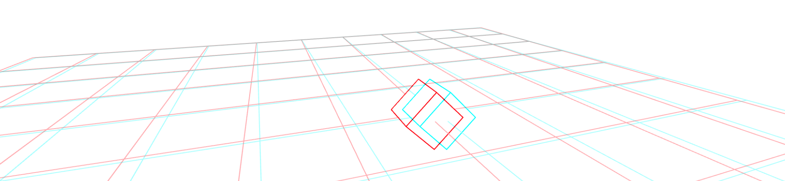
<!-- /tutorial-scope -->
</div>

_task(reihenfolge)

Dabei ist es wichtig, in welcher Reihenfolge du die Transformationen angibst. Wenn du zuerst verschiebst und dann drehst, sieht das Ergebnis anders aus:

```ini
shape = grid

shape = box
move = 100, 0, 0
rotate = 0, 0, 45
```
<!-- tutorial-scope -->
<!-- tutorial-screenshot
# erst verschieben, dann drehen
write-file: scene.ini <- previous-code
sleep: 1
preview-reload
tab: preview
variants: dark anaglyph
# Your browser window for the hand-made shots: 1906 CSS pixels wide
zoom: 0.54
hook: camera 20 20 -450 50 35 0
crop-top: 27%
crop-bottom: 27%
-->

<div style='text-align: center; margin: 1em 0;'>
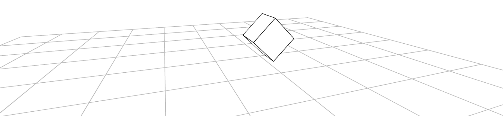
<!-- /tutorial-scope -->
</div>

Dieser Würfel schwebt jetzt über dem Gitter, weil er zuerst nach rechts verschoben wurde und danach erst um 45 Grad um die Z-Achse gedreht wurde, denn: jede Drehung findet immer um den Ursprung statt (und jede Skalierung auch).

_task(reihenfolge-erklaeren)

## Farben und Schattierung

Du kannst die Farben der Objekte kontrollieren, um verschiedene Effekte zu erzielen:

<div class='gallery columns-4'>
<!-- tutorial-scope -->
<!-- tutorial-screenshot
# Kegel mit background = 1.0
write-file: scene.ini <- file:stufen/cone-white-black-white.ini
sleep: 1
preview-reload
tab: preview
variants: anaglyph
zoom: 0.54
hook: camera 20 20 -330
crop-top: 27%
crop-bottom: 27%
crop-left: 38.5%
crop-right: 38.5%
-->
<figure>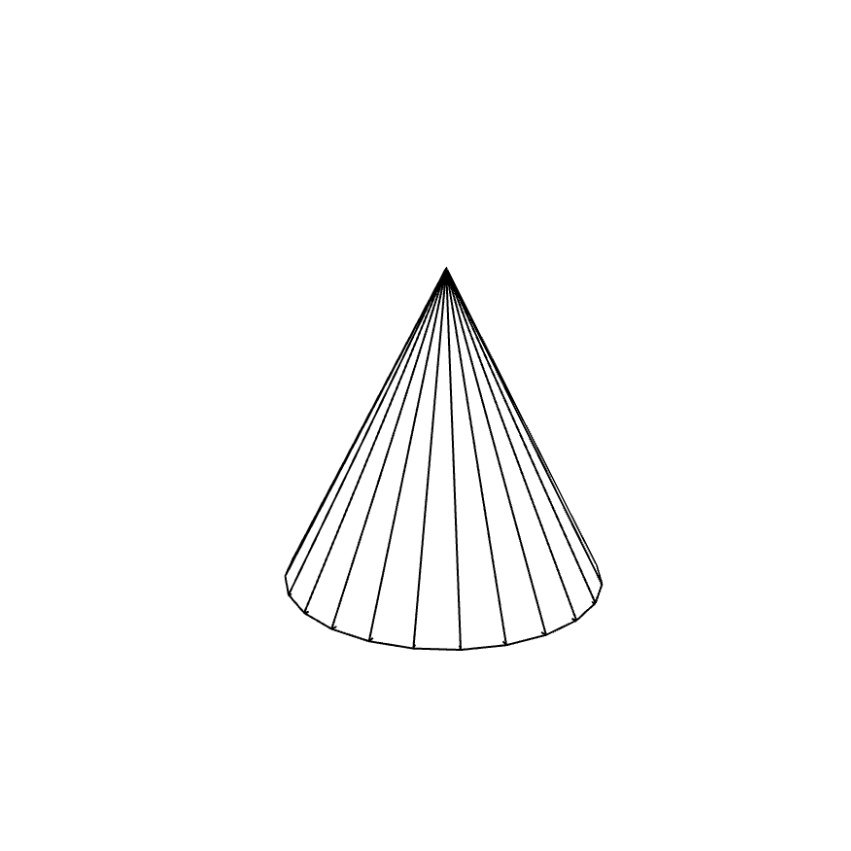<figcaption><code>stroke = 0.0</code><br><code>fill = 1.0</code></figcaption></figure>
<!-- /tutorial-scope -->
<!-- tutorial-scope -->
<!-- tutorial-screenshot
# Kegel mit background = 1.0
write-file: scene.ini <- file:stufen/cone-white-black-off.ini
sleep: 1
preview-reload
tab: preview
variants: anaglyph
zoom: 0.54
hook: camera 20 20 -330
crop-top: 27%
crop-bottom: 27%
crop-left: 38.5%
crop-right: 38.5%
-->
<figure>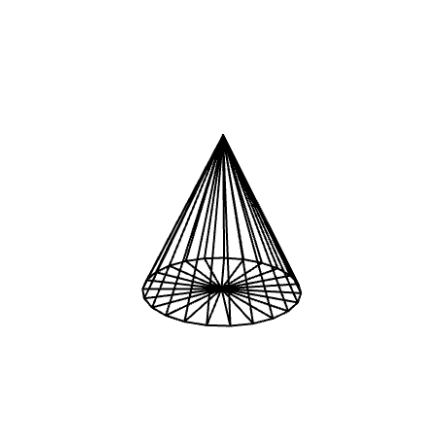<figcaption><code>stroke = 0.0</code><br><code>fill = off</code></figcaption></figure>
<!-- /tutorial-scope -->
<!-- tutorial-scope -->
<!-- tutorial-screenshot
# Kegel mit background = 1.0
write-file: scene.ini <- file:stufen/cone-white-black-shade.ini
sleep: 1
preview-reload
tab: preview
variants: anaglyph
zoom: 0.54
hook: camera 20 20 -330
crop-top: 27%
crop-bottom: 27%
crop-left: 38.5%
crop-right: 38.5%
-->
<figure>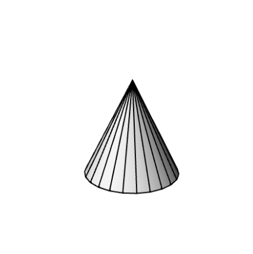<figcaption><code>stroke = 0.0</code><br><code>shade = on</code></figcaption></figure>
<!-- /tutorial-scope -->
<!-- tutorial-scope -->
<!-- tutorial-screenshot
# Kegel mit background = 1.0
write-file: scene.ini <- file:stufen/cone-white-off-shade.ini
sleep: 1
preview-reload
tab: preview
variants: anaglyph
zoom: 0.54
hook: camera 20 20 -330
crop-top: 27%
crop-bottom: 27%
crop-left: 38.5%
crop-right: 38.5%
-->
<figure>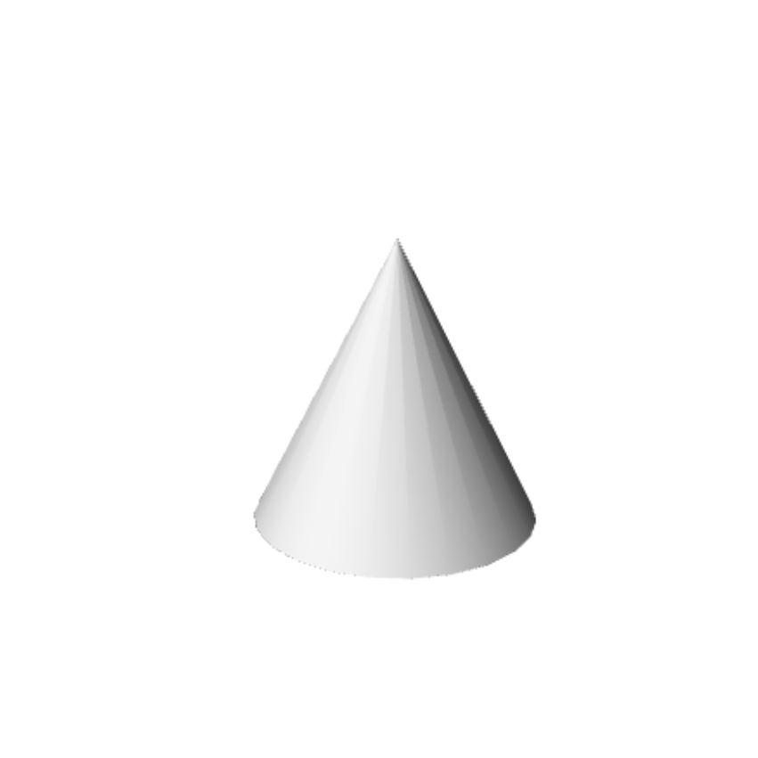<figcaption><code>stroke = off</code><br><code>shade = on</code></figcaption></figure>
<!-- /tutorial-scope -->
</div>
<div class='gallery columns-4'>
<!-- tutorial-scope -->
<!-- tutorial-screenshot
# Kegel mit background = 0.0
write-file: scene.ini <- file:stufen/cone-black-white-black.ini
sleep: 1
preview-reload
tab: preview
variants: anaglyph
zoom: 0.54
hook: camera 20 20 -330
crop-top: 27%
crop-bottom: 27%
crop-left: 38.5%
crop-right: 38.5%
-->
<figure>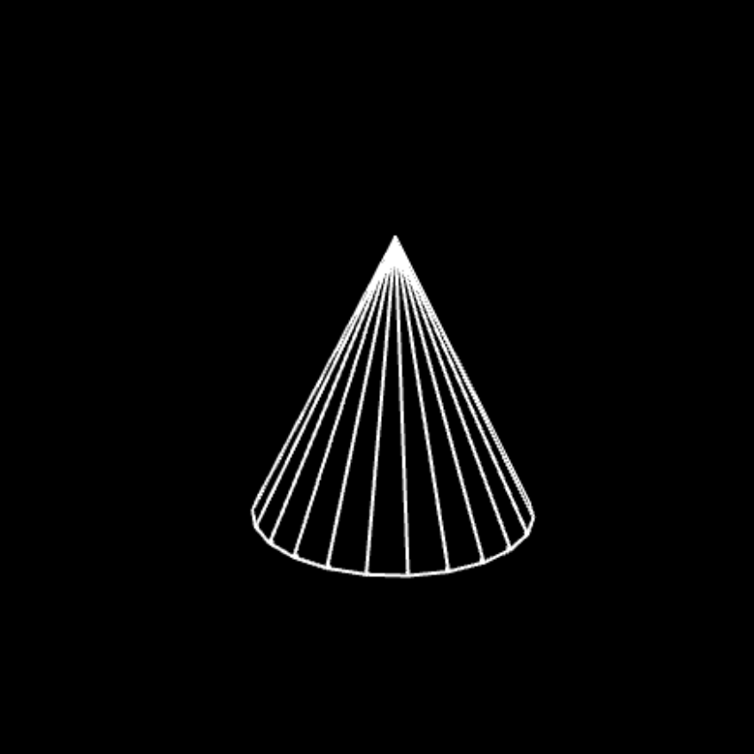<figcaption><code>stroke = 1.0</code><br><code>fill = 0.0</code></figcaption></figure>
<!-- /tutorial-scope -->
<!-- tutorial-scope -->
<!-- tutorial-screenshot
# Kegel mit background = 0.0
write-file: scene.ini <- file:stufen/cone-black-white-off.ini
sleep: 1
preview-reload
tab: preview
variants: anaglyph
zoom: 0.54
hook: camera 20 20 -330
crop-top: 27%
crop-bottom: 27%
crop-left: 38.5%
crop-right: 38.5%
-->
<figure>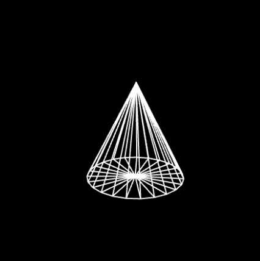<figcaption><code>stroke = 1.0</code><br><code>fill = off</code></figcaption></figure>
<!-- /tutorial-scope -->
<!-- tutorial-scope -->
<!-- tutorial-screenshot
# Kegel mit background = 0.0
write-file: scene.ini <- file:stufen/cone-black-black-shade.ini
sleep: 1
preview-reload
tab: preview
variants: anaglyph
zoom: 0.54
hook: camera 20 20 -330
crop-top: 27%
crop-bottom: 27%
crop-left: 38.5%
crop-right: 38.5%
-->
<figure>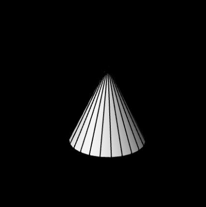<figcaption><code>stroke = 0.0</code><br><code>shade = on</code></figcaption></figure>
<!-- /tutorial-scope -->
<!-- tutorial-scope -->
<!-- tutorial-screenshot
# Kegel mit background = 0.0
write-file: scene.ini <- file:stufen/cone-black-off-shade.ini
sleep: 1
preview-reload
tab: preview
variants: anaglyph
zoom: 0.54
hook: camera 20 20 -330
crop-top: 27%
crop-bottom: 27%
crop-left: 38.5%
crop-right: 38.5%
-->
<figure>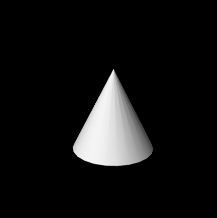<figcaption><code>stroke = off</code><br><code>shade = on</code></figcaption></figure>
<!-- /tutorial-scope -->
</div>

Dafür stehen dir vier Befehle zur Verfügung:

- `background` für die Hintergrundfarbe: `0.0` bis `1.0` für schwarz bis weiß
- `stroke` für die Strichfarbe:  `0.0` bis `1.0` für schwarz bis weiß / `off` für kein Strich
- `fill` für die Füllfarbe: `0.0` bis `1.0` für schwarz bis weiß / `off` für keine Füllung
- `shade` für 3D-Schattierung: `on` für 3D-Schattierung / `off` für keine 3D-Schattierung

Im folgenden Beispiel schalten wir die Strichfarbe aus und die 3D-Schattierung ein:

```ini
shape = grid

shape = torus
shade = on
stroke = off
```

<!-- tutorial-scope -->
<!-- tutorial-screenshot
# schattierter Ring
write-file: scene.ini <- previous-code
sleep: 1
preview-reload
tab: preview
variants: dark anaglyph
# Your browser window for the hand-made shots: 1906 CSS pixels wide
zoom: 0.54
hook: camera 20 20 -450
crop-top: 27%
crop-bottom: 27%
-->

<div style='text-align: center; margin: 1em 0;'>
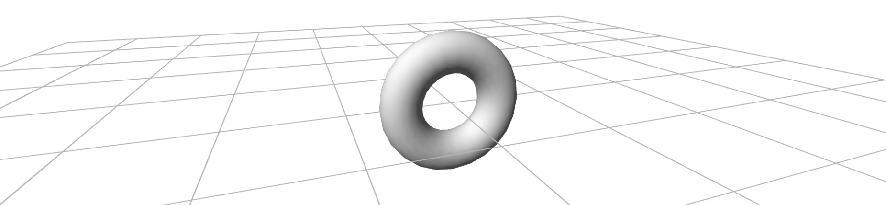
<!-- /tutorial-scope -->
</div>

### Bunte Farben

Statt einer Zahl von `0.0` bis `1.0` kannst du jede Farbe angeben, die auch eine Webseite kennt: einen englischen Farbnamen wie `gold` oder `skyblue`, einen Farbcode wie `#4aa03f` oder die drei Anteile Rot, Grün und Blau, jeweils von `0` bis `1`:

```ini
background = navy

fill = gold
shape = sphere
move = -150, 0, 0

fill = #4aa03f
shape = box

fill = 1, 0.5, 0
shape = cone
move = 150, 0, 0
```

`fill` wirkt wie ein Stift: Die Farbe gilt für alle Objekte, die danach kommen, bis du eine neue wählst. Welche Namen es gibt und wie Farbcodes funktionieren, steht im Handbuch unter [Farben angeben](/reference/farben).

_uses(farbnamen, farbcodes, rgb)

Mit `strokeWeight = 4` kannst du außerdem die Dicke der Konturen verändern.

## Übungsaufgaben

Versuche, eine oder mehrere der folgenden Szenen zu erstellen:

<div class='gallery columns-3'>
<!-- tutorial-scope -->
<!-- tutorial-screenshot
# Eine Ampel
write-file: scene.ini <- file:ampel.ini
sleep: 1
preview-reload
tab: preview
variants: dark anaglyph
zoom: 0.54
hook: camera 20 20 -230 0 0 0
crop-top: 27%
crop-bottom: 27%
crop-left: 38.5%
crop-right: 38.5%
-->
<figure>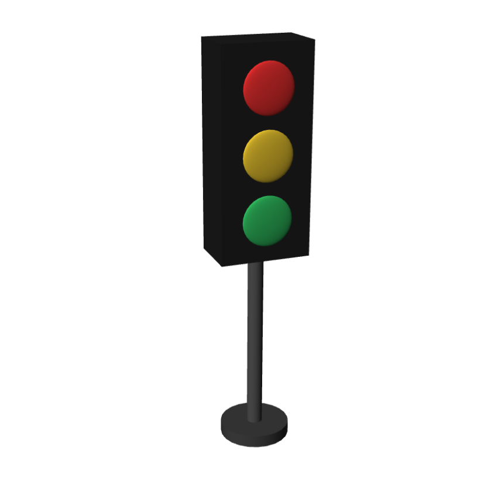<figcaption>Eine Ampel</figcaption></figure>
<!-- /tutorial-scope -->
<!-- tutorial-scope -->
<!-- tutorial-screenshot
# Eine Eistüte
write-file: scene.ini <- file:eis.ini
sleep: 1
preview-reload
tab: preview
variants: dark anaglyph
zoom: 0.54
hook: camera 20 20 -290 0 10 0
crop-top: 27%
crop-bottom: 27%
crop-left: 38.5%
crop-right: 38.5%
-->
<figure>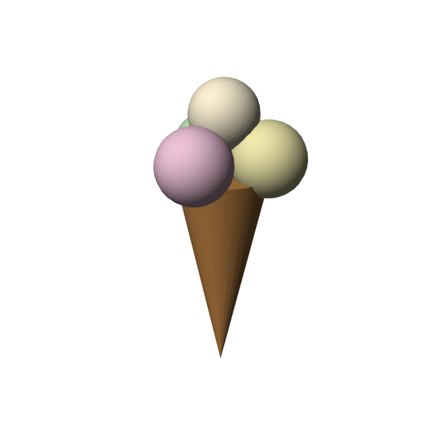<figcaption>Eine Eistüte</figcaption></figure>
<!-- /tutorial-scope -->
<!-- tutorial-scope -->
<!-- tutorial-screenshot
# Ein Schneemann
write-file: scene.ini <- file:schneemann.ini
sleep: 1
preview-reload
tab: preview
variants: dark anaglyph
zoom: 0.54
hook: camera 20 20 -270 0 105 0
crop-top: 27%
crop-bottom: 27%
crop-left: 38.5%
crop-right: 38.5%
-->
<figure>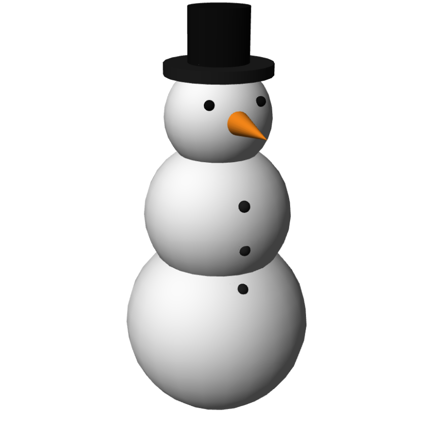<figcaption>Ein Schneemann</figcaption></figure>
<!-- /tutorial-scope -->
</div>

Erstelle dafür jeweils eine neue Datei (mit »File« / »New Text File«) und speichere sie unter einem passenden Namen, z. B. `ampel.ini`, `eis.ini` oder `schneemann.ini`. Du musst dann auf der Vorschauseite nur noch den passenden Dateinamen im Textfeld unten ändern, um die Szene zu sehen.

## Weitere Möglichkeiten

Mit Körpern und Farben kannst du schon ganze Szenen bauen. Hier kommen Bewegung, Schrift und fertige 3D-Modelle dazu.

### Code auskommentieren

Manchmal möchte man Teile eines Programms vorübergehend deaktivieren, ohne sie zu löschen. Dafür kannst du Zeilen auskommentieren, indem du ein Semikolon `;` am Anfang der Zeile setzt. Zum Beispiel:

```ini
;shape = grid
shape = box
```

<div class='hint'>
Tipp: Statt eines Semikolons (<code>;</code>) kannst du auch ein Hashtag (<code>#</code>) verwenden, um eine Zeile auszukommentieren. Das gilt nur am Anfang einer Zeile: In <code>fill = #4aa03f</code> ist <code>#</code> der Anfang eines Farbcodes.
</div>

Um schnell ganze Blöcke auszukommentieren, kannst du mehrere Zeilen markieren und dann <kbd>Strg</kbd><kbd>K</kbd> und <kbd>Strg</kbd><kbd>C</kbd> (für »comment«) drücken. Um die Kommentare wieder zu entfernen, markiere die Zeilen und drücke <kbd>Strg</kbd><kbd>K</kbd> und <kbd>Strg</kbd><kbd>U</kbd> (für »uncomment«). Es gibt auch weitere Shortcuts dafür, die du im Menü finden kannst.

### Animationen

Während deine Szene angezeigt wird, läuft im Hintergrund eine Uhr mit. Die Anzahl der Sekunden seit dem Start der Szene wird in der Variablen `t` gespeichert. Du kannst diese Variable verwenden, um Animationen zu erstellen:

```ini
shade = on
fill = gold
shape = torus
rotate = 0, t * 30, 0
```

In diesem Beispiel wird der Torus um 30 Grad pro Sekunde um die Y-Achse gedreht. Das bedeutet, dass er nach 3 Sekunden 90 Grad geschafft hat und nach 12 Sekunden eine volle Umdrehung gemacht hat.

<!-- tutorial-scope -->
<!-- tutorial-screenshot
# Ring, der sich dreht (eine halbe Umdrehung, dann sieht er wieder gleich aus)
write-file: scene.ini <- previous-code
sleep: 1
preview-reload
tab: preview
variants: dark anaglyph
viewport: 380x260
hook: hide-controls
hook: camera 20 20 -648
record: 6s
-->

<div style='text-align: center; margin: 1em 0;'>
<video src='animation1.mp4' autoplay loop muted style='width: 380px; max-width: 100%;' aria-label='Ein goldener Torus dreht sich gleichmäßig um die Y-Achse.'></video>
<!-- /tutorial-scope -->
</div>  

_task(umdrehung)

**Profitipp:** Mit Hilfe der Sinus- und Cosinusfunktionen kannst du auch sanfte Bewegungen erzeugen:

```ini
shade = on
fill = orange
shape = box
rotate = cos(t * 2) * 10, 0, sin(t * 3) * 10
```

<!-- tutorial-scope -->
<!-- tutorial-screenshot
# wackelnder Würfel (cos(2t) und sin(3t) wiederholen sich nach 2π Sekunden)
write-file: scene.ini <- previous-code
sleep: 1
preview-reload
tab: preview
variants: dark anaglyph
viewport: 300x240
hook: hide-controls
hook: camera 20 20 -695
record: 6.28s
-->

<div style='text-align: center; margin: 1em 0;'>
<video src='animation2.mp4' autoplay loop muted style='width: 300px; max-width: 100%;' aria-label='Ein orangefarbener Würfel wackelt im Raum hin und her.'></video>
<!-- /tutorial-scope -->
</div>

**Aufgabe:** Erstelle eine Animation, bei der eine gelbe Sonne in der Mitte steht und eine blaue Erde um die Sonne kreist. Ein weißer Mond soll dabei um die Erde kreisen, und der Hintergrund ist schwarz wie das Weltall:

<!-- tutorial-scope -->
<!-- tutorial-screenshot
# Sonne, Erde, Mond: eine Erdumrundung dauert 12 Sekunden
write-file: scene.ini <- file:sonnensystem.ini
sleep: 1
preview-reload
tab: preview
variants: anaglyph
viewport: 1029x382
hook: hide-controls
hook: camera 10 0 -242
record: 12s
-->

<div style='text-align: center; margin: 1em 0;'>
<video src='animation3.mp4' autoplay loop muted style='width: 1029px; max-width: 100%;' aria-label='Vor schwarzem Hintergrund kreist eine blaue Erde um eine gelbe Sonne, ein weißer Mond kreist um die Erde.'></video>
<!-- /tutorial-scope -->
</div>

_task(sonnensystem)

### Text

Du kannst Text in deine Szene einfügen, indem du den Befehl `text` verwendest:

```ini
text = Hello!
```

<!-- tutorial-scope -->
<!-- tutorial-screenshot
# Text
write-file: scene.ini <- previous-code
sleep: 1
preview-reload
tab: preview
variants: dark anaglyph
# Your browser window for the hand-made shots: 1906 CSS pixels wide
zoom: 0.54
hook: camera 20 20 -420
crop-top: 27%
crop-bottom: 27%
-->

<div style='text-align: center; margin: 1em 0;'>

<!-- /tutorial-scope -->
</div>

Richtig gut sieht er aber erst mit einer 3D-Schattierung aus:

```ini
text = Hello!
shade = on
stroke = off
fill = #f9b935
```

<!-- tutorial-scope -->
<!-- tutorial-screenshot
# schattierter Text
write-file: scene.ini <- previous-code
sleep: 1
preview-reload
tab: preview
variants: dark anaglyph
# Your browser window for the hand-made shots: 1906 CSS pixels wide
zoom: 0.54
hook: camera 20 20 -420
crop-top: 27%
crop-bottom: 27%
-->

<div style='text-align: center; margin: 1em 0;'>

<!-- /tutorial-scope -->
</div>

Bei 3D-Text kannst du zusätzlich die Schriftgröße mit `size`, die Tiefe mit `depth` und die horizontale Ausrichtung mit `align` (`left`, `center` oder `right`) einstellen:

```ini
text = Hallo Welt!
size = 60
depth = 12
align = left
shade = on
```

### 3D-Modelle

Du kannst auch 3D-Modelle in deine Szene einfügen. Auf der Website [kenney.nl](https://kenney.nl/assets) gibt es eine große Sammlung von kostenlosen 3D-Modellen, die du verwenden kannst. Du kannst sie direkt in dein Projekt herunterladen und in der `scene.ini` einfügen. Klicke dazu auf ein Kit, um die verfügbaren 3D-Modelle zu sehen:

<div class='gallery columns-2'>
<figure><a href='/blaster-kit'>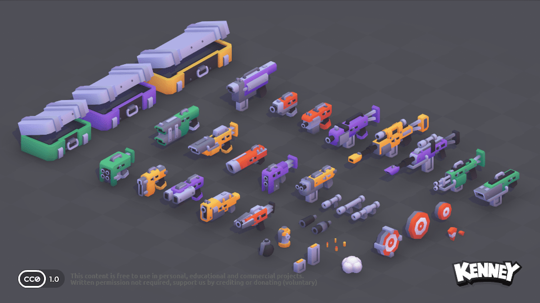</a><figcaption>Blaster Kit</figcaption></figure>
<figure><a href='/car-kit'>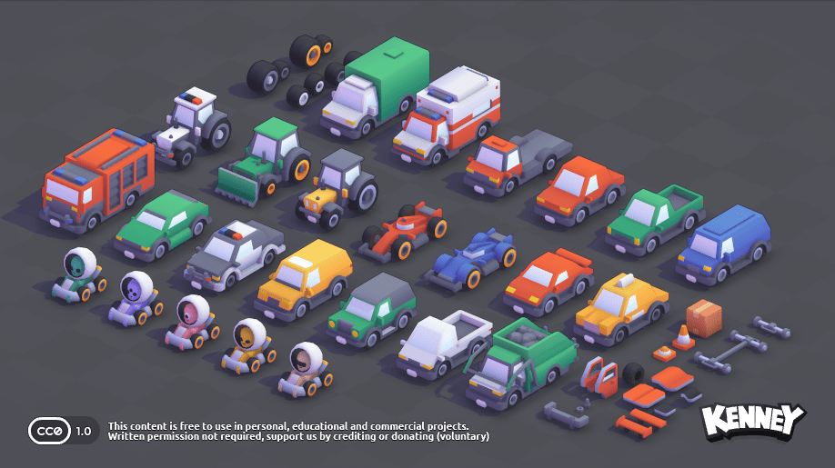</a><figcaption>Car Kit</figcaption></figure>
<figure><a href='/castle-kit'>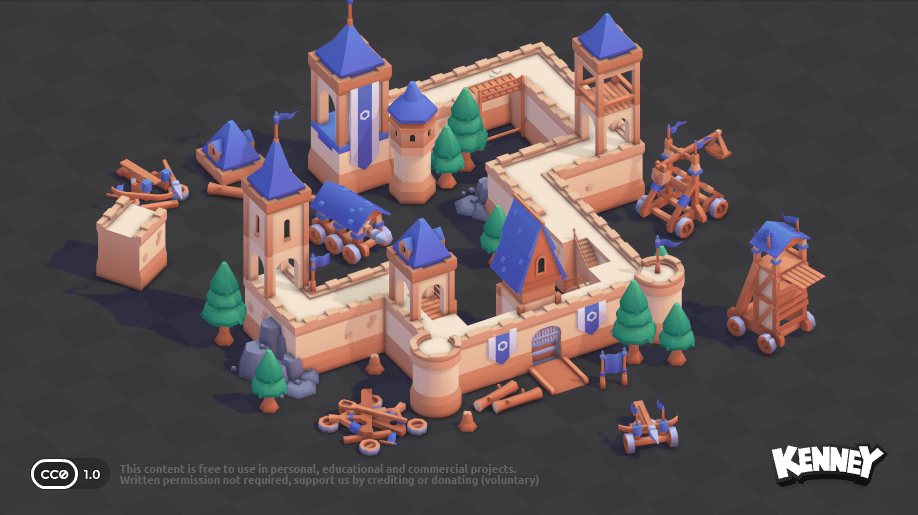</a><figcaption>Castle Kit</figcaption></figure>
<figure><a href='/city-kit-commercial'>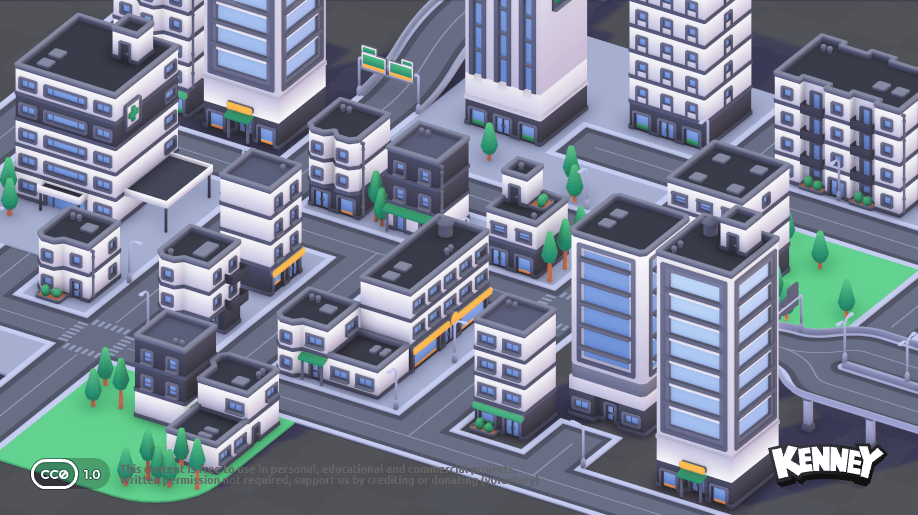</a><figcaption>City Kit (Commercial)</figcaption></figure>
<figure><a href='/city-kit-industrial'>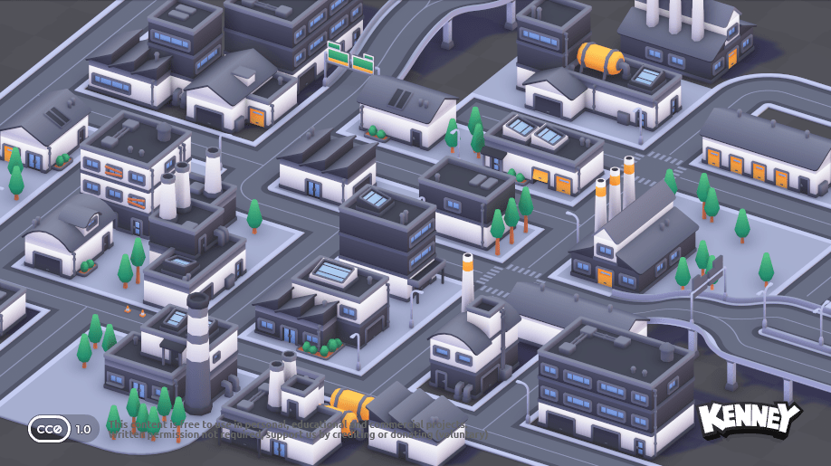</a><figcaption>City Kit (Industrial)</figcaption></figure>
<figure><a href='/city-kit-roads'>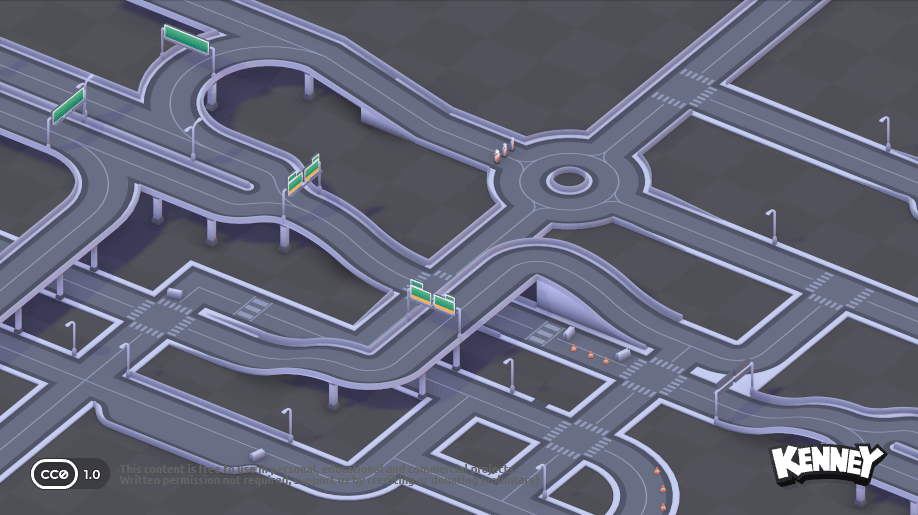</a><figcaption>City Kit (Roads)</figcaption></figure>
<figure><a href='/city-kit-suburban'>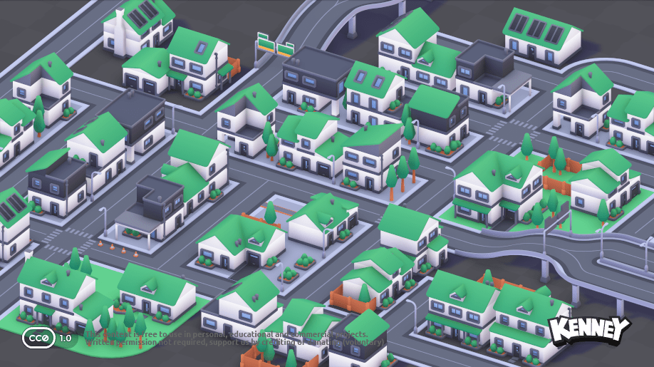</a><figcaption>City Kit (Suburban)</figcaption></figure>
<figure><a href='/cube-pets'></a><figcaption>Cube Pets</figcaption></figure>
<figure><a href='/factory-kit'>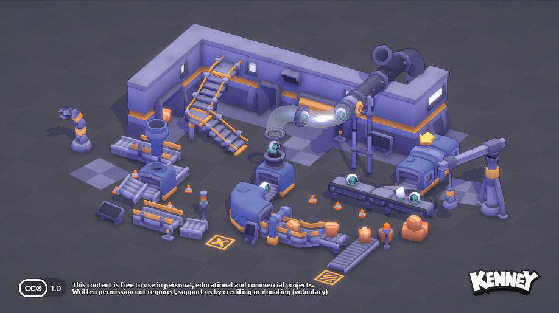</a><figcaption>Factory Kit</figcaption></figure>
<figure><a href='/fantasy-town-kit'></a><figcaption>Fantasy Town Kit</figcaption></figure>
<figure><a href='/food-kit'></a><figcaption>Food Kit</figcaption></figure>
<figure><a href='/graveyard-kit'>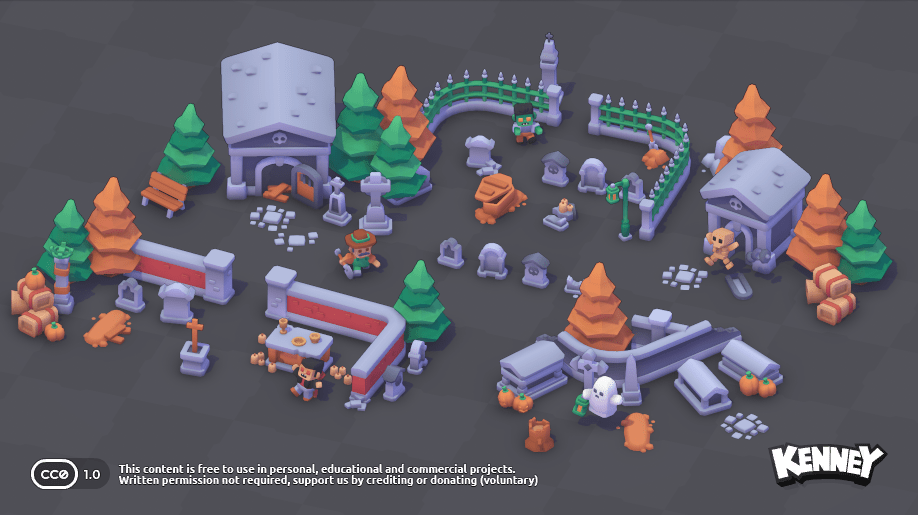</a><figcaption>Graveyard Kit</figcaption></figure>
<figure><a href='/holiday-kit'>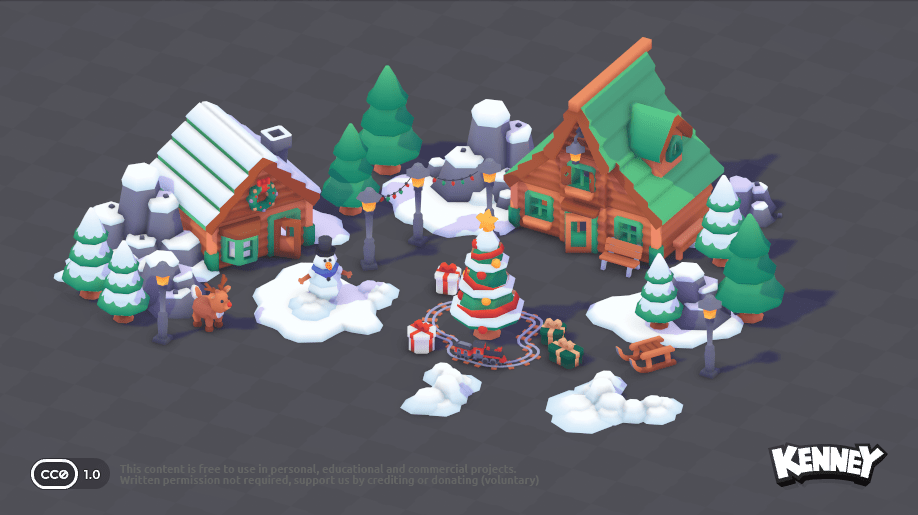</a><figcaption>Holiday Kit</figcaption></figure>
<figure><a href='/mini-arcade'>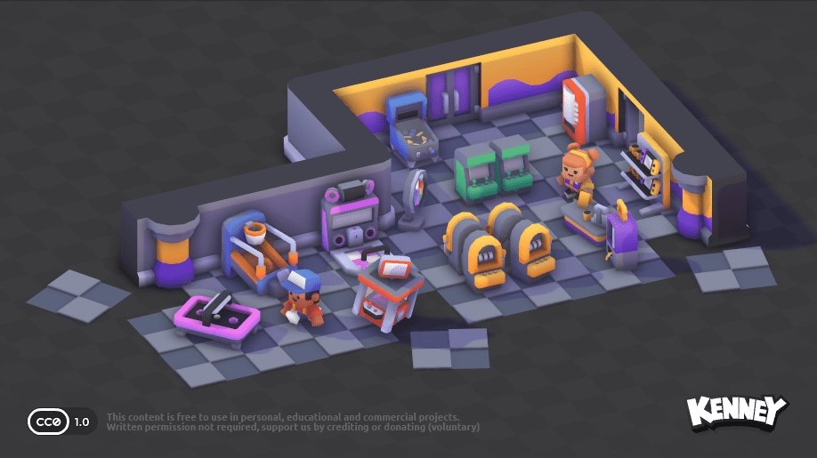</a><figcaption>Mini Arcade</figcaption></figure>
<figure><a href='/mini-characters'>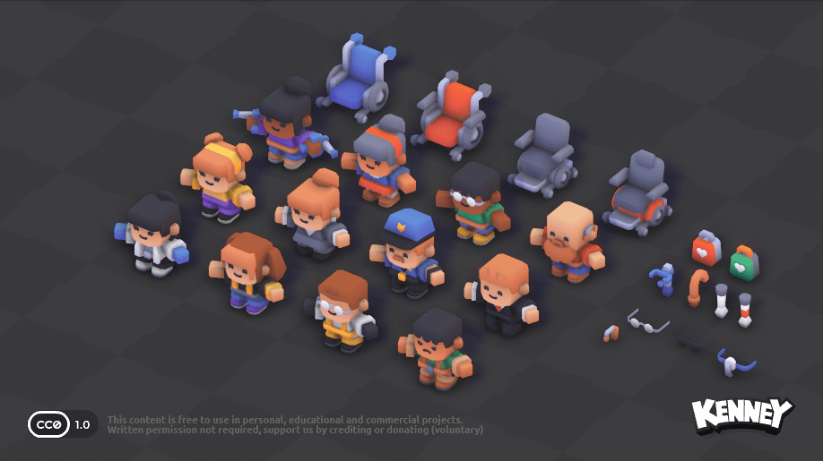</a><figcaption>Mini Characters</figcaption></figure>
<figure><a href='/mini-dungeon'>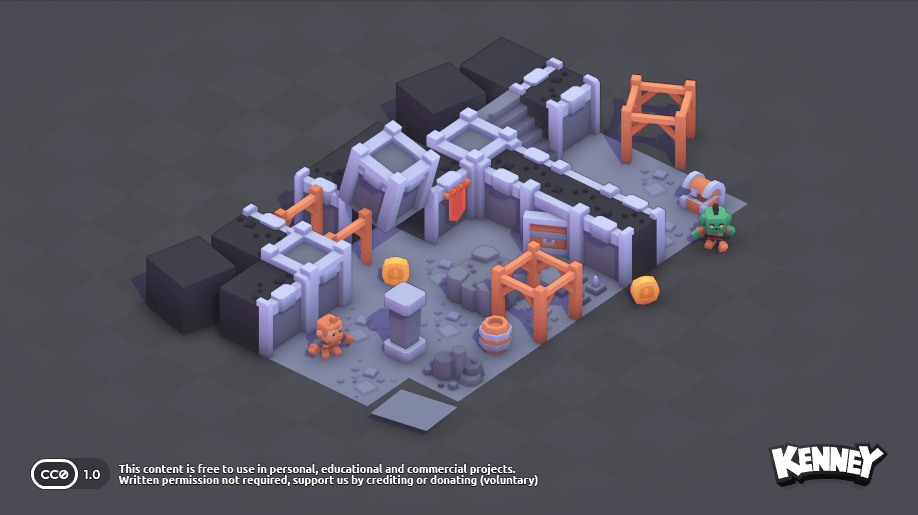</a><figcaption>Mini Dungeon</figcaption></figure>
<figure><a href='/mini-market'>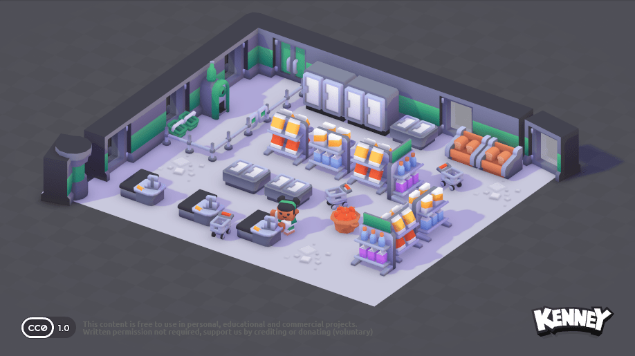</a><figcaption>Mini Market</figcaption></figure>
<figure><a href='/pirate-kit'>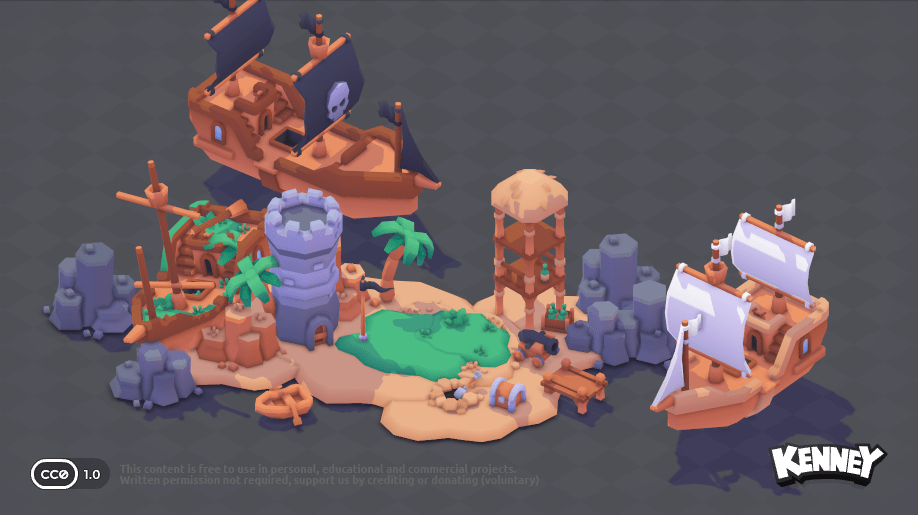</a><figcaption>Pirate Kit</figcaption></figure>
<figure><a href='/platformer-kit'>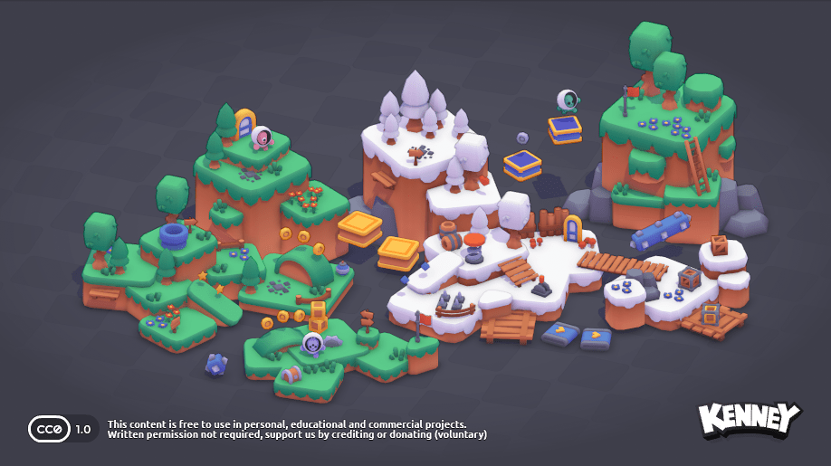</a><figcaption>Platformer Kit</figcaption></figure>
<figure><a href='/survival-kit'>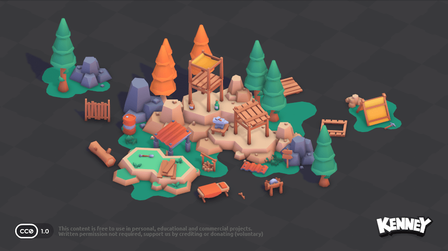</a><figcaption>Survival Kit</figcaption></figure>
<figure><a href='/train-kit'></a><figcaption>Train Kit</figcaption></figure>
<figure><a href='/watercraft-kit'>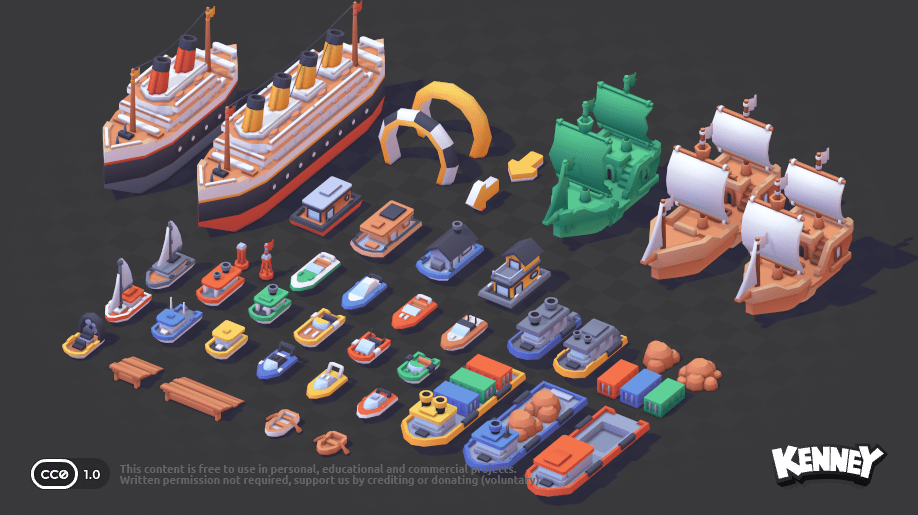</a><figcaption>Watercraft Kit</figcaption></figure>
</div>

## Größere Szenen bauen

Je mehr Körper eine Szene hat, desto länger wird die Datei. Schleifen, Gruppen und eigene Formen halten sie kurz.

### Schleifen

Wenn du viele Objekte platzieren möchtest, wirst du merken, dass du dafür viele Zeilen schreiben musst. Hier werden z. B. drei Würfel nebeneinander platziert, mit zwei Zeilen für jeden Würfel:

```ini
shape = grid

shape = box
move = -100, 0, 0

shape = box
move = 0, 0, 0

shape = box
move = 100, 0, 0
```

<!-- tutorial-scope -->
<!-- tutorial-screenshot
# drei Würfel in einer Reihe
write-file: scene.ini <- previous-code
sleep: 1
preview-reload
tab: preview
variants: dark anaglyph
# Your browser window for the hand-made shots: 1906 CSS pixels wide
zoom: 0.54
hook: camera 20 20 -430
crop-top: 27%
crop-bottom: 27%
-->

<div style='text-align: center; margin: 1em 0;'>
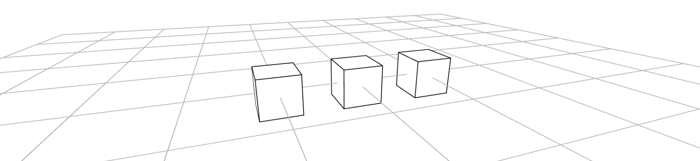
<!-- /tutorial-scope -->
</div>

Du kannst ähnliche Zeilen zu einer Schleife zusammenfassen. Wenn du z. B. schreibst:

```ini
shape = grid

loop x from -100 to 100 step 100
    shape = box
    move = x, 0, 0
end
```

…erhältst du genau dasselbe Bild. Dabei lassen wir eine Variable `x` in 100er-Schritten von -100 bis 100 laufen, wodurch drei Würfel an den gewünschten Positionen gezeichnet werden.

_task(wie-viele)

<div class='hint'>
Tipp: Rücke das Innere einer Schleife ein (wie oben z. B. mit Tab oder ein 4 Leerzeichen), um den Überblick zu behalten.
</div>

Um eine Schleife zu verwenden, musst du dich genau an die Syntax halten. Dabei gelten folgende Regeln:

- Eine Schleife beginnt mit `loop` und endet mit `end`.
- Du musst eine Variable benennen, z. B. `x`.
- Du musst mit `from` angeben, mit welchem Wert du beginnen möchtest.
- Du musst mit `to` angeben, bis zu welchem Wert die Schleife laufen soll.
- Du _kannst_ mit `step` angeben, in welchen Schritten die Variable weiterlaufen soll. Wenn du `step` nicht angibst, wird eine Schrittgröße von 1 angenommen.

Du kannst die oben abgebildete Schleife auch so formulieren:

```ini
shape = grid

loop x from 1 to 3
    shape = box
    move = (x - 2) * 100, 0, 0
end
```

<div class='hint'>
Warum funktioniert das? Wenn du die Werte 1 bis 3 in den Ausdruck (x - 2) * 100 einsetzt, siehst du, dass genau dieselben Werte (-100, 0 und 100) herauskommen. Du kannst aber genauso auch die erste Schleife verwenden, falls du das leichter findest. Für den Computer macht es keinen Unterschied.
</div>

#### Verschachtelte Schleifen

Schleifen können auch verschachtelt werden. Das heisst: du schreibst erst eine äußere Schleife mit einer Variablen, und darin eine innere Schleife mit einer anderen Variablen, z. B.:

```ini
shape = grid

loop z from -100 to 100 step 100
    loop x from -100 to 100 step 100
        shape = box
        move = x, 0, z
    end
end
```

In der äußeren Schleife nimmt `z` drei verschiedene Werte an und für jeden Durchlauf der äußeren Schleife nimmt `x` unabhängig von `z` ebenso drei Werte an. Diese beiden Werte können wir jetzt verwenden, um den Würfel in x- und z-Richtung zu verschieben. Das Ergebnis sieht dann so aus:

<!-- tutorial-scope -->
<!-- tutorial-screenshot
# neun Würfel aus zwei verschachtelten Schleifen
write-file: scene.ini <- code:loop z from -100 to 100 step 100||move = x, 0, z
sleep: 1
preview-reload
tab: preview
variants: dark anaglyph
# Your browser window for the hand-made shots: 1906 CSS pixels wide
zoom: 0.54
hook: camera 30 20 -300
crop-top: 16%
crop-bottom: 16%
-->

<div style='text-align: center; margin: 1em 0;'>
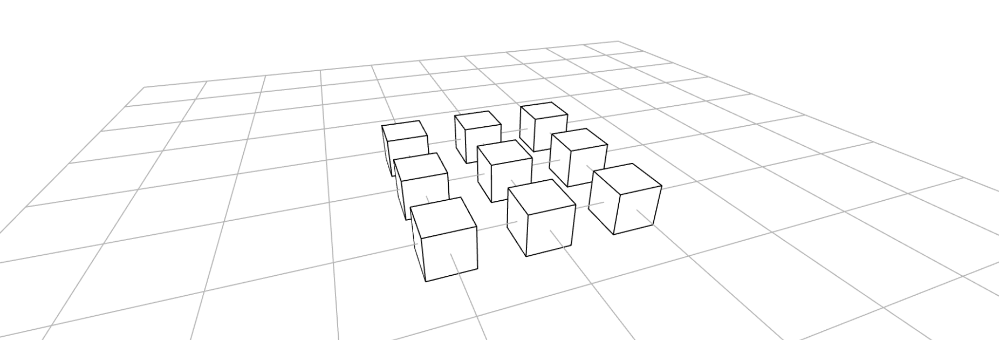
<!-- /tutorial-scope -->
</div>

<div class='hint'>
Achtung: Achte darauf, bei verschachtelten Schleifen verschiedene Variablen für jede Schleife zu verwenden!
</div>

**Aufgabe:** Versuche, mit Hilfe von verschachtelten Schleifen ein Gitter aus 3x3x3 Würfeln zu bauen:

<!-- tutorial-scope -->
<!-- tutorial-screenshot
# 27 Würfel: die Lösung der Aufgabe steht nicht auf der Seite, sondern daneben
write-file: scene.ini <- file:wuerfelgitter.ini
sleep: 1
preview-reload
tab: preview
variants: dark anaglyph
# Your browser window for the hand-made shots: 1906 CSS pixels wide
zoom: 0.54
hook: camera 25 30 -100 0 100 0
crop-top: 16%
crop-bottom: 16%
-->

<div style='text-align: center; margin: 1em 0;'>
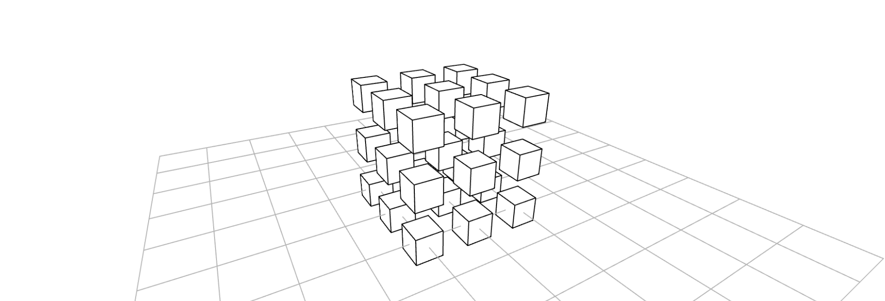
<!-- /tutorial-scope -->
</div>

_task(wuerfelgitter)

### Gruppen

Bisher hast du jeden Körper einzeln verschoben, gedreht und skaliert. Mit einer **Gruppe** kannst du mehrere Körper gemeinsam bewegen. Schreibe dazu `group`, dann die Transformationen der Gruppe und anschließend die dazugehörigen Objekte. `end` beendet die Gruppe:

```ini
shape = grid

group
    rotate = 0, t * 30, 0
    move = 0, 50, 0

    shape = box
    move = -100, -25, 0

    shape = sphere
    move = 100, 0, 0
end
```

Hier stehen Würfel und Kugel auf entgegengesetzten Seiten des Gruppenmittelpunkts. Beide drehen sich gemeinsam um diesen Mittelpunkt, während die gesamte Gruppe nach rechts verschoben ist. Die `move`-Befehle bei den einzelnen Körpern bestimmen dagegen ihre Position **innerhalb** der Gruppe.

<div class='hint'>
Tipp: Du kannst auch Gruppen in Gruppen anlegen oder eine ganze Gruppe in einer Schleife wiederholen. Achte darauf, jede Gruppe mit einem eigenen <code>end</code> zu schließen.
</div>

### Eigene Formen definieren

Wenn du dieselbe zusammengesetzte Figur mehrmals verwenden möchtest, musst du sie nicht jedes Mal neu schreiben. Mit `define` kannst du ihr einen Namen geben und sie danach wie eine Form mit `shape` verwenden. Zum Beispiel bauen wir einen Baum aus einem Stamm und einer Baumkrone:

```ini
define baum
    shape = cylinder
    scale = 0.2, 1, 0.2
    move = 0, 50, 0
    fill = #865c39

    shape = cone
    scale = 1.2
    move = 0, 145, 0
    fill = #2b8f45
end

shape = grid

shape = baum
move = -120, 0, 0

shape = baum
scale = 0.7
move = 120, 0, 0
```

Die Definition zwischen `define baum` und `end` beschreibt den Aufbau eines Baums, zeichnet aber selbst noch nichts. Erst `shape = baum` fügt einen Baum in die Szene ein. Die beiden Bäume bestehen aus denselben Einzelteilen, können aber unabhängig voneinander verschoben, gedreht oder skaliert werden.

<div class='hint'>
Wichtig: Schreibe Transformationen für eine selbst definierte Form direkt unter <code>shape = baum</code>, ohne Leerzeile dazwischen. Eine Leerzeile beendet hier die Angaben für diese Instanz.
</div>

**Aufgabe:** Pflanze eine Allee: zwei Reihen Bäume links und rechts eines Wegs.

_task(allee)

## Deine Szene abgeben

Zum Schluss suchst du dir deine schönste Szene aus. Sie kann aus einer der Aufgaben stammen oder ganz neu sein, Hauptsache, sie liegt als `.ini`-Datei im Ordner `/workspace/anaglyph`.

In der Galerie deiner Klasse erscheint die Szene aus einer festen Ansicht: aus der, die in deiner Datei steht. Dreh und verschieb die Szene in der Vorschau, bis sie am besten aussieht, klicke auf »Kamera kopieren« und füge die Zeile in deine Datei ein, zum Beispiel ganz oben:

```ini
camera = 20, -35, -320, 0, 40, 0
```

Die sechs Zahlen sind die beiden Drehwinkel in Grad, der Abstand und der Punkt, um den sich die Kamera dreht. Ohne diese Zeile zeigt die Galerie die Standardansicht, und die passt selten zu einer ganzen Szene. Mit »Reset Camera« kommst du jederzeit zu deiner Ansicht zurück.

Sobald du unten eine Datei auswählst, zeigt die Karte, wie deine Szene in der Galerie aussehen wird. Deine Abgabe ist eine Kopie: Du kannst danach weiter an der Datei arbeiten, eine neue Version abgeben oder deine Abgabe wieder löschen.

_task(galerie)

<!-- tutorial-step
# Jede Szene-Aufgabe nimmt eine Lösung an und lehnt die Szene einen Schritt davor ab
# (solutions/, not-yet/; Würfelgitter und Sonnensystem rendert die Seite selbst)
write-file: scene.ini <- file:not-yet/kugel.ini
check-task-fails: kugel
write-file: scene.ini <- file:solutions/kugel.ini
check-task: kugel
write-file: vier-wuerfel.ini <- file:not-yet/vier-wuerfel.ini
check-task-fails: vier-wuerfel
write-file: vier-wuerfel.ini <- file:solutions/vier-wuerfel.ini
check-task: vier-wuerfel
write-file: wuerfelstern.ini <- file:not-yet/wuerfelstern.ini
check-task-fails: wuerfelstern
write-file: wuerfelstern.ini <- file:solutions/wuerfelstern.ini
check-task: wuerfelstern
write-file: balken.ini <- file:not-yet/balken.ini
check-task-fails: balken
write-file: balken.ini <- file:solutions/balken.ini
check-task: balken
write-file: wuerfelgitter.ini <- file:not-yet/wuerfelgitter.ini
check-task-fails: wuerfelgitter
write-file: wuerfelgitter.ini <- file:wuerfelgitter.ini
check-task: wuerfelgitter
write-file: allee.ini <- file:not-yet/allee.ini
check-task-fails: allee
write-file: allee.ini <- file:solutions/allee.ini
check-task: allee
write-file: sonnensystem.ini <- file:not-yet/sonnensystem.ini
check-task-fails: sonnensystem
write-file: sonnensystem.ini <- file:sonnensystem.ini
check-task: sonnensystem
-->
