<div class='meta'>
image: teaser.webp
image_alt: "Das Spektrogramm einer kurzen Musik: die Zeit nach rechts, die Frequenz nach oben, je lauter, desto kräftiger die Farbe; unten die Schläge der Kick-Drum als dunkle Flecken, darüber die waagerechten Linien der Akkorde und der Melodie, oben die Wolken der Hi-Hat. Eine senkrechte Linie markiert einen Moment, und darunter steht das Spektrum dieses Moments als Kurve mit vielen Spitzen."
kind: labor
language: Python
duration: 8 Doppelstunden
curriculum: "Oberstufe: Algorithmen und Datenstrukturen (Fourier-Transformation, Huffman-Codierung), Vertiefung Technische Informatik (Abtastung, Quantisierung, Audiokompression)"
topics: [kompression, codierung, zahlensysteme]
requires: [huffman]
reference: [bits-und-bytes]
</div>

<div
    class="autotoc-secondary-trigger"
    data-title="Auf dieser Seite"
    data-levels="h2,h3">
</div>

<script src='/include/sampling_widget.js'></script>
<script src='/include/spectrum_widget.js'></script>
<script src='/include/hearing_widget.js'></script>
<script src='/include/abx_widget.js'></script>

# Audio komprimieren

<p class='abstract'>
Eine Minute Musik in CD-Qualität braucht 10 MB, als MP3 nur ein Zehntel davon, und man hört kaum einen Unterschied. Du schreibst WAV-Dateien Byte für Byte, zerlegst Klänge mit der Fourier-Transformation in ihre Frequenzen und baust in Python Schritt für Schritt einen Coder, der weglässt, was das Ohr nicht hört. Unterwegs liest du echte MP3-Dateien und hörst, was Opus und die Codecs von heute daraus gemacht haben.
</p>

## Ton als Zahlen

Was du hörst, ist Luft, die schwingt: Der Druck steigt und fällt, hunderte bis tausende Male in der Sekunde. Ein Mikrofon macht daraus eine Spannung, die genauso steigt und fällt. Ein Computer kann mit einer Spannung nichts anfangen, nur mit Zahlen. Darum misst ein Wandler sie in festen Abständen und schreibt jeden Messwert als ganze Zahl auf, ein **Sample**. Zwei Entscheidungen bestimmen, wie gut das klingt und wie viel Platz es braucht: **wie oft** gemessen wird und **wie genau**.

### Einrichten

Lege im Terminal einen Ordner an und hol die beiden Klänge dieser Seite:

```bash_copy
mkdir -p ~/audio && cd ~/audio
wget ${web_root}/audio/stimme.wav
wget ${web_root}/audio/musik.wav
```

<!-- tutorial-step
terminal-open
terminal-run: mkdir -p ~/audio && cd ~/audio
-->

Öffne sie im Explorer: VS Code spielt WAV-Dateien selbst ab. `stimme.wav` ist ein Satz, gesprochen von Thorsten, einer freien Stimme für Sprachausgabe; sie wurde mit 22.050 Samples in der Sekunde aufgenommen. `musik.wav` sind acht Sekunden einer Band, die es nicht gibt: Schlagzeug, Bass, Akkorde und eine Melodie, ausgerechnet aus Sinusschwingungen und Rauschen, mit 44.100 Samples in der Sekunde.

### Wie oft und wie genau

Wie oft gemessen wird, heißt **Abtastrate** und wird in Hertz angegeben: 44.100 Hz sind 44.100 Samples in der Sekunde. Je seltener gemessen wird, desto mehr von den schnellen Schwingungen geht verloren. Eine Abtastrate hält Frequenzen bis knapp unter ihrer Hälfte fest; was schneller schwingt, muss vorher herausgefiltert werden. Das Ohr eines jungen Menschen hört bis etwa 20.000 Hz. Darum misst eine CD 44.100-mal in der Sekunde, gut doppelt so oft.

_person(shannon)

Wie genau gemessen wird, bestimmen die **Bits je Sample**. Mit 16 Bit hat jedes Sample eine von 65.536 Stufen, von −32.768 bis 32.767. Jedes Sample wird auf die nächste Stufe gerundet, das heißt **quantisiert**. Jedes Bit weniger halbiert die Zahl der Stufen und verdoppelt den Fehler beim Runden. Diesen Fehler hörst du als Rauschen.

Probier beides aus. Spiel einen Klang ab und schalte um, während er läuft:

<div class='sampling-widget'></div>

<div class='hint try'>
<strong>Ausprobieren:</strong> Stell bei der Musik die Abtastrate von 44.100 schrittweise auf 4.000 Hz. Achte auf das Zischen der Hi-Hat: Bei welcher Rate ist es weg? Wie klingt die Musik bei 8.000 Hz, der Rate des Telefons? Geh dann zurück auf 44.100 Hz und nimm Bits weg. Ab wie vielen Bits hörst du ein Rauschen, und wo hörst du es zuerst, in lauten oder in leisen Stellen? Im Bild sitzt bei wenigen Bits jedes Sample auf einer der Linien. Bei der Stimme ändert sich zwischen 44.100 und 22.050 Hz nichts: warum?
</div>

Die Samples in gleichen Abständen als Zahlen zu senden, heißt **Pulscodemodulation**, kurz PCM. Alec Reeves, ein Ingenieur bei ITT in Paris, schlug sie 1937 für Telefongespräche vor und meldete sie 1938 zum Patent an. Bauen ließ sie sich erst Jahrzehnte später: 1961 schickte das Telefonnetz der USA die ersten Gespräche als PCM, 8.000 Samples mit je 8 Bit in der Sekunde. Die **Compact Disc** von Philips und Sony kam am 1. Oktober 1982 in Japan in die Läden, mit zwei Kanälen für Stereo und je 44.100 Samples mit 16 Bit in der Sekunde. Die krumme Zahl kommt vom Videorekorder: Studios speicherten Musik digital auf Videobändern, drei Samples in jeder Zeile des Fernsehbilds. Beim europäischen Fernsehen sind das 294 Zeilen mal 50 Halbbilder mal 3 Samples, genau 44.100 in der Sekunde.

_task(cd-lied)

### Eine WAV-Datei Byte für Byte

Eine WAV-Datei speichert genau das: wie oft gemessen wurde, wie genau, und dann die Samples, eine Zahl nach der anderen. Das Format haben IBM und Microsoft 1991 festgelegt; die [Beschreibung des Formats an der McGill University](https://www.mmsp.ece.mcgill.ca/Documents/AudioFormats/WAVE/WAVE.html) fasst die Spezifikation zusammen und verlinkt sie. Eine WAV-Datei ist eine RIFF-Datei: eine Folge von **Chunks**, jeder mit einem Namen aus vier Zeichen und seiner Länge. Zahlen stehen im **Little Endian** in der Datei, das niedrige Byte zuerst, wie bei [GIF](/gif).

Hier ist eine ganze WAV-Datei, 60 Bytes groß: acht Samples eines Tons mit 1.000 Hz, 8.000-mal in der Sekunde gemessen, also eine Millisekunde lang.

<pre class='spec hexdump'>
00000000  <span class='m0'>52 49 46 46 34 00 00 00  57 41 56 45</span> <span class='m1'>66 6d 74 20</span>  |RIFF4...WAVEfmt |
00000010  <span class='m1'>10 00 00 00 01 00 01 00  40 1f 00 00 80 3e 00 00</span>  |........@....&gt;..|
00000020  <span class='m1'>02 00 10 00</span> <span class='m2'>64 61 74 61  10 00 00 00</span> <span class='m3'>00 00 41 2d</span>  |....data......A-|
00000030  <span class='m3'>00 40 41 2d 00 00 bf d2  00 c0 bf d2</span>              |.@A-........|
</pre>

Die Farben zeigen die drei Chunks: <span class='m0'>RIFF</span>, <span class='m1'>fmt</span> und <span class='m2'>data</span>, und danach die <span class='m3'>Samples</span>. Die ersten 44 Bytes heißen zusammen der **Header**; sie sind in jeder WAV-Datei dieser Art gleich aufgebaut, nur die Zahlen darin ändern sich.

#### Der RIFF-Chunk

<pre class='spec'>
      7 6 5 4 3 2 1 0        Field Name                    Type
     +---------------+
   0 |               |       Chunk ID ("RIFF")             4 Bytes
     +-   . . . .   -+
   3 |               |
     +---------------+
   4 |               |       Chunk Size                    Unsigned, 4 Bytes
     +-   . . . .   -+
   7 |               |
     +---------------+
   8 |               |       Format ("WAVE")               4 Bytes
     +-   . . . .   -+
  11 |               |
     +---------------+
</pre>

<pre class='spec hexdump'>
00000000  <span class='m0'>52 49 46 46</span> <span class='m1'>34 00 00 00</span>  <span class='m2'>57 41 56 45</span> 66 6d 74 20  |RIFF4...WAVEfmt |
</pre>

<div style='max-width: 100%; overflow-x: auto;'>
<table class='table bytes'>
<tr>
<td><span class='m0'><code>52 49 46 46</code></span></td>
<td>Die Zeichen <code>RIFF</code></td>
</tr>
<tr>
<td><span class='m1'><code>34 00 00 00</code></span></td>
<td>Chunk Size: 0x34 = 52
<p class='expl'>
So viele Bytes kommen nach diesem Feld noch, bis die Datei zu Ende ist: 60 − 8. Im Header gezählt sind das 36 Bytes und dazu die Bytes der Samples.
</p>
</td>
</tr>
<tr>
<td><span class='m2'><code>57 41 56 45</code></span></td>
<td>Die Zeichen <code>WAVE</code>: In dieser RIFF-Datei steckt Ton.</td>
</tr>
</table>
</div>

#### Der fmt-Chunk

<pre class='spec'>
      7 6 5 4 3 2 1 0        Field Name                    Type
     +---------------+
  12 |               |       Chunk ID ("fmt ")             4 Bytes
     +-   . . . .   -+
  15 |               |
     +---------------+
  16 |               |       Chunk Size (16)               Unsigned, 4 Bytes
     +-   . . . .   -+
  19 |               |
     +---------------+
  20 |               |       Audio Format (1 = PCM)        Unsigned, 2 Bytes
     +-             -+
  21 |               |
     +---------------+
  22 |               |       Number of Channels            Unsigned, 2 Bytes
     +-             -+
  23 |               |
     +---------------+
  24 |               |       Sample Rate                   Unsigned, 4 Bytes
     +-   . . . .   -+
  27 |               |
     +---------------+
  28 |               |       Byte Rate                     Unsigned, 4 Bytes
     +-   . . . .   -+
  31 |               |
     +---------------+
  32 |               |       Block Align                   Unsigned, 2 Bytes
     +-             -+
  33 |               |
     +---------------+
  34 |               |       Bits per Sample               Unsigned, 2 Bytes
     +-             -+
  35 |               |
     +---------------+
</pre>

<pre class='spec hexdump'>
00000000  52 49 46 46 34 00 00 00  57 41 56 45 <span class='m0'>66 6d 74 20</span>  |RIFF4...WAVEfmt |
00000010  <span class='m1'>10 00 00 00</span> <span class='m2'>01 00</span> <span class='m3'>01 00</span>  <span class='m4'>40 1f 00 00</span> <span class='m5'>80 3e 00 00</span>  |........@....&gt;..|
00000020  <span class='m6'>02 00</span> <span class='m7'>10 00</span> 64 61 74 61  10 00 00 00 00 00 41 2d  |....data......A-|
</pre>

<div style='max-width: 100%; overflow-x: auto;'>
<table class='table bytes'>
<tr>
<td><span class='m0'><code>66 6d 74 20</code></span></td>
<td>Die Zeichen <code>fmt </code>, mit einem Leerzeichen am Ende: Jeder Name hat vier Zeichen.</td>
</tr>
<tr>
<td><span class='m1'><code>10 00 00 00</code></span></td>
<td>Chunk Size: 16 Bytes folgen in diesem Chunk.</td>
</tr>
<tr>
<td><span class='m2'><code>01 00</code></span></td>
<td>Audio Format: 1 heißt PCM, die Samples stehen so in der Datei, wie sie gemessen wurden.
<p class='expl'>
Andere Zahlen stehen für Verfahren, die die Samples umrechnen; eines davon, μ-law, kommt im nächsten Kapitel.
</p>
</td>
</tr>
<tr>
<td><span class='m3'><code>01 00</code></span></td>
<td>Number of Channels: 1, Mono. Bei Stereo stünde hier 2, und die Samples für links und rechts kämen abwechselnd.</td>
</tr>
<tr>
<td><span class='m4'><code>40 1f 00 00</code></span></td>
<td>Sample Rate: 0x1f40 = 8.000 Samples in der Sekunde</td>
</tr>
<tr>
<td><span class='m5'><code>80 3e 00 00</code></span></td>
<td>Byte Rate: 0x3e80 = 16.000 Bytes in der Sekunde
<p class='expl'>
Abtastrate mal Kanäle mal Bytes je Sample: 8.000 · 1 · 2. Ein Programm, das die Datei abspielt, sieht daran, wie schnell es lesen muss.
</p>
</td>
</tr>
<tr>
<td><span class='m6'><code>02 00</code></span></td>
<td>Block Align: 2 Bytes für alle Kanäle eines Zeitpunkts</td>
</tr>
<tr>
<td><span class='m7'><code>10 00</code></span></td>
<td>Bits per Sample: 16</td>
</tr>
</table>
</div>

#### Der data-Chunk

<pre class='spec'>
      7 6 5 4 3 2 1 0        Field Name                    Type
     +---------------+
  36 |               |       Chunk ID ("data")             4 Bytes
     +-   . . . .   -+
  39 |               |
     +---------------+
  40 |               |       Chunk Size                    Unsigned, 4 Bytes
     +-   . . . .   -+
  43 |               |
     +---------------+
  44 |               |       Samples                       Chunk Size Bytes
     +-   . . . .   -+
     |               |
     +---------------+
</pre>

<pre class='spec hexdump'>
00000020  02 00 10 00 <span class='m0'>64 61 74 61</span>  <span class='m1'>10 00 00 00</span> <span class='m2'>00 00</span> <span class='m3'>41 2d</span>  |....data......A-|
00000030  <span class='m4'>00 40</span> <span class='m3'>41 2d</span> <span class='m2'>00 00</span> <span class='m5'>bf d2</span>  <span class='m6'>00 c0</span> <span class='m5'>bf d2</span>              |.@A-........|
</pre>

<div style='max-width: 100%; overflow-x: auto;'>
<table class='table bytes'>
<tr>
<td><span class='m0'><code>64 61 74 61</code></span></td>
<td>Die Zeichen <code>data</code></td>
</tr>
<tr>
<td><span class='m1'><code>10 00 00 00</code></span></td>
<td>Chunk Size: 16 Bytes, acht Samples zu je 2 Bytes</td>
</tr>
<tr>
<td><span class='m2'><code>00 00</code></span></td>
<td>0: Die Schwingung beginnt bei null.</td>
</tr>
<tr>
<td><span class='m3'><code>41 2d</code></span></td>
<td>0x2d41 = 11.585</td>
</tr>
<tr>
<td><span class='m4'><code>00 40</code></span></td>
<td>0x4000 = 16.384, der höchste Punkt: halb so laut, wie es geht.</td>
</tr>
<tr>
<td><span class='m5'><code>bf d2</code></span></td>
<td>0xd2bf = −11.585
<p class='expl'>
Eine negative Zahl steht im Zweierkomplement in der Datei: 0xd2bf ist 53.951, und 53.951 − 65.536 = −11.585. Jede Zahl ab 0x8000 ist negativ.
</p>
</td>
</tr>
<tr>
<td><span class='m6'><code>00 c0</code></span></td>
<td>0xc000 = −16.384, der tiefste Punkt</td>
</tr>
</table>
</div>

Eine Schwingung mit 1.000 Hz dauert eine Millisekunde, genau so lange wie diese acht Samples: Die Datei ist eine einzige Schwingung, gemessen an acht Punkten.

### Den Header schreiben

Bytes wie diese baut in Python das Modul [`struct`](https://docs.python.org/3/library/struct.html). `struct.pack` bekommt einen Text, der sagt, wie die Bytes aussehen sollen, und die Werte dazu:

<!-- page-code: own -->
```python
struct.pack('<4sI4s', b'RIFF', 52, b'WAVE')
```

`<` heißt Little Endian, `4s` sind vier Bytes, so wie sie sind, `I` ist eine Zahl ohne Vorzeichen mit 4 Bytes und `H` eine mit 2 Bytes. Heraus kommen die ersten 12 Bytes der Datei oben.

Lege im Ordner `audio` die Datei `wav.py` an:

<!-- page-code: own -->
```python
import struct


def wav_header(n, rate):
    size = 2 * n
    riff = struct.pack('<4sI4s', b'RIFF', 36 + size, b'WAVE')
    # hier: fmt und data
    return riff + fmt + data
```

`wav_header` bekommt die Zahl der Samples `n` und die Abtastrate `rate` und gibt die 44 Bytes des Headers zurück, für eine Datei in Mono mit 16 Bit. `size` ist die Zahl der Bytes der Samples, zwei für jede.

<div class='hint own' data-check='wav-header'>
<strong>Jetzt bist du dran:</strong> Schreib die beiden Zeilen für <code>fmt</code> und <code>data</code>, jede mit einem <code>struct.pack</code>. Die Felder, ihre Längen und ihre Werte stehen in den Tabellen oben.
</div>

<!-- hint -->
Der fmt-Chunk hat acht Felder. Schreib sie dir der Reihe nach auf, jedes mit seiner Länge: Welche haben 4 Bytes, welche 2? Welche Werte hängen von `rate` ab, welche sind immer gleich?
<!-- /hint -->
<!-- hint -->
Für den fmt-Chunk passt `'<4sIHHIIHH'`: der Name, dann die Chunk Size mit 4 Bytes, zwei Felder mit 2 Bytes, zwei mit 4 und zwei mit 2. Die Byte Rate ist `2 * rate`. Der data-Chunk braucht nur `'<4sI'`.
<!-- /hint -->

<!-- solution -->
```python
def wav_header(n, rate):
    size = 2 * n
    riff = struct.pack('<4sI4s', b'RIFF', 36 + size, b'WAVE')
    fmt = struct.pack('<4sIHHIIHH', b'fmt ', 16, 1, 1, rate, 2 * rate, 2, 16)
    data = struct.pack('<4sI', b'data', size)
    return riff + fmt + data
```
<!-- /solution -->

_task(wav-header)

Nach dem Header kommen die Samples. Im Programm sind sie Kommazahlen von −1 bis 1, damit es beim Rechnen egal ist, wie viele Bits die Datei hat; erst beim Schreiben werden sie zu ganzen Zahlen mit 16 Bit. Schreib zwei Funktionen dazu, eine zum Schreiben und eine zum Lesen, und oben die Zeilen für `wave` und `numpy`:

```python
~ import struct
import wave

import numpy as np
```

```python
def write_wav(path, samples, rate):
    numbers = np.clip(np.round(samples * 32767), -32768, 32767).astype('<i2')
    with open(path, 'wb') as f:
        f.write(wav_header(len(numbers), rate))
        f.write(numbers.tobytes())


def read_wav(path):
    with wave.open(path, 'rb') as f:
        rate = f.getframerate()
        frames = f.readframes(f.getnframes())
    return np.frombuffer(frames, dtype='<i2') / 32767, rate
```

`samples` ist ein numpy-Array, eine Liste von Zahlen, mit der man auf einmal rechnet: `samples * 32767` multipliziert jede Zahl darin. `np.round` rundet jede, `np.clip` begrenzt jede auf −32.768 bis 32.767, und `astype('<i2')` macht daraus ganze Zahlen mit 2 Bytes im Little Endian. `tobytes` gibt ihre Bytes, ein Sample nach dem anderen.

Zum Lesen nimmt `read_wav` das Modul [`wave`](https://docs.python.org/3/library/wave.html) aus Python: Es liest den Header und gibt die Abtastrate und die Bytes der Samples. Ist der Header kaputt, bricht es mit einem Fehler ab. `np.frombuffer` macht aus den Bytes wieder Zahlen, und `/ 32767` bringt sie zurück auf −1 bis 1.

### Ein Ton aus Zahlen

Ein reiner Ton ist eine Sinusschwingung. Mit `f` Schwingungen in der Sekunde und halb so laut, wie es geht, ist das Sample zur Zeit `t` (in Sekunden)

$$x(t) = 0{,}5 \cdot \sin(2\pi f t)$$

Das `n`-te Sample wird zur Zeit \\(t = n / \text{rate}\\) gemacht. Lege die Datei `tones.py` an:

<!-- page-code: own -->
```python
import numpy as np

from wav import write_wav


def tone(freq, seconds, rate):
    # hier: die Samples eines Tons


if __name__ == '__main__':
    write_wav('kurz.wav', tone(1000, 0.001, 8000), 8000)
    write_wav('a.wav', tone(440, 2, 44100), 44100)
```

<div class='hint own' data-check='ton'>
<strong>Jetzt bist du dran:</strong> Schreib <code>tone(freq, seconds, rate)</code>. Die Funktion gibt ein numpy-Array mit den Samples eines Tons mit <code>freq</code> Hz zurück, <code>seconds</code> Sekunden lang, bei <code>rate</code> Samples in der Sekunde. <code>np.arange(k)</code> gibt die Zahlen 0, 1, …, k − 1 als Array, und <code>np.sin</code> rechnet den Sinus jeder Zahl eines Arrays.
</div>

<!-- hint -->
Wie viele Samples sind es? Bei `rate` Samples in der Sekunde und `seconds` Sekunden: `round(seconds * rate)`. Für `tone(1000, 0.001, 8000)` sind es 8.
<!-- /hint -->
<!-- hint -->
Erst die Zeiten, dann die Formel, beides für das ganze Array auf einmal:

```python
t = np.arange(…) / rate
return 0.5 * np.sin(…)
```
<!-- /hint -->

<!-- solution -->
```python
def tone(freq, seconds, rate):
    t = np.arange(round(seconds * rate)) / rate
    return 0.5 * np.sin(2 * np.pi * freq * t)
```
<!-- /solution -->

_task(ton)

Lass das Programm laufen und sieh dir die kleine Datei an:

```bash
python3 tones.py
hexdump -C kurz.wav
```

<!-- tutorial-step
write-file: audio/wav.py <- file:stufen/wav.py
write-file: audio/tones.py <- file:stufen/tones-1.py
check-task: wav-header
check-task: ton
terminal-run: cd /workspace/audio && python3 tones.py && hexdump -C kurz.wav
terminal-wait-for-prompt: 30
wait-for-text: 00 c0 bf d2
-->

Dort stehen dieselben 60 Bytes wie oben. Öffne dann `a.wav` im Explorer und spiel sie ab: zwei Sekunden lang der Kammerton a mit 440 Hz, nach dem ein Orchester seine Instrumente stimmt.

<div class='hint try'>
<strong>Ausprobieren:</strong> Schreib in <code>tones.py</code> eine dritte Datei mit <code>tone(440, 2, 8000)</code> und Abtastrate 8.000. Klingt sie anders als <code>a.wav</code>? Und wie groß sind die beiden Dateien (<code>ls -l</code>)? Versuch es dann mit <code>tone(5000, 2, 8000)</code>: Welchen Ton hörst du, und warum keinen mit 5.000 Hz? Nimm die Zeilen danach wieder heraus.
</div>

Mit 8.000 Samples in der Sekunde kommen auf eine Millisekunde acht Samples, und ein Ton mit 5.000 Hz schwingt in derselben Zeit fünfmal. Für fünf Schwingungen sind acht Punkte zu wenig: Sie liegen genau so, wie sie bei einem Ton mit 3.000 Hz lägen, nur auf dem Kopf.

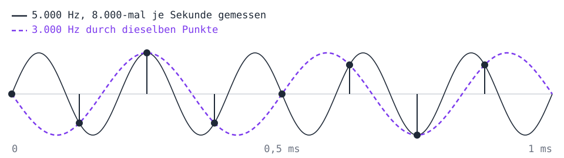
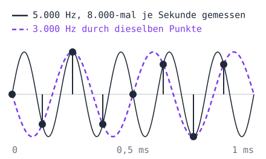

Wer die Samples abspielt, kennt nur die Punkte und hört den Ton mit 3.000 Hz, 8.000 minus 5.000. Eine Frequenz über der halben Abtastrate kommt also nicht einfach abhanden, sie taucht als eine andere, tiefere wieder auf. Das heißt **Aliasing**, nach dem englischen *alias*, ein anderer Name. Darum filtert ein Wandler vor dem Messen alles über der halben Abtastrate heraus.

### Drei Töne auf einmal

Zwei Klänge, die zugleich erklingen, sind in Zahlen eine Summe: Der Druck der Luft ist an jeder Stelle die Summe dessen, was beide Klänge aus ihr machen. Ein Akkord aus drei Tönen, A, Cis und E, ist darum die Summe dreier Töne. Schreib unten in `tones.py` dazu:

```python
~     write_wav('a.wav', tone(440, 2, 44100), 44100)
    chord = tone(440, 2, 44100) + tone(554.37, 2, 44100) + tone(659.26, 2, 44100)
    write_wav('akkord.wav', chord, 44100)
```

<!-- tutorial-step
write-file: audio/tones.py <- file:stufen/tones-2.py
terminal-run: python3 tones.py
terminal-wait-for-prompt: 30
-->

_task(drei-toene)

<!-- after: drei-toene -->
Jeder der drei Töne schwingt bis 0,5, zusammen kommen sie an manchen Stellen bis fast 1,5. In der Datei gibt es aber keine Zahl über 32.767: `np.clip` schneidet alles darüber ab, und die Welle hat dort flache Stellen statt runder Spitzen. Eine solche Ecke ist ein Gemisch vieler hoher Frequenzen, die in keinem der drei Töne vorkamen, und die hörst du als Kratzen. Das heißt **Clipping**, und es passiert genauso, wenn ein Mikrofon zu laut ausgesteuert ist. Ohne `np.clip` wäre es schlimmer: Eine Zahl über 32.767 würde in 16 Bit zu einer negativen, und es knallte.

Damit es sauber klingt, muss die Summe unter 1 bleiben, etwa so: `chord = (…) / 3`. Mach das und hör noch einmal hin.
<!-- /after -->

<!-- stage: stufen/tones-3.py as tones.py -->

## Kleine Tricks

Eine Minute in CD-Qualität braucht 10 MB. Bevor es darum geht, was das Ohr nicht hört, bringen drei kleine Tricks schon einiges: Stufen, die sich nach der Lautstärke richten, eine Vorhersage des nächsten Samples und kurze Codes für kleine Zahlen. Die beiden letzten verlieren nichts: Was herauskommt, ist Bit für Bit dasselbe wie vorher.

### Leise Stellen, grobe Stufen

Das Telefonnetz schickt Gespräche seit 1961 als 8.000 Samples in der Sekunde mit je 8 Bit, 64.000 Bit in der Sekunde. 8 Bit sind 255 Stufen von −127 bis 127, mit gleichen Abständen von 1/127 zwischen −1 und 1. Eine laute Stimme nutzt sie alle. Eine leise, die nur bis 0,06 geht, nutzt nur die Stufen von −8 bis 8. Der Fehler beim Runden ist bei beiden gleich groß, bei der leisen Stimme aber fast so laut wie die Stimme selbst.

Im Widget ist die Stimme so leise; damit du etwas hörst, wird sie nach dem Runden wieder lauter gemacht:

<div class='sampling-widget' data-mulaw data-bits='8' data-clip='stimme' data-level='0.06'></div>

<div class='hint try'>
<strong>Ausprobieren:</strong> Spiel die leise Stimme mit gleichmäßigen Stufen ab und hör auf das Rauschen am Ende jedes Worts, wenn die Stimme leiser wird. Schalt dann auf 16 Bit und zurück auf 8. Schalt danach auf μ-law: Wo ist das Rauschen geblieben? Stell zum Schluss 4 Bit ein und zähl im Bild die Linien der Stufen, auf denen die leise Stimme sitzt, einmal gleichmäßig und einmal nach μ-law.
</div>

Gleichmäßige Stufen sind für leise Stellen zu grob und für laute unnötig fein: Ein Fehler von 1/127 fällt bei einem Sample von 0,9 nicht auf, bei einem von 0,02 schon. Besser sind Stufen, die mit dem Sample wachsen, eng bei null und weit bei den lauten Samples. Dann ist der Fehler immer ungefähr derselbe Bruchteil des Samples, bei leisen Stellen genauso wie bei lauten.

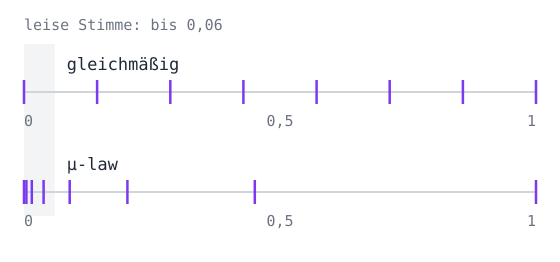

So arbeitet **μ-law**, gesprochen wie im Englischen »mju-law«: Erst wird jedes Sample `x` mit einem Logarithmus gestaucht, dann gleichmäßig gerundet, und beim Abspielen wird das Stauchen wieder rückgängig gemacht. Gestaucht wird mit

$$y = \operatorname{sgn}(x) \cdot \frac{\ln(1 + \mu \lvert x \rvert)}{\ln(1 + \mu)}, \quad \mu = 255$$

`sgn(x)` ist das Vorzeichen, 1 oder −1: Der Logarithmus rechnet mit dem Betrag \\(\lvert x \rvert\\), und das Vorzeichen kommt danach wieder dazu. Aus 0 wird 0, aus 1 wird 1, aber schon 0,06 wird zu 0,5. Die halbe Zahl der Stufen gehört so den Samples unter 0,06.

Festgelegt hat das die internationale Fernmeldeunion 1972 in der Norm [G.711](https://www.itu.int/rec/T-REC-G.711): μ-law in Nordamerika und Japan, das ähnliche A-law in Europa und fast überall sonst. Um die Null liegen die Stufen von 8 Bit nach μ-law enger als die von 13 Bit mit gleichmäßigen Stufen. G.711 ist bis heute im Einsatz, auch bei Anrufen über das Internet.

Lege die Datei `mulaw.py` an. `mulaw` staucht wie in der Formel, `np.log` ist der natürliche Logarithmus und `np.sign` das Vorzeichen:

<!-- page-code: own -->
```python
import numpy as np

from wav import read_wav, write_wav

MU = 255


def mulaw(x):
    return np.sign(x) * np.log(1 + MU * np.abs(x)) / np.log(1 + MU)


def unmulaw(y):
    # hier: das Stauchen rückgängig machen
```

<div class='hint own' data-check='unmulaw'>
<strong>Jetzt bist du dran:</strong> Schreib <code>unmulaw(y)</code>: Die Funktion macht <code>mulaw</code> rückgängig, also gilt <code>unmulaw(mulaw(x)) == x</code>, bis auf die letzten Stellen hinter dem Komma. Wie bei <code>mulaw</code> soll sie mit einem ganzen numpy-Array auf einmal rechnen.
</div>

<!-- hint -->
Rechne mit dem Betrag: Aus \\(\lvert y \rvert = \ln(1 + \mu \lvert x \rvert) / \ln(1 + \mu)\\) wird, mit \\(\ln(1 + \mu)\\) multipliziert, \\(\lvert y \rvert \cdot \ln(1 + \mu) = \ln(1 + \mu \lvert x \rvert)\\). Was ist \\(e\\) hoch beide Seiten?
<!-- /hint -->
<!-- hint -->
\\(e^{\lvert y \rvert \cdot \ln(1 + \mu)}\\) ist \\((1 + \mu)^{\lvert y \rvert}\\), also gilt \\((1 + \mu)^{\lvert y \rvert} = 1 + \mu \lvert x \rvert\\). Löse nach \\(\lvert x \rvert\\) auf und multipliziere zum Schluss mit `np.sign(y)`. `**` rechnet in numpy mit jeder Zahl eines Arrays.
<!-- /hint -->

<!-- solution -->
```python
def unmulaw(y):
    return np.sign(y) * ((1 + MU) ** np.abs(y) - 1) / MU
```
<!-- /solution -->

_task(unmulaw)

Jetzt fehlt das Runden, und ein Maß dafür, wie gut eine Kopie zum Original passt. Schreib unter `unmulaw`:

```python
def quantise(x, bits):
    top = 2 ** (bits - 1) - 1
    return np.round(x * top) / top


def snr(original, copy):
    noise = original - copy
    return 10 * np.log10(np.sum(original ** 2) / np.sum(noise ** 2))
```

`quantise` rundet jedes Sample auf eine von `2 * top + 1` gleichmäßigen Stufen, bei 8 Bit auf ein Vielfaches von 1/127. `snr` vergleicht die Energie des Originals, die Summe der Quadrate aller Samples, mit der Energie des Fehlers. Das Verhältnis heißt **Signal-Rausch-Abstand** und wird in **Dezibel** angegeben, 10-mal dem Logarithmus zur Basis 10: 10 dB mehr sind 10-mal so viel Energie, 20 dB 100-mal so viel. Ist eine Welle doppelt so hoch, hat sie 4-mal so viel Energie, das sind 6 dB mehr. Je größer die Zahl, desto weniger hört man den Fehler.

Unten in die Datei kommt das Programm: Es macht die Stimme leiser, rundet sie auf beide Arten mit 8 Bit und gibt aus, wie weit der Fehler jeweils unter der Stimme liegt. Die leiseste Fassung schreibt es in zwei Dateien, wieder laut gemacht:

```python
if __name__ == '__main__':
    voice, rate = read_wav('stimme.wav')
    for level in [1, 0.25, 0.06]:
        quiet = voice * level
        even = quantise(quiet, 8)
        law = unmulaw(quantise(mulaw(quiet), 8))
        print(f'{level:4}: gleichmäßig {snr(quiet, even):4.1f} dB, μ-law {snr(quiet, law):4.1f} dB')
    write_wav('leise-gleichmaessig.wav', even / level, rate)
    write_wav('leise-mulaw.wav', law / level, rate)
```

_task(viermal-leiser)

<!-- after: viermal-leiser -->
Lass das Programm laufen:

```bash
python3 mulaw.py
```

<!-- tutorial-step
write-file: audio/mulaw.py <- file:stufen/mulaw.py
check-task: unmulaw
terminal-run: cd /workspace/audio && (test -f stimme.wav || curl -sO http://workspace_nginx_1/audio/stimme.wav) && (test -f musik.wav || curl -sO http://workspace_nginx_1/audio/musik.wav) && python3 mulaw.py
terminal-wait-for-prompt: 30
wait-for-text: 0.06: gleichmäßig 12.1 dB
-->

Bei voller Lautstärke liegen beide Fehler weit unter der Stimme, gleichmäßig 35 dB, μ-law knapp 38. Viermal leiser verliert die gleichmäßige Rundung 12 dB, wie vorhergesagt: Ihr Fehler bleibt gleich groß, die Stimme hat ein Sechzehntel der Energie. Noch einmal etwa viermal leiser sind es nur 12 dB, der Fehler ist fast so laut wie die Stimme. μ-law verliert dabei kaum etwas, weil seine Stufen mit der Stimme kleiner werden. Hör dir die beiden Dateien `leise-gleichmaessig.wav` und `leise-mulaw.wav` an.
<!-- /after -->

### Das nächste Sample raten

Bei 44.100 Samples in der Sekunde ändert sich ein Klang von einem Sample zum nächsten nur wenig. Hier sind acht Samples aus der Stimme, ab dem Index 56.019, als ganze Zahlen mit 16 Bit:

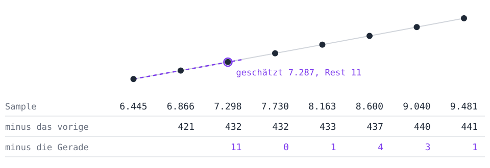
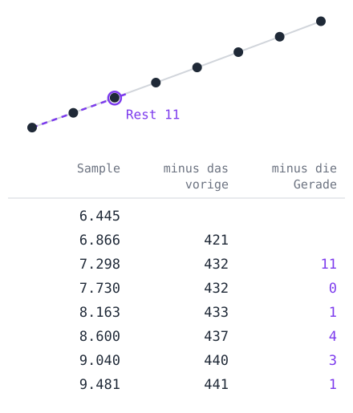

Die Samples sind Zahlen um 8.000, ihre Unterschiede zum vorigen Sample nur um 430. Noch besser rät, wer die Gerade durch die beiden letzten Samples verlängert: Steigt der Klang von 6.445 auf 6.866, um 421, dann ist die beste Schätzung für das nächste Sample 6.866 + 421 = 7.287. Gemessen sind 7.298, der Rest ist 11. Allgemein ist die Schätzung für das Sample mit dem Index `n`

$$x\_{n-1} + (x\_{n-1} - x\_{n-2}) = 2 x\_{n-1} - x\_{n-2}$$

An dieser Stelle steigt die Welle fast gerade an, darum klappt es so gut; an anderen Stellen ist der Rest größer. Gespeichert werden statt der Samples die Reste. Wer sie liest, rechnet dieselbe Schätzung aus und zählt den Rest dazu: Er bekommt das Sample genau zurück.

Die Idee ist alt. C. Chapin Cutler von den Bell Labs meldete 1950 ein [Patent](https://patents.google.com/patent/US2605361A/en) an, Unterschiede statt Samples zu senden, die **Differenz-Pulscodemodulation** (DPCM). Mit Unterschieden, die sich nach der Lautstärke richten, kam die ITU 1984 in der Norm G.721 auf 4 Bit je Sample, halb so viel wie G.711. Dort werden die Unterschiede gerundet, und etwas geht verloren. Hier bleibt jeder Rest, wie er ist.

Lege `predict.py` an. Zum Rechnen braucht es die Samples als ganze Zahlen, wie in der Datei; `numbers` macht sie aus dem, was `read_wav` gibt. Mit `int64`, 8 Bytes je Zahl, passt auch ein Rest, der größer ist als 16 Bit:

<!-- page-code: own -->
```python
import numpy as np

from wav import read_wav


def numbers(path):
    samples, rate = read_wav(path)
    return np.round(samples * 32767).astype(np.int64)


def residual(x):
    # hier: die Reste
```

Mit numpy rechnet man am besten mit Ausschnitten statt mit einer Schleife. `x[2:]` sind alle Samples ab dem Index 2, `x[1:-1]` alle vom Index 1 bis ohne das letzte, `x[:-2]` alle ohne die letzten beiden. Die drei sind gleich lang, und an derselben Stelle steht in ihnen ein Sample, sein Vorgänger und dessen Vorgänger.

<div class='hint own' data-check='residual'>
<strong>Jetzt bist du dran:</strong> Schreib <code>residual(x)</code>: Die Funktion bekommt ein numpy-Array mit ganzen Zahlen und gibt ein gleich langes Array zurück. Die ersten beiden Zahlen bleiben, wie sie sind, denn für sie gibt es keine Gerade. Ab dem Index 2 steht dort das Sample minus die Schätzung <code>2 * x[n - 1] - x[n - 2]</code>. <code>x</code> selbst bleibt dabei unverändert.
</div>

<!-- hint -->
Fang mit einer Kopie an, `r = x.copy()`; dann bleiben die ersten beiden Zahlen von selbst, und `x` ändert sich nicht. Einem Ausschnitt kann man ein ganzes Array zuweisen: `r[2:] = …`.
<!-- /hint -->
<!-- hint -->
Die Samples sind `x[2:]`, ihre Vorgänger `x[1:-1]` und deren Vorgänger `x[:-2]`:

```python
r = x.copy()
r[2:] = x[2:] - (2 * … - …)
return r
```
<!-- /hint -->

<!-- solution -->
```python
def residual(x):
    r = x.copy()
    r[2:] = x[2:] - (2 * x[1:-1] - x[:-2])
    return r
```
<!-- /solution -->

_task(residual)

Zurück geht es nur der Reihe nach, denn für jedes Sample braucht man die beiden davor, und die stehen erst fest, wenn sie selbst zurückgerechnet sind. Darum braucht `restore` eine Schleife. Schreib sie unter `residual`, dazu das Programm:

```python
def restore(r):
    x = r.copy()
    for n in range(2, len(x)):
        x[n] = r[n] + 2 * x[n - 1] - x[n - 2]
    return x


if __name__ == '__main__':
    for path in ['stimme.wav', 'musik.wav']:
        x = numbers(path)
        r = residual(x)
        print(f'{path}: Samples im Mittel {np.abs(x).mean():.0f}, Reste {np.abs(r).mean():.0f}')
        print('  zurück wie vorher:', np.array_equal(restore(r), x))
```

`np.abs(x).mean()` ist der Mittelwert der Beträge, wie groß eine Zahl im Mittel ist. `np.array_equal` sagt, ob zwei Arrays in jeder Zahl übereinstimmen.

```bash
python3 predict.py
```

<!-- tutorial-step
write-file: audio/predict.py <- file:stufen/predict.py
check-task: residual
terminal-run: python3 predict.py
terminal-wait-for-prompt: 30
wait-for-text: Reste 397
-->

Bei der Stimme sind die Reste im Mittel ein Zwanzigstel so groß wie die Samples, bei der Musik ein Zehntel, und `restore` bringt jedes Sample genau zurück.

<div class='hint try'>
<strong>Ausprobieren:</strong> Rate statt mit der Geraden mit dem vorigen Sample allein: <code>r[2:] = x[2:] - x[1:-1]</code>, und in <code>restore</code> entsprechend <code>x[n] = r[n] + x[n - 1]</code>. Bei welcher der beiden Dateien hilft die Gerade mehr? Die Hi-Hat der Musik ist Rauschen: Lässt sich Rauschen vorhersagen? Stell beides danach wieder zurück.
</div>

### Kleine Zahlen, kurze Codes

Die Reste sind klein, aber in der Datei hätte jeder immer noch 16 Bit, und gespart wäre nichts. Kleine Zahlen brauchen kurze Codes, große dürfen längere haben, wie bei [Huffman](/huffman). Ein Huffman-Code bräuchte eine Tabelle für jede Datei. Für Zahlen, bei denen kleine häufig und große selten sind, geht es ohne: Solomon Golomb fand 1966 Codes dafür, und Robert Rice nahm am Jet Propulsion Laboratory der NASA davon die einfachsten, für Daten von Raumsonden. Ein **Rice-Code** hat einen Parameter `k` und schreibt eine Zahl `u ≥ 0` in zwei Teilen:

1. `u // 2**k` als so viele Nullen, gefolgt von einer 1,
2. dann `u % 2**k` als Binärzahl mit genau `k` Stellen.

Mit `k = 2` sieht das so aus:

<div class='table-responsive'>
<table class='table'>
<tr><th><code>u</code></th><td>0</td><td>1</td><td>2</td><td>3</td><td>4</td><td>5</td><td>6</td><td>7</td><td>8</td><td>9</td></tr>
<tr><th>Code</th><td><code>1 00</code></td><td><code>1 01</code></td><td><code>1 10</code></td><td><code>1 11</code></td><td><code>01 00</code></td><td><code>01 01</code></td><td><code>01 10</code></td><td><code>01 11</code></td><td><code>001 00</code></td><td><code>001 01</code></td></tr>
</table>
</div>

Zahlen bis 3 brauchen 3 Bit, bis 7 vier, und jede weitere Vierergruppe ein Bit mehr. Wer liest, zählt die Nullen bis zur 1 und liest dann `k` Bits: Ein Code endet von selbst, ohne Trennzeichen. Ein größeres `k` passt für größere Zahlen.

Die Reste sind aber auch negativ. Darum werden sie vorher im Zickzack umgeordnet, 0, −1, 1, −2, 2, … werden zu 0, 1, 2, 3, 4, …: Eine Zahl `r ≥ 0` wird zu `2 * r`, eine negative zu `-2 * r - 1`. Lege `rice.py` an:

<!-- page-code: own -->
```python
import numpy as np

from predict import numbers, residual


def zigzag(r):
    return np.where(r >= 0, 2 * r, -2 * r - 1)


def rice(u, k):
    # hier: der Code als Text aus 0 und 1
```

`np.where(bedingung, a, b)` nimmt für jede Zahl `a`, wo die Bedingung gilt, sonst `b`.

<div class='hint own' data-check='rice'>
<strong>Jetzt bist du dran:</strong> Schreib <code>rice(u, k)</code> für eine ganze Zahl <code>u ≥ 0</code> und <code>k ≥ 1</code>. Die Funktion gibt den Rice-Code als Text aus Nullen und Einsen zurück, ohne Leerzeichen: <code>rice(5, 2)</code> ergibt <code>'0101'</code>.
</div>

<!-- hint -->
Rechne erst die beiden Teile aus: `q = u // 2**k` und `rest = u % 2**k`. Aus `q` werden `'0' * q` und eine `'1'`.
<!-- /hint -->
<!-- hint -->
`format(rest, 'b')` schreibt eine Zahl binär, aber ohne führende Nullen. Mit `format(rest, '02b')` hat sie mindestens 2 Stellen, mit `format(rest, f'0{k}b')` mindestens `k`.
<!-- /hint -->

<!-- solution -->
```python
def rice(u, k):
    return '0' * (u // 2 ** k) + '1' + format(u % 2 ** k, f'0{k}b')
```
<!-- /solution -->

_task(rice)

Für die ganze Datei braucht es keine Texte, nur ihre Länge: `u // 2**k` Nullen, eine 1 und `k` Bits. `u >> k` ist dasselbe wie `u // 2**k` und rechnet mit dem ganzen Array. Welches `k` am besten ist, probiert `best_bits` einfach aus:

```python
def rice_bits(u, k):
    return int(np.sum((u >> k) + 1 + k))


def best_bits(u):
    return min(rice_bits(u, k) for k in range(16))


if __name__ == '__main__':
    for path in ['stimme.wav', 'musik.wav']:
        x = numbers(path)
        u = zigzag(residual(x))
        print(f'{path}: {best_bits(u) / (16 * len(x)):.0%} mit einem k')
```

```bash
python3 rice.py
```

<!-- tutorial-step
write-file: audio/rice.py <- file:stufen/rice-1.py
check-task: rice
terminal-run: python3 rice.py
terminal-wait-for-prompt: 30
wait-for-text: musik.wav: 70% mit einem k
-->

Die Stimme braucht 58 % ihrer 16 Bit je Sample, die Musik 70 %, und nichts ist verloren. Ein `k` für die ganze Datei passt aber nicht überall: In einer Pause sind die Reste winzig, in einem lauten Wort groß. Teil die Reste darum in Blöcke von 4.096 Samples und such für jeden Block sein eigenes `k`. Das kostet 4 Bit je Block, um `k` zu speichern.

_task(je-block)

<!-- after: je-block -->
Schreib unten in die Schleife:

```python
~         print(f'{path}: {best_bits(u) / (16 * len(x)):.0%} mit einem k')
        blocks = sum(best_bits(u[s:s + 4096]) + 4 for s in range(0, len(u), 4096))
        print(f'{path}: {blocks / (16 * len(x)):.0%} mit einem k je Block')
```

<!-- tutorial-step
write-file: audio/rice.py <- file:stufen/rice-2.py
terminal-run: python3 rice.py
terminal-wait-for-prompt: 30
wait-for-text: musik.wav: 67% mit einem k je Block
-->

Die Stimme schrumpft von 58 auf 46 %, die Musik nur von 70 auf 67 %. Die Stimme hat Pausen und leise Silben, in denen ein kleines `k` reicht; ein Viertel ihrer Samples liegt nahe bei null. Die Musik ist überall ungefähr gleich laut, und ein `k` passt fast überall.
<!-- /after -->

<!-- stage: stufen/rice-2.py as rice.py -->

So arbeitet **FLAC**, das freie Format für Musik ohne Verlust. Tony Robinson an der Universität Cambridge beschrieb 1994 sein Programm Shorten, das mit Vorhersage und Rice-Codes arbeitet. Josh Coalson begann im Jahr 2000 mit FLAC, Version 1.0 erschien 2001, und seit Dezember 2024 beschreibt es der [RFC 9639](https://www.rfc-editor.org/rfc/rfc9639.html). Die Vorhersage mit der Geraden steht dort genau so, als »fixed predictor« der Ordnung 2. FLAC kann mehr: Es sucht für jeden Block die beste Vorhersage, auch eine aus bis zu 32 vorigen Samples mit eigenen Faktoren, und teilt jeden Block in Stücke mit eigenem `k`. Lass ffmpeg die beiden Dateien als FLAC schreiben:

```bash
ffmpeg -loglevel error -i stimme.wav stimme.flac
ffmpeg -loglevel error -i musik.wav musik.flac
ls -l *.wav *.flac
```

<!-- tutorial-step
terminal-run: ffmpeg -y -loglevel error -i stimme.wav stimme.flac && ffmpeg -y -loglevel error -i musik.wav musik.flac && ls -l stimme.* musik.*
terminal-wait-for-prompt: 30
wait-for-text: musik.flac
-->

Die Stimme braucht als FLAC etwa ein Drittel, die Musik etwa 60 %. Viel mehr schafft kein Verfahren ohne Verlust: Rauschen lässt sich nicht vorhersagen, und jedes Bit davon muss mit in die Datei. Wer eine Minute Musik auf ein Zehntel bringen will, muss etwas weglassen: das, was das Ohr nicht hört. Dazu muss man wissen, aus welchen Frequenzen ein Klang besteht.

<div class='book'>
<i class='bi bi-file-earmark-text'></i>
<p><strong>SHORTEN: Simple lossless and near-lossless waveform compression</strong>, Tony Robinson, Cambridge University Engineering Department, 1994. Die Vorhersage aus den vorigen Samples und kurze Codes für die Reste, die Idee hinter FLAC, auf wenigen Seiten: <a href='http://mi.eng.cam.ac.uk/reports/svr-ftp/auto-pdf/robinson_tr156.pdf'>PDF</a>, die <a href='https://mi.eng.cam.ac.uk/reports/abstracts/robinson_tr156.html'>Zusammenfassung</a> in Cambridge.</p>
</div>

## Frequenzen

Der Akkord aus dem ersten Kapitel war eine Summe von drei Sinustönen. Joseph Fourier behauptete 1822 in seinem Buch über die Ausbreitung von Wärme, dass sich fast jede Schwingung so schreiben lässt: als Summe von Sinusschwingungen verschiedener Frequenzen, jede mit ihrer eigenen Stärke. Welche Frequenzen in einem Klang stecken und wie stark, heißt sein **Spektrum**. Für das Ohr ist das die wichtigste Beschreibung eines Klangs: Im Innenohr reagiert jede Stelle auf eine andere Frequenz. Und für das Komprimieren auch: Was das Ohr nicht hört, lässt sich erst weglassen, wenn man die Frequenzen kennt.

_person(fourier)

### Frequenzen sehen

Ein **Spektrogramm** zeigt das Spektrum über die Zeit: nach rechts die Zeit, nach oben die Frequenz, und je stärker eine Frequenz zu einer Zeit ist, desto kräftiger die Farbe. Die Frequenzen stehen auf einer logarithmischen Skala, wie auf einer Klaviatur: Von 100 bis 200 Hz ist es so weit wie von 1.000 bis 2.000 Hz, eine Oktave.

<div class='spectrum-widget'></div>

<div class='hint try'>
<strong>Ausprobieren:</strong> Beim Akkord siehst du drei waagerechte Linien: Lies im Spektrum unten ab, bei welchen Frequenzen sie liegen. Der <strong>Sweep</strong> ist ein Ton, der in vier Sekunden von 100 Hz bis 10.000 Hz gleitet: Auf der logarithmischen Skala wird er zu einer geraden Linie. Bei der Stimme liegen viele Linien in gleichen Abständen übereinander und bewegen sich gemeinsam auf und ab, wenn die Stimme höher oder tiefer wird. Wo im Satz siehst du statt Linien eine breite Wolke weit oben, und welche Laute sind das? Schalt bei der Musik die Instrumente einzeln aus und wieder an: Wo liegt die Kick-Drum, wo die Hi-Hat, und welches Instrument macht die waagerechten Linien in der Mitte?
</div>

Die Linien der Stimme sind ihre **Obertöne**: Die Stimmbänder schwingen mit einer Grundfrequenz, beim Sprechen meist zwischen 80 und 250 Hz, und dazu mit jedem Vielfachen davon. Laute wie s, sch und z sind dagegen Rauschen, ein Gemisch sehr vieler Frequenzen, und das liegt hoch. Darum gehen sie bei einer kleinen Abtastrate als Erstes verloren.

### Mit einem Testton vergleichen

Wie findet man heraus, wie stark eine Frequenz in `N` Samples steckt? Man nimmt einen Testton dieser Frequenz, multipliziert jedes Sample mit ihm und zählt alles zusammen. Steckt die Frequenz im Klang, gehen beide gemeinsam auf und ab, die Produkte sind meist positiv, und die Summe wird groß. Andere Frequenzen geraten mal in den gleichen Takt, mal in den entgegengesetzten, und ihre Produkte heben sich auf.

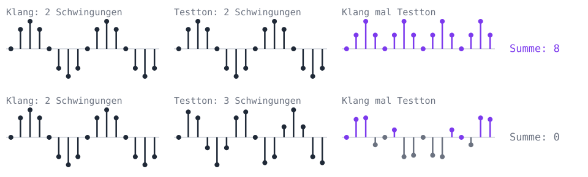
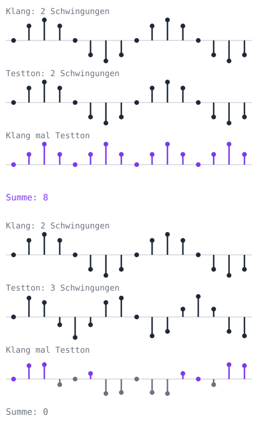

Ein Testton macht genau `k` Schwingungen in den `N` Samples; bei `rate` Samples in der Sekunde hat er die Frequenz `k * rate / N`. Weil ein Ton im Klang gegen den Testton verschoben sein kann, nimmt man zwei Testtöne, einen Kosinus und einen Sinus:

$$c\_k = \sum\_{n=0}^{N-1} x\_n \cos\left(\frac{2\pi k n}{N}\right), \qquad s\_k = \sum\_{n=0}^{N-1} x\_n \sin\left(\frac{2\pi k n}{N}\right)$$

Die Stärke der Frequenz, so hoch, wie die Schwingung im Klang geht, ist dann

$$A\_k = \frac{2}{N} \sqrt{c\_k^2 + s\_k^2}$$

Probier es von Hand mit acht Samples, \\(x = (1, 2, 1, 0, 1, 2, 1, 0)\\). Für `k = 2` sind die beiden Testtöne:

<div class='table-responsive'>
<table class='table'>
<tr><th><code>n</code></th><td>0</td><td>1</td><td>2</td><td>3</td><td>4</td><td>5</td><td>6</td><td>7</td></tr>
<tr><th>Sample</th><td>1</td><td>2</td><td>1</td><td>0</td><td>1</td><td>2</td><td>1</td><td>0</td></tr>
<tr><th>Kosinus</th><td>1</td><td>0</td><td>−1</td><td>0</td><td>1</td><td>0</td><td>−1</td><td>0</td></tr>
<tr><th>Sinus</th><td>0</td><td>1</td><td>0</td><td>−1</td><td>0</td><td>1</td><td>0</td><td>−1</td></tr>
</table>
</div>

_task(von-hand)

<!-- after: von-hand -->
Mit dem Kosinus heben sich die Produkte auf, 1 − 1 + 1 − 1 = 0. Mit dem Sinus bleibt 2 + 2 = 4, denn bei `n = 3` und `n = 7` ist das Sample 0. Also ist \\(A_2 = \frac{2}{8} \sqrt{0^2 + 4^2} = 1\\): In den Samples steckt ein Sinus mit zwei Schwingungen und der Höhe 1. Dazu kommt eine 1, die immer gleich bleibt; sie gehört zu `k = 0`, der Frequenz 0.
<!-- /after -->

Python rechnet mit Kosinus und Sinus auf einmal, mit **komplexen Zahlen**. Eine komplexe Zahl ist ein Paar aus zwei Zahlen, in Python `c + s * 1j`. `np.exp(-1j * phi)` ist das Paar aus `np.cos(phi)` und `-np.sin(phi)`. Multipliziert man die Samples mit `np.exp(-2j * np.pi * k * n / N)` und zählt alles zusammen, steht in der Summe \\(c\_k\\) und \\(-s\_k\\), und `abs` gibt \\(\sqrt{c\_k^2 + s\_k^2}\\). Diese Summen für alle `k` von 0 bis `N - 1` heißen die **diskrete Fourier-Transformation**, kurz DFT:

$$X\_k = \sum\_{n=0}^{N-1} x\_n \, e^{-2\pi i k n / N}$$

Für einen Klang aus reellen Zahlen ist die zweite Hälfte ein Spiegelbild der ersten; wichtig sind nur die `k` unter `N / 2`, die Frequenzen bis zur halben Abtastrate. Lege `freq.py` an:

<!-- page-code: own -->
```python
import time

import numpy as np

from tones import tone


def dft(x):
    # hier: die DFT


def strongest(X, rate, count):
    N = len(X)
    amplitude = np.abs(X[:N // 2]) * 2 / N
    best = np.argsort(amplitude)[::-1][:count]
    return [(round(k * rate / N), round(float(amplitude[k]), 2)) for k in best]


if __name__ == '__main__':
    rate = 4096
    x = tone(440, 1, rate) + 0.5 * tone(1000, 1, rate)
    start = time.perf_counter()
    X = dft(x)
    print(f'dft: {time.perf_counter() - start:.3f} s', strongest(X, rate, 2))
```

`strongest` rechnet aus den Summen die Stärken \\(A_k\\), sortiert sie mit `np.argsort` und gibt die `count` stärksten Frequenzen in Hz mit ihrer Stärke zurück. Das Programm macht eine Sekunde aus zwei Tönen, 440 Hz mit der Höhe 0,5 und 1.000 Hz mit 0,25, und misst mit `time.perf_counter`, wie lange `dft` braucht.

<div class='hint own' data-check='dft'>
<strong>Jetzt bist du dran:</strong> Schreib <code>dft(x)</code>: Die Funktion gibt ein numpy-Array mit den <code>N</code> komplexen Zahlen \(X_0\) bis \(X_{N-1}\) zurück, eine für jedes <code>k</code>. Für jedes <code>k</code> reicht eine Zeile, die mit allen Samples auf einmal rechnet.
</div>

<!-- hint -->
Leg zuerst ein Array für das Ergebnis an, `X = np.zeros(N, dtype=complex)`, und die Indizes der Samples, `n = np.arange(N)`. Dann geht eine Schleife über alle `k` von 0 bis `N - 1`.
<!-- /hint -->
<!-- hint -->
In der Schleife ist `x * np.exp(-2j * np.pi * k * n / N)` das Array der Produkte; `np.sum` zählt sie zusammen:

```python
for k in range(N):
    X[k] = np.sum(…)
return X
```
<!-- /hint -->

<!-- solution -->
```python
def dft(x):
    N = len(x)
    n = np.arange(N)
    X = np.zeros(N, dtype=complex)
    for k in range(N):
        X[k] = np.sum(x * np.exp(-2j * np.pi * k * n / N))
    return X
```
<!-- /solution -->

_task(dft)

```bash
python3 freq.py
```

<!-- tutorial-step
write-file: audio/freq.py <- file:stufen/freq-1.py
check-task: dft
terminal-run: cd /workspace/audio && python3 freq.py
terminal-wait-for-prompt: 60
wait-for-text: [(440, 0.5), (1000, 0.25)]
-->

`dft` findet die beiden Töne mit ihren Höhen. Für 4.096 Samples braucht es auf einem Workspace etwa eine halbe Sekunde.

_task(doppelt)

<!-- after: doppelt -->
Probier es aus: Setz `rate = 8192`, dann sind es 8.192 Samples.

Es dauert etwa viermal so lange: Für jedes der `N` Ergebnisse geht `dft` alle `N` Samples durch, das sind \\(N^2\\) Multiplikationen. Doppelt so viele Samples sind viermal so viel Arbeit. Eine Sekunde in CD-Qualität hat 44.100 Samples, und `dft` bräuchte dafür Minuten.
<!-- /after -->

### Schneller: die FFT

Die DFT von `N` Samples lässt sich aus zwei DFTs von je `N / 2` Samples zusammensetzen: aus der DFT der Samples mit geradem Index, `E`, und der mit ungeradem, `O`. Für jedes `k` unter `N / 2` gilt

$$X\_k = E\_k + e^{-2\pi i k / N} \, O\_k, \qquad X\_{k + N/2} = E\_k - e^{-2\pi i k / N} \, O\_k$$

Warum? In der Summe von \\(X_k\\) sind die Summanden mit geradem `n = 2m` genau die DFT der geraden Samples, denn \\(2\pi k \cdot 2m / N = 2\pi k m / (N/2)\\). Bei ungeradem `n = 2m + 1` kommt nur der Faktor \\(e^{-2\pi i k / N}\\) dazu. Für \\(k + N/2\\) dreht sich jeder Testton der halben DFTs einmal ganz herum, und das ändert nichts; nur der Faktor wechselt sein Vorzeichen. So liefern zwei halbe DFTs alle `N` Ergebnisse.

Die beiden halben DFTs macht man genauso, mit Vierteln, und so weiter, bis nur noch ein Sample übrig ist: Die DFT eines einzigen Samples ist das Sample selbst. Bei 8.192 = 2¹³ Samples sind das 13 Stufen mit je 8.192 Multiplikationen, gut 100.000 statt 67 Millionen. Das ist die **schnelle Fourier-Transformation**, auf Englisch Fast Fourier Transform, kurz FFT. Sie braucht eine Zweierpotenz als `N`.

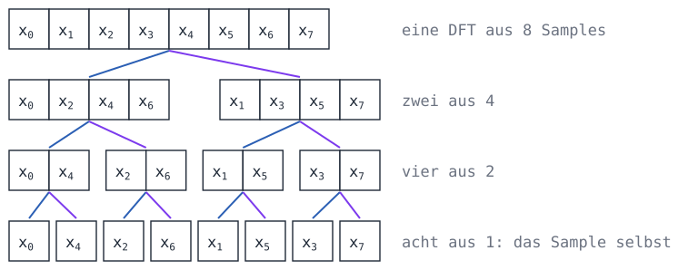
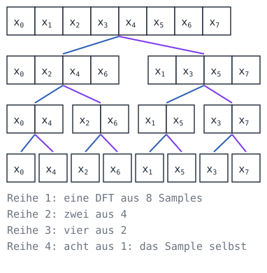

Blau führt zu den Samples mit geradem Index einer Gruppe, lila zu denen mit ungeradem. Von unten nach oben gelesen ist das, was `fft` tut: Aus acht DFTs von einem Sample werden vier von zwei, zwei von vier und eine von acht, in drei Stufen mit je acht Multiplikationen.

Veröffentlicht haben sie James Cooley von IBM und John Tukey von der Universität Princeton 1965. Tukey soll die Idee in einer Sitzung der Berater von Präsident Kennedy gehabt haben, in der es darum ging, Atomwaffentests der Sowjetunion an Samples von Erdbebenstationen außerhalb des Landes zu erkennen. Später stellte sich heraus, dass Carl Friedrich Gauß denselben Trick schon um 1805 benutzt hatte, um die Bahnen der Kleinplaneten Pallas und Juno zu berechnen. Veröffentlicht wurde das erst nach seinem Tod.

<div class='book'>
<i class='bi bi-file-earmark-text'></i>
<p><strong>An Algorithm for the Machine Calculation of Complex Fourier Series</strong>, James W. Cooley und John W. Tukey, Mathematics of Computation, 1965. Fünf Seiten, auf denen die FFT zu einem Programm für Computer wird: beim <a href='https://doi.org/10.1090/S0025-5718-1965-0178586-1'>Verlag</a>.</p>
</div>

Schreib unter `dft` die Funktion `fft`. `x[0::2]` sind die Samples mit geradem Index, jedes zweite ab dem ersten, und `x[1::2]` die mit ungeradem; `np.concatenate` hängt zwei Arrays hintereinander:

<!-- page-code: own -->
```python
def fft(x):
    N = len(x)
    if N == 1:
        return x.astype(complex)
    # hier: zwei halbe FFTs und daraus das Ganze
```

<div class='hint own' data-check='fft'>
<strong>Jetzt bist du dran:</strong> Schreib <code>fft(x)</code> für ein <code>x</code>, dessen Länge eine Zweierpotenz ist: Die Funktion ruft sich selbst für die geraden und die ungeraden Samples auf und setzt die Ergebnisse nach den beiden Formeln oben zusammen. Sie gibt dasselbe zurück wie <code>dft</code>, nur schneller.
</div>

<!-- hint -->
Erst die beiden Hälften: `even = fft(x[0::2])` und `odd = fft(x[1::2])`. Dann die Faktoren für alle `k` unter `N / 2` auf einmal, `np.exp(-2j * np.pi * np.arange(N // 2) / N)`, multipliziert mit `odd`.
<!-- /hint -->
<!-- hint -->
Mit `w` für die Faktoren mal `odd` ist die erste Hälfte des Ergebnisses `even + w` und die zweite `even - w`:

```python
w = np.exp(-2j * np.pi * np.arange(N // 2) / N) * odd
return np.concatenate([…, …])
```
<!-- /hint -->

<!-- solution -->
```python
def fft(x):
    N = len(x)
    if N == 1:
        return x.astype(complex)
    even = fft(x[0::2])
    odd = fft(x[1::2])
    w = np.exp(-2j * np.pi * np.arange(N // 2) / N) * odd
    return np.concatenate([even + w, even - w])
```
<!-- /solution -->

_task(fft)

Lass im Programm alle drei gegeneinander antreten, `dft`, deine `fft` und die von numpy, `np.fft.fft`:

```python
if __name__ == '__main__':
    rate = 8192
    x = tone(440, 1, rate) + 0.5 * tone(1000, 1, rate)
    for name, transform in [('dft', dft), ('fft', fft), ('numpy', np.fft.fft)]:
        start = time.perf_counter()
        X = transform(x)
        print(f'{name:5}: {time.perf_counter() - start:.4f} s', strongest(X, rate, 2))
```

<!-- tutorial-step
write-file: audio/freq.py <- file:stufen/freq-2.py
check-task: fft
terminal-run: python3 freq.py
terminal-wait-for-prompt: 60
wait-for-text: numpy:
-->

Alle drei finden dasselbe. `dft` braucht gut zwei Sekunden, deine `fft` etwa ein Zwanzigstel Sekunde, und numpy wenige Tausendstel: Seine FFT ist in C geschrieben und rechnet ohne die vielen Aufrufe von Python. Für 65.536 Samples, anderthalb Sekunden in CD-Qualität, bräuchte `dft` mehr als drei Minuten, deine `fft` eine halbe Sekunde und numpy drei Tausendstel. Auf der FFT beruhen MP3 und Opus, das Spektrogramm im Widget oben und vieles mehr, was mit Klang, Bildern und Funk rechnet.

<div class='hint try'>
<strong>Ausprobieren:</strong> Setz <code>rate = 8000</code>. Was passiert mit deiner <code>fft</code>, und an welcher Stelle der Rekursion? numpy rechnet weiter: Seine FFT zerlegt auch in Drittel, Fünftel und andere Teile.
</div>

### Eine Telefonnummer aus Tönen

Im [Spiel am Telefon](/telefonspiel) klingt jede Taste mit zwei Tönen zugleich, einem für ihre Zeile und einem für ihre Spalte:

<div class='table-responsive'>
<table class='table'>
<tr><th></th><th>1.209 Hz</th><th>1.336 Hz</th><th>1.477 Hz</th></tr>
<tr><th>697 Hz</th><td>1</td><td>2</td><td>3</td></tr>
<tr><th>770 Hz</th><td>4</td><td>5</td><td>6</td></tr>
<tr><th>852 Hz</th><td>7</td><td>8</td><td>9</td></tr>
<tr><th>941 Hz</th><td>*</td><td>0</td><td>#</td></tr>
</table>
</div>

In der Datei `waehlen.wav` wählt jemand eine Telefonnummer, aufgenommen mit 8.000 Samples in der Sekunde wie im Telefonnetz. Hol sie dir:

```bash_copy
wget ${web_root}/audio/waehlen.wav
```

<!-- tutorial-step
terminal-run: test -f waehlen.wav || curl -sO http://workspace_nginx_1/audio/waehlen.wav
terminal-wait-for-prompt: 30
-->

Für eine Taste braucht es keine ganze FFT: Es reicht, sieben Frequenzen zu prüfen, mit je einem Testton. Der muss nicht `k` ganze Schwingungen machen, er darf jede Frequenz haben; das `n`-te Sample ist zur Zeit `n / rate`. Lege `dial.py` an:

<!-- page-code: own -->
```python
import numpy as np

from wav import read_wav

ROWS = [697, 770, 852, 941]
COLUMNS = [1209, 1336, 1477]
KEYS = ['123', '456', '789', '*0#']


def strength(block, freq, rate):
    # hier: wie stark freq in block steckt
```

<div class='hint own' data-check='staerke'>
<strong>Jetzt bist du dran:</strong> Schreib <code>strength(block, freq, rate)</code>: wie stark die Frequenz <code>freq</code> in den Samples <code>block</code> steckt, als Höhe der Schwingung wie \(A_k\) oben. Ein Sinus mit der Höhe 0,5 und genau dieser Frequenz ergibt 0,5, ein Sinus mit einer anderen der sieben Frequenzen fast 0.
</div>

<!-- hint -->
Es ist eine einzige Summe der DFT. Statt `k * n / N` steht im Testton jetzt `freq * n / rate`: `freq` Schwingungen in der Sekunde, und das Sample mit dem Index `n` ist zur Zeit `n / rate`.
<!-- /hint -->
<!-- hint -->
Mit `n = np.arange(len(block))` ist die Summe `np.sum(block * np.exp(-2j * np.pi * freq * n / rate))`. Ihr Betrag, mit `abs`, mal 2 und geteilt durch die Zahl der Samples gibt die Höhe.
<!-- /hint -->

<!-- solution -->
```python
def strength(block, freq, rate):
    n = np.arange(len(block))
    return 2 * abs(np.sum(block * np.exp(-2j * np.pi * freq * n / rate))) / len(block)
```
<!-- /solution -->

_task(staerke)

Den Rest schreibst du ab. `key` nimmt die stärkste der vier Zeilen und die stärkste der drei Spalten und schlägt die Taste nach. `tones` teilt die Samples in Stücke von 10 Millisekunden und sammelt die lauten Stücke, die aufeinander folgen, zu einem Block, einem für jede Taste:

```python
def key(block, rate):
    row = max(range(4), key=lambda i: strength(block, ROWS[i], rate))
    column = max(range(3), key=lambda i: strength(block, COLUMNS[i], rate))
    return KEYS[row][column]


def tones(samples, rate):
    piece = rate // 100
    blocks = []
    start = None
    for i in range(0, len(samples), piece):
        loud = np.abs(samples[i:i + piece]).max() > 0.2
        if loud and start is None:
            start = i
        elif not loud and start is not None:
            blocks.append(samples[start:i])
            start = None
    return blocks


if __name__ == '__main__':
    samples, rate = read_wav('waehlen.wav')
    print(''.join(key(block, rate) for block in tones(samples, rate)))
```

`max(range(4), key=…)` gibt den Index, für den `strength` am größten ist. `start` merkt sich, wo der laute Teil begann; wird es wieder leise, kommt alles von `start` bis hier als Block in die Liste.

```bash
python3 dial.py
```

<!-- tutorial-step
write-file: audio/dial.py <- file:stufen/dial.py
check-task: staerke
terminal-run: python3 dial.py
terminal-wait-for-prompt: 30
-->

_task(nummer)

<!-- after: nummer -->
Ruf die Nummer besser nicht an: Es gibt dort niemanden. Die Bundesnetzagentur hält in Berlin die Nummern 030 23125-000 bis -999 und ein paar weitere für Filme, Bücher und Aufgaben wie diese frei, damit niemand angerufen wird, dessen Nummer zufällig in einem Krimi vorkommt.
<!-- /after -->

Mit dem Spektrum weißt du jetzt, aus welchen Frequenzen ein Klang besteht. Das ist die Sprache, in der MP3, AAC und Opus über Klänge nachdenken: Sie zerlegen ihn in Frequenzen und fragen für jede, ob das Ohr sie überhaupt hört.

## Was das Ohr nicht hört

Bis hierher ging nichts verloren, oder es klang schlechter. MP3 und alle Codecs nach ihm machen etwas anderes: Sie lassen weg, was das Ohr ohnehin nicht hört, und das ist mehr, als man denkt. Dazu muss man wissen, wie das Ohr hört.

### Wie das Ohr Frequenzen trennt

Im Innenohr liegt die Schnecke, ein aufgerollter Gang von gut drei Zentimetern, gefüllt mit Flüssigkeit. Durch ihn läuft die Basilarmembran, an deren Anfang hohe Frequenzen am stärksten schwingen und an deren Ende tiefe. Auf ihr sitzen Haarzellen, die melden, wo sie schwingt. Das Ohr zerlegt einen Klang also selbst in Frequenzen, ähnlich wie deine FFT. Georg von Békésy hat diese Welle auf der Membran an Ohren von Verstorbenen sichtbar gemacht und dafür 1961 den Nobelpreis für Medizin bekommen.

Diese Zerlegung ist nicht beliebig fein. Ein Ton bringt nicht nur eine Stelle der Membran zum Schwingen, sondern ein Stück davon. Was im selben Stück landet, hört das Ohr zusammen. Eberhard Zwicker teilte den Bereich des Hörens 1961 in 24 solche Stücke, die **Frequenzgruppen**; gezählt wird in **Bark**, nach dem Physiker Heinrich Barkhausen. Unten sind die Gruppen etwa 100 Hz breit, oben mehrere tausend.

### Die Hörschwelle

Wie leise darf ein Ton sein, damit man ihn gerade noch hört? Das hängt stark von seiner Frequenz ab.

_task(am-besten)

<!-- after: am-besten -->
Am leisesten hört das Ohr um 3.500 Hz. Der Gehörgang ist ein Rohr von etwa 2,5 cm, das an einem Ende offen und am anderen vom Trommelfell geschlossen ist. In einem solchen Rohr schwingt die Luft am stärksten bei einer Wellenlänge von viermal seiner Länge, 10 cm, und das sind bei 343 m/s Schallgeschwindigkeit etwa 3.400 Hz. Dort verstärkt der Gehörgang, was ankommt.
<!-- /after -->

Miss deine eigene Hörschwelle. **Nimm Kopfhörer und fang leise an:** Stell mit dem Bezugston einmal die Lautstärke ein und dreh danach nicht mehr daran, auch wenn ein Ton nicht zu hören ist. Lauter als der Regler erlaubt spielt das Widget nichts ab. Wenn etwas unangenehm laut ist, nimm die Kopfhörer ab.

<div class='hearing-widget' data-kind='threshold'></div>

<div class='hint try'>
<strong>Ausprobieren:</strong> Fang mit 1.000 Hz an: Spiel den Ton ab und schieb den Pegel nach links, bis du ihn nicht mehr hörst, dann merk dir den Wert. Mach dasselbe für die anderen Töne. Bei welchem Ton kommst du am weitesten nach links? Hörst du 16.000 Hz überhaupt, und hört ihn jemand neben dir, der älter ist?
</div>

Die gestrichelte Kurve ist die Hörschwelle eines jungen Menschen mit gesunden Ohren, wie Ernst Terhardt sie 1979 in einer Formel zusammengefasst hat; viele Modelle des Gehörs in Audiocodecs benutzen sie. Mit `f` in Kilohertz ist sie in dB

$$T(f) = 3{,}64 \cdot f^{-0{,}8} - 6{,}5 \cdot e^{-0{,}6\,(f - 3{,}3)^2} + 10^{-3} \cdot f^4$$

Die Dezibel hier sind keine dBFS wie im Widget, sondern **dB SPL**: Schalldruck, gemessen gegen 20 Mikropascal, ungefähr den leisesten Druck, den ein Ohr bei 1.000 Hz hört. Wie laut eine Datei im Ohr ankommt, weiß weder der Browser noch ein Codec, denn das hängt vom Regler und von den Kopfhörern ab. Ein Codec nimmt deshalb an, dass die lauteste Zahl einer Datei mit 16 Bit so laut klingt wie 96 dB SPL, sehr laut. Was dann noch unter der Schwelle liegt, hört auch niemand, der leiser hört.

Lege `ear.py` an:

<!-- page-code: own -->
```python
import numpy as np

from wav import read_wav, write_wav


def threshold(f):
    # hier: die Hörschwelle in dB SPL für f in Hz
```

<div class='hint own' data-check='hoerschwelle'>
<strong>Jetzt bist du dran:</strong> Schreib <code>threshold(f)</code>: die Formel von Terhardt für <code>f</code> in Hz, als Zahl oder als ganzes numpy-Array auf einmal.
</div>

<!-- hint -->
Rechne zuerst die Kilohertz aus, `k = f / 1000`. Hoch geht in Python mit `**`, und `np.exp` ist \\(e\\) hoch.
<!-- /hint -->
<!-- hint -->
Die drei Teile der Formel, mit `k` statt `f`:

```python
return 3.64 * k ** -0.8 - 6.5 * np.exp(…) + 0.001 * k ** 4
```
<!-- /hint -->

<!-- solution -->
```python
def threshold(f):
    k = f / 1000
    return 3.64 * k ** -0.8 - 6.5 * np.exp(-0.6 * (k - 3.3) ** 2) + 0.001 * k ** 4
```
<!-- /solution -->

_task(hoerschwelle)

### Weglassen, was niemand hört

Jetzt kann ein Programm entscheiden, welche Frequenzen eines Klangs hörbar sind. Es teilt den Klang in Blöcke von 2.048 Samples, für jeden Block berechnet `np.fft.rfft` die FFT, nur die erste Hälfte, die Frequenzen bis zur halben Abtastrate. `levels` macht aus jeder Zahl der FFT eine Lautstärke in dB SPL: die Höhe der Schwingung wie bei \\(A_k\\), in Dezibel, und 96 dazu. Das `1e-12` verhindert den Logarithmus von 0. Schreib unter `threshold`:

```python
def levels(block):
    X = np.fft.rfft(block)
    return 20 * np.log10(np.abs(X) * 2 / len(block) + 1e-12) + 96
```

`np.fft.rfftfreq(len(block), 1 / rate)` gibt die Frequenz zu jeder dieser Zahlen, in Hz.

<div class='hint own' data-check='hoerbar'>
<strong>Jetzt bist du dran:</strong> Schreib <code>audible(block, rate)</code>: ein Array aus <code>True</code> und <code>False</code>, eines für jede Frequenz der FFT, <code>True</code> für die, die mindestens so laut sind wie die Hörschwelle bei ihrer Frequenz.
</div>

<!-- hint -->
Du brauchst zwei Arrays gleicher Länge: `levels(block)` und die Hörschwelle bei jeder Frequenz, `threshold(freqs)`. Vergleicht man zwei numpy-Arrays mit `>=`, kommt ein Array aus `True` und `False` heraus.
<!-- /hint -->
<!-- hint -->
Die erste Frequenz ist 0 Hz, und dort teilt `threshold` durch 0. Nimm für sie 20 Hz, die tiefste Frequenz, die ein Ohr hört: `np.maximum(freqs, 20)` macht aus jeder Frequenz unter 20 eine 20.
<!-- /hint -->

<!-- solution -->
```python
def audible(block, rate):
    freqs = np.fft.rfftfreq(len(block), 1 / rate)
    return levels(block) >= threshold(np.maximum(freqs, 20))
```
<!-- /solution -->

_task(hoerbar)

Das Programm nimmt aus jedem Block der Musik und der Stimme die Frequenzen unter der Hörschwelle heraus: Es multipliziert die FFT mit dem Array aus `True` und `False`, das als 1 und 0 zählt, und `np.fft.irfft` macht daraus wieder Samples. Es zählt, wie viele Frequenzen übrig bleiben, und schreibt das Ergebnis in eine neue Datei:

```python
if __name__ == '__main__':
    N = 2048
    for name in ['musik', 'stimme']:
        x, rate = read_wav(name + '.wav')
        out = np.zeros(len(x))
        kept = 0
        total = 0
        for s in range(0, len(x) - N + 1, N):
            block = x[s:s + N]
            keep = audible(block, rate)
            out[s:s + N] = np.fft.irfft(np.fft.rfft(block) * keep, N)
            kept += keep.sum()
            total += len(keep)
        print(f'{name}: {kept / total:.0%} der Frequenzen über der Hörschwelle')
        write_wav(name + '-hoerbar.wav', out, rate)
```

```bash
python3 ear.py
```

<!-- tutorial-step
write-file: audio/ear.py <- file:stufen/ear.py
check-task: hoerschwelle
check-task: hoerbar
terminal-run: python3 ear.py
terminal-wait-for-prompt: 60
wait-for-text: stimme: 39%
-->

Bei der Musik liegt gut die Hälfte der Frequenzen über der Hörschwelle, bei der Stimme weniger als zwei Fünftel, denn sie hat Pausen und nichts über 11.000 Hz. Hör dir `musik-hoerbar.wav` und `musik.wav` nacheinander an. Was fehlt, ist vor allem der tiefste Bass unter 60 Hz, wo das Ohr eine hohe Schwelle hat, und das Höchste über 14.000 Hz. Mit guten Kopfhörern und lautem Regler hörst du vielleicht, dass die Kick-Drum etwas dünner klingt: Das ist die Annahme mit den 96 dB, die bei dir nicht stimmt.

### Ein lauter Klang verdeckt einen leisen

Die Hörschwelle gilt in der Stille. Neben einem lauten Klang steigt sie: Ein leiser Ton, den man allein gut hört, verschwindet neben einem lauten mit ähnlicher Frequenz, weil beide dasselbe Stück der Basilarmembran zum Schwingen bringen. Das heißt **Verdeckung**, auf Englisch Masking, und die erhöhte Schwelle neben dem lauten Klang die **Mithörschwelle**.

_task(welche-seite)

Im Widget rauscht es laut zwischen 920 und 1.080 Hz, in einer Frequenzgruppe. Daneben piept ein leiser Ton.

<div class='hearing-widget' data-kind='masking'></div>

<div class='hint try'>
<strong>Ausprobieren:</strong> Nimm den Ton bei 1.400 Hz, schalt das Rauschen aus und hör, wie leise er sein darf. Schalt das Rauschen an und schieb den Pegel nach links, bis der Ton im Rauschen verschwindet, und merk dir den Wert. Mach dasselbe bei 700 Hz, dann bei den anderen Tönen. Auf welcher Seite des Rauschens musst du weiter nach rechts, damit der Ton zu hören bleibt? Schalt erst danach »Modell zeigen« ein und vergleich deine Werte mit der Kurve.
</div>

<!-- after: welche-seite -->
Die Verdeckung reicht nach oben viel weiter als nach unten. Ein tiefer, lauter Klang bringt die Basilarmembran auf einer langen Strecke zum Schwingen, die zuerst an den Stellen für hohe Frequenzen vorbeiführt; ein hoher Klang dagegen schwingt nur kurz vor den tiefen Stellen. Im Modell des Widgets liegt die Mithörschwelle zwei Frequenzgruppen über dem Rauschen etwa 17 dB unter ihm, zwei Frequenzgruppen darunter etwa 32 dB.
<!-- /after -->

Verdeckt wird auch in der Zeit. Nach einem lauten Schlag hört das Ohr etwa 100 Millisekunden lang schlechter, als müsste es sich erst erholen. Und sogar kurz davor, etwa 20 Millisekunden. Warum, ist nicht ganz geklärt; eine Erklärung ist, dass das Gehirn einen lauten Klang schneller verarbeitet als einen leisen.

Für einen Codec heißt das: Er muss nicht nur weglassen, was unter der Hörschwelle liegt. Er darf alles ungenau speichern, solange der Fehler unter der Mithörschwelle bleibt, die die lauten Teile des Klangs gerade hochziehen. Wie das geht, zeigen die nächsten beiden Kapitel: Erst braucht es Blöcke, die gut zusammenpassen, dann das Runden nach Gehör.

## Blöcke und Fenster

Ein Codec arbeitet in Blöcken: Er zerlegt jeden Block in Frequenzen und speichert sie ungenau, wo das Ohr es nicht merkt. In Kapitel 4 waren die Blöcke einfach aneinandergereiht. Das geht gut, solange nur Unhörbares wegfällt. Rundet man aber gröber, passen die Enden zweier Blöcke nicht mehr zusammen: Am Ende eines Blocks liegt die Welle etwas zu hoch, am Anfang des nächsten etwas zu tief. Jeder solche Sprung ist ein Knacken, bei Blöcken von 2.048 Samples über 20-mal in der Sekunde, ein Knattern unter der Musik.

### Fenster, die sich überlappen

Dagegen hilft ein **Fenster**: Jeder Block wird am Anfang und am Ende sanft auf null geblendet, und die Blöcke überlappen sich zur Hälfte, so dass einer ausblendet, während der nächste einblendet. Ein Fehler endet dann nicht mit einem Sprung, er wird leiser.

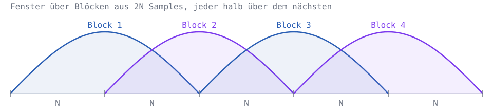
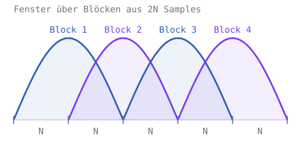

Dafür bezahlt man: Überlappen sich die Blöcke zur Hälfte, ist jedes Sample in zwei Blöcken, und eine FFT jedes Blocks gibt doppelt so viele Zahlen, wie es Samples gibt. Ein Codec, der doppelt so viele Zahlen speichern muss, ist kein guter Codec.

John Princen, Alan Johnson und Alan Bradley an der University of Surrey fanden 1987 eine Transformation, die beides kann: Blöcke aus `2N` Samples, die sich zur Hälfte überlappen, und für jeden Block nur `N` Zahlen. Sie heißt **modifizierte diskrete Kosinustransformation**, kurz MDCT, und steckt in MP3, AAC, Vorbis und Opus. Aus `2N` Samples \\(x\_n\\) macht sie `N` Zahlen

$$X\_k = \sum\_{n=0}^{2N-1} x\_n \cos\left(\frac{\pi}{N} \left(n + \frac{1}{2} + \frac{N}{2}\right)\left(k + \frac{1}{2}\right)\right)$$

Das ist eine Summe wie bei der DFT, nur mit einem einzigen Testton, einem Kosinus, der um ein halbes Sample und einen Viertelblock verschoben ist. Zurück geht es mit derselben Summe über `k`, mal `2 / N`. Lege `mdct.py` an, mit dem Rückweg `imdct` schon fertig:

<!-- page-code: own -->
```python
import numpy as np

from wav import read_wav, write_wav


def mdct(x):
    # hier: die N Zahlen der MDCT von 2N Samples


def imdct(X):
    N = len(X)
    k = np.arange(N)
    y = np.zeros(2 * N)
    for n in range(2 * N):
        y[n] = np.sum(X * np.cos(np.pi / N * (n + 0.5 + N / 2) * (k + 0.5)))
    return y * 2 / N


if __name__ == '__main__':
    print(np.round(imdct(mdct(np.arange(16.0))), 2))
```

<div class='hint own' data-check='mdct'>
<strong>Jetzt bist du dran:</strong> Schreib <code>mdct(x)</code>: Die Funktion bekommt ein numpy-Array mit <code>2N</code> Samples und gibt ein Array mit den <code>N</code> Zahlen \(X_0\) bis \(X_{N-1}\) zurück, nach der Formel oben.
</div>

<!-- hint -->
Es geht wie bei `dft`: `N = len(x) // 2`, ein Array `n = np.arange(2 * N)` für die Indizes der Samples, ein Array `X = np.zeros(N)` für das Ergebnis und eine Schleife über alle `k` von 0 bis `N - 1`.
<!-- /hint -->
<!-- hint -->
In der Schleife ist der Testton `np.cos(np.pi / N * (n + 0.5 + N / 2) * (k + 0.5))`, wie in `imdct`, nur dass jetzt `n` das Array ist und `k` die Zahl. Multipliziere ihn mit `x` und zähl alles zusammen.
<!-- /hint -->

<!-- solution -->
```python
def mdct(x):
    N = len(x) // 2
    n = np.arange(2 * N)
    X = np.zeros(N)
    for k in range(N):
        X[k] = np.sum(x * np.cos(np.pi / N * (n + 0.5 + N / 2) * (k + 0.5)))
    return X
```
<!-- /solution -->

_task(mdct)

Das Programm gibt der MDCT einen einzigen Block, die Zahlen 0 bis 15, und schickt ihre acht Zahlen durch `imdct` zurück.

_task(ein-block)

<!-- after: ein-block -->
```bash
python3 mdct.py
```

<!-- tutorial-step
write-file: audio/mdct.py <- file:stufen/mdct-1.py
check-task: mdct
terminal-run: python3 mdct.py
terminal-wait-for-prompt: 30
wait-for-text: 23. 23.
-->

Heraus kommt `[-7, -5, -3, -1, 1, 3, 5, 7, 23, 23, 23, 23, 23, 23, 23, 23]`. In der ersten Hälfte steht jede Zahl minus ihr Spiegelbild, 0 − 7, 1 − 6, …, in der zweiten jede Zahl plus ihr Spiegelbild, 8 + 15, 9 + 14, …. Acht Zahlen können nicht 16 Samples zurückgeben; die MDCT verliert die Hälfte, aber auf eine geschickte Art. Der nächste Block, einen halben Block später, bringt dieselben Samples in seiner ersten Hälfte zurück, mit dem Spiegelbild **abgezogen**. Zählt man beide zusammen, heben sich die Spiegelbilder auf. Das heißt auf Englisch Time Domain Aliasing Cancellation, kurz TDAC.

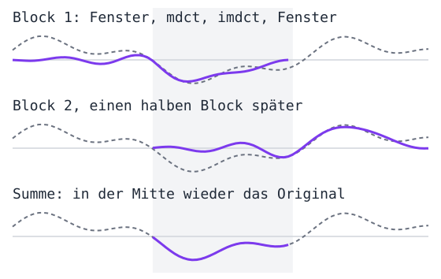

Damit das klappt, braucht es ein Fenster, mit dem jeder Block vor der MDCT und nach der `imdct` multipliziert wird. Das Sinusfenster \\(w\_n = \sin\left(\frac{\pi}{2N}\left(n + \frac{1}{2}\right)\right)\\) erfüllt, was Princen und Bradley dafür verlangen: An jeder Stelle der Überlappung ergeben die Quadrate der beiden Fenster zusammen 1:

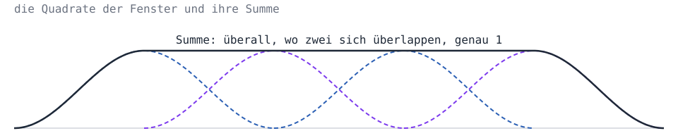
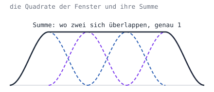

Weil jeder Block zweimal mit seinem Fenster multipliziert wird, vor der MDCT und nach der `imdct`, zählt beim Zusammenzählen das Quadrat. Schreib dazu unter `imdct`:

```python
def window(N):
    return np.sin(np.pi * (np.arange(2 * N) + 0.5) / (2 * N))


def encode(x, N):
    w = window(N)
    x = np.concatenate([np.zeros(N), x, np.zeros(2 * N)])
    return [mdct(w * x[s:s + 2 * N]) for s in range(0, len(x) - 2 * N + 1, N)]


def decode(blocks, N, length):
    w = window(N)
    y = np.zeros((len(blocks) + 1) * N)
    for i, X in enumerate(blocks):
        y[i * N:i * N + 2 * N] += w * imdct(X)
    return y[N:N + length]
```

`encode` setzt vor den Klang einen halben Block Stille, damit auch die ersten Samples zwei Blöcke haben, und dahinter genug Stille für den letzten. Dann nimmt es alle `N` Samples einen Block aus `2N`, multipliziert ihn mit dem Fenster und gibt die Liste der MDCTs zurück. `decode` geht den Weg zurück: Jeder Block geht durch `imdct` und das Fenster und wird an seiner Stelle dazugezählt, `+=`, so dass sich die überlappenden Hälften addieren. Am Ende schneidet es die Stille wieder ab. Prüf mit zwei Sekunden der Musik, ob alles zurückkommt:

```python
~     print(np.round(imdct(mdct(np.arange(16.0))), 2))
    x, rate = read_wav('musik.wav')
    x = x[:2 * rate]
    y = decode(encode(x, 1024), 1024, len(x))
    print('größter Fehler:', np.abs(x - y).max())
```

<!-- tutorial-step
write-file: audio/mdct.py <- file:stufen/mdct-2.py
terminal-run: python3 mdct.py
terminal-wait-for-prompt: 60
wait-for-text: größter Fehler:
-->

Der größte Fehler liegt bei 10⁻¹³, an der 13. Stelle hinter dem Komma, und das ist Rundung beim Rechnen: Die MDCT mit Fenster verliert nichts. Für die 88.200 Samples sind es 88 Blöcke mit je 1.024 Zahlen, 90.112 Zahlen: so viele, wie es Samples gibt, und dazu die Ränder.
<!-- /after -->

<!-- stage: stufen/mdct-2.py as mdct.py -->

### Vorechos

Lange Blöcke haben einen Vorteil: Je mehr Samples in einem Block stecken, desto feiner trennt die MDCT die Frequenzen, so wie die FFT bei mehr Samples feinere Frequenzen findet. Und sie haben einen Nachteil, den die Kastagnetten zeigen. Hol sie dir:

```bash_copy
wget ${web_root}/audio/kastagnetten.wav
```

<!-- tutorial-step
terminal-run: test -f kastagnetten.wav || curl -sO http://workspace_nginx_1/audio/kastagnetten.wav
terminal-wait-for-prompt: 30
-->

Lege `vorecho.py` an. Es rundet die Zahlen jedes Blocks grob: Die größte Zahl eines Blocks bestimmt die Stufen, und jede Zahl wird auf ein Vielfaches eines Achtels von ihr gerundet. Das macht es einmal mit langen Blöcken von 1.024 Zahlen und einmal mit kurzen von 128:

```python
import numpy as np

from mdct import decode, encode
from wav import read_wav, write_wav


def coarse(blocks):
    out = []
    for X in blocks:
        step = np.abs(X).max() / 8
        out.append(np.round(X / step) * step)
    return out


if __name__ == '__main__':
    x, rate = read_wav('kastagnetten.wav')
    for N, name in [(1024, 'lang'), (128, 'kurz')]:
        y = decode(coarse(encode(x, N)), N, len(x))
        write_wav(f'kastagnetten-{name}.wav', y, rate)
        print(f'{name}: Blöcke mit {N} Zahlen, fertig')
```

_task(vorecho)

<!-- after: vorecho -->
```bash
python3 vorecho.py
```

<!-- tutorial-step
write-file: audio/vorecho.py <- file:stufen/vorecho.py
terminal-run: python3 vorecho.py
terminal-wait-for-prompt: 60
wait-for-text: kurz: Blöcke mit 128 Zahlen, fertig
-->

Hör dir `kastagnetten.wav`, `kastagnetten-lang.wav` und `kastagnetten-kurz.wav` an. In den langen Blöcken rauscht es schon vor jedem Schlag, der nach einer Pause kommt: Ein Block von 2.048 Samples dauert 46 Millisekunden, und das Runden verteilt seinen Fehler über den ganzen Block. Die größte Zahl im Block gehört zum Schlag, also sind die Stufen grob, und das Rauschen reicht bis an den Anfang des Blocks, in die leise Stelle davor. Das heißt **Vorecho**. Nach dem Schlag verdeckt der Schlag selbst das Rauschen, davor nur etwa 20 Millisekunden lang, wie im letzten Kapitel.

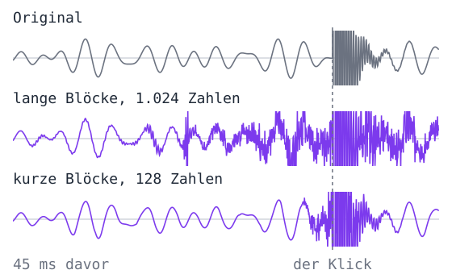

In den kurzen Blöcken bleibt der Fehler beim Schlag. Darum schalten Codecs um: AAC nimmt Blöcke mit 1.024 Zahlen, und wo ein Schlag kommt, acht kurze mit je 128; MP3 wechselt zwischen 576 und dreimal 192. Ein Codec muss dafür vorausschauen, ob ein Schlag kommt, und das ist ein Grund, warum ein Codec immer etwas Verzögerung hat.
<!-- /after -->

## Quantisieren nach Gehör

Jetzt kommt alles zusammen: die MDCT in Blöcken, die Mithörschwelle und das Runden. Ein Codec wie MP3 oder AAC rundet jede Zahl der MDCT so grob, wie es geht, ohne dass man den Fehler hört. Wo die Musik laut ist und viel verdeckt, sind die Stufen grob; wo es leise ist, fein. Was dabei herauskommt, sind fast nur kleine ganze Zahlen und sehr viele Nullen, und die lassen sich mit wenigen Bits speichern.

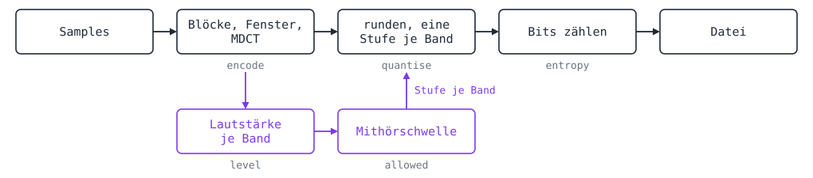
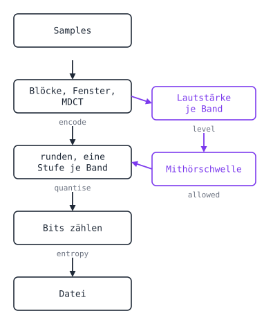

### Schneller rechnen

`mdct` geht für jedes `k` alle Samples durch und rechnet dabei jedes Mal die Testtöne neu aus. Für ein ganzes Lied dauert das zu lange. Die Testtöne hängen aber nur von `N` ab: Man kann sie einmal ausrechnen, als Tabelle mit einer Zeile für jedes `k`, eine **Matrix**. `tones(N) @ x` multipliziert jede Zeile mit `x` und zählt zusammen, alle `N` Summen auf einmal, und numpy macht das in C. `@functools.cache` merkt sich die Matrix für jedes `N`, damit sie nur einmal ausgerechnet wird. Ersetz `mdct` und `imdct` in `mdct.py` durch:

```python
@functools.cache
def tones(N):
    n = np.arange(2 * N)
    k = np.arange(N)
    return np.cos(np.pi / N * np.outer(k + 0.5, n + 0.5 + N / 2))


def mdct(x):
    return tones(len(x) // 2) @ x


def imdct(X):
    return tones(len(X)).T @ X * 2 / len(X)
```

`np.outer` bildet aus zwei Arrays die Tabelle aller Produkte, Zeile für Zeile `k + 0.5` mal jedes `n + 0.5 + N / 2`. `.T` dreht die Matrix, so dass die Zeilen zu Spalten werden: Für `imdct` läuft die Summe über `k` statt über `n`. Oben in die Datei kommt `import functools`. Es kommen dieselben Zahlen heraus, nur viel schneller.

<!-- tutorial-step
write-file: audio/mdct.py <- file:stufen/mdct-3.py
check-task: mdct
-->

<!-- stage: stufen/mdct-3.py as mdct.py -->

### Bänder

Ein Codec speichert nicht für jede der 1.024 Zahlen eines Blocks eine eigene Stufe, das kostete zu viele Bits. Er teilt die Zahlen in **Bänder**, ungefähr in Frequenzgruppen, eines für jedes Bark, und gibt jedem Band eine Stufe. Unten sind die Bänder 4 bis 10 Zahlen breit, oben über 300:

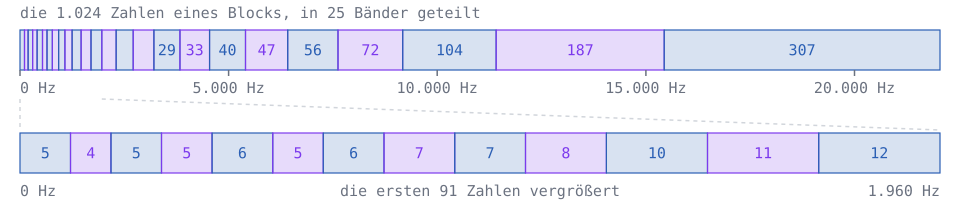
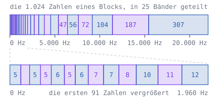

Lege `codec.py` an:

```python
import numpy as np

from ear import threshold
from mdct import decode, encode
from wav import read_wav, write_wav

N = 1024
RATE = 44100
CAL = 44.0
OFFSET = 15


def bark(f):
    return 13 * np.arctan(0.00076 * f) + 3.5 * np.arctan((f / 7500) ** 2)


def spread(dz):
    return 15.81 + 7.5 * (dz + 0.474) - 17.5 * np.sqrt(1 + (dz + 0.474) ** 2)


def make_bands():
    edges = [0]
    for z in range(1, 26):
        k = int(np.searchsorted(bark(FREQS), z))
        if k - edges[-1] >= 4 and k < N:
            edges.append(k)
    edges.append(N)
    return list(zip(edges[:-1], edges[1:]))


FREQS = (np.arange(N) + 0.5) * RATE / (2 * N)
BANDS = make_bands()
CENTRES = np.array([bark(FREQS[(a + b) // 2]) for a, b in BANDS])
QUIET = np.array([threshold(FREQS[a:b]).min() for a, b in BANDS])
```

`FREQS` ist die Frequenz jeder der 1.024 Zahlen der MDCT. `bark` ist die Formel von Zwicker, die aus Hz Bark macht, und `make_bands` sucht mit `np.searchsorted` die Stelle, an der jedes ganze Bark beginnt; ein Band hat mindestens vier Zahlen. `BANDS` ist dann eine Liste von 25 Paaren, Anfang und Ende jedes Bandes, `CENTRES` die Mitte jedes Bandes in Bark und `QUIET` die Hörschwelle in jedem Band, aus `ear.py`. `spread` ist die Kurve aus dem Widget zur Verdeckung: um wie viele dB die Mithörschwelle eines Klangs `dz` Bark neben ihm unter seiner Lautstärke liegt. `CAL` rechnet die Zahlen der MDCT in dB SPL um, so dass ein Sinus, so laut es geht, 96 dB hat. `OFFSET` sagt, wie weit der Fehler unter der Mithörschwelle bleiben soll.

### Die Mithörschwelle eines Blocks

Für jedes Band kennt der Codec seine Lautstärke in dB SPL, `level`. Jedes Band verdeckt sich selbst und seine Nachbarn: Band `j` hebt die Schwelle in Band `i` auf `level[j] + spread(CENTRES[i] - CENTRES[j]) - OFFSET`. Verdecken mehrere Bänder dasselbe Band, zählen ihre Wirkungen zusammen, aber nicht als Dezibel: Dezibel sind ein Logarithmus. Zusammen zählt die Energie, \\(10^{L / 10}\\) für \\(L\\) dB, und aus der Summe werden mit \\(10 \cdot \log\_{10}\\) wieder Dezibel. Zwei gleich laute Verdecker ergeben so 3 dB mehr, nicht doppelt so viele dB.

<div class='hint own' data-check='mithoerschwelle'>
<strong>Jetzt bist du dran:</strong> Schreib <code>allowed(level)</code>: Die Funktion bekommt für jedes der 25 Bänder seine Lautstärke in dB und gibt für jedes Band zurück, wie laut der Fehler dort sein darf: die Energie aller Verdecker zusammen, in dB, aber nie unter der Hörschwelle <code>QUIET</code>.
</div>

<!-- hint -->
Zwei Schleifen: außen über die Bänder `i`, für die du die Schwelle suchst, innen über alle Bänder `j`, die etwas verdecken. Innen zählst du `10 ** ((level[j] + spread(CENTRES[i] - CENTRES[j]) - OFFSET) / 10)` zusammen.
<!-- /hint -->
<!-- hint -->
Nach der inneren Schleife ist `10 * np.log10(power)` die Schwelle für Band `i`. Zum Schluss nimmt `np.maximum(out, QUIET)` für jedes Band den größeren der beiden Werte:

```python
out = np.zeros(len(level))
for i in range(len(level)):
    power = 0
    for j in range(len(level)):
        power += …
    out[i] = 10 * np.log10(power)
return np.maximum(out, QUIET)
```
<!-- /hint -->

<!-- solution -->
```python
def allowed(level):
    out = np.zeros(len(level))
    for i in range(len(level)):
        power = 0
        for j in range(len(level)):
            power += 10 ** ((level[j] + spread(CENTRES[i] - CENTRES[j]) - OFFSET) / 10)
        out[i] = 10 * np.log10(power)
    return np.maximum(out, QUIET)
```
<!-- /solution -->

_task(mithoerschwelle)

So sieht das für einen Block der Musik aus, etwa 1,4 Sekunden nach dem Anfang, mit deinem `allowed`:

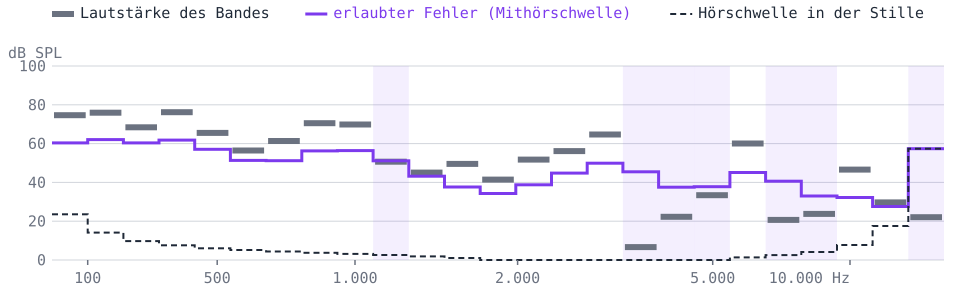
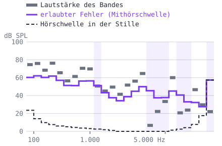

Die lila Linie liegt fast überall weit über der Hörschwelle: Die lauten Bänder ziehen die Mithörschwelle für sich und ihre Nachbarn hoch. Wo ein Band lila hinterlegt ist, ist es leiser als der Fehler, den die Nachbarn verdecken; dort darf alles 0 werden, und niemand hört es. Ganz oben hebt die Hörschwelle selbst die Linie: So hoch hört kaum ein Ohr.

### Runden nach Gehör

Jetzt das Runden. Rundet man auf ein Vielfaches einer Stufe `step`, ist der Fehler gleichmäßig zwischen `-step / 2` und `step / 2` verteilt, und seine Energie ist im Mittel `step ** 2 / 12` je Zahl. `quantise` wählt die Stufe jedes Bandes so, dass die Energie des Fehlers im ganzen Band gerade so groß ist, wie `allowed` erlaubt. Heraus kommen ganze Zahlen `q` und für jedes Band seine Stufe; `dequantise` macht daraus wieder die Zahlen der MDCT. Schreib unter `allowed`:

```python
def quantise(X):
    level = np.array([10 * np.log10(np.sum(X[a:b] ** 2) + 1e-20) + CAL for a, b in BANDS])
    noise = allowed(level)
    q = np.zeros(N, dtype=int)
    steps = np.zeros(len(BANDS))
    for i, (a, b) in enumerate(BANDS):
        steps[i] = np.sqrt(12 * 10 ** ((noise[i] - CAL) / 10) / (b - a))
        q[a:b] = np.round(X[a:b] / steps[i])
    return q, steps


def dequantise(q, steps):
    Y = np.zeros(N)
    for i, (a, b) in enumerate(BANDS):
        Y[a:b] = q[a:b] * steps[i]
    return Y


if __name__ == '__main__':
    x, rate = read_wav('musik.wav')
    coded = [quantise(X) for X in encode(x, N)]
    y = decode([dequantise(q, steps) for q, steps in coded], N, len(x))
    write_wav('musik-codec.wav', y, rate)
    write_wav('musik-rest.wav', x - y, rate)
    values = np.concatenate([q for q, steps in coded])
    print(f'{np.mean(values == 0):.0%} der Zahlen sind 0, die größte ist {np.abs(values).max()}')
```

Das Programm codiert die ganze Musik, macht daraus wieder Samples und schreibt zwei Dateien: `musik-codec.wav`, was der Codec übrig lässt, und `musik-rest.wav`, was er weggelassen hat, das Original minus das Ergebnis.

_task(der-rest)

<!-- after: der-rest -->
```bash
python3 codec.py
```

<!-- tutorial-step
write-file: audio/codec.py <- file:stufen/codec-1.py
check-task: mithoerschwelle
terminal-run: python3 codec.py
terminal-wait-for-prompt: 60
wait-for-text: der Zahlen sind 0
-->

Hör dir `musik.wav` und `musik-codec.wav` nacheinander an, dann `musik-rest.wav`. Der Rest ist nicht still: Er ist nur etwa 14 dB leiser als die Musik und wird mit ihr lauter und leiser, denn er ist so laut, wie die Mithörschwelle erlaubt, und die folgt der Musik. Fast zwei Drittel seiner Energie liegen unter 200 Hz, bei Bass und Kick-Drum: Dort hören wir schlecht, und laute tiefe Töne verdecken viel. Allein hört man den Rest gut; unter der Musik soll er verschwinden, wenn das Modell stimmt. Gut zwei Drittel der gerundeten Zahlen sind 0, und die größte ist 16.
<!-- /after -->

### Wie viele Bits

Wie viele Bits braucht es, die gerundeten Zahlen zu speichern? Kommt eine Zahl mit der Wahrscheinlichkeit `p` vor, braucht ein guter Code für sie \\(\log\_2(1/p)\\) Bits: Eine Zahl, die in der Hälfte der Fälle vorkommt, 1 Bit, eine, die in einem Achtel vorkommt, 3 Bits. Im Mittel sind das

$$H = \sum p \cdot \log_2 \frac{1}{p}$$

Bits je Zahl. Claude Shannon hat 1948 gezeigt, dass kein Code im Mittel mit weniger auskommt; man nennt \\(H\\) die **Entropie**. Ein [Huffman-Code](/huffman) kommt bis auf weniger als ein Bit je Zahl heran. MP3 und AAC haben feste Huffman-Tabellen für die gerundeten Zahlen, Opus einen Coder, der noch etwas näher an \\(H\\) kommt.

<div class='hint own' data-check='entropie'>
<strong>Jetzt bist du dran:</strong> Schreib <code>entropy(values)</code>: die Entropie der Zahlen in einem numpy-Array, in Bits je Zahl. <code>np.unique(values, return_counts=True)</code> gibt die verschiedenen Zahlen und wie oft jede vorkommt.
</div>

<!-- hint -->
`np.unique` gibt zwei Arrays zurück; du brauchst nur das zweite: `_, counts = np.unique(values, return_counts=True)`. Die Wahrscheinlichkeiten sind dann `counts / counts.sum()`.
<!-- /hint -->
<!-- hint -->
Mit `p` für das Array der Wahrscheinlichkeiten ist die Formel `np.sum(p * np.log2(1 / p))`; `float` macht daraus eine gewöhnliche Zahl.
<!-- /hint -->

<!-- solution -->
```python
def entropy(values):
    _, counts = np.unique(values, return_counts=True)
    p = counts / counts.sum()
    return float(np.sum(p * np.log2(1 / p)))
```
<!-- /solution -->

_task(entropie)

Dazu kommen die Stufen der Bänder. Ein Codec speichert sie als kleine ganze Zahl, AAC etwa in Schritten von 1,5 dB; rechne mit 6 Bits für jedes Band in jedem Block. Schreib unten ins Programm:

```python
~     print(f'{np.mean(values == 0):.0%} der Zahlen sind 0, die größte ist {np.abs(values).max()}')
    bits = entropy(values) * len(values) + 6 * len(BANDS) * len(coded)
    seconds = len(x) / rate
    print(f'{bits / seconds / 1000:.0f} kbit/s statt {16 * rate / 1000:.0f} kbit/s')
```

<!-- tutorial-step
write-file: audio/codec.py <- file:stufen/codec-2.py
check-task: entropie
terminal-run: python3 codec.py
terminal-wait-for-prompt: 60
wait-for-text: kbit/s statt 706 kbit/s
-->

Dein Codec braucht für die Musik etwa 76 kbit/s statt 706, ein Neuntel. MP3 braucht für Musik in Stereo meist 128 bis 320 kbit/s, für Mono etwa die Hälfte; dein Codec liegt also in derselben Gegend, mit einem viel einfacheren Modell des Gehörs.

<!-- stage: stufen/codec-2.py as codec.py -->

<div class='hint try'>
<strong>Ausprobieren:</strong> Setz <code>OFFSET</code> auf 5 und lass das Programm noch einmal laufen: Wie viele kbit/s sind es, und hörst du in <code>musik-codec.wav</code> einen Unterschied zum Original? Geh in Schritten von 5 weiter nach unten, bis zu −10. Ab wann hörst du das Rauschen, und woran zuerst? Setz <code>OFFSET</code> dann wieder auf 15.
</div>

## Echte Dateien

Dein Codec zeigt, wie es geht. Jetzt die echten: Was steht in einer MP3-Datei, und wie gut klingen MP3, AAC und Opus bei wenigen Bits?

### Eine MP3-Datei Byte für Byte

ffmpeg macht aus der Musik eine MP3-Datei mit 128 kbit/s:

```bash
ffmpeg -i musik.wav -b:a 128k musik.mp3
ls -l musik.wav musik.mp3
hexdump -C musik.mp3 | head -5
```

<!-- tutorial-step
terminal-run: cd /workspace/audio && ffmpeg -v error -y -i musik.wav -b:a 128k musik.mp3 && ls -l musik.wav musik.mp3 && hexdump -C musik.mp3 | head -5
terminal-wait-for-prompt: 30
wait-for-text: Info
-->

Aus 705.644 Bytes werden 129.193, knapp ein Fünftel. So fängt die Datei an:

<pre class='spec hexdump'>
00000000  <span class='m0'>49 44 33 04 00 00 00 00  00 23</span> <span class='m1'>54 53 53 45 00 00</span>  |ID3......#TSSE..|
00000010  <span class='m1'>00 0f 00 00 03 4c 61 76  66 36 30 2e 31 36 2e 31</span>  |.....Lavf60.16.1|
00000020  <span class='m1'>30 30 00</span> <span class='mg'>00 00 00 00 00  00 00 00 00 00</span> <span class='m2'>ff fb 90</span>  |00..............|
00000030  <span class='m2'>c0</span> <span class='mg'>00 00 00 00 00 00 00  00 00 00 00 00 00 00 00</span>  |................|
00000040  <span class='mg'>00 00</span> <span class='m3'>49 6e 66 6f</span> 00 00  00 0f 00 00 01 34 00 01  |..Info.......4..|
</pre>

Vorn steht ein <span class='m0'>ID3-Tag</span>, ein Kasten für Angaben zur Musik, Titel, Künstler, Album, Bild. ffmpeg schreibt nur einen <span class='m1'>Eintrag</span> hinein: `TSSE`, womit die Datei gemacht wurde, `Lavf60.16.100`, die Bibliothek von ffmpeg. Danach, nach ein paar <span class='mg'>Bytes Füllung</span>, beginnt mit <span class='m2'><code>ff fb 90 c0</code></span> der erste **Frame**. Eine MP3-Datei ist eine Folge von Frames, jeder mit einem Header von 4 Bytes und danach den Bits für 1.152 Samples.

#### Das ID3-Tag

Die ersten zehn Bytes sagen, wie lang das Tag ist: `ID3`, die Version 2.4.0 (`04 00`), Flags (`00`) und die Größe in vier Bytes, `00 00 00 23`. Die Größe ist besonders geschrieben: Von jedem Byte zählen nur die unteren 7 Bits, das oberste ist immer 0. So kommt im Tag nie `ff` vor, und ein Programm, das Frames am Byte `ff` erkennt, stolpert nicht über das Tag. Hier ist es einfach 0x23 = 35: Nach den zehn Bytes kommen 35 Bytes Tag, und der erste Frame beginnt beim Byte 45.

#### Der Header eines Frames

Die vier Bytes `ff fb 90 c0` sind Felder aus einzelnen Bits:

<pre class='spec'>
      7 6 5 4 3 2 1 0        Field Name
     +-+-+-+-+-+-+-+-+
   0 |<span class='m0'>1 1 1 1 1 1 1 1</span>|       <span class='m0'>Sync: 11 Bits, alle 1</span>
     +-+-+-+-+-+-+-+-+
   1 |<span class='m0'>1 1 1</span>|<span class='m1'>1 1</span>|<span class='m2'>0 1</span>|<span class='m3'>1</span>|       <span class='m1'>Version</span>, <span class='m2'>Layer</span>, <span class='m3'>ohne Prüfsumme</span>
     +-+-+-+-+-+-+-+-+
   2 |<span class='m4'>1 0 0 1</span>|<span class='m5'>0 0</span>|<span class='m6'>0</span>|<span class='mg'>0</span>|       <span class='m4'>Bitrate</span>, <span class='m5'>Abtastrate</span>, <span class='m6'>Padding</span>, <span class='mg'>frei</span>
     +-+-+-+-+-+-+-+-+
   3 |<span class='m7'>1 1</span>|<span class='mg'>0 0 0 0 0 0</span>|       <span class='m7'>Kanäle</span>, <span class='mg'>Weiteres</span>
     +-+-+-+-+-+-+-+-+
</pre>

<div style='max-width: 100%; overflow-x: auto;'>
<table class='table bytes'>
<tr>
<td><span class='m0'><code>11111111 111</code></span></td>
<td>Sync: elf Einsen, an denen ein Player den Anfang eines Frames erkennt, auch wenn er mitten in einen Strom einsteigt, etwa beim Internetradio</td>
</tr>
<tr>
<td><span class='m1'><code>11</code></span></td>
<td>Version: MPEG-1</td>
</tr>
<tr>
<td><span class='m2'><code>01</code></span></td>
<td>Layer III, das ist das »3« in MP3</td>
</tr>
<tr>
<td><span class='m3'><code>1</code></span></td>
<td>keine Prüfsumme nach dem Header</td>
</tr>
<tr>
<td><span class='m4'><code>1001</code></span></td>
<td>Bitrate: der Index 9 in der Tabelle unten, 128 kbit/s</td>
</tr>
<tr>
<td><span class='m5'><code>00</code></span></td>
<td>Abtastrate: der Index 0, 44.100 Hz</td>
</tr>
<tr>
<td><span class='m6'><code>0</code></span></td>
<td>Padding: ob der Frame ein Byte länger ist</td>
</tr>
<tr>
<td><span class='m7'><code>11</code></span></td>
<td>Kanäle: Mono (<code>00</code> wäre Stereo)</td>
</tr>
</table>
</div>

<div style='max-width: 100%; overflow-x: auto;'>
<table class='table'>
<tr><th>Index</th><td>1</td><td>2</td><td>3</td><td>4</td><td>5</td><td>6</td><td>7</td><td>8</td><td>9</td><td>10</td><td>11</td><td>12</td><td>13</td><td>14</td></tr>
<tr><th>Bitrate in kbit/s</th><td>32</td><td>40</td><td>48</td><td>56</td><td>64</td><td>80</td><td>96</td><td>112</td><td>128</td><td>160</td><td>192</td><td>224</td><td>256</td><td>320</td></tr>
</table>
</div>

Die Abtastrate hat drei Werte: Der Index 0 ist 44.100 Hz, 1 ist 48.000 Hz, 2 ist 32.000 Hz. Die Tabellen gelten für MPEG-1 Layer III; die Seite des [MPEG-Formats bei der Library of Congress](https://www.loc.gov/preservation/digital/formats/fdd/fdd000012.shtml) beschreibt das Format und nennt die Normen.

Ein Frame enthält 1.152 Samples. Bei 128.000 Bits in der Sekunde und 44.100 Samples in der Sekunde sind das 1.152 · 128.000 / 44.100 Bits, geteilt durch 8 für Bytes: 144 · 128.000 / 44.100 = 417,96 Bytes. Ein Frame hat aber eine ganze Zahl von Bytes, abgerundet 417. Damit es im Mittel trotzdem genau 128 kbit/s werden, ist mancher Frame ein Byte länger; das sagt das Padding-Bit.

_task(frame-bytes)

Lege `mp3.py` an:

<!-- page-code: own -->
```python
BITRATES = [0, 32, 40, 48, 56, 64, 80, 96, 112, 128, 160, 192, 224, 256, 320]
RATES = [44100, 48000, 32000]


def frame_length(header):
    # hier: die Länge des Frames in Bytes, aus seinem Header
```

Um ein Feld aus einem Byte zu holen, schiebt man es nach rechts und schneidet ab, was links davon steht: `header[2] >> 4` sind die oberen vier Bits von Byte 2, der Index der Bitrate. `(header[2] >> 2) & 3` schiebt um zwei Stellen und behält mit `& 3`, binär `11`, nur die unteren zwei Bits: den Index der Abtastrate. Mehr dazu steht im Handbuch unter [Bits und Bytes](/reference/bits-und-bytes).

<div class='hint own' data-check='frame-laenge'>
<strong>Jetzt bist du dran:</strong> Schreib <code>frame_length(header)</code>: Die Funktion bekommt die vier Bytes eines Headers und gibt zurück, wie viele Bytes der Frame lang ist, mit dem Padding.
</div>

<!-- hint -->
Drei Felder aus Byte 2: die Bitrate `BITRATES[header[2] >> 4]` in kbit/s, die Abtastrate `RATES[(header[2] >> 2) & 3]` und das Padding, ein einziges Bit, `(header[2] >> 1) & 1`.
<!-- /hint -->
<!-- hint -->
Die Länge ist `144 * bitrate // rate + padding`, mit der Bitrate in Bit pro Sekunde, also mal 1.000. `//` teilt ganzzahlig und rundet ab.
<!-- /hint -->

<!-- solution -->
```python
def frame_length(header):
    bitrate = BITRATES[header[2] >> 4] * 1000
    rate = RATES[(header[2] >> 2) & 3]
    padding = (header[2] >> 1) & 1
    return 144 * bitrate // rate + padding
```
<!-- /solution -->

_task(frame-laenge)

Jetzt kann ein Programm von Frame zu Frame springen: am Header die Länge ablesen, so viele Bytes weiter, und dort muss wieder ein Header stehen. `id3_size` liest die Größe des Tags, sieben Bits je Byte. Schreib dazu:

```python
def id3_size(data):
    if data[:3] != b'ID3':
        return 0
    size = 0
    for byte in data[6:10]:
        size = size * 128 + byte
    return 10 + size


if __name__ == '__main__':
    with open('musik.mp3', 'rb') as f:
        data = f.read()
    pos = id3_size(data)
    print(f'ID3-Tag: {pos} Bytes')
    frames = 0
    padded = 0
    while pos + 4 <= len(data) and data[pos] == 0xFF and data[pos + 1] & 0xE0 == 0xE0:
        length = frame_length(data[pos:pos + 4])
        padded += (data[pos + 2] >> 1) & 1
        pos += length
        frames += 1
    print(f'{frames} Frames, {padded} davon mit Padding, {len(data) - pos} Bytes danach')
    print(f'{(frames - 1) * 1152 / 44100:.4f} Sekunden Klang')
```

`data[pos + 1] & 0xE0 == 0xE0` prüft die oberen drei Bits des zweiten Bytes, den Rest des Syncs. Findet die Schleife keinen Header mehr, hört sie auf.

```bash
python3 mp3.py
ffprobe -v error -show_entries format=duration musik.mp3
```

<!-- tutorial-step
write-file: audio/mp3.py <- file:stufen/mp3.py
check-task: frame-laenge
terminal-run: python3 mp3.py && ffprobe -v error -show_entries format=duration musik.mp3
terminal-wait-for-prompt: 30
wait-for-text: duration=8.045714
-->

309 Frames, 295 davon mit Padding, und nach dem letzten Frame kein Byte mehr. Der erste Frame enthält keinen Klang: Nach seinem Header steht `Info`, und darin hat der Coder notiert, wie viele Frames und Bytes folgen und wie viel Stille ein Player am Anfang und am Ende weglassen soll. Darum rechnet das Programm mit `frames - 1`: 308 Frames mit je 1.152 Samples sind 8,0457 Sekunden, und genau das sagt auch `ffprobe`. Die Musik dauert 8 Sekunden; den Rest füllt der Coder mit Stille, vorn, weil er vorausschaut, und hinten bis zum vollen Frame.

<!-- stage: stufen/mp3.py as mp3.py -->

### MP3, AAC und Opus

Seit MP3 sind weitere Codecs dazugekommen: **AAC** (1997), heute in Videos und bei Musikdiensten, und **Opus** (2012), im Browser bei Videoanrufen. ffmpeg kann alle drei. Mach dieselbe Musik mit jedem bei mehreren Bitraten:

```bash_copy
for r in 32 64 128; do ffmpeg -v error -y -i musik.wav -b:a ${r}k musik-$r.mp3; done
for r in 32 64 128; do ffmpeg -v error -y -i musik.wav -c:a aac -b:a ${r}k musik-$r.m4a; done
for r in 16 32 64; do ffmpeg -v error -y -i musik.wav -c:a libopus -b:a ${r}k musik-$r.opus; done
ls -l musik*
```

<!-- tutorial-step
terminal-run: for r in 32 64 128; do ffmpeg -v error -y -i musik.wav -b:a ${r}k musik-$r.mp3; ffmpeg -v error -y -i musik.wav -c:a aac -b:a ${r}k musik-$r.m4a; done; for r in 16 32 64; do ffmpeg -v error -y -i musik.wav -c:a libopus -b:a ${r}k musik-$r.opus; done; ls -l musik*.opus
terminal-wait-for-prompt: 60
wait-for-text: musik-64.opus
-->

<div class='table-responsive'>
<table class='table'>
<tr><th></th><th>16 kbit/s</th><th>32 kbit/s</th><th>64 kbit/s</th><th>128 kbit/s</th></tr>
<tr><th>MP3</th><td></td><td>32.410</td><td>64.618</td><td>129.193</td></tr>
<tr><th>AAC</th><td></td><td>34.461</td><td>66.899</td><td>137.813</td></tr>
<tr><th>Opus</th><td>22.587</td><td>50.515</td><td>88.747</td><td></td></tr>
</table>
</div>

Die Bytes bei dir sollten genauso aussehen. MP3 und AAC halten die Bitrate fast genau ein: 8 Sekunden mal 32.000 Bit sind 32.000 Bytes. Opus nimmt die Bitrate als Ziel und gibt einem Klang, der schwer zu codieren ist, mehr: Bei dieser Musik sind es statt 32 etwa 50 kbit/s.

### Hören, ob man es hört

Ob man einen Codec hört, lässt sich nicht mit einer Frage wie »Klingt das gut?« klären: Wer weiß, welches das Original ist, hört leicht einen Unterschied, den es nicht gibt. Darum gibt es den **ABX-Test**, den W. A. Munson und Mark B. Gardner von den Bell Labs 1950 beschrieben: Du hörst **A**, das Original, und **B**, die Fassung mit Codec, und dazu **X**, das eins von beiden ist, ohne dass du weißt, welches. Dann sagst du, ob X A oder B ist. Wer keinen Unterschied hört, liegt im Mittel bei der Hälfte richtig. Wer in 10 Runden 9-mal richtig liegt, hat mit Raten nur eine Chance von etwa 1 %: Er hört einen Unterschied.

Im Widget sind A und B fünf Sekunden der Musik, B einmal durch den Codec und zurück; du kannst jederzeit umschalten, ohne dass die Musik von vorn anfängt.

<div class='abx-widget'></div>

<div class='hint try'>
<strong>Ausprobieren:</strong> Fang mit MP3 bei 128 kbit/s an und spiel 10 Runden. Geh dann mit der Bitrate herunter: Ab welcher hörst du sicher einen Unterschied? Achte auf die Hi-Hat, das Zischen oben, und auf den Klang der Glocke, wenn sie verklingt. Vergleiche danach die drei Codecs bei 32 kbit/s.
</div>

## Heute

Alles, was du gebaut hast, steckt in den Codecs, die heute jeden Tag Milliarden Mal laufen. Wie sie entstanden sind und wohin es geht.

### Wie MP3 entstand

1987 taten sich die Universität Erlangen-Nürnberg und das Fraunhofer-Institut für Integrierte Schaltungen in Erlangen zusammen. Dieter Seitzer, Professor in Erlangen, träumte von einer digitalen Jukebox: Musik aus einem Rechner, über eine ISDN-Leitung des Telefonnetzes, und dafür musste sie etwa zwölfmal kleiner werden, ungefähr so viel wie bei deinem Codec. Sein Doktorand Karlheinz Brandenburg schrieb 1989 seine Doktorarbeit darüber, wie man Klänge nach dem codiert, was das Ohr wahrnimmt, genau das, was du in den Kapiteln über das Ohr und das Runden gemacht hast. Die Moving Picture Experts Group, kurz MPEG, machte daraus mit anderen Vorschlägen eine Norm, MPEG-1, fertig 1992 und 1993 veröffentlicht als ISO/IEC 11172. Sie hat drei Stufen, Layer I bis III, und Layer III ist das, was man heute MP3 nennt: eine Filterbank und danach eine MDCT, Runden nach Gehör und Huffman-Codes.

Zum Prüfen hörte Brandenburg immer wieder ein Lied: »Tom's Diner« von Suzanne Vega, eine Stimme ohne Begleitung. Eine einzelne Stimme verdeckt wenig, und jeder Fehler ist zu hören. 1995 stimmten die Forscher in Erlangen ab, wie die Dateien heißen sollten, und wählten die Endung `.mp3`. Wer MP3 benutzen wollte, zahlte bis 2017 Lizenzen; dann lief das letzte Patent ab, und MP3 ist frei.

_person(brandenburg)

### Nach MP3

**AAC** wurde 1997 als Nachfolger von MP3 genormt, von Dolby, AT&T, Fraunhofer und Sony gemeinsam. Es hat nur noch die MDCT, ohne die Filterbank davor, und Blöcke mit 1.024 oder achtmal 128 Zahlen, wie im Kapitel über Blöcke. AAC steckt in Videos, bei Apple und bei den meisten Musikdiensten.

**Vorbis** begann Chris Montgomery 1993, Version 1.0 erschien im Jahr 2000: ein Codec, für den niemand Lizenzen zahlen muss. Spotify nutzt ihn vor allem, und viele Spiele, darunter Minecraft, speichern ihre Klänge damit.

**Opus** ist seit 2012 als [RFC 6716](https://www.rfc-editor.org/rfc/rfc6716) beschrieben. Es hat zwei Codecs in einem: SILK, von Skype für Sprache entwickelt, sagt das nächste Sample aus den vorigen voraus wie im Kapitel über kleine Tricks; CELT aus dem Umfeld der Xiph.Org Foundation arbeitet mit der MDCT in kurzen Blöcken, damit wenig Verzögerung entsteht. Opus kann alles von 6 bis 510 kbit/s, und jeder Browser muss es für Anrufe über WebRTC können: Wenn du im Browser telefonierst oder eine Videokonferenz hast, hörst du sehr wahrscheinlich Opus.

**LC3** ist der Codec von Bluetooth LE Audio, entwickelt von Fraunhofer und Ericsson. Er löst den alten Codec SBC ab und klingt in den Hörtests der Bluetooth-Organisation besser als er, auch wenn Pakete verloren gehen.

<div class='hint try'>
<strong>Ausprobieren:</strong> Wie wenig reicht für eine Stimme? Mach aus <code>stimme.wav</code> eine Opus-Datei mit 6 kbit/s, der kleinsten Bitrate, und wieder eine WAV-Datei zum Anhören:
<pre><code>ffmpeg -i stimme.wav -c:a libopus -b:a 6k -application voip stimme-6.opus
ffmpeg -i stimme-6.opus stimme-6.wav
ls -l stimme.wav stimme-6.opus</code></pre>
Wie viel kleiner ist die Opus-Datei? Achte beim Anhören von <code>stimme-6.wav</code> auf die Laute s, z und sch: Sind sie noch da?
</div>

### Codecs, die lernen

Seit einigen Jahren gibt es Codecs, in denen ein neuronales Netz steckt. Opus 1.5 vom März 2024 kann mit Netzen verlorene Pakete füllen und Sprache bei 6 kbit/s deutlich besser klingen lassen; ausgeschaltet ist das, bis man es einschaltet. Weiter gehen Codecs, die ganz aus Netzen bestehen. **SoundStream** von Forschenden bei Google (2021) hat einen Coder, der aus dem Klang wenige Zahlen macht, und einen Decoder, der daraus wieder einen Klang macht; beide haben an sehr vielen Klängen gelernt, wie man das gut macht. In ihren Hörtests klang SoundStream mit 3 kbit/s besser als Opus mit 12. **EnCodec** (2022) arbeitet ähnlich, mit 1,5 bis 24 kbit/s.

Dahinter steckt ein anderer Gedanke als in deinem Codec. Dein Codec speichert den Klang ungenau, aber was er zurückgibt, ist der Klang mit etwas Rauschen. Ein neuronaler Decoder bekommt so wenig, dass er vieles ergänzen muss, und er ergänzt es so, wie es zu den Klängen passt, die er beim Lernen gehört hat: Was er ausgibt, klingt echt, auch wo es nicht stimmt.

_task(erfundene-details)

## Wie geht es weiter?

Für Bilder gibt es dieselben Ideen: [Eine JPEG-Datei decodieren](/jpeg) zerlegt Bilder in Blöcke und rundet ihre Frequenzen nach dem, was das Auge sieht. [Video komprimieren](/video-compression) baut daraus einen Videocodec und speichert von Bild zu Bild nur, was sich ändert. Und im [Spiel am Telefon](/telefonspiel) hörst du, was ein Telefon mit 8.000 Samples in der Sekunde aus einer Stimme macht.
