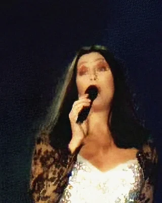
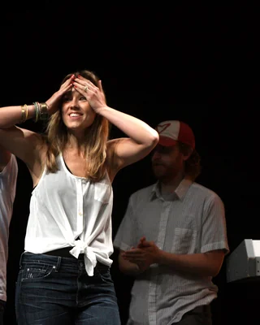
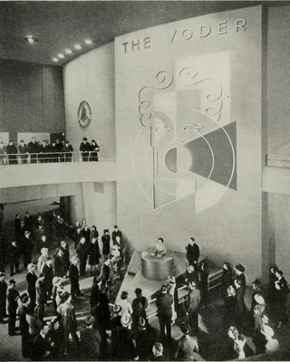

<div class='meta'>
image: teaser.webp
image_alt: "Ein kurzer Klang als Welle und dahinter seine Echos, jedes etwas leiser als das vorige."
kind: labor
language: Python
duration: 6 Doppelstunden
curriculum: "Oberstufe: Algorithmen und Datenstrukturen (Fourier-Transformation, Faltung), Vertiefung Technische Informatik (digitale Signalverarbeitung)"
topics: [codierung, listen]
requires: [audio-compression]
reference: [bits-und-bytes]
</div>

<script src='/include/effect_widget.js'></script>

<div
    class="autotoc-secondary-trigger"
    data-title="Auf dieser Seite"
    data-levels="h2,h3">
</div>

# Audioeffekte

<p class='abstract'>
Dezibel und ein Compressor, ein Equalizer, Echo, Chorus und Hall, eine Stimme in einer anderen Tonhöhe, Autotune und ein Roboter, der spricht: Du baust die Effekte eines Tonstudios in Python mit numpy und hörst bei jedem im Widget, was seine Regler tun.
</p>

## Lautstärke

Der einfachste Effekt macht einen Klang lauter oder leiser, alles auf einmal. Ein Compressor macht nur die lauten Stellen leiser. Beide rechnen in Dezibel.

### Einrichten

Leg einen Ordner an und hol die Klänge aus »Audio komprimieren«: die Musik und die Stimme.

```bash_copy
mkdir -p /workspace/effects && cd /workspace/effects
wget ${web_root}/audio/musik.wav ${web_root}/audio/stimme.wav
```

Zum Lesen und Schreiben der WAV-Dateien nimmst du `wav.py`, wie du es in »Audio komprimieren« geschrieben hast. Lege es an:

```python
import struct
import wave

import numpy as np


def wav_header(n, rate):
    size = 2 * n
    riff = struct.pack('<4sI4s', b'RIFF', 36 + size, b'WAVE')
    fmt = struct.pack('<4sIHHIIHH', b'fmt ', 16, 1, 1, rate, 2 * rate, 2, 16)
    data = struct.pack('<4sI', b'data', size)
    return riff + fmt + data


def write_wav(path, samples, rate):
    numbers = np.clip(np.round(samples * 32767), -32768, 32767).astype('<i2')
    with open(path, 'wb') as f:
        f.write(wav_header(len(numbers), rate))
        f.write(numbers.tobytes())


def read_wav(path):
    with wave.open(path, 'rb') as f:
        rate = f.getframerate()
        frames = f.readframes(f.getnframes())
    return np.frombuffer(frames, dtype='<i2') / 32767, rate
```

`read_wav` gibt die Samples als Kommazahlen von −1 bis 1 und die Abtastrate, `write_wav` schreibt sie wieder als Datei mit 16 Bit.

<!-- tutorial-step
write-file: effects/wav.py <- file:stufen/wav.py
terminal-run: mkdir -p /workspace/effects && cd /workspace/effects && (test -f musik.wav || curl -sO http://workspace_nginx_1/audio/musik.wav) && (test -f stimme.wav || curl -sO http://workspace_nginx_1/audio/stimme.wav) && ls
terminal-wait-for-prompt: 30
wait-for-text: stimme.wav
-->

### Dezibel

Wie laut ein Klang ist, gibt man in **Dezibel** an, kurz dB. Dezibel zählen nicht, wie viel lauter etwas wird, sondern womit es multipliziert wird: Jedes Sample wird mit dem Faktor \\(10^{dB / 20}\\) multipliziert. +20 dB ist also mal 10, −20 dB mal ein Zehntel. Das passt zum Ohr: Es hört nicht, um wie viel ein Klang lauter wird, sondern um welchen Faktor. Zwischen dem leisesten Klang, den man gerade noch hört, und einem, der wehtut, liegen etwa 120 dB: ein Faktor von einer Million in der Höhe der Schwingung, in Dezibel eine handliche Zahl.

Warum 20? Dezibel waren zuerst für die Leistung gedacht, und die wächst mit dem Quadrat der Schwingung: +10 dB sind die zehnfache Leistung, und dafür reicht eine Schwingung, die etwa 3,16-mal so hoch ist, die Wurzel aus 10. Für die Höhe der Schwingung teilt man darum durch 20 statt durch 10.

<div class='effect-widget' data-effect='gain'></div>

<div class='hint try'>
<strong>Ausprobieren:</strong> Stell −10 dB ein und schalt <strong>Effekt an</strong> aus und ein: Klingt die Musik halb so laut? So hören es viele Menschen. Dann −20 dB und −40 dB: Wie viel hörst du noch? Zum Schluss Rock mit +12 dB: Was hörst du, und wie sieht die Welle unten aus?
</div>

_task(db-half)

Lege `gain.py` an:

<!-- page-code: own -->
```python
import numpy as np

from wav import read_wav, write_wav


def gain(x, db):
    # hier: x mit dem Faktor zu db Dezibel multipliziert


if __name__ == '__main__':
    x, rate = read_wav('musik.wav')
    for db in (-20, -6, 6):
        y = gain(x, db)
        write_wav(f'musik{db:+d}db.wav', y, rate)
        print(f'{db:+d} dB: lauteste Stelle {np.abs(y).max():.2f}')
```

<div class='hint own' data-check='gain'>
<strong>Jetzt bist du dran:</strong> Schreib <code>gain(x, db)</code>: <code>x</code> mit dem Faktor zu <code>db</code> Dezibel multipliziert.
</div>

<!-- hint -->
In Python ist \\(10^{dB / 20}\\) `10 ** (db / 20)`. numpy multipliziert damit das ganze Array auf einmal.
<!-- /hint -->

<!-- solution -->
```python
def gain(x, db):
    return x * 10 ** (db / 20)
```
<!-- /solution -->

_task(gain)

```bash
python3 gain.py
```

<!-- tutorial-step
write-file: effects/gain.py <- file:stufen/gain.py
check-task: gain
terminal-run: cd /workspace/effects && python3 gain.py
terminal-wait-for-prompt: 60
wait-for-text: +6 dB
-->

Hör dir die drei Dateien an. Bei +6 dB ist die lauteste Stelle über 1: Eine WAV-Datei mit 16 Bit kann das nicht speichern, und `write_wav` schneidet ab, was darüber hinausgeht. Die Schwingung bekommt flache Spitzen, und das klingt kratzig: Das heißt **Übersteuern**, englisch Clipping.

### Compressor

Im Radio klingt ein Lied gleichmäßig laut, auch wo jemand leise singt, und ein Podcast ist in der Bahn gut zu verstehen, ohne dass ein Lachen in den Ohren schmerzt. Dahinter steckt ein **Compressor**, wie man ihn auch im deutschen Tonstudio nennt: Er macht laute Stellen leiser und lässt leise, wie sie sind. Was über dem **Threshold** liegt, der Schwelle, staucht er nach der **Ratio**: Bei 2 : 1 kommt von 10 dB über dem Threshold nur die Hälfte heraus, 5 dB. Danach ist alles höchstens so laut wie vorher, und man kann es als Ganzes wieder lauter machen, mit dem **Make-up Gain**. Jetzt sind die leisen Stellen lauter als vorher, die lauten aber nicht.

Wie laut der Klang gerade ist, sagt ein einzelnes Sample nicht, denn eine Schwingung geht ständig durch null. Der Compressor folgt deshalb dem Betrag der Samples mit Verzögerung, dem **Pegel**:

$$p\_n = c \cdot p\_{n-1} + (1 - c) \cdot |x\_n|$$

\\(c\\) liegt knapp unter 1: Je näher an 1, desto langsamer folgt der Pegel. Wird der Klang lauter, nimmt der Compressor ein \\(c\\) für die Zeit **Attack**, wird er leiser, eins für die Zeit **Release**.

<div class='effect-widget' data-effect='compressor'></div>

<div class='hint try'>
<strong>Ausprobieren:</strong> Hör dir das Schlagzeug bei 20 : 1 an und zieh den Threshold langsam von 0 dB herunter bis −40 dB. Achte auf den Anschlag jeder Snare, den ersten Moment des Schlags: Wann wird er stumpf? Stell dann die Attack auf 30 ms: Was kommt zurück, und warum? Schau dabei rechts im Bild, wie viele dB der Compressor wegnimmt, und auf die Welle darunter. Nimm dann das Funk-Schlagzeug, mit 20 dB Make-up Gain: Was wird aus den leisen Schlägen auf der Snare zwischen den lauten?
</div>

_task(compressor-level)

### Ein Compressor in Python

Lege `compressor.py` an:

<!-- page-code: own -->
```python
import math

import numpy as np

from wav import read_wav, write_wav


def gain_db(level, threshold, ratio):
    # hier: wie viele dB der Compressor bei diesem Pegel dazugibt (0 oder weniger)


def compress(x, rate, threshold, ratio, attack, release, makeup):
    a = math.exp(-1 / (attack * rate))
    r = math.exp(-1 / (release * rate))
    level = 0
    y = np.zeros_like(x)
    for n, v in enumerate(np.abs(x).tolist()):
        c = a if v > level else r
        level = c * level + (1 - c) * v
        db = 20 * math.log10(max(level, 1e-9))
        y[n] = x[n] * 10 ** ((gain_db(db, threshold, ratio) + makeup) / 20)
    return y


def save(path, y, rate):
    peak = np.abs(y).max()
    write_wav(path, y / max(1, peak), rate)
    print(f'{path}: lauteste Stelle {peak:.2f}')


if __name__ == '__main__':
    x, rate = read_wav('stimme.wav')
    save('stimme-komprimiert.wav', compress(x, rate, -30, 4, 0.005, 0.1, 15), rate)
```

`compress` geht einmal über alle Samples, denn jeder Pegel braucht den vorigen. `math.exp` macht aus der Zeit `attack` in Sekunden das \\(c\\): Nach dieser Zeit ist der Pegel knapp zwei Drittel des Wegs zum neuen Betrag gegangen. Der Pegel in Dezibel geht an `gain_db`, und das Sample wird mit dem Faktor multipliziert, der zu `gain_db` und dem Make-up Gain `makeup` gehört. `save` macht leiser, was lauter als 1 geworden ist, statt es abzuschneiden wie `write_wav`.

<div class='hint own' data-check='gain-db'>
<strong>Jetzt bist du dran:</strong> Schreib <code>gain_db(level, threshold, ratio)</code>: Liegt der Pegel <code>level</code> in dB höchstens beim Threshold <code>threshold</code>, gibt der Compressor 0 dB dazu. Liegt er darüber, gib zurück, um wie viele dB der Compressor ihn leiser macht, als negative Zahl.
</div>

<!-- hint -->
Liegt der Pegel 12 dB über dem Threshold und die Ratio ist 4, bleiben 12 / 4 = 3 dB über dem Threshold. Der Compressor nimmt also 9 dB weg: `gain_db` gibt −9 zurück.
<!-- /hint -->
<!-- hint -->
Von dem, was über dem Threshold liegt, `level - threshold`, bleibt der Teil `1 / ratio`; weggenommen wird der Teil `1 - 1 / ratio`.
<!-- /hint -->

<!-- solution -->
```python
def gain_db(level, threshold, ratio):
    if level <= threshold:
        return 0
    return (threshold - level) * (1 - 1 / ratio)
```
<!-- /solution -->

_task(gain-db)

```bash
python3 compressor.py
```

<!-- tutorial-step
write-file: effects/compressor.py <- file:stufen/compressor.py
check-task: gain-db
terminal-run: cd /workspace/effects && python3 compressor.py
terminal-wait-for-prompt: 120
wait-for-text: stimme-komprimiert.wav
-->

Hör dir `stimme-komprimiert.wav` an und dann noch einmal `stimme.wav`: In der komprimierten Fassung sind die leisen Silben etwa 5 dB lauter geworden, die lauten etwa 1 dB leiser. Lagen zwischen ihnen vorher fast 20 dB, sind es jetzt etwa 13. Ein Compressor macht aber alles Leise lauter, auch ein Rauschen oder ein Atmen: Er kann nicht wissen, welche leisen Klänge man hören will.

<div class='history' id='history-loudness-war'>

<p><strong>Der Loudness War</strong>, 2008. Lange wurde Musik immer lauter aufgenommen. Ist der höchste Wert erreicht, den ein Sample auf einer CD haben kann, geht es nur noch mit einem Compressor weiter, mit immer höherer Ratio. Metallicas Album »Death Magnetic« ist auf der CD so laut, dass die Spitzen über den höchsten Wert hinausgehen und abgeschnitten werden, was verzerrt klingt. Dieselben Lieder im Spiel »Guitar Hero« haben viel mehr Abstand zwischen leise und laut und sind weniger abgeschnitten. Heute machen die meisten großen Streamingdienste jedes Lied von sich aus gleich laut, Spotify und YouTube auf −14 LUFS, ein Maß dafür, wie laut Menschen einen Klang hören.</p>
<p>Hör dir <a href='https://www.youtube.com/watch?v=K6AJuRK2NE4'>»The Day That Never Comes«</a> aus »Death Magnetic« auf YouTube an und achte darauf, wie die lauten Stellen klingen, wenn die ganze Band einsetzt.</p>
<p class='history-credit'>Lars Ulrich und James Hetfield von Metallica. Foto: Kreepin Deth, 2008, CC BY 3.0, zugeschnitten (<a href='https://commons.wikimedia.org/wiki/File:Metallica_at_The_O2_Arena_London_2008.jpg'>Wikimedia Commons</a>)</p>
</div>

<div class='hint try'>
<strong>Ausprobieren:</strong> Stell im Widget Rock ein, die Attack auf 1 ms, die Release auf 20 ms und den Threshold tief. Jetzt klingt der Bass verzerrt: Der Pegel folgt so schnell, dass der Compressor die einzelnen Schwingungen des Basses leiser und lauter macht und ihre Form verändert. Wie lang muss die Release sein, bis die Verzerrung verschwindet?
</div>

## Frequenzen

In »Audio komprimieren« hast du Klänge in ihre Frequenzen zerlegt. Wer die Frequenzen kennt, kann sie auch verändern: tiefe lauter, hohe leiser, oder nur einen Bereich durchlassen.

### Equalizer

Ein **Equalizer**, kurz EQ, macht einen Bereich von Frequenzen lauter oder leiser: der Bassregler am Lautsprecher, die Klangregler im Musikprogramm, im Tonstudio Dutzende davon. Ein Regler des EQ hat drei Einstellungen: um welche Frequenz es geht, wie breit der Bereich ist und wie viele Dezibel dazukommen oder wegfallen. Die Breite zählt man in Oktaven, denn das Ohr hört Frequenzen auf einer logarithmischen Skala: Von 100 bis 200 Hz ist es so weit wie von 1.000 bis 2.000 Hz.

<div class='effect-widget' data-effect='eq'></div>

<div class='hint try'>
<strong>Ausprobieren:</strong> Am Anfang ist alles weit weg von der Mitte 12 dB leiser, <strong>Übrige</strong>: Was hörst du von der Musik noch? Stell <strong>Übrige</strong> auf 0 dB und dann 60 Hz, eine Oktave und +12 dB ein: Welches Instrument wird lauter? Dann −24 dB bei 10 kHz mit zwei Oktaven: Was verschwindet? Schalt mit <strong>Effekt an</strong> hin und her und achte darauf, was sich ändert. Schieb bei +12 dB die Frequenz langsam von unten nach oben und hör, wann die Melodie lauter wird. Zum Schluss ein Bandpass, der nur einen Bereich durchlässt: Stell <strong>Übrige</strong>, was weit weg von der Mitte geschieht, auf −24 dB, die Verstärkung auf 0 dB, die Mitte auf 1 kHz und die Breite auf eine Oktave. Wie klingt die Musik jetzt, und woran erinnert sie dich? Probier dann die Knöpfe unter den Reglern: Wie klingt Musik aus einem alten Radio, am Telefon, aus einer Party nebenan? Schau, wo die Regler dann stehen, und such eine Einstellung, die nach etwas anderem klingt, das du kennst.
</div>

<div class='history' id='history-around-the-world'>

<p><strong>Daft Punk, »Around the World«</strong>, 1997. Das Lied lebt von einer gleichmäßigen Basslinie und einer Roboterstimme, die immer wieder »Around the world« singt. Im Video von Michel Gondry tanzen fünf Gruppen auf einer Bühne, die eine Schallplatte darstellt, und jede Gruppe ist ein Instrument: die Roboter die Stimme, die Sportler die Bassgitarre, die auf und ab steigt, die Discotänzerinnen das hohe Keyboard, die Skelette die Gitarre und die Mumien den Drumcomputer. So sieht man, was ein EQ trennt: Jedes Instrument hat seinen eigenen Bereich, tief oder hoch.</p>
<p>Schau dir <a href='https://www.youtube.com/watch?v=K0HSD_i2DvA'>das Video</a> auf YouTube an und folge einer Gruppe: Hörst du ihr Instrument aus den anderen heraus, und liegt es tief oder hoch?</p>
<p class='history-credit'>Daft Punk. Foto: Sony Music Entertainment, 2013, CC BY 4.0, zugeschnitten (<a href='https://commons.wikimedia.org/wiki/File:Daft_Punk_in_2013_2-_centered.jpg'>Wikimedia Commons</a>)</p>
</div>

### Der Drop

In elektronischer Tanzmusik hilft ein Filter beim **Drop**: Vor dem Moment, in dem das ganze Lied mit voller Kraft einsetzt, nimmt ein **Hochpass** über einige Takte nach und nach den Bass heraus, und mit dem Drop kommt er auf einen Schlag zurück. Weil der Bass eine Weile fehlte, wirkt er danach umso gewaltiger ([Icon Collective](https://www.iconcollective.edu/edm-drop-tips) beschreibt es für Produzenten). Im Widget kannst du die **Form** auf Hochpass stellen und die Frequenz langsam nach oben schieben: Was bleibt von der Musik, wenn der Bass fehlt?

<div class='history' id='history-drop'>
<p><strong>Martin Garrix, »Animals«</strong>, 2013. Der Breakdown ist zuerst gefiltert, damit die Energie sinkt; im Build-up steigert sich alles bis zu einem letzten Takt fast ohne Musik, dann setzt der Drop mit einer gewaltigen Kick-Drum ein. Am Ende nimmt Garrix den Bass noch einmal heraus, als Gegensatz. Mit »Animals« wurde er der jüngste Produzent, dessen Lied auf Platz eins des Musikladens Beatport kam.</p>
<p>Hör dir <a href='https://www.youtube.com/watch?v=gCYcHz2k5x0'>das Video</a> auf YouTube an: Wann wird die Musik dünner, und wie wirkt der Drop danach?</p>
</div>

### Ein Equalizer in Python

Ein EQ rechnet in Dezibel, und aus den Dezibeln wird wie bei `gain` ein Faktor, mit dem jede Frequenz multipliziert wird. Für den Regler im Widget ist die Verstärkung eine Glocke über den Oktaven: In der Mitte wirkt sie ganz, `width` Oktaven daneben noch zur Hälfte, weiter weg immer weniger. Ist `d` der Abstand von der Mitte in Oktaven, gibt der Regler

$$G(d) = G \cdot 2^{-(d / \text{width})^2}$$

Dezibel dazu.

_task(eq-octave)

<!-- after: eq-octave -->
Lege `eq.py` an:

<!-- page-code: own -->
```python
import numpy as np

from wav import read_wav, write_wav


def bell(freqs, centre, width, gain):
    # hier: für jede Frequenz der Faktor, mit dem der EQ ihre Schwingung multipliziert


def equalize(x, rate, centre, width, gain):
    X = np.fft.rfft(x)
    freqs = np.fft.rfftfreq(len(x), 1 / rate)
    return np.fft.irfft(X * bell(freqs, centre, width, gain), len(x))


def save(path, y, rate):
    peak = np.abs(y).max()
    write_wav(path, y / max(1, peak), rate)
    print(f'{path}: lauteste Stelle {peak:.2f}')


if __name__ == '__main__':
    x, rate = read_wav('musik.wav')
    save('musik-bass.wav', equalize(x, rate, 60, 1, 12), rate)
    save('musik-ohne-hihat.wav', equalize(x, rate, 10000, 2, -30), rate)
```

`equalize` macht mit der FFT von numpy, was du in »Audio komprimieren« selbst gebaut hast: `np.fft.rfft` zerlegt die ganzen acht Sekunden auf einmal in ihre Frequenzen, nur die erste Hälfte, bis zur halben Abtastrate, und `np.fft.rfftfreq` gibt die Frequenz zu jeder Zahl. Jede Zahl wird mit dem Faktor ihrer Frequenz multipliziert, und `np.fft.irfft` macht daraus wieder Samples. `save` kennst du aus dem Compressor.

<div class='hint own' data-check='eq-bell'>
<strong>Jetzt bist du dran:</strong> Schreib <code>bell(freqs, centre, width, gain)</code>: <code>freqs</code> ist ein numpy-Array von Frequenzen in Hz, <code>centre</code> die Mitte in Hz, <code>width</code> die Breite in Oktaven und <code>gain</code> die Verstärkung in dB. Gib für jede Frequenz den Faktor für die Schwingung zurück.
</div>

<!-- hint -->
Drei Schritte: der Abstand in Oktaven, daraus die Dezibel nach der Formel oben, daraus der Faktor. Wie viele Oktaven `f` von `centre` entfernt ist, sagt `np.log2(f / centre)`: Bei der doppelten Frequenz ist es 1, bei der halben −1.
<!-- /hint -->
<!-- hint -->
Die erste Frequenz der FFT ist 0 Hz, und `np.log2(0)` ist minus unendlich. `np.maximum(freqs, 1)` macht aus 0 erst 1:

```python
octaves = np.log2(np.maximum(freqs, 1) / centre)
db = gain * 2 ** (-(octaves / width) ** 2)
```
<!-- /hint -->

<!-- solution -->
```python
def bell(freqs, centre, width, gain):
    octaves = np.log2(np.maximum(freqs, 1) / centre)
    db = gain * 2 ** (-(octaves / width) ** 2)
    return 10 ** (db / 20)
```
<!-- /solution -->

_task(eq-bell)

```bash
python3 eq.py
```

<!-- tutorial-step
write-file: effects/eq.py <- file:stufen/eq.py
check-task: eq-bell
terminal-run: cd /workspace/effects && python3 eq.py
terminal-wait-for-prompt: 60
wait-for-text: musik-ohne-hihat.wav
-->

```text
musik-bass.wav: lauteste Stelle 2.27
musik-ohne-hihat.wav: lauteste Stelle 0.80
```

Hör dir beide Dateien an und vergleich sie mit `musik.wav`. Beim Bass wäre die lauteste Stelle mehr als doppelt so hoch, wie eine WAV-Datei fassen kann: Die Kick-Drum und der Bass bekommen bis zum Vierfachen. `save` macht deshalb das Ganze leiser, und neben dem lauten Bass klingt der Rest etwas leiser als vorher. Ohne die Hi-Hat fehlt das Zischen oben; die anderen Instrumente bleiben, wie sie waren, denn sie haben bei 10.000 Hz kaum etwas.
<!-- /after -->

<div class='hint try'>
<strong>Ausprobieren:</strong> Mach die Stimme, <code>stimme.wav</code>, verständlicher oder unverständlicher: Gib zwischen 2.000 und 4.000 Hz einige dB dazu oder nimm dort viel weg. Woran hörst du den Unterschied zuerst? Bau dann wie im Widget einen Bandpass: Gib <code>bell</code> einen fünften Parameter <code>rest=0</code>, die Dezibel weit weg von der Mitte, und rechne <code>db = rest + (gain - rest) * 2 ** (-(octaves / width) ** 2)</code>. Mit <code>rest=-24</code> und <code>gain=0</code> bleibt nur der Bereich um <code>centre</code>.
</div>

## Verzögerte Kopien

Ein Echo, ein Chorus und Hall zählen zum Klang Kopien von sich selbst dazu, die später kommen: eine Viertelsekunde später, einige Millisekunden oder so viele, dass man sie nicht mehr einzeln hört.

### Echo

Ruft man in den Bergen, kommt der Ruf von einer Felswand zurück, leiser und etwas später. Ein **Echo** im Tonstudio macht dasselbe: Es zählt zum Klang eine Kopie dazu, die um eine feste Zeit verzögert ist. Kommt auch jedes Echo selbst wieder als Echo zurück, immer leiser, heißt das **Rückkopplung**. Mit der Verzögerung \\(D\\) in Samples und der Rückkopplung \\(g\\) ist

$$y\_n = x\_n + g \cdot y\_{n - D}$$

Jedes Sample bekommt das, was \\(D\\) Samples vorher herauskam, \\(g\\)-mal so hoch dazu. Die **Mischung** sagt, wie viel von den Echos zum Klang kommt.

<div class='effect-widget' data-effect='echo'></div>

<div class='hint try'>
<strong>Ausprobieren:</strong> Hör dir den Gesang mit 0,3 Sekunden Verzögerung an und dreh die Rückkopplung langsam hoch: Wie viele Echos hörst du, bevor sie verschwinden? Mach die Verzögerung dann immer kürzer, bis unter 0,1 Sekunden: Wann hörst du keine einzelnen Echos mehr, sondern einen Raum? Probier dasselbe mit dem Schlagzeug.
</div>

_task(echo-height)

Lege `echo.py` an:

<!-- page-code: own -->
```python
import numpy as np

from wav import read_wav, write_wav


def echo(x, rate, delay, feedback, mix):
    # hier: der Klang mit seinen Echos


def save(path, y, rate):
    peak = np.abs(y).max()
    write_wav(path, y / max(1, peak), rate)
    print(f'{path}: lauteste Stelle {peak:.2f}')


if __name__ == '__main__':
    x, rate = read_wav('stimme.wav')
    # zwei Sekunden Stille dahinter, damit die Echos ausklingen
    x = np.concatenate([x, np.zeros(2 * rate)])
    save('stimme-echo.wav', echo(x, rate, 0.3, 0.5, 0.6), rate)
    save('stimme-halle.wav', echo(x, rate, 0.05, 0.7, 0.5), rate)
```

<div class='hint own' data-check='echo'>
<strong>Jetzt bist du dran:</strong> Schreib <code>echo(x, rate, delay, feedback, mix)</code>: <code>delay</code> ist die Verzögerung in Sekunden. Rechne <code>y</code> nach der Formel oben, Sample für Sample, und gib <code>x + mix * (y - x)</code> zurück. <code>x</code> selbst soll sich dabei nicht ändern.
</div>

<!-- hint -->
Die Verzögerung in Samples ist `D = round(delay * rate)`. Fang mit einer Kopie an, `y = x.copy()`; dann ist `y` schon \\(x\_n\\), und es fehlt nur noch das Echo.
<!-- /hint -->
<!-- hint -->
Eine Schleife ab dem ersten Sample, das ein Echo bekommt:

```python
for n in range(D, len(y)):
    y[n] += …
```

Nimm dabei `y[n - D]`, nicht `x[n - D]`: Erst so kommt auch jedes Echo als Echo zurück.
<!-- /hint -->

<!-- solution -->
```python
def echo(x, rate, delay, feedback, mix):
    D = round(delay * rate)
    y = x.copy()
    for n in range(D, len(y)):
        y[n] += feedback * y[n - D]
    return x + mix * (y - x)
```
<!-- /solution -->

_task(echo)

```bash
python3 echo.py
```

<!-- tutorial-step
write-file: effects/echo.py <- file:stufen/echo.py
check-task: echo
terminal-run: cd /workspace/effects && python3 echo.py
terminal-wait-for-prompt: 60
wait-for-text: stimme-halle.wav
-->

Hör dir `stimme-echo.wav` und `stimme-halle.wav` an. Mit 0,3 Sekunden hörst du jedes Echo für sich, mit 0,05 Sekunden verschwimmen sie zu einem Klang wie in einem gekachelten Bad. Zwei Klänge hört das Ohr erst als zwei, wenn zwischen ihnen mehr als einige Zehntelsekunden liegen; was schneller folgt, hört es als einen.

Lange bevor Rechner Klänge bearbeiteten, machte man Echos mit Tonband: Ein Tonkopf nahm den Klang auf, ein zweiter ein Stück weiter spielte ihn wieder ab. Die Verzögerung ergab sich aus dem Abstand der beiden Köpfe und der Geschwindigkeit des Bands, die Rückkopplung daraus, wie viel von der Wiedergabe wieder aufgenommen wurde.

<div class='history' id='history-let-it-be'>
<p><strong>Das Bandecho auf der Hi-Hat von »Let It Be«</strong>, 1970. Phil Spector mischte »Let It Be« von den Beatles für das Album neu und gab Ringo Starrs Hi-Hat in der zweiten Strophe ein Bandecho, so viel, dass sie fast alle Aufmerksamkeit auf sich zieht. Starr gefiel Spectors Fassung nicht. 2003 erschien auf »Let It Be... Naked« eine Fassung ohne Spectors Zutaten, mit Starrs einfachem Schlagzeug.</p>
<p>Hör dir die zweite Strophe in beiden Fassungen an: <a href='https://www.youtube.com/watch?v=QDYfEBY9NM4&t=45s'>die Fassung des Albums</a> und <a href='https://www.youtube.com/watch?v=lcA-qlMP11s&t=45s'>die Fassung von »Naked«</a>, beide auf YouTube, ab der 45. Sekunde.</p>
</div>

<div class='hint try'>
<strong>Ausprobieren:</strong> Setz die Rückkopplung auf 1 oder höher. Was passiert mit der lautesten Stelle, und warum?
</div>

### Chorus

Singen zwei Menschen dieselbe Melodie, klingt es nie wie einer, der lauter singt: Der eine ist immer ein klein wenig früher oder später, und das ändert sich ständig. Ein **Chorus** macht das mit einem einzigen Klang nach. Er zählt eine Kopie dazu, die etwa 15 Millisekunden hinterherläuft, und diese Verzögerung wandert langsam hin und her: um die **Tiefe**, mit dem **Tempo** einer Sinusschwingung. Zu kurz für ein Echo, das man hört; was man hört, ist ein Klang, der breiter wird.

<div class='effect-widget' data-effect='chorus'></div>

<div class='hint try'>
<strong>Ausprobieren:</strong> Hör dir den Gesang mit einer Tiefe von 0 an: Wie klingt er, nur mit einer Kopie 15 ms dahinter? Dreh dann die Tiefe langsam auf und hör, wann er zu schweben beginnt. Mit einem hohen Tempo und viel Tiefe singt er falsch: Woran hörst du das? Probier dasselbe mit den Gitarren.
</div>

Die Verzögerung ist fast nie eine ganze Zahl von Samples: Bei 44.100 Samples in der Sekunde sind 15,3 Millisekunden 674,73 Samples. Die Kopie muss also zwischen zwei Samples gelesen werden: Zwischen zwei Samples denkt man sich eine Gerade und liest auf ihr ab. An der Stelle 2,25 sind das drei Viertel von Sample 2 und ein Viertel von Sample 3.

Lege `chorus.py` an:

<!-- page-code: own -->
```python
import numpy as np

from wav import read_wav, write_wav


def read(x, pos):
    # hier: die Werte von x an den Stellen pos, zwischen zwei Samples gemischt


def chorus(x, rate, depth, speed, mix):
    n = np.arange(len(x))
    delay = (0.015 + depth * (1 + np.sin(2 * np.pi * speed * n / rate)) / 2) * rate
    pos = n - delay
    wet = np.where(pos >= 0, read(x, np.maximum(pos, 0)), 0)
    return x + mix * wet


def save(path, y, rate):
    peak = np.abs(y).max()
    write_wav(path, y / max(1, peak), rate)
    print(f'{path}: lauteste Stelle {peak:.2f}')


if __name__ == '__main__':
    x, rate = read_wav('stimme.wav')
    save('stimme-chorus.wav', chorus(x, rate, 0.004, 1, 0.7), rate)
```

`chorus` rechnet für jedes Sample, wie weit die Kopie gerade hinterherläuft, in Samples, und liest sie an der Stelle `n - delay`. Vor dem ersten Sample gibt es noch keine Kopie: Dort nimmt `np.where` 0.

<div class='hint own' data-check='chorus-read'>
<strong>Jetzt bist du dran:</strong> Schreib <code>read(x, pos)</code>: <code>pos</code> ist ein Array von Stellen mit Nachkommastellen, alle zwischen 0 und <code>len(x) - 1</code>. Gib für jede Stelle den Wert zwischen den beiden Samples daneben zurück, auf der Geraden zwischen ihnen.
</div>

<!-- hint -->
Für jede Stelle das Sample davor, `i = np.floor(pos).astype(int)`, und wie weit die Stelle dahinter liegt, `f = pos - i`, eine Zahl von 0 bis unter 1. Der Wert ist dann `(1 - f) * x[i] + f * x[i + 1]`.
<!-- /hint -->
<!-- hint -->
Steht eine Stelle genau auf dem letzten Sample, gibt es kein `x[i + 1]`. Mit `np.clip(…, 0, len(x) - 2)` wird `i` höchstens das vorletzte, und `f` ist dann 1:

```python
i = np.clip(np.floor(pos).astype(int), 0, len(x) - 2)
f = pos - i
```
<!-- /hint -->

<!-- solution -->
```python
def read(x, pos):
    i = np.clip(np.floor(pos).astype(int), 0, len(x) - 2)
    f = pos - i
    return (1 - f) * x[i] + f * x[i + 1]
```
<!-- /solution -->

_task(chorus-read)

```bash
python3 chorus.py
```

<!-- tutorial-step
write-file: effects/chorus.py <- file:stufen/chorus.py
check-task: chorus-read
terminal-run: cd /workspace/effects && python3 chorus.py
terminal-wait-for-prompt: 60
wait-for-text: stimme-chorus.wav
-->

Hör dir `stimme-chorus.wav` an: eine Stimme, die klingt wie zwei, die nicht ganz zusammen sprechen.

<div class='hint try'>
<strong>Ausprobieren:</strong> Ändere in <code>chorus</code> die 15 Millisekunden, <code>0.015</code>, in eine Millisekunde, <code>0.001</code>, und gib mehr Mischung. Jetzt rauscht die Stimme wie ein startendes Flugzeug: Das ist ein <strong>Flanger</strong>. Er heißt so, weil man ihn früher mit zwei Tonbändern machte und eines am Rand der Spule, englisch <em>flange</em>, mit dem Finger bremste.
</div>

### Hall

In einem Raum kommt ein Klang nicht nur einmal zurück, sondern von jeder Wand, von der Decke und vom Boden, und jedes Echo wird wieder zurückgeworfen. Nach kurzer Zeit sind es so viele, dass man keines mehr einzeln hört, nur noch ein Nachklingen, das leiser wird: **Hall**. Wie lange er dauert, misst man als **Nachhallzeit**: die Zeit, bis er um 60 dB leiser ist, ein Tausendstel der Höhe. Ein Wohnzimmer hat etwa eine halbe Sekunde, eine große Kirche mehrere.

<div class='effect-widget' data-effect='reverb'></div>

<div class='hint try'>
<strong>Ausprobieren:</strong> Hör dir das Schlagzeug in einem kleinen Raum an, Raumgröße ½ und 0,5 Sekunden Nachhall, dann in einer Kirche, 2 und 4 Sekunden. Achte auf die Snare zwischen zwei Schlägen: Wann hörst du noch den vorigen Schlag nachklingen? Mach den Nachhall dann sehr lang und die Raumgröße klein: Was klingt jetzt metallisch?
</div>

Manfred Schroeder von den Bell Labs fand 1962 einen Hall, den ein Rechner schnell genug ausrechnen kann. Er nimmt vier Echos mit Rückkopplung nebeneinander, mit Verzögerungen von 29,7 bis 43,7 Millisekunden, die zueinander nicht passen, so dass ihre Echos sich nie wiederholen. Jedes ist dein `echo` mit der Mischung 1, mit einer Rückkopplung, die es in der Nachhallzeit um 60 dB leiser macht. Danach kommen zwei **Allpässe**: Sie lassen jede Frequenz gleich laut durch, verschmieren aber jedes Echo zu vielen kleinen, so dass der Hall dicht wird. Ein Allpass rechnet

$$y\_n = -g \cdot x\_n + x\_{n - D} + g \cdot y\_{n - D}$$

Lege `reverb.py` an. Es nimmt `echo` aus `echo.py`:

<!-- page-code: own -->
```python
import numpy as np

from echo import echo
from wav import read_wav, write_wav

COMBS = [0.0297, 0.0371, 0.0411, 0.0437]


def allpass(x, rate, delay, g):
    # hier: der Allpass, Sample für Sample


def reverb(x, rate, size, time, mix):
    wet = np.zeros_like(x)
    for delay in COMBS:
        D = round(delay * size * rate)
        g = 10 ** (-3 * D / rate / time)
        wet += echo(x, rate, delay * size, g, 1) / len(COMBS)
    for delay in (0.005, 0.0017):
        wet = allpass(wet, rate, delay, 0.7)
    return x + mix * wet


def save(path, y, rate):
    peak = np.abs(y).max()
    write_wav(path, y / max(1, peak), rate)
    print(f'{path}: lauteste Stelle {peak:.2f}')


if __name__ == '__main__':
    x, rate = read_wav('stimme.wav')
    x = np.concatenate([x, np.zeros(3 * rate)])
    save('stimme-raum.wav', reverb(x, rate, 1, 1.5, 0.4), rate)
    save('stimme-kirche.wav', reverb(x, rate, 2, 4, 0.6), rate)
```

<div class='hint own' data-check='allpass'>
<strong>Jetzt bist du dran:</strong> Schreib <code>allpass(x, rate, delay, g)</code> nach der Formel oben: <code>delay</code> in Sekunden, für die Samples vor <code>D</code> nur <code>-g * x[n]</code>.
</div>

<!-- hint -->
Wie bei `echo`: `D = round(delay * rate)` und eine Schleife. Fang mit `y = np.zeros_like(x)` an, einem Array aus Nullen so lang wie `x`, und rechne `y[n]` für jedes `n` aus.
<!-- /hint -->
<!-- hint -->
```python
for n in range(len(x)):
    y[n] = -g * x[n]
    if n >= D:
        y[n] += …
```
<!-- /hint -->

<!-- solution -->
```python
def allpass(x, rate, delay, g):
    D = round(delay * rate)
    y = np.zeros_like(x)
    for n in range(len(x)):
        y[n] = -g * x[n]
        if n >= D:
            y[n] += x[n - D] + g * y[n - D]
    return y
```
<!-- /solution -->

_task(allpass)

```bash
python3 reverb.py
```

<!-- tutorial-step
write-file: effects/reverb.py <- file:stufen/reverb.py
check-task: allpass
terminal-run: cd /workspace/effects && python3 reverb.py
terminal-wait-for-prompt: 120
wait-for-text: stimme-kirche.wav
-->

Hör dir `stimme-raum.wav` und `stimme-kirche.wav` an. In der Kirche verschwimmen die Wörter: Der Hall eines Worts ist noch laut, wenn das nächste beginnt. Darum sind Hörsäle und Klassenräume gedämpft, und eine Kirche ist für Orgel und Chor gebaut, nicht für Vorträge.

<div class='hint try'>
<strong>Ausprobieren:</strong> Lass die beiden Allpässe weg: Wie klingt der Hall nur aus den vier Echos? Und was passiert mit nur einem Echo statt vier?
</div>

## Tonhöhe und Stimme

Eine Stimme höher oder tiefer, ohne dass sie schneller wird, eine Stimme auf den richtigen Ton gerückt und eine Stimme, die auf einem Akkord spricht: Dafür muss ein Effekt wissen, wie hoch ein Klang gerade ist, oder ihn in Bänder zerlegen.

### Pitch Shifting

Spielt man eine Aufnahme schneller ab, wird sie höher und kürzer: Doppelt so schnell ist eine Oktave höher und halb so lang, die Stimme klingt nach Zeichentrick. Ein **Pitch Shifter** ändert nur die Tonhöhe und lässt die Länge, wie sie ist. Er zerlegt den Klang in **Grains**, kurze Stücke von 50 ms, die sich überlappen. Jedes Grain liest er schneller oder langsamer, mit `read` aus dem Chorus, legt es aber an seinen alten Platz zurück: So wird jedes Stück höher, und der Klang bleibt gleich lang.

<div class='effect-widget' data-effect='pitch'></div>

<div class='hint try'>
<strong>Ausprobieren:</strong> Schieb den Gesang 12 Halbtöne nach oben, eine Oktave, und dann 12 nach unten. Woran hörst du, dass es dieselbe Stimme ist, und woran, dass etwas nicht stimmt? Probier dasselbe mit Funk: Was klingt dort zuerst falsch, das Schlagzeug oder die Melodie?
</div>

_task(speed-length)

<div class='history' id='history-sped-up'>

<p><strong>Nightcore, »sped up« und »slowed«</strong>, 2001. »Nightcore« war der Name eines Schulprojekts: Lieder, etwa 35 % schneller abgespielt, und damit höher. In den frühen 2020er-Jahren wurde das durch TikTok wieder beliebt. Bei FIFTY FIFTYs »Cupid« wurde 2023 zuerst die schnellere Fassung eines Fans auf TikTok bekannt, dann brachte die Plattenfirma eine eigene heraus. Den umgekehrten Weg geht »slowed and reverb«: ein Lied langsamer abgespielt, also tiefer, und mit Hall dazu, beliebt auf YouTube und TikTok.</p>
<p>Hör dir »Cupid« in drei Fassungen an, alle von FIFTY FIFTY auf YouTube: <a href='https://www.youtube.com/watch?v=OFDTqxlgWOw'>wie aufgenommen</a>, <a href='https://www.youtube.com/watch?v=Xxb9Hl5d6n4'>schneller</a> und <a href='https://www.youtube.com/watch?v=31Igu1C9H4g'>langsamer</a>. Achte auf die Stimmen: Wie klingen sie in der schnellen Fassung, und wie lang ist jede Fassung?</p>
<p class='history-credit'>FIFTY FIFTY. Foto: K-POPIT, 2023, CC BY 3.0, zugeschnitten (<a href='https://commons.wikimedia.org/wiki/File:20230413_FIFTY_FIFTY_(%ED%94%BC%ED%94%84%ED%8B%B0%ED%94%BC%ED%94%84%ED%8B%B0).jpg'>Wikimedia Commons</a>)</p>
</div>

Die Grains haben einen Haken: Liegen zwei übereinander, deren Schwingungen gerade gegeneinander laufen, löschen sie sich aus, und die Stimme klingt hohl. Darum verschiebt der Pitch Shifter jedes Grain, bevor er es hinzuzählt, um bis zu eine Schwingung der tiefsten Stimme (1/60 Sekunde), bis es am besten zu dem passt, was schon da ist. Am besten passt es, wo das Produkt der beiden, Sample für Sample addiert, am größten ist: `np.correlate` rechnet das für alle Verschiebungen auf einmal aus.

### Die Tonhöhe finden

Dasselbe Produkt sagt auch, wie hoch eine Stimme gerade ist. Multipliziert man einen Block Sample für Sample mit sich selbst, um `lag` Samples verschoben, und zählt zusammen, heißt das **Autokorrelation**. Sie ist groß, wo der Block zu sich selbst passt: bei einer Verschiebung um eine ganze Schwingung, um zwei und so weiter. Bei 0 passt er immer, und kurz danach noch fast, denn eine Stimme ändert sich von Sample zu Sample kaum. Erst nach einer halben Schwingung läuft die verschobene Kopie gegen das Original und die Summe wird negativ. Die Tonhöhe findet man also so: Warte, bis die Autokorrelation einmal negativ war, und nimm dann die Verschiebung, bei der sie am größten ist. Ist sie das bei `lag` Samples, dauert eine Schwingung `lag / rate` Sekunden, und die Frequenz ist `rate / lag`.

Lege `pitch.py` an. Es nimmt `read` aus `chorus.py`:

<!-- page-code: own -->
```python
import numpy as np

from chorus import read
from wav import read_wav, write_wav

SIZE, HOP = 2048, 512


def pitch(block, rate):
    # hier: die Tonhöhe des Blocks in Hz, 0, wenn keine gefunden


def pitches(x, rate):
    out = []
    for start in range(0, len(x) - SIZE, HOP):
        block = x[start:start + SIZE]
        loud = np.sqrt(np.mean(block ** 2)) > 0.02
        out.append(pitch(block, rate) if loud else 0)
    return out


def shift(x, rate, factor, grain=0.05):
    G = round(grain * rate)
    D = rate // 60
    window = np.hanning(G)
    offsets = np.arange(-G // 2 - D, G - G // 2 + D)
    y = np.zeros(len(x) + G)
    weight = np.zeros(len(x) + G)
    for c in range(G // 2, len(x), G // 4):
        f = factor(c) if callable(factor) else factor
        piece = read(x, np.clip(c + offsets * f, 0, len(x) - 1))
        here = y[c - G // 2:c - G // 2 + G]
        s = np.argmax(np.correlate(piece, here, 'valid'))
        y[c - G // 2:c - G // 2 + G] += window * piece[s:s + G]
        weight[c - G // 2:c - G // 2 + G] += window
    return y[:len(x)] / np.maximum(weight[:len(x)], 1e-3)


def save(path, y, rate):
    peak = np.abs(y).max()
    write_wav(path, y / max(1, peak), rate)
    print(f'{path}: lauteste Stelle {peak:.2f}')


if __name__ == '__main__':
    x, rate = read_wav('stimme.wav')
    found = [round(f) for f in pitches(x, rate) if f]
    print('Tonhöhen in Hz:', found[:12], '…')
    save('stimme-hoch.wav', shift(x, rate, 2 ** (5 / 12)), rate)
    save('stimme-tief.wav', shift(x, rate, 2 ** (-5 / 12)), rate)
```

`pitches` geht in Blöcken von 2048 Samples über den Klang, je 512 Samples weiter, und gibt für jeden die Tonhöhe, für leise Blöcke 0. `shift` legt alle 512 Samples ein Grain hin, `factor` mal so schnell gelesen; `factor` ist eine Zahl oder eine Funktion, die für jede Stelle `c` eine Zahl gibt.

<div class='hint own' data-check='pitch'>
<strong>Jetzt bist du dran:</strong> Schreib <code>pitch(block, rate)</code>: Geh die Verschiebungen <code>lag</code> von 1 bis <code>rate // 60</code> durch, rechne für jede die Autokorrelation und gib die Frequenz der größten zurück, die nach dem ersten negativen Wert kommt. Findest du keine, gib 0 zurück.
</div>

<!-- hint -->
Die Autokorrelation für eine Verschiebung ist `np.dot(block[:-lag], block[lag:])`: der Block ohne seine letzten `lag` Samples mal der Block ohne seine ersten `lag`, Sample für Sample, addiert.
<!-- /hint -->
<!-- hint -->
Merk dir in einer Variablen, ob schon ein negativer Wert kam, und in zwei weiteren den größten Wert danach und sein `lag`:

```python
best, best_lag, dipped = 0, 0, False
for lag in range(1, rate // 60):
    r = np.dot(block[:-lag], block[lag:])
    if r < 0:
        dipped = True
    elif …
```
<!-- /hint -->

<!-- solution -->
```python
def pitch(block, rate):
    best, best_lag, dipped = 0, 0, False
    for lag in range(1, rate // 60):
        r = np.dot(block[:-lag], block[lag:])
        if r < 0:
            dipped = True
        elif dipped and r > best:
            best, best_lag = r, lag
    return rate / best_lag if best_lag else 0
```
<!-- /solution -->

_task(pitch)

```bash
python3 pitch.py
```

<!-- tutorial-step
write-file: effects/pitch.py <- file:stufen/pitch.py
check-task: pitch
terminal-run: cd /workspace/effects && python3 pitch.py
terminal-wait-for-prompt: 120
wait-for-text: stimme-tief.wav
-->

Die erste Zeile zeigt die Tonhöhen der Stimme: meist zwischen 100 und 200 Hz, wie bei vielen erwachsenen Männern. Wo jemand ein »s« oder »sch« spricht, schwingt nichts, und `pitch` findet eine zufällige, oft sehr hohe Zahl. Hör dir `stimme-hoch.wav` und `stimme-tief.wav` an: fünf Halbtöne höher und tiefer, gleich lang wie `stimme.wav`.

### Autotune

**Autotune** rückt schiefen Gesang gerade: Es findet die Tonhöhe jedes Blocks und schiebt sie zum nächsten Halbton. Gedacht ist es unhörbar, mit einer **Retune Speed** von einigen Dutzend Millisekunden, so dass die Stimme langsam zum richtigen Ton gleitet. Stellt man sie auf 0, springt die Stimme sofort von Halbton zu Halbton, ohne das Gleiten dazwischen, und klingt wie eine Maschine.

<div class='history' id='history-believe'>

<p><strong>Cher, »Believe«</strong>, 1998. Ein Jahr zuvor brachte die Firma Antares Auto-Tune heraus. Erfunden hatte es Andy Hildebrand, der für Exxon aus den Echos von Schall im Boden herausgelesen hatte, wo man nach Öl bohren soll, mit denselben Verfahren, auch der Autokorrelation, die du eben in <code>pitch</code> geschrieben hast. »Believe« war die erste Aufnahme, die Auto-Tune hörbar als Effekt nutzt: Die Produzenten stellten es so extrem ein, dass Chers Stimme sofort von Ton zu Ton springt. Der Effekt wurde als »Cher-Effekt« bekannt. Um ihren Trick zu schützen, behaupteten die Produzenten zuerst, es sei ein Vocoder gewesen.</p>
<p>Hör dir <a href='https://www.youtube.com/watch?v=nZXRV4MezEw'>»Believe«</a> auf YouTube an und achte darauf, wo Chers Stimme von Ton zu Ton springt, statt zu gleiten.</p>
<p class='history-credit'>Cher. Foto: Gerben Bosma, 1999, CC BY-SA 4.0, zugeschnitten (<a href='https://commons.wikimedia.org/wiki/File:22-16-32_Cher_Concert_in_Ahoy,_Rotterdam_op_27_oktober_1999_van_Gerben_Bosma_04.jpg'>Wikimedia Commons</a>)</p>
</div>

<div class='effect-widget' data-effect='autotune'></div>

<div class='hint try'>
<strong>Ausprobieren:</strong> Hör dir den Gesang zuerst an, wie er gesungen wurde. Schalt <strong>Effekt an</strong> ein, mit dem Ziel <strong>ein Ton</strong>: Jetzt ist die Melodie weg, jeder Ton liegt auf demselben, und im Bild liegen die lila Punkte auf einer Höhe. Nimm dann <strong>gespiegelt</strong>: Wo die Melodie hinaufging, geht sie jetzt hinunter, auf Halbtönen. Erkennst du das Lied noch? Mit <strong>der nächste Halbton</strong> hörst du kaum einen Unterschied, denn der Gesang trifft die Töne schon fast: Wo springt die Stimme trotzdem im Bild von Linie zu Linie? Dreh zum Schluss die Retune Speed langsam auf: Ab wann klingt die Stimme wieder wie gesungen?
</div>

<div class='history' id='history-songify'>

<p><strong>Auto-Tune the News</strong>, 2009. Die Gregory Brothers machten auf ihrem YouTube-Kanal »schmoyoho« aus Aufnahmen von Politikern, Nachrichtensprechern und Kommentatoren Lieder: Sie veränderten die Stimmen am Rechner, bis sie einer Melodie folgten. Ab 2011 hieß die Reihe »Songify the News«.</p>
<p>Hör dir zwei ihrer Lieder auf YouTube an: den <a href='https://www.youtube.com/watch?v=MX0D4oZwCsA'>»Double Rainbow Song«</a> aus dem Video eines Mannes, der einen doppelten Regenbogen sieht, und <a href='https://www.youtube.com/watch?v=sP4NMoJcFd4'>»Can't Hug Every Cat«</a> aus dem Video einer Frau, die Katzen liebt. Woran hörst du, wo sie Sätze wiederholt oder umgestellt haben?</p>
<p class='history-credit'>Die Gregory Brothers. Foto: The Bui Brothers, 2010, CC BY-SA 2.0, zugeschnitten (<a href='https://commons.wikimedia.org/wiki/File:Gregories.jpg'>Wikimedia Commons</a>)</p>
</div>

Ein Halbton ist ein Zwölftel einer Oktave: zwölf Halbtöne verdoppeln die Frequenz, ein Halbton multipliziert sie mit \\(2^{1/12} \approx 1{,}0595\\). Von einem Ton \\(f\\) bis zum Kammerton A mit 440 Hz sind es also \\(12 \cdot \log\_2(f / 440)\\) Halbtöne. Rundet man diese Zahl, hat man den nächsten Halbton.

Lege `autotune.py` an. Es nimmt `pitches` und `shift` aus `pitch.py`:

<!-- page-code: own -->
```python
import numpy as np

from pitch import HOP, SIZE, pitches, save, shift
from wav import read_wav


def nearest_note(f):
    # hier: die Frequenz des Halbtons, der f am nächsten liegt


def autotune(x, rate):
    found = pitches(x, rate)

    def factor(c):
        k = min(max(0, (c - SIZE // 2) // HOP), len(found) - 1)
        f = found[k]
        return nearest_note(f) / f if 60 < f < 1000 else 1

    return shift(x, rate, factor)


if __name__ == '__main__':
    x, rate = read_wav('stimme.wav')
    save('stimme-autotune.wav', autotune(x, rate), rate)
```

<div class='hint own' data-check='nearest-note'>
<strong>Jetzt bist du dran:</strong> Schreib <code>nearest_note(f)</code>: die Frequenz des Halbtons, der <code>f</code> am nächsten liegt, von 440 Hz aus gezählt.
</div>

<!-- hint -->
Rechne aus, wie viele Halbtöne `f` von 440 Hz entfernt ist, `12 * np.log2(f / 440)`, und runde. 440 Hz mal \\(2^{1/12}\\) hoch dieser Zahl ist der Halbton.
<!-- /hint -->

<!-- solution -->
```python
def nearest_note(f):
    return 440 * 2 ** (round(12 * np.log2(f / 440)) / 12)
```
<!-- /solution -->

_task(nearest-note)

```bash
python3 autotune.py
```

<!-- tutorial-step
write-file: effects/autotune.py <- file:stufen/autotune.py
check-task: nearest-note
terminal-run: cd /workspace/effects && python3 autotune.py
terminal-wait-for-prompt: 120
wait-for-text: stimme-autotune.wav
-->

Hör dir `stimme-autotune.wav` an: Jede Silbe liegt jetzt auf einem Halbton und springt zum nächsten, sobald die Stimme ihn erreicht. `autotune` hat keine Retune Speed: Jeder Block springt sofort.

<div class='hint try'>
<strong>Ausprobieren:</strong> Gib <code>autotune</code> eine Retune Speed: Merk dir in <code>factor</code> den Faktor des vorigen Blocks und geh von ihm aus nur ein Stück auf den neuen zu, zum Beispiel ein Fünftel des Wegs. Wie klingt die Stimme jetzt?
</div>

### Vocoder

Ein **Vocoder** lässt ein Instrument sprechen. Er zerlegt die Stimme in Bänder, von tief bis hoch, und misst in jedem Block, wie stark sie in jedem Band ist. Dann nimmt er einen zweiten Klang, den **Träger**, etwa einen Akkord, und macht ihn in jedem Band genau so stark wie die Stimme. Was man hört, hat die Tonhöhe des Akkords, aber die Laute der Stimme: Ein »a« und ein »i« unterscheiden sich nicht in der Tonhöhe, sondern darin, welche Bänder stark sind.

<div class='effect-widget' data-effect='vocoder'></div>

<div class='hint try'>
<strong>Ausprobieren:</strong> Hör dir den Gesang zuerst ohne Effekt an und schalt dann <strong>Effekt an</strong> ein: Er singt jetzt nicht mehr seine Melodie, sondern immer denselben Akkord, und die Wörter bleiben. Nimm Rauschen als Träger: Jetzt flüstert die Stimme. Warum versteht man sie, wenn Rauschen keine Tonhöhe hat? Zieh die Bänder zum Schluss auf 4 herunter und dann auf 32: Ab wie vielen Bändern verstehst du die Wörter? Probier dasselbe mit dem Chor.
</div>

<div class='history' id='history-vocoder'>

<p><strong>Der Vocoder</strong>, 1937. Homer Dudley erfand ihn bei den Bell Labs, um Sprache mit weniger Bandbreite durch Telefonleitungen zu schicken: Statt der Welle gehen nur die Stärken der Bänder durch die Leitung, und am anderen Ende macht ein Vocoder daraus wieder Sprache. Im Zweiten Weltkrieg verschlüsselte das System SIGSALY damit Telefongespräche. 1939 zeigten die Bell Labs auf der Weltausstellung in New York den Voder, der Sprache aus zehn Bändern erzeugte, gespielt mit Tasten. Kraftwerk nahmen in den Siebzigern für ihre Alben »Ralf & Florian« und »Autobahn« einen eigens gebauten Vocoder, und Florian Schneider sang auf der Bühne durch ihn.</p>
<p>Hör dir <a href='https://www.youtube.com/watch?v=aQUlA8Hcv4s'>»Mr. Blue Sky«</a> vom Electric Light Orchestra auf YouTube an, 1977: Wo singt eine Stimme durch den Vocoder, und was singt sie?</p>
<p>Imogen Heap sang »Hide and Seek« 2004 durch die Einstellung »Vocoder« eines Harmonizers, als ihr Rechner keinen Strom mehr hatte. Welche Töne ihre Stimme singt, bestimmte ein Keyboard: Der Harmonizer setzt die Stimme auf jeden Ton, den sie dort spielte, so dass sie mehrstimmig mit sich selbst singt. Hör dir <a href='https://www.youtube.com/watch?v=UYIAfiVGluk'>»Hide and Seek«</a> auf YouTube an: Wo wechseln die Töne, während sie ein Wort singt?</p>
<p class='history-credit'>Der Voder auf der Weltausstellung. Bild: Bell System Technical Journal, 1940, keine bekannten Rechte, zugeschnitten (<a href='https://commons.wikimedia.org/wiki/File:Homer_Dudley_(October_1940)._%22The_Carrier_Nature_of_Speech%22._Bell_System_Technical_Journal,_XIX(4);495-515._--_Fig.5_The_voder_being_demonstrated_at_the_New_York_World%27s_Fair.jpg'>Wikimedia Commons</a>)</p>
</div>

_task(vocoder-numbers)

Lege `vocoder.py` an:

<!-- page-code: own -->
```python
import numpy as np

from wav import read_wav, write_wav

SIZE, HOP = 2048, 512


def saw(freqs, n, rate):
    t = np.arange(n) / rate
    return sum(2 * ((f * t) % 1) - 1 for f in freqs) / len(freqs)


def vocode_frame(voice, carrier, edges):
    # hier: das Spektrum des Trägers, in jedem Band so stark wie das der Stimme


def vocoder(x, carrier, rate, bands=16):
    hz = np.geomspace(100, 8000, bands + 1)
    edges = np.round(hz * SIZE / rate).astype(int)
    window = np.hanning(SIZE)
    y = np.zeros(len(x) + SIZE)
    for start in range(0, len(x) - SIZE, HOP):
        v = np.fft.rfft(x[start:start + SIZE] * window)
        c = np.fft.rfft(carrier[start:start + SIZE] * window)
        y[start:start + SIZE] += np.fft.irfft(vocode_frame(v, c, edges)) * window
    return y[:len(x)] / 1.5


def save(path, y, rate):
    peak = np.abs(y).max()
    write_wav(path, y / max(1, peak), rate)
    print(f'{path}: lauteste Stelle {peak:.2f}')


if __name__ == '__main__':
    x, rate = read_wav('stimme.wav')
    chord = saw([130.8, 164.8, 196.0], len(x), rate)
    save('stimme-roboter.wav', vocoder(x, chord, rate), rate)
    save('stimme-fluestern.wav', vocoder(x, np.random.uniform(-1, 1, len(x)), rate), rate)
```

`vocoder` geht in Blöcken von 2048 Samples über die Stimme, je 512 weiter, wie `pitches`, und nimmt von beiden Klängen das Spektrum mit `np.fft.rfft`. Die Grenzen der Bänder `edges` sind Indizes in diesem Spektrum, von 100 bis 8000 Hz, jedes Band gleich viele Male breiter als das darunter: So hat das tiefe Ende so viele Bänder wie das hohe, wie beim Hören. `np.fft.irfft` macht aus dem Spektrum wieder einen Block, und die Blöcke überlappen sich wie die Grains.

<div class='hint own' data-check='vocode-frame'>
<strong>Jetzt bist du dran:</strong> Schreib <code>vocode_frame(voice, carrier, edges)</code>: Gib eine Kopie des Spektrums <code>carrier</code> zurück, in der jedes Band von <code>edges[i]</code> bis vor <code>edges[i + 1]</code> mit einem Faktor multipliziert ist, so dass es so stark ist wie dasselbe Band in <code>voice</code>. Die Stärke eines Bands ist die Wurzel aus der Summe der Quadrate seiner Beträge.
</div>

<!-- hint -->
Die Paare von Grenzen bekommst du mit `zip(edges[:-1], edges[1:])`. Die Stärke eines Bands von `lo` bis vor `hi` ist `np.sqrt(np.sum(np.abs(voice[lo:hi]) ** 2))`; die Werte sind komplexe Zahlen, `np.abs` gibt ihren Betrag.
<!-- /hint -->
<!-- hint -->
Ist die Stimme in einem Band 10 stark und der Träger 5, multiplizierst du das Band des Trägers mit 2. Ist der Träger in einem Band 0, gibt es nichts zu multiplizieren: Dann bleibt es 0.
<!-- /hint -->

<!-- solution -->
```python
def vocode_frame(voice, carrier, edges):
    out = carrier.copy()
    for lo, hi in zip(edges[:-1], edges[1:]):
        v = np.sqrt(np.sum(np.abs(voice[lo:hi]) ** 2))
        c = np.sqrt(np.sum(np.abs(carrier[lo:hi]) ** 2))
        out[lo:hi] *= v / c if c > 0 else 0
    return out
```
<!-- /solution -->

_task(vocode-frame)

```bash
python3 vocoder.py
```

<!-- tutorial-step
write-file: effects/vocoder.py <- file:stufen/vocoder.py
check-task: vocode-frame
terminal-run: cd /workspace/effects && python3 vocoder.py
terminal-wait-for-prompt: 60
wait-for-text: stimme-fluestern.wav
-->

Hör dir `stimme-roboter.wav` und `stimme-fluestern.wav` an. Der Roboter spricht auf dem Akkord C-Dur, die Flüsterstimme auf Rauschen: Sie hat keine Tonhöhe, aber man versteht sie, denn die Laute stecken in den Bändern.

<div class='hint try'>
<strong>Ausprobieren:</strong> Ändere in <code>vocoder</code> die Zahl der Bänder: Mit <code>bands=4</code> verstehst du kaum noch etwas, mit 64 klingt der Roboter fast wieder wie die Stimme. Und wie klingt die Stimme mit <code>saw([65.4], …)</code>, einer einzigen tiefen Sägezahnschwingung, als Träger?
</div>
