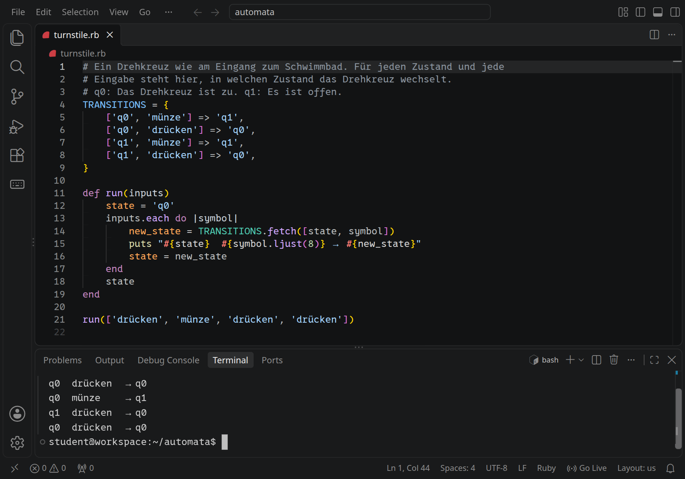
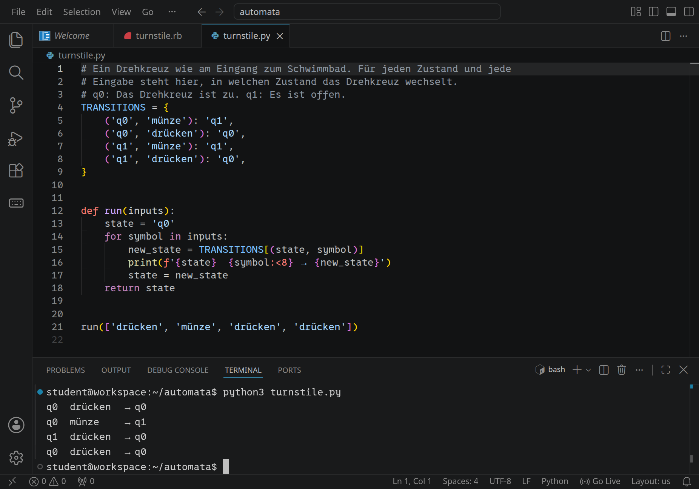
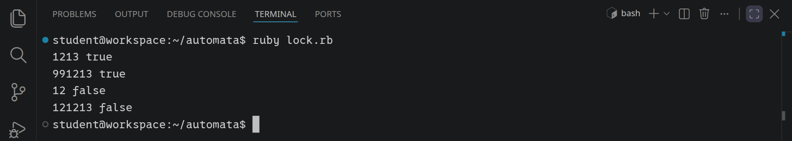
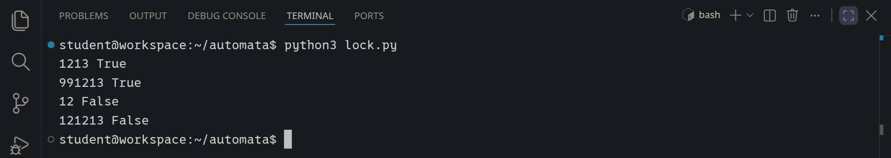
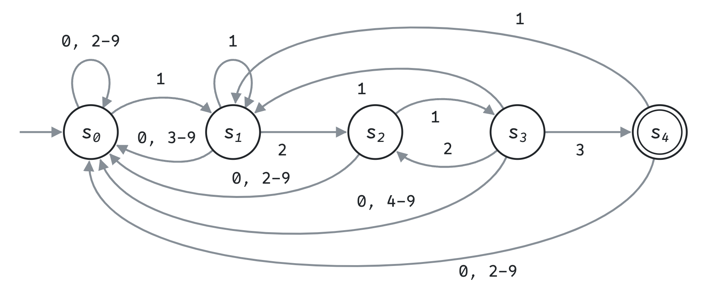
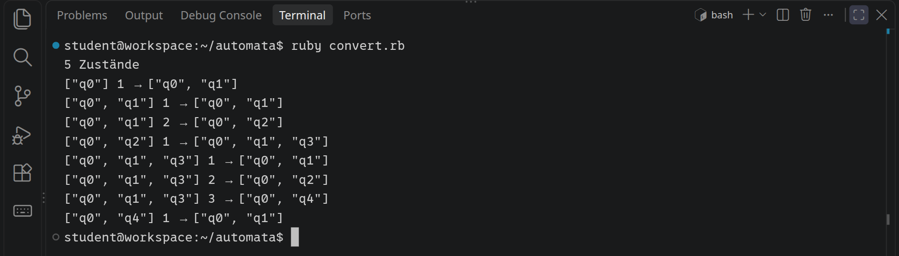
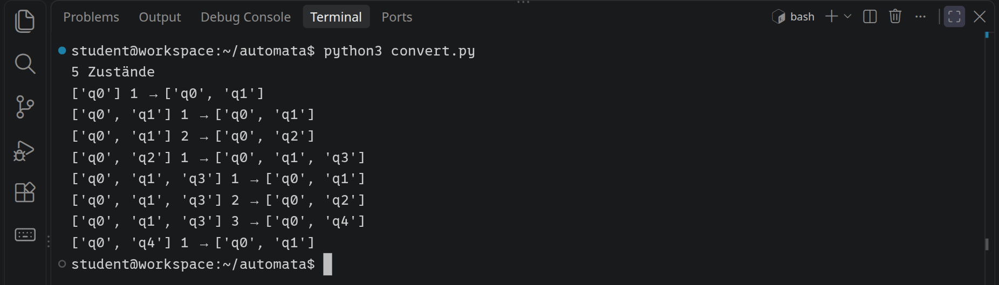
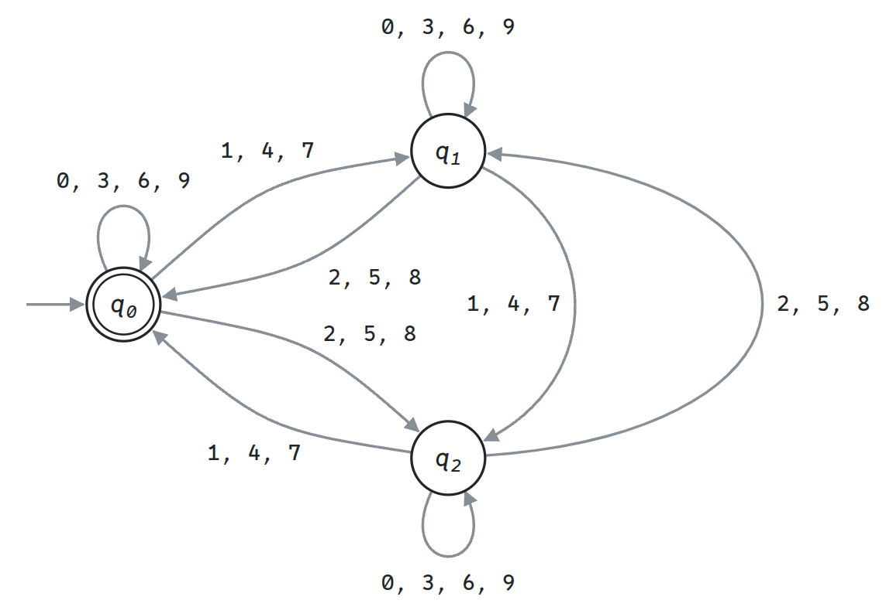

<div class='meta'>
image: teaser.webp:contain
image_alt: "Ein endlicher Automat mit den Zuständen q0, q1 und q2 und Übergängen für die Ziffern 0 bis 9"
kind: projekt
language: Ruby / Python
languages: [ruby, python]
duration: 2 Doppelstunden
reference: [automaten, regex, ruby-python]
</div>

<div
    class="autotoc-secondary-trigger"
    data-title="Auf dieser Seite"
    data-levels="h2,h3">
</div>

# Endliche Automaten

<p class='abstract'>
Ein Drehkreuz, ein Zahlenschloss und ein Automat, der durch 3 teilt, ohne zu rechnen: Du baust endliche Automaten in Ruby oder Python und findest heraus, warum ein Schloss bei 1 2 1 2 1 3 nicht aufgeht, obwohl der Code 1213 ist. Dann schreibst du einen Automaten, der raten darf, verwandelst ihn mit einem kleinen Programm in einen, der nicht raten muss, und siehst zu, wie der explodiert.
</p>

Ein Drehkreuz am Schwimmbad, ein Getränkeautomat, eine Ampel: Sie alle sind in jedem Moment in einem von wenigen **Zuständen** (zu, offen; grün, gelb, rot). Jede Eingabe, eine Münze, ein Knopfdruck, ein Takt, lässt sie nach einer festen Regel in einen anderen Zustand wechseln. Mehr gibt es nicht: keine Variablen, kein Gedächtnis außer dem Zustand. So ein Gerät heißt in der Informatik **endlicher Automat**, und mit genau dieser Idee sucht dein Editor nach Wörtern, prüfen Programme, ob eine E-Mail-Adresse richtig aussieht, und zerlegt ein Compiler deinen Code in Wörter.

<!-- language: ruby -->
In dieser Aktivität programmierst du Automaten in Ruby, und zwar so einfach wie möglich: Ein Automat ist eine Tabelle, ein Hash, und eine Schleife, die die Eingabe Zeichen für Zeichen liest.
<!-- /language -->
<!-- language: python -->
In dieser Aktivität programmierst du Automaten in Python, und zwar so einfach wie möglich: Ein Automat ist eine Tabelle, ein Python-`dict`, und eine Schleife, die die Eingabe Zeichen für Zeichen liest.
<!-- /language -->

## Einrichten

Lege im Terminal (<kbd>Strg</kbd><kbd>J</kbd>) einen Ordner an und öffne ihn mit <kbd>Strg</kbd><kbd>K</kbd> <kbd>Strg</kbd><kbd>O</kbd>:

```bash
mkdir /workspace/automata
```

<!-- language: ruby -->
Alle Dateien dieser Aktivität kommen in diesen Ordner. Ein Programm startest du im Terminal mit `ruby` und dem Namen der Datei.
<!-- /language -->
<!-- language: python -->
Alle Dateien dieser Aktivität kommen in diesen Ordner. Ein Programm startest du im Terminal mit `python3` und dem Namen der Datei.
<!-- /language -->

## Ein Drehkreuz

Das Drehkreuz am Eingang zum Schwimmbad ist erst zu. Wirfst du eine Münze ein, ist es offen; gehst du durch (»drücken«), ist es wieder zu. Drückst du, ohne zu zahlen, bleibt es zu, und eine zweite Münze in ein offenes Drehkreuz ist verschenkt. Als Bild, mit einem Kreis für jeden Zustand und einem Pfeil für jeden Übergang. Die Zustände heißen, wie in der Informatik üblich, q<sub>0</sub>, q<sub>1</sub> und so weiter; q<sub>0</sub> ist »zu«, q<sub>1</sub> ist »offen«:

<div class='automaton-drawing' role='img' aria-label='Zwei Kreise: q0 für zu und q1 für offen. Ein Pfeil ohne Anfang zeigt auf q0, dort beginnt das Drehkreuz. münze führt von q0 nach q1, drücken von q1 zurück nach q0. drücken in q0 und münze in q1 führen jeweils im Bogen zum selben Zustand zurück.' data-states='q0 q1' data-start='q0' data-accept='' data-transitions='q0 drücken q0, q0 münze q1, q1 drücken q0, q1 münze q1'></div>
<script src='/include/automaton_layout.js'></script>

<!-- language: ruby -->
Lege `turnstile.rb` an:

```ruby
# Ein Drehkreuz wie am Eingang zum Schwimmbad. Für jeden Zustand und jede
# Eingabe steht hier, in welchen Zustand das Drehkreuz wechselt.
# q0: Das Drehkreuz ist zu. q1: Es ist offen.
TRANSITIONS = {
    ['q0', 'münze'] => 'q1',
    ['q0', 'drücken'] => 'q0',
    ['q1', 'münze'] => 'q1',
    ['q1', 'drücken'] => 'q0',
}

def run(inputs)
    state = 'q0'
    inputs.each do |symbol|
        new_state = TRANSITIONS.fetch([state, symbol])
        puts "#{state}  #{symbol.ljust(8)} → #{new_state}"
        state = new_state
    end
    state
end

run(['drücken', 'münze', 'drücken', 'drücken'])
```

`TRANSITIONS` ist die Tabelle des Automaten: Zu jedem Paar aus Zustand und Eingabe steht dort der neue Zustand, so wie zu jedem Pfeil im Bild. `TRANSITIONS[['q0', 'münze']]` ist `'q1'`. `fetch` schlägt genauso nach, meldet aber einen Fehler, wenn es ein Paar nicht gibt. Die Methode `run` beginnt in `q0`, liest die Eingaben der Reihe nach, schlägt für jede den neuen Zustand nach und gibt ihn aus. Starte das Programm:

```bash
ruby turnstile.rb
```

<!-- tutorial-screenshot
# Ordner automata, turnstile.rb offen, darunter die Ausgabe
viewport: 1029x720
write-file: automata/turnstile.rb <- file:stufen/turnstile.rb
press: Control+K
press: Control+O
wait-for-input-value: /workspace/
type: automata
press: Enter
wait-for-input-value: /workspace/automata/
press: Enter
wait-for-text: turnstile.rb
open-file: turnstile.rb
hide-left-sidebar
terminal-open
terminal-run: clear
terminal-run: ruby turnstile.rb
terminal-wait-for-prompt
move-mouse: selector:.terminal
check-task-fails: drehkreuz ruby
-->

<!-- /language -->
<!-- language: python -->
Lege `turnstile.py` an:

```python
# Ein Drehkreuz wie am Eingang zum Schwimmbad. Für jeden Zustand und jede
# Eingabe steht hier, in welchen Zustand das Drehkreuz wechselt.
# q0: Das Drehkreuz ist zu. q1: Es ist offen.
TRANSITIONS = {
    ('q0', 'münze'): 'q1',
    ('q0', 'drücken'): 'q0',
    ('q1', 'münze'): 'q1',
    ('q1', 'drücken'): 'q0',
}


def run(inputs):
    state = 'q0'
    for symbol in inputs:
        new_state = TRANSITIONS[(state, symbol)]
        print(f'{state}  {symbol:<8} → {new_state}')
        state = new_state
    return state


run(['drücken', 'münze', 'drücken', 'drücken'])
```

`TRANSITIONS` ist die Tabelle des Automaten: Zu jedem Paar aus Zustand und Eingabe steht dort der neue Zustand, so wie zu jedem Pfeil im Bild. `TRANSITIONS[('q0', 'münze')]` ist `'q1'`. Die Funktion `run` beginnt in `q0`, liest die Eingaben der Reihe nach, schlägt für jede den neuen Zustand nach und gibt ihn aus. Starte das Programm:

```bash
python3 turnstile.py
```

<!-- tutorial-screenshot
# turnstile.py offen, darunter die Ausgabe
viewport: 1029x720
write-file: automata/turnstile.py <- file:stufen/turnstile.py
open-file: turnstile.py
terminal-open
terminal-run: clear
terminal-run: python3 turnstile.py
terminal-wait-for-prompt
move-mouse: selector:.terminal
check-task-fails: drehkreuz
-->

<!-- /language -->

Jede Zeile ist ein Pfeil im Bild: der alte Zustand, die Eingabe und der neue Zustand. Probier eigene Folgen aus, indem du die letzte Zeile änderst. Was passiert, wenn du `run(['tritt'])` schreibst?

_task(drehkreuz)

Für `tritt` gibt es keinen Pfeil, und das Programm bricht mit einer Fehlermeldung ab. Ein Automat bricht nicht ab: Jede Eingabe, für die es keinen Pfeil gibt, führt ihn in einen **Fehlerzustand** q<sub>F</sub>. Aus q<sub>F</sub> kommt er nicht mehr heraus, und q<sub>F</sub> akzeptiert nichts. Meist zeichnet man ihn nicht, sondern sagt nur dazu, dass alle fehlenden Pfeile dorthin führen.

## Ein Automat, der rechnen kann

Das Drehkreuz macht etwas. Viele Automaten beantworten stattdessen eine Frage über ein Wort: Gehört es dazu oder nicht? Sie haben dafür einen **Startzustand** und einen oder mehrere **akzeptierende Zustände**, im Bild mit doppeltem Rand. Der Automat liest das Wort; endet er in einem akzeptierenden Zustand, nimmt er das Wort an.

Hier ist ein Automat, der Binärzahlen liest und annimmt, wenn sie durch 3 teilbar sind:

<div class='automaton-drawing' role='img' aria-label='Drei Kreise q0, q1 und q2 für die Reste 0, 1 und 2; q0 ist der Start und hat einen doppelten Rand, weil dort Zahlen enden, die durch 3 teilbar sind. Von q0 führt 0 zurück zu q0 und 1 zu q1. Von q1 führt 1 zu q0 und 0 zu q2. Von q2 führt 0 zu q1 und 1 zurück zu q2.' data-states='q0 q1 q2' data-start='q0' data-accept='q0' data-transitions='q0 0 q0, q0 1 q1, q1 1 q0, q1 0 q2, q2 0 q1, q2 1 q2'></div>

Wie kann er das, ohne zu rechnen? Sein Zustand ist der **Rest**, der bisher beim Teilen durch 3 bleibt: In q<sub>0</sub> ist der Rest 0, in q<sub>1</sub> ist er 1, in q<sub>2</sub> ist er 2. Liest er von links eine weitere Ziffer, verdoppelt sich die Zahl, und die Ziffer kommt dazu: Aus `11` (3) wird mit einer `0` die `110` (6), mit einer `1` die `111` (7). Mit dem Rest passiert dasselbe: Aus Rest `r` wird mit der Ziffer `d` der Rest von `2 · r + d`, und der Automat geht in den Zustand mit diesem Rest als Index. Mehr als den Rest muss sich der Automat nicht merken. Für `110`:

<table class='table' style='width: auto;'>
<tr><th>gelesen</th><td><code>1</code></td><td><code>11</code></td><td><code>110</code></td></tr>
<tr><th>Wert</th><td>1</td><td>3</td><td>6</td></tr>
<tr><th>Zustand</th><td>q<sub>1</sub></td><td>q<sub>0</sub></td><td>q<sub>0</sub></td></tr>
</table>

<!-- language: ruby -->
Er endet in q<sub>0</sub>, also ist 6 durch 3 teilbar. Lege `divisible.rb` an:

```ruby
# Ist eine Binärzahl durch 3 teilbar? Der Automat liest sie Ziffer für Ziffer
# von links. Sein Zustand ist der Rest, der bis dahin beim Teilen durch 3
# bleibt: In q2 ist der Rest 2.
START = 'q0'
ACCEPTING = ['q0']
TRANSITIONS = {
    ['q0', '0'] => 'q0', ['q0', '1'] => 'q1',
    ['q1', '0'] => 'q2', ['q1', '1'] => 'q0',
    ['q2', '0'] => 'q1', ['q2', '1'] => 'q2',
}

def accepts(word)
    state = START
    word.each_char do |symbol|
        state = TRANSITIONS.fetch([state, symbol])
    end
    ACCEPTING.include?(state)
end

['11', '110', '111', '1001', '10000'].each do |word|
    puts "#{word} #{word.to_i(2)} #{accepts(word)}"
end
```

`START` und `ACCEPTING` sind neu: Die Methode `accepts` beginnt in `START` und sagt am Ende, ob der letzte Zustand in der Liste `ACCEPTING` steht. Zum Vergleich gibt das Programm neben jedem Wort seinen Wert aus; `word.to_i(2)` liest eine Binärzahl.

```bash
ruby divisible.rb
```
<!-- /language -->
<!-- language: python -->
Er endet in q<sub>0</sub>, also ist 6 durch 3 teilbar. Lege `divisible.py` an:

```python
# Ist eine Binärzahl durch 3 teilbar? Der Automat liest sie Ziffer für Ziffer
# von links. Sein Zustand ist der Rest, der bis dahin beim Teilen durch 3
# bleibt: In q2 ist der Rest 2.
START = 'q0'
ACCEPTING = {'q0'}
TRANSITIONS = {
    ('q0', '0'): 'q0', ('q0', '1'): 'q1',
    ('q1', '0'): 'q2', ('q1', '1'): 'q0',
    ('q2', '0'): 'q1', ('q2', '1'): 'q2',
}


def accepts(word):
    state = START
    for symbol in word:
        state = TRANSITIONS[(state, symbol)]
    return state in ACCEPTING


for word in ['11', '110', '111', '1001', '10000']:
    print(word, int(word, 2), accepts(word))
```

`START` und `ACCEPTING` sind neu: Die Funktion `accepts` beginnt in `START` und sagt am Ende, ob der letzte Zustand in der Menge `ACCEPTING` liegt. Zum Vergleich gibt das Programm neben jedem Wort seinen Wert aus; `int(word, 2)` liest eine Binärzahl.

```bash
python3 divisible.py
```
<!-- /language -->

_task(rest)

So liest ein DEA, Zeichen für Zeichen, hier an einem anderen Automaten: Er nimmt die Wörter aus `a` und `b` an, die auf `ab` enden. In q<sub>1</sub> war das letzte Zeichen ein `a`, in q<sub>2</sub> waren die letzten beiden `ab`. Der Ring zeigt, in welchem Zustand er ist, der lila Pfeil, welchen Übergang er gerade nimmt. Ändere das Wort oben:

<div class='automaton-stepper' data-stepper data-title='DEA: endet auf ab' data-states='q0 q1 q2' data-start='q0' data-accept='q2' data-alphabet='ab' data-transitions='q0 a q1, q0 b q0, q1 a q1, q1 b q2, q2 a q1, q2 b q0' data-input='abbab'></div>
<script src='/include/automaton_stepper.js'></script>

<!-- language: ruby -->
Der Automat hat nur drei Zustände und liest jede Ziffer genau einmal. Darum ist ihm egal, wie lang die Zahl ist. `(3 ** 1000).to_s(2)` schreibt 3 hoch 1000 als Binärzahl. Hänge diese Zeile an und probier es aus:

```ruby
puts accepts((3 ** 1000).to_s(2))
```
<!-- /language -->
<!-- language: python -->
Der Automat hat nur drei Zustände und liest jede Ziffer genau einmal. Darum ist ihm egal, wie lang die Zahl ist. `bin(3 ** 1000)` schreibt 3 hoch 1000 als Binärzahl, mit `0b` davor, das `[2:]` abschneidet. Hänge diese Zeile an und probier es aus:

```python
print(accepts(bin(3 ** 1000)[2:]))
```
<!-- /language -->

Das sind 1585 Ziffern, und `accepts` merkt sich nie mehr als einen von drei Zuständen, q<sub>0</sub>, q<sub>1</sub> oder q<sub>2</sub>.

_task(teilbar-5)

<!-- language: ruby -->
<div class='hint try'>
<strong>Ausprobieren:</strong> Die Übergänge bleiben, nur die akzeptierenden Zustände ändern sich. Schreib in <code>divisible.rb</code> <code>ACCEPTING = ['q1', 'q2']</code>. Welche Zahlen nimmt der Automat jetzt an? Und welche mit <code>ACCEPTING = ['q2']</code>? Stell <code>['q0']</code> danach wieder her.
</div>
<!-- /language -->
<!-- language: python -->
<div class='hint try'>
<strong>Ausprobieren:</strong> Die Übergänge bleiben, nur die akzeptierenden Zustände ändern sich. Schreib in <code>divisible.py</code> <code>ACCEPTING = {'q1', 'q2'}</code>. Welche Zahlen nimmt der Automat jetzt an? Und welche mit <code>ACCEPTING = {'q2'}</code>? Stell <code>{'q0'}</code> danach wieder her.
</div>
<!-- /language -->

### Was ein Automat nicht kann

Die Stärke des Automaten ist auch seine Grenze: Er weiß nur, in welchem Zustand er ist, und davon hat er endlich viele. Was er sich merken müsste, ohne dass es eine feste Obergrenze gibt, kann er nicht. Darum heißen diese Automaten **endlich**.

_task(grenzen)

_person(turing)

## Das Zahlenschloss

Am Fahrradkeller hängt ein Zahlenschloss mit Tastenfeld. Es hat keine Enter-Taste: Es geht auf, sobald die letzten vier getippten Ziffern der Code sind, 1213. Als Automat merkt es sich, wie viel vom Code schon stimmt: In q<sub>0</sub> noch nichts, in q<sub>1</sub> die erste Ziffer, 1, in q<sub>2</sub> die ersten zwei, 12, und so weiter bis q<sub>4</sub>, dem ganzen Code:

<!-- language: ruby -->
```ruby
# Ein Zahlenschloss mit dem Code 1213. Es öffnet, sobald die letzten vier
# getippten Ziffern der Code sind. Der Zustand merkt sich, wie viel vom Code
# schon stimmt: In q2 stimmen die ersten zwei Ziffern, 12.
START = 'q0'
ACCEPTING = ['q4']
TRANSITIONS = {
    ['q0', '1'] => 'q1',
    ['q1', '2'] => 'q2',
    ['q2', '1'] => 'q3',
    ['q3', '3'] => 'q4',
}

def opens(digits)
    state = START
    digits.each_char do |digit|
        # Fehlt ein Übergang, geht es zurück zum Start.
        state = TRANSITIONS.fetch([state, digit], START)
    end
    ACCEPTING.include?(state)
end

['1213', '991213', '12', '121213'].each do |digits|
    puts "#{digits} #{opens(digits)}"
end
```

Neu ist `TRANSITIONS.fetch([state, digit], START)`: `fetch` sucht den Übergang in der Tabelle, und gibt es ihn nicht, nimmt es `START`. So muss nicht jede der zehn Ziffern in jedem Zustand einzeln in der Tabelle stehen; alles, was nicht zum Code passt, führt zurück zum Anfang. Starte das Programm:

<!-- tutorial-screenshot
# lock.rb: 121213 öffnet nicht
write-file: automata/lock.rb <- file:stufen/lock.rb
terminal-open
terminal-maximize
terminal-run: clear
terminal-run: ruby lock.rb
terminal-wait-for-prompt
crop-terminal-lines: auto
check-task-fails: schloss ruby
-->

<!-- /language -->
<!-- language: python -->
```python
# Ein Zahlenschloss mit dem Code 1213. Es öffnet, sobald die letzten vier
# getippten Ziffern der Code sind. Der Zustand merkt sich, wie viel vom Code
# schon stimmt: In q2 stimmen die ersten zwei Ziffern, 12.
START = 'q0'
ACCEPTING = {'q4'}
TRANSITIONS = {
    ('q0', '1'): 'q1',
    ('q1', '2'): 'q2',
    ('q2', '1'): 'q3',
    ('q3', '3'): 'q4',
}


def opens(digits):
    state = START
    for digit in digits:
        # Fehlt ein Übergang, geht es zurück zum Start.
        state = TRANSITIONS.get((state, digit), START)
    return state in ACCEPTING


for digits in ['1213', '991213', '12', '121213']:
    print(digits, opens(digits))
```

Neu ist `TRANSITIONS.get((state, digit), START)`: `get` sucht den Übergang in der Tabelle, und gibt es ihn nicht, nimmt es `START`. So muss nicht jede der zehn Ziffern in jedem Zustand einzeln in der Tabelle stehen; alles, was nicht zum Code passt, führt zurück zum Anfang. Starte das Programm:

<!-- tutorial-screenshot
# lock.py: 121213 öffnet nicht
write-file: automata/lock.py <- file:stufen/lock.py
terminal-open
terminal-maximize
terminal-run: clear
terminal-run: python3 lock.py
terminal-wait-for-prompt
crop-terminal-lines: auto
check-task-fails: schloss
-->

<!-- /language -->

Die ersten drei Zeilen stimmen. Aber die letzte: Lena hat sich vertippt, 1 2 1 2, und dann richtig weitergetippt, 1 3. Die letzten vier Ziffern sind 1213, und trotzdem bleibt das Schloss zu. Geh die Ziffern mit dem Automaten durch: In q<sub>3</sub> (`121` stimmt) kommt eine `2`. Das ist nicht die erwartete `3`, also geht es zurück nach q<sub>0</sub>. Dabei hat Lena mit `12` gerade wieder den Anfang des Codes getippt. Der Automat hat es vergessen.

_task(schloss)

### Automatron zeichnet nach

Für jede Ziffer in jedem Zustand die richtige Antwort zu finden, ist Denkarbeit. Ein Werkzeug kann sie dir abnehmen: [Automatron](/automatron) baut aus einem **regulären Ausdruck** einen Automaten. `(0|1|2|3|4|5|6|7|8|9)*1213` heißt: beliebig viele Ziffern (`|` ist »oder«, `*` »beliebig oft, auch keinmal«), danach `1213`. Gib den Ausdruck in Automatron ein. Unter »Minimierung« zeigt es den minimierten DEA: den Automaten mit den wenigsten Zuständen, der dasselbe tut:

_tool(automatron)

<!-- tutorial-screenshot
# Automatron: der minimierte DEA für das Schloss; breit genug für alle fünf
# Zustände (bei 1029 px fehlte s4 rechts)
open-site: /automatron
tab: preview
viewport: 1400x700
zoom: 2
click: selector:#ti_input
type: (0|1|2|3|4|5|6|7|8|9)*1213
press: Enter
wait-for-text: minimierter DEA
sleep: 1
crop-element: #automatron-min svg
variants: dark
-->


<!-- language: ruby -->
Automatron zeigt nacheinander drei Automaten und gibt jedem einen eigenen Buchstaben: q für den ersten, r für den zweiten, s für den minimierten. s<sub>0</sub> bis s<sub>4</sub> sind darum deine q<sub>0</sub> bis q<sub>4</sub>. Vergleiche die Pfeile mit deiner Tabelle: Automatron zeichnet auch die Pfeile zurück nach s<sub>0</sub>, die in `lock.rb` das `fetch` erledigt. Darüber steht, wie Automatron zu diesem Automaten gekommen ist. Einen Teil davon baust du gleich selbst.
<!-- /language -->
<!-- language: python -->
Automatron zeigt nacheinander drei Automaten und gibt jedem einen eigenen Buchstaben: q für den ersten, r für den zweiten, s für den minimierten. s<sub>0</sub> bis s<sub>4</sub> sind darum deine q<sub>0</sub> bis q<sub>4</sub>. Vergleiche die Pfeile mit deiner Tabelle: Automatron zeichnet auch die Pfeile zurück nach s<sub>0</sub>, die in `lock.py` das `get` erledigt. Darüber steht, wie Automatron zu diesem Automaten gekommen ist. Einen Teil davon baust du gleich selbst.
<!-- /language -->

## Ein Automat, der rät

Beim Schloss steckte die Arbeit in den Pfeilen zurück. Es geht auch anders, wenn der Automat raten darf: In q<sub>0</sub> wartet er. Kommt eine 1, *könnte* hier der Code anfangen, oder auch nicht. Der Automat nimmt einfach beides: Er bleibt in q<sub>0</sub> und geht zugleich nach q<sub>1</sub>. Ab da folgt er dem Code; passt eine Ziffer nicht, endet dieser Weg im Fehlerzustand q<sub>F</sub>, den das Bild wie immer nicht zeigt.

<div class='automaton-drawing' role='img' aria-label='Fünf Kreise in einer Reihe: q0 bis q4, der letzte mit doppeltem Rand. q0 führt mit jeder Ziffer 0 bis 9 zu sich selbst zurück und mit 1 außerdem nach q1. Danach geht es mit 2 nach q2, mit 1 nach q3 und mit 3 nach q4.' data-states='q0 q1 q2 q3 q4' data-start='q0' data-accept='q4' data-transitions='q0 0-9 q0, q0 1 q1, q1 2 q2, q2 1 q3, q3 3 q4'></div>

So ein Automat heißt **nichtdeterministischer endlicher Automat**, kurz **NEA**. Die Automaten von vorhin, bei denen jeder Schritt feststeht, heißen **deterministisch**, kurz **DEA**. Ein NEA nimmt ein Wort an, wenn wenigstens einer seiner Wege in einem akzeptierenden Zustand endet.

_person(rabin-scott)

<!-- language: ruby -->
Ruby kann nicht raten, aber es kann alle Wege zugleich verfolgen: Statt eines Zustands merkt sich `opens` eine **Menge** von Zuständen, nämlich alle, in denen der NEA gerade sein könnte. Die Tabelle führt darum zu Mengen. Lege `lock_nfa.rb` an:

```ruby_copy
# Das Zahlenschloss als nichtdeterministischer endlicher Automat (NEA).
# Ein Übergang führt hier zu einer Menge von Zuständen: Der NEA darf raten.
# In q2 stimmen die ersten zwei Ziffern des Codes, wie beim Schloss vorher.
DIGITS = '0123456789'
START = 'q0'
ACCEPTING = Set['q4']
TRANSITIONS = {}

# In q0 wartet der NEA: Jede Ziffer führt wieder nach q0 …
DIGITS.each_char do |digit|
    TRANSITIONS[['q0', digit]] = Set['q0']
end
# … aber bei einer 1 darf er auch raten, dass hier der Code beginnt.
TRANSITIONS[['q0', '1']] = Set['q0', 'q1']
TRANSITIONS[['q1', '2']] = Set['q2']
TRANSITIONS[['q2', '1']] = Set['q3']
TRANSITIONS[['q3', '3']] = Set['q4']

def opens(digits)
    states = Set[START]
    digits.each_char do |digit|
        …
        puts "#{digit} #{states.sort.inspect}"
    end
    !(states & ACCEPTING).empty?
end

if __FILE__ == $0
    puts opens('121213')
end
```

Ein paar Zeichen sind neu. `Set['q0', 'q1']` ist eine Menge; `a |= b` fügt alle Elemente von `b` zur Menge `a` hinzu, und `states & ACCEPTING` sind die Zustände, die in beiden Mengen liegen. Der Teil unter `if __FILE__ == $0` läuft nur, wenn du die Datei selbst startest, nicht, wenn ein anderes Programm sie lädt; das brauchst du gleich.

<div class='hint own' data-check='nea-schritt'>
<strong>Jetzt bist du dran:</strong> In <code>opens</code> fehlt der eigentliche Schritt, dort, wo <code>…</code> steht: Aus der Menge <code>states</code> vor einer Ziffer wird die Menge danach. Jeder Zustand in <code>states</code> führt mit <code>digit</code> zu einer Menge in <code>TRANSITIONS</code>, und alle diese Mengen zusammen sind die neuen Zustände. Hat ein Zustand für die Ziffer keinen Eintrag, endet sein Weg: Er trägt nichts bei.
</div>

<!-- hint -->
Spiel es mit `states = {q0, q1}` und der Ziffer `2` durch: Wohin führt `q0` mit 2, wohin `q1`? Die neue Menge ist alles, was dabei herauskommt, zusammengenommen. Die alte Menge brauchst du dabei noch, also sammelst du in einer neuen.
<!-- /hint -->
<!-- hint -->
`TRANSITIONS.fetch([state, digit], Set.new)` gibt die Menge für einen Zustand, und eine leere, wenn es keinen Eintrag gibt. Mit `|=` sammelst du alle in einer zunächst leeren Menge; danach wird sie zu `states`.
<!-- /hint -->
<!-- hint -->
Ein Gerüst; die Lücken mit `…` füllst du:

```ruby
        new_states = Set.new
        states.each do |state|
            new_states |= …
        end
        states = …
```
<!-- /hint -->

<!-- solution -->
```ruby
~     digits.each_char do |digit|
        new_states = Set.new
        states.each do |state|
            new_states |= TRANSITIONS.fetch([state, digit], Set.new)
        end
        states = new_states
~         puts "#{digit} #{states.sort.inspect}"
```
<!-- /solution -->
<!-- /language -->
<!-- language: python -->
Python kann nicht raten, aber es kann alle Wege zugleich verfolgen: Statt eines Zustands merkt sich `opens` eine **Menge** von Zuständen, nämlich alle, in denen der NEA gerade sein könnte. Die Tabelle führt darum zu Mengen. Lege `lock_nfa.py` an:

```python_copy
# Das Zahlenschloss als nichtdeterministischer endlicher Automat (NEA).
# Ein Übergang führt hier zu einer Menge von Zuständen: Der NEA darf raten.
# In q2 stimmen die ersten zwei Ziffern des Codes, wie beim Schloss vorher.
DIGITS = '0123456789'
START = 'q0'
ACCEPTING = {'q4'}
TRANSITIONS = {}

# In q0 wartet der NEA: Jede Ziffer führt wieder nach q0 …
for digit in DIGITS:
    TRANSITIONS[('q0', digit)] = {'q0'}
# … aber bei einer 1 darf er auch raten, dass hier der Code beginnt.
TRANSITIONS[('q0', '1')] = {'q0', 'q1'}
TRANSITIONS[('q1', '2')] = {'q2'}
TRANSITIONS[('q2', '1')] = {'q3'}
TRANSITIONS[('q3', '3')] = {'q4'}


def opens(digits):
    states = {START}
    for digit in digits:
        …
        print(digit, sorted(states))
    return len(states & ACCEPTING) > 0


if __name__ == '__main__':
    print(opens('121213'))
```

Ein paar Zeichen sind neu. `{'q0', 'q1'}` ist eine Menge; `a |= b` fügt alle Elemente von `b` zur Menge `a` hinzu, und `states & ACCEPTING` sind die Zustände, die in beiden Mengen liegen. Der Teil unter `if __name__ == '__main__':` läuft nur, wenn du die Datei selbst startest, nicht, wenn ein anderes Programm sie lädt; das brauchst du gleich.

<div class='hint own' data-check='nea-schritt'>
<strong>Jetzt bist du dran:</strong> In <code>opens</code> fehlt der eigentliche Schritt, dort, wo <code>…</code> steht: Aus der Menge <code>states</code> vor einer Ziffer wird die Menge danach. Jeder Zustand in <code>states</code> führt mit <code>digit</code> zu einer Menge in <code>TRANSITIONS</code>, und alle diese Mengen zusammen sind die neuen Zustände. Hat ein Zustand für die Ziffer keinen Eintrag, endet sein Weg: Er trägt nichts bei.
</div>

<!-- hint -->
Spiel es mit `states = {q0, q1}` und der Ziffer `2` durch: Wohin führt `q0` mit 2, wohin `q1`? Die neue Menge ist alles, was dabei herauskommt, zusammengenommen. Die alte Menge brauchst du dabei noch, also sammelst du in einer neuen.
<!-- /hint -->
<!-- hint -->
`TRANSITIONS.get((state, digit), set())` gibt die Menge für einen Zustand, und eine leere, wenn es keinen Eintrag gibt. Mit `|=` sammelst du alle in einer zunächst leeren Menge; danach wird sie zu `states`.
<!-- /hint -->
<!-- hint -->
Ein Gerüst; die Lücken mit `…` füllst du:

```python
        new_states = set()
        for state in states:
            new_states |= …
        states = …
```
<!-- /hint -->

<!-- solution -->
```python
~     for digit in digits:
        new_states = set()
        for state in states:
            new_states |= TRANSITIONS.get((state, digit), set())
        states = new_states
~         print(digit, sorted(states))
```
<!-- /solution -->
<!-- /language -->

_task(nea-schritt)

_task(nea-zustaende)

<!-- language: ruby -->
```bash
ruby lock_nfa.rb
```
<!-- /language -->
<!-- language: python -->
```bash
python3 lock_nfa.py
```
<!-- /language -->

Nach jeder Ziffer steht die Menge der Zustände, in denen der NEA sein könnte. `121213` öffnet, ohne dass du über einen einzigen Pfeil zurück nachdenken musstest.

So verfolgt ein NEA alle Wege zugleich, hier an einem anderen: Er nimmt die Wörter aus `a` und `b` an, deren **vorletztes** Zeichen ein `b` ist. Bei jedem `b` rät er, dass es das vorletzte sein könnte, und geht nach q<sub>1</sub>, ohne q<sub>0</sub> zu verlassen. Jeder Zustand, in dem er sein könnte, trägt einen Ring; ein neuer Ring kommt aus dem Zustand, von dem aus er erreicht wird, und ein Weg ohne passenden Pfeil endet:

<div class='automaton-stepper' data-stepper data-title='NEA: das vorletzte Zeichen ist ein b' data-states='q0 q1 q2' data-start='q0' data-accept='q2' data-alphabet='ab' data-transitions='q0 a-b q0, q0 b q1, q1 a-b q2' data-input='aabba'></div>

## Vom NEA zum DEA

<!-- language: ruby -->
Ein NEA ist leicht zu schreiben. Ein DEA ist leichter auszuführen: ein Nachschlagen pro Zeichen, kein Hantieren mit Mengen, und genau so bauen ihn Programme in Hardware oder in schnelle Suchfunktionen ein. Zum Glück muss man sich nicht entscheiden. Die Mengen, die `opens` ausgibt, sind selbst die Zustände eines DEA. Ein Programm kann sie alle aufzählen, ausgehend von `{q0}`: Für jede Menge und jede Ziffer rechnet es aus, welche Menge danach kommt, und macht weiter, bis keine neue mehr auftaucht. Das heißt **Potenzmengenkonstruktion**. Lege `convert.rb` an:
<!-- /language -->
<!-- language: python -->
Ein NEA ist leicht zu schreiben. Ein DEA ist leichter auszuführen: ein Nachschlagen pro Zeichen, kein Hantieren mit Mengen, und genau so bauen ihn Programme in Hardware oder in schnelle Suchfunktionen ein. Zum Glück muss man sich nicht entscheiden. Die Mengen, die `opens` ausgibt, sind selbst die Zustände eines DEA. Ein Programm kann sie alle aufzählen, ausgehend von `{q0}`: Für jede Menge und jede Ziffer rechnet es aus, welche Menge danach kommt, und macht weiter, bis keine neue mehr auftaucht. Das heißt **Potenzmengenkonstruktion**. Lege `convert.py` an:
<!-- /language -->

<!-- language: ruby -->
```ruby_copy
# Die Potenzmengenkonstruktion: Sie baut aus einem NEA einen DEA. Jeder
# Zustand des DEA ist eine Menge von Zuständen des NEA, nämlich die, in denen
# der NEA gerade sein könnte.
require_relative 'lock_nfa'

# Alle Zustände, in die der NEA aus states mit symbol kommt.
def step(states, symbol)
    …
end

def to_dfa
    start = Set[START]
    found = Set[start]
    todo = [start]
    transitions = {}
    until todo.empty?
        states = todo.pop
        DIGITS.each_char do |symbol|
            target = step(states, symbol)
            transitions[[states, symbol]] = target
            unless found.include?(target)
                found << target
                todo << target
            end
        end
    end
    [found, transitions]
end

found, transitions = to_dfa
puts "#{found.size} Zustände"
transitions.each do |(states, symbol), target|
    next if target == Set[START]

    puts "#{states.sort.inspect} #{symbol} → #{target.sort.inspect}"
end
```

<div class='hint own'>
<strong>Jetzt bist du dran:</strong> In <code>step</code> fehlt der Schritt von einer Menge zur nächsten, dort, wo <code>…</code> steht. Den hast du schon geschrieben: Nimm deinen Schritt aus <code>opens</code> in <code>lock_nfa.rb</code>. Die Ziffer heißt hier <code>symbol</code>, und statt die neue Menge <code>states</code> zuzuweisen, gibt <code>step</code> sie zurück.
</div>

<!-- hint -->
Es sind die Zeilen in `opens` von `new_states = Set.new` bis zum `end` der inneren Schleife. `states = new_states` brauchst du hier nicht: `step` ändert `states` nicht, sondern liefert die Menge danach.
<!-- /hint -->
<!-- hint -->
Eine Ruby-Methode gibt den Wert ihrer letzten Zeile zurück. Ein Gerüst; die Lücken mit `…` füllst du:

```ruby
def step(states, symbol)
    new_states = Set.new
    states.each do |state|
        new_states |= …
    end
    …
end
```
<!-- /hint -->

<!-- solution -->
```ruby
~ def step(states, symbol)
    new_states = Set.new
    states.each do |state|
        new_states |= TRANSITIONS.fetch([state, symbol], Set.new)
    end
    new_states
~ end
```
<!-- /solution -->

Eine Menge kann in Ruby Schlüssel eines Hash sein oder in einer anderen Menge liegen; sie darf sich danach nur nicht mehr ändern. `todo` ist die Liste der Mengen, deren Übergänge noch nicht ausgerechnet sind. Am Ende gibt das Programm aus, wie viele Zustände der DEA hat, und alle Übergänge, die nicht zurück nach `{q0}` führen:

<!-- tutorial-screenshot
# convert.rb: der DEA für das Schloss
write-file: automata/lock_nfa.rb <- file:stufen/lock_nfa.rb
write-file: automata/convert.rb <- file:stufen/convert.rb
terminal-open
terminal-maximize
terminal-run: clear
terminal-run: ruby convert.rb
terminal-wait-for-prompt
crop-terminal-lines: auto
check-task: nea-schritt ruby
check-task-fails: generalschluessel ruby
-->

<!-- /language -->
<!-- language: python -->
```python_copy
# Die Potenzmengenkonstruktion: Sie baut aus einem NEA einen DEA. Jeder
# Zustand des DEA ist eine Menge von Zuständen des NEA, nämlich die, in denen
# der NEA gerade sein könnte.
from lock_nfa import DIGITS, START, ACCEPTING, TRANSITIONS


# Alle Zustände, in die der NEA aus states mit symbol kommt.
def step(states, symbol):
    …


def to_dfa():
    start = frozenset({START})
    found = {start}
    todo = [start]
    transitions = {}
    while todo:
        states = todo.pop()
        for symbol in DIGITS:
            target = step(states, symbol)
            transitions[(states, symbol)] = target
            if target not in found:
                found.add(target)
                todo.append(target)
    return found, transitions


found, transitions = to_dfa()
print(len(found), 'Zustände')
for (states, symbol), target in transitions.items():
    if target != {START}:
        print(sorted(states), symbol, '→', sorted(target))
```

`frozenset` ist eine Menge, die sich nicht mehr ändern lässt. Nur solche Mengen dürfen in Python Schlüssel eines `dict` sein oder in einer anderen Menge liegen.

<div class='hint own'>
<strong>Jetzt bist du dran:</strong> In <code>step</code> fehlt der Schritt von einer Menge zur nächsten, dort, wo <code>…</code> steht. Den hast du schon geschrieben: Nimm deinen Schritt aus <code>opens</code> in <code>lock_nfa.py</code>. Die Ziffer heißt hier <code>symbol</code>, und statt die neue Menge <code>states</code> zuzuweisen, gibt <code>step</code> sie als <code>frozenset</code> zurück.
</div>

<!-- hint -->
Es sind die Zeilen in `opens` von `new_states = set()` bis zum Ende der inneren Schleife. `states = new_states` brauchst du hier nicht: `step` ändert `states` nicht, sondern liefert die Menge danach.
<!-- /hint -->
<!-- hint -->
`frozenset(new_states)` macht aus der Menge eine, die sich nicht mehr ändert. Ein Gerüst; die Lücken mit `…` füllst du:

```python
def step(states, symbol):
    new_states = set()
    for state in states:
        new_states |= …
    return …
```
<!-- /hint -->

<!-- solution -->
```python
~ def step(states, symbol):
    new_states = set()
    for state in states:
        new_states |= TRANSITIONS.get((state, symbol), set())
    return frozenset(new_states)
```
<!-- /solution -->

`todo` ist die Liste der Mengen, deren Übergänge noch nicht ausgerechnet sind. Am Ende gibt das Programm aus, wie viele Zustände der DEA hat, und alle Übergänge, die nicht zurück nach `{q0}` führen:

<!-- tutorial-screenshot
# convert.py: der DEA für das Schloss
write-file: automata/lock_nfa.py <- file:stufen/lock_nfa.py
write-file: automata/convert.py <- file:stufen/convert.py
terminal-open
terminal-maximize
terminal-run: clear
terminal-run: python3 convert.py
terminal-wait-for-prompt
crop-terminal-lines: auto
check-task: nea-schritt
check-task-fails: generalschluessel
-->

<!-- /language -->

<!-- language: ruby -->
Fünf Zustände, wie bei Automatron. Und sieh dir die Übergänge an: `["q0", "q1", "q3"] 2 → ["q0", "q2"]` ist genau der Pfeil, den du in `lock.rb` von Hand gesucht hast, von q<sub>3</sub> mit einer 2 nach q<sub>2</sub>. Das Programm hat ihn gefunden, ohne nachzudenken. Eine leere Menge kommt hier nicht vor, weil der NEA in q<sub>0</sub> immer bleiben kann; käme eine vor, wäre sie der Fehlerzustand q<sub>F</sub> des DEA.
<!-- /language -->
<!-- language: python -->
Fünf Zustände, wie bei Automatron. Und sieh dir die Übergänge an: `['q0', 'q1', 'q3'] 2 → ['q0', 'q2']` ist genau der Pfeil, den du in `lock.py` von Hand gesucht hast, von q<sub>3</sub> mit einer 2 nach q<sub>2</sub>. Das Programm hat ihn gefunden, ohne nachzudenken. Eine leere Menge kommt hier nicht vor, weil der NEA in q<sub>0</sub> immer bleiben kann; käme eine vor, wäre sie der Fehlerzustand q<sub>F</sub> des DEA.
<!-- /language -->

### Ein Generalschlüssel

Jetzt zeigt sich, wie viel leichter ein NEA zu ändern ist.

_task(generalschluessel)

<!-- language: ruby -->
Starte danach `convert.rb` noch einmal. Es baut den DEA aus deinem neuen NEA, ohne dass du daran etwas ändern musst. Den DEA mit Generalschlüssel von Hand zu bauen, mit allen Pfeilen zurück, wäre eine knifflige Aufgabe; Automatron kommt mit `(0|1|2|3|4|5|6|7|8|9)*(1213|4711)` auf dasselbe Ergebnis.
<!-- /language -->
<!-- language: python -->
Starte danach `convert.py` noch einmal. Es baut den DEA aus deinem neuen NEA, ohne dass du daran etwas ändern musst. Den DEA mit Generalschlüssel von Hand zu bauen, mit allen Pfeilen zurück, wäre eine knifflige Aufgabe; Automatron kommt mit `(0|1|2|3|4|5|6|7|8|9)*(1213|4711)` auf dasselbe Ergebnis.
<!-- /language -->

_task(dea-generalschluessel)

### Wenn der DEA explodiert

<!-- language: ruby -->
Beim Schloss hat der DEA so viele Zustände wie der NEA. Das ist nicht immer so. Ein NEA, der prüft, ob die N-te Ziffer von hinten eine 1 ist, rät, wo diese 1 steht, und zählt dann bis zum Ende ab. Er braucht N + 1 Zustände, q<sub>0</sub> bis q<sub>N</sub>. Lege `last.rb` an:

```ruby
# Ist die N-te Ziffer von hinten eine 1? Der NEA rät, wo diese 1 steht, und
# zählt danach die Ziffern bis zum Ende ab: In q2 hat er zwei gezählt.
N = 3
DIGITS = '01'
START = 'q0'
ACCEPTING = Set["q#{N}"]
TRANSITIONS = {
    ['q0', '0'] => Set['q0'],
    ['q0', '1'] => Set['q0', 'q1'],
}
(1...N).each do |i|
    TRANSITIONS[["q#{i}", '0']] = Set["q#{i + 1}"]
    TRANSITIONS[["q#{i}", '1']] = Set["q#{i + 1}"]
end
```

Ändere in `convert.rb` die Zeile `require_relative 'lock_nfa'` zu `require_relative 'last'` und starte es. Ändere dann `N` in `last.rb` auf 5 und starte `convert.rb` noch einmal.
<!-- /language -->
<!-- language: python -->
Beim Schloss hat der DEA so viele Zustände wie der NEA. Das ist nicht immer so. Ein NEA, der prüft, ob die N-te Ziffer von hinten eine 1 ist, rät, wo diese 1 steht, und zählt dann bis zum Ende ab. Er braucht N + 1 Zustände, q<sub>0</sub> bis q<sub>N</sub>. Lege `last.py` an:

```python
# Ist die N-te Ziffer von hinten eine 1? Der NEA rät, wo diese 1 steht, und
# zählt danach die Ziffern bis zum Ende ab: In q2 hat er zwei gezählt.
N = 3
DIGITS = '01'
START = 'q0'
ACCEPTING = {f'q{N}'}
TRANSITIONS = {
    ('q0', '0'): {'q0'},
    ('q0', '1'): {'q0', 'q1'},
}
for i in range(1, N):
    TRANSITIONS[(f'q{i}', '0')] = {f'q{i + 1}'}
    TRANSITIONS[(f'q{i}', '1')] = {f'q{i + 1}'}
```

Ändere in `convert.py` die Zeile `from lock_nfa import …` zu `from last import …` und starte es. Ändere dann `N` in `last.py` auf 5 und starte `convert.py` noch einmal.
<!-- /language -->

_task(explosion)

<!-- after: explosion -->
Der DEA kann nicht raten, wo die 1 steht. Er muss sich darum alle letzten N Ziffern merken, und jede Möglichkeit ist ein eigener Zustand. Bei N = 30 wären das über eine Milliarde. Automatron zeigt unter den Beispielen den DEA für »drittletztes Symbol ist 1«; zähl seine Zustände.
<!-- /after -->

## Zusammenfassung

- Ein **endlicher Automat** hat endlich viele Zustände und eine Tabelle, die für jeden Zustand und jedes Zeichen den nächsten nennt. In Ruby ist das ein Hash mit Paaren als Schlüsseln, in Python ein `dict`.
- Ein Automat, der Wörter prüft, hat einen **Startzustand** und **akzeptierende Zustände**. Er nimmt ein Wort an, wenn er am Ende in einem akzeptierenden Zustand ist.
- Ein **DEA** weiß bei jedem Zeichen genau, wohin. Ein **NEA** darf mehrere Wege zugleich gehen; er nimmt ein Wort an, wenn einer davon akzeptiert. Verfolgt wird er mit einer Menge von Zuständen.
- Die **Potenzmengenkonstruktion** macht aus jedem NEA einen DEA, der dasselbe tut. Er kann aber exponentiell mehr Zustände haben.
- Was keine feste Obergrenze hat, etwa gleich viele a wie b, kann kein endlicher Automat prüfen.

_task(nea-oder-dea)

## Wie geht es weiter?

- **Reguläre Ausdrücke.** In Ruby prüft `'121213'.match?(/\A[0-9]*1213\z/)` dasselbe wie dein Schloss, in Python `re.fullmatch('[0-9]*1213', '121213')`. Dahinter steckt die Idee dieser Seite: Ausdruck, Automat, Zeichen für Zeichen lesen. Die Bausteine regulärer Ausdrücke und wie man sie in Ruby, Python und mit grep benutzt, stehen auf der Handbuch-Seite [Reguläre Ausdrücke](/reference/regex).
- **Automatron ganz.** Automatron macht mehr als die Potenzmengenkonstruktion: Erst baut es aus dem Ausdruck einen NEA mit ε-Übergängen (Thompson-Konstruktion), am Ende verkleinert es den DEA (Minimierung). Probier die Beispiele aus und lies die Erklärungen zwischen den Bildern. Alle Verfahren Schritt für Schritt erklärt die Handbuch-Seite [Endliche Automaten](/reference/automaten).
- **Mehr als endlich.** Klammern prüfen, ob jede `(` ein `)` hat, kann ein endlicher Automat nicht. Ein **Kellerautomat** kann es, mit einem [Stack](/reference/listen#stack) als Gedächtnis. So prüfen Compiler deinen Code.

<!-- tutorial-screenshot
# Teaser: der minimierte DEA für »eine Dezimalzahl ist durch 3 teilbar«; der
# Zustand ist die Quersumme modulo 3. Gezeichnet wie in Automatron, aber aus
# dem Automaten selbst (hook divisible-by-3), nicht aus einem regulären Ausdruck.
open-site: /automatron
tab: preview
viewport: 1029x700
hook: divisible-by-3
crop-element: #output_area svg
variants: dark
-->


<!-- tutorial-step
# Für »Teilbar durch 5« kopiert man divisible.rb und divisible.py nach
# divisible5: unverändert lösen sie die Aufgabe noch nicht.
write-file: automata/divisible5.rb <- code:Ist eine Binärzahl durch 3 teilbar?||ACCEPTING = ['q0']
write-file: automata/divisible5.py <- code:Ist eine Binärzahl durch 3 teilbar?||ACCEPTING = {'q0'}
check-task-fails: teilbar-5 ruby
check-task-fails: teilbar-5
-->

<!-- tutorial-step
# Die Musterlösungen aus loesung/ lösen jede Programmieraufgabe, in beiden Sprachen
write-file: automata/turnstile.rb <- file:loesung/turnstile.rb
write-file: automata/turnstile.py <- file:loesung/turnstile.py
write-file: automata/divisible5.rb <- file:loesung/divisible5.rb
write-file: automata/divisible5.py <- file:loesung/divisible5.py
write-file: automata/lock.rb <- file:loesung/lock.rb
write-file: automata/lock.py <- file:loesung/lock.py
write-file: automata/lock_nfa.rb <- file:loesung/lock_nfa.rb
write-file: automata/lock_nfa.py <- file:loesung/lock_nfa.py
check-task: drehkreuz
check-task: drehkreuz ruby
check-task: teilbar-5
check-task: teilbar-5 ruby
check-task: schloss
check-task: schloss ruby
check-task: nea-schritt
check-task: nea-schritt ruby
check-task: generalschluessel
check-task: generalschluessel ruby
-->
