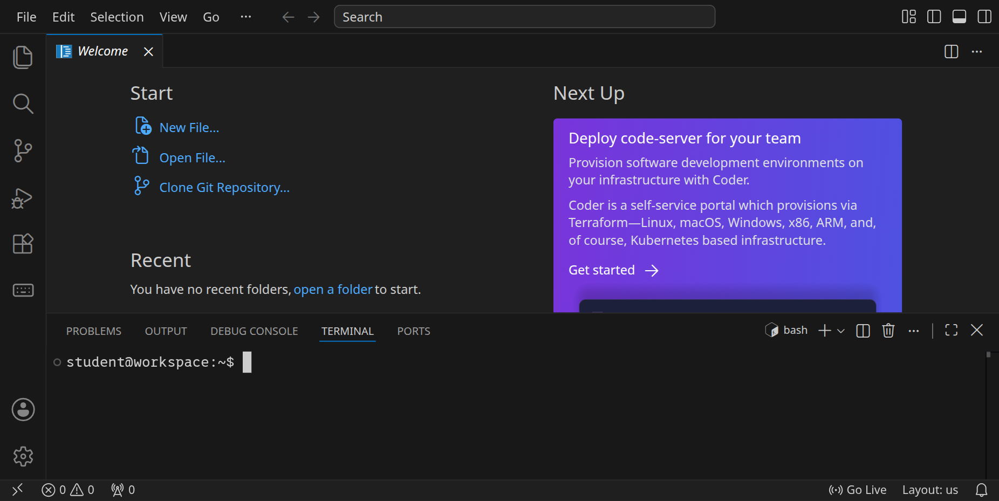
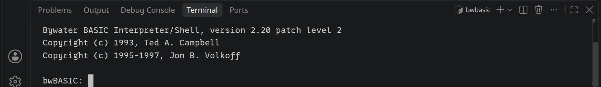
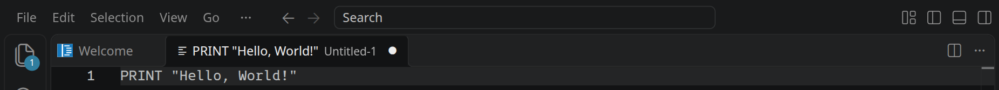
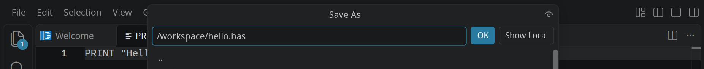
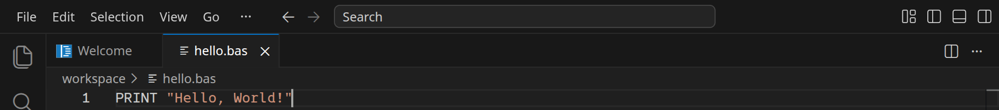
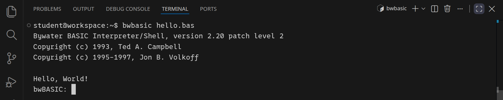
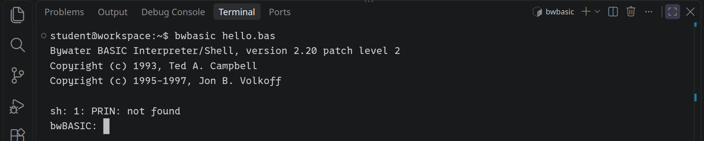
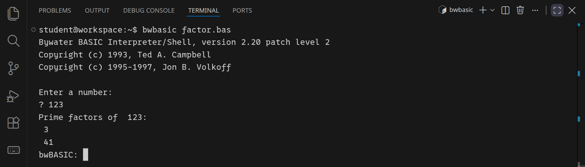
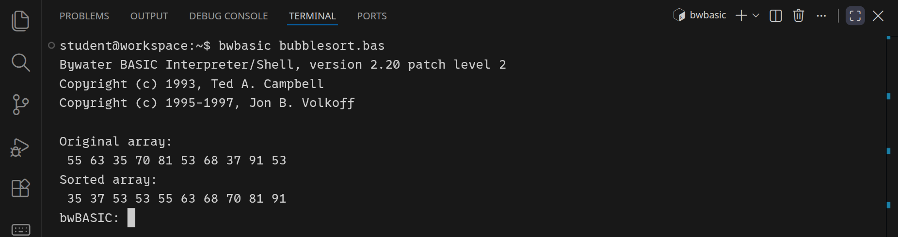

<div class='meta'>
image: basic-logo.png
kind: steckbrief
</div>

<div
    class="autotoc-secondary-trigger"
    data-title="Auf dieser Seite"
    data-levels="h2,h3">
</div>

# BASIC <span style='font-size: 80%;'>(1964)</span>

<div class='floatright' style='width: 24em;'>
    
    <p>John G. Kemeny &amp; Thomas E. Kurtz</p>
</div>

<p class='abstract'>
BASIC ist eine Programmiersprache, die in den 1960er Jahren von John G. Kemeny und Thomas E. Kurtz am Dartmouth College entwickelt wurde. Sie wurde ursprünglich für Anfänger entwickelt, um das Programmieren zu erlernen. Der Name BASIC steht für "Beginner's All-purpose Symbolic Instruction Code". BASIC wurde in den 1970er und 1980er Jahren auf vielen Heimcomputern eingesetzt. Es gibt viele verschiedene Versionen von BASIC, darunter Microsoft BASIC, Commodore BASIC und Sinclair BASIC.
</p>

Heutzutage ist BASIC weniger relevant als moderne Programmiersprachen, wird aber immer noch in Bildungskontexten und von Enthusiasten verwendet, um die Grundlagen des Programmierens zu lehren und historische Computersysteme zu emulieren.

## Hello, World!

BASIC ist eine Skriptsprache, was bedeutet, dass der Code zur Laufzeit interpretiert wird.

Früher wurde BASIC auf vielen Heimcomputern eingesetzt, darunter der Commodore 64, der Apple II und der Sinclair ZX Spectrum. Im Workspace kannst du BASIC-Programme z. B. mit Bywater BASIC (bwBASIC) ausführen.

Du hast zwei Möglichkeiten, BASIC-Code auszuführen:

1. Du kannst BASIC-Code direkt in der BASIC-Shell ausführen.
2. Du kannst BASIC-Code in einer Textdatei speichern und dann ausführen.

**Möglichkeit 1:** BASIC-Code in der BASIC-Shell ausführen

Öffne dazu ein Terminal, indem du entweder <kbd>Strg</kbd><kbd>J</kbd> drückst oder das Panel-Symbol  rechts oben drückst. Dein Fenster sollte jetzt ungefähr so aussehen:

<!-- tutorial-screenshot
# Ein frischer Workspace ohne Ordner, das Terminal offen
hide-left-sidebar
terminal-open
sleep: 0.5
-->



Starte nun die BASIC-Shell, indem du `bwbasic` eingibst und dann <kbd>Enter</kbd> drückst. Du solltest eine Ausgabe wie diese sehen:

<!-- tutorial-screenshot
press: Control+l
terminal-run: bwbasic
wait-for-text: bwBASIC:
sleep: 0.5
crop-terminal-lines: auto
-->



Jetzt kannst du BASIC-Code direkt in der Shell eingeben und ausführen. Schreibe einfach `PRINT "Hello, world!"` und drücke <kbd>Enter</kbd>. Du solltest die Ausgabe `Hello, world!` sehen.

Du kannst die BASIC-Shell wieder beenden, indem du `SYSTEM` eingibst und <kbd>Enter</kbd> drückst oder einfach <kbd>Strg</kbd><kbd>D</kbd> drückst.

**Möglichkeit 2:** BASIC-Code in einer Textdatei speichern und ausführen

BASIC-Programme werden in Textdateien mit der Endung `.bas` geschrieben. Ein BASIC-Interpreter liest anschließend den Quelltext und führt ihn aus.

Stelle zuerst sicher, dass du keinen Ordner geöffnet hast. Um sicherzugehen, drücke einfach den Shortcut für »Ordner schließen«: <kbd>Strg</kbd><kbd>K</kbd> und dann <kbd>F</kbd>. Dein Workspace sollte jetzt ungefähr so aussehen:

<!-- tutorial-screenshot
# Die Shell wieder verlassen, das Terminal schließen
terminal-run: SYSTEM
terminal-wait-for-prompt
press: Control+l
press: Control+j
show-left-sidebar
sleep: 0.5
-->


### Quelltext schreiben

Klicke auf »New File« und wähle als Dateityp »Text File« (oder bestätige einfach mit <kbd>Enter</kbd>).

<!-- tutorial-screenshot
click: New File...
wait-for-text: Text File
sleep: 0.5
crop-bottom: 77%
-->


Schreibe nun den folgenden Code in die Datei:

_include_file(hello.bas, basic)

Da Visual Studio Code noch nicht weiß, dass es sich um BASIC-Quelltext handelt, ist dein Programm momentan noch einfarbig, aber das wird sich gleich ändern. An dem weißen Punkt erkennst du, dass deine Änderungen noch nicht gespeichert sind.

<!-- tutorial-screenshot
# Das Programm in eine noch namenlose Datei
press: Enter
sleep: 1
hide-left-sidebar
type: <- file:hello.bas
sleep: 0.5
crop-bottom: 82%
-->



Drücke nun <kbd>Strg</kbd><kbd>S</kbd>, um die Datei zu speichern. Gib `hello.bas` ein – der vollständige Pfad zu deiner Datei lautet dann `/workspace/hello.bas`.

<!-- tutorial-screenshot
press: Control+s
wait-for-text: Save As
press: Control+a
type: /workspace/hello.bas
sleep: 0.5
crop-bottom: 82%
-->



Sobald du die Datei gespeichert hast, wird sie automatisch als BASIC-Datei erkannt und die Syntax wird hervorgehoben.

<!-- tutorial-screenshot
press: Enter
wait-for-file: hello.bas
sleep: 1.5
crop-bottom: 78%
-->



### Skript ausführen

Um unser Programm auszuführen, müssen wir den BASIC-Interpreter aufrufen und ihm den Dateinamen unseres Programms übergeben.

Öffne dazu ein Terminal, indem du <kbd>Strg</kbd><kbd>J</kbd> drückst und gib folgenden Befehl ein:

```bash
bwbasic hello.bas
```

<div class='hint'>
Du musst nicht den vollständigen Dateinamen schreiben. Schreib einfach <code>bwbasic he</code> und drücke <kbd>Tab</kbd>, um den Dateinamen automatisch zu <code>hello.bas</code> vervollständigen zu lassen. Du kannst danach ganz normal weiterschreiben.
</div>

Das Programm sollte die Nachricht `Hello, World!` im Terminal ausgeben:

<!-- tutorial-screenshot
hide-left-sidebar
terminal-open
# Mit dem Begrüßungstext von bwbasic passt alles nur ins ganze Terminal
terminal-maximize
press: Control+l
terminal-run: bwbasic hello.bas
# bwbasic bleibt danach in seiner eigenen Eingabe (bwBASIC:)
wait-for-text: Hello, World!
sleep: 0.5
crop-terminal-lines: auto
-->



Um BASIC zu beenden, gib `SYSTEM` ein und drücke <kbd>Enter</kbd> oder drücke einfach <kbd>Strg</kbd><kbd>D</kbd>.

### Fehler finden und beheben

Wenn du einen Fehler im Code machst, wird BASIC eine Fehlermeldung ausgeben. Versuche zum Beispiel, statt `PRINT` das Wort `PRIN` zu schreiben:

```basic
PRIN "Hello, World!"
```

Speichere die Datei und führe das Skript erneut aus:

```bash
bwbasic hello.bas
```

<div class='hint'>
Nutze die Pfeiltaste hoch <kbd>↑</kbd>, um den letzten Befehl erneut einzugeben. So kannst du schnell dein Programm testen, nachdem du es verändert hast.
</div>

BASIC sollte eine Fehlermeldung ausgeben, die dir hilft, den Fehler zu finden:

<!-- tutorial-screenshot
# Der Fehler aus dem Text; die lange Meldung braucht das ganze Terminal
terminal-run: SYSTEM
terminal-wait-for-prompt
write-file: hello.bas <- file:hello-error.bas
terminal-maximize
press: Control+l
terminal-run: bwbasic hello.bas
wait-for-text: not found
sleep: 0.5
crop-terminal-lines: auto
-->



Es lohnt sich, die Fehlermeldungen genau zu lesen, um den Fehler zu finden und zu beheben. Achte auf die Zeilennummer (in diesem Beispiel 1) und den Text, der dir sagt, was falsch ist. Denke daran, den Fehler wieder zu beheben, bevor du das nächste Beispiel ausprobierst.

## Primfaktorzerlegung

Im zweiten Beispiel wollen wir eine Zahl in ihre Primfaktoren zerlegen.
An diesem Beispiel kannst du sehen, wie man in BASIC Benutzereingaben verarbeitet und Schleifen verwendet.
Erstelle eine neue Datei mit <kbd>Strg</kbd><kbd>Alt</kbd><kbd>N</kbd> und schreibe den folgenden Code hinein:

_include_file(factor.bas, basic)

Speichere die Datei unter dem Namen `factor.bas` und führe sie aus:

<!-- tutorial-screenshot
terminal-run: SYSTEM
terminal-wait-for-prompt
write-file: factor.bas <- file:factor.bas
terminal-maximize
press: Control+l
terminal-run: bwbasic factor.bas
wait-for-text: number:
terminal-run: 123
wait-for-text: Prime factors
sleep: 1
crop-terminal-lines: auto
-->



Das Programm hat die Zahl 123 in ihre Primfaktoren zerlegt und ausgegeben. Probiere aus, was passiert, wenn du die Zahl 3000000000 eingibst. Was könnte der Grund dafür sein?

## Bubblesort

Im dritten Beispiel wollen wir eine Liste von 10 Zufallszahlen sortieren. Dafür verwenden wir den [Bubblesort-Algorithmus](https://de.wikipedia.org/wiki/Bubblesort), der zwar nicht besonders effizient ist, aber sehr einfach zu verstehen und zu implementieren. Der Bubblesort-Algorithmus funktioniert, indem er die Liste mehrmals durchläuft und benachbarte Elemente vertauscht, wenn sie in der falschen Reihenfolge sind.

An diesem Beispiel kannst du sehen, wie man in BASIC Arrays verwendet, Funktionen verwendet und Schleifen verschachtelt.

Erstelle eine neue Datei und schreibe den folgenden Code hinein:

_include_file(bubblesort.bas, basic)

Speichere das Skript unter dem Namen `bubblesort.bas` und führe es aus:

<!-- tutorial-screenshot
terminal-run: SYSTEM
terminal-wait-for-prompt
write-file: bubblesort.bas <- file:bubblesort.bas
press: Control+l
terminal-run: bwbasic bubblesort.bas
wait-for-text: Sorted array
sleep: 1
crop-terminal-lines: auto
-->



Das Programm hat eine Liste von 10 Zufallszahlen sortiert. Versuche, den Quelltext so zu verändern, dass statt 10 Zahlen 100 oder mehr Zahlen sortiert werden.

## Zusammenfassung

In diesem Kapitel hast du an drei Beispielen gesehen, wie man ein einfaches BASIC-Skript schreiben und ausführen kann. Das ist natürlich nur ein erster Eindruck. Um BASIC wirklich zu beherrschen, musst du noch viel mehr lernen – am besten, indem du eigene Skripte schreibst und ausprobierst. Die Buchhandlungen, Bibliotheken und Youtube sind voll von Material für dich. Viel Spaß beim Programmieren!
