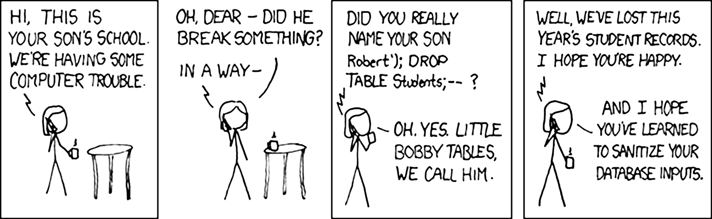

<div class='meta'>
image: xkcd-327.webp:0:50
image_alt: "Ausschnitt aus dem xkcd-Comic »Exploits of a Mom«: Die Schule ruft eine Mutter an, weil sie Probleme mit dem Computer hat"
kind: labor
language: Ruby / Python / SQL
languages: [ruby, python]
duration: 1 Doppelstunde
requires: [mysql]
reference: [sql, ruby-python]
</div>

<div
    class="autotoc-secondary-trigger"
    data-title="Auf dieser Seite"
    data-levels="h2,h3">
</div>

# SQL Injection

<p class='abstract'>
Viele Programme bauen aus dem, was jemand in ein Formular tippt, eine SQL-Abfrage. Geschieht das unvorsichtig, kann eine geschickte Eingabe die Abfrage selbst verändern. In diesem Labor schreibst du ein kleines Anmeldeprogramm, findest seine Lücke in deiner eigenen Testdatenbank und schließt sie mit einem Prepared Statement.
</p>

<div class='hint'>
Das Eindringen in fremde Computersysteme und das Ausspähen von Daten ist strafbar. Probiere alles auf dieser Seite nur an deinem eigenen Programm und deiner eigenen Testdatenbank aus. Mehr dazu steht am <a href='#5-wichtiger-hinweis'>Ende der Seite</a>.
</div>

## Eine Testdatenbank

Für dieses Labor bekommst du eine eigene, leere Datenbank, die du danach wieder löschen kannst. Öffne dein [Profil](/profil) und klicke unter MySQL auf »Weitere Datenbank erstellen«. Sie heißt zum Beispiel `db_1234`; ersetze diesen Namen auf dieser Seite immer durch den Namen deiner Datenbank.

Unter der neuen Datenbank stehen »Zugangsdaten nur für diese Datenbank«: ein Benutzername, der genauso heißt wie die Datenbank, und ein Passwort. Mit diesem Zugang erreicht ein Programm nur diese eine Datenbank. Was dort schiefgeht, bleibt dort, und genau das wollen wir für ein Programm, das gleich eine Lücke haben wird.

Öffne ein Terminal (<kbd>Strg</kbd><kbd>J</kbd>), lege einen Ordner an und lade die Testdaten herunter:

```bash_copy
mkdir ~/bobby_tables
cd ~/bobby_tables
wget https://github.com/specht/workspace-files/raw/main/users.sql
```

Importiere sie in deine neue Datenbank:

```bash
mysql db_1234 < users.sql
```

<!-- tutorial-step
# Die Testdatenbank im Profil anlegen; die Hook trägt Name und Passwort in
# login.rb und login.py ein, wie man sie aus dem Profil abschreibt.
open-site: /profil
tab: preview
hook: test-database
-->

<!-- tutorial-step
# Testdaten holen und importieren
terminal-open
terminal-run: mkdir -p ~/bobby_tables && cd ~/bobby_tables
terminal-run: wget -q https://github.com/specht/workspace-files/raw/main/users.sql
terminal-wait-for-prompt
terminal-run: mysql $(cat .testdb) < users.sql
terminal-wait-for-prompt
terminal-run: clear
terminal-run: mysql $(cat .testdb) -e 'SELECT login FROM users;'
wait-for-text: mallory
-->


Starte dann `mycli db_1234` und prüfe mit `SHOW TABLES;` und `SELECT * FROM users;`, ob die Daten angekommen sind:

<div style="max-width: 100%; overflow-x: auto;">
<table class='table table-sm'>
<thead>
<tr>
<th>login</th>
<th>password</th>
<th>address</th>
</tr>
</thead>
<tbody>
<tr>
<td>admin</td>
<td>YLrelnmPDPB-ZhQ1GzRxiEf</td>
<td>2683 John Calvin Drive, Chicago IL 60603</td>
</tr>
<tr>
<td>alice</td>
<td>asdf</td>
<td>578 Gordon Street, Claremont CA 91711</td>
</tr>
<tr>
<td>bob</td>
<td>1234</td>
<td>525 Cambridge Drive, Phoenix AZ 85039</td>
</tr>
<tr>
<td>mallory</td>
<td>hunter2</td>
<td>3747 Haven Lane, Lansing MI 48933</td>
</tr>
</tbody>
</table>
</div>

<div class='hint'>
Die Passwörter stehen hier im Klartext, damit du siehst, was passiert. Ein echter Server speichert nie das Passwort selbst, sondern einen Hash mit Salz; wie das geht, steht in <a href='/crypto'>Kryptographie im Terminal</a>.
</div>

## Ein Anmeldeprogramm

<!-- language: ruby -->
Das Programm braucht die Ruby-Bibliothek `mysql2`. Installiere sie einmal:

```bash
gem install mysql2
```

Lege im Ordner `bobby_tables` die Datei `login.rb` an und füge diesen Code ein. Trage oben den Namen deiner Datenbank und ihr Passwort aus dem Profil ein:

_include_file(login.rb, ruby)

Hinweise:

- `$stdin.noecho(&:gets)` liest das Passwort, ohne es auf dem Bildschirm zu zeigen.
- Mit <code>#&#8288;{ … }</code> wird der Wert einer Variable in einen String eingebettet (Z. 22 und 23), wie in Python mit f-Strings. Man nennt das [String Interpolation](https://en.wikipedia.org/wiki/String_interpolation).
- Der Backslash am Ende von Z. 21 und 22 setzt den String in der nächsten Zeile fort: Es ist ein einziger String ohne Zeilenumbruch, nur zur besseren Lesbarkeit auf drei Zeilen verteilt.
<!-- /language -->
<!-- language: python -->
Das Programm braucht die Python-Bibliothek `mysql.connector`; sie ist im Workspace schon installiert.

Lege im Ordner `bobby_tables` die Datei `login.py` an und füge diesen Code ein. Trage oben den Namen deiner Datenbank und ihr Passwort aus dem Profil ein:

_include_file(login.py, python)

Hinweise:

- `getpass.getpass` liest das Passwort, ohne es auf dem Bildschirm zu zeigen.
- In einem f-String (`f"…"`) wird mit `{ … }` der Wert einer Variable in den String eingebettet (Z. 21 und 22). Man nennt das [String Interpolation](https://en.wikipedia.org/wiki/String_interpolation).
- Die drei Strings in Z. 20 bis 22 stehen in einer Klammer direkt hintereinander. Python klebt sie zu einem einzigen String ohne Zeilenumbruch zusammen; sie sind nur zur besseren Lesbarkeit auf drei Zeilen verteilt.
- `cursor.fetchall()` holt alle Zeilen der Antwort, jede als Tupel; `rows[0][0]` ist die erste Spalte der ersten Zeile.
<!-- /language -->

<div class='hint'>
Für dieses Labor steht das Passwort im Quelltext. In einem echten Programm gehört es nicht dorthin, sondern zum Beispiel in eine Umgebungsvariable: So machen es <code>MYSQL_HOST</code>, <code>MYSQL_USER</code> und <code>MYSQL_PASSWORD</code> für deine Hauptdatenbank.
</div>

<!-- language: ruby -->
Starte das Programm mit `ruby login.rb` und melde dich als `alice` mit dem Passwort `asdf` an, dann mit einem falschen Passwort.

<!-- tutorial-step
# Ruby: die Bibliothek, dann das Programm mit richtigem und falschem Passwort
# und die drei Angriffe aus »Experimentieren«
terminal-open
terminal-run: gem install mysql2
terminal-wait-for-prompt: 300
terminal-run: clear
terminal-run: ruby login.rb
wait-for-text: Login:
terminal-run: alice
wait-for-text: Passwort:
terminal-run: asdf
wait-for-text: Herzlich willkommen, alice.
terminal-run: clear
terminal-run: ruby login.rb
wait-for-text: Login:
terminal-run: alice
wait-for-text: Passwort:
terminal-run: falsch
wait-for-text: Fehler: Login oder Passwort falsch.
terminal-run: clear
terminal-run: ruby login.rb
wait-for-text: Login:
terminal-run: admin' #
wait-for-text: Passwort:
press: Enter
wait-for-text: Herzlich willkommen, admin.
terminal-run: clear
terminal-run: ruby login.rb
wait-for-text: Login:
terminal-run: mallory' UNION SELECT address FROM users WHERE LOGIN='mallory' ORDER BY login ASC #
wait-for-text: Passwort:
press: Enter
wait-for-text: Herzlich willkommen, 3747 Haven Lane
terminal-run: clear
terminal-run: ruby login.rb
wait-for-text: Login:
terminal-run: x' UNION SELECT password FROM users WHERE login='admin' #
wait-for-text: Passwort:
press: Enter
wait-for-text: Herzlich willkommen, YLrelnmPDPB-ZhQ1GzRxiEf
check-task-fails: prepared
-->

<!-- /language -->
<!-- language: python -->
Starte das Programm mit `python3 login.py` und melde dich als `alice` mit dem Passwort `asdf` an, dann mit einem falschen Passwort.

<!-- tutorial-step
# Python: dasselbe, ohne etwas zu installieren
terminal-open
terminal-run: clear
terminal-run: python3 login.py
wait-for-text: Login:
terminal-run: alice
wait-for-text: Passwort:
terminal-run: asdf
wait-for-text: Herzlich willkommen, alice.
terminal-run: clear
terminal-run: python3 login.py
wait-for-text: Login:
terminal-run: alice
wait-for-text: Passwort:
terminal-run: falsch
wait-for-text: Fehler: Login oder Passwort falsch.
terminal-run: clear
terminal-run: python3 login.py
wait-for-text: Login:
terminal-run: admin' #
wait-for-text: Passwort:
press: Enter
wait-for-text: Herzlich willkommen, admin.
terminal-run: clear
terminal-run: python3 login.py
wait-for-text: Login:
terminal-run: mallory' UNION SELECT address FROM users WHERE LOGIN='mallory' ORDER BY login ASC #
wait-for-text: Passwort:
press: Enter
wait-for-text: Herzlich willkommen, 3747 Haven Lane
terminal-run: clear
terminal-run: python3 login.py
wait-for-text: Login:
terminal-run: x' UNION SELECT password FROM users WHERE login='admin' #
wait-for-text: Passwort:
press: Enter
wait-for-text: Herzlich willkommen, YLrelnmPDPB-ZhQ1GzRxiEf
check-task-fails: prepared python
-->

<!-- /language -->

## Experimentieren

Notiere dir die SQL-Abfragen, die in den folgenden Aufgaben entstehen; du brauchst sie später noch.

_task(zweck)

_task(abfrage)

_uses(select, where)

_task(apostroph)

<!-- after: apostroph -->
Das Programm bricht mit einer Fehlermeldung der Datenbank ab: `You have an error in your SQL syntax`. Der Apostroph in `o'brien` beendet den Text in der Abfrage zu früh. Die Datenbank bekommt `WHERE login = 'o'brien' AND …`, und mit `brien' AND …` dahinter kann sie nichts anfangen. Was jemand als Login eintippt, wird also nicht nur verglichen, es wird Teil der Abfrage.
<!-- /after -->

Wie in vielen anderen Sprachen können in SQL Kommentare stehen: Mit `#` oder `--` beginnt ein Kommentar, der bis zum Ende der Zeile gilt und nicht ausgeführt wird.

Das Programm setzt die Eingabe unverändert in die SQL-Abfrage ein. Damit kann, wer etwas eintippt, die Abfrage selbst verändern.

_task(admin)

_task(union)

_task(passwort-auslesen)

## Die Lücke schließen

Der Angriff, den du ausprobiert hast, heißt **SQL Injection**: Eigener SQL-Code wird in eine Abfrage eingeschleust und bringt das Programm dazu, etwas anderes zu tun als vorgesehen. Das Problem liegt im Programm, das Eingaben ungeprüft in den SQL-Code mischt, und dort lässt es sich auch beheben.

Statt die Eingabe per String Interpolation einzubauen, benutzt man ein **Prepared Statement**: Die Abfrage wird mit Platzhaltern `?` vorbereitet und erst danach mit den Eingaben ausgeführt. Die Datenbank bekommt den SQL-Code und die Werte getrennt; was in einem Wert steht, wird nie zu SQL, egal welche Zeichen darin vorkommen.

<!-- language: ruby -->
Kommentiere die Zeilen 21 bis 23 aus und füge dahinter ein:

```ruby
query = CLIENT.prepare("SELECT login FROM users WHERE login = ? AND password = ? LIMIT 1;")
rows = query.execute(login, password).to_a
```
<!-- /language -->
<!-- language: python -->
Kommentiere die Zeilen 19 bis 23 aus und füge dahinter ein:

```python
cursor = connection.cursor(prepared=True)
cursor.execute("SELECT login FROM users WHERE login = ? AND password = ? LIMIT 1;", (login, password))
rows = cursor.fetchall()
```

`connection.cursor(prepared=True)` gibt einen Cursor für Prepared Statements. Die Werte gehen als Tupel `(login, password)` getrennt von der Abfrage mit.
<!-- /language -->

_uses(platzhalter)

<div class='hint'>
Zeilen kommentierst du in Ruby und Python mit <code>#</code> am Anfang aus. Schneller geht es, wenn du sie markierst und <kbd>Strg</kbd><kbd>#</kbd> drückst (mit US-Tastaturlayout <kbd>Ctrl</kbd><kbd>/</kbd>).
</div>

_task(prepared)

<!-- tutorial-step
# Die Lücke schließen, genau wie die Seite es sagt (Zeilen auskommentieren,
# den Codeblock dahinter einfügen), in beiden Programmen
open-site: /profil
tab: preview
hook: test-database fixed
-->

<!-- tutorial-step
# Mit Prepared Statement: alice kommt herein, die drei Angriffe nicht mehr
terminal-open
terminal-run: clear
terminal-run: ruby login.rb
wait-for-text: Login:
terminal-run: alice
wait-for-text: Passwort:
terminal-run: asdf
wait-for-text: Herzlich willkommen, alice.
terminal-run: clear
terminal-run: ruby login.rb
wait-for-text: Login:
terminal-run: alice
wait-for-text: Passwort:
terminal-run: falsch
wait-for-text: Fehler: Login oder Passwort falsch.
terminal-run: clear
terminal-run: ruby login.rb
wait-for-text: Login:
terminal-run: admin' #
wait-for-text: Passwort:
press: Enter
wait-for-text: Fehler: Login oder Passwort falsch.
terminal-run: clear
terminal-run: ruby login.rb
wait-for-text: Login:
terminal-run: mallory' UNION SELECT address FROM users WHERE LOGIN='mallory' ORDER BY login ASC #
wait-for-text: Passwort:
press: Enter
wait-for-text: Fehler: Login oder Passwort falsch.
terminal-run: clear
terminal-run: ruby login.rb
wait-for-text: Login:
terminal-run: x' UNION SELECT password FROM users WHERE login='admin' #
wait-for-text: Passwort:
press: Enter
wait-for-text: Fehler: Login oder Passwort falsch.
terminal-run: clear
terminal-run: python3 login.py
wait-for-text: Login:
terminal-run: alice
wait-for-text: Passwort:
terminal-run: asdf
wait-for-text: Herzlich willkommen, alice.
terminal-run: clear
terminal-run: python3 login.py
wait-for-text: Login:
terminal-run: alice
wait-for-text: Passwort:
terminal-run: falsch
wait-for-text: Fehler: Login oder Passwort falsch.
terminal-run: clear
terminal-run: python3 login.py
wait-for-text: Login:
terminal-run: admin' #
wait-for-text: Passwort:
press: Enter
wait-for-text: Fehler: Login oder Passwort falsch.
terminal-run: clear
terminal-run: python3 login.py
wait-for-text: Login:
terminal-run: mallory' UNION SELECT address FROM users WHERE LOGIN='mallory' ORDER BY login ASC #
wait-for-text: Passwort:
press: Enter
wait-for-text: Fehler: Login oder Passwort falsch.
terminal-run: clear
terminal-run: python3 login.py
wait-for-text: Login:
terminal-run: x' UNION SELECT password FROM users WHERE login='admin' #
wait-for-text: Passwort:
press: Enter
wait-for-text: Fehler: Login oder Passwort falsch.
check-task: prepared
check-task: prepared python
-->


_task(behoben)

<div class='hint try'>
<strong>Ausprobieren:</strong> Melde dich im geänderten Programm als <code>o'brien</code> an, mit irgendeinem Passwort. Vorhin hat der Apostroph das Programm zum Absturz gebracht. Was passiert jetzt, und warum? Versuch es auch als <code>alice</code> mit dem Passwort <code>x' OR '1'='1</code>.
</div>

_task(warum-prepared)

_task(eigener-zugang)

Wenn du fertig bist, kannst du die Testdatenbank im [Profil](/profil) wieder löschen.

## Wichtiger Hinweis

Das Eindringen in fremde Computersysteme und das Ausspähen von Daten ist illegal und wird bestraft. Die Beispiele hier zeigen eine Sicherheitslücke, damit du sie in deinen eigenen Programmen erkennst und vermeidest. Probiere sie nur an Systemen aus, die du selbst betreibst oder für die du eine ausdrückliche Erlaubnis hast.

Ein Vergleich zum Schluss: Es ist in Ordnung, mit einem Lockpicking-Set dein eigenes Schloss zu öffnen, weil du den Schlüssel verloren hast. Öffnest du fremde Schlösser ohne Erlaubnis, begehst du eine Straftat.



<em>Cartoon von Randall Munroe, [xkcd.com](https://xkcd.com/327/).</em>


_person(munroe)