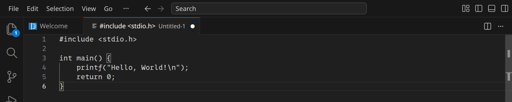
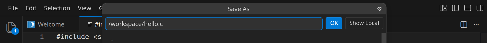
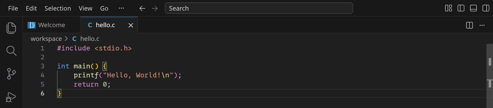
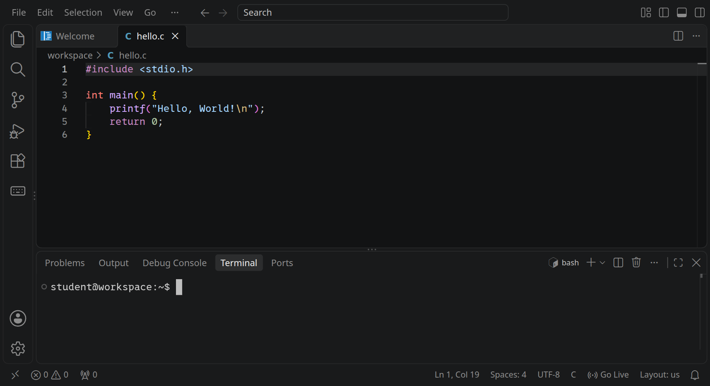
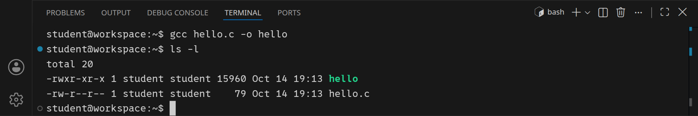
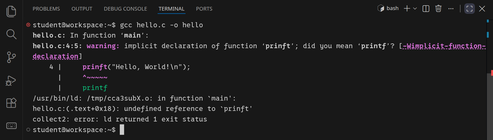
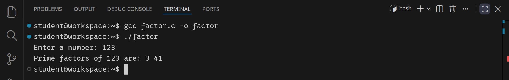
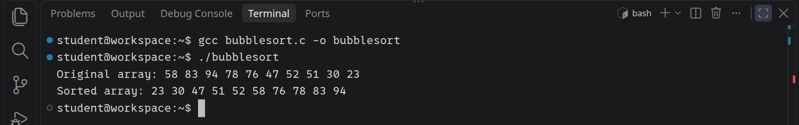

<div class='meta'>
image: c-logo.png
kind: steckbrief
</div>

<div
    class="autotoc-secondary-trigger"
    data-title="Auf dieser Seite"
    data-levels="h2,h3">
</div>

# C <span style='font-size: 80%;'>(1972)</span>

<div class='floatright' style='width: 16em;'>
    
    <p>Dennis Ritchie</p>
</div>

<p class='abstract'>
Die Programmiersprache C wurde in den frühen 1970er Jahren von Dennis Ritchie bei Bell Labs entwickelt, um das Unix-Betriebssystem zu implementieren. C wurde für die Systemprogrammierung und die Entwicklung von Betriebssystemen verwendet, wobei Unix eines der bekanntesten Beispiele ist. Weitere bekannte Softwareprojekte, die in C geschrieben wurden, sind der Linux-Kernel, der Webserver Apache, der Python-Interpreter und 3D-Computerspiele wie Doom.
</p>

Heutzutage ist C immer noch äußerst relevant und weit verbreitet. Sie bildet die Grundlage für viele moderne Programmiersprachen wie C++, C#, und Objective-C und wird weiterhin in der Entwicklung von Betriebssystemen, eingebetteten Systemen, Datenbanken und anderen Performance-kritischen Anwendungen eingesetzt. Die Sprache ist bekannt für ihre Effizienz, Portabilität und Nähe zur Hardware, was sie zu einer bevorzugten Wahl für Anwendungen macht, die eine hohe Leistung erfordern.

## Hello, world!

C-Programme werden in Textdateien mit der Endung `.c` geschrieben. Diese Dateien werden anschließend von einem Compiler in ausführbare Dateien übersetzt, die auf deinem Computer direkt ausgeführt werden können. Es gibt eine Vielzahl von Compilern, die du verwenden kannst, aber wir werden hier den freien »GNU C Compiler« `gcc` verwenden, der auf den meisten Systemen verfügbar ist.

Stelle zuerst sicher, dass du keinen Ordner geöffnet hast. Um sicherzugehen, drücke einfach den Shortcut für »Ordner schließen«: <kbd>Strg</kbd><kbd>K</kbd> und dann <kbd>F</kbd>. Dein Workspace sollte jetzt ungefähr so aussehen:

<!-- tutorial-screenshot
# Ein frischer Workspace ohne Ordner
show-left-sidebar
-->


### Quelltext schreiben

Klicke auf »New File« und wähle als Dateityp »Text File«.

<!-- tutorial-screenshot
click: New File...
wait-for-text: Text File
sleep: 0.5
crop-bottom: 77%
-->


Schreibe nun den folgenden Code in die Datei:

_include_file(hello.c, c)

Da Visual Studio Code noch nicht weiß, dass es sich um C-Quelltext handelt, ist dein Programm momentan noch einfarbig, aber das wird sich gleich ändern. An dem weißen Punkt erkennst du, dass deine Änderungen noch nicht gespeichert sind.

<!-- tutorial-screenshot
# Das Programm in eine noch namenlose Datei
press: Enter
sleep: 1
hide-left-sidebar
type: <- file:hello.c
sleep: 0.5
crop-bottom: 60%
-->



Drücke nun <kbd>Strg</kbd><kbd>S</kbd>, um die Datei zu speichern. Gib `hello.c` ein – der vollständige Pfad zu deiner Datei lautet dann `/workspace/hello.c`.

<!-- tutorial-screenshot
press: Control+s
wait-for-text: Save As
press: Control+a
type: /workspace/hello.c
sleep: 0.5
crop-bottom: 82%
-->



Sobald du die Datei gespeichert hast, wird sie automatisch als C-Datei erkannt und die Syntax wird hervorgehoben.

<!-- tutorial-screenshot
press: Enter
wait-for-file: hello.c
sleep: 1.5
crop-bottom: 56%
-->



### Kompilieren und ausführen

Bevor wir das Programm ausführen können, müssen wir es kompilieren. Dadurch wird der Quelltext in Maschinencode übersetzt, den dein Computer ausführen kann.

Öffne dazu ein Terminal, indem du entweder <kbd>Strg</kbd><kbd>J</kbd> drückst oder das Panel-Symbol  rechts oben drückst. Dein Fenster sollte jetzt ungefähr so aussehen:

<!-- tutorial-screenshot
hide-left-sidebar
terminal-open
sleep: 0.5
-->



Um das Programm zu kompilieren, gib folgenden Befehl ein:

```bash
gcc hello.c -o hello
```

<div class='hint'>
Du musst nicht den vollständigen Dateinamen schreiben. Schreib einfach <code>gcc he</code> und drücke <kbd>Tab</kbd>, um den Dateinamen automatisch zu <code>hello.c</code> vervollständigen zu lassen. Du kannst danach ganz normal weiterschreiben.
</div>

Wenn du keinen Fehler gemacht hast, wird das Programm erfolgreich kompiliert und die ausführbare Datei `hello` wird im selben Verzeichnis erstellt. Du kannst dies überprüfen, indem du dir die Dateien im aktuellen Verzeichnis mit `ls` oder `ls -l` anzeigen lässt:

<!-- tutorial-screenshot
press: Control+l
terminal-run: gcc hello.c -o hello
terminal-wait-for-prompt
terminal-run: ls -l
terminal-wait-for-prompt
crop-terminal-lines: auto
-->



Die grüne Datei `hello` ist die ausführbare Datei – im Unterschied zu Windows, wo ausführbare Dateien die Endung `.exe` haben, haben ausführbare Dateien unter Linux keine Endung. Um das Programm auszuführen, gib folgenden Befehl ein:

```bash
./hello
```

Das Programm sollte die Nachricht `Hello, World!` im Terminal ausgeben. Du kannst beide Schritte auch in einem Befehl kombinieren:

```bash
gcc hello.c -o hello && ./hello
```

<div class='hint'>
Die Zeichenkombination <code>&amp;&amp;</code> sorgt dafür, dass der zweite Befehl nur ausgeführt wird, wenn der erste erfolgreich war.
</div>

### Fehler finden und beheben

Wenn du einen Fehler im Code machst, wird der Compiler eine Fehlermeldung ausgeben. Versuche zum Beispiel, statt `printf` das Wort `prinft` zu schreiben:

```c
~ #include <stdio.h>
~
~ int main() {
    prinft("Hello, World!\n");
~     return 0;
~ }
```

Speichere die Datei und führe den Compiler erneut aus:

```bash
gcc hello.c -o hello
```

<div class='hint'>
Nutze die Pfeiltaste hoch <kbd>↑</kbd>, um den letzten Befehl erneut einzugeben. So kannst du schnell dein Programm testen, nachdem du es verändert hast.
</div>

Der Compiler sollte eine Fehlermeldung ausgeben, die dir hilft, den Fehler zu finden:

<!-- tutorial-screenshot
# prinft statt printf; die lange Meldung braucht das ganze Terminal
write-file: hello.c <- file:hello-prinft.c
terminal-maximize
press: Control+l
terminal-run: gcc hello.c -o hello
terminal-wait-for-prompt
crop-terminal-lines: auto
-->



Es lohnt sich, die Fehlermeldungen genau zu lesen, um den Fehler zu finden und zu beheben. Achte auf die Zeilennummer (in diesem Beispiel 4) und den Text, der dir sagt, was falsch ist. Denke daran, den Fehler wieder zu beheben, bevor du das nächste Beispiel ausprobierst.

## Primfaktorzerlegung

Im zweiten Beispiel wollen wir eine Zahl in ihre Primfaktoren zerlegen. An diesem Beispiel kannst du sehen, wie man in C Benutzereingaben verarbeitet und Schleifen verwendet.
Erstelle eine neue Datei mit <kbd>Strg</kbd><kbd>Alt</kbd><kbd>N</kbd> und schreibe den folgenden Code hinein:

_include_file(factor.c, c)

Speichere die Datei unter dem Namen `factor.c`. Kompiliere das Programm:

```bash
gcc factor.c -o factor
```

Falls du keine Fehlermeldung erhältst, kannst du das Programm ausführen und testen:

<!-- tutorial-screenshot
write-file: factor.c <- file:factor.c
press: Control+l
terminal-run: gcc factor.c -o factor
terminal-wait-for-prompt
terminal-run: ./factor
wait-for-text: Enter a number
terminal-run: 123
terminal-wait-for-prompt
crop-terminal-lines: auto
-->



Das Programm hat die Zahl 123 in ihre Primfaktoren zerlegt und ausgegeben.

<div class='hint try'>
<strong>Ausprobieren:</strong> Gib statt 123 die Zahl <code>3000000000</code> ein. Welche Zahl nennt das Programm in seiner Antwort, und was könnte der Grund dafür sein? Ändere danach <code>int num, i;</code> zu <code>long num, i;</code> und jedes <code>%d</code> zu <code>%ld</code>, übersetze neu und probier die Zahl noch einmal. Was ist bei <code>long</code> anders als bei <code>int</code>?
</div>

## Bubblesort

Im dritten Beispiel wollen wir eine Liste von 10 Zufallszahlen sortieren. Dafür verwenden wir den [Bubblesort-Algorithmus](https://de.wikipedia.org/wiki/Bubblesort), der zwar nicht besonders effizient ist, aber sehr einfach zu verstehen und zu implementieren. Der Bubblesort-Algorithmus funktioniert, indem er die Liste mehrmals durchläuft und benachbarte Elemente vertauscht, wenn sie in der falschen Reihenfolge sind.

An diesem Beispiel kannst du sehen, wie man in C Arrays verwendet, Funktionen verwendet und Schleifen verschachtelt.

Erstelle eine neue Datei und schreibe den folgenden Code hinein:

_include_file(bubblesort.c, c)

Speichere die Datei unter dem Namen `bubblesort.c`. Kompiliere das Programm:

```bash
gcc bubblesort.c -o bubblesort
```
Falls du keine Fehlermeldung erhältst, kannst du das Programm ausführen und testen:

<!-- tutorial-screenshot
write-file: bubblesort.c <- file:bubblesort.c
press: Control+l
terminal-run: gcc bubblesort.c -o bubblesort
terminal-wait-for-prompt
terminal-run: ./bubblesort
terminal-wait-for-prompt
crop-terminal-lines: auto
-->



Das Programm hat eine Liste von 10 Zufallszahlen sortiert.

<div class='hint try'>
<strong>Ausprobieren:</strong> Ändere <code>bubblesort.c</code>, übersetze neu und starte das Programm:
<ul>
<li>Sortiere 100 Zahlen statt 10. Wie oft musst du dafür die 10 ersetzen?</li>
<li>Ändere nur den Aufruf zu <code>bubbleSort(arr, 5);</code>. Welche Zahlen sind danach sortiert? Ein Array in C weiß nicht, wie lang es ist: Deshalb bekommt <code>bubbleSort</code> die Länge mit.</li>
<li>Sortiere absteigend, die größte Zahl zuerst: Welches Zeichen musst du dafür ändern?</li>
</ul>
</div>

## Zusammenfassung

In diesem Kapitel hast du an drei Beispielen gesehen, wie man ein einfaches C-Programm schreiben, kompilieren und ausführen kann. Das ist natürlich nur ein erster Eindruck. Um C wirklich zu beherrschen, musst du noch viel mehr lernen – am besten, indem du eigene Programme schreibst und ausprobierst. Die Buchhandlungen, Bibliotheken und Youtube sind voll von Material für dich. Viel Spaß beim Programmieren!

