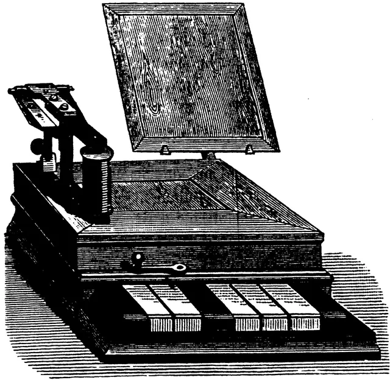

image: teaser.webp
image_alt: "Das Kabel: eine dunkle Tafel mit der Frequenz 42.7 kHz, darunter fünf runde Lampen in Grün, Gelb, Rot, Blau und Lila mit den Knöpfen 1 bis 5; Grün und Rot leuchten."
kind: labor
topic: networks
duration: 1 Doppelstunde

# Datenübertragung per Kabel

Zu zweit übertragt ihr Wörter von einem Raum in den anderen, nur mit ein paar Lampen, die man ein- und ausschalten kann. Dafür denkt ihr euch ein Protokoll aus: wie aus Buchstaben Lichtzeichen werden, woran man Anfang und Ende erkennt und was ihr tut, wenn etwas schiefgeht. Und dann nimmt euch jemand Lampen weg.

## Das Kabel

Stellt euch ein langes Kabel mit fünf Adern vor. An jedem Ende hängen fünf Lampen und fünf Knöpfe: Hält jemand einen Knopf gedrückt, leuchtet die Lampe dazu an beiden Enden, und zwar so lange, bis er den Knopf loslässt. Mehr kann das Kabel nicht.

Hier ist es. Damit nicht alle an demselben Kabel hängen, stellt ihr eine **Frequenz** ein, wie bei einem Funkgerät: Alle, die dieselbe Frequenz eingestellt haben, sehen dieselben Lampen, und alle können darauf senden. Haltet einen Knopf mit der Maus oder dem Finger gedrückt, oder nehmt die Tasten <kbd>1</kbd> bis <kbd>5</kbd>.

Ohne diese Seite und ohne Anmeldung, etwa auf dem Handy, findet ihr das Kabel unter **${web_root}/ether**.

<strong>Ausprobieren:</strong> Öffnet das Kabel auf zwei Geräten mit derselben Frequenz und haltet auf dem einen einen Knopf: Auf beiden leuchtet die Lampe. Stellt dann eines 0.1 kHz höher. Was seht ihr jetzt, und was sieht das andere Gerät, wenn ihr dort einen Knopf drückt?

## Zwei Räume

Findet euch in Zweiergruppen zusammen und macht euch mit dem Kabel vertraut. Gleich seid ihr in verschiedenen Räumen:

<strong><i class='bi bi-door-closed'></i>Raum A: die Senderseite</strong>bekommt von der Lehrkraft ein Wort und überträgt es mit den Lampen.

eure Frequenzsonst nichts

<strong><i class='bi bi-door-closed'></i>Raum B: die Empfängerseite</strong>schreibt mit, was ankommt, und bringt das Wort auf einem Zettel mit.

Die Wörter sind unterschiedlich lang und bestehen nur aus den Großbuchstaben A bis Z. Sie ergeben nicht immer einen Sinn, ihr könnt also nichts erraten: Sie müssen trotzdem fehlerfrei ankommen. Wenn ihr während der Übertragung in den anderen Raum laufen müsst, um euch zu besprechen, ist die Übertragung gescheitert.

## Euer Protokoll

Bevor ihr euch trennt, einigt ihr euch auf ein **Protokoll**: Regeln, an die sich beide Seiten halten, damit die Übertragung klappt. Beachtet dabei:

- Wie werden Buchstaben übertragen?
- Woher soll die Empfängerseite wissen, wann die Übertragung abgeschlossen ist?
- Welche Probleme können während der Übertragung auf der Sender- und auf der Empfängerseite auftreten, und wie wollt ihr darauf reagieren?

Macht euch einen guten Plan, der möglichst alle Fälle abdeckt, und schreibt ihn auf: Im anderen Raum könnt ihr nicht mehr nachfragen.

Haltet jede Übertragung auf einem Zettel in einer Tabelle wie dieser fest:

<table class='table cable-log'>
<tr><th>Nr.</th><th>Lampen</th><th>Nachricht</th><th>Ergebnis</th><th>Probleme</th></tr>
<tr><td>1</td><td>5</td><td></td><td></td><td></td></tr>
<tr><td>2</td><td></td><td></td><td></td><td></td></tr>
<tr><td>3</td><td></td><td></td><td></td><td></td></tr>
</table>

_task(protokoll)

## Weniger Lampen

Nach einer Weile stellt eure Lehrkraft weniger Lampen ein. Über den Lampen zählt dann eine Zeile die Zeit herunter, und die Lampen, die wegfallen, sind gestrichelt umrandet. Ist die Zeit um, sind sie weg, bei allen auf einmal, auch mitten in einer Übertragung.

Passt euer Protokoll an, ohne euch zu treffen: Was ihr dafür braucht, muss schon in eurem Plan stehen oder über die Lampen gehen. Später werden es vielleicht noch weniger.

_task(weniger-lampen)

## Nach der Übertragung

Wenn ihr wieder zusammen seid, vergleicht eure Zettel und sprecht über diese Fragen:

Wie viele verschiedene Zeichen könnt ihr mit fünf Lampen auf einmal zeigen, wenn jede an oder aus ist? Wie viele mit vier, drei, zwei, einer? Und wie viele Buchstaben gibt es?

Wie merkt die Empfängerseite, dass ein Buchstabe zu Ende ist und der nächste beginnt, vor allem wenn zweimal derselbe kommt, wie in SCHNEE?

Alle auf eurer Frequenz sehen eure Lampen und können selbst Lampen einschalten. Merkt ihr, ob jemand mitliest? Und was passiert mit eurer Nachricht, wenn jemand dazwischenfunkt?

## Wie es ein Telegraf gemacht hat

Vor 150 Jahren hatten Telegrafen dasselbe Problem: Über eine Leitung gingen nur »Strom an« und »Strom aus«. Émile Baudot baute dafür eine Tastatur mit fünf Tasten, so wie euer Kabel fünf Knöpfe hat.

<figure><figcaption>Baudots Tastatur mit fünf Tasten, 1884 (Zeichnung von M. Rothen, gemeinfrei, <a href='https://commons.wikimedia.org/wiki/File:Clavier_Baudot.jpg'>Wikimedia Commons</a>)</figcaption></figure>

<!-- Die Aktivität ist zurückgestellt: die Personenbox für Émile Baudot (part baudot, baudot.webp) steht in Commit 6bc97d13 der Seite reference/personen und kommt mit _person(baudot) zurück, wenn die Aktivität in den Katalog geht. -->

Wie viel durch eine Leitung passt, wenn man so geschickt wie möglich codiert, und wie man trotz Störungen fehlerfrei überträgt, hat Claude Shannon 1948 ausgerechnet.

<i class='bi bi-file-earmark-text'></i>

<strong>A Mathematical Theory of Communication</strong>, Claude E. Shannon, Bell System Technical Journal, 1948. Der Aufsatz, mit dem die Informationstheorie anfängt: eine Quelle, ein Sender, ein Kanal mit Störungen, ein Empfänger, und wie viele Bits pro Sekunde durch einen Kanal gehen können, ohne dass Fehler bleiben. Die ersten Seiten sind auch ohne die Mathematik dahinter zu lesen: <a href='https://people.math.harvard.edu/~ctm/home/text/others/shannon/entropy/entropy.pdf'>als PDF</a>.

_person(shannon)
