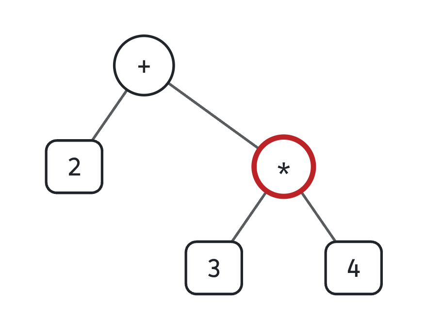
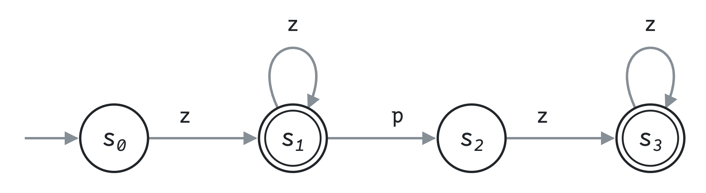
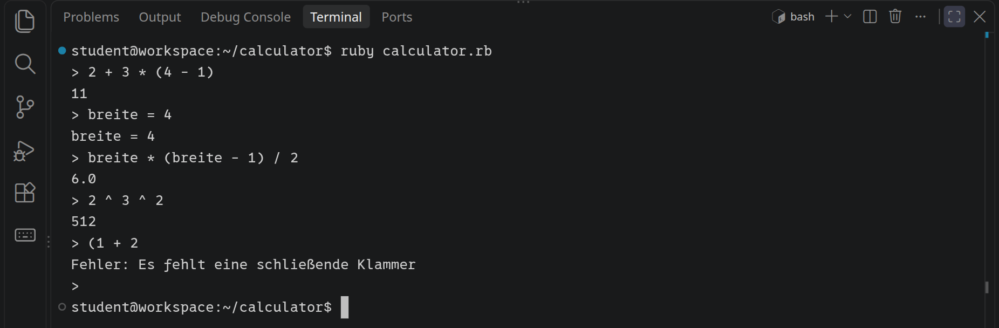
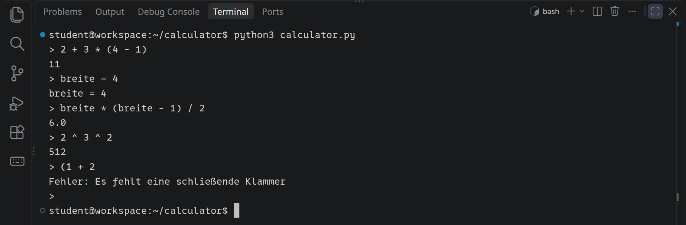

<div class='meta'>
image: baum.webp:contain
image_alt: "Der Syntaxbaum zu 2 + 3 * 4: oben das Plus, rechts darunter das Mal mit 3 und 4"
kind: projekt
language: Ruby / Python
languages: [ruby, python]
duration: 2 Doppelstunden
requires: [automata]
</div>

<div
    class="autotoc-secondary-trigger"
    data-title="Auf dieser Seite"
    data-levels="h2,h3">
</div>

<style>
    .calc-stepper input {
        font-family: '0xProto Nerd Font Mono', monospace;
        margin-bottom: 0.6em;
    }
    .calc-controls {
        display: flex;
        gap: 0.3em;
        align-items: center;
        flex-wrap: wrap;
        margin-bottom: 0.6em;
    }
    .calc-controls .calc-count {
        margin-left: 0.6em;
        color: var(--bs-secondary-color);
    }
    .calc-say {
        min-height: 2.4em;
    }
    .calc-say code {
        white-space: nowrap;
    }
    .calc-tree {
        overflow-x: auto;
    }
    .calc-tree svg {
        display: block;
        margin: 0 auto;
    }
    .calc-stepper {
        --calc-accent: #6741d9;
    }
    html[data-bs-theme="dark"] .calc-stepper {
        --calc-accent: #b197fc;
    }
    .calc-tree path.edge {
        fill: none;
        stroke: var(--bs-secondary-color);
        stroke-width: 1.5;
    }
    .calc-tree rect.op, .calc-tree rect.num {
        fill: var(--bs-body-bg);
        stroke: var(--bs-body-color);
        stroke-width: 1.5;
    }
    .calc-tree circle.pick {
        fill: none;
        stroke: var(--calc-accent);
        stroke-width: 3;
    }
    .calc-tree rect.num.fresh {
        stroke: #2e9e5b;
        stroke-width: 3;
    }
    .calc-tree text {
        fill: var(--bs-body-color);
        font-family: '0xProto Nerd Font Mono', monospace;
        font-size: 14px;
        text-anchor: middle;
        dominant-baseline: central;
    }
</style>

# Ein Rechner für Ausdrücke

<p class='abstract'>
Tipp <code>2 + 3 * (4 - 1)</code> in einen Taschenrechner, und er weiß, dass erst die Klammer drankommt, dann das Malnehmen und zuletzt das Plus. Woher eigentlich? Du baust einen Rechner, der Ausdrücke versteht, in Ruby oder Python: Er zerlegt den Text in Stücke, baut daraus einen Baum und rechnet den Baum von unten nach oben aus. Genauso fangen Compiler an, die aus deinem Programm Maschinencode machen.
</p>

## Punkt vor Strich

Ein Ausdruck wie `2 + 3 * 4` ist für einen Computer zuerst nur Text, eine Reihe von Zeichen. Von links nach rechts ausgerechnet käme 20 heraus: 2 + 3 ist 5, mal 4 ist 20. Richtig ist 14, denn Malnehmen bindet stärker als Plus. Für Ausdrücke gelten ein paar Regeln, die du aus der Mathematik kennst:

- Klammern zuerst.
- Punkt vor Strich: `*` und `/` vor `+` und `-`.
- Sonst von links nach rechts.

Die letzte Regel klingt selbstverständlich, macht aber einen Unterschied.

_task(links-nach-rechts)

Ein Rechner muss diese Regeln kennen. Er arbeitet dafür in drei Schritten:

1. **Zerlegen:** Aus dem Text `12+3*(4-1)` werden **Tokens**, die kleinsten Stücke, die etwas bedeuten: die Zahl 12, das Zeichen `+`, die Zahl 3 und so weiter. Leerzeichen fallen dabei weg.
2. **Einen Baum bauen:** Aus den Tokens wird ein Baum, an dem die Regeln schon abzulesen sind: Was zuerst gerechnet wird, hängt weiter unten.
3. **Ausrechnen:** Den Baum von unten nach oben, Knoten für Knoten.

So sieht der Baum für `2 + 3 * 4` aus. Das `*` hängt unter dem `+`, also wird es zuerst ausgerechnet:

<!-- tutorial-screenshot
# Der Baum für 2 + 3 * 4 aus dem Baumzeichner weiter unten
open-site: /calculator
tab: preview
viewport: 1029x700
zoom: 2
click: selector:#calc-input
press: Control+A
type: 2 + 3 * 4
hook: plain-tree
sleep: 1
crop-element: #calc-stepper .calc-tree svg
variants: dark
-->


## Einrichten

Lege einen Ordner an und öffne ihn mit <kbd>Strg</kbd><kbd>K</kbd> <kbd>Strg</kbd><kbd>O</kbd>:

```bash
mkdir /workspace/calculator
```

<!-- language: ruby -->
Lege darin `calculator.rb` an. Die drei Methoden tun noch nichts Richtiges, aber unten wartet schon der Rechner zum Tippen auf dich:

```ruby
# Ein Rechner für Ausdrücke

# Zerlegt einen Ausdruck in Tokens: Zahlen, Rechenzeichen und Klammern.
def tokenize(text)
    []
end

# Macht aus Tokens einen Baum.
def parse(tokens)
    tokens.first
end

# Rechnet einen Baum aus.
def evaluate(tree, variables = {})
    tree
end

def calculate(text, variables = {})
    evaluate(parse(tokenize(text)), variables)
end

loop do
    print '> '
    line = gets
    if line.nil?
        puts
        break
    end

    line = line.strip
    next if line.empty?

    begin
        p calculate(line)
    rescue ArgumentError => e
        puts "Fehler: #{e.message}"
    end
end
```

<!-- tutorial-step
# Das Gerüst von der Seite läuft, und noch löst es keine Aufgabe (ruby)
write-file: calculator/calculator.rb <- previous-code
check-task-fails: zerlegen
check-task-fails: baum
check-task-fails: ausrechnen
-->

Starte ihn mit `ruby calculator.rb` und tipp einen Ausdruck. Im Moment kommt `nil` heraus, egal was du tippst; <kbd>Strg</kbd><kbd>D</kbd> beendet ihn. `calculate` ist schon fertig: Es ruft die drei Schritte nacheinander auf. Die Prüfungen der Aufgaben laden nur deine Methoden und rufen sie direkt auf; die Schleife unten läuft dabei nicht.
<!-- /language -->
<!-- language: python -->
Lege darin `calculator.py` an. Die drei Funktionen tun noch nichts Richtiges, aber unten wartet schon der Rechner zum Tippen auf dich:

```python
# Ein Rechner für Ausdrücke


def tokenize(text):
    """Zerlegt einen Ausdruck in Tokens: Zahlen, Rechenzeichen und Klammern."""
    return []


def parse(tokens):
    """Macht aus Tokens einen Baum."""
    return tokens[0] if tokens else None


def evaluate(tree, variables=None):
    """Rechnet einen Baum aus."""
    return tree


def calculate(text, variables=None):
    return evaluate(parse(tokenize(text)), variables)


while True:
    try:
        line = input('> ').strip()
    except EOFError:
        print()
        break
    if not line:
        continue
    try:
        print(calculate(line))
    except ValueError as error:
        print(f'Fehler: {error}')
```

<!-- tutorial-step
# Das Gerüst von der Seite läuft, und noch löst es keine Aufgabe (python)
write-file: calculator/calculator.py <- previous-code
check-task-fails: zerlegen python
check-task-fails: baum python
check-task-fails: ausrechnen python
-->

Starte ihn mit `python3 calculator.py` und tipp einen Ausdruck. Im Moment kommt `None` heraus, egal was du tippst; <kbd>Strg</kbd><kbd>D</kbd> beendet ihn. `calculate` ist schon fertig: Es ruft die drei Schritte nacheinander auf. Die Prüfungen der Aufgaben laden nur deine Funktionen und rufen sie direkt auf; die Schleife unten läuft dabei nicht.
<!-- /language -->

## Zerlegen

`tokenize` geht den Text Zeichen für Zeichen durch, mit einem Index `i`, und entscheidet bei jedem Zeichen, was es ist:

- Ein Leerzeichen trennt nur. Es wird übersprungen.
- `+ - * / ^ ( )` sind je ein Token für sich.
- Eine Ziffer ist der Anfang einer Zahl. Die Zahl geht weiter, solange Ziffern kommen. Kommen danach ein Punkt und wieder Ziffern, ist es eine Kommazahl: `3.25`.
- Alles andere ist ein Fehler, zum Beispiel `#`. Dann bricht `tokenize` ab, mit einer Meldung, welches Zeichen an welcher Stelle nicht passt.

<!-- language: ruby -->
Zahlen kommen als Zahlen in die Liste, alles andere als String: `tokenize('12+3*(4-1)')` ergibt `[12, "+", 3, "*", "(", 4, "-", 1, ")"]`. Eine Zahl ohne Punkt wird mit `to_i` ein Integer, eine mit Punkt mit `to_f` eine Kommazahl. Ob ein Zeichen `c` eine Ziffer ist, sagt `c =~ /[0-9]/`, und einen Fehler meldest du mit `raise ArgumentError, "…"`.
<!-- /language -->
<!-- language: python -->
Zahlen kommen als Zahlen in die Liste, alles andere als String: `tokenize('12+3*(4-1)')` ergibt `[12, '+', 3, '*', '(', 4, '-', 1, ')']`. Eine Zahl ohne Punkt wird mit `int` ein int, eine mit Punkt mit `float` eine Kommazahl. Ob ein Zeichen `c` eine Ziffer ist, sagt `c.isdigit()`, und einen Fehler meldest du mit `raise ValueError('…')`.
<!-- /language -->

Was eine Zahl ist, beschreibt ein endlicher Automat, wie du sie aus [Endliche Automaten](/automata) kennst. In [Automatron](/automatron) steht `z` für eine Ziffer und `p` für den Punkt: `z+(pz+)?` heißt »mindestens eine Ziffer, danach vielleicht ein Punkt und mindestens eine Ziffer«.

<!-- tutorial-screenshot
# Automatron: der kleinste DEA für eine Zahl
open-site: /automatron
tab: preview
viewport: 1029x700
zoom: 2
click: selector:#ti_input
type: z+(pz+)?
press: Enter
wait-for-text: kleinster DEA
sleep: 1
crop-element: #output_area svg:nth-of-type(3)
variants: dark
-->


Die Schleifen in `tokenize` sind dieser Automat: Die erste läuft in s1 im Kreis, solange Ziffern kommen. Ein Punkt führt nach s2, und nur wenn danach wieder eine Ziffer kommt, geht es nach s3 weiter. Hört die Zahl in s2 auf, wie in `3.`, hat der Automat keine Zahl gelesen. Dein Tokenizer nimmt dann nur die `3` und meldet den Punkt als Zeichen, das nicht passt.

_task(zerlegen)

## Ein Baum

Den Ausdruck `2 + 3 * 4` schreibt der Rechner als Baum, in dem das, was zuerst gerechnet wird, weiter unten hängt: oben das `+`, links die 2, rechts ein `*` mit der 3 und der 4. Als Liste ist das

```text
["+", 2, ["*", 3, 4]]
```

Jeder Knoten ist entweder eine Zahl, ein **Blatt**, oder eine Liste aus dem Rechenzeichen und den beiden Teilbäumen links und rechts. Ein Minus vor einer Zahl oder einer Klammer ist ein Vorzeichen mit nur einem Teilbaum: `-(1 + 2)` ist `["neg", ["+", 1, 2]]`. Klammern tauchen im Baum gar nicht mehr auf, sie stecken in seiner Form: `(2 + 3) * 4` ist `["*", ["+", 2, 3], 4]`.

Probier es aus. Der Baum steht so, dass du den Ausdruck von links nach rechts lesen kannst. Mit den Pfeilen rechnest du ihn aus, einen Knoten nach dem anderen. Lila umrandet ist der Knoten, der als Nächstes drankommt: immer einer, unter dem nur noch Zahlen hängen.

<div class='calc-stepper' id='calc-stepper' data-stepper>
<input class='form-control' type='text' id='calc-input' value='2 + 3 * (4 - 1)' aria-label='Ausdruck für den Baum' spellcheck='false' maxlength='60'>
<div class='calc-controls'>
<button class='btn btn-sm btn-success' data-go='first' aria-label='Zum Anfang'><i class='bi bi-chevron-bar-left' style='margin-right: 0;'></i></button>
<button class='btn btn-sm btn-success' data-go='prev' aria-label='Einen Schritt zurück'><i class='bi bi-chevron-left' style='margin-right: 0;'></i></button>
<button class='btn btn-sm btn-success' data-go='next' aria-label='Nächster Schritt'><i class='bi bi-chevron-right' style='margin-right: 0;'></i></button>
<button class='btn btn-sm btn-success' data-go='last' aria-label='Zum Ende'><i class='bi bi-chevron-bar-right' style='margin-right: 0;'></i></button>
<span class='calc-count'></span>
</div>
<div class='calc-say' aria-live='polite'></div>
<div class='calc-tree' role='img' aria-label='Der Baum des Ausdrucks'></div>
</div>

### Was ein Automat nicht kann

Für die Tokens hat ein Automat gereicht. Für den Baum reicht er nicht mehr. Um zu wissen, zu welcher Klammer ein `)` gehört, muss man sich merken, wie viele Klammern gerade offen sind, und in `((((1))))` können es beliebig viele sein.

_task(klammern)

Was ein Automat nicht kann, kann ein Programm, das sich selbst aufruft. Die Regeln für Ausdrücke lassen sich als **Grammatik** aufschreiben, eine Regel pro Zeile. `{ … }` heißt »beliebig oft, auch keinmal«, `|` heißt »oder«:

```text
expression = term { ("+" | "-") term }
term       = factor { ("*" | "/") factor }
factor     = "-" factor | atom
atom       = Zahl | "(" expression ")"
```

Ein Ausdruck ist eine Summe aus Termen, ein Term ein Produkt aus Faktoren, und ein Faktor ist eine Zahl oder wieder ein ganzer Ausdruck in Klammern. Dass `*` stärker bindet als `+`, steht in der Grammatik selbst: Ein Term wird ganz eingesammelt, bevor das nächste `+` drankommt.

Aus jeder Regel wird eine Methode, die vorn aus der Liste der Tokens nimmt, was zu ihr gehört, und den Baum dafür zurückgibt. So sieht die erste aus:

<!-- language: ruby -->
```ruby
def expression(tokens)
    tree = term(tokens)
    tree = [tokens.shift, tree, term(tokens)] while ['+', '-'].include?(tokens.first)
    tree
end
```

`tokens.first` ist das nächste Token, `tokens.shift` nimmt es heraus. Solange ein `+` oder `-` kommt, wird der Baum bisher zum linken Teil eines neuen Knotens. So hängt `8 - 3 - 2` als `["-", ["-", 8, 3], 2]` zusammen, von links nach rechts.

Schreib `parse` so, dass es eine Kopie der Tokens (`tokens.dup`) an `expression` gibt und danach prüft, dass nichts übrig ist. Dann fehlen `term`, `factor` und `atom`. Bei einer Klammer ruft `atom` wieder `expression` auf und erwartet danach ein `)`.
<!-- /language -->
<!-- language: python -->
```python
def expression(tokens):
    tree = term(tokens)
    while first(tokens) in ('+', '-'):
        tree = [tokens.pop(0), tree, term(tokens)]
    return tree
```

`first(tokens)` gibt das nächste Token zurück oder `None`, wenn keins mehr da ist; schreib es dir als kleine Hilfsfunktion. `tokens.pop(0)` nimmt das Token heraus. Solange ein `+` oder `-` kommt, wird der Baum bisher zum linken Teil eines neuen Knotens. So hängt `8 - 3 - 2` als `['-', ['-', 8, 3], 2]` zusammen, von links nach rechts.

Schreib `parse` so, dass es eine Kopie der Tokens (`list(tokens)`) an `expression` gibt und danach prüft, dass nichts übrig ist. Dann fehlen `term`, `factor` und `atom`. Bei einer Klammer ruft `atom` wieder `expression` auf und erwartet danach ein `)`.
<!-- /language -->

Wo der Automat nur Zustände hatte, merkt sich das Programm, wo es gerade ist: Jeder Aufruf, der noch nicht fertig ist, wartet auf dem **[Stack](/reference/listen#stack)**, bis der Aufruf darin zurückkommt. Bei `((((1))))` liegen vier `atom` übereinander, und jedes weiß, dass es noch ein `)` braucht. Eine Grammatik wie diese heißt **kontextfrei**, und ein Parser, der für jede Regel eine Methode hat, die sich gegenseitig aufrufen, heißt **rekursiver Abstieg**.

_task(baum)

## Ausrechnen

Den Baum auszurechnen ist das Leichteste: Ein Blatt ist schon sein Wert. Bei jedem anderen Knoten rechnest du zuerst die Teilbäume aus, mit `evaluate` selbst, und verbindest dann ihre Werte mit dem Rechenzeichen. Genau so, wie der Baumzeichner oben es zeigt, nur dass `evaluate` die Knoten nicht nacheinander, sondern ineinander erledigt.

<!-- language: ruby -->
```ruby
op, *args = tree
values = args.map { |arg| evaluate(arg, variables) }
```

`op, *args = tree` nimmt das Rechenzeichen und die Teilbäume aus der Liste. Teilen soll immer eine Kommazahl geben, wie auf einem Taschenrechner. In Ruby ist `7 / 2` aber 3, weil zwei Integer geteilt wieder einen Integer geben; `7.to_f / 2` ist 3.5.
<!-- /language -->
<!-- language: python -->
```python
op, *args = tree
values = [evaluate(arg, variables) for arg in args]
```

`op, *args = tree` nimmt das Rechenzeichen und die Teilbäume aus der Liste. Teilen soll immer eine Kommazahl geben, wie auf einem Taschenrechner, und in Python ist `7 / 2` schon 3.5.
<!-- /language -->

_task(ausrechnen)

<div class='hint try'>
<strong>Ausprobieren:</strong> Lass <code>expression</code> nach rechts weiterbauen statt nach links: Mach aus dem <code>while</code> ein <code>if</code>, und ruf im neuen Knoten statt <code>term(tokens)</code> wieder <code>expression(tokens)</code> auf. Was ergibt jetzt <code>8 - 3 - 2</code>, und wie sieht sein Baum aus? Bei <code>2 + 3 + 4</code> fällt der Unterschied nicht auf: Warum nicht? Stell die Schleife danach wieder her.
</div>

## Fehler

Was soll bei `(1 + 2` herauskommen, oder bei `1 +`? Gar nichts: Das sind keine Ausdrücke. Ein Rechner, der dann trotzdem etwas ausrechnet, ist schlimmer als einer, der es sagt. Wo der Parser etwas anderes findet, als die Grammatik erlaubt, bricht er mit einem Fehler ab:

- `atom` bekommt kein Token mehr, weil der Ausdruck zu früh aufhört: `1 +`.
- `atom` findet nach einem Ausdruck in Klammern kein `)`: `(1 + 2`.
- `atom` findet etwas, das keine Zahl und keine Klammer auf ist: `)` oder `* 3`.
- Nach dem ganzen Ausdruck sind noch Tokens übrig: `1 2`.

Der Rechner zum Tippen fängt solche Fehler ab und schreibt die Meldung hin, statt abzustürzen. Mach die Meldungen so, dass man versteht, was fehlt.

_task(fehler)

## Hoch

Als Nächstes kommt `^` für »hoch« dazu: `2 ^ 3` ist 8. Hoch bindet noch stärker als Malnehmen, `2 * 3 ^ 2` ist 18. Und es hat eine Eigenart:

_task(hoch-vorhersage)

Hoch wird von rechts nach links gerechnet. Und ein Minus davor gilt erst nach dem Hoch: `-2 ^ 2` ist −4, so wie in der Mathematik −2² = −4 ist. Beides passt in eine neue Regel zwischen `factor` und `atom`:

```text
factor     = "-" factor | power
power      = atom [ "^" factor ]
```

`[ … ]` heißt »vielleicht«. Weil nach dem `^` wieder `factor` kommt und nicht eine Schleife wie bei `+`, hängt `2 ^ 3 ^ 2` als `["^", 2, ["^", 3, 2]]` zusammen: rechts tiefer, also rechts zuerst. Und weil `factor` ein Vorzeichen erlaubt, geht auch `2 ^ -1`.

_task(potenz)

<!-- language: ruby -->
Bei `2 ^ -1` gibt Ruby `(1/2)` aus: Ein Integer hoch eine negative Zahl ist in Ruby ein **Bruch** (`Rational`), genau ein halb, ohne Rundung. Er ist gleich 0.5, die Prüfung nimmt ihn also an; mit `to_f` wird eine Kommazahl daraus.
<!-- /language -->

## Variablen

Ein Rechner, der sich Zahlen merkt, ist viel praktischer: `breite = 4`, `hoehe = 3`, dann `breite * hoehe`. Dafür braucht es drei Änderungen:

1. `tokenize` erkennt **Namen**: ein Buchstabe oder `_`, danach beliebig viele Buchstaben, Ziffern und `_`. Ein Name ist ein String-Token wie die Rechenzeichen.
2. In der Grammatik ist ein Name ein `atom`, so wie eine Zahl, und im Baum ein Blatt: `x * (x + 1)` ist `["*", "x", ["+", "x", 1]]`.
3. `evaluate` bekommt die Werte der Namen mit und schaut ein Blatt, das ein Name ist, dort nach. Ein Name ohne Wert ist ein Fehler.

<!-- language: ruby -->
Die Werte stehen in einem Hash: `calculate('x * (x + 1)', { 'x' => 3 })` ist 12. Gib `variables` in `evaluate` an jeden Aufruf für die Teilbäume weiter.

Fehlt noch die Zuweisung. Sie gehört nicht in die Grammatik, sondern in den Rechner zum Tippen: Fängt eine Zeile mit einem Namen und `=` an, rechnet er den Rest aus und merkt sich das Ergebnis. Das kommt an die Stelle von `p calculate(line)`:

```ruby
~ line = line.strip
~ next if line.empty?
~
~ begin
    if (m = line.match(/\A([a-z_][a-z_0-9]*)\s*=(.*)\z/i))
        variables[m[1]] = calculate(m[2], variables)
        puts "#{m[1]} = #{variables[m[1]]}"
    else
        puts calculate(line, variables)
    end
~ rescue ArgumentError => e
~     puts "Fehler: #{e.message}"
~ end
```

`variables = {}` steht vor der Schleife, damit es sich von Zeile zu Zeile hält.

<!-- tutorial-screenshot
# Der fertige Rechner zum Tippen (ruby)
write-file: calculator/calculator.rb <- file:loesung/calculator.rb
hide-left-sidebar
terminal-maximize
terminal-run: cd /workspace/calculator && clear
terminal-run: ruby calculator.rb
wait-for-text: >
type: 2 + 3 * (4 - 1)
press: Enter
type: breite = 4
press: Enter
type: breite * (breite - 1) / 2
press: Enter
type: 2 ^ 3 ^ 2
press: Enter
type: (1 + 2
press: Enter
wait-for-text: schließende Klammer
press: Control+D
terminal-wait-for-prompt
crop-terminal-lines: auto
terminal-expect-no-text: Error
-->

<!-- /language -->
<!-- language: python -->
Die Werte stehen in einem dict: `calculate('x * (x + 1)', {'x': 3})` ist 12. Gib `variables` in `evaluate` an jeden Aufruf für die Teilbäume weiter.

Fehlt noch die Zuweisung. Sie gehört nicht in die Grammatik, sondern in den Rechner zum Tippen: Fängt eine Zeile mit einem Namen und `=` an, rechnet er den Rest aus und merkt sich das Ergebnis. Das kommt an die Stelle von `print(calculate(line))`:

```python
~ if not line:
~     continue
~ try:
    m = re.fullmatch(r'([A-Za-z_]\w*)\s*=(.*)', line)
    if m:
        variables[m[1]] = calculate(m[2], variables)
        print(f'{m[1]} = {variables[m[1]]}')
    else:
        print(calculate(line, variables))
~ except ValueError as error:
~     print(f'Fehler: {error}')
```

`import re` gehört an den Anfang und `variables = {}` vor die Schleife, damit es sich von Zeile zu Zeile hält.

<!-- tutorial-screenshot
# Der fertige Rechner zum Tippen (python)
write-file: calculator/calculator.py <- file:loesung/calculator.py
terminal-maximize
terminal-run: cd /workspace/calculator && clear
terminal-run: python3 calculator.py
wait-for-text: >
type: 2 + 3 * (4 - 1)
press: Enter
type: breite = 4
press: Enter
type: breite * (breite - 1) / 2
press: Enter
type: 2 ^ 3 ^ 2
press: Enter
type: (1 + 2
press: Enter
wait-for-text: schließende Klammer
press: Control+D
terminal-wait-for-prompt
crop-terminal-lines: auto
terminal-expect-no-text: Traceback
-->

<!-- /language -->

_task(variablen)

<!-- tutorial-step
# Die Musterlösungen aus loesung/ lösen jede Programmieraufgabe, in beiden Sprachen
write-file: calculator/calculator.rb <- file:loesung/calculator.rb
write-file: calculator/calculator.py <- file:loesung/calculator.py
check-task: zerlegen
check-task: zerlegen python
check-task: baum
check-task: baum python
check-task: ausrechnen
check-task: ausrechnen python
check-task: fehler
check-task: fehler python
check-task: potenz
check-task: potenz python
check-task: variablen
check-task: variablen python
check-task: links-nach-rechts <- 3
check-task: hoch-vorhersage <- 512
check-task: klammern <- 0
-->

## Wie geht es weiter?

- **Funktionen:** `sqrt(16)` oder `max(3, 7)`. Ein Name mit `(` dahinter ist ein Aufruf; die Grammatik bekommt dafür eine Regel mit einer Liste von Ausdrücken, durch Kommas getrennt.
- **Vergleiche** wie `x < 3` binden noch schwächer als `+`: eine Regel über `expression`. Mit Vergleichen, `if` und Schleifen wird aus dem Rechner eine kleine Programmiersprache, und `evaluate` ein **Interpreter**.
- **Ein Compiler** rechnet den Baum nicht aus, sondern schreibt für jeden Knoten Befehle auf, die ihn später ausrechnen. Wie solche Befehle für einen Prozessor aussehen, zeigt die [CPU Sandbox](/sandbox-cpu).
- Ruby und Python bauen aus deinem Programm auch zuerst einen Baum. Sieh ihn dir an:

<!-- page-code: own -->
```bash
ruby -e 'pp RubyVM::AbstractSyntaxTree.parse("2 + 3 * 4")'
python3 -c 'import ast; print(ast.dump(ast.parse("2 + 3 * 4", mode="eval"), indent=2))'
```

<script>
(function () {
    const root = document.getElementById('calc-stepper');
    if (!root) return;
    const input = root.querySelector('#calc-input');
    const say = root.querySelector('.calc-say');
    const box = root.querySelector('.calc-tree');
    const count = root.querySelector('.calc-count');
    const SVG = 'http://www.w3.org/2000/svg';
    const DY = 58;
    const PAD = 22;

    // Dieselben Regeln wie auf der Seite: tokenize, dann rekursiver Abstieg.
    function tokenize(text) {
        const tokens = [];
        let i = 0;
        while (i < text.length) {
            const c = text[i];
            if (c === ' ') {
                i++;
            } else if (/[0-9]/.test(c)) {
                let j = i;
                while (j < text.length && /[0-9]/.test(text[j])) j++;
                if (text[j] === '.' && /[0-9]/.test(text[j + 1] || '')) {
                    j++;
                    while (j < text.length && /[0-9]/.test(text[j])) j++;
                }
                tokens.push(Number(text.slice(i, j)));
                i = j;
            } else if ('+-*/^()'.includes(c)) {
                tokens.push(c);
                i++;
            } else if (/[a-z_]/i.test(c)) {
                throw new Error('Namen haben hier keinen Wert. Der Baumzeichner rechnet nur mit Zahlen.');
            } else {
                throw new Error(`Unbekanntes Zeichen »${c}« an Stelle ${i + 1}.`);
            }
        }
        return tokens;
    }

    function parse(tokens) {
        let next = 0;
        const node = (op, kids) => ({ id: next++, op, kids });
        const peek = () => tokens[0];
        function expression() {
            let tree = term();
            while (peek() === '+' || peek() === '-') { const op = tokens.shift(); tree = node(op, [tree, term()]); }
            return tree;
        }
        function term() {
            let tree = factor();
            while (peek() === '*' || peek() === '/') { const op = tokens.shift(); tree = node(op, [tree, factor()]); }
            return tree;
        }
        function factor() {
            if (peek() === '-') { tokens.shift(); return node('neg', [factor()]); }
            return power();
        }
        function power() {
            const base = atom();
            if (peek() !== '^') return base;
            tokens.shift();
            return node('^', [base, factor()]);
        }
        function atom() {
            if (!tokens.length) throw new Error('Der Ausdruck hört zu früh auf.');
            const token = tokens.shift();
            if (typeof token === 'number') return { id: next++, value: token };
            if (token === '(') {
                const tree = expression();
                if (peek() !== ')') throw new Error('Es fehlt eine schließende Klammer.');
                tokens.shift();
                return tree;
            }
            throw new Error(`Unerwartet: ${token}`);
        }
        const tree = expression();
        if (tokens.length) throw new Error(`Unerwartet: ${tokens[0]}`);
        return tree;
    }

    const isLeaf = (t) => 'value' in t;
    const show = (v) => Number.isInteger(v) ? String(v) : String(Number(v.toPrecision(10)));
    const label = (t) => isLeaf(t) ? show(t.value) : t.op;

    function apply(op, v) {
        switch (op) {
            case '+': return v[0] + v[1];
            case '-': return v[0] - v[1];
            case '*': return v[0] * v[1];
            case '/': return v[0] / v[1];
            case '^': return v[0] ** v[1];
            default: return -v[0];
        }
    }

    // Der Knoten, der als Nächstes drankommt: der erste von links, unter
    // dem nur noch Zahlen hängen.
    function ready(t) {
        if (isLeaf(t)) return null;
        for (const kid of t.kids) {
            const found = ready(kid);
            if (found) return found;
        }
        return t;
    }

    function replace(t, id, by) {
        if (t.id === id) return by;
        return isLeaf(t) ? t : { ...t, kids: t.kids.map((kid) => replace(kid, id, by)) };
    }

    function build(text) {
        const steps = [{ tree: parse(tokenize(text)) }];
        for (;;) {
            const step = steps[steps.length - 1];
            const pick = ready(step.tree);
            if (!pick) break;
            step.pick = pick;
            const values = pick.kids.map((kid) => kid.value);
            const value = apply(pick.op, values);
            steps.push({ tree: replace(step.tree, pick.id, { id: pick.id, value }), done: { pick, values, value } });
        }
        return steps;
    }

    // Jeder Knoten bekommt eine Spalte, in der Reihenfolge des Ausdrucks:
    // links der linke Teilbaum, dann der Knoten, dann der rechte.
    function width(t) {
        return Math.max(40, label(t).length * 9 + 18);
    }

    function layout(tree) {
        const pos = new Map();
        let x = PAD;
        let depth = 0;
        const place = (t, d) => {
            const w = width(t);
            pos.set(t.id, { x: x + w / 2, y: PAD + 16 + d * DY, w });
            x += w;
            depth = Math.max(depth, d);
        };
        (function walk(t, d) {
            if (isLeaf(t)) return place(t, d);
            if (t.kids.length === 1) { place(t, d); return walk(t.kids[0], d + 1); }
            walk(t.kids[0], d + 1);
            place(t, d);
            walk(t.kids[1], d + 1);
        })(tree, 0);
        return { pos, width: x + PAD, height: PAD * 2 + 32 + depth * DY };
    }

    function phrase(op, values, value) {
        const shown = values.map(show);
        const text = op === 'neg' ? `-(${shown[0]})` : `${shown[0]} ${op} ${shown[1]}`;
        return value === undefined ? text : `${text} = ${show(value)}`;
    }

    let steps = [];
    let current = 0;
    let svg = null;

    // One step drawn into an SVG that is never shown; the visible one moves
    // to it (stepper_motion.js). An operator is a round box, a number a box,
    // each keyed by its node, the edges lines from centre to centre under
    // them. The node that comes next wears the purple ring, which glides
    // from node to node; the number just computed has a green box.
    const make = (tag, attrs, text) => {
        const node = document.createElementNS(SVG, tag);
        for (const [k, v] of Object.entries(attrs)) node.setAttribute(k, v);
        if (text !== undefined) node.textContent = text;
        return node;
    };
    function picture(tree, marks) {
        const next = make('svg', {});
        const { pos } = layout(tree);
        (function edges(t) {
            if (isLeaf(t)) return;
            const p = pos.get(t.id);
            t.kids.forEach((kid) => {
                const q = pos.get(kid.id);
                next.appendChild(make('path', { 'data-key': `edge-${t.id}-${kid.id}`, 'data-ends': `node-${t.id} node-${kid.id}`, class: 'edge', d: `M${p.x} ${p.y} L${q.x} ${q.y}` }));
                edges(kid);
            });
        })(tree);
        (function nodes(t) {
            const p = pos.get(t.id);
            if (isLeaf(t)) {
                const w = width(t) - 8;
                next.appendChild(make('rect', { 'data-key': `node-${t.id}`, 'data-grow': '', class: marks.fresh === t.id ? 'num fresh' : 'num', x: p.x - w / 2, y: p.y - 15, width: w, height: 30, rx: 6 }));
                // a label that comes or goes sits on its box while it moves
                next.appendChild(make('text', { 'data-key': `num-${t.id}`, 'data-grow': '', 'data-follow': `node-${t.id}`, x: p.x, y: p.y }, label(t)));
                return;
            }
            // a round box: the same element as the number it becomes, so
            // that the operator turns into its result
            next.appendChild(make('rect', { 'data-key': `node-${t.id}`, 'data-grow': '', class: 'op', x: p.x - 17, y: p.y - 17, width: 34, height: 34, rx: 17 }));
            next.appendChild(make('text', { 'data-key': `op-${t.id}`, 'data-grow': '', 'data-follow': `node-${t.id}`, x: p.x, y: p.y }, label(t)));
            t.kids.forEach(nodes);
        })(tree);
        if (marks.pick !== null) {
            const p = pos.get(marks.pick);
            next.appendChild(make('circle', { 'data-key': 'pick', 'data-follow': `node-${marks.pick}`, class: 'pick', cx: p.x, cy: p.y, r: 23 }));
        }
        return next;
    }

    // From one step to the next: forward, the numbers under the node that is
    // computed rise into it and merge into the result, which takes the
    // operator's place; the edges shrink back into it. Back, the numbers
    // come out of the result again. The rest glides to its new place.
    let shownAt = null;
    function showStep(index) {
        const step = steps[index];
        const next = picture(step.tree, { pick: step.pick ? step.pick.id : null, fresh: step.done ? step.done.pick.id : null });
        const animate = shownAt !== null && Math.abs(index - shownAt) === 1;
        for (const node of svg.querySelectorAll('[data-to]')) { node.removeAttribute('data-to'); node.removeAttribute('data-merge'); }
        if (animate && index > shownAt && steps[shownAt].pick) {
            const pick = steps[shownAt].pick;
            for (const kid of pick.kids) {
                const box = svg.querySelector(`[data-key="node-${kid.id}"]`);
                const text = svg.querySelector(`[data-key="num-${kid.id}"]`);
                if (box) { box.dataset.to = `node-${pick.id}`; box.dataset.merge = ''; }
                if (text) { text.dataset.to = `num-${pick.id}`; text.dataset.merge = ''; }
            }
        }
        if (animate && index < shownAt && step.pick) {
            for (const kid of step.pick.kids) {
                next.querySelector(`[data-key="node-${kid.id}"]`).dataset.from = `node-${step.pick.id}`;
                next.querySelector(`[data-key="num-${kid.id}"]`).dataset.from = `num-${step.pick.id}`;
            }
        }
        shownAt = index;
        if (window.StepperMotion) window.StepperMotion.morph(svg, next, { duration: animate ? 550 : 0 });
        else svg.replaceChildren(...next.childNodes);
    }

    function draw() {
        const step = steps[current];
        showStep(current);

        const parts = [];
        if (step.done) parts.push(`<code>${phrase(step.done.pick.op, step.done.values, step.done.value)}</code>.`);
        if (step.pick) {
            parts.push(`Als Nächstes: <code>${phrase(step.pick.op, step.pick.kids.map((kid) => kid.value))}</code>.`);
        } else {
            parts.push(`Fertig: Der Ausdruck ergibt <strong>${show(step.tree.value)}</strong>.`);
        }
        say.innerHTML = parts.join(' ');
        count.textContent = `Schritt ${current + 1} von ${steps.length}`;
        root.querySelector("[data-go='first']").disabled = current <= 0;
        root.querySelector("[data-go='prev']").disabled = current <= 0;
        root.querySelector("[data-go='next']").disabled = current >= steps.length - 1;
        root.querySelector("[data-go='last']").disabled = current >= steps.length - 1;
        // for the timeline (stepper_keys.js)
        root.dataset.step = current;
        root.dataset.steps = steps.length;
    }

    function go(index) {
        current = Math.max(0, Math.min(steps.length - 1, index));
        draw();
    }

    function refresh() {
        shownAt = null;   // a new expression: no motion from the old tree
        box.replaceChildren();
        try {
            steps = build(input.value);
        } catch (error) {
            steps = [];
            say.textContent = error.message;
            count.textContent = '';
            root.querySelectorAll('[data-go]').forEach((button) => { button.disabled = true; });
            return;
        }
        const { width: w, height: h } = layout(steps[0].tree);
        svg = document.createElementNS(SVG, 'svg');
        svg.setAttribute('width', w);
        svg.setAttribute('height', h);
        svg.setAttribute('viewBox', `0 0 ${w} ${h}`);
        box.append(svg);
        current = 0;
        draw();
    }

    root.stepperGo = go;
    root.querySelector("[data-go='first']").addEventListener('click', () => go(0));
    root.querySelector("[data-go='prev']").addEventListener('click', () => go(current - 1));
    root.querySelector("[data-go='next']").addEventListener('click', () => go(current + 1));
    root.querySelector("[data-go='last']").addEventListener('click', () => go(steps.length - 1));
    input.addEventListener('input', refresh);
    refresh();
})();
</script>
