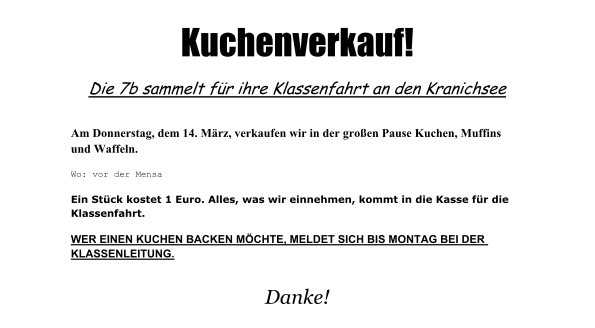
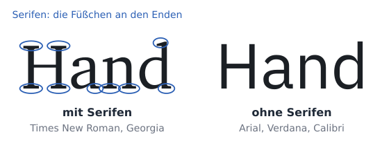
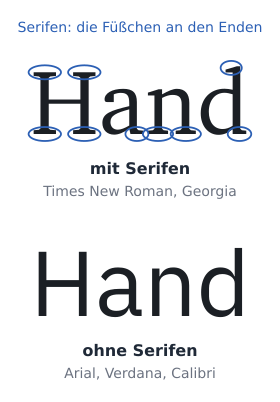
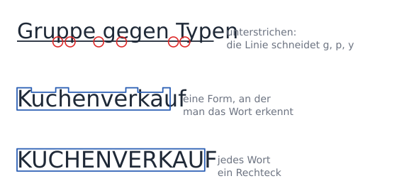
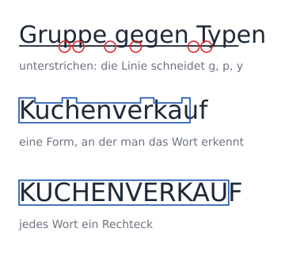
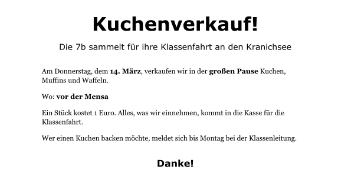

image: teaser.webp
image_alt: "Ein Aushang für einen Kuchenverkauf der Klasse 7b, in vielen verschiedenen Schriftarten und fast überall fett"
kind: labor
duration: 1 Stunde (45 Minuten)
curriculum: "Sek I: Standardsoftware (Umgang mit Textverarbeitungssoftware); Medienbildung: Produzieren (Gestaltung von Medienproduktionen)"
topics: [standardsoftware]
language: LibreOffice / Word / Nextcloud Office
languages: [libreoffice, word, nextcloud]
requires: [formatting-marks]
reference: []

# Schrift mit Absicht

Die 7b verkauft in der großen Pause Kuchen, für ihre Klassenfahrt. Jemand hat
den Aushang dafür gemacht, mit viel Begeisterung:

Wer im Flur vorbeigeht, schaut höchstens zwei Sekunden hin. In der Zeit muss er
lesen können, wann und wo es Kuchen gibt. Auf diesem Aushang springt ihm alles
gleichzeitig entgegen.

## Schriftarten

Hol dir den Aushang:

<a class='document-starter btn btn-primary' href='/api/task/document_starter/character-formatting/aushang' download><i class='bi bi-file-earmark-word' aria-hidden='true'></i>Vorlage herunterladen:02 Aushang.docx</a>

Welche Schriftart ein Text hat, siehst du, wenn der Cursor darin steht:

<!-- language: word -->
In Word steht sie im Register *Start* im Feld ganz links, daneben die Größe.
<!-- /language -->
<!-- language: libreoffice -->
In LibreOffice steht sie in der Leiste oben im Feld ganz links, daneben die
Größe.
<!-- /language -->
<!-- language: nextcloud -->
In Nextcloud Office steht sie im Register *Start* im Feld ganz links, daneben
die Größe.
<!-- /language -->

_task(schriften)

Schriften gibt es mit **Serifen**, den kleinen Füßchen an den Enden der
Buchstaben (Times New Roman, Georgia), und **ohne Serifen** (Arial, Verdana,
Calibri).

Für ein Blatt reichen zwei: eine für die Überschrift, eine für den
Text. Mehr Schriften machen ein Blatt nicht lebendiger, sondern unruhig, und
jede neue Schrift fragt den Blick: Ist das etwas anderes?

<strong>Schrift auf dem Bildschirm</strong>, 1974. Lange zeigte ein Bildschirm nur eine Schrift in einer Größe; wie ein Text gedruckt aussah, sah man erst auf dem Papier. Bei Xerox PARC in Kalifornien schrieben Butler Lampson, Charles Simonyi und ihre Kollegen 1974 das Programm Bravo für den Rechner Alto: Es zeigte verschiedene Schriften und den Text ungefähr so, wie er gedruckt aussehen würde. Heute heißt das WYSIWYG, »what you see is what you get«, was du siehst, bekommst du.

_person(tesler)

## Größe

Text auf Papier ist in **11 oder 12 pt** gut lesbar. Die Überschrift darf groß
sein; sie sagt, worum es geht. Der übrige Text hat überall dieselbe Größe,
sonst sieht ein kleiner Absatz aus wie Kleingedrucktes, das man überspringen
darf.

## Formatierung löschen

Eine Formatierung, die jemand von Hand gesetzt hat, kannst du auf einmal
löschen. Dann bekommt der Text wieder die Schrift und Größe, die das Dokument
für normalen Text vorsieht.

<!-- language: word -->
In Word markierst du den Text und drückst <kbd>Strg</kbd>+<kbd>Leertaste</kbd>.
<!-- /language -->
<!-- language: libreoffice -->
In LibreOffice markierst du den Text und drückst <kbd>Strg</kbd>+<kbd>M</kbd>
(*Format* <i class='bi bi-chevron-right' aria-hidden='true'></i> *Direkte Formatierung löschen*).
<!-- /language -->
<!-- language: nextcloud -->
In Nextcloud Office markierst du den Text und drückst
<kbd>Strg</kbd>+<kbd>M</kbd>.
<!-- /language -->

_task(loeschen)

**Jetzt bist du dran:** Gib dem Aushang zwei Schriften: eine für die
Überschrift und die Zeile darunter, eine für den übrigen Text, in 12 pt.

## Hervorheben

Fett hebt hervor, aber nur, wenn wenig fett ist. Ist ein ganzer Absatz fett,
sticht nichts mehr heraus. **Unterstrichen** sieht auf dem Bildschirm aus wie
ein Link und macht die Unterlängen schwer lesbar (g, p, y). **Großbuchstaben**
liest man langsamer: Wörter erkennen wir an ihrer Form, und in Großbuchstaben
haben alle Wörter dieselbe Form, ein Rechteck.

_task(hervorheben)

**Jetzt bist du dran:** Nimm das Unterstrichene und die Großbuchstaben weg,
und mach nur fett, was jemand im Vorbeigehen lesen muss: das Datum, die Zeit
und den Ort.

## Prüfen

Speichere den Aushang und lass ihn prüfen.

_task(aushang)

<!-- after: aushang -->
So kann der Aushang aussehen:

<strong>Ausprobieren:</strong> Zeig deinen Aushang jemandem zwei Sekunden lang und dreh ihn dann um. Frag, wann und wo der Kuchenverkauf ist. Probier dasselbe mit der Vorlage.

<!-- /after -->

<!-- extra -->
## Üben und knobeln

Drei Dokumente für alle, die mehr wollen: eins zum Üben, eins mit zwei neuen
Handgriffen und eins zum Suchen.

### Noch eine Runde

Für den Spieleabend der 7b hat jemand ein Plakat gemacht, mit genauso viel
Begeisterung wie den Aushang. Setz es mit Absicht, diesmal ohne oben
nachzusehen.

_task(runde)

### Zwei Handgriffe

Im Messprotokoll vom Kranichsee steht für jeden Tag eine Überschrift, aber nur
»Montag« ist schon gesetzt: Georgia, 14 pt, fett, blau. Das ließe sich für
jeden Tag einzeln einstellen, viermal vier Handgriffe. Schneller geht es mit
**Format übertragen**, dem Pinsel: Er nimmt das Aussehen der Stelle, an der der
Cursor steht, und malt es auf das, was du danach anklickst oder markierst.

<!-- language: word -->
In Word ist der Pinsel im Register *Start* ganz links, neben *Einfügen*. Ein
Klick überträgt einmal; ein Doppelklick lässt ihn an, bis du
<kbd>Esc</kbd> drückst.
<!-- /language -->
<!-- language: libreoffice -->
In LibreOffice ist der Pinsel in der Leiste oben und heißt *Formatierung
übertragen*. Ein Klick überträgt einmal; ein Doppelklick lässt ihn an, bis du
<kbd>Esc</kbd> drückst.
<!-- /language -->
<!-- language: nextcloud -->
In Nextcloud Office ist der Pinsel im Register *Start* und heißt
*Formatierung übertragen*. Er überträgt einmal; für den nächsten Tag klickst du
zuerst wieder in »Montag« und auf den Pinsel.
<!-- /language -->

Der zweite Handgriff: Im Protokoll stehen Flächen in km² und m² und die Gase
O₂ (Sauerstoff) und CO₂ (Kohlendioxid). Bei einer Fläche steht die 2 oben, bei
einem Gas unten, kleiner als die Buchstaben. Das ist kein anderes Zeichen,
sondern eine Formatierung: **hochgestellt** und **tiefgestellt**. Markier nur
die Zahl, nicht die Buchstaben davor.

<!-- language: word -->
In Word stellt <kbd>Strg</kbd>+<kbd>Shift</kbd>+<kbd>+</kbd> hoch und
<kbd>Strg</kbd>+<kbd>#</kbd> tief, oder die Knöpfe x² und x₂ im Register
*Start*.
<!-- /language -->
<!-- language: libreoffice -->
In LibreOffice stellt <kbd>Strg</kbd>+<kbd>Shift</kbd>+<kbd>P</kbd> hoch und
<kbd>Strg</kbd>+<kbd>Shift</kbd>+<kbd>B</kbd> tief; beides steht auch unter
*Format* <i class='bi bi-chevron-right' aria-hidden='true'></i> *Text*.
<!-- /language -->
<!-- language: nextcloud -->
In Nextcloud Office steht beides unter *Format* <i class='bi bi-chevron-right' aria-hidden='true'></i> *Text*:
*Hochgestellt* und *Tiefgestellt*.
<!-- /language -->

Die hohe 2 kannst du auch gleich tippen: <kbd>AltGr</kbd>+<kbd>2</kbd> schreibt
², <kbd>AltGr</kbd>+<kbd>3</kbd> schreibt ³. Für die tiefe 2 gibt es keine Taste.

_task(handgriffe)

### Sieben Fallen

Nach dem Kuchenverkauf schreibt die 7b den Eltern einen Dankesbrief. Er sieht
fertig aus. Sechs Fallen sind von der Art wie auf dem ersten Blatt, eine ist
von diesem: Sie fällt nur auf, wer genau hinsieht, welche Schrift jeder Absatz
hat. Wie bei den sechs Fallen zählt die Prüfung nur, und jede Falle hat ihre
eigenen Tipps.

_task(fallen)
