

image: teaser.webp
image_alt: "Ein Aushang für einen Kuchenverkauf der Klasse 7b, in vielen verschiedenen Schriftarten und fast überall fett"
kind: labor
duration: 1 Stunde (45 Minuten)
curriculum: "Sek I: Standardsoftware (Umgang mit Textverarbeitungssoftware); Medienbildung: Produzieren (Gestaltung von Medienproduktionen)"
topics: [standardsoftware]
language: LibreOffice / Word / Nextcloud Office
languages: [libreoffice, word, nextcloud]
requires: [formatting-marks]
reference: []

# Schrift mit Absicht

Die 7b verkauft in der großen Pause Kuchen, für ihre Klassenfahrt. Jemand hat
den Aushang dafür gemacht, mit viel Begeisterung:

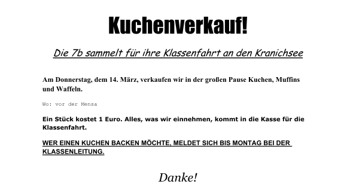

Wer im Flur vorbeigeht, schaut höchstens zwei Sekunden hin. In der Zeit muss er
lesen können, wann und wo es Kuchen gibt. Auf diesem Aushang springt ihm alles
gleichzeitig entgegen.

## Schriftarten

Hol dir den Aushang:

<a class='document-starter btn btn-primary' href='/api/task/document_starter/character-formatting/aushang' download><i class='bi bi-file-earmark-word' aria-hidden='true'></i>Vorlage herunterladen:02 Aushang.docx</a>

Welche Schriftart ein Text hat, siehst du, wenn der Cursor darin steht:

<!-- language: word -->
In Word steht sie im Register *Start* im Feld ganz links, daneben die Größe.
<!-- /language -->
<!-- language: libreoffice -->
In LibreOffice steht sie in der Leiste oben im Feld ganz links, daneben die
Größe.
<!-- /language -->
<!-- language: nextcloud -->
In Nextcloud Office steht sie im Register *Start* im Feld ganz links, daneben
die Größe.
<!-- /language -->

_task(schriften)

Jeder Absatz des Aushangs hat eine eigene Schrift, sieben verschiedene.
Manche sehen sich so ähnlich, dass nur das Feld sie sicher verrät.

Schriften gibt es mit **Serifen**, den kleinen Füßchen an den Enden der
Buchstaben (Times New Roman, Georgia), und **ohne Serifen** (Arial, Verdana,
Calibri).

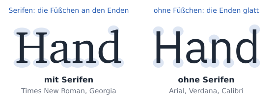
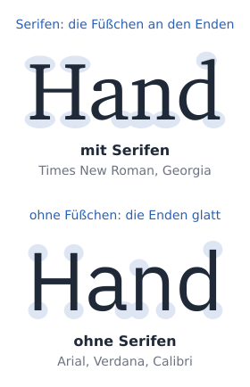

_person(morison)

Das Wort *sans* ist Französisch und heißt »ohne«. Eine Schrift ohne Serifen
heißt darum auf Englisch *sans serif*, und viele Schriften tragen das im
Namen. Auch andere Teile eines Namens verraten, wie eine Schrift aussieht:

<table class='table font-names'>
<thead><tr><th>Im Namen</th><th>Bedeutet</th><th>So sieht es aus</th><th>Schrift</th></tr></thead>
<tbody>
<tr><td rowspan='2'>Sans</td><td rowspan='2'>ohne Serifen</td><td></td><td>Open Sans</td></tr>
<tr><td></td><td>IBM Plex Sans, die Schrift dieser Seiten</td></tr>
<tr><td>Serif</td><td>mit Serifen</td><td></td><td>DejaVu Serif</td></tr>
<tr><td>Grotesk</td><td>ohne Serifen</td><td></td><td>Space Grotesk</td></tr>
<tr><td>Gothic</td><td>ohne Serifen</td><td></td><td>Didact Gothic</td></tr>
<tr><td>Mono</td><td>jeder Buchstabe gleich breit, das i so breit wie das m</td><td></td><td>DejaVu Sans Mono</td></tr>
<tr><td>Slab</td><td>Serifen als dicke, eckige Blöcke</td><td></td><td>Roboto Slab</td></tr>
<tr><td>Nerd Font</td><td>eine Mono-Schrift mit vielen Symbolen dazu, für das Terminal</td><td></td><td>0xProto Nerd Font Mono, die Schrift im Editor und im Terminal des Workspace</td></tr>
</tbody>
</table>

Sans, Grotesk und Gothic heißen alle drei »ohne Serifen«. Die Namen kommen
aus verschiedenen Zeiten und Ländern.

**Grotesk** kommt vom italienischen *grottesco*, »zur Höhle gehörig«, und
meinte später alles, was missgestaltet aussah. Als Anfang des
19. Jahrhunderts in England die ersten Schriften ohne Serifen aufkamen,
verglich man sie mit den verzierten Schriften, die man gewohnt war, und fand
sie plump; man nannte sie *grotesque*, auf Deutsch Grotesk. Typisch für diese
Schriften: Die Striche sind fast überall gleich dick, die Großbuchstaben
ungefähr gleich breit, das Ende eines Bogens wie beim c ist waagerecht
abgeschnitten, und das R hat oft ein geschwungenes Bein. Akzidenz-Grotesk ist
so eine. Nach ihrem Vorbild entstand später Helvetica, und Arial ist in den
Maßen der Helvetica gebaut.

**Gothic** sagten die Schriftgießereien in Amerika: Eine in Boston brachte
1837 Schriften ohne Serifen unter diesem Namen heraus. Warum, ist nicht
sicher. Vielleicht nach der gotischen Baukunst, die weder griechisch noch
römisch ist, vielleicht weil solche Schriften damals in Deutschland beliebt
waren. Über die Form sagt der Name wenig: Franklin Gothic ist eine Grotesk,
Century Gothic baut ihre Buchstaben dagegen aus Kreisen und geraden Linien,
das o ist fast rund.

**Sans** (von *sans serif*) ist das Wort, das sich heute für alle
durchgesetzt hat; Open Sans etwa ist gemacht, um auf Bildschirmen und auf
Papier gut lesbar zu sein.

_person(carter)

Zwei Schriften aus dem Aushang kennst du vielleicht aus Memes. **Impact**
zeichnete Geoffrey Lee 1965; weiß mit schwarzem Rand steht sie über
unzähligen Bildern im Netz. **Comic Sans** zeichnete Vincent Connare 1994 bei
Microsoft, nach der Schrift in Comics, für die Sprechblasen eines Programms.
Weil sie danach überall auftauchte, auch dort, wo es ernst zugeht, lachen
viele über sie, und so wurde sie selbst zum Meme.

Unter Leuten, die Schriften gestalten, gibt es eigene Witze. Der Comic xkcd
spielt mit dem **Kerning**: dem Abstand zwischen zwei bestimmten Buchstaben,
den eine gute Schrift für jedes Paar einzeln festlegt. Stimmt er nicht, liest
man ein Wort falsch, oder man stolpert über eine Lücke, die nicht dahin gehört.
Wer das einmal sieht, sieht es überall:

<figure>
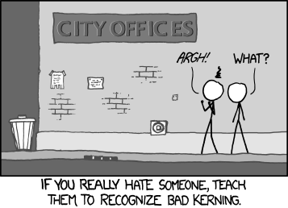
<figcaption>»Wenn du jemanden wirklich hasst, bring ihm bei, schlechtes Kerning zu erkennen.« Bild: Randall Munroe, <a href='https://xkcd.com/1015/'>xkcd 1015</a>, CC BY-NC 2.5</figcaption>
</figure>

<figure>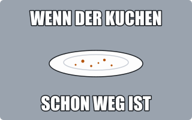<figcaption>Impact</figcaption></figure>
<figure>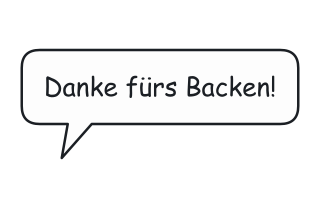<figcaption>Comic Sans</figcaption></figure>

Für ein Blatt reichen zwei: eine für die Überschrift, eine für den
Text. Mehr Schriften machen ein Blatt nicht lebendiger, sondern unruhig, und
jede neue Schrift fragt den Blick: Ist das etwas anderes?

<strong>Schrift auf dem Bildschirm</strong>, 1974. Lange zeigte ein Bildschirm nur eine Schrift in einer Größe; wie ein Text gedruckt aussah, sah man erst auf dem Papier. Bei Xerox PARC in Kalifornien schrieben Butler Lampson, Charles Simonyi und ihre Kollegen 1974 das Programm Bravo für den Rechner Alto: Es zeigte verschiedene Schriften und den Text ungefähr so, wie er gedruckt aussehen würde. Heute heißt das WYSIWYG, »what you see is what you get«, was du siehst, bekommst du.

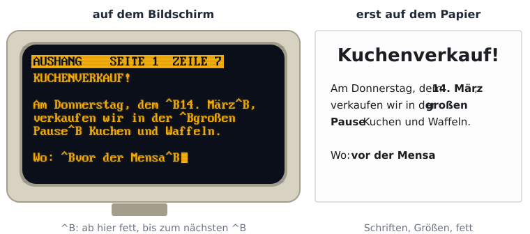
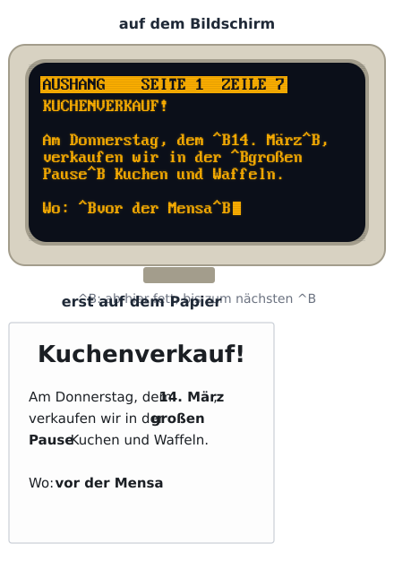

Die Schrift auf dem Bildschirm ist die eines PC aus den 1980er Jahren: PxPlus IBM VGA 8x16 aus <a href='https://int10h.org/oldschool-pc-fonts/'>The Ultimate Oldschool PC Font Pack</a> von VileR, CC BY-SA 4.0.

_person(tesler)

## Größe

Text auf Papier ist in **11 oder 12 pt** gut lesbar. Die Überschrift darf groß
sein; sie sagt, worum es geht. Der übrige Text hat überall dieselbe Größe,
sonst sieht ein kleiner Absatz aus wie Kleingedrucktes, das man überspringen
darf.

## Formatierung löschen

Eine Formatierung, die jemand von Hand gesetzt hat, kannst du auf einmal
löschen. Dann bekommt der Text wieder die Schrift und Größe, die das Dokument
für normalen Text vorsieht.

<!-- language: word -->
In Word markierst du den Text und drückst <kbd>Strg</kbd>+<kbd>Leertaste</kbd>.
<!-- /language -->
<!-- language: libreoffice -->
In LibreOffice markierst du den Text und drückst <kbd>Strg</kbd>+<kbd>M</kbd>
(*Format* <i class='bi bi-chevron-right' aria-hidden='true'></i> *Direkte Formatierung löschen*).
<!-- /language -->
<!-- language: nextcloud -->
In Nextcloud Office markierst du den Text und drückst
<kbd>Strg</kbd>+<kbd>M</kbd>.
<!-- /language -->

_task(loeschen)

**Jetzt bist du dran:** Gib dem Aushang zwei Schriften: eine für die
Überschrift und die Zeile darunter, eine für den übrigen Text, in 12 pt.

## Hervorheben

Fett hebt hervor, aber nur, wenn wenig fett ist. Ist ein ganzer Absatz fett,
sticht nichts mehr heraus. **Unterstrichen** sieht auf dem Bildschirm aus wie
ein Link und macht die Unterlängen schwer lesbar (g, p, y). **Großbuchstaben**
liest man langsamer: Wörter erkennen wir an ihrer Form, und in Großbuchstaben
haben alle Wörter dieselbe Form, ein Rechteck.

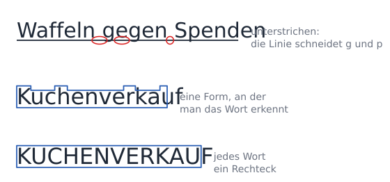
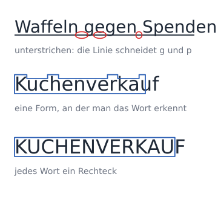

_task(hervorheben)

**Jetzt bist du dran:** Nimm das Unterstrichene und die Großbuchstaben weg,
und mach nur fett, was jemand im Vorbeigehen lesen muss: das Datum, die Zeit
und den Ort.

## Prüfen

Speichere den Aushang und lass ihn prüfen.

_task(aushang)

<!-- after: aushang -->
So kann der Aushang aussehen:

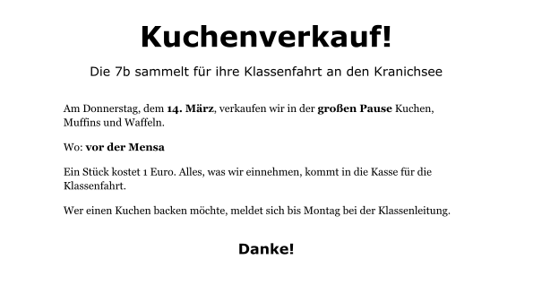

<strong>Ausprobieren:</strong> Zeig deinen Aushang jemandem zwei Sekunden lang und dreh ihn dann um. Frag, wann und wo der Kuchenverkauf ist. Probier dasselbe mit der Vorlage.

<!-- /after -->

<!-- extra -->
## Üben und knobeln

Drei Dokumente für alle, die mehr wollen: eins zum Üben, eins mit zwei neuen
Handgriffen und eins zum Suchen.

### Noch eine Runde

Für den Spieleabend der 7b hat jemand ein Plakat gemacht, mit genauso viel
Begeisterung wie den Aushang. Setz es mit Absicht, diesmal ohne oben
nachzusehen.

_task(runde)

### Zwei Handgriffe

Im Messprotokoll vom Kranichsee steht für jeden Tag eine Überschrift, aber nur
»Montag« ist schon gesetzt: Georgia, 14 pt, fett, blau. Das ließe sich für
jeden Tag einzeln einstellen, viermal vier Handgriffe. Schneller geht es mit
**Format übertragen**, dem Pinsel: Er nimmt das Aussehen der Stelle, an der der
Cursor steht, und malt es auf das, was du danach anklickst oder markierst.

<!-- language: word -->
In Word ist der Pinsel im Register *Start* ganz links, neben *Einfügen*. Ein
Klick überträgt einmal; ein Doppelklick lässt ihn an, bis du
<kbd>Esc</kbd> drückst.
<!-- /language -->
<!-- language: libreoffice -->
In LibreOffice ist der Pinsel in der Leiste oben und heißt *Formatierung
übertragen*. Ein Klick überträgt einmal; ein Doppelklick lässt ihn an, bis du
<kbd>Esc</kbd> drückst.
<!-- /language -->
<!-- language: nextcloud -->
In Nextcloud Office ist der Pinsel im Register *Start* und heißt
*Formatierung übertragen*. Er überträgt einmal; für den nächsten Tag klickst du
zuerst wieder in »Montag« und auf den Pinsel.
<!-- /language -->

Der zweite Handgriff: Im Protokoll stehen Flächen in km² und m² und die Gase
O₂ (Sauerstoff) und CO₂ (Kohlendioxid). Bei einer Fläche steht die 2 oben, bei
einem Gas unten, kleiner als die Buchstaben. Das ist kein anderes Zeichen,
sondern eine Formatierung: **hochgestellt** und **tiefgestellt**. Markier nur
die Zahl, nicht die Buchstaben davor.

<!-- language: word -->
In Word stellt <kbd>Strg</kbd>+<kbd>Shift</kbd>+<kbd>+</kbd> hoch und
<kbd>Strg</kbd>+<kbd>#</kbd> tief, oder die Knöpfe x² und x₂ im Register
*Start*.
<!-- /language -->
<!-- language: libreoffice -->
In LibreOffice stellt <kbd>Strg</kbd>+<kbd>Shift</kbd>+<kbd>P</kbd> hoch und
<kbd>Strg</kbd>+<kbd>Shift</kbd>+<kbd>B</kbd> tief; beides steht auch unter
*Format* <i class='bi bi-chevron-right' aria-hidden='true'></i> *Text*.
<!-- /language -->
<!-- language: nextcloud -->
In Nextcloud Office steht beides unter *Format* <i class='bi bi-chevron-right' aria-hidden='true'></i> *Text*:
*Hochgestellt* und *Tiefgestellt*.
<!-- /language -->

Die hohe 2 kannst du auch gleich tippen: <kbd>AltGr</kbd>+<kbd>2</kbd> schreibt
², <kbd>AltGr</kbd>+<kbd>3</kbd> schreibt ³. Für die tiefe 2 gibt es keine Taste.

_task(handgriffe)

### Sieben Fallen

Nach dem Kuchenverkauf schreibt die 7b den Eltern einen Dankesbrief. Er sieht
fertig aus. Sechs Fallen sind von der Art wie auf dem ersten Blatt, eine ist
von diesem: Sie fällt nur auf, wer genau hinsieht, welche Schrift jeder Absatz
hat. Wie bei den sechs Fallen zählt die Prüfung nur, und jede Falle hat ihre
eigenen Tipps.

_task(fallen)
