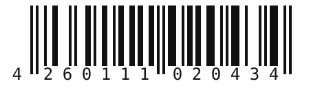
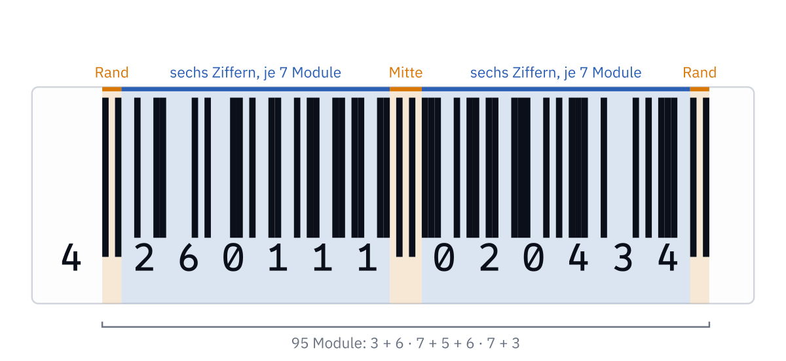
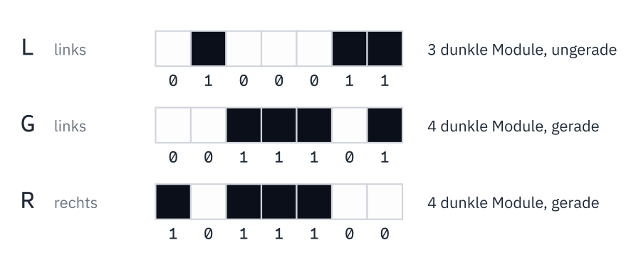

<div class='meta'>
image: teaser.webp:25:50
image_alt: "Ein Strichcode mit den Ziffern 4 260111 020434 auf einem weißen Etikett, daneben das Struktogramm der Funktion check_digit mit einer Zählschleife von 0 bis 11."
kind: projekt
duration: 3 Doppelstunden
languages: [ruby, python, dart, java]
curriculum: "Sek I: Algorithmisches Problemlösen (Eigenschaften und Darstellung von Algorithmen, Implementieren von Algorithmen), Information und Daten (Codierung: Strichcode, QR-Code); Oberstufe: Algorithmen und Softwareentwicklung (Struktogramm, Pseudocode)"
topics: [fehlererkennung, codierung, darstellung]
age: Sek I
requires: [kata-lists]
reference: [struktogramme]
</div>

<div
    class="autotoc-secondary-trigger"
    data-title="Auf dieser Seite"
    data-levels="h2,h3">
</div>

# Prüfziffern: erst planen, dann programmieren

<p class='abstract'>
Warum piept die Kasse, wenn jemand eine Ziffer eines Strichcodes falsch eintippt? Du rechnest eine Prüfziffer von Hand aus, liest Struktogramme und übersetzt sie in Code. Dann planst du selbst, mit Kommentaren im Code, bevor du programmierst, und findest heraus, welche Tippfehler die Kasse übersieht. Zum Schluss beklebst du einen QR-Code, bis er unlesbar wird, und programmierst selbst einen Code, der einen Fehler nicht nur findet, sondern repariert.
</p>

<script src='/include/struktogramm.js'></script>

## Die Geschichte

Samstagvormittag im Supermarkt. Auf einer Packung Nudeln ist der Strichcode
zerknittert, und der Scanner piept nicht. Die Kassiererin tippt die dreizehn
Ziffern unter den Strichen von Hand ein:

<div class='gallery centered'>
<figure><figcaption>Der Strichcode der Nudeln, ausgedacht</figcaption></figure>
</div>

Dreizehn Ziffern sind viele, und beim Abtippen passiert schnell ein Fehler.
Dann stünde auf dem Kassenbon eine andere Ware mit einem anderen Preis.

_task(eine-ziffer)

## Der Strichcode

Der Code heißt **EAN-13** (European Article Number, heute GTIN-13); er steht
auf fast jeder Ware im Laden. Die ersten zwölf Ziffern sagen, aus welchem Land
die Nummer kommt, welche Firma sie vergeben hat und welche Ware es ist. Die
dreizehnte ist keine Information über die Ware, sondern eine **Prüfziffer**: Sie
wird aus den anderen zwölf berechnet, nach einer Regel, die die Organisation
GS1 festgelegt hat:

1. Multipliziere die zwölf Ziffern abwechselnd mit 1 und mit 3, mit 1
   beginnend. Die Zahl, mit der eine Ziffer multipliziert wird, heißt ihr
   **Gewicht**.
2. Addiere die Produkte.
3. Die Prüfziffer ist, was bis zur nächsten durch 10 teilbaren Zahl fehlt. Ist
   die Summe schon durch 10 teilbar, ist sie 0.

Für die Ziffern `4 001234 56789` sieht das so aus:

<div class='scroll-x'><table class='table'>
<tr><th>Ziffer</th><td>4</td><td>0</td><td>0</td><td>1</td><td>2</td><td>3</td><td>4</td><td>5</td><td>6</td><td>7</td><td>8</td><td>9</td></tr>
<tr><th>Gewicht</th><td>1</td><td>3</td><td>1</td><td>3</td><td>1</td><td>3</td><td>1</td><td>3</td><td>1</td><td>3</td><td>1</td><td>3</td></tr>
<tr><th>Produkt</th><td>4</td><td>0</td><td>0</td><td>3</td><td>2</td><td>9</td><td>4</td><td>15</td><td>6</td><td>21</td><td>8</td><td>27</td></tr>
</table>
</div>

Die Summe ist 99; bis 100 fehlt 1, also ist der ganze Code `4 001234 567891`.

_task(von-hand)

<!-- after: von-hand -->
Die Kasse rechnet genauso, mit den zwölf Ziffern, die eingetippt wurden. Passt
das Ergebnis nicht zur dreizehnten Ziffer, piept sie.

Und warum merkt sie **jede** einzelne falsche Ziffer? Ändert sich eine Ziffer
mit dem Gewicht 1 um 1 bis 9, ändert sich die Summe um 1 bis 9. Ändert sich
eine mit dem Gewicht 3, ändert sich die Summe um 3, 6, 9, …, 27, aber nie um 10,
20 oder 30. In beiden Fällen ist danach eine andere Prüfziffer nötig.
<!-- /after -->

## Wie die Striche die Ziffern tragen

Der Scanner liest keine Ziffern, sondern hell und dunkel. Ein Strichcode ist
in 95 gleich breite Streifen geteilt, die **Module**. Jedes Modul ist dunkel
oder hell, also eine 1 oder eine 0; ein breiter Strich sind mehrere dunkle
Module nebeneinander.



Am Rand und in der Mitte stehen feste Muster: `101` links und rechts, `01010`
in der Mitte. Ihre Striche reichen weiter nach unten als die anderen. An ihnen
erkennt der Scanner, wo der Code anfängt, wo seine Mitte ist und wie breit ein
Modul ist, egal wie weit die Packung vom Scanner entfernt ist. Dazwischen
stehen links und rechts je sechs Ziffern mit je sieben Modulen.

Jede Ziffer besteht aus genau zwei dunklen und zwei hellen Abschnitten. Welches
Muster zu welcher Ziffer gehört, legt GS1 in einer Tabelle fest, und zwar in
drei Fassungen, **L**, **G** und **R**. So sieht die 4 in allen dreien aus:



R ist L mit vertauschtem Hell und Dunkel, G ist R von hinten nach vorne
gelesen. Darum genügt die Tabelle für L:

<div class='scroll-x'><table class='table'>
<tr><th>Ziffer</th><td>0</td><td>1</td><td>2</td><td>3</td><td>4</td><td>5</td><td>6</td><td>7</td><td>8</td><td>9</td></tr>
<tr><th>L</th><td><code>0001101</code></td><td><code>0011001</code></td><td><code>0010011</code></td><td><code>0111101</code></td><td><code>0100011</code></td><td><code>0110001</code></td><td><code>0101111</code></td><td><code>0111011</code></td><td><code>0110111</code></td><td><code>0001011</code></td></tr>
</table>
</div>

Rechts von der Mitte steht jede Ziffer in R. Links steht sie in L oder in G,
und L hat immer eine ungerade Zahl dunkler Module, G eine gerade.

_task(rechts-lesen)

Zähl die Ziffern unter dem Code: Links und rechts von der Mitte stehen je
sechs, die 4 ganz vorne hat keine eigenen Striche. Sie steckt in der Auswahl
der Fassungen in der linken Hälfte. Bei den Nudeln stehen die Ziffern
2 6 0 1 1 1 in den Fassungen L G L L G G, und dieses Muster bedeutet die 4:

<div class='scroll-x'><table class='table' style='width: auto;'>
<tr><th>Erste Ziffer</th><th>Linke Hälfte</th></tr>
<tr><td>0</td><td><code>L L L L L L</code></td></tr>
<tr><td>1</td><td><code>L L G L G G</code></td></tr>
<tr><td>2</td><td><code>L L G G L G</code></td></tr>
<tr><td>3</td><td><code>L L G G G L</code></td></tr>
<tr><td>4</td><td><code>L G L L G G</code></td></tr>
<tr><td>5</td><td><code>L G G L L G</code></td></tr>
<tr><td>6</td><td><code>L G G G L L</code></td></tr>
<tr><td>7</td><td><code>L G L G L G</code></td></tr>
<tr><td>8</td><td><code>L G L G G L</code></td></tr>
<tr><td>9</td><td><code>L G G L G L</code></td></tr>
</table>
</div>

Die erste Ziffer links steht dabei immer in L. Liest der Scanner einen Code
von rechts nach links, etwa weil die Packung auf dem Kopf liegt, trifft er
zuerst auf eine Ziffer mit einer geraden Zahl dunkler Module. Daran merkt er,
dass er rückwärts liest, und dreht die Ziffern um.

_task(erste-ziffer)

## Ein Algorithmus, drei Schreibweisen

Die Regel in Worten ist kurz, aber ein Computer braucht es genauer: Wo fängt
das Zählen an? Was heißt »bis zur nächsten durch 10 teilbaren Zahl«? Bevor du
programmierst, schreibst du einen Algorithmus darum so auf, dass er genau ist
und trotzdem in keiner Programmiersprache: als **Pseudocode** oder als
**Struktogramm**. Beides steht im Handbuch unter
[Pseudocode und Struktogramme](/reference/struktogramme), mit einem Feld zum
Ausprobieren.

### Ein Struktogramm lesen

Ein Struktogramm liest man von oben nach unten. Jeder Kasten ist eine
Anweisung; eine Schleife hat links einen Balken, und was rechts daneben steht,
wiederholt sie, solange ihre Bedingung oben wahr ist. `n mod 10` ist der Rest
bei der Division durch 10, `n div 10` das ganzzahlige Ergebnis.

```struktogramm
mystery(n):
    s ← 0
    while n > 0:
        s ← s + n mod 10
        n ← n div 10
    return s
```

_task(raetsel)

<!-- after: raetsel -->
`n mod 10` ist die letzte Ziffer von `n`, und `n div 10` streicht sie: Aus 4021
wird 402, dann 40, dann 4, dann 0. `mystery` addiert also alle Ziffern, das ist
die **Quersumme**. Mit `mod` und `div` kommt man an die Ziffern einer Zahl, und
mit `mod` sagt man, was übrig bleibt, wenn eine Zahl nicht aufgeht.
<!-- /after -->

### Die Prüfziffer als Struktogramm

So sieht die Regel von GS1 als Struktogramm aus. `digits` ist eine Liste der
zwölf Ziffern; die erste hat den Index 0. `weight(i)` ist das Gewicht der
Ziffer mit dem Index `i`, also 1 oder 3.

```struktogramm
check_digit(digits):
    total ← 0
    for i from 0 to 11:
        total ← total + weight(i) * digits[i]
    return (10 - total mod 10) mod 10
```

`total mod 10` ist der Rest, und `10 - total mod 10` ist, was bis zur nächsten
durch 10 teilbaren Zahl fehlt.

_task(zweites-mod)

## Vom Struktogramm zum Code

### Einrichten

<!-- language: ruby -->
Lege im Workspace einen Ordner und darin eine Datei für die Funktionen an:

```bash
mkdir -p ~/check-digits
cd ~/check-digits
touch check_digits.rb
```

Öffne `check_digits.rb` im Editor. Ausprobieren kannst du deine Funktionen in
`irb`, das die Datei vorher lädt:

```bash
irb -r ./check_digits.rb
```

Dort tippst du einen Aufruf wie `weight(3)` und siehst, was er zurückgibt. Nach
einer Änderung an der Datei beendest du `irb` mit <kbd>Strg</kbd><kbd>D</kbd>
und startest es neu.
<!-- /language -->
<!-- language: python -->
Lege im Workspace einen Ordner und darin eine Datei für die Funktionen an:

```bash
mkdir -p ~/check-digits
cd ~/check-digits
touch check_digits.py
```

Öffne `check_digits.py` im Editor. Ausprobieren kannst du deine Funktionen in
Python selbst, das die Datei vorher ausführt:

```bash
python3 -i check_digits.py
```

Dort tippst du einen Aufruf wie `weight(3)` und siehst, was er zurückgibt. Nach
einer Änderung an der Datei beendest du Python mit <kbd>Strg</kbd><kbd>D</kbd>
und startest es neu.
<!-- /language -->
<!-- language: dart -->
Lege im Workspace einen Ordner und darin eine Datei für die Funktionen an:

```bash
mkdir -p ~/check-digits
cd ~/check-digits
touch check_digits.dart
```

Öffne `check_digits.dart` im Editor. Ausprobieren kannst du deine Funktionen
mit einem `main` am Ende der Datei, das sie aufruft und ausgibt, etwa
`void main() { print(weight(3)); }`, und

```bash
dart run check_digits.dart
```

Die Prüfung ruft deine Funktionen selbst auf; dein `main` stört sie nicht.
<!-- /language -->
<!-- language: java -->
Lege im Workspace einen Ordner an. In Java steht jede Methode in einer Klasse;
deine Methoden kommen als `public static` in eine Klasse `CheckDigits`, in der
Datei `CheckDigits.java`:

```bash
mkdir -p ~/check-digits
cd ~/check-digits
```

```java
public class CheckDigits {
    // hier kommen die Methoden hin
}
```

Ausprobieren kannst du deine Methoden in `jshell`, das die Datei vorher lädt:

```bash
jshell CheckDigits.java
```

Dort tippst du einen Aufruf wie `CheckDigits.weight(3)` und siehst, was er
zurückgibt. Nach einer Änderung an der Datei lädt `/open CheckDigits.java` sie
neu; `/exit` beendet `jshell`.
<!-- /language -->

### Das Gewicht

Die Ziffern mit geradem Index (0, 2, 4, …) haben das Gewicht 1, die mit
ungeradem Index das Gewicht 3.

<div class='hint own' data-check='gewicht'>
<strong>Jetzt bist du dran:</strong> Schreib die Funktion <code>weight(index)</code>,
die für einen Index das Gewicht zurückgibt.
</div>

<!-- language: ruby -->
<!-- hint -->
Ob eine Zahl gerade ist, sagt der Rest bei der Division durch 2: `index % 2`
ist 0 oder 1. Ruby hat dafür auch `index.even?`.
<!-- /hint -->

<!-- hint -->
Als Struktogramm ist es eine Verzweigung mit zwei Spalten, in jeder ein
`return`:

```struktogramm
weight(index):
    if index mod 2 == 0:
        return 1
    else:
        return 3
```
<!-- /hint -->

<!-- solution -->
```ruby
def weight(index)
  if index.even?
    1
  else
    3
  end
end
```
<!-- /solution -->
<!-- /language -->
<!-- language: python -->
<!-- hint -->
Ob eine Zahl gerade ist, sagt der Rest bei der Division durch 2: `index % 2`
ist 0 oder 1.
<!-- /hint -->

<!-- hint -->
Als Struktogramm ist es eine Verzweigung mit zwei Spalten, in jeder ein
`return`:

```struktogramm
weight(index):
    if index mod 2 == 0:
        return 1
    else:
        return 3
```
<!-- /hint -->

<!-- solution -->
```python
def weight(index):
    if index % 2 == 0:
        return 1
    else:
        return 3
```
<!-- /solution -->
<!-- /language -->
<!-- language: dart, java -->
<!-- hint -->
Ob eine Zahl gerade ist, sagt der Rest bei der Division durch 2: `index % 2`
ist 0 oder 1.
<!-- /hint -->

<!-- hint -->
Als Struktogramm ist es eine Verzweigung mit zwei Spalten, in jeder ein
`return`:

```struktogramm
weight(index):
    if index mod 2 == 0:
        return 1
    else:
        return 3
```
<!-- /hint -->
<!-- /language -->
<!-- language: dart -->
<!-- solution -->
```dart
int weight(int index) {
  if (index % 2 == 0) {
    return 1;
  } else {
    return 3;
  }
}
```
<!-- /solution -->
<!-- /language -->
<!-- language: java -->
<!-- solution -->
```java
public class CheckDigits {
    public static int weight(int index) {
        if (index % 2 == 0) {
            return 1;
        } else {
            return 3;
        }
    }
}
```
<!-- /solution -->
<!-- /language -->

<!-- language: ruby -->
<!-- stage: stufen/1-gewicht/check_digits.rb as check_digits.rb -->
<!-- /language -->
<!-- language: python -->
<!-- stage: stufen/1-gewicht/check_digits.py as check_digits.py -->
<!-- /language -->
<!-- language: dart -->
<!-- stage: stufen/1-gewicht/check_digits.dart as check_digits.dart -->
<!-- /language -->
<!-- language: java -->
<!-- stage: stufen/1-gewicht/CheckDigits.java as CheckDigits.java -->
<!-- /language -->

_task(gewicht)

### Die Prüfziffer

<div class='hint own' data-check='pruefziffer'>
<strong>Jetzt bist du dran:</strong> Übersetze das Struktogramm von
<code>check_digit</code> von oben in Code, Kasten für Kasten, unter
<code>weight</code> in dieselbe Datei.
</div>

<!-- language: ruby -->
<!-- hint -->
Wie die Bausteine in Ruby heißen, steht im Handbuch unter
[Vom Pseudocode zum Code](/reference/struktogramme#code):
`←` ist `=`, `mod` ist `%`, und `for i from 0 to 11` ist `(0..11).each do |i|`.
<!-- /hint -->

<!-- solution -->
```ruby
def check_digit(digits)
  total = 0
  (0..11).each do |i|
    total = total + weight(i) * digits[i]
  end
  (10 - total % 10) % 10
end
```
<!-- /solution -->

<div class='hint try'>
<strong>Ausprobieren:</strong> Ruf in <code>irb</code>
<code>check_digit([4, 0, 0, 1, 2, 3, 4, 5, 6, 7, 8, 9])</code> auf; heraus kommt
die 1 aus der Tabelle oben. Nimm dann das letzte <code>% 10</code> weg, starte
neu und ruf <code>check_digit([4, 0, 0, 0, 0, 0, 0, 0, 0, 0, 0, 2])</code> auf. Achte darauf,
ob das Ergebnis noch eine Ziffer ist, und setz das <code>% 10</code> danach wieder ein.
</div>
<!-- /language -->
<!-- language: python -->
<!-- hint -->
Wie die Bausteine in Python heißen, steht im Handbuch unter
[Vom Pseudocode zum Code](/reference/struktogramme#code):
`←` ist `=`, `mod` ist `%`, und `for i from 0 to 11` ist
`for i in range(0, 12)`, denn `range` hört eins vor dem Ende auf.
<!-- /hint -->

<!-- solution -->
```python
def check_digit(digits):
    total = 0
    for i in range(0, 12):
        total = total + weight(i) * digits[i]
    return (10 - total % 10) % 10
```
<!-- /solution -->

<div class='hint try'>
<strong>Ausprobieren:</strong> Ruf in Python
<code>check_digit([4, 0, 0, 1, 2, 3, 4, 5, 6, 7, 8, 9])</code> auf; heraus kommt
die 1 aus der Tabelle oben. Nimm dann das letzte <code>% 10</code> weg, starte
neu und ruf <code>check_digit([4, 0, 0, 0, 0, 0, 0, 0, 0, 0, 0, 2])</code> auf. Achte darauf,
ob das Ergebnis noch eine Ziffer ist, und setz das <code>% 10</code> danach wieder ein.
</div>
<!-- /language -->
<!-- language: dart -->
<!-- hint -->
In Dart schreibt man Namen aus mehreren Wörtern zusammen, das zweite groß:
`checkDigit` statt `check_digit`. `digits` ist eine Liste von Zahlen, `List<int>`. Die Bausteine:
`←` ist `=`, `mod` ist `%`, und `for i from 0 to 11` ist
`for (var i = 0; i <= 11; i++)`.
<!-- /hint -->

<!-- solution -->
```dart
int checkDigit(List<int> digits) {
  var total = 0;
  for (var i = 0; i <= 11; i++) {
    total = total + weight(i) * digits[i];
  }
  return (10 - total % 10) % 10;
}
```
<!-- /solution -->

<div class='hint try'>
<strong>Ausprobieren:</strong> Gib in deinem <code>main</code>
<code>checkDigit([4, 0, 0, 1, 2, 3, 4, 5, 6, 7, 8, 9])</code> aus; heraus kommt
die 1 aus der Tabelle oben. Nimm dann das letzte <code>% 10</code> weg und gib
<code>checkDigit([4, 0, 0, 0, 0, 0, 0, 0, 0, 0, 0, 2])</code> aus. Achte darauf,
ob das Ergebnis noch eine Ziffer ist, und setz das <code>% 10</code> danach wieder ein.
</div>
<!-- /language -->
<!-- language: java -->
<!-- hint -->
In Java schreibt man Namen aus mehreren Wörtern zusammen, das zweite groß:
`checkDigit` statt `check_digit`. `digits` ist ein Array, `int[] digits`. Die
Bausteine: `←` ist `=`, `mod` ist `%`, und `for i from 0 to 11` ist
`for (int i = 0; i <= 11; i++)`.
<!-- /hint -->

<!-- solution -->
```java
public static int checkDigit(int[] digits) {
    int total = 0;
    for (int i = 0; i <= 11; i++) {
        total = total + weight(i) * digits[i];
    }
    return (10 - total % 10) % 10;
}
```
<!-- /solution -->

<div class='hint try'>
<strong>Ausprobieren:</strong> Ruf in <code>jshell</code>
<code>CheckDigits.checkDigit(new int[] {4, 0, 0, 1, 2, 3, 4, 5, 6, 7, 8, 9})</code>
auf; heraus kommt die 1 aus der Tabelle oben. Nimm dann das letzte
<code>% 10</code> weg, lade mit <code>/open CheckDigits.java</code> neu und ruf es mit
<code>{4, 0, 0, 0, 0, 0, 0, 0, 0, 0, 0, 2}</code> auf. Achte darauf, ob das
Ergebnis noch eine Ziffer ist, und setz das <code>% 10</code> danach wieder ein.
</div>
<!-- /language -->

<!-- language: ruby -->
<!-- stage: stufen/2-pruefziffer/check_digits.rb as check_digits.rb -->
<!-- /language -->
<!-- language: python -->
<!-- stage: stufen/2-pruefziffer/check_digits.py as check_digits.py -->
<!-- /language -->
<!-- language: dart -->
<!-- stage: stufen/2-pruefziffer/check_digits.dart as check_digits.dart -->
<!-- /language -->
<!-- language: java -->
<!-- stage: stufen/2-pruefziffer/CheckDigits.java as CheckDigits.java -->
<!-- /language -->

_task(pruefziffer)

## Erst planen, dann programmieren

Bisher stand der Plan schon da, und du hast ihn übersetzt. Ab jetzt planst du
selbst, und zwar gleich dort, wo der Code hinkommt: Du legst die Funktion an
und schreibst als Kommentare hinein, was sie Schritt für Schritt tun soll, noch
ohne eine Zeile Code. Dabei klärst du drei Fragen: Was bekommt die Funktion,
und was gibt sie zurück? Welche Fälle gibt es, auch solche, die nicht vorkommen
sollten? Und in welcher Reihenfolge geschieht was?

Dann ersetzt du einen Kommentar nach dem anderen durch Code und probierst nach
jedem Schritt aus. Die Kommentare dürfen stehen bleiben: Wer den Code später
liest, sieht so, wofür jeder Teil da ist. Genauso planen viele, die beruflich
programmieren; der Plan ist Pseudocode, nur eben in der Datei.

### Ist der Code gültig?

Die Kasse bekommt, was die Kassiererin getippt hat, als Text, und will wissen:
Ist das ein gültiger Code? Er ist es, wenn er aus genau 13 Ziffern besteht und
die letzte die Prüfziffer der ersten zwölf ist.

<!-- language: ruby -->
<div class='hint own' data-check='ean'>
<strong>Jetzt bist du dran:</strong> Leg die Funktion <code>valid_ean?(code)</code>
an und schreib zuerst deinen Plan als Kommentare hinein, dann den Code dazu.
Sie gibt <code>true</code> oder <code>false</code> zurück und benutzt
<code>check_digit</code>.
</div>

<!-- hint -->
Was macht einen Code sicher ungültig, bevor man rechnet? Wenn er zu kurz oder
zu lang ist, und wenn ein Zeichen keine Ziffer ist. Prüf das zuerst und gib
dann gleich `false` zurück.
<!-- /hint -->

<!-- hint -->
Ein Plan, dem noch der Code fehlt:

```ruby
def valid_ean?(code)
  # nicht genau 13 Zeichen: false
  # ein Zeichen ist keine Ziffer: false
  # die 13 Zeichen als Zahlen
  # gültig, wenn die Prüfziffer der ersten zwölf gleich der dreizehnten ist
end
```
<!-- /hint -->

<!-- hint -->
Für die Einzelheiten in Ruby: `code.length` ist die Zahl der Zeichen,
`code.chars` die Liste der Zeichen, `('0'..'9').include?(c)` sagt, ob `c` eine
Ziffer ist, `c.to_i` macht aus `'7'` die Zahl 7, und `digits[0..11]` sind die
ersten zwölf Elemente einer Liste.
<!-- /hint -->

<!-- solution -->
```ruby
def valid_ean?(code)
  # nicht genau 13 Zeichen: false
  return false unless code.length == 13
  # ein Zeichen ist keine Ziffer: false
  return false unless code.chars.all? { |c| ('0'..'9').include?(c) }

  # die 13 Zeichen als Zahlen
  digits = code.chars.map(&:to_i)
  # gültig, wenn die Prüfziffer der ersten zwölf gleich der dreizehnten ist
  check_digit(digits[0..11]) == digits[12]
end
```
<!-- /solution -->
<!-- /language -->
<!-- language: python -->
<div class='hint own' data-check='ean'>
<strong>Jetzt bist du dran:</strong> Leg die Funktion <code>is_valid_ean(code)</code>
an und schreib zuerst deinen Plan als Kommentare hinein, dann den Code dazu.
Sie gibt <code>True</code> oder <code>False</code> zurück und benutzt
<code>check_digit</code>.
</div>

<!-- hint -->
Was macht einen Code sicher ungültig, bevor man rechnet? Wenn er zu kurz oder
zu lang ist, und wenn ein Zeichen keine Ziffer ist. Prüf das zuerst und gib
dann gleich `False` zurück.
<!-- /hint -->

<!-- hint -->
Ein Plan, dem noch der Code fehlt. Damit Python die Funktion schon jetzt
annimmt, steht am Ende `pass`, das nichts tut:

```python
def is_valid_ean(code):
    # nicht genau 13 Zeichen: False
    # ein Zeichen ist keine Ziffer: False
    # die 13 Zeichen als Zahlen
    # gültig, wenn die Prüfziffer der ersten zwölf gleich der dreizehnten ist
    pass
```
<!-- /hint -->

<!-- hint -->
Für die Einzelheiten in Python: `len(code)` ist die Zahl der Zeichen,
`c in '0123456789'` sagt, ob `c` eine Ziffer ist, `int(c)` macht aus `'7'` die
Zahl 7, und `digits[0:12]` sind die ersten zwölf Elemente einer Liste.
<!-- /hint -->

<!-- solution -->
```python
def is_valid_ean(code):
    # nicht genau 13 Zeichen: False
    if len(code) != 13:
        return False
    # ein Zeichen ist keine Ziffer: False
    if not all(c in '0123456789' for c in code):
        return False
    # die 13 Zeichen als Zahlen
    digits = [int(c) for c in code]
    # gültig, wenn die Prüfziffer der ersten zwölf gleich der dreizehnten ist
    return check_digit(digits[0:12]) == digits[12]
```
<!-- /solution -->
<!-- /language -->
<!-- language: dart -->
<div class='hint own' data-check='ean'>
<strong>Jetzt bist du dran:</strong> Leg die Funktion <code>bool isValidEan(String code)</code>
an und schreib zuerst deinen Plan als Kommentare hinein, dann den Code dazu.
Sie gibt <code>true</code> oder <code>false</code> zurück und benutzt
<code>checkDigit</code>.
</div>

<!-- hint -->
Was macht einen Code sicher ungültig, bevor man rechnet? Wenn er zu kurz oder
zu lang ist, und wenn ein Zeichen keine Ziffer ist. Prüf das zuerst und gib
dann gleich `false` zurück.
<!-- /hint -->

<!-- hint -->
Ein Plan, dem noch der Code fehlt. Damit Dart die Funktion schon jetzt
annimmt, gibt sie vorerst `false` zurück:

```dart
bool isValidEan(String code) {
  // nicht genau 13 Zeichen: false
  // ein Zeichen ist keine Ziffer: false
  // die 13 Zeichen als Zahlen
  // gültig, wenn die Prüfziffer der ersten zwölf gleich der dreizehnten ist
  return false;
}
```
<!-- /hint -->

<!-- hint -->
Für die Einzelheiten in Dart: `code.length` ist die Zahl der Zeichen,
`code.split('')` die Liste der Zeichen, `'0123456789'.contains(c)` sagt, ob `c`
eine Ziffer ist, `int.parse(c)` macht aus `'7'` die Zahl 7, und
`digits.sublist(0, 12)` sind die ersten zwölf Elemente einer Liste.
<!-- /hint -->

<!-- solution -->
```dart
bool isValidEan(String code) {
  // nicht genau 13 Zeichen: false
  if (code.length != 13) {
    return false;
  }
  // ein Zeichen ist keine Ziffer: false
  for (final c in code.split('')) {
    if (!'0123456789'.contains(c)) {
      return false;
    }
  }
  // die 13 Zeichen als Zahlen
  final digits = code.split('').map(int.parse).toList();
  // gültig, wenn die Prüfziffer der ersten zwölf gleich der dreizehnten ist
  return checkDigit(digits.sublist(0, 12)) == digits[12];
}
```
<!-- /solution -->
<!-- /language -->
<!-- language: java -->
<div class='hint own' data-check='ean'>
<strong>Jetzt bist du dran:</strong> Leg die Methode <code>public static boolean isValidEan(String code)</code>
an und schreib zuerst deinen Plan als Kommentare hinein, dann den Code dazu.
Sie gibt <code>true</code> oder <code>false</code> zurück und benutzt
<code>checkDigit</code>.
</div>

<!-- hint -->
Was macht einen Code sicher ungültig, bevor man rechnet? Wenn er zu kurz oder
zu lang ist, und wenn ein Zeichen keine Ziffer ist. Prüf das zuerst und gib
dann gleich `false` zurück.
<!-- /hint -->

<!-- hint -->
Ein Plan, dem noch der Code fehlt. Damit Java die Methode schon jetzt
übersetzt, gibt sie vorerst `false` zurück:

```java
public static boolean isValidEan(String code) {
    // nicht genau 13 Zeichen: false
    // jedes Zeichen eine Ziffer, als Zahl in ein Array; sonst false
    // gültig, wenn die Prüfziffer der ersten zwölf gleich der dreizehnten ist
    return false;
}
```
<!-- /hint -->

<!-- hint -->
Für die Einzelheiten in Java: `code.length()` ist die Zahl der Zeichen,
`code.charAt(i)` das Zeichen mit dem Index `i`, ein `char`. Ein Zeichen ist
eine Ziffer, wenn `c >= '0' && c <= '9'`, und `c - '0'` macht aus `'7'` die
Zahl 7. Ein Array für 13 Zahlen legt `new int[13]` an; `checkDigit` liest davon
nur die ersten zwölf.
<!-- /hint -->

<!-- solution -->
```java
public static boolean isValidEan(String code) {
    // nicht genau 13 Zeichen: false
    if (code.length() != 13) {
        return false;
    }
    // jedes Zeichen eine Ziffer, als Zahl in ein Array; sonst false
    int[] digits = new int[13];
    for (int i = 0; i < 13; i++) {
        char c = code.charAt(i);
        if (c < '0' || c > '9') {
            return false;
        }
        digits[i] = c - '0';
    }
    // gültig, wenn die Prüfziffer der ersten zwölf gleich der dreizehnten ist
    return checkDigit(digits) == digits[12];
}
```
<!-- /solution -->
<!-- /language -->

<!-- language: ruby -->
<!-- stage: stufen/3-ean/check_digits.rb as check_digits.rb -->
<!-- /language -->
<!-- language: python -->
<!-- stage: stufen/3-ean/check_digits.py as check_digits.py -->
<!-- /language -->
<!-- language: dart -->
<!-- stage: stufen/3-ean/check_digits.dart as check_digits.dart -->
<!-- /language -->
<!-- language: java -->
<!-- stage: stufen/3-ean/CheckDigits.java as CheckDigits.java -->
<!-- /language -->

_task(ean)

### Bücher: die ISBN

Bücher tragen eine **ISBN** (International Standard Book Number). Bis 2007
hatte sie zehn Zeichen, etwa `3-499-12304-5`; die Bindestriche trennen nur
Gruppen und zählen nicht mit. Ihre Prüfung geht anders als beim Strichcode:

1. Multipliziere die zehn Ziffern mit den Gewichten 10, 9, 8, … bis 1: die
   erste mit 10, die letzte mit 1.
2. Addiere die Produkte.
3. Die ISBN ist gültig, wenn die Summe durch 11 teilbar ist.

Die letzte Ziffer ist also so gewählt, dass die Summe aufgeht. Manchmal müsste
sie dafür 10 sein, und das ist keine Ziffer: Dann steht dort ein `X`, wie die
römische Zehn. Ein `X` gibt es nur an dieser Stelle.

Für `3-499-12304-5` ist die Summe
3 · 10 + 4 · 9 + 9 · 8 + 9 · 7 + 1 · 6 + 2 · 5 + 3 · 4 + 0 · 3 + 4 · 2 + 5 · 1
= 242 = 22 · 11; die ISBN ist gültig.

<!-- language: ruby -->
Diesmal steht kein Plan auf der Seite. Leg `valid_isbn?(isbn)` an und schreib
deinen Plan als Kommentare hinein, bevor du Code schreibst: Was geschieht mit
den Bindestrichen, was mit einem `X`, was mit einem Zeichen, das weder Ziffer
noch `X` ist?
<!-- /language -->
<!-- language: python -->
Diesmal steht kein Plan auf der Seite. Leg `is_valid_isbn(isbn)` an und schreib
deinen Plan als Kommentare hinein, bevor du Code schreibst: Was geschieht mit
den Bindestrichen, was mit einem `X`, was mit einem Zeichen, das weder Ziffer
noch `X` ist?
<!-- /language -->
<!-- language: dart, java -->
Diesmal steht kein Plan auf der Seite. Leg `isValidIsbn(isbn)` an und schreib
deinen Plan als Kommentare hinein, bevor du Code schreibst: Was geschieht mit
den Bindestrichen, was mit einem `X`, was mit einem Zeichen, das weder Ziffer
noch `X` ist?
<!-- /language -->

_task(plan-isbn)

<!-- language: ruby -->
<!-- stage: loesung/check_digits.rb as check_digits.rb -->
<!-- /language -->
<!-- language: python -->
<!-- stage: loesung/check_digits.py as check_digits.py -->
<!-- /language -->
<!-- language: dart -->
<!-- stage: loesung/check_digits.dart as check_digits.dart -->
<!-- /language -->
<!-- language: java -->
<!-- stage: loesung/CheckDigits.java as CheckDigits.java -->
<!-- /language -->

_task(isbn)

## Was die Prüfziffer findet

Ein häufiger Fehler beim Abtippen ist nicht die falsche Ziffer, sondern der
**Zahlendreher**: zwei benachbarte Ziffern in der falschen Reihenfolge.

_task(zahlendreher-vorhersage)

<!-- after: zahlendreher-vorhersage -->
Ausrechnen kannst du es mit einem kleinen Programm, das alle Möglichkeiten
ausprobiert. Für zwei verschiedene Ziffern `a` und `b` gibt es 10 · 9 = 90
Paare. Es genügt, jedes Paar an den Anfang eines Codes zu stellen, den Rest mit
Nullen zu füllen und die Prüfziffer anzuhängen; dann ist der Code gültig.
Vertauscht man nun die ersten beiden Ziffern: Ist der Code danach immer noch
gültig, hat die Kasse den Zahlendreher nicht bemerkt.
<!-- /after -->

<!-- language: ruby -->
<div class='hint own' data-check='zahlendreher'>
<strong>Jetzt bist du dran:</strong> Schreib in eine neue Datei
<code>swaps.rb</code> ein Programm, das die 90 Paare durchgeht und zählt, wie
viele Zahlendreher <code>valid_ean?</code> nicht bemerkt. Die erste Zeile
<code>require_relative 'check_digits'</code> holt deine Funktionen dazu.
</div>

<!-- hint -->
Zwei Schleifen ineinander gehen alle Paare durch: außen `a` von 0 bis 9, innen
`b` von 0 bis 9; ist `a == b`, geht es mit dem nächsten weiter (`next`).
<!-- /hint -->

<!-- hint -->
Für ein Paar: `digits = [a, b, 0, 0, 0, 0, 0, 0, 0, 0, 0, 0]`, dann ist
`code = (digits + [check_digit(digits)]).join` ein gültiger Code.
`code[1] + code[0] + code[2..]` ist derselbe Code mit vertauschten ersten
Ziffern.
<!-- /hint -->

<!-- solution -->
```ruby
require_relative 'check_digits'

missed = 0
(0..9).each do |a|
  (0..9).each do |b|
    next if a == b

    digits = [a, b, 0, 0, 0, 0, 0, 0, 0, 0, 0, 0]
    code = (digits + [check_digit(digits)]).join
    swapped = code[1] + code[0] + code[2..]
    missed = missed + 1 if valid_ean?(swapped)
  end
end
puts "Unbemerkt: #{missed} von 90"
```
<!-- /solution -->

```bash
ruby swaps.rb
```
<!-- /language -->
<!-- language: python -->
<div class='hint own' data-check='zahlendreher'>
<strong>Jetzt bist du dran:</strong> Schreib in eine neue Datei
<code>swaps.py</code> ein Programm, das die 90 Paare durchgeht und zählt, wie
viele Zahlendreher <code>is_valid_ean</code> nicht bemerkt. Die erste Zeile
<code>from check_digits import check_digit, is_valid_ean</code> holt deine
Funktionen dazu.
</div>

<!-- hint -->
Zwei Schleifen ineinander gehen alle Paare durch: außen `a` von 0 bis 9, innen
`b` von 0 bis 9; ist `a == b`, geht es mit dem nächsten weiter (`continue`).
<!-- /hint -->

<!-- hint -->
Für ein Paar: `digits = [a, b, 0, 0, 0, 0, 0, 0, 0, 0, 0, 0]`, dann ist
`code = ''.join(str(d) for d in digits + [check_digit(digits)])` ein gültiger
Code. `code[1] + code[0] + code[2:]` ist derselbe Code mit vertauschten ersten
Ziffern.
<!-- /hint -->

<!-- solution -->
```python
from check_digits import check_digit, is_valid_ean

missed = 0
for a in range(0, 10):
    for b in range(0, 10):
        if a == b:
            continue
        digits = [a, b, 0, 0, 0, 0, 0, 0, 0, 0, 0, 0]
        code = ''.join(str(d) for d in digits + [check_digit(digits)])
        swapped = code[1] + code[0] + code[2:]
        if is_valid_ean(swapped):
            missed = missed + 1
print(f"Unbemerkt: {missed} von 90")
```
<!-- /solution -->

```bash
python3 swaps.py
```
<!-- /language -->
<!-- language: dart -->
<div class='hint own' data-check='zahlendreher'>
<strong>Jetzt bist du dran:</strong> Schreib in eine neue Datei
<code>swaps.dart</code> ein Programm, das die 90 Paare durchgeht und zählt, wie
viele Zahlendreher <code>isValidEan</code> nicht bemerkt. Die erste Zeile
<code>import 'check_digits.dart';</code> holt deine Funktionen dazu; das Programm
steht in <code>void main() { … }</code>.
</div>

<!-- hint -->
Zwei Schleifen ineinander gehen alle Paare durch: außen `a` von 0 bis 9, innen
`b` von 0 bis 9; ist `a == b`, geht es mit dem nächsten weiter (`continue`).
<!-- /hint -->

<!-- hint -->
Für ein Paar: `final digits = [a, b, 0, 0, 0, 0, 0, 0, 0, 0, 0, 0];`, dann ist
`[...digits, checkDigit(digits)].join()` ein gültiger Code.
`code[1] + code[0] + code.substring(2)` ist derselbe Code mit vertauschten
ersten Ziffern.
<!-- /hint -->

<!-- solution -->
```dart
import 'check_digits.dart';

void main() {
  var missed = 0;
  for (var a = 0; a <= 9; a++) {
    for (var b = 0; b <= 9; b++) {
      if (a == b) {
        continue;
      }
      final digits = [a, b, 0, 0, 0, 0, 0, 0, 0, 0, 0, 0];
      final code = [...digits, checkDigit(digits)].join();
      final swapped = code[1] + code[0] + code.substring(2);
      if (isValidEan(swapped)) {
        missed = missed + 1;
      }
    }
  }
  print('Unbemerkt: $missed von 90');
}
```
<!-- /solution -->

```bash
dart run swaps.dart
```
<!-- /language -->
<!-- language: java -->
<div class='hint own' data-check='zahlendreher'>
<strong>Jetzt bist du dran:</strong> Schreib in eine neue Datei
<code>Swaps.java</code> eine Klasse <code>Swaps</code> mit einem
<code>main</code>, das die 90 Paare durchgeht und zählt, wie viele Zahlendreher
<code>CheckDigits.isValidEan</code> nicht bemerkt.
</div>

<!-- hint -->
Zwei Schleifen ineinander gehen alle Paare durch: außen `a` von 0 bis 9, innen
`b` von 0 bis 9; ist `a == b`, geht es mit dem nächsten weiter (`continue`).
<!-- /hint -->

<!-- hint -->
Für ein Paar: `int[] digits = {a, b, 0, 0, 0, 0, 0, 0, 0, 0, 0, 0};`, dann ist
`"" + a + b + "0000000000" + CheckDigits.checkDigit(digits)` ein gültiger Code
als String. `code.substring(1, 2) + code.substring(0, 1) + code.substring(2)`
ist derselbe Code mit vertauschten ersten Ziffern.
<!-- /hint -->

<!-- solution -->
```java
public class Swaps {
    static void main() {
        int missed = 0;
        for (int a = 0; a <= 9; a++) {
            for (int b = 0; b <= 9; b++) {
                if (a == b) {
                    continue;
                }
                int[] digits = {a, b, 0, 0, 0, 0, 0, 0, 0, 0, 0, 0};
                String code = "" + a + b + "0000000000" + CheckDigits.checkDigit(digits);
                String swapped = code.substring(1, 2) + code.substring(0, 1) + code.substring(2);
                if (CheckDigits.isValidEan(swapped)) {
                    missed = missed + 1;
                }
            }
        }
        IO.println("Unbemerkt: " + missed + " von 90");
    }
}
```
<!-- /solution -->

`java Swaps.java` übersetzt die Datei und findet `CheckDigits` im selben
Ordner:

```bash
java Swaps.java
```
<!-- /language -->

<!-- language: ruby -->
<!-- stage: loesung/swaps.rb as swaps.rb -->
<!-- /language -->
<!-- language: python -->
<!-- stage: loesung/swaps.py as swaps.py -->
<!-- /language -->
<!-- language: dart -->
<!-- stage: loesung/swaps.dart as swaps.dart -->
<!-- /language -->
<!-- language: java -->
<!-- stage: loesung/Swaps.java as Swaps.java -->
<!-- /language -->

_task(zahlendreher)

<!-- after: zahlendreher -->
Unbemerkt bleiben genau die Paare, deren Ziffern sich um 5 unterscheiden, etwa
`05` und `50`. Beim Vertauschen tauschen die beiden Ziffern ihre Gewichte 1 und
3; die Summe ändert sich dadurch um das Doppelte ihres Unterschieds. Ist der
Unterschied 5, ändert sie sich um 10, und die Prüfziffer bleibt dieselbe.
<!-- /after -->

_task(isbn-dreher)

## Wenn der Code beschädigt ist: QR-Codes

<script src='/include/jsqr/jsQR.js'></script>
<script src='/include/qr_code.js'></script>
<script src='/include/qr_damage.js'></script>

Die Prüfziffer merkt, dass eine Ziffer falsch ist. Welche es ist, weiß die
Kasse nicht, und erst recht nicht, wie sie richtig hieße: Die Kassiererin muss
den Code noch einmal abtippen. Auf manchen Packungen steht neben dem
Strichcode ein **QR-Code**, und ein Handy liest ihn auch dann noch, wenn ein
Teil verschmutzt, zerkratzt oder überklebt ist. Ein QR-Code findet Fehler
nicht nur, er repariert sie. Der QR-Code in diesem Kapitel trägt dieselben
dreizehn Ziffern wie der Strichcode der Nudeln.

### Woraus ein QR-Code besteht

Auch ein QR-Code besteht aus Modulen, diesmal aus kleinen Quadraten, hell oder
dunkel. Dieser hier hat 25 × 25 davon:


- In drei Ecken steht ein **Suchmuster**: ein dunkles Quadrat in einem hellen
  Rahmen in einem dunklen Rahmen. An ihnen erkennt ein Handy, wo der Code ist,
  wie er gedreht ist und wie groß ein Modul ist, so wie der Scanner am Rand
  und an der Mitte eines Strichcodes.
- Zwischen den Suchmustern laufen zwei **Taktlinien**, abwechselnd hell und
  dunkel: An ihnen zählt das Handy die Zeilen und Spalten ab. Das
  **Ausrichtungsmuster** unten rechts hilft, wenn der Code schräg fotografiert
  ist oder auf einer gewölbten Dose klebt.
- Neben den Suchmustern steht zweimal dieselbe **Formatinformation**: wie
  stark der Code Fehler korrigiert und mit welcher Maske er gedruckt ist.
- Der Rest sind **Codewörter**, je acht Module, meist ein Block aus 2 × 4.
  Jedes trägt ein Byte, also acht Bits. Sie stehen in Doppelspalten im
  Zickzack, von unten rechts nach oben, in der nächsten Doppelspalte wieder
  hinunter. Die ersten 28 Codewörter, rechts, sind die **Daten**: die dreizehn
  Ziffern und, weil sie nicht alles füllen, Füllbytes. Die übrigen 16, links,
  sind die **Korrektur**: Sie sind aus den Daten berechnet, so wie die
  Prüfziffer aus den zwölf Ziffern, nur sind es viel mehr.

Gedruckt werden die Codewörter nicht, wie sie sind. Damit keine großen hellen
oder dunklen Flächen entstehen und nirgends zufällig etwas, das wie ein
Suchmuster aussieht, dreht das Programm, das den Code erzeugt, ihre Module nach
einem festen Muster um, der **Maske**, etwa jedes Modul, bei dem Zeile und
Spalte zusammen eine gerade Zahl ergeben. Acht Masken stehen zur Wahl; das
Programm nimmt die, mit der der Code am gleichmäßigsten aussieht, und das Handy
dreht dieselben Module beim Lesen wieder um.

### Wie viel darf fehlen?

Auf den Code kommen zwei gleich große Aufkleber aus 5 × 5 Modulen: A mitten in
das Suchmuster oben links, B an den rechten Rand, mitten in die Codewörter mit
den Daten. Der Code ist mit der Stufe M gedruckt; was das heißt, kommt gleich.


_task(qr-fleck)

<!-- after: qr-fleck -->
Probier es aus. Die Knöpfe »Aufkleber A« und »Aufkleber B« kleben die beiden
Aufkleber auf; mit dem Aufkleber, dem Filzstift und dem Radierer malst du
selbst, mit der Maus, dem Finger oder mit den Pfeiltasten und der Leertaste.
Nach jedem Strich liest ein Programm für QR-Codes, jsQR, den bemalten Code als
Bild, so wie eine App ein Foto liest. Beim Code steht, was es gelesen hat und
was beschädigt ist.

<div class='qr-damage' data-text='4260111020434' data-level='M'
    data-l='1111111011110111001111111 1000001010010001001000001 1011101001000100001011101 1011101000011001101011101 1011101010011001101011101 1000001011101110101000001 1111111010101010101111111 0000000011000100000000000 1110011011011101111110011 0110100100001000100111101 0111011111101110111101111 1011110010111011110111000 1001011101100110011011011 0110110010100110010001001 1111011010110001000011010 0011110010100100001000001 1100001110011101111111110 0000000011101000100010110 1111111001101111101011001 1000001010011011100011111 1011101000100110111110111 1011101001100110111000000 1011101010010000011001111 1000001011000101000010010 1111111011111101101001111'
    data-m='1111111010111110101111111 1000001001100111001000001 1011101001010010001011101 1011101010010000001011101 1011101010011000001011101 1000001010101000101000001 1111111010101010101111111 0000000011001101100000000 1000101111110100011111001 1001010001000110101001100 1101111111101000110011110 0010100100001010000110110 0111001100000111101010101 1100000010101000011111000 0000011010011111001101011 0011100001010101111001111 1111011110101100111110000 0000000010100110100010111 1111111010100001101011000 1000001001001010100010001 1011101011110111111111001 1011101001101000110110001 1011101001011110010111110 1000001000110100110011100 1111111011101100011000001'
    data-q='1111111001101001101111111 1000001010101011001000001 1011101011110111001011101 1011101000000000101011101 1011101001011100001011101 1000001000110010001000001 1111111010101010101111111 0000000001101110000000000 0111011001001110100000110 1100010111101001101110100 1110001100111011010000010 0010110101001111010011100 1000001110010000101101101 0010110001100000000011011 0101011101101110011000001 1011010111000011000001000 0010101101010100111110011 0000000010011100100010010 1111111001011011101011111 1000001011100111100011101 1011101000101001111111100 1011101011101011110001001 1011101010111101110100010 1000001011010011100110110 1111111001101111011111001'
    data-h='1111111001010011001111111 1000001010110011001000001 1011101001101111001011101 1011101001111100001011101 1011101001101100101011101 1000001010100011101000001 1111111010101010101111111 0000000010110100000000000 0000111100000110101100010 1111100101100001001001100 0001111111101111010011110 1100100111101010100110110 0110111010010111101010101 1001010100110110011111000 0011001111111011001101011 0001110111001011111001111 1101011010111100111110000 0000000011000010100010111 1111111011011101101011000 1000001011110110100010001 1011101011011011111111001 1011101001110100110110001 1011101000100100010111110 1000001000010010110011100 1111111000100110011000001'>
</div>

Aufkleber B beschädigt fünf Codewörter, und Stufe M repariert bis zu acht: Das
Programm liest dieselben dreizehn Ziffern wie vorher. Aufkleber A beschädigt
kein einziges Codewort, und trotzdem liest das Programm nichts. Ohne das
Suchmuster findet es den Code gar nicht erst, und die Korrektur kann nur
reparieren, was gefunden ist.

<div class='hint try'>
<strong>Ausprobieren:</strong> Klebe Aufkleber B auf, schalte »Codewörter
zeigen« ein, rot sind die beschädigten, und wechsle zwischen den Stufen L, M, Q
und H. Achte darauf, bei welcher Stufe der Code nicht mehr lesbar ist. Mal dann
bei Stufe H mit dem Filzstift und der Größe 3 × 3 weitere Flecken in die
Codewörter, bis er kippt, und zähl die roten Codewörter. Mit einem Handy geht es auch auf Papier:
Druck einen QR-Code aus und kleb ein Stück Papier über eine Ecke mit
Codewörtern, dann über ein Suchmuster.
</div>

Die Suchmuster sind darum so auffällig, und auf sie hat das Team um Masahiro
Hara bei der Firma Denso besonders geachtet, als es den QR-Code erfand.

_person(hara)
<!-- /after -->

### Die Stufen der Korrektur

Wie viel ein QR-Code reparieren kann, legt fest, wer ihn erzeugt, mit einer von
vier Stufen: L, M, Q oder H. Je höher die Stufe, desto mehr Codewörter sind
Korrektur und desto weniger bleiben für Daten. Für den Code der Nudeln mit
seinen 44 Codewörtern:

<div class='scroll-x'><table class='table' style='width: auto;'>
<tr><th>Stufe</th><th>Daten</th><th>Korrektur</th><th>repariert bis zu</th></tr>
<tr><td>L</td><td>34</td><td>10</td><td>5 Codewörter</td></tr>
<tr><td>M</td><td>28</td><td>16</td><td>8 Codewörter</td></tr>
<tr><td>Q</td><td>22</td><td>22</td><td>11 Codewörter</td></tr>
<tr><td>H</td><td>16</td><td>28</td><td>14 Codewörter</td></tr>
</table>
</div>

Für jedes beschädigte Codewort braucht der Code zwei Korrekturcodewörter:
eines, um herauszufinden, welches Codewort falsch ist, und eines, um es
richtigzustellen. Denso Wave, die Firma hinter dem QR-Code, nennt für die vier
Stufen ungefähr
[7, 15, 25 und 30 Prozent](https://www.qrcode.com/en/about/error_correction.html)
der Codewörter; bei diesem kleinen Code sind es 11, 18, 25 und 32 Prozent.

_task(qr-stufen)

_task(qr-nicht-immer-h)

### Reparieren mit einer Geraden

Wie kann ein Code einen Fehler reparieren, statt ihn nur zu bemerken? Die Idee
hatten Irving Reed und Gustave Solomon 1960. Ganz klein sieht sie so aus: Die
Daten sind zwei Zahlen, 2 und 6. Man liest sie als die ersten beiden Werte
einer Folge, die bei jedem Schritt um gleich viel wächst, hier um 4, als Punkte
auf einer Geraden. Gespeichert werden vier Werte dieser Folge, 2, 6, 10 und 14;
die beiden letzten sind die Korrektur.

Kommt ein Wert falsch an, etwa 2, 6, 11, 14, liegen drei der vier noch auf
einer Geraden: 2, 6 und 14 wachsen um 4 bei jedem Schritt, wenn man den Platz
der 11 mitzählt. Nur die 11 passt nicht, und auf der Geraden stünde dort die
10. Zwei Korrekturwerte reparieren also einen falschen Wert. Weiß man dagegen
schon, welche Werte fehlen, etwa weil zwei unlesbar sind, genügen die beiden
übrigen: Durch zwei Punkte geht genau eine Gerade.

_task(gerade)

<!-- after: gerade -->
Ein QR-Code rechnet genauso, nur nicht mit einer Geraden durch zwei Punkte,
sondern mit einer Kurve durch so viele Punkte, wie er Datencodewörter hat, und
er speichert so viele Punkte mehr, wie er Korrekturcodewörter hat. Gerechnet
wird dabei nicht mit gewöhnlichen Zahlen, sondern mit Bytes in einer eigenen
Arithmetik, einem endlichen Körper, in dem jedes Ergebnis wieder ein Byte ist.
Das Verfahren heißt nach seinen Erfindern **Reed-Solomon-Code**. Es steckt auch
in CDs und DVDs, die trotz Kratzern noch spielen; die Raumsonde Voyager 2
schickte 1986 ihre Bilder vom Uranus damit zur Erde, und Server mit RAID 6
verlieren damit keine Daten, wenn zwei ihrer Festplatten ausfallen.
<!-- /after -->

<div class='book'>
<i class='bi bi-file-earmark-text'></i>
<p><strong>Polynomial Codes over Certain Finite Fields</strong>, Irving S. Reed und Gustave Solomon, Journal of the Society for Industrial and Applied Mathematics, 1960. Auf fünf Seiten die Daten als Polynom, von dem mehr Werte gespeichert werden, als nötig sind: <a href='https://doi.org/10.1137/0108018'>bei der SIAM</a>.</p>
</div>

### Jetzt bist du dran: ein Gitter, das ein Bit repariert

Einen Code, der einen Fehler repariert, kannst du selbst programmieren, ganz
ohne Kurven. Die Daten sind Bits in einem Gitter, hier vier Zeilen mit je vier
Bits. Ans Ende jeder Zeile kommt ein **Paritätsbit**: 1, wenn die Zeile eine
ungerade Zahl von Einsen hat, sonst 0. Danach hat jede Zeile eine gerade Zahl
von Einsen. Darunter kommt eine Zeile mit den Paritätsbits der Spalten, sodass
auch jede Spalte eine gerade Zahl von Einsen hat, die letzte eingeschlossen.
Fett sind die Paritätsbits:

<div class='scroll-x'><table class='table' style='width: auto; text-align: center;'>
<tr><td>1</td><td>1</td><td>0</td><td>0</td><th>0</th></tr>
<tr><td>0</td><td>1</td><td>0</td><td>1</td><th>0</th></tr>
<tr><td>1</td><td>1</td><td>1</td><td>0</td><th>1</th></tr>
<tr><td>0</td><td>0</td><td>1</td><td>1</td><th>0</th></tr>
<tr><th>0</th><th>1</th><th>0</th><th>0</th><th>1</th></tr>
</table>
</div>

Kippt ein Bit, haben genau eine Zeile und genau eine Spalte eine ungerade Zahl
von Einsen, und wo sie sich kreuzen, steht das gekippte Bit. Reparieren heißt
dann: es wieder umdrehen. Wie bei der Prüfziffer kommt etwas dazu, das aus den
Daten berechnet ist, nur zweimal, für jede Zeile und für jede Spalte, und das
verrät nicht nur, dass ein Bit falsch ist, sondern auch, welches.

Im Code ist das Gitter eine Liste von Zeilen, jede Zeile eine Liste von Bits.
Das Gitter von oben:

<!-- language: ruby -->
```ruby
grid = [[1, 1, 0, 0, 0], [0, 1, 0, 1, 0], [1, 1, 1, 0, 1], [0, 0, 1, 1, 0], [0, 1, 0, 0, 1]]
```

`grid[2]` ist die dritte Zeile, `grid[2][0]` ihr erstes Bit. Die Funktionen
kommen in eine neue Datei `parity_grid.rb` im Ordner `check-digits`;
ausprobieren kannst du sie mit `irb -r ./parity_grid.rb`.
<!-- /language -->
<!-- language: python -->
```python
grid = [[1, 1, 0, 0, 0], [0, 1, 0, 1, 0], [1, 1, 1, 0, 1], [0, 0, 1, 1, 0], [0, 1, 0, 0, 1]]
```

`grid[2]` ist die dritte Zeile, `grid[2][0]` ihr erstes Bit. Die Funktionen
kommen in eine neue Datei `parity_grid.py` im Ordner `check-digits`;
ausprobieren kannst du sie mit `python3 -i parity_grid.py`.
<!-- /language -->
<!-- language: dart -->
```dart
final grid = [[1, 1, 0, 0, 0], [0, 1, 0, 1, 0], [1, 1, 1, 0, 1], [0, 0, 1, 1, 0], [0, 1, 0, 0, 1]];
```

`grid[2]` ist die dritte Zeile, `grid[2][0]` ihr erstes Bit; das ganze Gitter
ist eine Liste von Listen, `List<List<int>>`. Die Funktionen kommen in eine neue Datei
`parity_grid.dart` im Ordner `check-digits`; ausprobieren kannst du sie wieder
mit einem `main` und `dart run parity_grid.dart`.
<!-- /language -->
<!-- language: java -->
```java
int[][] grid = {{1, 1, 0, 0, 0}, {0, 1, 0, 1, 0}, {1, 1, 1, 0, 1}, {0, 0, 1, 1, 0}, {0, 1, 0, 0, 1}};
```

`grid[2]` ist die dritte Zeile, ein `int[]`, `grid[2][0]` ihr erstes Bit. Die
Methoden kommen als `public static` in eine neue Klasse `ParityGrid`, in der
Datei `ParityGrid.java` im Ordner `check-digits`; ausprobieren kannst du sie
mit `jshell ParityGrid.java`.
<!-- /language -->

<!-- language: ruby -->
<div class='hint own' data-check='paritaet'>
<strong>Jetzt bist du dran:</strong> Schreib die Funktion
<code>parity(bits)</code>: Sie bekommt eine Liste aus Nullen und Einsen und gibt
0 zurück, wenn darin eine gerade Zahl von Einsen steht, sonst 1.
</div>

<!-- hint -->
Zähl die Einsen: Weil jedes Bit 0 oder 1 ist, ist ihre Zahl die Summe aller
Bits. Ob sie gerade ist, sagt der Rest bei der Division durch 2, wie bei
`weight`: `% 2`.
<!-- /hint -->

<!-- solution -->
```ruby
def parity(bits)
  ones = 0
  bits.each do |bit|
    ones = ones + bit
  end
  ones % 2
end
```
<!-- /solution -->
<!-- /language -->
<!-- language: python -->
<div class='hint own' data-check='paritaet'>
<strong>Jetzt bist du dran:</strong> Schreib die Funktion
<code>parity(bits)</code>: Sie bekommt eine Liste aus Nullen und Einsen und gibt
0 zurück, wenn darin eine gerade Zahl von Einsen steht, sonst 1.
</div>

<!-- hint -->
Zähl die Einsen: Weil jedes Bit 0 oder 1 ist, ist ihre Zahl die Summe aller
Bits. Ob sie gerade ist, sagt der Rest bei der Division durch 2, wie bei
`weight`: `% 2`.
<!-- /hint -->

<!-- solution -->
```python
def parity(bits):
    ones = 0
    for bit in bits:
        ones = ones + bit
    return ones % 2
```
<!-- /solution -->
<!-- /language -->
<!-- language: dart, java -->
<div class='hint own' data-check='paritaet'>
<strong>Jetzt bist du dran:</strong> Schreib die Funktion
<code>parity(bits)</code>: Sie bekommt Nullen und Einsen und gibt 0 zurück,
wenn darin eine gerade Zahl von Einsen steht, sonst 1.
</div>

<!-- hint -->
Zähl die Einsen: Weil jedes Bit 0 oder 1 ist, ist ihre Zahl die Summe aller
Bits. Ob sie gerade ist, sagt der Rest bei der Division durch 2, wie bei
`weight`: `% 2`.
<!-- /hint -->
<!-- /language -->
<!-- language: dart -->
<!-- solution -->
```dart
int parity(List<int> bits) {
  var ones = 0;
  for (final bit in bits) {
    ones = ones + bit;
  }
  return ones % 2;
}
```
<!-- /solution -->
<!-- /language -->
<!-- language: java -->
<!-- solution -->
```java
public class ParityGrid {
    public static int parity(int[] bits) {
        int ones = 0;
        for (int bit : bits) {
            ones = ones + bit;
        }
        return ones % 2;
    }
}
```
<!-- /solution -->
<!-- /language -->

<!-- language: ruby -->
<!-- stage: loesung/parity_grid.rb as parity_grid.rb -->
<!-- /language -->
<!-- language: python -->
<!-- stage: loesung/parity_grid.py as parity_grid.py -->
<!-- /language -->
<!-- language: dart -->
<!-- stage: loesung/parity_grid.dart as parity_grid.dart -->
<!-- /language -->
<!-- language: java -->
<!-- stage: loesung/ParityGrid.java as ParityGrid.java -->
<!-- /language -->

_task(paritaet)

<!-- language: ruby -->
<div class='hint own' data-check='bit-finden'>
<strong>Jetzt bist du dran:</strong> Schreib <code>find_error(grid)</code>: Sie
gibt <code>[row, column]</code> zurück, die Zeile und die Spalte des gekippten
Bits, und <code>nil</code>, wenn alle Zeilen und Spalten eine gerade Zahl von
Einsen haben. Schreib zuerst deinen Plan als Kommentare hinein.
</div>

<!-- hint -->
Probier es zuerst von Hand: Dreh im Gitter oben das Bit `grid[1][2]` um. Welche
Zeile hat jetzt eine ungerade Zahl von Einsen, welche Spalte?
<!-- /hint -->

<!-- hint -->
Ein Plan, dem noch der Code fehlt:

```ruby
def find_error(grid)
  # für jede Zeile mit ihrem Index: Parität 1? Index merken
  # für jeden Index einer Spalte: die Spalte als Liste, Parität 1? Index merken
  # keine Zeile oder keine Spalte gefunden: nil
  # sonst [Zeile, Spalte]
end
```
<!-- /hint -->

<!-- hint -->
Eine Spalte ist keine Liste im Gitter; du baust sie, indem du aus jeder Zeile
das Element mit demselben Index nimmst: `grid.map { |line| line[c] }`. Wie viele
Spalten es gibt, sagt `grid[0].length`.
<!-- /hint -->

<!-- solution -->
```ruby
def find_error(grid)
  # die Zeile mit einer ungeraden Zahl von Einsen
  row = nil
  grid.each_with_index do |bits, r|
    row = r if parity(bits) == 1
  end
  # die Spalte mit einer ungeraden Zahl von Einsen
  column = nil
  (0...grid[0].length).each do |c|
    bits = grid.map { |line| line[c] }
    column = c if parity(bits) == 1
  end
  # alles gerade: kein Fehler
  return nil if row.nil? || column.nil?

  [row, column]
end
```
<!-- /solution -->

<div class='hint try'>
<strong>Ausprobieren:</strong> Leg in <code>irb</code> das Gitter von oben an,
ruf <code>find_error(grid)</code> auf, dreh mit
<code>grid[3][1] = 1 - grid[3][1]</code> ein Bit um und ruf es noch einmal auf.
Achte darauf, ob auch ein gekipptes Paritätsbit gefunden wird, etwa
<code>grid[4][4]</code>.
</div>
<!-- /language -->
<!-- language: python -->
<div class='hint own' data-check='bit-finden'>
<strong>Jetzt bist du dran:</strong> Schreib <code>find_error(grid)</code>: Sie
gibt <code>[row, column]</code> zurück, die Zeile und die Spalte des gekippten
Bits, als Liste, und <code>None</code>, wenn alle Zeilen und Spalten eine gerade
Zahl von Einsen haben. Schreib zuerst deinen Plan als Kommentare hinein.
</div>

<!-- hint -->
Probier es zuerst von Hand: Dreh im Gitter oben das Bit `grid[1][2]` um. Welche
Zeile hat jetzt eine ungerade Zahl von Einsen, welche Spalte?
<!-- /hint -->

<!-- hint -->
Ein Plan, dem noch der Code fehlt:

```python
def find_error(grid):
    # für jeden Index einer Zeile: Parität 1? Index merken
    # für jeden Index einer Spalte: die Spalte als Liste, Parität 1? Index merken
    # keine Zeile oder keine Spalte gefunden: None
    # sonst [Zeile, Spalte]
    pass
```
<!-- /hint -->

<!-- hint -->
Eine Spalte ist keine Liste im Gitter; du baust sie, indem du aus jeder Zeile
das Element mit demselben Index nimmst: `[line[c] for line in grid]`. Wie viele
Spalten es gibt, sagt `len(grid[0])`.
<!-- /hint -->

<!-- solution -->
```python
def find_error(grid):
    # die Zeile mit einer ungeraden Zahl von Einsen
    row = None
    for r in range(len(grid)):
        if parity(grid[r]) == 1:
            row = r
    # die Spalte mit einer ungeraden Zahl von Einsen
    column = None
    for c in range(len(grid[0])):
        bits = [line[c] for line in grid]
        if parity(bits) == 1:
            column = c
    # alles gerade: kein Fehler
    if row is None or column is None:
        return None
    return [row, column]
```
<!-- /solution -->

<div class='hint try'>
<strong>Ausprobieren:</strong> Leg in Python das Gitter von oben an, ruf
<code>find_error(grid)</code> auf, dreh mit
<code>grid[3][1] = 1 - grid[3][1]</code> ein Bit um und ruf es noch einmal auf.
Achte darauf, ob auch ein gekipptes Paritätsbit gefunden wird, etwa
<code>grid[4][4]</code>.
</div>
<!-- /language -->
<!-- language: dart -->
<div class='hint own' data-check='bit-finden'>
<strong>Jetzt bist du dran:</strong> Schreib <code>List&lt;int&gt;? findError(List&lt;List&lt;int&gt;&gt; grid)</code>:
Sie gibt <code>[row, column]</code> zurück, die Zeile und die Spalte des gekippten
Bits, und <code>null</code>, wenn alle Zeilen und Spalten eine gerade Zahl von
Einsen haben; darum das Fragezeichen am Rückgabetyp. Schreib zuerst deinen Plan
als Kommentare hinein.
</div>

<!-- hint -->
Probier es zuerst von Hand: Dreh im Gitter oben das Bit `grid[1][2]` um. Welche
Zeile hat jetzt eine ungerade Zahl von Einsen, welche Spalte?
<!-- /hint -->

<!-- hint -->
Ein Plan, dem noch der Code fehlt:

```dart
List<int>? findError(List<List<int>> grid) {
  // für jeden Index einer Zeile: Parität 1? Index merken
  // für jeden Index einer Spalte: die Spalte als Liste, Parität 1? Index merken
  // keine Zeile oder keine Spalte gefunden: null
  // sonst [Zeile, Spalte]
  return null;
}
```
<!-- /hint -->

<!-- hint -->
Eine Spalte ist keine Liste im Gitter; du baust sie, indem du aus jeder Zeile
das Element mit demselben Index nimmst: `grid.map((line) => line[c]).toList()`.
Wie viele Spalten es gibt, sagt `grid[0].length`. Zeile und Spalte merkst du dir
in `int? row;` und `int? column;`, die mit `null` beginnen.
<!-- /hint -->

<!-- solution -->
```dart
List<int>? findError(List<List<int>> grid) {
  // die Zeile mit einer ungeraden Zahl von Einsen
  int? row;
  for (var r = 0; r < grid.length; r++) {
    if (parity(grid[r]) == 1) {
      row = r;
    }
  }
  // die Spalte mit einer ungeraden Zahl von Einsen
  int? column;
  for (var c = 0; c < grid[0].length; c++) {
    final bits = grid.map((line) => line[c]).toList();
    if (parity(bits) == 1) {
      column = c;
    }
  }
  // alles gerade: kein Fehler
  if (row == null || column == null) {
    return null;
  }
  return [row, column];
}
```
<!-- /solution -->

<div class='hint try'>
<strong>Ausprobieren:</strong> Leg in deinem <code>main</code> das Gitter von
oben an, gib <code>findError(grid)</code> aus, dreh mit
<code>grid[3][1] = 1 - grid[3][1];</code> ein Bit um und gib es noch einmal aus.
Achte darauf, ob auch ein gekipptes Paritätsbit gefunden wird, etwa
<code>grid[4][4]</code>.
</div>
<!-- /language -->
<!-- language: java -->
<div class='hint own' data-check='bit-finden'>
<strong>Jetzt bist du dran:</strong> Schreib <code>public static int[] findError(int[][] grid)</code>:
Sie gibt <code>{row, column}</code> zurück, die Zeile und die Spalte des
gekippten Bits, und <code>null</code>, wenn alle Zeilen und Spalten eine gerade
Zahl von Einsen haben. Schreib zuerst deinen Plan als Kommentare hinein.
</div>

<!-- hint -->
Probier es zuerst von Hand: Dreh im Gitter oben das Bit `grid[1][2]` um. Welche
Zeile hat jetzt eine ungerade Zahl von Einsen, welche Spalte?
<!-- /hint -->

<!-- hint -->
Ein Plan, dem noch der Code fehlt:

```java
public static int[] findError(int[][] grid) {
    // für jeden Index einer Zeile: Parität 1? Index merken
    // für jeden Index einer Spalte: die Spalte als Array, Parität 1? Index merken
    // keine Zeile oder keine Spalte gefunden: null
    // sonst {Zeile, Spalte}
    return null;
}
```
<!-- /hint -->

<!-- hint -->
Eine Spalte ist kein Array im Gitter; du baust sie, indem du aus jeder Zeile das
Element mit demselben Index nimmst: ein neues `int[] bits = new int[grid.length];`
und `bits[r] = grid[r][c]` für jede Zeile. Wie viele Spalten es gibt, sagt
`grid[0].length`. Zeile und Spalte merkst du dir in `int row = -1;` und
`int column = -1;`: -1 heißt, noch keine gefunden.
<!-- /hint -->

<!-- solution -->
```java
public static int[] findError(int[][] grid) {
    // die Zeile mit einer ungeraden Zahl von Einsen
    int row = -1;
    for (int r = 0; r < grid.length; r++) {
        if (parity(grid[r]) == 1) {
            row = r;
        }
    }
    // die Spalte mit einer ungeraden Zahl von Einsen
    int column = -1;
    for (int c = 0; c < grid[0].length; c++) {
        int[] bits = new int[grid.length];
        for (int r = 0; r < grid.length; r++) {
            bits[r] = grid[r][c];
        }
        if (parity(bits) == 1) {
            column = c;
        }
    }
    // alles gerade: kein Fehler
    if (row == -1 || column == -1) {
        return null;
    }
    return new int[] {row, column};
}
```
<!-- /solution -->

<div class='hint try'>
<strong>Ausprobieren:</strong> Leg in <code>jshell</code> das Gitter von oben an,
ruf <code>Arrays.toString(ParityGrid.findError(grid))</code> auf, dreh mit
<code>grid[3][1] = 1 - grid[3][1]</code> ein Bit um und ruf es noch einmal auf.
Achte darauf, ob auch ein gekipptes Paritätsbit gefunden wird, etwa
<code>grid[4][4]</code>.
</div>
<!-- /language -->

_task(bit-finden)

Und wenn zwei Bits kippen?

_task(zwei-bits)

<!-- after: zwei-bits -->
Kippen zwei Bits in derselben Zeile, hat die Zeile wieder eine gerade Zahl von
Einsen, nur ihre beiden Spalten sind ungerade. Das Gitter merkt, dass etwas
nicht stimmt, aber nicht, in welcher Zeile: Wie die Prüfziffer bemerkt es den
Fehler, ohne ihn reparieren zu können. Für 16 Bits Daten hat das Gitter 9
Paritätsbits und repariert ein Bit. Ein QR-Code der Stufe H repariert 14 von 44
Codewörtern, und dafür sind fast zwei Drittel seiner Codewörter Korrektur.
<!-- /after -->

<!-- extra -->
## Wie geht es weiter?

- **Bücher heute:** Seit 2007 hat die ISBN dreizehn Ziffern, beginnt mit 978
  oder 979 und ist selbst ein EAN-13-Code: Auf der Rückseite eines Buchs steht
  sie als Strichcode, mit derselben Prüfziffer wie auf den Nudeln. Probier
  deine Funktion für Strichcodes an einem Buch aus deinem Regal aus.
- **Kontonummern:** Auch eine IBAN hat Prüfziffern, die dritte und vierte
  Stelle; gerechnet wird mit dem Rest bei der Division durch 97.
- **Kreditkarten:** Die letzte Ziffer der meisten Kreditkartennummern ist eine
  Prüfziffer nach dem Luhn-Algorithmus. Von rechts gesehen wird jede zweite
  Ziffer verdoppelt, angefangen mit der neben der Prüfziffer; wird eine davon
  größer als 9, zieht man 9 ab. Die Summe aller Ziffern muss durch 10 teilbar
  sein. Damit fällt eine falsch getippte Ziffer auf und die meisten Dreher.

_person(luhn)

## Zum Nachschlagen

- [Pseudocode und Struktogramme](/reference/struktogramme) im Handbuch: alle
  Bausteine, ein Feld zum Ausprobieren, und wie aus Pseudocode Ruby oder Python
  wird.
- [Wie man eine Prüfziffer berechnet](https://www.gs1.org/services/how-calculate-check-digit-manually),
  bei GS1, auf Englisch: die Regel für EAN-13 und die anderen Codes von GS1.
- [ISBN Users' Manual](https://www.isbn-international.org/content/isbn-users-manual/29)
  der Internationalen ISBN-Agentur, auf Englisch: wie eine ISBN aufgebaut ist
  und wie ihre Prüfziffer berechnet wird.
