<div class='meta'>
image: clisp-logo.png
kind: steckbrief
</div>

<div
    class="autotoc-secondary-trigger"
    data-title="Auf dieser Seite"
    data-levels="h2,h3">
</div>

# Common Lisp <span style='font-size: 80%;'>(1984)</span>

<div class='floatright' style='width: 16em;'>
    
    <p>John McCarthy</p>
</div>

<p class='abstract'>
Lisp, entwickelt 1958 von John McCarthy am Massachusetts Institute of Technology (MIT), ist eine der ältesten Programmiersprachen und basiert auf der rekursiven Funktionstheorie. Lisp wurde vor allem in der Künstlichen Intelligenz (KI) eingesetzt, mit bekannten Anwendungen wie dem Expertensystem DENDRAL und dem KI-Framework Cyc. Heutzutage ist Lisp immer noch relevant, insbesondere in der Forschung und in spezialisierten Bereichen der Softwareentwicklung. Common Lisp, um das es hier geht, fasste ab 1984 die vielen Lisp-Varianten zu einer gemeinsamen Sprache zusammen. Dialekte wie Common Lisp und Scheme werden weiterhin für ihre Flexibilität und mächtigen Makrosysteme geschätzt, die es ermöglichen, komplexe Programme effizient zu entwickeln und zu erweitern.
</p>

<!-- ## Eigenschaften

- **Funktional**: Common Lisp ist eine funktionale Programmiersprache, die auf der rekursiven Funktionstheorie basiert.
- **Dynamisch**: Common Lisp ist eine dynamisch typisierte Sprache, was bedeutet, dass Variablen ihren Datentyp zur Laufzeit ändern können.
- **Objektorientierung**: Common Lisp unterstützt die objektorientierte Programmierung, die auf der Verwendung von Objekten und Klassen basiert.
- **Makros**: Common Lisp bietet Makros, die es ermöglichen, den Code zur Kompilierzeit zu transformieren.
- **Hohe Performance**: Common Lisp ist eine der schnellsten Programmiersprachen und wird häufig für rechenintensive Anwendungen eingesetzt.
- **Community**: Common Lisp hat eine aktive und engagierte Community, die eine Vielzahl von Bibliotheken und Frameworks entwickelt hat. -->

## Hello, world!

Lisp ist eine Skriptsprache, was bedeutet, dass der Code zur Laufzeit interpretiert wird. Ein moderner Lisp-Interpreter ist [»SBCL«](https://de.wikipedia.org/wiki/Steel_Bank_Common_Lisp) (»Steel Bank Common Lisp«), den wir in diesem Tutorial verwenden. Du hast damit zwei Möglichkeiten, Lisp-Code auszuführen:

1. Du kannst Lisp-Code direkt in der SBCL-Shell ausführen.
2. Du kannst Lisp-Code in einer Textdatei speichern und dann ausführen.

**Möglichkeit 1:** Lisp-Code in der SBCL-Shell ausführen

Öffne dazu ein Terminal, indem du entweder <kbd>Strg</kbd><kbd>J</kbd> drückst oder das Panel-Symbol  rechts oben drückst. Dein Fenster sollte jetzt ungefähr so aussehen:

<!-- tutorial-screenshot
# Ein frischer Workspace ohne Ordner, das Terminal offen
hide-left-sidebar
terminal-open
sleep: 0.5
-->

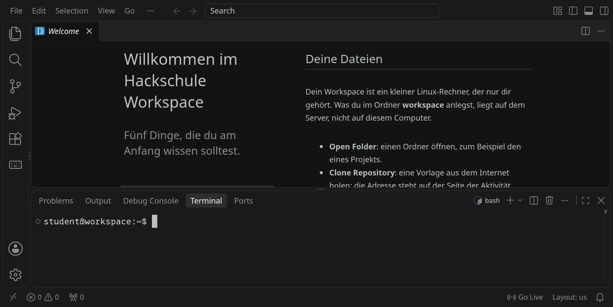

Starte nun die SBCL-Shell, indem du `sbcl` eingibst und dann <kbd>Enter</kbd> drückst. Du solltest eine Ausgabe wie diese sehen:

<!-- tutorial-screenshot
# Die Begrüßung ist lang: das ganze Terminal, wie im alten Bild
terminal-maximize
press: Control+l
terminal-run: sbcl
wait-for-text: distribution for more information
sleep: 0.5
crop-terminal-lines: auto
-->

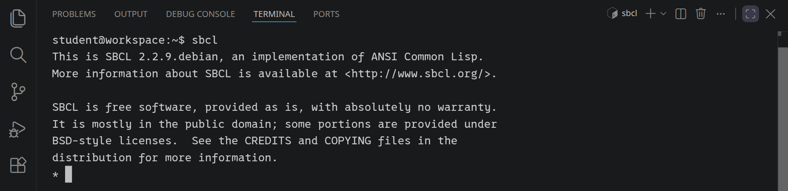

Jetzt kannst du Lisp-Code direkt in der Shell eingeben und ausführen. Schreibe einfach `(format t "Hello, world!")` und drücke <kbd>Enter</kbd>. Du solltest die Ausgabe `Hello, world!` sehen.

Du kannst die SBCL-Shell wieder beenden, indem du `(exit)` eingibst und <kbd>Enter</kbd> drückst oder einfach <kbd>Strg</kbd><kbd>D</kbd> drückst.

**Möglichkeit 2:** Lisp-Code in einer Textdatei speichern und ausführen

Lisp-Programme werden in Textdateien mit der Endung `.lisp` geschrieben. Ein Lisp-Interpreter liest anschließend den Quelltext und führt ihn aus.

Stelle zuerst sicher, dass du keinen Ordner geöffnet hast. Um sicherzugehen, drücke einfach den Shortcut für »Ordner schließen«: <kbd>Strg</kbd><kbd>K</kbd> und dann <kbd>F</kbd>. Dein Workspace sollte jetzt ungefähr so aussehen:

<!-- tutorial-screenshot
# Die Shell wieder verlassen, das Terminal schließen
terminal-run: (exit)
terminal-wait-for-prompt
press: Control+l
press: Control+j
show-left-sidebar
sleep: 0.5
-->

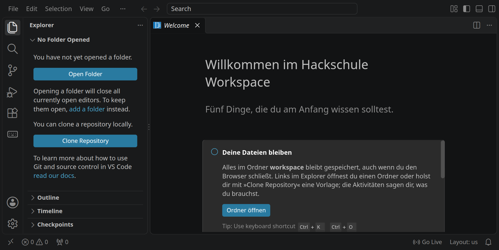

### Quelltext schreiben

Klicke auf »New File« und wähle als Dateityp »Text File« (oder bestätige einfach mit <kbd>Enter</kbd>).

<!-- tutorial-screenshot
click: New File...
wait-for-text: Text File
sleep: 0.5
crop-bottom: 77%
-->


Schreibe nun den folgenden Code in die Datei:

_include_file(hello.lisp, clisp)

Da Visual Studio Code noch nicht weiß, dass es sich um Lisp-Quelltext handelt, ist dein Programm momentan noch einfarbig, aber das wird sich gleich ändern. An dem weißen Punkt erkennst du, dass deine Änderungen noch nicht gespeichert sind.

<!-- tutorial-screenshot
# Das Programm in eine noch namenlose Datei
press: Enter
sleep: 1
hide-left-sidebar
type: <- file:hello.lisp
sleep: 0.5
crop-bottom: 82%
-->

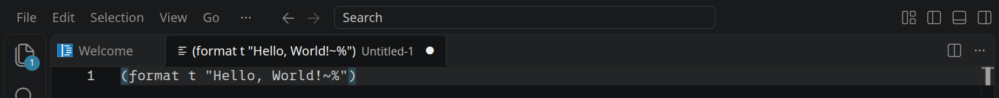

Drücke nun <kbd>Strg</kbd><kbd>S</kbd>, um die Datei zu speichern. Gib `hello.lisp` ein – der vollständige Pfad zu deiner Datei lautet dann `/workspace/hello.lisp`.

<!-- tutorial-screenshot
press: Control+s
wait-for-text: Save As
press: Control+a
type: /workspace/hello.lisp
sleep: 0.5
crop-bottom: 82%
-->

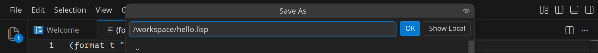

Da Lisp standardmäßig nicht von Visual Studio Code unterstützt wird, müssen wir noch eine passende Erweiterung installieren. Klicke dazu auf das Erweiterungs-Symbol  in der Seitenleiste oder drücke <kbd>Strg</kbd><kbd>Shift</kbd><kbd>X</kbd>. Suche nach der Erweiterung »Lisp-Syntax« und installiere sie. Weil der Herausgeber nicht verifiziert ist, fragt Visual Studio Code, ob du ihm vertraust; bestätige mit »Trust Publisher & Install«.

<!-- tutorial-screenshot
# Speichern, dann die Erweiterung im Marketplace
press: Enter
wait-for-file: hello.lisp
sleep: 1
press: Control+Shift+x
wait-for-text: Marketplace
type: Lisp-Syntax
sleep: 3
crop-bottom: 50%
-->

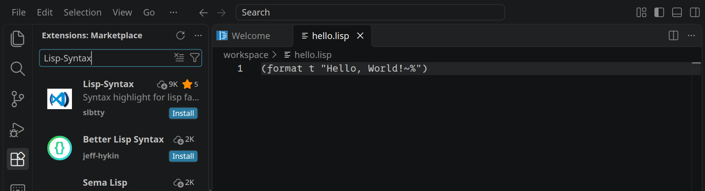

Alternativ kannst du auch <kbd>Strg</kbd><kbd>P</kbd> drücken und `ext install slbtty.lisp-syntax` eingeben, um die Erweiterung zu installieren.

Anschließend solltest du dein Lisp-Programm farbig sehen:

<!-- tutorial-screenshot
# Die Erweiterung installieren, wie es der Text als zweiten Weg
# nennt; danach ist der Code farbig
press: Control+p
type: ext install slbtty.lisp-syntax
wait-for-text: Press Enter to install extension
press: Enter
# Der Herausgeber ist nicht verifiziert: VS Code fragt nach
wait-for-text: Trust Publisher & Install
click: Trust Publisher & Install
sleep: 10
# Neu öffnen: erst dann kennt VS Code die Sprache
close-tab: hello.lisp
open-file: hello.lisp
hide-left-sidebar
sleep: 2
crop-bottom: 78%
-->

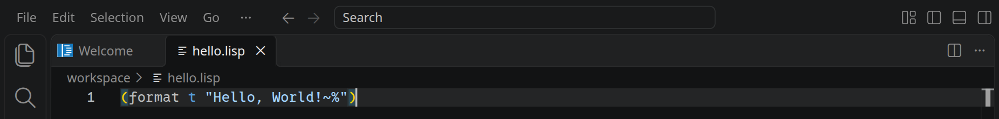

### Skript ausführen

Um unser Programm auszuführen, müssen wir den Lisp-Interpreter aufrufen (in unserem Fall `sbcl`) und ihm den Dateinamen unseres Programms übergeben.

Öffne dazu ein Terminal, indem du <kbd>Strg</kbd><kbd>J</kbd> drückst und gib folgenden Befehl ein:

```bash
sbcl --script hello.lisp
```

<div class='hint'>
Du musst nicht den vollständigen Dateinamen schreiben. Schreib einfach <code>sbcl --script he</code> und drücke <kbd>Tab</kbd>, um den Dateinamen automatisch zu <code>hello.lisp</code> vervollständigen zu lassen. Du kannst danach ganz normal weiterschreiben.
</div>

Das Programm sollte die Nachricht `Hello, World!` im Terminal ausgeben:

<!-- tutorial-screenshot
hide-left-sidebar
terminal-open
press: Control+l
terminal-run: sbcl --script hello.lisp
terminal-wait-for-prompt
crop-terminal-lines: auto
-->

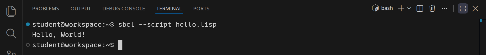

### Fehler finden und beheben

Wenn du einen Fehler im Code machst, wird Lisp eine Fehlermeldung ausgeben. Versuche zum Beispiel, statt `format` das Wort `formt` zu schreiben:

```clisp
(formt t "Hello, World!~%")
```

Speichere die Datei und führe das Skript erneut aus:

```bash
sbcl --script hello.lisp
```

<div class='hint'>
Nutze die Pfeiltaste hoch <kbd>↑</kbd>, um den letzten Befehl erneut einzugeben. So kannst du schnell dein Programm testen, nachdem du es verändert hast.
</div>

SBCL sollte eine Fehlermeldung ausgeben, die dir hilft, den Fehler zu finden (du musst etwas nach oben scrollen, um den Auslöser zu finden):

<!-- tutorial-screenshot
# Der Fehler aus dem Text. SBCL hängt eine lange Rückverfolgung an;
# zurück zum Befehl scrollen und nur den Anfang mit der Meldung zeigen
write-file: hello.lisp <- file:hello-error.lisp
terminal-maximize
# clear statt Strg+L: leert auch den Verlauf; Strg+↑ scrollt dann zum
# Befehl ganz oben
terminal-run: clear
terminal-wait-for-prompt
terminal-run: sbcl --script hello.lisp
terminal-wait-for-prompt
press: Control+ArrowUp
sleep: 0.5
crop-terminal-lines: 4
-->

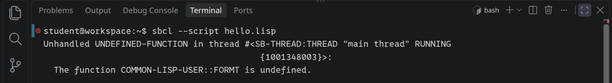

Es lohnt sich, die Fehlermeldungen genau zu lesen, um den Fehler zu finden und zu beheben. Leider gibt SBCL im Gegensatz zu vielen anderen Interpretern keine Zeilennummer an, aber die Meldung sollte dir trotzdem helfen, den Fehler zu finden. Denke daran, den Fehler wieder zu beheben, bevor du das nächste Beispiel ausprobierst.

## Primfaktorzerlegung

Im zweiten Beispiel wollen wir eine Zahl in ihre Primfaktoren zerlegen.
An diesem Beispiel kannst du sehen, wie man in Lisp Benutzereingaben verarbeitet und Schleifen verwendet.
Erstelle eine neue Datei mit <kbd>Strg</kbd><kbd>Alt</kbd><kbd>N</kbd> und schreibe den folgenden Code hinein:

_include_file(factor.lisp, clisp)

Speichere die Datei unter dem Namen `factor.lisp` und führe sie aus:

<!-- tutorial-screenshot
write-file: factor.lisp <- file:factor.lisp
terminal-maximize
press: Control+l
terminal-run: sbcl --script factor.lisp
wait-for-text: factorise:
terminal-run: 123
terminal-wait-for-prompt
crop-terminal-lines: auto
-->

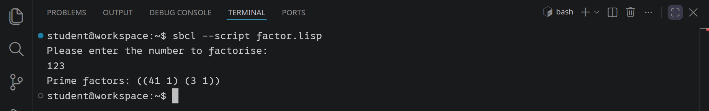

Das Programm hat die Zahl 123 in ihre Primfaktoren zerlegt und ausgegeben. Anders als andere Programmiersprachen kann Lisp auch die Zahl 3000000000 in Sekundenbruchteilen zerlegen. Wenn du allerdings eine sehr große Zahl wie 123456789123456789 verwendest, dauert die Berechnung sehr lange (probier es gern aus, du kannst das Programm mit <kbd>Strg</kbd><kbd>C</kbd> abbrechen).

## Bubblesort

Im dritten Beispiel wollen wir eine Liste von 10 Zufallszahlen sortieren. Dafür verwenden wir den [Bubblesort-Algorithmus](https://de.wikipedia.org/wiki/Bubblesort), der zwar nicht besonders effizient ist, aber sehr einfach zu verstehen und zu implementieren. Der Bubblesort-Algorithmus funktioniert, indem er die Liste mehrmals durchläuft und benachbarte Elemente vertauscht, wenn sie in der falschen Reihenfolge sind.

An diesem Beispiel kannst du sehen, wie man in Lisp Arrays verwendet, Funktionen verwendet und Schleifen verschachtelt.

Erstelle eine neue Datei und schreibe den folgenden Code hinein:

_include_file(bubblesort.lisp, clisp)

Speichere das Skript unter dem Namen `bubblesort.lisp` und führe es aus:

<!-- tutorial-screenshot
write-file: bubblesort.lisp <- file:bubblesort.lisp
press: Control+l
terminal-run: sbcl --script bubblesort.lisp
terminal-wait-for-prompt
crop-terminal-lines: auto
-->

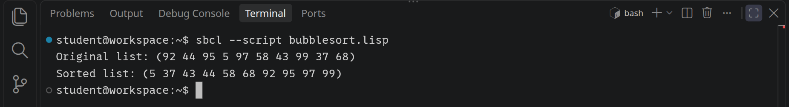

Das Programm hat eine Liste von 10 Zufallszahlen sortiert. Versuche, den Quelltext so zu verändern, dass statt 10 Zahlen 100 oder mehr Zahlen sortiert werden.

## Zusammenfassung

In diesem Kapitel hast du an drei Beispielen gesehen, wie man ein einfaches Lisp-Skript schreiben und ausführen kann. Das ist natürlich nur ein erster Eindruck. Um Lisp wirklich zu beherrschen, musst du noch viel mehr lernen – am besten, indem du eigene Skripte schreibst und ausprobierst. Die Buchhandlungen, Bibliotheken und Youtube sind voll von Material für dich. Viel Spaß beim Programmieren!
