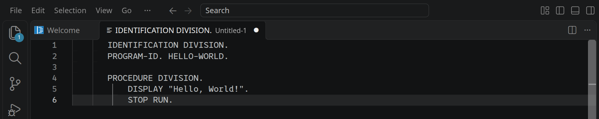
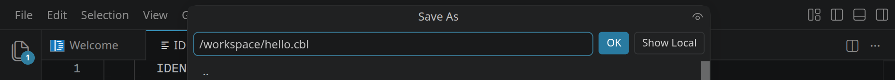
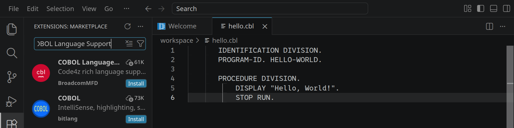
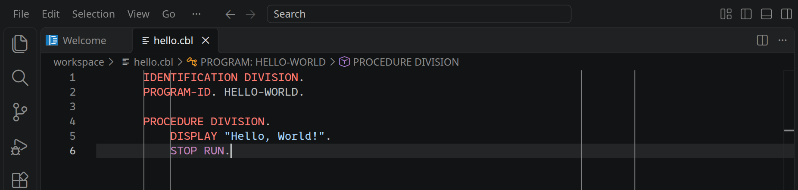
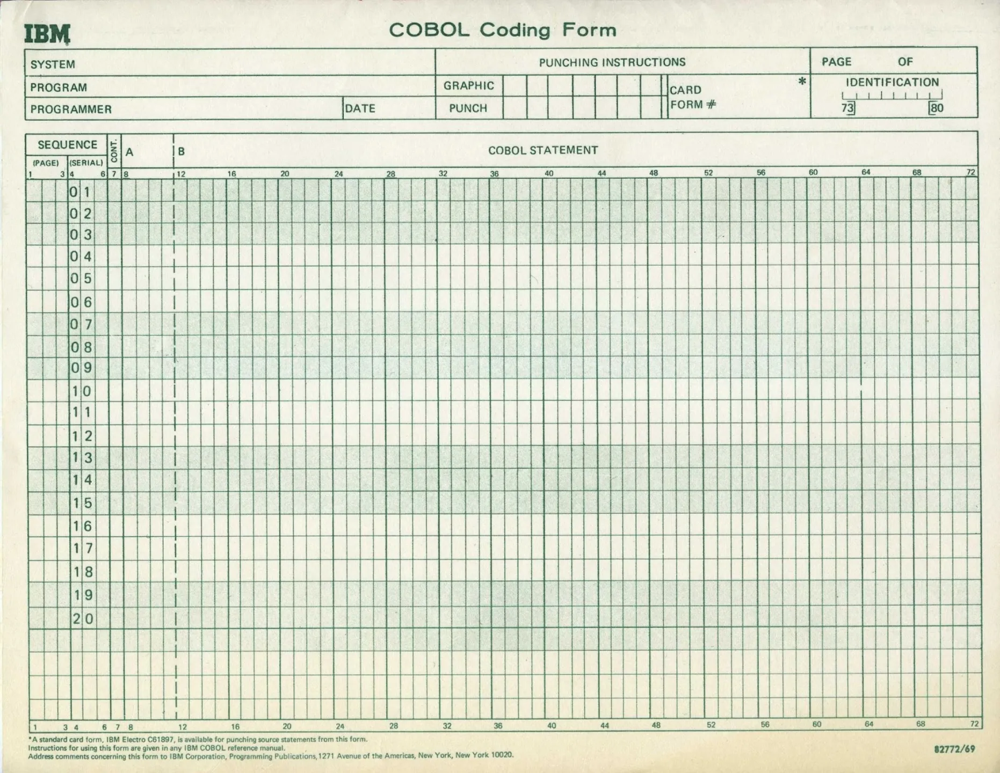
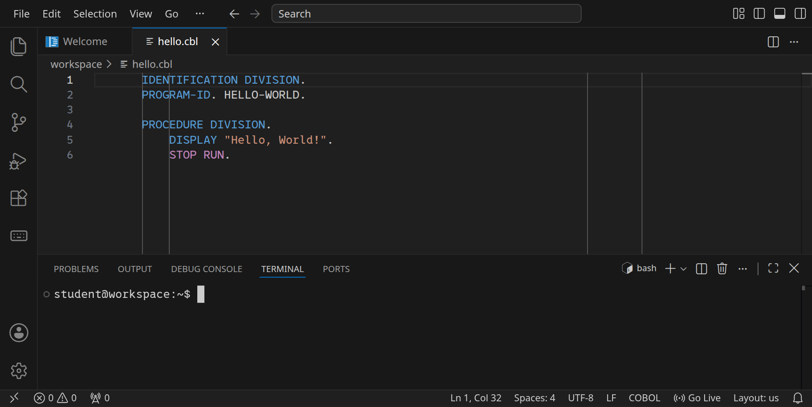
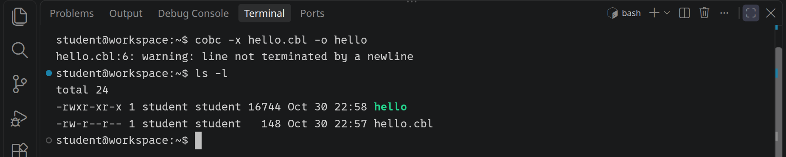
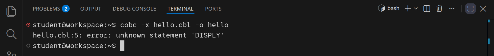
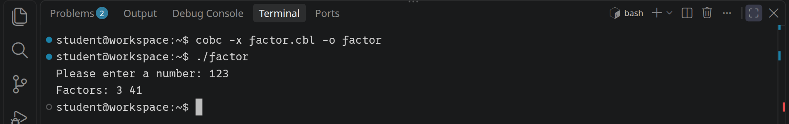
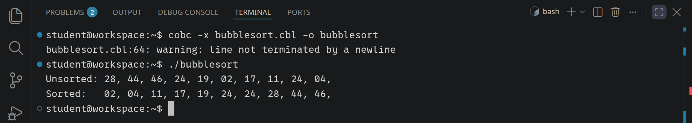

<div class='meta'>
image: cobol-logo.png
kind: steckbrief
</div>

<div
    class="autotoc-secondary-trigger"
    data-title="Auf dieser Seite"
    data-levels="h2,h3">
</div>

# COBOL <span style='font-size: 80%;'>(1959)</span>

<p class='abstract'>
COBOL (Common Business-Oriented Language) wurde 1959 von einem Ausschuss aus Firmen und Behörden (CODASYL) entworfen. Es baut stark auf FLOW-MATIC auf, einer Sprache von Grace Hopper, die darum oft »Großmutter von COBOL« genannt wird. Es war die erste Programmiersprache, die speziell für Geschäftsanwendungen entwickelt wurde. COBOL ist eine imperative Programmiersprache, die für die Verarbeitung von Daten in Form von Datensätzen optimiert ist. Trotz ihres hohen Alters wird die Programmiersprache COBOL immer noch in der Unternehmenssoftwareentwicklung eingesetzt.
</p>

_person(hopper)

Die Sprache wurde hauptsächlich in Bereichen wie Banken, Versicherungen und Regierungsbehörden eingesetzt, um Transaktionsverarbeitung, Buchhaltung und andere geschäftskritische Anwendungen zu unterstützen. Heutzutage ist COBOL immer noch relevant, insbesondere in der Finanzbranche und bei großen Unternehmen, die auf stabile und zuverlässige Systeme angewiesen sind. Viele dieser Systeme laufen seit Jahrzehnten und werden weiterhin gepflegt und erweitert, da sie für den täglichen Betrieb unerlässlich sind.

## Hello, world!

COBOL-Programme werden in Textdateien mit der Endung `.cbl` oder `.cob` geschrieben. Diese Dateien werden anschließend von einem Compiler in ausführbare Dateien übersetzt, die auf deinem Computer direkt ausgeführt werden können.

Stelle zuerst sicher, dass du keinen Ordner geöffnet hast. Um sicherzugehen, drücke einfach den Shortcut für »Ordner schließen«: <kbd>Strg</kbd><kbd>K</kbd> und dann <kbd>F</kbd>. Dein Workspace sollte jetzt ungefähr so aussehen:

<!-- tutorial-screenshot
# Ein frischer Workspace ohne Ordner
show-left-sidebar
sleep: 0.5
-->


### Quelltext schreiben

Klicke auf »New File« und wähle als Dateityp »Text File«.

<!-- tutorial-screenshot
click: New File...
wait-for-text: Text File
sleep: 0.5
crop-bottom: 77%
-->


Schreibe nun den folgenden Code in die Datei:

_include_file(hello.cbl, c)

Da Visual Studio Code noch nicht weiß, dass es sich um COBOL-Quelltext handelt, ist dein Programm momentan noch einfarbig, aber das wird sich gleich ändern. An dem weißen Punkt erkennst du, dass deine Änderungen noch nicht gespeichert sind.

<!-- tutorial-screenshot
# Das Programm in eine noch namenlose Datei
press: Enter
sleep: 1
hide-left-sidebar
type: <- file:hello.cbl
sleep: 0.5
crop-bottom: 60%
-->



Drücke nun <kbd>Strg</kbd><kbd>S</kbd>, um die Datei zu speichern. Gib `hello.cbl` ein – der vollständige Pfad zu deiner Datei lautet dann `/workspace/hello.cbl`.

<!-- tutorial-screenshot
press: Control+s
wait-for-text: Save As
press: Control+a
type: /workspace/hello.cbl
sleep: 0.5
crop-bottom: 82%
-->



<div class='hint'>
Achte darauf, dass du deine Datei nicht aus Versehen <code>hello.cbl.</code> (mit einem Punkt am Ende) nennst, da Visual Studio Code als Dateiname <code>IDENTIFICATION DIVISION.</code> vorschlägt.
</div>

Da COBOL standardmäßig nicht von Visual Studio Code unterstützt wird, müssen wir noch eine passende Erweiterung installieren. Klicke dazu auf das Erweiterungs-Symbol  in der Seitenleiste oder drücke <kbd>Strg</kbd><kbd>Shift</kbd><kbd>X</kbd>. Suche nach der Erweiterung »COBOL Language Support« und installiere sie. Weil der Herausgeber nicht verifiziert ist, fragt Visual Studio Code, ob du ihm vertraust; bestätige mit »Trust Publisher & Install«.

<!-- tutorial-screenshot
# Speichern, dann die Erweiterung im Marketplace
press: Enter
wait-for-file: hello.cbl
sleep: 1
press: Control+Shift+x
wait-for-text: Marketplace
type: COBOL Language Support
sleep: 3
crop-bottom: 50%
-->



Alternativ kannst du auch <kbd>Strg</kbd><kbd>P</kbd> drücken und `ext install broadcomMFD.cobol-language-support` eingeben, um die Erweiterung zu installieren.

Anschließend solltest du dein COBOL-Programm farbig sehen:

<!-- tutorial-screenshot
# Die Erweiterung installieren, wie es der Text als zweiten Weg
# nennt; danach ist der Code farbig
press: Control+p
type: ext install broadcomMFD.cobol-language-support
wait-for-text: Press Enter to install extension
press: Enter
# Der Herausgeber ist nicht verifiziert: VS Code fragt nach
wait-for-text: Trust Publisher & Install
click: Trust Publisher & Install
sleep: 10
# Neu öffnen: erst dann kennt VS Code die Sprache
close-tab: hello.cbl
open-file: hello.cbl
hide-left-sidebar
sleep: 2
crop-bottom: 56%
-->



Wie man sieht, hat COBOL eine bestimmte Vorstellung davon, wie der Code eingerückt sein sollte. Das liegt daran, dass COBOL ein sehr altes Sprachdesign hat und auf Lochkartenprogrammierung ausgelegt ist. Die Einrückung ist also nicht nur eine Frage des Stils, sondern auch der Funktionalität. Früher wurde der Code auf solchen Formularen geschrieben:



### Kompilieren und ausführen

Bevor wir das Programm ausführen können, müssen wir es kompilieren. Dadurch wird der Quelltext in Maschinencode übersetzt, den dein Computer ausführen kann.

Öffne dazu ein Terminal, indem du entweder <kbd>Strg</kbd><kbd>J</kbd> drückst oder das Panel-Symbol  rechts oben drückst. Dein Fenster sollte jetzt ungefähr so aussehen:

<!-- tutorial-screenshot
hide-left-sidebar
terminal-open
sleep: 0.5
-->



Um das Programm zu kompilieren, gib folgenden Befehl ein:

```bash
cobc -x hello.cbl -o hello
```

<div class='hint'>
Du musst nicht den vollständigen Dateinamen schreiben. Schreib einfach <code>cobc -x he</code> und drücke <kbd>Tab</kbd>, um den Dateinamen automatisch zu <code>hello.cbl</code> vervollständigen zu lassen. Du kannst danach ganz normal weiterschreiben.
</div>

Falls du die Warnung _»line not terminated b a newline«_ erhältst, ist dies nicht weiter schlimm - sie bedeutet nur, dass die letzte Zeile deines Programms keinen Zeilenumbruch am Ende hat. Du kannst sie einfach ignorieren. Wenn du keinen Fehler gemacht hast, wird das Programm erfolgreich kompiliert und die ausführbare Datei `hello` wird im selben Verzeichnis erstellt. Du kannst dies überprüfen, indem du dir die Dateien im aktuellen Verzeichnis mit `ls` oder `ls -l` anzeigen lässt:

<!-- tutorial-screenshot
# Die Warnung von cobc und ls passen nur ins ganze Terminal
terminal-maximize
press: Control+l
terminal-run: cobc -x hello.cbl -o hello
terminal-wait-for-prompt
terminal-run: ls -l
terminal-wait-for-prompt
crop-terminal-lines: auto
-->



Die grüne Datei `hello` ist die ausführbare Datei – im Unterschied zu Windows, wo ausführbare Dateien die Endung `.exe` haben, haben ausführbare Dateien unter Linux keine Endung. Um das Programm auszuführen, gib folgenden Befehl ein:

```bash
./hello
```

Das Programm sollte die Nachricht `Hello, World!` im Terminal ausgeben. Du kannst beide Schritte auch in einem Befehl kombinieren:

```bash
cobc -x hello.cbl -o hello && ./hello
```

<div class='hint'>
Die Zeichenkombination <code>&amp;&amp;</code> sorgt dafür, dass der zweite Befehl nur ausgeführt wird, wenn der erste erfolgreich war.
</div>

### Fehler finden und beheben

Wenn du einen Fehler im Code machst, wird der Compiler eine Fehlermeldung ausgeben. Versuche zum Beispiel, statt `DISPLAY` das Wort `DISPLY` zu schreiben:

```c
~ IDENTIFICATION DIVISION.
~ PROGRAM-ID. HELLO-WORLD.
~
~ PROCEDURE DIVISION.
    DISPLY "Hello, World!".
~     STOP RUN.
```

Speichere die Datei und führe den Compiler erneut aus:

```bash
cobc -x hello.cbl -o hello
```

<div class='hint'>
Nutze die Pfeiltaste hoch <kbd>↑</kbd>, um den letzten Befehl erneut einzugeben. So kannst du schnell dein Programm testen, nachdem du es verändert hast.
</div>

Der Compiler sollte eine Fehlermeldung ausgeben, die dir hilft, den Fehler zu finden:

<!-- tutorial-screenshot
# Der Fehler aus dem Text; die lange Meldung braucht das ganze Terminal
write-file: hello.cbl <- file:hello-error.cbl
terminal-maximize
press: Control+l
terminal-run: cobc -x hello.cbl -o hello
terminal-wait-for-prompt
crop-terminal-lines: auto
-->



Es lohnt sich, die Fehlermeldungen genau zu lesen, um den Fehler zu finden und zu beheben. Achte auf die Zeilennummer (in diesem Beispiel 5) und den Text, der dir sagt, was falsch ist. Denke daran, den Fehler wieder zu beheben, bevor du das nächste Beispiel ausprobierst.

## Primfaktorzerlegung

Im zweiten Beispiel wollen wir eine Zahl in ihre Primfaktoren zerlegen. An diesem Beispiel kannst du sehen, wie man in COBOL Benutzereingaben verarbeitet und Schleifen verwendet.
Erstelle eine neue Datei mit <kbd>Strg</kbd><kbd>Alt</kbd><kbd>N</kbd> und schreibe den folgenden Code hinein:

_include_file(factor.cbl, c)

Speichere die Datei unter dem Namen `factor.cbl`. Kompiliere das Programm:

```bash
cobc -x factor.cbl -o factor
```

Falls du keine Fehlermeldung erhältst, kannst du das Programm ausführen und testen:

<!-- tutorial-screenshot
write-file: factor.cbl <- file:factor.cbl
terminal-maximize
press: Control+l
terminal-run: cobc -x factor.cbl -o factor
terminal-wait-for-prompt
terminal-run: ./factor
wait-for-text: number:
terminal-run: 123
terminal-wait-for-prompt
crop-terminal-lines: auto
-->



Das Programm hat die Zahl 123 in ihre Primfaktoren zerlegt und ausgegeben.

<div class='hint try'>
<strong>Ausprobieren:</strong> Gib statt 123 die Zahl <code>3000000000</code> ein. Was passiert, und was könnte der Grund dafür sein? Schau dir dazu an, wie <code>NUM</code> in der <code>WORKING-STORAGE SECTION</code> beschrieben ist.
</div>

## Bubblesort

Im dritten Beispiel wollen wir eine Liste von 10 Zahlen sortieren, die im Programm stehen. Dafür verwenden wir den [Bubblesort-Algorithmus](https://de.wikipedia.org/wiki/Bubblesort), der zwar nicht besonders effizient ist, aber sehr einfach zu verstehen und zu implementieren. Der Bubblesort-Algorithmus funktioniert, indem er die Liste mehrmals durchläuft und benachbarte Elemente vertauscht, wenn sie in der falschen Reihenfolge sind.

An diesem Beispiel kannst du sehen, wie man in COBOL Arrays verwendet und Schleifen verschachtelt.

Erstelle eine neue Datei und schreibe den folgenden Code hinein:

_include_file(bubblesort.cbl, c)

Speichere die Datei unter dem Namen `bubblesort.cbl`. Kompiliere das Programm:

```bash
cobc -x bubblesort.cbl -o bubblesort
```
Falls du keine Fehlermeldung erhältst, kannst du das Programm ausführen und testen:

<!-- tutorial-screenshot
write-file: bubblesort.cbl <- file:bubblesort.cbl
press: Control+l
terminal-run: cobc -x bubblesort.cbl -o bubblesort
terminal-wait-for-prompt
terminal-run: ./bubblesort
terminal-wait-for-prompt
crop-terminal-lines: auto
-->



Das Programm hat eine Liste von 10 Zahlen sortiert.

<div class='hint try'>
<strong>Ausprobieren:</strong> Ändere <code>bubblesort.cbl</code>, übersetze neu und starte das Programm:
<ul>
<li>Füge eine elfte Zahl hinzu. Was musst du außer einer Zeile <code>MOVE … TO ITEM (11)</code> noch ändern?</li>
<li>Ändere eine der Zahlen zu <code>123</code>. Was meldet <code>cobc</code>, und welche Zahl steht danach in der Ausgabe? Was bedeutet wohl <code>PIC 99</code>?</li>
<li>Wie viele Zahlen kann das Programm höchstens sortieren?</li>
</ul>
</div>

## Zusammenfassung

In diesem Kapitel hast du an drei Beispielen gesehen, wie man ein einfaches COBOL-Programm schreiben, kompilieren und ausführen kann. Das ist natürlich nur ein erster Eindruck. Um COBOL wirklich zu beherrschen, musst du noch viel mehr lernen – am besten, indem du eigene Programme schreibst und ausprobierst. Die Buchhandlungen, Bibliotheken und Youtube sind voll von Material für dich. Viel Spaß beim Programmieren!

