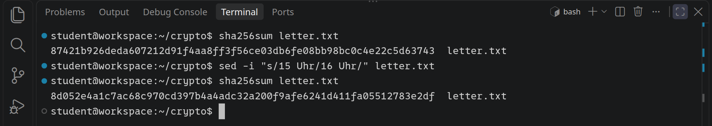
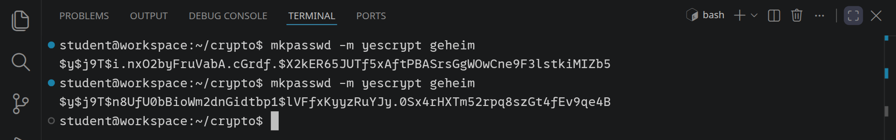
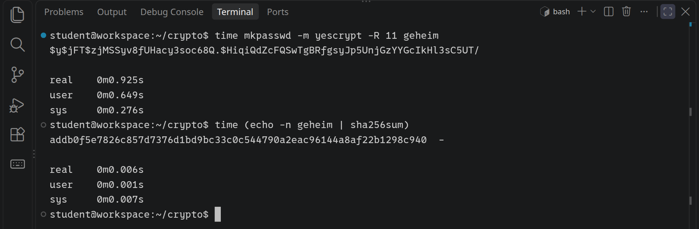
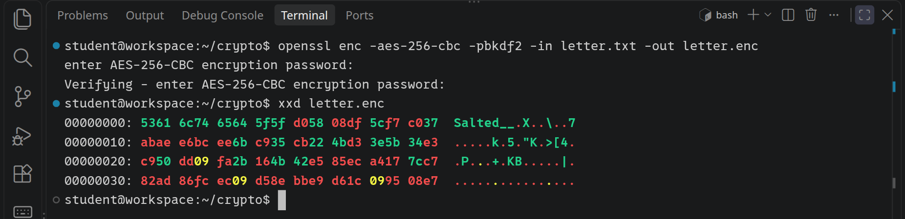
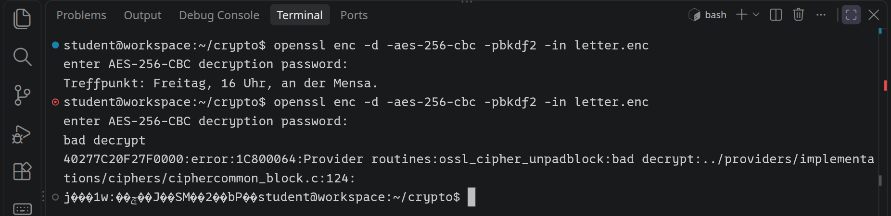
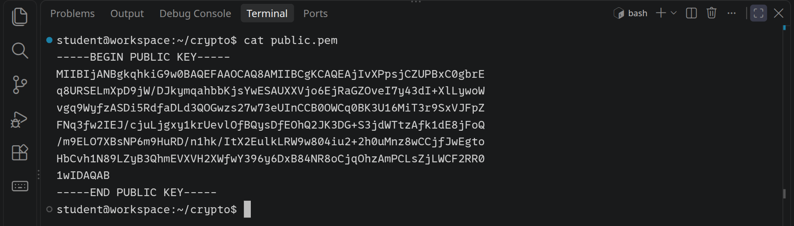
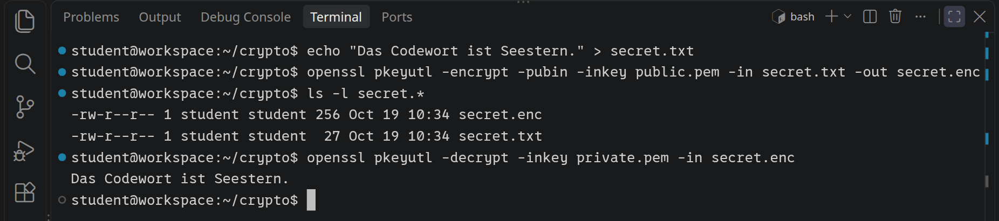
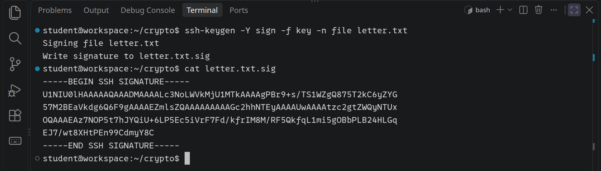
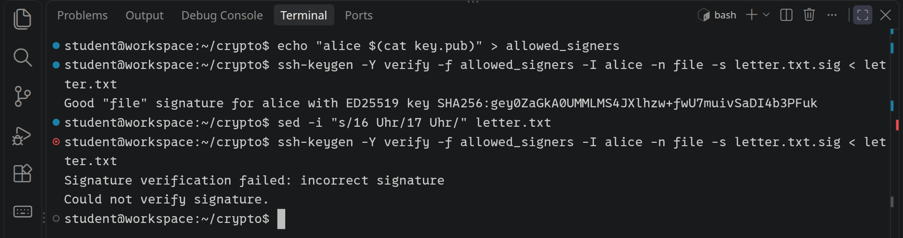
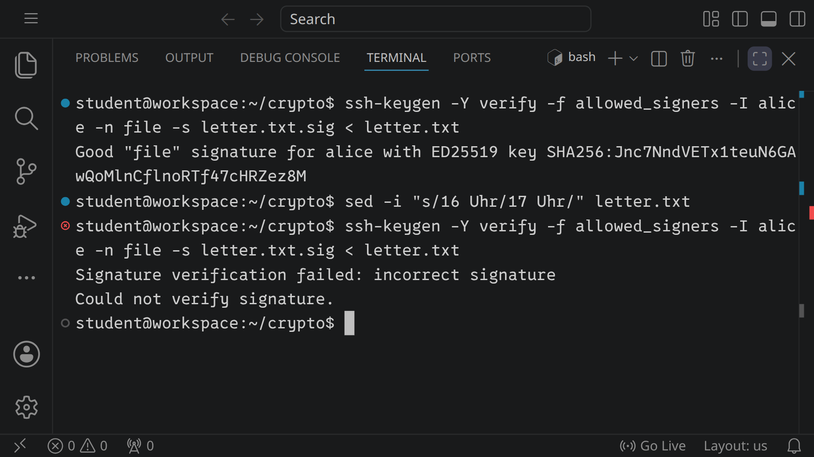

<div class='meta'>
image: teaser.webp
image_alt: "Ein Terminal, in dem ssh-keygen die Signatur eines Briefs erst bestätigt und nach einer Änderung ablehnt"
kind: labor
language: Bash
duration: 2 Doppelstunden
requires: [tcpip]
</div>

<div
    class="autotoc-secondary-trigger"
    data-title="Auf dieser Seite"
    data-levels="h2,h3">
</div>

# Kryptographie im Terminal

<p class='abstract'>
Wie prüft man, ob eine Datei unterwegs verändert wurde? Wie speichert ein Server Passwörter, ohne sie zu kennen? Und wie schickt man jemandem ein Geheimnis, ohne vorher ein Passwort auszumachen? In dieser Aktivität probierst du die Bausteine der Kryptographie im Terminal aus: Hashes, Passwörter mit Salz, Verschlüsselung mit einem und mit zwei Schlüsseln und digitale Unterschriften. Am Ende weißt du, was hinter dem Schloss im Browser und hinter deinem SSH-Schlüssel steckt.
</p>

Auf der Seite [TCP/IP](/tcpip) hast du gesehen: Was unverschlüsselt durchs Netz geht, kann jeder Router unterwegs mitlesen, und auch verändern. Kryptographie löst drei verschiedene Probleme, und es hilft, sie auseinanderzuhalten:

<table class='table'>
<tr><th>Problem</th><th>Frage</th><th>Werkzeug</th></tr>
<tr><td class='text-nowrap'>Unversehrtheit</td><td>Ist die Datei noch dieselbe?</td><td>Hash</td></tr>
<tr><td class='text-nowrap'>Geheimhaltung</td><td>Kann nur die richtige Person lesen, was ich schicke?</td><td>Verschlüsselung</td></tr>
<tr><td class='text-nowrap'>Echtheit</td><td>Kommt die Nachricht wirklich von der Person, die sie geschickt haben will?</td><td>Unterschrift</td></tr>
</table>

## Vorbereitung

_include(workspace#terminal-oeffnen)

Lege einen Ordner für diese Aktivität an, wechsle hinein und schreib einen kurzen Brief in eine Datei:

```bash
mkdir ~/crypto
cd ~/crypto
echo "Treffpunkt: Freitag, 15 Uhr, an der Mensa." > letter.txt
```

## Fingerabdrücke: Hashes

<div class='hint books'>
In diesem Abschnitt lernst du den Befehl <code>sha256sum</code> kennen.
</div>

Eine **Hashfunktion** macht aus beliebig vielen Daten eine kurze Zahl fester Länge, den **Hash**. SHA-256 ist eine solche Funktion; ihr Hash ist 256 Bit lang und wird als 64 Zeichen in Hexadezimal geschrieben. Berechne den Hash deines Briefs, ändere dann eine einzige Ziffer und berechne ihn noch einmal:

```bash
sha256sum letter.txt
sed -i "s/15 Uhr/16 Uhr/" letter.txt
sha256sum letter.txt
```

`sed -i` ersetzt im Brief `15 Uhr` durch `16 Uhr`.

_task(lawine)

<!-- tutorial-screenshot
# Ordner crypto mit dem Brief, Hash vor und nach der Änderung
hide-left-sidebar
terminal-open
terminal-maximize
terminal-run: mkdir -p ~/crypto && cd ~/crypto && rm -f key key.pub letter.* private.pem public.pem secret.*
terminal-run: echo "Treffpunkt: Freitag, 15 Uhr, an der Mensa." > letter.txt
terminal-run: clear
terminal-run: sha256sum letter.txt
terminal-run: sed -i "s/15 Uhr/16 Uhr/" letter.txt
terminal-run: sha256sum letter.txt
terminal-wait-for-prompt
crop-terminal-lines: auto
-->



Eine gute Hashfunktion hat drei Eigenschaften:

- **Gleiche Daten, gleicher Hash.** Wer denselben Brief hat, berechnet denselben Hash, auf jedem Rechner der Welt.
- **Kleine Änderung, ganz anderer Hash.** Eine Ziffer, ein Leerzeichen, ein Bit: Der Hash ist danach nicht ähnlich, sondern ein völlig anderer.
- **Kein Weg zurück.** Aus dem Hash lässt sich der Brief nicht berechnen, und niemand findet mit vertretbarem Aufwand zwei verschiedene Dateien mit demselben Hash.

Darum taugt ein Hash als **Fingerabdruck**. Wer eine große Datei herunterlädt, zum Beispiel ein Betriebssystem, findet daneben oft ihren SHA-256-Hash. Stimmt der Hash der heruntergeladenen Datei damit überein, ist sie unterwegs nicht verändert worden. Auch [Git](/git) benennt jeden Commit und jede Datei nach ihrem Hash: Die Commit-IDs wie `a4a310c` sind der Anfang davon.

_task(hash-berechnen)

<div class='hint'>
<code>echo</code> hängt an seinen Text einen Zeilenumbruch an, und der zählt für den Hash mit. Mit <code>echo -n</code> fehlt er.
</div>

## Passwörter speichern

Ein Server, bei dem du dich anmeldest, muss prüfen können, ob dein Passwort stimmt. Speichert er die Passwörter selbst, liegen sie nach einem Einbruch alle offen da, und weil viele Menschen dasselbe Passwort für mehrere Dienste benutzen, ist der Schaden dann nicht auf diesen einen Server begrenzt.

Besser: Der Server speichert nur einen Hash des Passworts. Bei der Anmeldung berechnet er den Hash dessen, was du eingibst, und vergleicht. Das Passwort selbst kennt er nicht. Ein einfacher SHA-256-Hash reicht dafür aber nicht, aus zwei Gründen:

- **Gleiche Passwörter haben gleiche Hashes.** Wer die gespeicherten Hashes sieht, erkennt sofort, wer dasselbe Passwort benutzt, und für häufige Passwörter wie `123456` sind die Hashes längst in Listen nachzuschlagen.
- **SHA-256 ist schnell.** Das ist bei Dateien gewollt, bei Passwörtern ein Nachteil: Wer die Hashes erbeutet hat, kann sehr viele Vermutungen pro Sekunde ausprobieren.

Darum benutzen Server für Passwörter eigene Hashfunktionen wie **yescrypt**, bcrypt oder Argon2. Linux speichert die Passwörter seiner Benutzer mit yescrypt. `mkpasswd` zeigt, was dabei herauskommt. Rufe es zweimal mit demselben Passwort auf:

```bash
mkpasswd -m yescrypt geheim
mkpasswd -m yescrypt geheim
```

_task(salz-vorhersage)

<!-- tutorial-screenshot
terminal-run: clear
terminal-run: mkpasswd -m yescrypt geheim
terminal-run: mkpasswd -m yescrypt geheim
terminal-wait-for-prompt
crop-terminal-lines: auto
-->



Jedes Ergebnis besteht aus Teilen, getrennt durch `$`: `y` steht für yescrypt, `j9T` für die Einstellungen, dann kommt ein zufälliges **Salz** und erst danach der eigentliche Hash. Das Salz wird jedes Mal neu ausgewürfelt und mit dem Passwort zusammen gehasht. So hat dasselbe Passwort bei jeder Person einen anderen Hash, und fertige Listen nützen nichts. Das Salz ist nicht geheim, es steht ja mit im Ergebnis; zur Prüfung rechnet der Server mit demselben Salz noch einmal.

Der zweite Unterschied ist die Zeit. Mit `-R` stellst du ein, wie viel Arbeit yescrypt machen soll, und `time` misst, wie lange ein Befehl dauert:

```bash
time mkpasswd -m yescrypt -R 11 geheim
time (echo -n geheim | sha256sum)
```

<!-- tutorial-screenshot
terminal-run: clear
terminal-run: time mkpasswd -m yescrypt -R 11 geheim
terminal-wait-for-prompt
terminal-run: time (echo -n geheim | sha256sum)
terminal-wait-for-prompt
crop-terminal-lines: auto
-->



`-R 11` ist mehr Arbeit, als ein Server sich üblicherweise vornimmt; er wählt die Einstellung so, dass eine Anmeldung kaum merklich länger dauert. Wer aber erbeutete Hashes durchprobieren will, muss für jede einzelne Vermutung diese Arbeit leisten, und das summiert sich. yescrypt braucht dafür außerdem viel Speicher, was spezielle Hardware zum Raten teuer macht.

_task(salz)

<div class='hint'>
Den besten Schutz hat trotzdem das Passwort selbst: lang, nirgends sonst benutzt, am besten aus einem Passwort-Manager. Gegen ein Passwort wie <code>123456</code> hilft auch die langsamste Hashfunktion nicht viel.
</div>

## Verschlüsseln mit einem Passwort

<div class='hint books'>
In diesem Abschnitt lernst du den Befehl <code>openssl enc</code> kennen.
</div>

Ein Hash lässt sich nicht umkehren. Soll jemand den Brief wieder lesen können, brauchst du **Verschlüsselung**: Mit einem Schlüssel wird aus dem Brief Datensalat, und mit demselben Schlüssel wird daraus wieder der Brief. Weil beide Seiten denselben Schlüssel benutzen, heißt das **symmetrische** Verschlüsselung. Das bekannteste Verfahren ist AES:

```bash
openssl enc -aes-256-cbc -pbkdf2 -in letter.txt -out letter.enc
```

`openssl` fragt zweimal nach einem Passwort. `-pbkdf2` macht daraus den eigentlichen 256-Bit-Schlüssel, wie bei Passwörtern mit Salz und mit Absicht langsam. Sieh dir an, was in `letter.enc` steht. `cat` würde nur Zeichensalat ausgeben; `xxd` zeigt jedes Byte als zweistellige Hexadezimalzahl und rechts daneben als Zeichen, soweit es eines ist:

```bash
xxd letter.enc
```

<!-- tutorial-screenshot
terminal-run: clear
terminal-run: openssl enc -aes-256-cbc -pbkdf2 -in letter.txt -out letter.enc
sleep: 1
type: Pinguin
press: Enter
sleep: 1
type: Pinguin
press: Enter
terminal-wait-for-prompt
terminal-run: xxd letter.enc
terminal-wait-for-prompt
crop-terminal-lines: auto
-->



Vorn steht `Salted__`, dahinter das Salz und dann der verschlüsselte Brief, von Zufall nicht zu unterscheiden. Zum Entschlüsseln gibt es `-d`. Probier es mit dem richtigen Passwort und einmal mit einem falschen:

```bash
openssl enc -d -aes-256-cbc -pbkdf2 -in letter.enc
```

<!-- tutorial-screenshot
terminal-run: clear
terminal-run: openssl enc -d -aes-256-cbc -pbkdf2 -in letter.enc
sleep: 1
type: Pinguin
press: Enter
terminal-wait-for-prompt
terminal-run: openssl enc -d -aes-256-cbc -pbkdf2 -in letter.enc
sleep: 1
type: pinguin
press: Enter
terminal-wait-for-prompt
crop-terminal-lines: auto
-->



Ein falsches Passwort, und sei es nur ein kleiner Buchstabe, ergibt einen ganz anderen Schlüssel. `openssl` merkt das meist am Ende der Daten und meldet `bad decrypt`; was es bis dahin entschlüsselt hat, ist Zeichensalat.

_task(verschluesselt)


<div class='hint try'>
<strong>Ausprobieren:</strong> Verändere ein einziges Byte des verschlüsselten Briefs, in einer Kopie:
<ul>
<li><code>cp letter.enc broken.enc</code></li>
<li><code>printf X | dd of=broken.enc bs=1 seek=20 conv=notrunc</code> überschreibt das Byte mit dem Index 20, in der zweiten Zeile von <code>xxd</code>, mit einem <code>X</code>.</li>
<li><code>openssl enc -d -aes-256-cbc -pbkdf2 -in broken.enc</code> mit dem richtigen Passwort</li>
</ul>
Meldet <code>openssl</code> einen Fehler? Welcher Teil des Briefs ist kaputt, und welcher nicht? Probier es mit einer frischen Kopie und <code>seek=60</code>, in der letzten Zeile. Was heißt das für jemanden, der den verschlüsselten Brief unterwegs verändern kann, ohne das Passwort zu kennen?
</div>

Symmetrische Verschlüsselung ist schnell und sicher, hat aber ein Problem: Beide Seiten brauchen dasselbe Passwort. Wie verabredest du es mit jemandem, ohne dass es unterwegs mitgelesen wird?

_task(schluesselproblem)

## Zwei Schlüssel

<div class='hint books'>
In diesem Abschnitt lernst du <code>openssl genpkey</code> und <code>openssl pkeyutl</code> kennen.
</div>

Die Lösung sind Verfahren mit **zwei Schlüsseln**, die zusammengehören: einem **öffentlichen** Schlüssel, den jeder haben darf, und einem **privaten**, den nur du hast. Was mit dem öffentlichen Schlüssel verschlüsselt wurde, kann nur der private wieder entschlüsseln. Das heißt **asymmetrische** Verschlüsselung; das bekannteste Verfahren ist RSA. Erzeuge ein Schlüsselpaar:

```bash
openssl genpkey -algorithm RSA -out private.pem
openssl pkey -in private.pem -pubout -out public.pem
cat public.pem
```

Die Punkte und Pluszeichen beim ersten Befehl zeigen, wie `openssl` nach zwei großen Primzahlen sucht; aus ihnen entsteht der Schlüssel. `public.pem` darfst du jedem zeigen, `private.pem` niemandem.

<!-- tutorial-screenshot
terminal-run: clear
terminal-run: openssl genpkey -algorithm RSA -out private.pem 2> /dev/null
terminal-wait-for-prompt
terminal-run: openssl pkey -in private.pem -pubout -out public.pem
terminal-run: clear
terminal-run: cat public.pem
terminal-wait-for-prompt
crop-terminal-lines: auto
-->



Verschlüssle eine kurze Nachricht mit dem öffentlichen Schlüssel und entschlüssle sie mit dem privaten:

```bash
echo "Das Codewort ist Seestern." > secret.txt
openssl pkeyutl -encrypt -pubin -inkey public.pem -in secret.txt -out secret.enc
openssl pkeyutl -decrypt -inkey private.pem -in secret.enc
```

<!-- tutorial-screenshot
terminal-run: clear
terminal-run: echo "Das Codewort ist Seestern." > secret.txt
terminal-run: openssl pkeyutl -encrypt -pubin -inkey public.pem -in secret.txt -out secret.enc
terminal-run: ls -l secret.*
terminal-run: openssl pkeyutl -decrypt -inkey private.pem -in secret.enc
terminal-wait-for-prompt
crop-terminal-lines: auto
-->



Aus 27 Bytes sind 256 geworden, so groß wie der Schlüssel. Mehr als gut 200 Bytes passen auf einmal nicht hinein, und RSA ist viel langsamer als AES. Darum arbeiten echte Programme **hybrid**: Sie würfeln einen zufälligen AES-Schlüssel aus, verschlüsseln damit die eigentlichen Daten und schicken nur diesen kurzen Schlüssel mit RSA oder einem verwandten Verfahren. Genau so beginnt jede Verbindung mit `https://`.

_person(diffie-hellman)

<div class='book'>
<i class='bi bi-file-earmark-text'></i>
<p><strong>New Directions in Cryptography</strong>, Whitfield Diffie und Martin Hellman, IEEE Transactions on Information Theory, 1976. Der Aufsatz, in dem öffentliche und private Schlüssel zum ersten Mal öffentlich beschrieben sind, dazu Unterschriften, die jeder prüfen kann, und der Schlüsseltausch, der ihre Namen trägt: <a href='https://ee.stanford.edu/~hellman/publications/24.pdf'>als PDF auf Hellmans Seite</a>.</p>
</div>

_person(rivest-shamir-adleman)

<div class='book'>
<i class='bi bi-file-earmark-text'></i>
<p><strong>A Method for Obtaining Digital Signatures and Public-Key Cryptosystems</strong>, Ron Rivest, Adi Shamir und Leonard Adleman, Communications of the ACM, 1978. Das erste veröffentlichte Verfahren, das die Idee von Diffie und Hellman wahr macht, gebaut aus zwei großen Primzahlen: RSA. Rivest hat den Aufsatz <a href='https://people.csail.mit.edu/rivest/Rsapaper.pdf'>als PDF</a> auf seine Seite gestellt.</p>
</div>

_task(welcher-schluessel)

### Ein Geheimnis für jemand anderen

<div class='hint handshake'>
Hierfür brauchst du eine zweite Person mit einem eigenen Workspace. Ihr braucht beide ein Schlüsselpaar wie oben und eure IP-Adressen (<code>ifconfig</code>).
</div>

Schick deinen öffentlichen Schlüssel über Port 1234, wie auf der Seite [TCP/IP](/tcpip). Die empfangende Person wartet und speichert, was ankommt:

```bash
nc -l -p 1234 > partner.pem
```

Du schickst deine Datei. `-N` beendet die Verbindung, sobald die Datei ganz hinüber ist:

```bash
nc -N 172.20.0.12 1234 < public.pem
```

Mit `partner.pem` kann die andere Person dir jetzt eine Nachricht verschlüsseln und `secret.enc` auf demselben Weg zurückschicken. Entschlüsseln kannst nur du, mit deinem privaten Schlüssel. Wer unterwegs mitliest, sieht einen öffentlichen Schlüssel und eine verschlüsselte Nachricht, und mit beiden kann er nichts anfangen.

Eine Frage bleibt: Woher weißt du, dass der öffentliche Schlüssel wirklich von deinem Partner kommt und nicht von jemandem, der sich dazwischengeschaltet hat? Dafür gibt es Unterschriften.

## Unterschreiben

<div class='hint books'>
In diesem Abschnitt lernst du <code>ssh-keygen</code> kennen.
</div>

Eine **digitale Unterschrift** dreht die zwei Schlüssel um: Mit dem privaten Schlüssel unterschreibst du, und mit dem öffentlichen kann jeder prüfen, dass die Unterschrift von dir stammt und die Datei seitdem nicht verändert wurde. Wir nehmen dafür Ed25519, ein modernes Verfahren mit kurzen Schlüsseln, und das Werkzeug `ssh-keygen`, das auch SSH und Git benutzen:

```bash
ssh-keygen -t ed25519 -f key -N "" -C "alice"
```

`-f key` legt das Paar in die Dateien `key` (privat) und `key.pub` (öffentlich), `-N ""` verzichtet auf ein Passwort für den privaten Schlüssel, und `-C` gibt dem Schlüssel einen Namen. Für einen echten Schlüssel solltest du ein Passwort setzen; hier geht es nur ums Ausprobieren. Unterschreibe den Brief:

```bash
ssh-keygen -Y sign -f key -n file letter.txt
```

Die Unterschrift steht danach in `letter.txt.sig`; `-n file` sagt, wofür sie gedacht ist, damit niemand eine Unterschrift unter einer Datei als Unterschrift für etwas anderes ausgeben kann.

<!-- tutorial-screenshot
terminal-run: clear
terminal-run: ssh-keygen -t ed25519 -f key -N "" -C "alice" > /dev/null
terminal-run: clear
terminal-run: ssh-keygen -Y sign -f key -n file letter.txt
terminal-run: cat letter.txt.sig
terminal-wait-for-prompt
crop-terminal-lines: auto
-->



Zum Prüfen braucht `ssh-keygen` eine Liste, wem welcher öffentliche Schlüssel gehört. Lege sie an und prüfe den Brief:

```bash
echo "alice $(cat key.pub)" > allowed_signers
ssh-keygen -Y verify -f allowed_signers -I alice -n file -s letter.txt.sig < letter.txt
```

Ändere jetzt den Brief und prüfe noch einmal:

```bash
sed -i "s/16 Uhr/17 Uhr/" letter.txt
ssh-keygen -Y verify -f allowed_signers -I alice -n file -s letter.txt.sig < letter.txt
```

_task(geaendert)

<!-- tutorial-screenshot
terminal-run: clear
terminal-run: echo "alice $(cat key.pub)" > allowed_signers
terminal-run: ssh-keygen -Y verify -f allowed_signers -I alice -n file -s letter.txt.sig < letter.txt
terminal-wait-for-prompt
terminal-run: sed -i "s/16 Uhr/17 Uhr/" letter.txt
terminal-run: ssh-keygen -Y verify -f allowed_signers -I alice -n file -s letter.txt.sig < letter.txt
terminal-wait-for-prompt
crop-terminal-lines: auto
-->



Unterschrieben wird nicht der ganze Brief, sondern sein Hash: Ändert sich eine Ziffer, passt der Hash nicht mehr zur Unterschrift. Die Unterschrift beweist also beides, wer unterschrieben hat und dass der Brief seitdem gleich geblieben ist. Geheim ist der Brief dadurch nicht, er liegt ja offen daneben.

_task(unterschrift)


<div class='hint try'>
<strong>Ausprobieren:</strong>
<ul>
<li>Stell den Brief mit <code>sed -i "s/17 Uhr/16 Uhr/" letter.txt</code> wieder auf 16 Uhr und prüfe noch einmal. Gilt die Unterschrift wieder? Was sagt das darüber, was eigentlich unterschrieben ist?</li>
<li>Prüfe mit <code>-I bob</code> statt <code>-I alice</code> oder mit <code>-n mail</code> statt <code>-n file</code>. Was meldet <code>ssh-keygen</code>, und warum?</li>
</ul>
</div>

## Was hinter SSH, Git und HTTPS steckt

Die Zeile `SHA256:…` in der Prüfung ist der **Fingerabdruck** des Schlüssels, ein Hash des öffentlichen Schlüssels. Du kannst ihn selbst anzeigen:

```bash
ssh-keygen -lf key.pub
```

Fingerabdrücke sind kurz genug, um sie vorzulesen oder zu vergleichen. So prüfst du, ob ein öffentlicher Schlüssel, der über das Netz kam, wirklich der richtige ist: Ihr vergleicht den Fingerabdruck auf einem anderen Weg, zum Beispiel nebeneinander am Bildschirm.

Damit kennst du die Bausteine hinter Werkzeugen, die du jeden Tag benutzt:

- **SSH**: Bei GitHub und vielen Servern kannst du statt eines Passworts deinen öffentlichen Schlüssel hinterlegen. Beim Anmelden beweist dein Rechner mit einer Unterschrift, dass er den privaten Schlüssel hat, ohne ihn zu verschicken. Beim ersten Kontakt mit einem Server zeigt SSH dessen Fingerabdruck.
- **Git**: Commits sind nach ihrem Hash benannt, und mit `git config gpg.format ssh` kann Git Commits mit genau so einem SSH-Schlüssel unterschreiben.
- **HTTPS**: Der Server schickt ein **Zertifikat**, seinen öffentlichen Schlüssel mit der Unterschrift einer Stelle, der dein Browser vertraut. Dann handeln beide einen AES-Schlüssel aus, und alles Weitere ist symmetrisch verschlüsselt.

_task(fingerabdruck)

## Zusammenfassung

<table class='table table-sm'>
<tr><th>Hash</th><td><code>sha256sum DATEI</code>: Fingerabdruck einer Datei; gleiche Daten, gleicher Hash</td></tr>
<tr><th>Passwort-Hash</th><td><code>mkpasswd -m yescrypt</code>: mit Salz und mit Absicht langsam</td></tr>
<tr><th>Ein Schlüssel</th><td><code>openssl enc -aes-256-cbc -pbkdf2</code>, mit <code>-d</code> zurück</td></tr>
<tr><th>Zwei Schlüssel</th><td><code>openssl genpkey</code>, <code>openssl pkeyutl -encrypt</code> mit dem öffentlichen, <code>-decrypt</code> mit dem privaten Schlüssel</td></tr>
<tr><th>Unterschrift</th><td><code>ssh-keygen -Y sign</code> mit dem privaten, <code>ssh-keygen -Y verify</code> mit dem öffentlichen Schlüssel</td></tr>
<tr><th>Fingerabdruck</th><td><code>ssh-keygen -lf key.pub</code></td></tr>
</table>

## Wie geht es weiter?

Auf der Seite [Git und GitHub](/git) sind Commits nach ihrem Hash benannt; jetzt weißt du, warum eine Commit-ID eine Version eindeutig festhält. Wie HTTP über eine TCP-Verbindung läuft, zeigt [TCP/IP](/tcpip); bei `https://` liegt die Verschlüsselung von hier dazwischen.

<!-- tutorial-screenshot
# Bild für die Karte der Aktivität: dieselbe Unterschrift, einmal gültig, einmal
# nicht; der ganze Workspace in 16:9, das Terminal groß
zoom: 1.4
viewport: 1029x579
terminal-maximize
terminal-run: sed -i "s/17 Uhr/16 Uhr/" letter.txt
terminal-run: clear
terminal-run: ssh-keygen -Y verify -f allowed_signers -I alice -n file -s letter.txt.sig < letter.txt
terminal-wait-for-prompt
terminal-run: sed -i "s/16 Uhr/17 Uhr/" letter.txt
terminal-run: ssh-keygen -Y verify -f allowed_signers -I alice -n file -s letter.txt.sig < letter.txt
terminal-wait-for-prompt
-->

