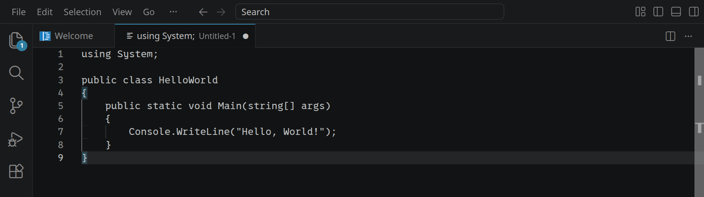
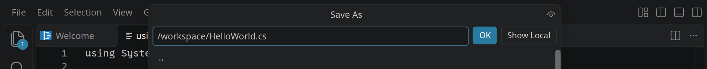
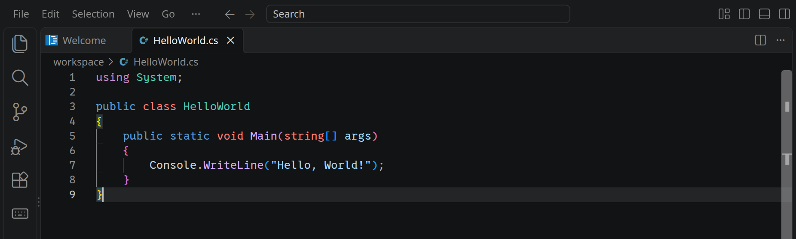
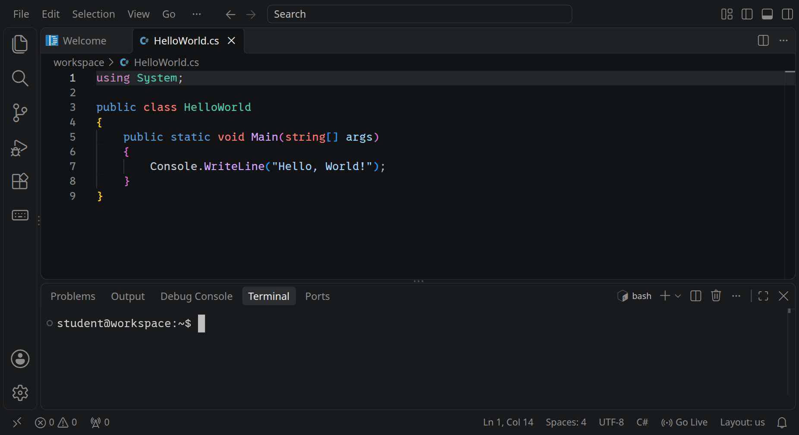
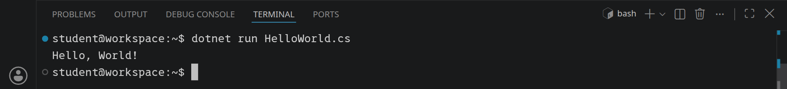
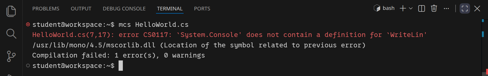
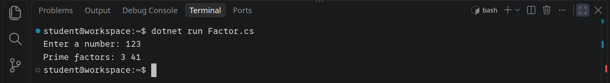
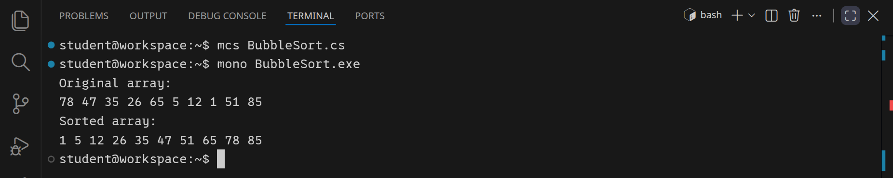

<div class='meta'>
image: cs-logo.png
kind: steckbrief
curriculum: "Oberstufe: Algorithmen und Softwareentwicklung (ein Programm übersetzen, Fehlermeldungen lesen, einfache Datentypen, Bubblesort ändern)"
topics: [programmiersprachen]
</div>

<div
    class="autotoc-secondary-trigger"
    data-title="Auf dieser Seite"
    data-levels="h2,h3">
</div>

# C&#35; <span style='font-size: 80%;'>(1999)</span>

<p class='abstract'>
C#, ab 1999 entwickelt von Anders Hejlsberg und seinem Team bei Microsoft und im Jahr 2000 vorgestellt, ist eine moderne, objektorientierte Programmiersprache, die Teil des .NET-Frameworks ist.
</p>

_person(hejlsberg)

C# wird häufig für die Entwicklung von Windows-Anwendungen, Webanwendungen und Spielen verwendet. Bekannte Beispiele für Anwendungen, die in C# entwickelt wurden, sind Teile der Entwicklungsumgebung Visual Studio, die Webanwendungsplattform ASP.NET und Spiele, die mit der Unity-Engine erstellt wurden, wie »Hearthstone« und »Monument Valley«. Heutzutage ist C# immer noch äußerst relevant, da es eine breite Palette von Anwendungsbereichen abdeckt und durch die .NET-Plattform sowie die Unterstützung durch Microsoft kontinuierlich weiterentwickelt wird.

<!-- ## Eigenschaften

- **Objektorientierung**: C# ist eine objektorientierte Programmiersprache, die auf der Verwendung von Objekten und Klassen basiert.
- **Typsicherheit**: C# ist eine typsichere Sprache, was bedeutet, dass Variablen einen festen Datentyp haben.
- **Interoperabilität**: C# ist eng mit der .NET-Plattform verbunden und ermöglicht die Interoperabilität mit anderen .NET-Sprachen wie Visual Basic und F#.
- **Webentwicklung**: C# wird in der Webentwicklung eingesetzt und ermöglicht die Entwicklung von Webanwendungen mit ASP.NET.
- **Spieleentwicklung**: C# wird in der Spieleentwicklung eingesetzt und ist die bevorzugte Sprache für die Entwicklung von Spielen mit der Unity-Engine.
- **Community**: C# hat eine aktive und engagierte Community, die eine Vielzahl von Bibliotheken und Frameworks entwickelt hat. -->

## Hello, world!

C#-Programme laufen auf .NET, einer freien Plattform von Microsoft für Windows, macOS und Linux. Im Workspace ist .NET 10 installiert, mit dem Befehl `dotnet`.

C#-Programme werden in Textdateien mit der Endung `.cs` geschrieben. Der Befehl `dotnet run` übersetzt eine solche Datei mit dem C#-Compiler und führt das Ergebnis gleich aus.

### Quelltext schreiben

_include(workspace#neue-datei)

<!-- tutorial-step
# Wie im Handbuch »Workspace« (oben eingebunden): kein Ordner offen,
# »New File...«, »Text File«
show-left-sidebar
click: New File...
wait-for-text: Text File
sleep: 0.5
-->

Schreibe nun den folgenden Code in die Datei:

_include_file(HelloWorld.cs, cs)

Da Visual Studio Code noch nicht weiß, dass es sich um C#-Quelltext handelt, ist dein Programm momentan noch einfarbig, aber das wird sich gleich ändern. An dem weißen Punkt erkennst du, dass deine Änderungen noch nicht gespeichert sind.

<!-- tutorial-screenshot
# Das Programm in eine noch namenlose Datei
press: Enter
sleep: 1
hide-left-sidebar
type: <- file:HelloWorld.cs
sleep: 0.5
crop-bottom: 44%
-->



Drücke nun <kbd>Strg</kbd><kbd>S</kbd>, um die Datei zu speichern. Gib `HelloWorld.cs` ein – der vollständige Pfad zu deiner Datei lautet dann `/workspace/HelloWorld.cs`.

<!-- tutorial-screenshot
press: Control+s
wait-for-text: Save As
press: Control+a
type: /workspace/HelloWorld.cs
sleep: 0.5
crop-bottom: 82%
-->



Sobald du die Datei gespeichert hast, wird sie automatisch als C#-Datei erkannt und die Syntax wird hervorgehoben.

<!-- tutorial-screenshot
press: Enter
wait-for-file: HelloWorld.cs
sleep: 1.5
crop-bottom: 40%
-->



_task(hallo)

### Kompilieren und ausführen

Bevor das Programm laufen kann, muss es kompiliert werden: Der Compiler übersetzt den Quelltext in eine Form, die die .NET-Laufzeitumgebung ausführen kann.

Öffne dazu ein Terminal, indem du entweder <kbd>Strg</kbd><kbd>J</kbd> drückst oder das Panel-Symbol  rechts oben drückst. Dein Fenster sollte jetzt ungefähr so aussehen:

<!-- tutorial-screenshot
hide-left-sidebar
terminal-open
sleep: 0.5
-->



Übersetze und starte das Programm mit:

```bash
dotnet run HelloWorld.cs
```

<div class='hint'>
Du musst nicht den vollständigen Dateinamen schreiben. Schreib einfach <code>dotnet run He</code> und drücke <kbd>Tab</kbd>, um den Dateinamen automatisch zu <code>HelloWorld.cs</code> vervollständigen zu lassen.
</div>

Beim ersten Mal dauert es ein paar Sekunden, weil `dotnet` das Programm erst kompiliert. Dann erscheint `Hello, World!`:

<!-- tutorial-screenshot
# Einmal vorweg, damit das Bild zeigt, wie es sich danach anfühlt
terminal-run: dotnet run HelloWorld.cs
terminal-wait-for-prompt: 120
press: Control+l
terminal-run: dotnet run HelloWorld.cs
terminal-wait-for-prompt: 60
crop-terminal-lines: auto
-->



Wo ist das übersetzte Programm? `dotnet` legt es nicht neben deine Datei, sondern in einen eigenen Ordner, und benutzt es beim nächsten Mal wieder, solange du `HelloWorld.cs` nicht änderst. Deshalb startet es beim zweiten Mal sofort. Änderst du die Datei, übersetzt `dotnet run` sie von selbst neu.

### Fehler finden und beheben

Wenn du einen Fehler im Code machst, wird der Compiler eine Fehlermeldung ausgeben. Versuche zum Beispiel, statt `WriteLine` das Wort `WriteLin` zu schreiben:

```cs
~ {
~     public static void Main(string[] args)
~     {
        Console.WriteLin("Hello, World!");
~     }
~ }
```

Speichere die Datei und starte das Programm erneut:

```bash
dotnet run HelloWorld.cs
```

<div class='hint'>
Nutze die Pfeiltaste hoch <kbd>↑</kbd>, um den letzten Befehl erneut einzugeben. So kannst du schnell dein Programm testen, nachdem du es verändert hast.
</div>

_task(fehler)

Statt das Programm zu starten, gibt der Compiler eine Fehlermeldung aus, die dir hilft, den Fehler zu finden:

<!-- tutorial-screenshot
# Der Fehler aus dem Text; die lange Meldung braucht das ganze Terminal
write-file: HelloWorld.cs <- file:error-HelloWorld.cs
terminal-maximize
press: Control+l
terminal-run: dotnet run HelloWorld.cs
terminal-wait-for-prompt: 60
crop-terminal-lines: auto
-->



Es lohnt sich, die Fehlermeldungen genau zu lesen, um den Fehler zu finden und zu beheben. Die Stelle steht am Anfang der Meldung: `HelloWorld.cs(7,17)` heißt Zeile 7, Zeichen 17. Danach folgt der Text, der dir sagt, was falsch ist. Denke daran, den Fehler wieder zu beheben, bevor du das nächste Beispiel ausprobierst.

## Primfaktorzerlegung

Im zweiten Beispiel wollen wir eine Zahl in ihre Primfaktoren zerlegen.
Wir erreichen dies mit einem sehr einfachen Algorithmus, der einfach alle Zahlen von 2 bis zur eingegebenen Zahl durchprobiert und dabei diejenigen Zahlen ausgibt, bei denen die Division ohne Rest möglich ist. Außerdem wird die eingegebene Zahl durch jeden gefundenen Primfaktor geteilt, um die Schleife möglichst schnell zu beenden. An diesem Beispiel kannst du sehen, wie man in C# Benutzereingaben verarbeitet und Schleifen verwendet.
Erstelle eine neue Datei mit <kbd>Strg</kbd><kbd>Alt</kbd><kbd>N</kbd> und schreibe den folgenden Code hinein:

_include_file(Factor.cs, cs)

Speichere die Datei unter dem Namen `Factor.cs` und starte sie:

```bash
dotnet run Factor.cs
```

<!-- tutorial-screenshot
write-file: Factor.cs <- file:Factor.cs
terminal-maximize
press: Control+l
terminal-run: dotnet run Factor.cs
wait-for-text: number:
terminal-run: 123
terminal-wait-for-prompt
crop-terminal-lines: auto
-->



Das Programm hat die Zahl 123 in ihre Primfaktoren zerlegt und ausgegeben.

_task(int-grenze)

<!-- after: int-grenze -->
`int.Parse` liest ein `int`: 32 Bit, höchstens 2147483647. 3000000000 passt nicht hinein. C# rechnet dann nicht mit einer falschen Zahl weiter, sondern bricht mit einer Exception ab.
<!-- /after -->

<div class='hint try'>
<strong>Ausprobieren:</strong> Ersetze in der Zeile mit <code>int.Parse</code> beide <code>int</code> durch <code>long</code> und probier <code>3000000000</code> noch einmal. Was ist bei <code>long</code> anders als bei <code>int</code>?
</div>

## Bubblesort

Im dritten Beispiel wollen wir eine Liste von 10 Zufallszahlen sortieren. Dafür verwenden wir den [Bubblesort-Algorithmus](https://de.wikipedia.org/wiki/Bubblesort), der zwar nicht besonders effizient ist, aber sehr einfach zu verstehen und zu implementieren. Der Bubblesort-Algorithmus funktioniert, indem er die Liste mehrmals durchläuft und benachbarte Elemente vertauscht, wenn sie in der falschen Reihenfolge sind.

An diesem Beispiel kannst du sehen, wie man in C# Arrays verwendet, Funktionen verwendet und Schleifen verschachtelt.

Erstelle eine neue Datei und schreibe den folgenden Code hinein:

_include_file(BubbleSort.cs, cs)

Speichere die Datei unter dem Namen `BubbleSort.cs` und starte sie:

```bash
dotnet run BubbleSort.cs
```

<!-- tutorial-screenshot
write-file: BubbleSort.cs <- file:BubbleSort.cs
press: Control+l
terminal-run: dotnet run BubbleSort.cs
terminal-wait-for-prompt: 60
crop-terminal-lines: auto
-->



Das Programm hat eine Liste von 10 Zufallszahlen sortiert.

_task(ueber-das-ende)

_task(absteigend)

<div class='hint try'>
<strong>Ausprobieren:</strong> Sortiere 100 Zahlen statt 10 und starte das Programm noch einmal. Warum musst du dafür nur eine einzige Zahl ändern?
</div>

## Zusammenfassung

In diesem Kapitel hast du an drei Beispielen gesehen, wie man ein einfaches C#-Programm schreiben, kompilieren und ausführen kann. Das ist natürlich nur ein erster Eindruck. Um C# wirklich zu beherrschen, musst du noch viel mehr lernen – am besten, indem du eigene Programme schreibst und ausprobierst. Die Buchhandlungen, Bibliotheken und Youtube sind voll von Material für dich. Viel Spaß beim Programmieren!
