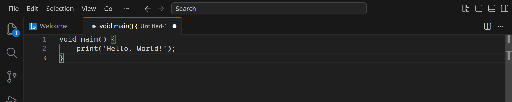
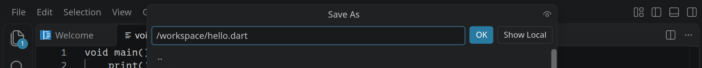
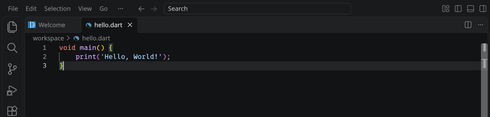
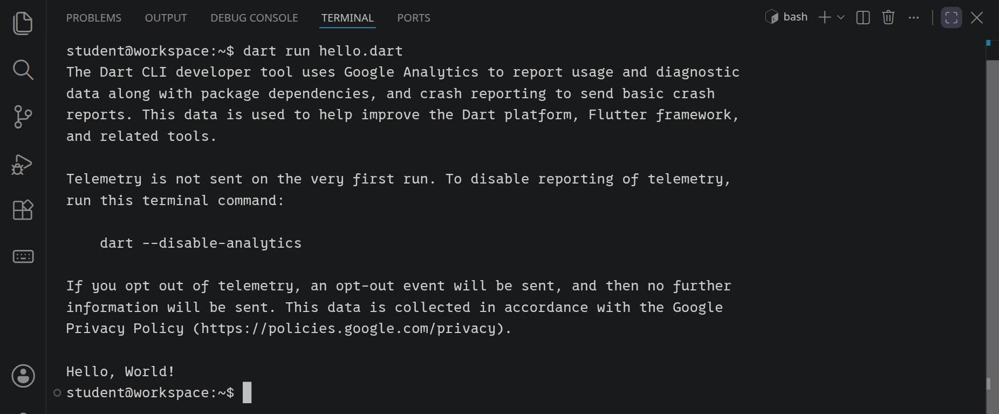
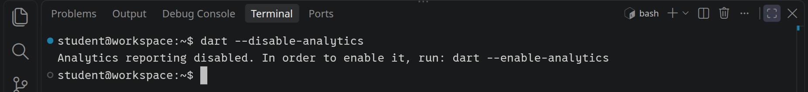
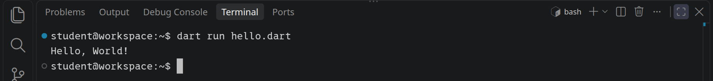
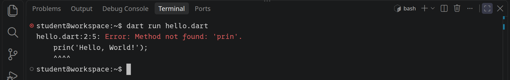
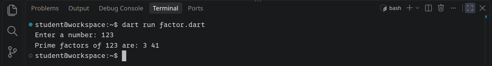
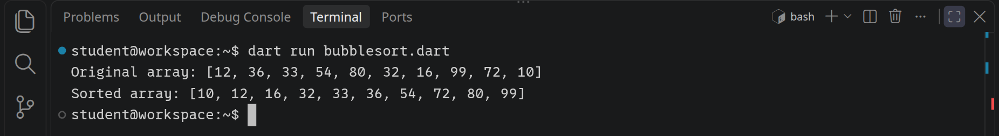

<div class='meta'>
image: dart-logo.png
kind: steckbrief
</div>

<div
    class="autotoc-secondary-trigger"
    data-title="Auf dieser Seite"
    data-levels="h2,h3">
</div>

# Dart <span style='font-size: 80%;'>(2011)</span>

<div class='floatright' style='width: 24em;'>
    
    <p>
        Lars Bak und Kaspar Lund
    </p>
</div>

<p class='abstract'>
Dart, entwickelt von Lars Bak und Kaspar Lund bei Google und erstmals 2011 veröffentlicht, ist eine objektorientierte Programmiersprache, die für die Entwicklung von Web- und mobilen Anwendungen konzipiert wurde. Dart wird häufig in Verbindung mit dem Framework Flutter verwendet, das es ermöglicht, plattformübergreifende mobile Anwendungen mit einer einzigen Codebasis zu erstellen.
</p>

Bekannte Beispiele für Anwendungen, die mit Dart und Flutter entwickelt wurden, sind die mobilen Apps Google Pay, Google Earth, Google Classroom und die App von Alibaba. Heutzutage ist Dart immer noch relevant, insbesondere in der mobilen App-Entwicklung, da Flutter eine wachsende Popularität genießt und eine effiziente und konsistente Entwicklungserfahrung über verschiedene Plattformen hinweg bietet.

## Hello, world!

Dart-Programme werden in Textdateien mit der Endung `.dart` geschrieben. Diese Dateien werden anschließend von einem Compiler in ausführbare Dateien übersetzt, die auf deinem Computer direkt ausgeführt werden können.

Stelle zuerst sicher, dass du keinen Ordner geöffnet hast. Um sicherzugehen, drücke einfach den Shortcut für »Ordner schließen«: <kbd>Strg</kbd><kbd>K</kbd> und dann <kbd>F</kbd>. Dein Workspace sollte jetzt ungefähr so aussehen:

<!-- tutorial-screenshot
# Ein frischer Workspace ohne Ordner
show-left-sidebar
sleep: 0.5
-->


### Quelltext schreiben

Klicke auf »New File« und wähle als Dateityp »Text File«.

<!-- tutorial-screenshot
click: New File...
wait-for-text: Text File
sleep: 0.5
crop-bottom: 77%
-->


Schreibe nun den folgenden Code in die Datei:

_include_file(hello.dart, dart)

Da Visual Studio Code noch nicht weiß, dass es sich um Dart-Quelltext handelt, ist dein Programm momentan noch einfarbig, aber das wird sich gleich ändern. An dem weißen Punkt erkennst du, dass deine Änderungen noch nicht gespeichert sind.

<!-- tutorial-screenshot
# Das Programm in eine noch namenlose Datei
press: Enter
sleep: 1
hide-left-sidebar
type: <- file:hello.dart
sleep: 0.5
crop-bottom: 60%
-->



Drücke nun <kbd>Strg</kbd><kbd>S</kbd>, um die Datei zu speichern. Gib `hello.dart` ein – der vollständige Pfad zu deiner Datei lautet dann `/workspace/hello.dart`.

<!-- tutorial-screenshot
press: Control+s
wait-for-text: Save As
press: Control+a
type: /workspace/hello.dart
sleep: 0.5
crop-bottom: 82%
-->



Sobald du die Datei gespeichert hast, wird sie automatisch als Dart-Datei erkannt und die Syntax wird hervorgehoben.

<!-- tutorial-screenshot
press: Enter
wait-for-file: hello.dart
sleep: 1.5
crop-bottom: 56%
-->



### Programm ausführen

Um unser Programm auszuführen, müssen wir den Dart-Compiler aufrufen und ihm den Dateinamen unseres Programms übergeben.

Öffne dazu ein Terminal, indem du <kbd>Strg</kbd><kbd>J</kbd> drückst und gib folgenden Befehl ein:

```bash
dart run hello.dart
```

<div class='hint'>
Du musst nicht den vollständigen Dateinamen schreiben. Schreib einfach <code>dart run he</code> und drücke <kbd>Tab</kbd>, um den Dateinamen automatisch zu <code>hello.dart</code> vervollständigen zu lassen. Du kannst danach ganz normal weiterschreiben.
</div>

Das Programm sollte die Nachricht `Hello, World!` im Terminal ausgeben:

<!-- tutorial-screenshot
# Der erste Lauf: Dart erklärt die Telemetrie, das braucht Platz
hide-left-sidebar
terminal-maximize
press: Control+l
terminal-run: dart run hello.dart
terminal-wait-for-prompt
crop-terminal-lines: auto
-->



### Was ist Telemetrie?

Telemetrie ist eine Funktion von Dart, die Informationen über die Ausführung des Programms sammelt und an Google sendet. Diese Informationen helfen den Entwicklern von Dart, die Sprache zu verbessern. Um zu verhindern, dass Telemetrie-Daten gesendet werden, gib den folgenden Befehl wie angegeben ein:

```bash
dart --disable-analytics
```

Du solltest nun eine Bestätigung sehen, dass die Telemetrie deaktiviert wurde:

<!-- tutorial-screenshot
press: Control+l
terminal-run: dart --disable-analytics
terminal-wait-for-prompt
crop-terminal-lines: auto
-->



Wenn wir das Programm erneut ausführen, sollte es die Nachricht `Hello, World!` ohne die Meldung zur Telemetrie ausgeben:

<!-- tutorial-screenshot
press: Control+l
terminal-run: dart run hello.dart
terminal-wait-for-prompt
crop-terminal-lines: auto
-->



<div class='hint'>
Dart kann Quelltext für viele verschiedene Plattformen kompilieren, z. B. für Webanwendungen, mobile Apps für Android und iOS (mit Flutter) und Desktopanwendungen unter Windows, Mac OS und Linux. In diesem Artikel probieren wir Dart auf der Kommandozeile aus, aber du kannst Dart auch in anderen Umgebungen verwenden.
</div>

### Fehler finden und beheben

Wenn du einen Fehler im Code machst, wird Dart eine Fehlermeldung ausgeben. Versuche zum Beispiel, statt `print` das Wort `prin` zu schreiben:

```dart
prin('Hello, World!');
```

Speichere die Datei und führe das Programm erneut aus:

```bash
dart run hello.dart
```

<div class='hint'>
Nutze die Pfeiltaste hoch <kbd>↑</kbd>, um den letzten Befehl erneut einzugeben. So kannst du schnell dein Programm testen, nachdem du es verändert hast.
</div>

Dart sollte eine Fehlermeldung ausgeben, die dir hilft, den Fehler zu finden:

<!-- tutorial-screenshot
# Der Fehler aus dem Text; die lange Meldung braucht das ganze Terminal
write-file: hello.dart <- file:hello-error.dart
terminal-maximize
press: Control+l
terminal-run: dart run hello.dart
terminal-wait-for-prompt
crop-terminal-lines: auto
-->



Es lohnt sich, die Fehlermeldungen genau zu lesen, um den Fehler zu finden und zu beheben. Achte auf die Zeilennummer (in diesem Beispiel 2) und den Text, der dir sagt, was falsch ist. Denke daran, den Fehler wieder zu beheben, bevor du das nächste Beispiel ausprobierst.

## Primfaktorzerlegung

Im zweiten Beispiel wollen wir eine Zahl in ihre Primfaktoren zerlegen.
An diesem Beispiel kannst du sehen, wie man in Dart Benutzereingaben verarbeitet und Schleifen verwendet.
Erstelle eine neue Datei mit <kbd>Strg</kbd><kbd>Alt</kbd><kbd>N</kbd> und schreibe den folgenden Code hinein:

_include_file(factor.dart, dart)

Speichere die Datei unter dem Namen `factor.dart` und führe sie aus:

<!-- tutorial-screenshot
write-file: factor.dart <- file:factor.dart
terminal-maximize
press: Control+l
terminal-run: dart run factor.dart
wait-for-text: number:
terminal-run: 123
terminal-wait-for-prompt
crop-terminal-lines: auto
-->



Das Programm hat die Zahl 123 in ihre Primfaktoren zerlegt und ausgegeben. Anders als andere Programmiersprachen kann Dart auch die Zahl 3000000000 in Sekundenbruchteilen zerlegen. Auch mit einer sehr großen Zahl wie 123456789123456789 kommt das Programm problemlos zurecht. Falls du auf eine Zahl stoßen solltest, die so groß ist, dass das Programm sehr lange braucht, kannst du das Programm mit <kbd>Strg</kbd><kbd>C</kbd> abbrechen.

## Bubblesort

Im dritten Beispiel wollen wir eine Liste von 10 Zufallszahlen sortieren. Dafür verwenden wir den [Bubblesort-Algorithmus](https://de.wikipedia.org/wiki/Bubblesort), der zwar nicht besonders effizient ist, aber sehr einfach zu verstehen und zu implementieren. Der Bubblesort-Algorithmus funktioniert, indem er die Liste mehrmals durchläuft und benachbarte Elemente vertauscht, wenn sie in der falschen Reihenfolge sind.

An diesem Beispiel kannst du sehen, wie man in Dart Listen verwendet, Funktionen verwendet und Schleifen verschachtelt.

Erstelle eine neue Datei und schreibe den folgenden Code hinein:

_include_file(bubblesort.dart, dart)

Speichere das Skript unter dem Namen `bubblesort.dart` und führe es aus:

<!-- tutorial-screenshot
write-file: bubblesort.dart <- file:bubblesort.dart
press: Control+l
terminal-run: dart run bubblesort.dart
terminal-wait-for-prompt
crop-terminal-lines: auto
-->



Das Programm hat eine Liste von 10 Zufallszahlen sortiert. Versuche, den Quelltext so zu verändern, dass statt 10 Zahlen 100 oder mehr Zahlen sortiert werden.

## Zusammenfassung

In diesem Kapitel hast du an drei Beispielen gesehen, wie man ein einfaches Dart-Programm schreiben und ausführen kann. Das ist natürlich nur ein erster Eindruck. Um Dart wirklich zu beherrschen, musst du noch viel mehr lernen – am besten, indem du eigene Skripte schreibst und ausprobierst. Die Buchhandlungen, Bibliotheken und Youtube sind voll von Material für dich. Viel Spaß beim Programmieren!
