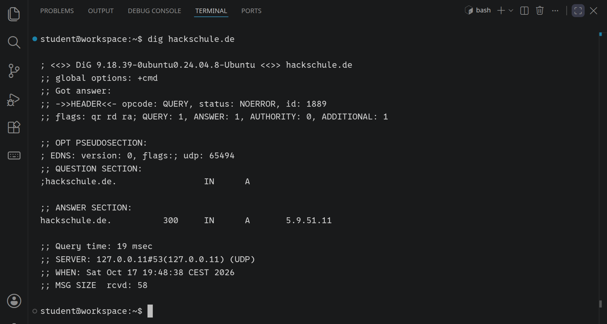
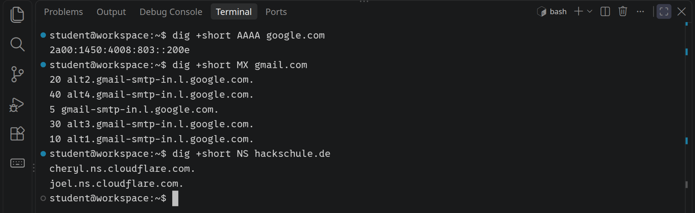
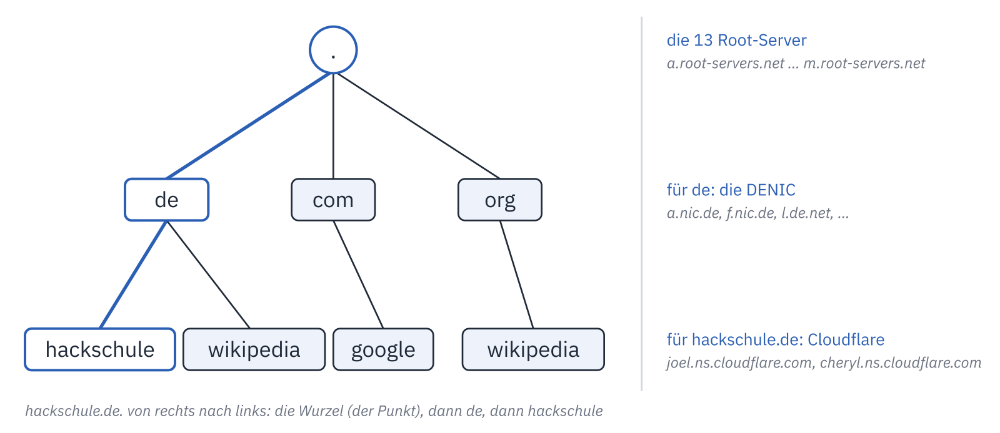
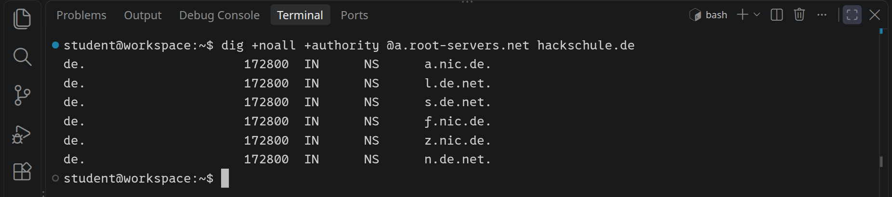
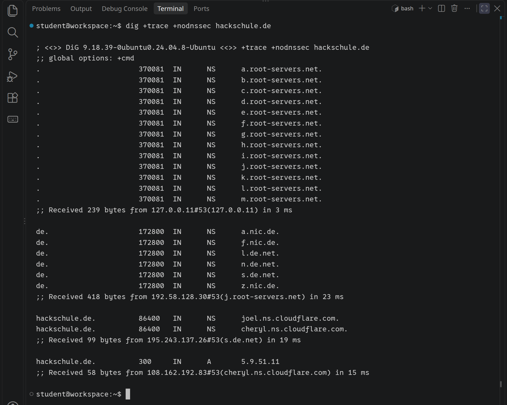

<div class='meta'>
image: dns-tree.webp:contain
image_alt: "Ein Baum der Domainnamen: die Wurzel, darunter de, com und org, darunter hackschule, wikipedia und google"
kind: labor
language: Bash
requires: [tcpip]
reference: [netzwerk, terminal]
</div>

<div
    class="autotoc-secondary-trigger"
    data-title="Auf dieser Seite"
    data-levels="h2,h3">
</div>

# DNS: Wie aus einem Namen eine Adresse wird

<p class='abstract'>
Pakete im Internet brauchen eine IP-Adresse, Menschen merken sich Namen. Wer übersetzt zwischen beiden? Du fragst mit <code>dig</code> nach der Adresse von hackschule.de, gehst den Weg der Frage selbst ab, von den Root-Servern über die Server für .de bis zu dem einen, der die Antwort wirklich kennt, und siehst, warum die zweite Frage schneller beantwortet wird als die erste.
</p>

## Vorbereitung

Diese Aktivität setzt [TCP/IP-Verbindungen](/tcpip) fort: Was eine IP-Adresse ist und was `ping` tut, solltest du kennen. Du brauchst nur ein Terminal.

_include(workspace#terminal-oeffnen)

## Einen Namen nachschlagen

In [TCP/IP-Verbindungen](/tcpip) hat `ping hackschule.de` einfach funktioniert. Dabei kennt das Netz nur Zahlen: Bevor das erste Paket losgeht, fragt dein Rechner einen **DNS-Server** (Domain Name System), welche Adresse zu dem Namen gehört. Diese Frage kannst du selbst stellen, mit `dig`:

```bash
dig hackschule.de
```

<!-- tutorial-screenshot
# Terminal öffnen: Handbuch »Workspace«, eingebunden oben
viewport: 1029x640
hide-left-sidebar
terminal-open
terminal-maximize
terminal-run: clear
terminal-run: dig hackschule.de
terminal-wait-for-prompt
crop-terminal-lines: auto
-->



Die Ausgabe ist lang, aber nur drei Stellen sind wichtig:

- **QUESTION SECTION**: Die Frage. `A` heißt: Gesucht ist eine IPv4-Adresse.
- **ANSWER SECTION**: Die Antwort, `hackschule.de.`, eine Zahl, `IN A` und die Adresse. Der Punkt am Ende des Namens gehört dazu, gleich mehr dazu. Die Zahl ist die **TTL** (*time to live*): So viele Sekunden darf man sich die Antwort noch merken. Bei `hackschule.de` sind es höchstens 300; hat kurz vorher schon jemand gefragt, weniger, warum, steht weiter unten.
- **SERVER**: Wen `dig` gefragt hat. In deinem Workspace ist das `127.0.0.11`, ein kleiner DNS-Server, den Docker jedem Container mitgibt. Er kennt die Antwort selbst nicht, sondern fragt weiter.

_task(adresse)

Nur die Antwort, ohne alles drumherum, gibt `dig +short` aus. Schreib damit einen Befehl, der genau die Adresse von `hackschule.de` ausgibt:

_task(nur-adresse)

## Nicht nur Adressen

Ein Name kann mehrere Einträge haben, jeder mit einem **Typ**. Den Typ schreibst du vor den Namen:

```bash
dig +short AAAA google.com
dig +short MX gmail.com
dig +short NS hackschule.de
```

<!-- tutorial-screenshot
terminal-run: clear
terminal-run: dig +short AAAA google.com
terminal-run: dig +short MX gmail.com
terminal-run: dig +short NS hackschule.de
terminal-wait-for-prompt
crop-terminal-lines: auto
-->



<div style='max-width: 100%; overflow-x: auto;'>
<table class='table'>
<thead><tr><th>Typ</th><th>Was er nennt</th><th>Beispiel</th></tr></thead>
<tbody>
<tr><td class='text-nowrap'><code>A</code></td><td>eine IPv4-Adresse</td><td class='text-nowrap'><code>5.9.51.11</code></td></tr>
<tr><td class='text-nowrap'><code>AAAA</code></td><td>eine IPv6-Adresse</td><td class='text-nowrap'><code>2a00:1450:…</code></td></tr>
<tr><td class='text-nowrap'><code>MX</code></td><td>den Mailserver für Adressen <code>…@name</code>, mit einer Zahl davor: Kleinere werden zuerst versucht</td><td class='text-nowrap'><code>5 gmail-smtp-in.l.google.com.</code></td></tr>
<tr><td class='text-nowrap'><code>NS</code></td><td>die Nameserver, die für den Namen zuständig sind</td><td class='text-nowrap'><code>joel.ns.cloudflare.com.</code></td></tr>
<tr><td class='text-nowrap'><code>TXT</code></td><td>beliebigen Text, etwa zum Nachweis, dass einem eine Domain gehört</td><td class='text-nowrap'><code>"v=spf1 …"</code></td></tr>
</tbody>
</table>
</div>

`hackschule.de` hat keinen `AAAA`-Eintrag; `dig +short AAAA hackschule.de` gibt nichts aus. Nicht jeder Name hat jeden Typ.

_task(mailserver)

## Wer kennt die Antwort?

Kein Server der Welt kennt alle Namen. Stattdessen ist jeder Name ein Pfad, von rechts nach links gelesen, und für jedes Stück ist jemand anderes zuständig:



- Ganz oben steht die **Wurzel**, geschrieben als der Punkt am Ende von `hackschule.de.`. Für sie sind die 13 **Root-Server** zuständig, `a.root-servers.net` bis `m.root-servers.net`.
- Darunter die **Endungen** (*Top-Level-Domains*) wie `de`, `com` oder `pe`. Für `de` ist die DENIC zuständig, eine Genossenschaft in Frankfurt.
- Darunter die Namen, die jemand bei der Endung angemeldet hat, wie `hackschule.de`. Wer einen Namen anmeldet, sagt, welche Nameserver für ihn zuständig sind; bei `hackschule.de` sind es zwei von Cloudflare.

Wer eine Adresse sucht, fängt oben an. Die Root-Server kennen `hackschule.de` nicht, aber sie wissen, wer für `de` zuständig ist. Frag selbst, mit `@` vor dem Server, den `dig` fragen soll:

```bash
dig @a.root-servers.net hackschule.de
```

<!-- tutorial-screenshot
terminal-run: clear
terminal-run: dig +noall +authority @a.root-servers.net hackschule.de
terminal-wait-for-prompt
crop-terminal-lines: auto
-->



Der Root-Server antwortet nicht mit einer Adresse. Im **AUTHORITY SECTION** steht ein Verweis: Frag die Server für `de`. Im Bild steht nur dieser Teil der Antwort; `+noall +authority` blendet den Rest aus.

_task(wurzel)

Geh den Weg selbst weiter: Frag einen der Server für `de` nach `hackschule.de`. Er verweist dich wieder weiter, und erst der Server, auf den er verweist, kennt die Adresse.

_task(de-server)

_task(zustaendig)

<div class='hint try'>
<strong>Ausprobieren:</strong> Frag einen Root-Server nach einem Namen mit einer Endung, die es nicht gibt: <code>dig @a.root-servers.net hackschule.xyzzy</code>. Was steht jetzt hinter <code>status:</code>? Warum kann der Root-Server diesmal selbst antworten, statt dich weiterzuschicken?
</div>

Dass kein Server alle Namen kennen muss, sondern jeder nur sein Stück, ist der Kern des DNS, wie Paul Mockapetris es 1983 entworfen hat:

_person(mockapetris)

<div class='book'>
<i class='bi bi-file-earmark-text'></i>
<p><strong>Domain Names – Concepts and Facilities</strong> (RFC 882) und <strong>Domain Names – Implementation and Specification</strong> (RFC 883), Paul Mockapetris, November 1983. Die beiden Texte, in denen das DNS zum ersten Mal beschrieben ist, als reiner Text wie damals üblich: <a href='https://www.rfc-editor.org/rfc/rfc882'>RFC 882</a> und <a href='https://www.rfc-editor.org/rfc/rfc883'>RFC 883</a>.</p>
</div>

## Den ganzen Weg auf einmal

`dig +trace` geht den Weg von oben selbst ab und zeigt jede Station:

```bash
dig +trace +nodnssec hackschule.de
```

<!-- tutorial-screenshot
# Tall enough for all four blocks
viewport: 1029x960
terminal-run: clear
terminal-run: dig +trace +nodnssec hackschule.de
terminal-wait-for-prompt
crop-terminal-lines: auto
-->



Vier Blöcke, und unter jedem steht, von wem er kam (`Received … from`): die Liste der Root-Server, dann ein Root-Server mit den Servern für `de`, dann ein Server für `de` mit denen von Cloudflare, zuletzt einer von Cloudflare mit der Adresse. `+nodnssec` lässt die Signaturen weg, mit denen die Antworten unterschrieben sind; sie würden die Ausgabe verdoppeln.

_task(verteilt)

## Gemerkt ist schneller: die TTL

Den ganzen Weg muss niemand bei jeder Frage gehen. Der DNS-Server, den dein Workspace fragt, merkt sich jede Antwort, so lange, wie ihre TTL sagt. Bevor du es ausprobierst:

_task(zweimal)

```bash
dig wikipedia.org
dig wikipedia.org
```

<!-- tutorial-step
terminal-run: clear
terminal-run: dig wikipedia.org
terminal-wait-for-prompt
terminal-run: dig wikipedia.org
terminal-wait-for-prompt
-->

Achte auf `Query time` und auf die TTL im ANSWER SECTION. Beim zweiten Mal kam die Antwort aus dem Speicher, in null oder einer Millisekunde, und die TTL ist um die Sekunden kleiner, die seitdem vergangen sind. Läuft sie ab, fragt der Server wieder ganz von vorn.

Darum dauert es eine Weile, bis eine geänderte Adresse überall ankommt: Wer die alte noch gemerkt hat, benutzt sie, bis ihre TTL abgelaufen ist. Bei `hackschule.de` sind das höchstens fünf Minuten, die Server für `de` darf man sich zwei Tage merken (172800 Sekunden).

<div class='hint try'>
<strong>Ausprobieren:</strong> Frag statt des DNS-Servers deines Workspace direkt einen der Nameserver, die für <code>hackschule.de</code> zuständig sind (<code>dig +short NS hackschule.de</code>), zum Beispiel <code>dig @joel.ns.cloudflare.com hackschule.de</code>, mehrmals hintereinander. Welche TTL nennt er jedes Mal? Warum zählt sie bei ihm nicht herunter, beim DNS-Server deines Workspace aber schon?
</div>

## Rückwärts: von der Adresse zum Namen

Auch zu einer Adresse kann ein Name gehören, ein Eintrag vom Typ `PTR`. `dig -x` fragt danach:

```bash
dig +short -x 8.8.8.8
```

So kam in [TCP/IP-Verbindungen](/tcpip) `traceroute` zu den Namen der Router: Zu jeder Adresse hat es rückwärts nachgefragt.

_task(rueckwaerts)

## Wem kann man glauben?

Eine DNS-Antwort ist ein unverschlüsseltes UDP-Paket, und dein Rechner glaubt der ersten, die passt. Wer im selben WLAN sitzt oder einen DNS-Server betreibt, könnte dir eine falsche unterschieben, und zwar gezielt: mit der Adresse eines eigenen Servers, auf dem eine Kopie der echten Seite läuft.

_task(falsche-antwort)

Dagegen gibt es zweierlei. **DNSSEC** unterschreibt die Antworten, und wer nachprüft, merkt eine Fälschung; das sind die Einträge, die `+nodnssec` eben weggelassen hat. Und bei `https://` zeigt der Server ein Zertifikat für seinen Namen vor: Ein falscher Server, zu dem eine gefälschte Antwort führt, hat keins für `hackschule.de`, und der Browser warnt. Wie solche Zertifikate und Signaturen funktionieren, zeigt [Kryptographie im Terminal](/crypto).

## Zusammenfassung

<div style='max-width: 100%; overflow-x: auto;'>
<table class='table'>
<thead><tr><th>Befehl oder Begriff</th><th>Bedeutung</th></tr></thead>
<tbody>
<tr><td><code>dig name</code>, <code>dig +short name</code></td><td>Nach der Adresse fragen, ausführlich oder nur die Antwort</td></tr>
<tr><td><code>dig +short TYP name</code></td><td>Nach einem anderen Eintrag fragen: <code>AAAA</code>, <code>MX</code>, <code>NS</code>, <code>TXT</code></td></tr>
<tr><td><code>dig @server name</code></td><td>Einen bestimmten DNS-Server fragen</td></tr>
<tr><td><code>dig +trace name</code></td><td>Den Weg von den Root-Servern an selbst abgehen</td></tr>
<tr><td><code>dig -x adresse</code></td><td>Rückwärts: Welcher Name gehört zur Adresse?</td></tr>
<tr><td>TTL</td><td>Wie viele Sekunden eine Antwort gemerkt werden darf</td></tr>
<tr><td>Root-Server, Endung, zuständiger Nameserver</td><td>Wer auf dem Weg von rechts nach links durch den Namen gefragt wird</td></tr>
</tbody>
</table>
</div>

## Wie geht es weiter?

- `dig +short TXT hackschule.de` und `dig +short TXT gmail.com`: Was steht dort? Such nach »SPF«: Damit sagt eine Domain, welche Server E-Mails in ihrem Namen verschicken dürfen.
- `dig +short google.com` mehrmals hintereinander: Kommt immer dieselbe Adresse? Große Dienste verteilen ihre Besucher über DNS auf viele Server.
- `cat /etc/resolv.conf` zeigt, welchen DNS-Server dein Workspace fragt.

<!-- tutorial-step
# Die Aufgaben mit Antworten, die sich nicht ändern; adresse und zustaendig
# hängen von hackschule.de ab und würden sonst das Rendern brechen.
check-task: nur-adresse <- dig +short hackschule.de
check-task-fails: nur-adresse <- dig hackschule.de
check-task: de-server <- a.nic.de
check-task-fails: de-server <- a.root-servers.net
check-task: rueckwaerts <- dns.google
check-task: wurzel <- 0
check-task-fails: wurzel <- 1
-->
