<div class='meta'>
image: rainbow.webp
kind: projekt
language: Pixelflow Canvas / Ruby
duration: 2 Doppelstunden
reference: [workspace, farben]
</div>

<div
    class="autotoc-secondary-trigger"
    data-title="Auf dieser Seite"
    data-levels="h2,h3">
</div>

# Pixelgrafik mit Ruby

<p class='abstract'>
In diesem Projekt programmierst du Pixelgrafiken. Mit der Zeichenfläche »Pixelflow Canvas« und ein paar Zeilen Ruby entsteht Schritt für Schritt ein Bild: eine hügelige Wiese aus Bézierkurven und ein Regenbogen aus Kreisen. Zum Schluss zeichnest du ein eigenes Bild und gibst es ab.
</p>

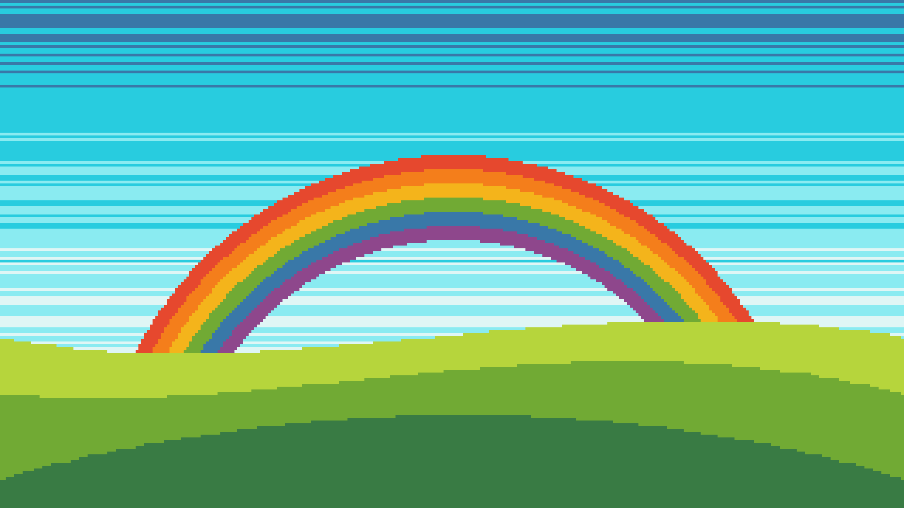

Du brauchst keine Vorkenntnisse in Ruby: Jeder Befehl wird erklärt, wenn er zum ersten Mal vorkommt.

## Vorbereitung

_include(workspace#terminal-oeffnen)

### Die Zeichenfläche installieren

Die Zeichenfläche ist eine Erweiterung für Visual Studio Code: »Pixelflow Canvas« vom Herausgeber `gymnasiumsteglitz`, mit der Kennung `gymnasiumsteglitz.pixelflow-canvas`.

_include(workspace#erweiterung-installieren)

### Das Rubygem installieren

Dein Ruby-Programm schickt seine Zeichenbefehle an die Zeichenfläche. Das erledigt das Rubygem »pixelflow_canvas«, eine Bibliothek für Ruby. Installiere es im Terminal:

```bash_copy
gem install pixelflow_canvas
```

<!-- tutorial-screenshot
# Die Erweiterung schon jetzt, für die Zeichenfläche weiter unten
press: Control+p
type: ext install gymnasiumsteglitz.pixelflow-canvas
wait-for-text: Press Enter to install extension
press: Enter
wait-for-text: Trust Publisher & Install
click: Trust Publisher & Install
sleep: 10
hide-left-sidebar
terminal-open
terminal-maximize
press: Control+l
terminal-run: gem install pixelflow_canvas
terminal-wait-for-prompt: 120
crop-terminal-lines: auto
-->

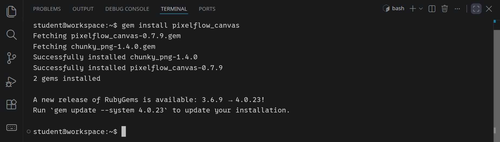

Mit dem Gem kommt `chunky_png`, das Ruby zum Speichern von PNG-Bildern braucht. Beide liegen danach in deinem Workspace unter `/workspace/.gem` und bleiben dort. Den Hinweis auf eine neue Version von RubyGems kannst du übergehen; die installierte reicht.

## Der erste Pixel

Lege mit <kbd>Strg</kbd><kbd>Alt</kbd><kbd>N</kbd> eine neue Datei an, wähle »Text File« und schreibe den folgenden Code hinein:

```ruby
require 'pixelflow_canvas'

Pixelflow::Canvas.new(320, 180, :palette) do
    set_pixel(160, 90, 10)
end
```

<!-- tutorial-screenshot
# Terminal zu; »New File...« öffnet dieselbe Auswahl wie Strg+Alt+N
click: selector:.part.panel [aria-label*="Restore Panel"]
press: Control+j
click: New File...
wait-for-text: Text File
press: Enter
sleep: 1
type: <- previous-code
sleep: 0.5
crop-bottom: 60%
-->

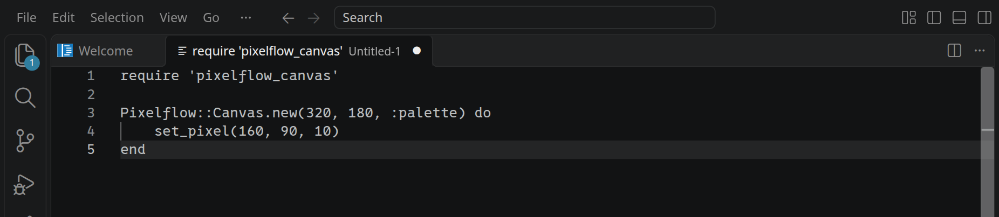

Noch weiß Visual Studio Code nicht, dass es Ruby ist, deshalb ist der Code einfarbig. Speichere die Datei mit <kbd>Strg</kbd><kbd>S</kbd> unter dem Namen `/workspace/rainbow.rb`:

<!-- tutorial-screenshot
press: Control+s
wait-for-text: Save As
press: Control+a
type: /workspace/rainbow.rb
sleep: 0.5
crop-bottom: 82%
-->

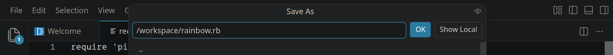

Jetzt erkennt Visual Studio Code die Endung `.rb`, und der Code wird farbig:

<!-- tutorial-screenshot
press: Enter
wait-for-file: rainbow.rb
sleep: 1.5
crop-bottom: 60%
-->

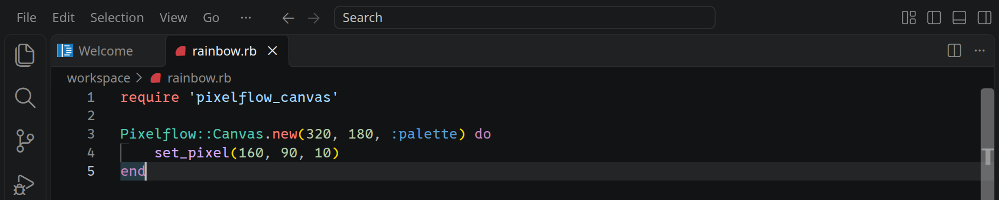

_task(erster-pixel)

### Die Zeichenfläche öffnen

Bevor das Programm zeichnen kann, muss die Zeichenfläche offen sein. Drücke <kbd>F1</kbd> (oder <kbd>Strg</kbd><kbd>Shift</kbd><kbd>P</kbd>), gib »pixel« ein und wähle »Show Pixelflow Canvas«:

<!-- tutorial-screenshot
press: F1
type: pixel
wait-for-text: Show Pixelflow Canvas
sleep: 0.5
crop-bottom: 80%
-->

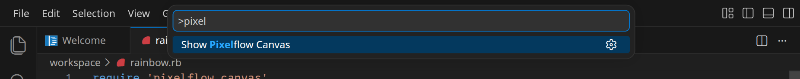

Die Zeichenfläche öffnet sich rechts neben deinem Code. Führe das Programm im Terminal aus:

```bash
ruby rainbow.rb
```

<!-- tutorial-screenshot
press: Enter
wait-for-text: Pixelflow Canvas
sleep: 2
terminal-open
press: Control+l
terminal-run: ruby rainbow.rb
terminal-wait-for-prompt
sleep: 1
move-mouse: selector:.part.statusbar
-->

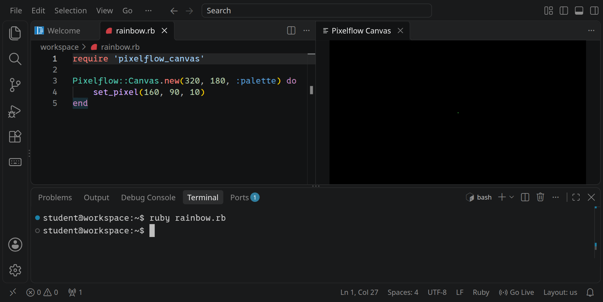

In der Mitte der Zeichenfläche leuchtet ein grüner Pixel. Vergrößert sieht die Zeichenfläche so aus:

<!-- tutorial-screenshot
# Die Zeichenfläche selbst: das Programm von oben, das sein Bild speichert
write-file: drawing-steps/step-1.rb <- file:stufen/step-1.rb
write-file: drawing-steps/save_step.rb <- file:stufen/save_step.rb
terminal-run: ruby -C /workspace/drawing-steps -r ./save_step.rb step-1.rb
terminal-wait-for-prompt
image-file: drawing-steps/step.png 8
-->
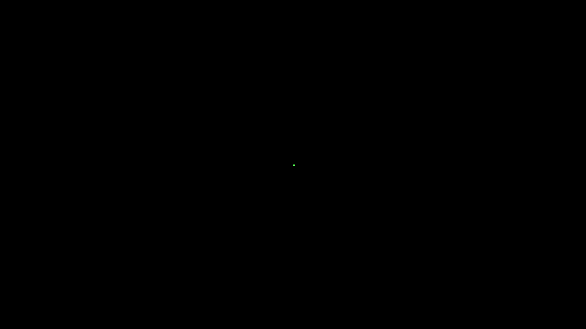

<div class='hint'>
Meldet Ruby <code>Connection refused - connect(2) for "127.0.0.1" port 19223</code>, ist die Zeichenfläche nicht offen: Dein Programm findet niemanden, der seine Befehle annimmt. Öffne sie wie oben beschrieben und starte das Programm noch einmal. Meldet Ruby <code>cannot load such file -- pixelflow_canvas</code>, fehlt das Rubygem.
</div>

### Was der Code macht

- `require 'pixelflow_canvas'` lädt das Rubygem.
- `Pixelflow::Canvas.new(320, 180, :palette)` verbindet sich mit der Zeichenfläche und stellt sie auf 320 Pixel Breite und 180 Pixel Höhe ein. `:palette` heißt: Farben sind Nummern aus einer Palette.
- Zwischen `do` und `end` stehen die Befehle, die auf der Zeichenfläche zeichnen.
- `set_pixel(160, 90, 10)` färbt den Pixel an der Stelle (160, 90) mit der Farbe 10.

Der Ursprung der Zeichenfläche ist oben links: Der x-Wert wird nach rechts größer, der y-Wert nach **unten**. Weil wir eine Palette verwenden, ist jede Farbe eine Zahl von 0 bis 255. Ohne weitere Angabe gilt die VGA-Palette, und dort ist 10 ein helles Grün. Hier findest du alle [Farben der VGA-Palette](https://specht.github.io/pixelflow_canvas_ruby/palettes.html#vga).

Ändere die Farbe des Pixels auf Blau und schieb ihn in die vier Ecken der Zeichenfläche. Nach jeder Änderung: speichern und `ruby rainbow.rb` noch einmal ausführen. Mit <kbd>↑</kbd> holst du den letzten Befehl zurück.

_task(ecke)

<div class='hint books'>
Statt einer Palette kannst du auch RGB-Farben verwenden: Ersetze <code>:palette</code> durch <code>:rgb</code> und gib jede Farbe als drei Zahlen für Rot, Grün und Blau an, jeweils von 0 bis 255, zum Beispiel <code>set_pixel(160, 90, 249, 200, 14)</code>. Paletten stammen aus einer Zeit, in der Speicher knapp war: Ein Pixel mit Palette braucht 1 Byte, denn er speichert nur die Nummer seiner Farbe. Ein RGB-Pixel braucht 3 Bytes. Heute ist eine Palette vor allem praktisch: Die Farben passen zueinander, und du musst nicht für jede Farbe drei Zahlen heraussuchen.
</div>

_uses(rgb)

_task(speicher)

## Eine Wiese mit Regenbogen

Jetzt entsteht Schritt für Schritt ein ganzes Bild: eine hügelige Wiese, darüber ein Regenbogen und der Himmel.

### Palette wählen

Die VGA-Palette ist nicht die einzige. Eine [Übersicht über alle Paletten](https://specht.github.io/pixelflow_canvas_ruby/palettes.html) findest du in der Dokumentation, und du kannst auch eigene festlegen. Für die Wiese mit Regenbogen nehmen wir die Palette »zughy_32«:

<div class='swatches'>
<span style='background-color: #472d3c;'><span>0</span></span>
<span style='background-color: #5e3643;'><span>1</span></span>
<span style='background-color: #7a444a;'><span>2</span></span>
<span style='background-color: #a05b53;'><span>3</span></span>
<span style='background-color: #bf7958;'><span>4</span></span>
<span style='background-color: #eea160;'><span>5</span></span>
<span style='background-color: #f4cca1;'><span>6</span></span>
<span style='background-color: #b6d53c;'><span>7</span></span>
<span style='background-color: #71aa34;'><span>8</span></span>
<span style='background-color: #397b44;'><span>9</span></span>
<span style='background-color: #3c5956;'><span>10</span></span>
<span style='background-color: #302c2e;'><span>11</span></span>
<span style='background-color: #5a5353;'><span>12</span></span>
<span style='background-color: #7d7071;'><span>13</span></span>
<span style='background-color: #a0938e;'><span>14</span></span>
<span style='background-color: #cfc6b8;'><span>15</span></span>
<span style='background-color: #dff6f5;'><span>16</span></span>
<span style='background-color: #8aebf1;'><span>17</span></span>
<span style='background-color: #28ccdf;'><span>18</span></span>
<span style='background-color: #3978a8;'><span>19</span></span>
<span style='background-color: #394778;'><span>20</span></span>
<span style='background-color: #39314b;'><span>21</span></span>
<span style='background-color: #564064;'><span>22</span></span>
<span style='background-color: #8e478c;'><span>23</span></span>
<span style='background-color: #cd6093;'><span>24</span></span>
<span style='background-color: #ffaeb6;'><span>25</span></span>
<span style='background-color: #f4b41b;'><span>26</span></span>
<span style='background-color: #f47e1b;'><span>27</span></span>
<span style='background-color: #e6482e;'><span>28</span></span>
<span style='background-color: #a93b3b;'><span>29</span></span>
<span style='background-color: #827094;'><span>30</span></span>
<span style='background-color: #4f546b;'><span>31</span></span>
</div>

Verändere den Code wie folgt und führe ihn erneut aus:

```ruby
require 'pixelflow_canvas'

Pixelflow::Canvas.new(320, 180, :palette) do
    set_predefined_palette(:zughy_32)
    set_pixel(160, 90, 10)
end
```

<!-- tutorial-screenshot
# Mit der Palette zughy_32
write-file: drawing-steps/step-2.rb <- file:stufen/step-2.rb
write-file: drawing-steps/save_step.rb <- file:stufen/save_step.rb
terminal-run: ruby -C /workspace/drawing-steps -r ./save_step.rb step-2.rb
terminal-wait-for-prompt
image-file: drawing-steps/step.png 8
-->
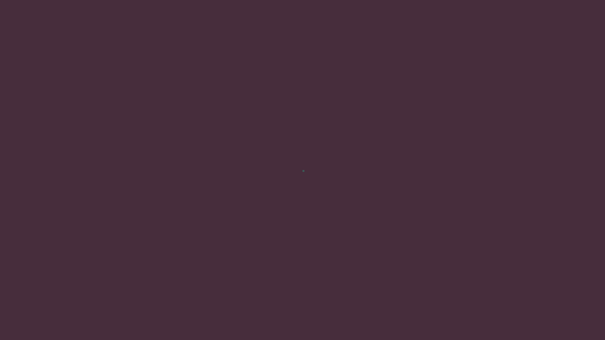

Die Farben haben sich geändert: Der Hintergrund ist nicht mehr schwarz, weil die Farbe 0 jetzt ein dunkles Lila ist, und die Farbe 10 ist jetzt ein dunkles Türkis.

<div style='clear: both;'></div>

### Hintergrund zeichnen

Lösche den `set_pixel`-Befehl und schreib stattdessen:

```ruby
set_color(16)
fill_rect(0, 0, 319, 179)
```

`set_color` wählt die Farbe für alle folgenden Befehle, hier 16, ein helles Blau. `fill_rect` füllt ein Rechteck. Es braucht vier Zahlen: x und y der Ecke oben links und x und y der Ecke unten rechts. Weil die Ecke unten rechts (319, 179) ist, füllt dieses Rechteck die ganze Zeichenfläche:

<!-- tutorial-screenshot
# Der Hintergrund
write-file: drawing-steps/step-3.rb <- file:stufen/step-3.rb
write-file: drawing-steps/save_step.rb <- file:stufen/save_step.rb
terminal-run: ruby -C /workspace/drawing-steps -r ./save_step.rb step-3.rb
terminal-wait-for-prompt
image-file: drawing-steps/step.png 8
-->
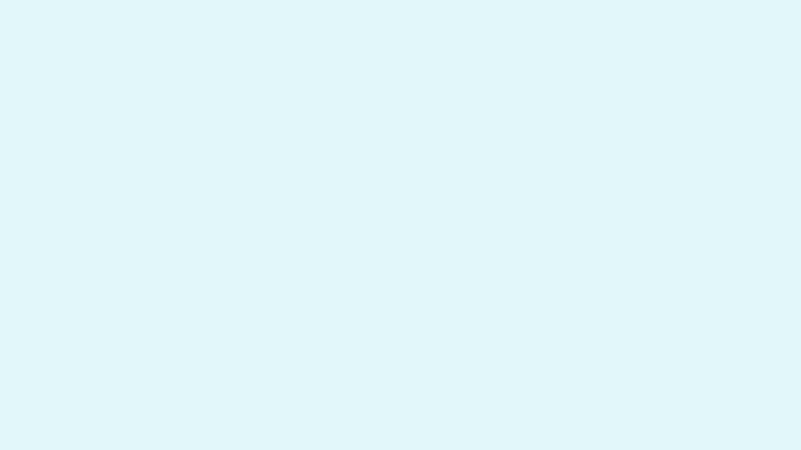

### Hügelige Wiese zeichnen

Für eine hügelige Wiese brauchen wir geschwungene Linien statt gerader: [Bézierkurven](https://de.wikipedia.org/wiki/B%C3%A9zierkurve). Eine Bézierkurve wird durch Punkte festgelegt. Es gibt quadratische Bézierkurven mit drei Punkten und kubische mit vier. Verschiebe hier die Punkte und sieh, wie sich die Kurve verändert:

<style>
.bezier_div circle {
    fill: white;
    stroke: #888;
    stroke-width: 0.1;
}
.bezier_div circle:hover {
    fill: #eee;
    stroke: #000;
    stroke-width: 0.1;
    cursor: pointer;
}
.bezier_div path.spline {
    stroke-width: 0.2;
    stroke: #000;
    fill: none;
}
.bezier_div path.line {
    stroke-width: 0.1;
    stroke: #888;
    stroke-dasharray: 0.2;
    fill: none;
}
[data-bs-theme=dark] {
    .bezier_div path.spline {
        stroke: #fff;
    }
    .bezier_div path.line {
        stroke: #666;
    }
    .bezier_div circle {
        fill: #222;
        stroke: #888;
    }
    .bezier_div circle:hover {
        fill: #333;
        stroke: #aaa;
    }
}
</style>

<div class='row'>
<div class='col-md-6'>
<h4>Quadratische Bézierkurve</h4>
<div class='bezier_div' data-points='3'>
    <svg width="100%" viewBox="0 0 16 9">
        <path class='line' d="M1,8 L 8,1 15,4" />
        <path class='spline' d="M1,8 Q8,1 15,4" />
        <circle cx='1' cy='8' r='0.3' data-index='0' />
        <circle cx='8' cy='1' r='0.3' data-index='1' />
        <circle cx='15' cy='4' r='0.3' data-index='2' />
    </svg>
</div>
</div>
<div class='col-md-6'>
<h4>Kubische Bézierkurve</h4>
<div class='bezier_div' data-points='4'>
    <svg width="100%" viewBox="0 0 16 9">
        <path class='line' d="M1,8 L 5,1 10,8 15,4" />
        <path class='spline' d="M1,8 C5,1 10,8 15,4" />
        <circle cx='1' cy='8' r='0.3' data-index='0' />
        <circle cx='5' cy='1' r='0.3' data-index='1' />
        <circle cx='10' cy='8' r='0.3' data-index='2' />
        <circle cx='15' cy='4' r='0.3' data-index='3' />
    </svg>
</div>
</div>
</div>

<script>
var current_circle = null;
window.addEventListener('DOMContentLoaded', function() {

    function handle_move(e) {
        let cx = e.clientX ?? e.touches[0].clientX;
        let cy = e.clientY ?? e.touches[0].clientY;
        let svg = current_circle.closest('svg');
        let rect = svg.getBoundingClientRect();
        let x = (cx - rect.left) / rect.width * 16.0;
        let y = (cy - rect.top) / rect.height * 9.0;
        if (x < 0.5) x = 0.5;
        if (x > 15.5) x = 15.5;
        if (y < 0.5) y = 0.5;
        if (y > 8.5) y = 8.5;
        current_circle.setAttribute('cx', x);
        current_circle.setAttribute('cy', y);
        let path = svg.querySelector('.spline');
        let line = svg.querySelector('.line');
        let points = Array.from(svg.querySelectorAll('circle')).map(c => [parseFloat(c.getAttribute('cx')), parseFloat(c.getAttribute('cy'))]);
        let d = '';
        if (points.length == 3) {
            d = `M${points[0][0]},${points[0][1]} Q${points[1][0]},${points[1][1]} ${points[2][0]},${points[2][1]}`;
        } else if (points.length == 4) {
            d = `M${points[0][0]},${points[0][1]} C${points[1][0]},${points[1][1]} ${points[2][0]},${points[2][1]} ${points[3][0]},${points[3][1]}`;
        }
        path.setAttribute('d', d);
        line.setAttribute('d', `M${points.map(p => p.join(',')).join(' L ')}`);
    }

    for (let div of document.querySelectorAll('.bezier_div')) {
        let points = parseInt(div.getAttribute('data-points'));
        for (let circle of div.querySelectorAll('circle')) {
            circle.addEventListener('mousedown', function(e) {
                e.preventDefault();
                e.stopPropagation();
                current_circle = circle;
            });
            circle.addEventListener('touchstart', function(e) {
                e.preventDefault();
                e.stopPropagation();
                current_circle = circle;
            });
        }
    }
    window.addEventListener('mousemove', function(e) {
        if (current_circle) {
            e.preventDefault();
            e.stopPropagation();
            handle_move(e);
        }
    });
    window.addEventListener('touchmove', function(e) {
        if (current_circle) {
            e.preventDefault();
            e.stopPropagation();
            handle_move(e);
        }
    });
    window.addEventListener('mouseup', function(e) {
        current_circle = null;
    });
    window.addEventListener('touchend', function(e) {
        current_circle = null;
    });
    window.addEventListener('touchcancel', function(e) {
        current_circle = null;
    });
});
</script>

_task(bezier)

Wir zeichnen drei kubische Bézierkurven in verschiedenen Grüntönen. Bei jeder sind der erste und der letzte Punkt die Enden der Kurve, die beiden mittleren ziehen sie in ihre Richtung. Schreib den Code unter `fill_rect`:

```ruby
set_color(7)
draw_cubic_bezier(0, 120, 100, 140, 200, 100, 320, 120)
set_color(8)
draw_cubic_bezier(0, 140, 100, 150, 200, 110, 320, 140)
set_color(9)
draw_cubic_bezier(0, 170, 110, 140, 220, 140, 320, 170)
```

Dein Bild sollte jetzt so aussehen:

<!-- tutorial-screenshot
# Drei Kurven
write-file: drawing-steps/step-4.rb <- file:stufen/step-4.rb
write-file: drawing-steps/save_step.rb <- file:stufen/save_step.rb
terminal-run: ruby -C /workspace/drawing-steps -r ./save_step.rb step-4.rb
terminal-wait-for-prompt
image-file: drawing-steps/step.png 8
-->
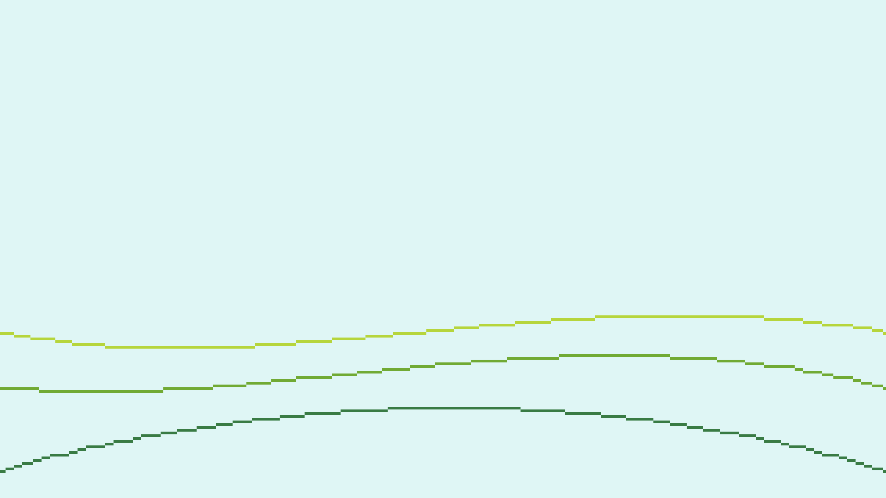

### Flächen füllen

Um die Hügel mit Farbe zu füllen, gibt es `flood_fill(x, y)`. Der Befehl beginnt am Pixel (x, y) und färbt ihn mit der aktuellen Farbe, dann alle Nachbarn, die dieselbe Farbe hatten wie er, dann deren Nachbarn und so weiter, bis er überall an eine andere Farbe stößt. Wie ein Farbeimer in einem Malprogramm.

_task(fluten)

Schreib den folgenden Code dazu:

```ruby
set_color(7)
flood_fill(0, 130)
```

Der Punkt (0, 130) liegt zwischen den oberen beiden Kurven, und genau diese Fläche wird hellgrün:

<!-- tutorial-screenshot
# Die erste Fläche gefüllt
write-file: drawing-steps/step-5.rb <- file:stufen/step-5.rb
write-file: drawing-steps/save_step.rb <- file:stufen/save_step.rb
terminal-run: ruby -C /workspace/drawing-steps -r ./save_step.rb step-5.rb
terminal-wait-for-prompt
image-file: drawing-steps/step.png 8
-->
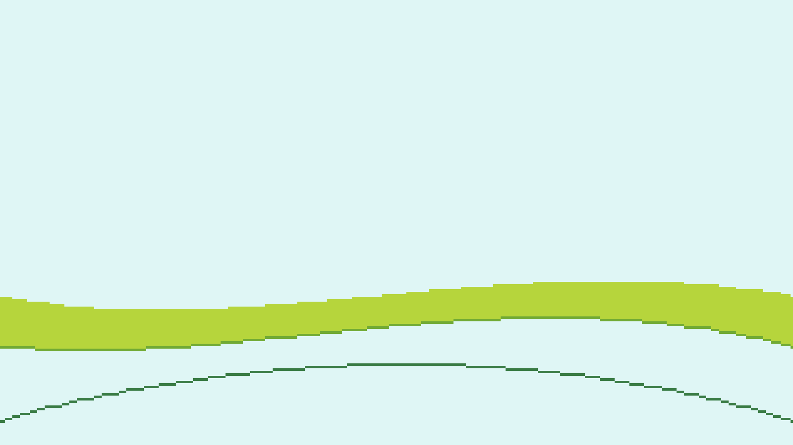

Füll mit diesen Zeilen auch die beiden anderen Flächen:

```ruby
set_color(8)
flood_fill(0, 150)
set_color(9)
flood_fill(0, 179)
```

<!-- tutorial-screenshot
# Alle drei Flächen
write-file: drawing-steps/step-6.rb <- file:stufen/step-6.rb
write-file: drawing-steps/save_step.rb <- file:stufen/save_step.rb
terminal-run: ruby -C /workspace/drawing-steps -r ./save_step.rb step-6.rb
terminal-wait-for-prompt
image-file: drawing-steps/step.png 8
-->
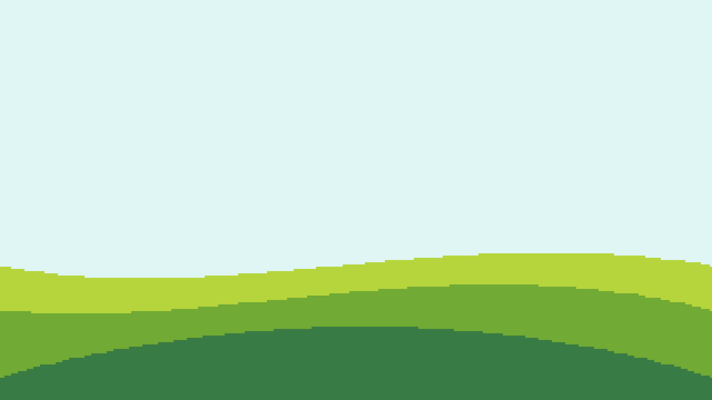

### Regenbogen zeichnen

Der Regenbogen besteht aus gefüllten Kreisen, einer in den anderen gelegt. Gezeichnet wie bisher, würden die Kreise auch die Wiese übermalen. Dagegen hilft eine Maske: Sie legt fest, welche Pixel die folgenden Befehle überhaupt verändern dürfen.

`set_mask` legt eine Maske fest. Zwischen `do` und `end` steht, was dazugehört: `add_color(16)` nimmt alle Pixel auf, die gerade die Farbe 16 haben, also den hellblauen Himmel. Alle anderen Pixel bleiben ab jetzt, wie sie sind.

```ruby
set_mask do
    add_color(16)
end
```

Jetzt die Kreise, von außen nach innen. Wir beginnen mit einem Radius von 125 Pixeln und machen jeden Kreis um 5 Pixel kleiner. Die Farben sind Rot (28), Orange (27), Gelb (26), Grün (8), Indigo (19), Violett (23) und zuletzt Himmelblau (16), das die Mitte wieder frei macht:

```ruby
r = 125
[28, 27, 26, 8, 19, 23, 16].each do |color|
    set_color(color)
    fill_circle(160, 180, r)
    r -= 5
end
```

`[28, 27, …].each do |color|` geht die Liste der Reihe nach durch; bei jedem Durchgang steht in `color` die nächste Zahl.

_task(maske)

<!-- tutorial-screenshot
# Der Regenbogen hinter den Hügeln
write-file: drawing-steps/step-7.rb <- file:stufen/step-7.rb
write-file: drawing-steps/save_step.rb <- file:stufen/save_step.rb
terminal-run: ruby -C /workspace/drawing-steps -r ./save_step.rb step-7.rb
terminal-wait-for-prompt
image-file: drawing-steps/step.png 8
-->
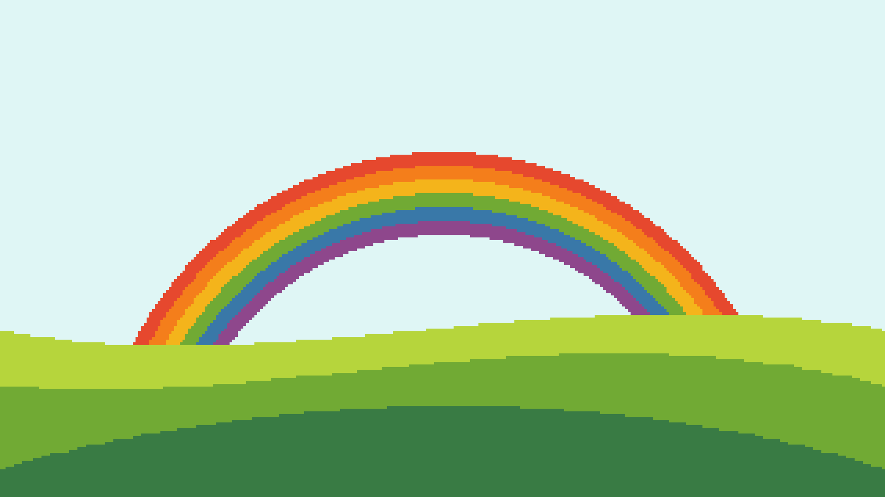

### Himmel zeichnen

Für den Himmel brauchen wir die Maske neu: Sie umfasst noch die Pixel, die vorhin hellblau waren, also auch die, auf denen jetzt der Regenbogen liegt. Neu festgelegt umfasst sie nur noch, was jetzt hellblau ist:

```ruby
set_mask do
    add_color(16)
end
```

Zwischen 16 und 20 liegen in der Palette schöne Blautöne. Wir gehen Zeile für Zeile von oben nach unten durch das Bild, wählen für jede Zeile eine Farbe aus diesem Bereich, mit etwas Zufall, und ziehen eine waagerechte Linie:

```ruby
(0...180).each do |y|
    set_color(20 - 3.5 * (y / 179.0) - rand() * 1.5)
    draw_line(0, y, 319, y)
end
```

`(0...180)` sind die Zahlen von 0 bis 179, und `rand()` ist eine Zufallszahl zwischen 0 und 1. Danach entfernen wir die Maske wieder:

```ruby
remove_mask()
```

Das fertige Bild:

<!-- tutorial-screenshot
# Das ganze Programm, mit einem festen Himmel
write-file: drawing-steps/rainbow.rb <- file:rainbow.rb
write-file: drawing-steps/save_step.rb <- file:stufen/save_step.rb
terminal-run: ruby -C /workspace/drawing-steps -r ./save_step.rb rainbow.rb
terminal-wait-for-prompt
image-file: drawing-steps/step.png 8
-->


## Bild speichern

Schreib als letzte Zeile vor `end`:

<!-- page-code: own -->
```ruby
save_as_png('rainbow.png')
```

Führe das Programm noch einmal aus. Die Datei `rainbow.png` liegt danach im Ordner, in dem du `ruby rainbow.rb` aufgerufen hast, also in `/workspace`. Öffne sie in Visual Studio Code mit <kbd>Strg</kbd><kbd>P</kbd> und »rainbow.png«, um sie anzusehen.

_task(bild-gespeichert)

Hier ist noch einmal das ganze Programm:

_include_file(rainbow.rb, ruby)

## Dein eigenes Bild

Jetzt bist du dran: Zeichne ein eigenes Bild. Lege dafür eine neue Datei `/workspace/bild.rb` an und beginne mit diesem Gerüst:

<!-- page-code: own -->
```ruby
require 'pixelflow_canvas'

Pixelflow::Canvas.new(320, 180, :palette) do
    set_predefined_palette(:zughy_32)

    # Hier zeichnest du dein Bild.

    save_as_png('bild.png')
end
```

Was du zeichnest, schreibst du an die Stelle mit dem Kommentar, zwischen `set_predefined_palette` und `save_as_png`. Ausführen wie vorhin, nur mit dem neuen Dateinamen: `ruby bild.rb`. Danach liegt dein Bild in `/workspace/bild.png`.

Die Ideen unten sind Bausteine für diese Stelle. Aus allen zusammen ist dieses Bild entstanden, auf einem Hintergrund mit `set_color(21)` und `fill_rect(0, 0, 319, 179)`:

<!-- tutorial-screenshot
# Alle Ideen zusammen auf einem dunklen Hintergrund
write-file: drawing-steps/ideas.rb <- file:stufen/ideas.rb
write-file: drawing-steps/save_step.rb <- file:stufen/save_step.rb
terminal-run: ruby -C /workspace/drawing-steps -r ./save_step.rb ideas.rb
terminal-wait-for-prompt
image-file: drawing-steps/step.png 8
-->
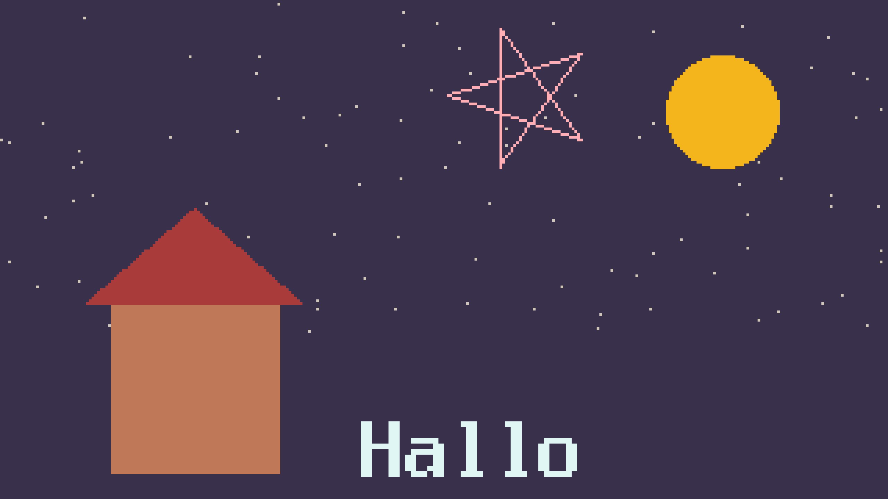

### Sterne

100 Pixel an zufälligen Stellen. `rand(320)` ist eine zufällige ganze Zahl von 0 bis 319, `rand(120)` eine von 0 bis 119, also nur in der oberen Hälfte:

```ruby
set_color(15)
100.times do
    set_pixel(rand(320), rand(120))
end
```

### Sonne

Ein gefüllter Kreis um den Punkt (260, 40) mit dem Radius 20:

```ruby
set_color(26)
fill_circle(260, 40, 20)
```

### Haus

Ein Rechteck und darüber ein Dreieck. `fill_triangle` braucht die drei Eckpunkte, jeweils x und y:

```ruby
set_color(4)
fill_rect(40, 110, 100, 170)
set_color(29)
fill_triangle(30, 110, 110, 110, 70, 75)
```

### Text

Schreibt »Hallo« an die Stelle (130, 150) in der Schrift `8x13B`, doppelt so groß. Weitere Schriften sind `4x6`, `6x10`, `7x13`, `9x15`, und mit `B` dahinter fett:

```ruby
set_color(16)
draw_text(130, 150, 'Hallo', '8x13B', 2)
```

### Mit einer Schildkröte zeichnen

Eine Schildkröte läuft über die Zeichenfläche und zieht eine Linie hinter sich her. Dieser Stern entsteht aus fünf Strecken von 50 Pixeln, nach jeder dreht sie sich um 144° nach rechts:

```ruby
t = Pixelflow::Turtle.new(self)
t.x = 180
t.y = 60
t.set_color(25)
5.times do
    t.forward(50)
    t.turn_right(144)
end
```

Alle Befehle stehen in der [Dokumentation des Pixelflow Canvas](https://specht.github.io/pixelflow_canvas_ruby/drawing_things.html), mit Bildern zu jedem Befehl.

_task(eigenes-bild)

## Zusammenfassung

Du hast gesehen, wie ein Programm ein Bild Pixel für Pixel zusammensetzt: aus Rechtecken, Kurven und Kreisen, mit gefüllten Flächen und einer Maske, die festlegt, was übermalt werden darf. Mit `save_as_png` wird aus dem Bild eine Datei, die du weitergeben kannst.
