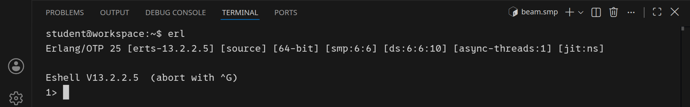
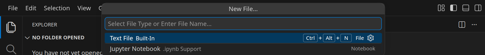
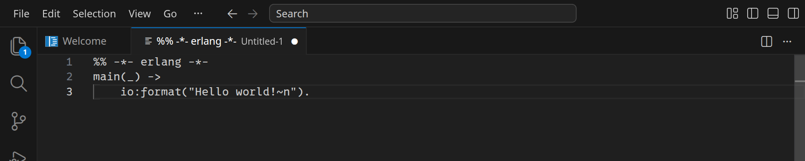
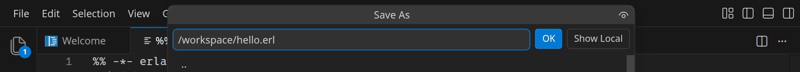
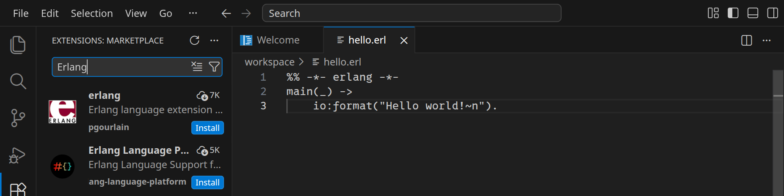
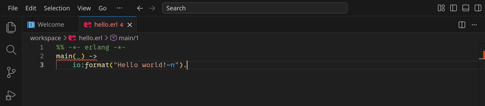
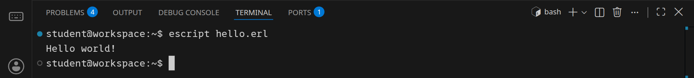

<div class='meta'>
image: erlang-logo.png
</div>

# Erlang <span style='font-size: 80%;'>(1986)</span>

<div class='floatright' style='width: 30em;'>
    
    <p>Joe Armstrong, Robert Verding und Mike Williams</p>
</div>

<p class='abstract'>
Erlang ist eine funktionale Programmiersprache, die 1986 von Joe Armstrong, Robert Verding und Mike Williams bei Ericsson entwickelt wurde. Sie wurde speziell für die Entwicklung von verteilten, fehlertoleranten und echtzeitfähigen Systemen konzipiert. Erlang ist bekannt für seine leichte Parallelisierung und seine Fähigkeit, mit Fehlern umzugehen, ohne das gesamte System zum Absturz zu bringen.
</p>

<!-- ## Eigenschaften

- **Funktionale Programmiersprache**: Erlang ist eine funktionale Programmiersprache, die auf der rekursiven Funktionstheorie basiert. -->

## Hello, world!

Erlang ist eine Skriptsprache, was bedeutet, dass der Code zur Laufzeit interpretiert wird. Du hast zwei Möglichkeiten, Erlang-Code auszuführen:

1. Du kannst Erlang-Code direkt in der Erlang-Shell ausführen.
2. Du kannst Erlang-Code in einer Textdatei speichern und dann ausführen.

**Möglichkeit 1:** Erlang-Code in der Erlang-Shell ausführen

Öffne dazu ein Terminal, indem du entweder <kbd>Strg</kbd><kbd>J</kbd> drückst oder das Panel-Symbol  rechts oben drückst. Dein Fenster sollte jetzt ungefähr so aussehen:

<!-- tutorial-screenshot
# Ein frischer Workspace ohne Ordner, das Terminal offen
hide-left-sidebar
terminal-open
sleep: 0.5
-->


Starte nun die Erlang-Shell, indem du `erl` eingibst und dann <kbd>Enter</kbd> drückst. Du solltest eine Ausgabe wie diese sehen:

<!-- tutorial-screenshot
press: Control+l
terminal-run: erl
wait-for-text: Eshell
sleep: 0.5
crop-terminal-lines: auto
-->



Jetzt kannst du Erlang-Code direkt in der Shell eingeben und ausführen. Schreibe einfach `io:format("Hello world!~n").` und drücke <kbd>Enter</kbd>. Du solltest die Ausgabe `Hello, world!` sehen.

Du kannst die Erlang-Shell wieder beenden, indem du zweimal hintereinander <kbd>Strg</kbd><kbd>C</kbd> drückst.

**Möglichkeit 2:** Erlang-Code in einer Textdatei speichern und ausführen

Erlang-Programme werden in Textdateien mit der Endung `.erl` geschrieben. Ein Erlang-Interpreter liest anschließend den Quelltext und führt ihn aus.

Stelle zuerst sicher, dass du keinen Ordner geöffnet hast. Um sicherzugehen, drücke einfach den Shortcut für »Ordner schließen«: <kbd>Strg</kbd><kbd>K</kbd> und dann <kbd>F</kbd>. Dein Workspace sollte jetzt ungefähr so aussehen:

<!-- tutorial-screenshot
# Die Shell wieder verlassen, das Terminal schließen
terminal-run: q().
terminal-wait-for-prompt
press: Control+l
press: Control+j
show-left-sidebar
sleep: 0.5
-->


### Quelltext schreiben

Klicke auf »New File« und wähle als Dateityp »Text File« (oder bestätige einfach mit <kbd>Enter</kbd>).

<!-- tutorial-screenshot
click: New File...
wait-for-text: Text File
sleep: 0.5
crop-bottom: 77%
-->



Schreibe nun den folgenden Code in die Datei:

_include_file(hello.erl, erlang)

Da Visual Studio Code noch nicht weiß, dass es sich um Erlang-Quelltext handelt, ist dein Programm momentan noch einfarbig, aber das wird sich gleich ändern. An dem weißen Punkt erkennst du, dass deine Änderungen noch nicht gespeichert sind.

<!-- tutorial-screenshot
# Das Programm in eine noch namenlose Datei
press: Enter
sleep: 1
hide-left-sidebar
type: <- file:hello.erl
sleep: 0.5
crop-bottom: 60%
-->



Drücke nun <kbd>Strg</kbd><kbd>S</kbd>, um die Datei zu speichern. Gib `hello.erl` ein – der vollständige Pfad zu deiner Datei lautet dann `/workspace/hello.erl`.

<!-- tutorial-screenshot
press: Control+s
wait-for-text: Save As
press: Control+a
type: /workspace/hello.erl
sleep: 0.5
crop-bottom: 82%
-->



Da Erlang standardmäßig nicht von Visual Studio Code unterstützt wird, müssen wir noch eine passende Erweiterung installieren. Klicke dazu auf das Erweiterungs-Symbol  in der Seitenleiste oder drücke <kbd>Strg</kbd><kbd>Shift</kbd><kbd>X</kbd>. Suche nach der Erweiterung »Erlang« und installiere sie. Weil der Herausgeber nicht verifiziert ist, fragt Visual Studio Code, ob du ihm vertraust; bestätige mit »Trust Publisher & Install«.

<!-- tutorial-screenshot
# Speichern, dann die Erweiterung im Marketplace
press: Enter
wait-for-file: hello.erl
sleep: 1
press: Control+Shift+x
wait-for-text: Marketplace
type: Erlang
sleep: 3
crop-bottom: 50%
-->



Alternativ kannst du auch <kbd>Strg</kbd><kbd>P</kbd> drücken und `ext install pgourlain.erlang` eingeben, um die Erweiterung zu installieren.

Anschließend solltest du dein Erlang-Programm farbig sehen:

<!-- tutorial-screenshot
# Die Erweiterung installieren, wie es der Text als zweiten Weg
# nennt; danach ist der Code farbig
press: Control+p
type: ext install pgourlain.erlang
wait-for-text: Press Enter to install extension
press: Enter
# Der Herausgeber ist nicht verifiziert: VS Code fragt nach
wait-for-text: Trust Publisher & Install
click: Trust Publisher & Install
sleep: 10
# Neu öffnen: erst dann kennt VS Code die Sprache
close-tab: hello.erl
open-file: hello.erl
hide-left-sidebar
sleep: 2
crop-bottom: 56%
-->



### Skript ausführen

Um unser Programm auszuführen, rufen wir `escript` auf und übergeben ihm den Dateinamen unseres Programms. `escript` führt eine Erlang-Datei als Skript aus und beginnt bei der Funktion `main`.

Öffne dazu ein Terminal, indem du <kbd>Strg</kbd><kbd>J</kbd> drückst und gib folgenden Befehl ein:

```bash
escript hello.erl
```

<div class='hint'>
Du musst nicht den vollständigen Dateinamen schreiben. Schreib einfach <code>escript he</code> und drücke <kbd>Tab</kbd>, um den Dateinamen automatisch zu <code>hello.erl</code> vervollständigen zu lassen. Du kannst danach ganz normal weiterschreiben.
</div>

Das Programm sollte die Nachricht `Hello world!` im Terminal ausgeben:

<!-- tutorial-screenshot
hide-left-sidebar
terminal-open
press: Control+l
terminal-run: escript hello.erl
terminal-wait-for-prompt
crop-terminal-lines: auto
-->

