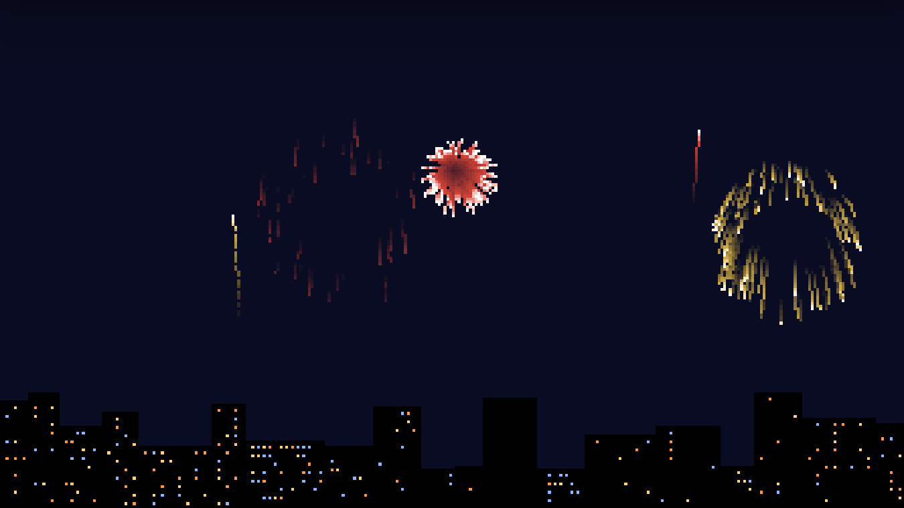
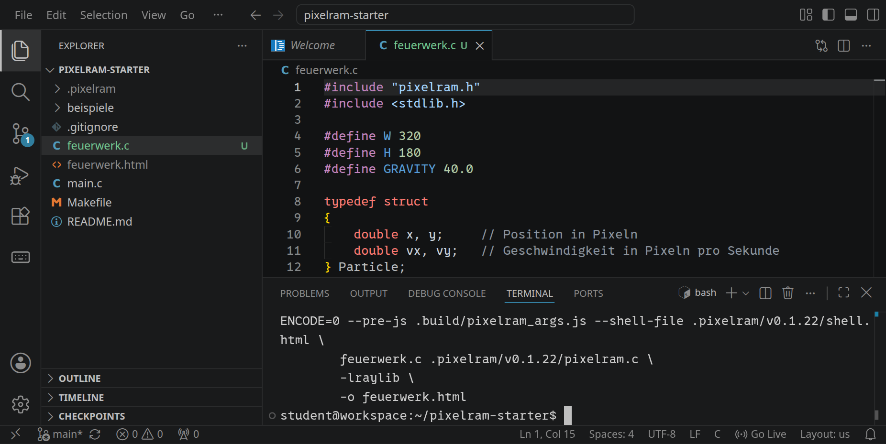
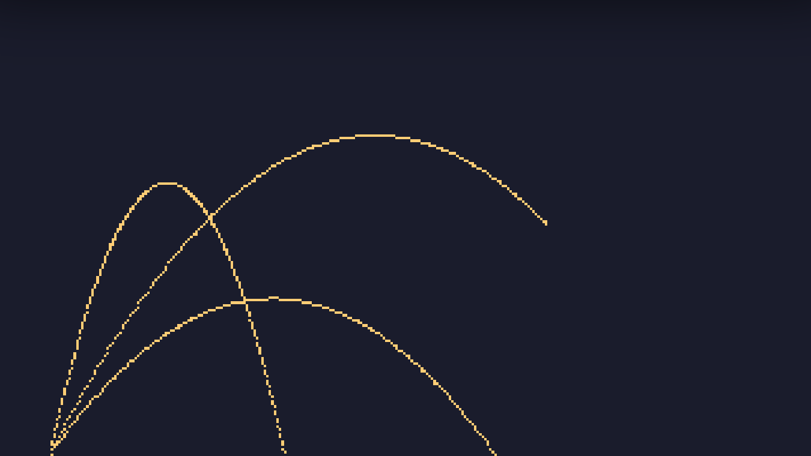
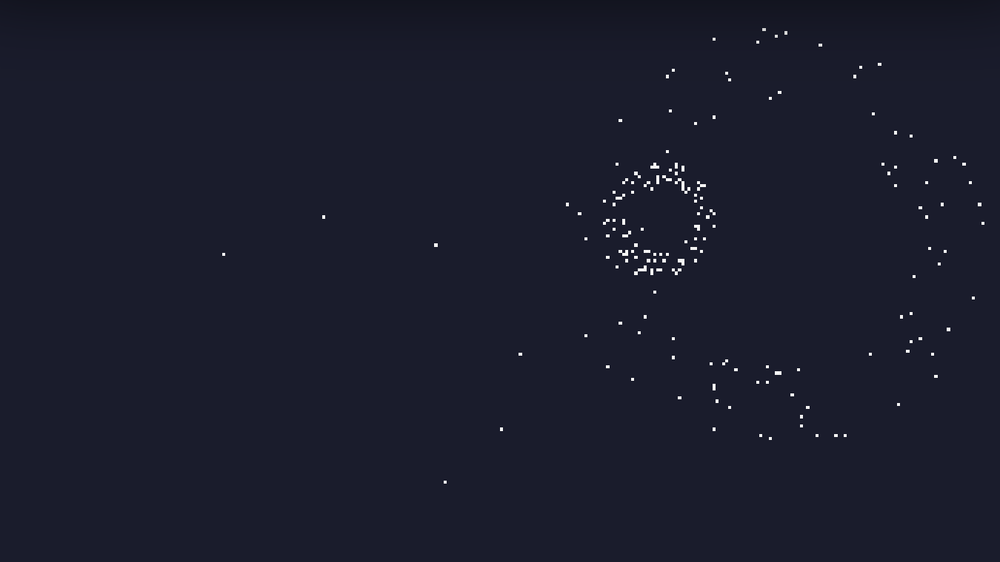

<div class='meta'>
image: feuerwerk.webp
kind: projekt
language: C
reference: [pixelram]
template: https://github.com/specht/pixelram-starter.git
template_name: des PixelRAM-Starters
</div>

# Feuerwerk aus Partikeln

<div
    class="autotoc-secondary-trigger"
    data-title="Auf dieser Seite"
    data-levels="h2,h3">
</div>

<p class='abstract'>
Ein Feuerwerk besteht aus tausenden Funken, und jeder einzelne folgt denselben einfachen Regeln: Er fliegt, die Schwerkraft zieht ihn nach unten, und irgendwann verglimmt er. In diesem Projekt programmierst du diese Regeln in C mit PixelRAM, vom ersten Funken bis zu Raketen, die du mit der Maus in den Himmel schießt.
</p>



Dieses Projekt baut auf [Echtzeitgrafik mit C](/pixelram) auf. Von dort kennst du die Vorlage, `make PROGRAM=…`, die Vorschau und die Schleife mit `present()`. Arbeite in einer eigenen Datei `feuerwerk.c` neben `main.c` und übersetze sie mit:

```bash
make PROGRAM=feuerwerk
```

Klone die Vorlage dafür im Terminal in einen eigenen Ordner `feuerwerk`; so kommt er dem Ordner aus [Echtzeitgrafik mit C](/pixelram) nicht in die Quere:

```bash_copy
git clone ${template} ~/feuerwerk
```

Öffne dann den Ordner `/workspace/feuerwerk` mit <kbd>Strg</kbd><kbd>K</kbd> <kbd>Strg</kbd><kbd>O</kbd>.

## Ein Funke

### Position und Geschwindigkeit

Ein Funke hat eine Position `x`, `y` und eine Geschwindigkeit `vx`, `vy`: wie viele Pixel er pro Sekunde nach rechts und nach unten fliegt. Ein negatives `vy` heißt: nach oben. Beides fasst ein `struct` zusammen.

In jedem Bild fragt das Programm, wie viel Zeit seit dem letzten Bild vergangen ist, `dt`, meistens etwa eine Sechzigstelsekunde. Dann gelten zwei Regeln:

- Die Schwerkraft ändert die Geschwindigkeit: `vy += GRAVITY * dt`. Jede Sekunde fällt der Funke 40 Pixel pro Sekunde schneller.
- Die Geschwindigkeit ändert die Position: `x += vx * dt` und `y += vy * dt`.

Mehr Physik braucht ein Feuerwerk nicht. Hier ein Funke, der immer wieder von links unten schräg nach oben geworfen wird:

```c
#include "pixelram.h"
#include <stdlib.h>

#define W 320
#define H 180
#define GRAVITY 40.0

typedef struct
{
    double x, y;     // Position in Pixeln
    double vx, vy;   // Geschwindigkeit in Pixeln pro Sekunde
} Particle;

double random_between(double low, double high)
{
    return low + (high - low) * rand() / (double)RAND_MAX;
}

void throw_spark(Particle *p)
{
    p->x = 20;
    p->y = H - 1;
    p->vx = random_between(20, 60);
    p->vy = random_between(-110, -60);
}

int main(void)
{
    screen_open(W, H, pixel_indexed8, "Ein Funke");
    use_palette("sweetie_16");

    Particle spark;
    throw_spark(&spark);

    double last = seconds();
    while (!should_close())
    {
        double now = seconds();
        double dt = now - last;   // Sekunden seit dem letzten Bild
        last = now;

        spark.vy += GRAVITY * dt;   // die Schwerkraft zieht nach unten
        spark.x += spark.vx * dt;
        spark.y += spark.vy * dt;

        if (spark.x >= W || spark.y >= H)
            throw_spark(&spark);

        set_pixel((int)spark.x, (int)spark.y, 4);
        present();
    }

    screen_close();
    return 0;
}
```

`random_between` liefert eine zufällige Kommazahl zwischen zwei Grenzen: `rand()` gibt eine ganze Zahl von 0 bis `RAND_MAX` zurück, geteilt durch `RAND_MAX` liegt sie zwischen 0 und 1. Weil das Programm den Bildschirm nie löscht, bleibt jede Flugbahn stehen.

<!-- tutorial-screenshot
# Die Vorlage im Terminal nach feuerwerk klonen, den Ordner öffnen, dann den Funken übersetzen
show-left-sidebar
terminal-open
terminal-run: git clone -q https://github.com/specht/pixelram-starter.git ~/feuerwerk && git -C ~/feuerwerk checkout -q 8f36e382554999421d77687c69f7541ca2c4afb7
press: Control+K
press: Control+O
wait-for-input-value: /workspace/
type: feuerwerk
press: Enter
wait-for-input-value: /workspace/feuerwerk/
press: Enter
wait-for-text: main.c
write-file: feuerwerk.c <- previous-code
open-file: feuerwerk.c
terminal-open
terminal-run: make PROGRAM=feuerwerk
terminal-wait-for-prompt: 180
-->


Übersetze das Programm mit `make PROGRAM=feuerwerk` und öffne `feuerwerk.html` in der Vorschau:

<!-- tutorial-screenshot
go-live
tab: preview
variants: crt
viewport: 800x450
hook: open feuerwerk.html
hook: run 12
crop-element: #canvas
-->


Jede Bahn ist eine Parabel, wie beim Wurf eines Balls. Das Programm rechnet sie nirgends aus: Sie entsteht von selbst aus den zwei Regeln.

_task(erster-funke)

_task(wurfhoehe)

<div class='hint think'>
<strong>Zum Nachdenken:</strong> Warum rechnet das Programm mit <code>dt</code>, statt den Funken in jedem Bild um einen festen Wert zu bewegen? Was würde sonst auf einem Computer passieren, der nur 30 Bilder pro Sekunde schafft?
</div>

## Eine Explosion

### Viele Funken

Für ein Feuerwerk braucht es nicht einen Funken, sondern viele. Sie stehen in einem Array `particles`, und `count` zählt, wie viele davon gerade leben. Eine Explosion wirft 100 Funken auf einmal von derselben Stelle aus, jeden in eine zufällige Richtung. Die Richtung ist ein Winkel zwischen 0 und 2π, und mit `cos` und `sin` wird daraus der Anteil nach rechts und nach unten:

```c
double angle = random_between(0, 2 * PI);
double speed = random_between(30, 50);
add(x, y, cos(angle) * speed, sin(angle) * speed, random_between(1.5, 2.5));
```

Alle Funken sind etwa gleich schnell. Deshalb liegen sie nach einem Moment auf einem Kreis um die Explosion, wie die Sterne eines echten Feuerwerkskörpers, und nicht in einer vollen Scheibe.

### Funken verglimmen

Jeder Funke bekommt eine Lebenszeit `life` in Sekunden, die in jedem Bild um `dt` kleiner wird. Ist sie abgelaufen, muss der Funke aus dem Array verschwinden. Statt alle folgenden Funken um einen Index nach vorne zu schieben, rückt einfach der letzte Funke in die Lücke. Die Reihenfolge ist egal, und es geht schnell, egal wie viele Funken es gibt:

```c
particles[i] = particles[count - 1];
count--;
i--;   // den nachgerückten Funken auch noch bewegen
```

_task(luecke)

Jetzt löscht das Programm den Bildschirm in jedem Bild mit `clear(0)` und zeichnet alle Funken neu, sonst sähe man nur noch Streifen. Hier das ganze Programm:

```c
#include "pixelram.h"
#include <math.h>
#include <stdlib.h>

#define W 320
#define H 180
#define GRAVITY 40.0
#define PI 3.14159265358979
#define MAX_PARTICLES 2000

typedef struct
{
    double x, y;     // Position in Pixeln
    double vx, vy;   // Geschwindigkeit in Pixeln pro Sekunde
    double life;     // verbleibende Lebenszeit in Sekunden
} Particle;

Particle particles[MAX_PARTICLES];
int count = 0;

double random_between(double low, double high)
{
    return low + (high - low) * rand() / (double)RAND_MAX;
}

void add(double x, double y, double vx, double vy, double life)
{
    if (count == MAX_PARTICLES)
        return;
    particles[count] = (Particle){ x, y, vx, vy, life };
    count++;
}

void explode(double x, double y)
{
    for (int i = 0; i < 100; i++)
    {
        double angle = random_between(0, 2 * PI);
        double speed = random_between(30, 50);
        add(x, y, cos(angle) * speed, sin(angle) * speed, random_between(1.5, 2.5));
    }
}

int main(void)
{
    screen_open(W, H, pixel_indexed8, "Explosion");
    use_palette("sweetie_16");

    double last = seconds();
    double next_explosion = 0;

    while (!should_close())
    {
        double now = seconds();
        double dt = now - last;
        last = now;

        if (now > next_explosion)
        {
            explode(random_between(60, W - 60), random_between(30, 90));
            next_explosion = now + 1.0;
        }

        clear(0);
        for (int i = 0; i < count; i++)
        {
            Particle *p = &particles[i];
            p->vy += GRAVITY * dt;
            p->x += p->vx * dt;
            p->y += p->vy * dt;
            p->life -= dt;

            if (p->life <= 0)
            {
                // verloschen: der letzte Funke rückt an seinen Platz
                particles[i] = particles[count - 1];
                count--;
                i--;
                continue;
            }

            set_pixel((int)p->x, (int)p->y, 12);
        }

        present();
    }

    screen_close();
    return 0;
}
```

`(Particle){ x, y, vx, vy, life }` baut einen ganzen Funken auf einmal, die Werte in der Reihenfolge der Felder im `struct`. `M_PI` gibt es in strengem C nicht, deshalb steht π als `PI` oben im Programm.

<!-- tutorial-screenshot
write-file: feuerwerk.c <- previous-code
terminal-open
terminal-run: make PROGRAM=feuerwerk
terminal-wait-for-prompt
tab: preview
variants: crt
viewport: 800x450
hook: open feuerwerk.html
hook: run 2.4
crop-element: #canvas
-->


Jede Sekunde explodiert es an einer neuen Stelle. Die Funken fliegen als Kreis auseinander und sinken dabei nach unten.

<div class='hint try'>
<strong>Ausprobieren:</strong> Dreh an den Zahlen und übersetze jedes Mal mit <code>make PROGRAM=feuerwerk</code>:
<ul>
<li>Setze <code>#define GRAVITY 0.0</code> und vergleich mit 40. Bleibt ein Kreis ein Kreis, während er fällt? Warum?</li>
<li>Lass in <code>explode</code> 1000 statt 100 Funken entstehen. Warum sind manche Explosionen jetzt dünner als andere? Sieh dir dafür <code>MAX_PARTICLES</code> und <code>add</code> an.</li>
</ul>
</div>

## Ein richtiges Feuerwerk

### Farben, die verglühen

Ein Funke soll hell aufleuchten und dann langsam dunkler werden. Dafür baut sich das Programm eine eigene Palette aus vier **Farbverläufen** zu je 16 Farben: Rot auf den Nummern 0 bis 15, Grün auf 16 bis 31, Blau auf 32 bis 47 und Gold auf 48 bis 63. Innerhalb eines Verlaufs ist 0 das Dunkelblau des Nachthimmels und 15 fast weiß. Die Farbe eines Funkens ist dann `16 * ramp + brightness`, und `brightness` sinkt mit der Lebenszeit:

```c
// Vier Farbverläufe zu je 16 Farben: 16 * ramp + Helligkeit
void make_palette(void)
{
    const int sky[3] = {10, 12, 35};
    const int colors[4][3] = { {255, 80, 60}, {80, 255, 120}, {90, 150, 255}, {255, 210, 80} };
    for (int ramp = 0; ramp < 4; ramp++)
        for (int b = 0; b < 16; b++)
        {
            double f = b / 15.0;
            // vom Nachthimmel zur Farbe, ganz hell fast weiß
            double white = f > 0.8 ? (f - 0.8) * 5 : 0;
            int rgb[3];
            for (int i = 0; i < 3; i++)
                rgb[i] = (sky[i] + (colors[ramp][i] - sky[i]) * f) * (1 - white) + 255 * white;
            set_palette(16 * ramp + b, rgb[0], rgb[1], rgb[2]);
        }
}
```

Nummer 0, der Himmel, ist damit Dunkelblau, und der ganze Bildschirm beginnt in dieser Farbe: PixelRAM füllt ihn am Anfang mit 0.

### Leuchtspuren

Echte Funken ziehen einen Schweif hinter sich her, weil das Auge ein Leuchten noch kurz sieht, wenn es schon weg ist. Das lässt sich mit dem Bildschirm selbst nachbauen: Statt ihn mit `clear(0)` zu löschen, wird jedes Pixel nur ein wenig dunkler, eine Stufe in seinem Farbverlauf. Ein Funke, der weiterfliegt, lässt so eine Spur zurück, die von selbst verglüht:

```c
// Nachleuchten: jedes Pixel wird ein wenig dunkler
void fade(void)
{
    for (int y = 0; y < H; y++)
        for (int x = 0; x < W; x++)
        {
            int c = get_pixel(x, y);
            if (c % 16 > 0)
                set_pixel(x, y, c - 1);
        }
}
```

`c % 16` ist die Helligkeit innerhalb des Verlaufs. Ist sie schon 0, bleibt das Pixel schwarz, sonst rutscht es eine Farbe tiefer, im selben Verlauf.

### Raketen

Bis jetzt explodieren die Funken einfach irgendwo in der Luft. Ein Feuerwerk schießt erst eine Rakete hoch, und sie explodiert am höchsten Punkt, wenn sie umkehrt, also sobald `vy` nicht mehr negativ ist. Eine Rakete ist auch nur ein Partikel, mit einem Merkmal `rocket` mehr.

Wie schnell muss die Rakete starten, damit sie in einer bestimmten Höhe umkehrt? Aus der Physik: Wer mit der Geschwindigkeit *v* nach oben startet, steigt bei der Schwerkraft *g* genau *h* = *v*² / 2*g* hoch. Umgekehrt ist *v* = √(2*gh*):

```c
void launch(double x, double target_y)
{
    // so schnell, dass die Rakete genau bei target_y umkehrt
    double vy = -sqrt(2 * GRAVITY * (H - target_y));
    add(x, H - 1, random_between(-8, 8), vy, 10, rand() % 4, true);
}
```

_task(startgeschwindigkeit)

Explodiert eine Rakete, bekommen ihre Funken ihren Farbverlauf und ihre Geschwindigkeit mit, sie fliegen also mit der Rakete weiter. Und weil Luft die Funken bremst, verlieren sie in jeder Sekunde einen Teil ihres Tempos:

```c
p->vx -= p->vx * 1.5 * dt;
p->vy -= p->vy * 1.5 * dt;
```

### Eine Stadt bei Nacht

Unten im Bild steht eine Stadt, vor der das Feuerwerk aufsteigt. Sie bekommt vier eigene Farben hinter den Farbverläufen: 64 für die Häuser, 65 bis 67 für Fenster in drei Lichtfarben. Die Stadt wird einmal am Anfang ausgedacht: Häuser mit zufälliger Breite und Höhe, nebeneinander von links nach rechts, jedes mit eigenem Fensterabstand und einem eigenen Anteil heller Fenster. Sie steht dann im zweidimensionalen Array `city`, eine Zahl für jedes Pixel, 0 für Himmel. In jedem Bild malt `draw_skyline` sie nach den Funken. So steigen die Raketen hinter den Häusern auf.

```c
// Häuser mit zufälliger Breite und Höhe, von links nach rechts. Jedes Haus
// hat seinen eigenen Fensterabstand, und in jedem leuchtet ein anderer Teil
// der Fenster. Die Stadt wird einmal ausgedacht und in city gemalt.
void make_skyline(void)
{
    set_palette(HOUSE, 0, 0, 0);
    set_palette(WINDOW, 255, 210, 120);       // Glühbirne
    set_palette(WINDOW + 1, 255, 150, 70);    // warmes Licht
    set_palette(WINDOW + 2, 140, 180, 255);   // Fernseher

    int x = 0;
    while (x < W)
    {
        int width = 10 + rand() % 20;
        int top = H - 12 - rand() % 30;
        int step = 2 + rand() % 2;                 // Fensterabstand
        double lit = random_between(0.05, 0.4);    // Anteil der hellen Fenster

        for (int i = x; i < x + width && i < W; i++)
            for (int y = top; y < H; y++)
                city[y][i] = HOUSE;

        for (int y = top + 2; y < H - 1; y += 3)
            for (int i = x + 2; i < x + width - 1 && i < W; i += step)
                if (random_between(0, 1) < lit)
                    city[y][i] = WINDOW + rand() % 3;

        x += width;
    }
}

// die Stadt vor den Himmel malen
void draw_skyline(void)
{
    for (int y = 0; y < H; y++)
        for (int x = 0; x < W; x++)
            if (city[y][x] != 0)
                set_pixel(x, y, city[y][x]);
}
```

Eine Kleinigkeit fehlt noch: Kommen zwei Raketen nacheinander auf derselben Seite hoch, drängt sich das Feuerwerk an einer Stelle. Deshalb startet die nächste Rakete abwechselnd in der linken und der rechten Hälfte.

### Das ganze Feuerwerk

Mit der Maus kannst du selbst Raketen starten: `mouse_button_pressed` meldet einen Klick, `mouse_position` sagt, wohin. Die Rakete fliegt genau bis zu dieser Höhe. Hier das ganze Programm:

```c
#include "pixelram.h"
#include <math.h>
#include <stdlib.h>

#define W 320
#define H 180
#define MAX_PARTICLES 3000
#define GRAVITY 40.0
#define PI 3.14159265358979
#define HOUSE 64     // Farbe der Häuser
#define WINDOW 65    // 65 bis 67: drei Farben für Fenster

typedef struct
{
    double x, y;     // Position in Pixeln
    double vx, vy;   // Geschwindigkeit in Pixeln pro Sekunde
    double life;     // verbleibende Lebenszeit in Sekunden
    int ramp;        // Farbverlauf 0 bis 3
    bool rocket;     // eine Rakete explodiert, wenn sie umkehrt
} Particle;

Particle particles[MAX_PARTICLES];
int count = 0;
uint8_t city[H][W];   // die Stadt: 0 ist Himmel, sonst eine Farbe

double random_between(double low, double high)
{
    return low + (high - low) * rand() / (double)RAND_MAX;
}

void add(double x, double y, double vx, double vy, double life, int ramp, bool rocket)
{
    if (count == MAX_PARTICLES)
        return;
    particles[count] = (Particle){ x, y, vx, vy, life, ramp, rocket };
    count++;
}

void launch(double x, double target_y)
{
    // so schnell, dass die Rakete genau bei target_y umkehrt
    double vy = -sqrt(2 * GRAVITY * (H - target_y));
    add(x, H - 1, random_between(-8, 8), vy, 10, rand() % 4, true);
}

void explode(Particle *p)
{
    // etwa gleich schnell: die Funken bilden eine Kugelschale, keine volle Scheibe
    for (int i = 0; i < 100; i++)
    {
        double angle = random_between(0, 2 * PI);
        double speed = random_between(30, 50);
        add(p->x, p->y, p->vx + cos(angle) * speed, p->vy + sin(angle) * speed,
            random_between(1.5, 2.5), p->ramp, false);
    }
}

// Vier Farbverläufe zu je 16 Farben: 16 * ramp + Helligkeit
void make_palette(void)
{
    const int sky[3] = {10, 12, 35};
    const int colors[4][3] = { {255, 80, 60}, {80, 255, 120}, {90, 150, 255}, {255, 210, 80} };
    for (int ramp = 0; ramp < 4; ramp++)
        for (int b = 0; b < 16; b++)
        {
            double f = b / 15.0;
            // vom Nachthimmel zur Farbe, ganz hell fast weiß
            double white = f > 0.8 ? (f - 0.8) * 5 : 0;
            int rgb[3];
            for (int i = 0; i < 3; i++)
                rgb[i] = (sky[i] + (colors[ramp][i] - sky[i]) * f) * (1 - white) + 255 * white;
            set_palette(16 * ramp + b, rgb[0], rgb[1], rgb[2]);
        }
}

// Häuser mit zufälliger Breite und Höhe, von links nach rechts. Jedes Haus
// hat seinen eigenen Fensterabstand, und in jedem leuchtet ein anderer Teil
// der Fenster. Die Stadt wird einmal ausgedacht und in city gemalt.
void make_skyline(void)
{
    set_palette(HOUSE, 0, 0, 0);
    set_palette(WINDOW, 255, 210, 120);       // Glühbirne
    set_palette(WINDOW + 1, 255, 150, 70);    // warmes Licht
    set_palette(WINDOW + 2, 140, 180, 255);   // Fernseher

    int x = 0;
    while (x < W)
    {
        int width = 10 + rand() % 20;
        int top = H - 12 - rand() % 30;
        int step = 2 + rand() % 2;                 // Fensterabstand
        double lit = random_between(0.05, 0.4);    // Anteil der hellen Fenster

        for (int i = x; i < x + width && i < W; i++)
            for (int y = top; y < H; y++)
                city[y][i] = HOUSE;

        for (int y = top + 2; y < H - 1; y += 3)
            for (int i = x + 2; i < x + width - 1 && i < W; i += step)
                if (random_between(0, 1) < lit)
                    city[y][i] = WINDOW + rand() % 3;

        x += width;
    }
}

// die Stadt vor den Himmel malen
void draw_skyline(void)
{
    for (int y = 0; y < H; y++)
        for (int x = 0; x < W; x++)
            if (city[y][x] != 0)
                set_pixel(x, y, city[y][x]);
}

// Nachleuchten: jedes Pixel wird ein wenig dunkler
void fade(void)
{
    for (int y = 0; y < H; y++)
        for (int x = 0; x < W; x++)
        {
            int c = get_pixel(x, y);
            if (c % 16 > 0)
                set_pixel(x, y, c - 1);
        }
}

int main(void)
{
    screen_open(W, H, pixel_indexed8, "Feuerwerk");
    make_palette();
    make_skyline();

    double last = seconds();
    double next_rocket = 0;
    bool left = false;
    int frame = 0;

    while (!should_close())
    {
        double now = seconds();
        double dt = now - last;
        last = now;

        if (now > next_rocket)
        {
            // abwechselnd links und rechts, damit sich die Raketen verteilen
            left = !left;
            double x = left ? random_between(30, W / 2) : random_between(W / 2, W - 30);
            launch(x, random_between(20, 70));
            next_rocket = now + random_between(0.3, 1.2);
        }
        if (mouse_button_pressed(pixel_mouse_left))
        {
            int mx, my;
            mouse_position(&mx, &my);
            launch(mx, my);
        }

        // jedes zweite Bild: die Spuren verblassen langsamer
        frame++;
        if (frame % 2 == 0)
            fade();

        for (int i = 0; i < count; i++)
        {
            Particle *p = &particles[i];
            p->vy += GRAVITY * dt;
            if (!p->rocket)
            {
                // Luftwiderstand bremst die Funken
                p->vx -= p->vx * 1.5 * dt;
                p->vy -= p->vy * 1.5 * dt;
            }
            p->x += p->vx * dt;
            p->y += p->vy * dt;
            p->life -= dt;

            if (p->rocket && p->vy >= 0)
            {
                explode(p);
                p->life = 0;
            }

            if (p->life <= 0 || p->y >= H)
            {
                // Lücke mit dem letzten Partikel füllen
                particles[i] = particles[count - 1];
                count--;
                i--;
                continue;
            }

            int brightness = p->rocket ? 15 : (int)(15 * fmin(1, p->life));
            set_pixel((int)p->x, (int)p->y, 16 * p->ramp + brightness);
        }

        // die Stadt vor dem Himmel: nach den Funken gezeichnet
        draw_skyline();
        present();
    }

    screen_close();
    return 0;
}
```

<!-- tutorial-screenshot
write-file: feuerwerk.c <- previous-code
terminal-open
terminal-run: make PROGRAM=feuerwerk
terminal-wait-for-prompt
tab: preview
variants: crt
viewport: 800x450
hook: open feuerwerk.html
# drei Explosionen über den ganzen Himmel verteilt, dazu aufsteigende Raketen
hook: run 7
crop-element: #canvas
-->


Die Funken einer Explosion haben unterschiedliche Lebenszeiten zwischen 1,5 und 2,5 Sekunden. Deshalb hört eine Explosion nicht auf einen Schlag auf, sondern franst aus. Ein Funke ist hell, solange er mehr als eine Sekunde vor sich hat, und wird in der letzten Sekunde dunkler.

<div class='hint task'>
<strong>Bau dein eigenes Feuerwerk.</strong> Ein paar Ideen:
<ul>
<li><strong>Schalen und Scheiben:</strong> Was passiert, wenn die Funken einer Explosion zwischen 0 und 50 Pixeln pro Sekunde schnell sind statt zwischen 30 und 50? Und wenn alle genau gleich schnell sind?</li>
<li><strong>Bunte Explosionen:</strong> Jeder Funke bekommt einen zufälligen Farbverlauf statt den der Rakete.</li>
<li><strong>Die Stadt schläft ein:</strong> Ab und zu geht ein Fenster aus oder an.</li>
<li><strong>Wind:</strong> Ein Wert <code>wind</code>, der <code>vx</code> in jedem Bild ein wenig verändert und sich mit den Pfeiltasten einstellen lässt.</li>
<li><strong>Doppelte Explosion:</strong> Einige Funken explodieren nach kurzer Zeit selbst noch einmal, in einer anderen Farbe.</li>
<li><strong>Glitzern:</strong> Kurz vor dem Verlöschen flackert die Helligkeit zufällig.</li>
<li><strong>Gleich schnell überall:</strong> <code>fade()</code> läuft in jedem zweiten Bild. Auf einem Bildschirm mit 120 Bildern pro Sekunde verglühen die Spuren also doppelt so schnell. Wie lässt sich das mit <code>dt</code> lösen?</li>
</ul>
</div>

_task(abgabe)
