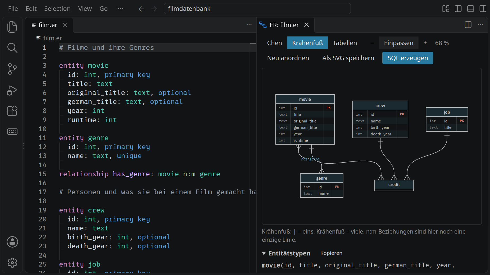
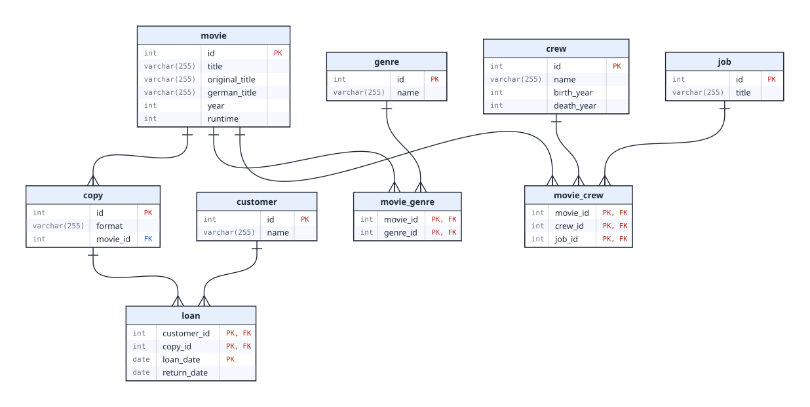

<div class='meta'>
image: teaser.webp
image_alt: "VS Code mit einem Datenmodell für Filme als Text links und dem daraus gezeichneten ER-Diagramm rechts"
kind: projekt
language: SQL
duration: 4 Doppelstunden
curriculum: "Sek I: Datenbanken (Datenbanken als Tabellen planen, verknüpfte Tabellen); Oberstufe: Datenbanken (Datenmodellierung, relationales Datenbankschema, Join, Normalisierung)"
topics: [datenbanken-modellierung, datenbanken-abfragen]
requires: [mysql]
reference: [er-modelle, sql, json, datensaetze]
</div>

<div
    class="autotoc-secondary-trigger"
    data-title="Auf dieser Seite"
    data-levels="h2,h3">
</div>

# Filmdatenbank mit MySQL

<p class='abstract'>
Du entwirfst eine Datenbank für Filme, ihre Genres und die Menschen, die an ihnen mitgearbeitet haben. Das Modell schreibst du als Text, die ER-Werkstatt in VS Code zeichnet daraus Diagramme und erzeugt das SQL für die Tabellen. Danach lädst du echte Filmdaten hinein und setzt mit <code>JOIN</code> wieder zusammen, was das Modell auf mehrere Tabellen verteilt hat.
</p>

In der »Einführung in SQL« hast du eine fertige Datenbank abgefragt. Jetzt baust du selbst eine: vom Modell über das Diagramm zu den Tabellen und dann zu den Abfragen. Alles, was du dabei schreibst, sind Dateien in deinem Workspace, die du behältst.

## Vom Datensatz zum Modell

### Ein Film als Datensatz

So könnte ein Film aussehen, wenn ein Programm ihn als JSON verschickt:

```json
{
  "id": 233,
  "title": "Back to the Future",
  "german_title": "Zurück in die Zukunft",
  "year": 1985,
  "runtime": 115,
  "genres": ["Adventure", "Comedy", "Sci-Fi"],
  "crew": {
    "director": ["Robert Zemeckis"],
    "actor": ["Michael J. Fox", "Christopher Lloyd", "Lea Thompson"],
    "composer": ["Alan Silvestri"]
  }
}
```

Für den Austausch ist das bequem: Alles über einen Film steht an einer Stelle. Für eine Datenbank, die viele Fragen beantworten soll, ist es ungünstig. »Welche Filme sind Sci-Fi?« hieße, in jedem Film die Liste `genres` zu durchsuchen. Und wer bei fünf Filmen Regie geführt hat, stünde fünfmal mit seinem Namen da, vielleicht einmal anders geschrieben.

_uses(json-aufbau)

In dem Datensatz stecken verschiedene Arten von Objekten: **Filme**, **Genres**, **Personen** und das, was eine Person bei einem Film gemacht hat, die **Tätigkeit**. In einer relationalen Datenbank bekommt jede Art ihre eigene Tabelle, und die Beziehungen zwischen ihnen werden eigens gespeichert.

_task(eine-spalte)

### Einen Ordner anlegen

Schließe zuerst einen geöffneten Ordner: <kbd>Strg</kbd><kbd>K</kbd>, dann <kbd>F</kbd>. Öffne dann mit <kbd>Strg</kbd><kbd>K</kbd> und <kbd>Strg</kbd><kbd>O</kbd> den Ordner `filmdatenbank`. Weil es ihn noch nicht gibt, fragt VS Code, ob er angelegt werden soll; bestätige mit <kbd>Enter</kbd>.

<!-- tutorial-screenshot
close-folder
press: Control+K
press: Control+O
wait-for-input-value: /workspace/
type: filmdatenbank
crop-bottom: 55%
-->


Lege im Ordner eine neue Datei `film.er` an: Klicke im Explorer auf das Symbol »Neue Datei« und tippe den Namen. Die Endung `.er` ist wichtig, an ihr erkennt VS Code ein ER-Modell.

### Das Modell als Text

Ein ER-Modell (Entity-Relationship-Modell) beschreibt, welche Objekte es gibt (**Entitäten**), welche Eigenschaften sie haben (**Attribute**) und wie sie zusammenhängen (**Beziehungen**). Du schreibst es als Text. Fang mit Filmen und Genres an:

```er
# Filme und ihre Genres

entity movie
  id: int, primary key
  title: text
  original_title: text, optional
  german_title: text, optional
  year: int
  runtime: int

entity genre
  id: int, primary key
  name: text, unique

relationship has_genre: movie n:m genre
```

So liest du das:

- `entity movie` legt die Entität `movie` an. Die eingerückten Zeilen darunter sind ihre Attribute: Name, Doppelpunkt, Typ.
- Typen: `int` für ganze Zahlen, `text` für Text bis 255 Zeichen. Es gibt auch `varchar(n)`, `decimal(p,s)`, `float`, `date`, `datetime` und `bool`.
- `primary key` markiert den **Primärschlüssel**: das Attribut, das jeden Film eindeutig bestimmt. Titel taugen dafür nicht, es gibt mehrere Filme mit demselben Titel. In SQL heißt er genauso, `PRIMARY KEY`.
- `optional` heißt: darf leer bleiben. Nicht jeder Film hat einen eigenen deutschen Titel.
- `unique` heißt: kein Wert darf doppelt vorkommen. Jedes Genre gibt es nur einmal.
- `relationship has_genre: movie n:m genre` verbindet Filme und Genres. `n:m` ist die **Kardinalität**: Ein Film hat mehrere Genres, und zu einem Genre gehören viele Filme. Weitere Möglichkeiten sind `1:1`, `1:n` und `n:1`.

Bezeichner schreibst du klein und englisch, ohne Leerzeichen und Umlaute; für mehrere Wörter nimmst du `_`. Die Namen sind nicht beliebig: Die Filmdaten, die du später lädst, erwarten genau diese Tabellen und Spalten.

_uses(attribute, beziehungen)

Während du tippst, unterstreicht VS Code Fehler rot und erklärt sie, wenn du mit der Maus darüberfährst. Alle Fehler stehen auch im Bereich »Probleme« (<kbd>Strg</kbd><kbd>Shift</kbd><kbd>M</kbd>).

_task(modell-filme)

### Dasselbe Modell als Diagramm

Klicke oben rechts im Editor auf »ER-Diagramm anzeigen« (oder <kbd>Strg</kbd><kbd>K</kbd>, dann <kbd>V</kbd>). Neben deinem Text erscheint das Modell als Diagramm, und es ändert sich mit, während du schreibst.

<!-- tutorial-screenshot
press: Enter
wait-for-text: create it
press: Enter
wait-for-text: filmdatenbank
write-file: filmdatenbank/film.er <- previous-code
open-file: film.er
close-tab: Welcome
hide-left-sidebar
press: Control+K
press: v
wait-for-text: Neu anordnen
sleep: 1
-->


Oben in der Vorschau wählst du zwischen drei Darstellungen desselben Modells.

**Chen.** Rechtecke sind Entitäten, Rauten Beziehungen, Ellipsen Attribute. Primärschlüssel sind unterstrichen. An den Linien steht die Kardinalität. Diese Darstellung findest du in vielen Schulbüchern.


_person(chen)

**Krähenfuß.** Jede Entität ist ein Kasten mit ihren Attributen. Das Linienende zeigt die Kardinalität: Der gespreizte Krähenfuß heißt »viele«, ein Querstrich heißt »eins«. Weil `has_genre` eine n:m-Beziehung ist, siehst du hier an beiden Enden einen Krähenfuß und keinen Strich.


**Tabellen.** So wird das Modell in der Datenbank gespeichert. Aus jeder Entität wird eine Tabelle. Die n:m-Beziehung wird zu einer eigenen Tabelle `movie_genre`: In ihr steht pro Zeile ein Paar aus Film und Genre, nur mit den beiden IDs.


Jetzt siehst du auch den Strich für »eins«: Die Linien führen von `movie_genre` zu `movie` und zu `genre`, mit dem Krähenfuß bei `movie_genre` und dem Strich am anderen Ende. Zu einem Film gehören viele Zeilen in `movie_genre`, aber jede Zeile gehört zu genau einem Film.

In `movie_genre` steht `PK, FK` hinter beiden Spalten:

- **FK**, Fremdschlüssel: `movie_id` verweist auf eine `id` in `movie`, `genre_id` auf eine `id` in `genre`. Die Datenbank lässt nur IDs zu, die es dort gibt.
- **PK**, Primärschlüssel: Beide Spalten **zusammen** bestimmen eine Zeile eindeutig. `movie_id` allein reicht nicht, ein Film hat mehrere Genres. Das nennt man einen zusammengesetzten Primärschlüssel.

Unter dem Diagramm stehen die Tabellen noch einmal als Liste und, aufgeklappt, »So wurde übersetzt«: Schritt für Schritt, was aus welchem Teil des Modells geworden ist.

Die Kästen kannst du mit der Maus verschieben. Die Positionen merkt sich die ER-Werkstatt in der versteckten Datei `.film.er.layout.json` neben deinem Modell; »Neu anordnen« ordnet alles wieder automatisch an.

_uses(uebersetzung, diagramme)

_task(vorhersage-n1)

## Vom Modell zur Datenbank

### Die Tabellen anlegen

Klicke in der Vorschau auf »SQL erzeugen«. Neben `film.er` entsteht die Datei `film.sql`:

```sql
-- Erzeugt aus film.er mit der ER-Werkstatt 0.1.0.
-- Nicht von Hand ändern: Beim nächsten Erzeugen wird diese Datei überschrieben.
-- Vorhandene Tabellen mit diesen Namen werden gelöscht, samt Inhalt.

SET FOREIGN_KEY_CHECKS = 0;
DROP TABLE IF EXISTS movie, genre, movie_genre;
SET FOREIGN_KEY_CHECKS = 1;

CREATE TABLE movie (
  id              INT NOT NULL,
  title           VARCHAR(255) NOT NULL,
  original_title  VARCHAR(255) NULL,
  german_title    VARCHAR(255) NULL,
  year            INT NOT NULL,
  runtime         INT NOT NULL,
  PRIMARY KEY (id)
);

CREATE TABLE genre (
  id    INT NOT NULL,
  name  VARCHAR(255) NOT NULL,
  PRIMARY KEY (id),
  UNIQUE (name)
);

CREATE TABLE movie_genre (
  movie_id  INT NOT NULL,
  genre_id  INT NOT NULL,
  PRIMARY KEY (movie_id, genre_id)
);

ALTER TABLE movie_genre
  ADD FOREIGN KEY (movie_id)
  REFERENCES movie (id);

ALTER TABLE movie_genre
  ADD FOREIGN KEY (genre_id)
  REFERENCES genre (id);
```

- `DROP TABLE IF EXISTS` löscht die Tabellen, falls es sie schon gibt. So kannst du ein geändertes Modell jederzeit mit demselben Befehl neu anlegen. Dabei geht ihr Inhalt verloren.
- `CREATE TABLE` legt eine Tabelle an. `NOT NULL` steht bei allem, was nicht `optional` ist.
- `PRIMARY KEY` legt den Primärschlüssel fest, `UNIQUE` verbietet doppelte Werte.
- `FOREIGN KEY … REFERENCES movie (id)` macht aus `movie_id` einen Fremdschlüssel auf `movie`.

Öffne ein Terminal (<kbd>Strg</kbd><kbd>J</kbd>) und gib die Datei an MySQL:

```bash
mysql < film.sql
```

Wenn alles klappt, gibt `mysql` nichts aus. Ob die Tabellen da sind, siehst du in `mycli`. Starte es und gib `SHOW TABLES;` ein:

```bash
mycli
```

```sql
SHOW TABLES;
```

<!-- tutorial-screenshot
click: selector:.editor-actions a[aria-label="SQL erzeugen"]
wait-for-file: filmdatenbank/film.sql
# mycli keeps rows free below its prompt for its menu. Without the status bar
# (never visible in a cropped terminal shot) the terminal has the one row more
# that SHOW TABLES with three tables needs to stay in view.
press: Control+Shift+P
type: Toggle Status Bar Visibility
wait-for-text: View: Toggle Status Bar Visibility
press: Enter
show-bottom-panel
terminal-open
terminal-maximize
terminal-run: clear
terminal-run: mysql < film.sql
terminal-wait-for-prompt
terminal-run: mycli
wait-for-text: student>
# No pager in the recipes (mycli's less would swallow the next steps);
# Control+L clears its answer. \n is nopager; a backslash command runs at once
# in multi-line mode. Students see the pager, the page explains it.
terminal-run: \n
sleep: 0.5
press: Control+L
type: SHOW TABLES;
press: Enter
wait-for-text: 3 rows in set
crop-terminal-lines: auto
crop-terminal-skip-bottom: 1
-->


_task(tabellen-filme)

### Filmdaten laden

Die Tabellen sind angelegt, aber leer. Beende `mycli` mit `exit` oder <kbd>Strg</kbd><kbd>D</kbd>. Lade dann die Filme, Genres und ihre Zuordnungen herunter:

```bash_copy
wget https://github.com/specht/workspace-files/raw/main/movie-archive/movies-data-films.sql
```

…und gib sie an MySQL:

```bash
mysql < movies-data-films.sql
```

Am Ende meldet MySQL für jede der drei Tabellen `OK`: Es hat sich angesehen, was jetzt darin steht, damit spätere Abfragen schnell sind.

Schau dir `movies-data-films.sql` ruhig an. Es sind lauter `INSERT`-Befehle, und jeder nennt die Spalten, in die er schreibt, zum Beispiel `INSERT INTO movie (id, title, original_title, …)`. Deshalb müssen die Namen in deinem Modell genau stimmen. Meldet MySQL `Unknown column` oder `Table … doesn't exist`, vergleiche die Namen in `film.er` mit der Meldung, erzeuge das SQL neu und fang mit `mysql < film.sql` wieder an.

<div class='hint'>
Die Filme stammen aus <a href='https://www.wikidata.org/'>Wikidata</a>, einer freien Wissensdatenbank, die jede und jeder weiterverwenden darf. Woher die Daten genau kommen, wie sie ausgewählt wurden und was jede Spalte bedeutet, beschreibt das Handbuch unter <a href='/reference/datensaetze#movies'>Datensätze</a>.
</div>

_task(daten-filme)

Starte wieder `mycli` und sieh dich um, wie in der »Einführung in SQL«:

```sql
SELECT * FROM movie LIMIT 5;
SELECT * FROM movie_genre LIMIT 5;
```

_task(anzahl-filme)

### Was die Schlüssel verhindern

Die Schlüssel aus deinem Modell passen jetzt auf die Daten auf. `SELECT * FROM movie_genre WHERE movie_id = 233;` zeigt die Genres von »Back to the Future« als IDs: 2, 5 und 16.

<div class='hint try'>
<strong>Ausprobieren:</strong> Trag drei Zeilen ein, die nicht passen, jede mit <code>INSERT INTO movie_genre (movie_id, genre_id) VALUES (…, …);</code>: die Zeile <code>(233, 16)</code>, die es schon gibt, die Zeile <code>(233, 99)</code> mit einem Genre, das es nicht gibt, und die Zeile <code>(99999, 16)</code> mit einem Film, den es nicht gibt. Achte bei jeder Meldung darauf, ob sie von <code>PRIMARY</code> oder von einem <code>FOREIGN KEY</code> spricht und welche Spalte sie nennt. Geht ein <code>INSERT</code> doch durch, nimm die Zeile mit <code>DELETE FROM movie_genre WHERE movie_id = … AND genre_id = …;</code> wieder heraus.
</div>

Die erste Zeile scheitert am Primärschlüssel von `movie_genre`: `Duplicate entry '233-16' for key 'movie_genre.PRIMARY'`. Jede Zuordnung gibt es nur einmal. Die beiden anderen scheitern an einem Fremdschlüssel: `Cannot add or update a child row: a foreign key constraint fails`. In `movie_genre` darf nur stehen, was auf einen Film und ein Genre zeigt, die es gibt. Am Ende der Meldung steht der Name, den MySQL dem Fremdschlüssel gegeben hat: `movie_genre_ibfk_1` für `movie_id`, `movie_genre_ibfk_2` für `genre_id`.

Und andersherum: Was geschieht, wenn die Zeile verschwindet, auf die ein Fremdschlüssel zeigt?

_task(genre-loeschen)

<!-- after: genre-loeschen -->
MySQL lehnt ab: `Cannot delete or update a parent row: a foreign key constraint fails`. Zu Sci-Fi gehören Zeilen in `movie_genre`, und solange eine Zeile auf das Genre zeigt, darf es nicht verschwinden. Genauso lehnt MySQL ab, einen Film zu löschen, der Genres hat, oder mit `UPDATE` die `id` eines Genres zu ändern, auf das eine Zeile zeigt.

Was beim Löschen geschehen soll, legst du beim Fremdschlüssel fest, mit `ON DELETE`:

<table class='table table-sm'>
<thead>
<tr><th>Angabe</th><th>Was beim Löschen geschieht</th></tr>
</thead>
<tbody>
<tr><td>keine, oder <code>ON DELETE RESTRICT</code></td><td>MySQL lehnt ab, solange eine Zeile auf die gelöschte zeigt.</td></tr>
<tr><td><code>ON DELETE CASCADE</code></td><td>Die Zeilen, die auf die gelöschte zeigen, werden mitgelöscht.</td></tr>
<tr><td><code>ON DELETE SET NULL</code></td><td>In den Zeilen, die auf die gelöschte zeigen, wird der Fremdschlüssel leer. Das geht nur, wenn die Spalte leer sein darf.</td></tr>
</tbody>
</table>

Die ER-Werkstatt schreibt kein `ON DELETE`, also lehnt deine Datenbank jedes solche Löschen ab. Das ist die vorsichtige Wahl. Für `movie_id` passt aber `CASCADE`: Ohne den Film bedeutet seine Zuordnung zu einem Genre nichts mehr. Bei `genre_id` ist es anders: Wer ein Genre löscht, zu dem viele Filme gehören, hat sich wahrscheinlich vertan.

Einen Fremdschlüssel ändern kannst du nicht; du löschst ihn mit seinem Namen und legst ihn neu an. `mycli` fragt vorher nach; du antwortest mit <kbd>y</kbd>:

```sql
ALTER TABLE movie_genre
  DROP FOREIGN KEY movie_genre_ibfk_1,
  ADD FOREIGN KEY (movie_id) REFERENCES movie (id) ON DELETE CASCADE;
```

Dann lösch »Back to the Future« in einer Transaktion:

```sql
START TRANSACTION;
DELETE FROM movie WHERE id = 233;
SELECT * FROM movie_genre WHERE movie_id = 233;
ROLLBACK;
```

<div class='hint try'>
<strong>Ausprobieren:</strong> Wie viele Zeilen findet das <code>SELECT</code> nach dem <code>DELETE</code>, und wie viele ein zweites <code>SELECT * FROM movie_genre WHERE movie_id = 233;</code> nach dem <code>ROLLBACK</code>? Lass <code>START TRANSACTION</code> nicht weg, sonst ist der Film mit seinen Genres wirklich weg. Das <code>CASCADE</code> bleibt in deiner Tabelle, bis du sie in »Menschen und Tätigkeiten« mit <code>mysql &lt; film.sql</code> neu anlegst.
</div>
<!-- /after -->

## JOIN: Beziehungen wieder zusammensetzen

In der »Einführung in SQL« kamen die Antworten aus einer Tabelle. Jetzt hast du die Daten mit Absicht verteilt. Welche Genres hat »Back to the Future«? `movie` kennt den Film, aber nicht seine Genres:

```sql
SELECT id, title, year
FROM movie
WHERE title = 'Back to the Future';
```

Die Zuordnung steht in `movie_genre`. Also verbindest du `movie` mit `movie_genre`:

```sql
SELECT movie.title, movie_genre.genre_id
FROM movie
JOIN movie_genre ON movie.id = movie_genre.movie_id
WHERE movie.title = 'Back to the Future';
```

`JOIN` verbindet Zeilen aus zwei Tabellen. `ON` sagt, welche Zeilen zusammengehören: die, bei denen `movie.id` und `movie_genre.movie_id` gleich sind. Weil es zwei Tabellen mit einer Spalte `id` geben kann, schreibst du den Tabellennamen davor, `movie.id`.

Jetzt hast du die IDs der Genres. Für ihre Namen folgst du der nächsten Linie im Tabellendiagramm, von `movie_genre` zu `genre`:

```sql
SELECT movie.title, genre.name
FROM movie
JOIN movie_genre ON movie.id = movie_genre.movie_id
JOIN genre ON movie_genre.genre_id = genre.id
WHERE movie.title = 'Back to the Future';
```

Was bei jedem `JOIN` passiert, zeigt der Query Stepper. Er führt die Abfrage Teil für Teil aus, so wie die Datenbank, auf denselben Filmdaten. Mit <kbd>←</kbd> und <kbd>→</kbd> siehst du, wie aus `movie` mit dem ersten `JOIN` eine breitere Tabelle wird, in der jeder Film so oft vorkommt, wie er Genres hat, und wie das zweite `JOIN` jede Zeile um den Namen des Genres ergänzt. Erst `WHERE` lässt dann die drei Zeilen übrig. Du kannst die Abfrage auch ändern.

<div class='query-stepper' data-stepper data-dataset='movies' data-query="SELECT movie.title, genre.name
FROM movie
JOIN movie_genre ON movie.id = movie_genre.movie_id
JOIN genre ON movie_genre.genre_id = genre.id
WHERE movie.title = 'Back to the Future';">
</div>

<script src='/include/query_stepper.js'></script>

<div class='hint'>
Jedes <code>JOIN … ON …</code> folgt einer Linie im Tabellendiagramm. Wenn du dort den Weg von einer Tabelle zur anderen findest, hast du die Abfrage schon fast. Vergisst du <code>ON</code>, verbindet MySQL jede Zeile mit jeder: Aus einigen tausend Filmen und Zuordnungen werden Millionen Zeilen.
</div>

_task(genres-film)

_task(animation)

<div class='hint try'>
<strong>Ausprobieren:</strong> Vergiss das <code>ON</code> einmal mit Absicht und zähle nur: <code>SELECT COUNT(*) FROM movie JOIN movie_genre;</code> Vergleiche das Ergebnis mit <code>SELECT COUNT(*) FROM movie;</code> und <code>SELECT COUNT(*) FROM movie_genre;</code>. Wie kommt die große Zahl zustande?
</div>

### Zählen pro Gruppe

Mit `COUNT(*)` zählst du Zeilen. Mit `GROUP BY` teilst du das Ergebnis vorher in Gruppen und zählst jede Gruppe für sich. Wie viele Genres hat jeder Film, hier die ersten fünf?

```sql
SELECT movie.title, COUNT(*)
FROM movie
JOIN movie_genre ON movie.id = movie_genre.movie_id
GROUP BY movie.id, movie.title
LIMIT 5;
```

Alle Zeilen mit demselben Film werden zu einer zusammengefasst, und `COUNT(*)` zählt, wie viele es waren: seine Genres. Gruppiert wird nach `movie.id`, weil zwei Filme denselben Titel haben können.

_task(filme-pro-genre)

## Menschen und Tätigkeiten

### Das Modell wächst

Bisher fehlt die `crew` aus dem Datensatz vom Anfang. Wer hat bei »Back to the Future« Regie geführt? In welchen Filmen hat eine Person mitgespielt? Dafür braucht das Modell Personen und ihre Tätigkeiten.

Überlege, bevor du weiterliest: Eine Person arbeitet an vielen Filmen, an einem Film arbeiten viele Personen. Und eine Person kann bei **einem** Film mehrere Tätigkeiten haben, etwa Regie führen und das Drehbuch schreiben. Zwischen welchen Entitäten besteht die Beziehung?

Sie verbindet drei Entitäten auf einmal: Film, Person und Tätigkeit. Ergänze `film.er` um zwei Entitäten und eine dreistellige Beziehung:

```er
# Personen und was sie bei einem Film gemacht haben

entity crew
  id: int, primary key
  name: text
  birth_year: int, optional
  death_year: int, optional

entity job
  id: int, primary key
  title: text, unique

relationship credit: movie, crew, job as movie_crew
```

- Eine Beziehung zwischen mehr als zwei Entitäten zählst du mit Kommas auf. Sie wird immer zu einer eigenen Tabelle.
- Ohne `as` hieße diese Tabelle `movie_crew_job`. Die Filmdaten erwarten `movie_crew`, deshalb gibst du den Namen mit `as movie_crew` vor.
- `job` enthält Tätigkeiten wie `actor`, `director` oder `composer`.

In der ER-Werkstatt, als Krähenfuß, hängt die Beziehung `credit` an allen drei Entitäten:

<!-- tutorial-screenshot
# Das ganze Modell in der ER-Werkstatt, als Krähenfuß. mycli from the
# picture with show-tables ends first: hidden, its terminal is too small.
terminal-run: quit
terminal-wait-for-prompt
check-task-fails: modell-crew
write-file: filmdatenbank/film.er <- file:film-2.er
check-task: modell-crew
open-file: film.er
hide-left-sidebar
hide-bottom-panel
click: Krähenfuß
sleep: 0.5
click: Einpassen
sleep: 1
-->


<!-- tutorial-screenshot
# Bild für die Karte der Aktivität: dasselbe Fenster in 16:9, so dass die
# Karte nichts abschneidet; das Diagramm neu eingepasst
viewport: 1029x579
click: Einpassen
sleep: 1
-->



In der Tabellenansicht siehst du `movie_crew` mit drei Fremdschlüsseln, die zusammen den Primärschlüssel bilden. So kann dieselbe Person bei einem Film mehrere Tätigkeiten haben, aber dieselbe Kombination aus Film, Person und Tätigkeit nicht zweimal vorkommen.


_task(modell-crew)

Erzeuge das SQL neu, beende `mycli` und lege die Tabellen an. Weil `film.sql` mit `DROP TABLE` beginnt, sind danach auch `movie` und `genre` wieder leer. Lade deshalb danach beide Datendateien. Die neue musst du erst herunterladen:

```bash_copy
wget https://github.com/specht/workspace-files/raw/main/movie-archive/movies-data-crew.sql
```

```bash
mysql < film.sql
mysql < movies-data-films.sql
mysql < movies-data-crew.sql
```

<div class='hint'>
In einer echten Datenbank, deren Daten nirgends sonst liegen, würdest du nicht alles löschen und neu laden. Dort ergänzt man nur, was neu ist: <code>CREATE TABLE</code> für die neuen Tabellen, <code>ALTER TABLE</code> für neue Spalten. Hier liegen die Daten in Dateien, deshalb ist Neuanlegen der einfachere und sichere Weg.
</div>

_task(tabellen-crew)

### Durch mehrere Beziehungen zu einer Person

Jetzt hat die Datenbank sechs Tabellen. Kurz aufgeschrieben, eine Zeile pro Tabelle, der Primärschlüssel unterstrichen und jeder Fremdschlüssel mit einem ↑:

_schema(movies)

Starte wieder `mycli`. Wer hat bei »Back to the Future« Regie geführt? Im Tabellendiagramm führt der Weg von `movie` über `movie_crew` zu `crew`, und die Tätigkeit steht in `job`. Jeder Schritt wird ein `JOIN`:

```sql
SELECT crew.name
FROM movie
JOIN movie_crew ON movie.id = movie_crew.movie_id
JOIN crew ON movie_crew.crew_id = crew.id
JOIN job ON movie_crew.job_id = job.id
WHERE movie.title = 'Back to the Future' AND job.title = 'director';
```

_task(besetzung-film)

_task(nolan)

Mit `GROUP BY` zählst du auch hier. Und wenn du nur Gruppen sehen willst, die eine Bedingung erfüllen, schreibst du sie hinter `HAVING`. `WHERE` filtert Zeilen, bevor gruppiert wird, `HAVING` filtert die fertigen Gruppen:

```sql
SELECT genre.name, COUNT(*)
FROM genre
JOIN movie_genre ON genre.id = movie_genre.genre_id
GROUP BY genre.id, genre.name
HAVING COUNT(*) >= 100;
```

Im Query Stepper siehst du die Gruppen: Bei `GROUP BY` bekommt jedes Genre seine Farbe, und `HAVING` streicht ganze Gruppen, nicht einzelne Zeilen. Probier auch, die Bedingung mit `WHERE` zu schreiben; der Query Stepper sagt dir, warum das nicht geht.

<div class='query-stepper' data-stepper data-dataset='movies' data-query="SELECT genre.name, COUNT(*)
FROM genre
JOIN movie_genre ON genre.id = movie_genre.genre_id
GROUP BY genre.id, genre.name
HAVING COUNT(*) >= 100;">
</div>

_tool(query-stepper)

_task(viel-regie)

### Ein Titel ist kein Schlüssel

Im Modell hast du `movie` eine `id` gegeben, weil Titel als Primärschlüssel nicht taugen. Mit `GROUP BY` und `HAVING` siehst du nach, ob das stimmt.

_task(doppelte-titel)

<!-- after: doppelte-titel -->
Mehr als vierzig Titel kommen doppelt vor, meist weil ein Stoff neu verfilmt wurde: »Nosferatu« von 1922 und von 2024, »Dune« von 1984 und von 2021, »Halloween« sogar dreimal. `SELECT * FROM movie WHERE title = 'Halloween';` zeigt die drei mit ihren IDs. Deshalb nennt die Aufgabe zu »Back to the Future« auch das Jahr.

Wäre `title` der Primärschlüssel, hätte schon `mysql < movies-data-films.sql` beim zweiten »Nosferatu« abgebrochen: `Duplicate entry 'Nosferatu' for key 'movie.PRIMARY'`. Und jede Zeile in `movie_genre` und `movie_crew` müsste den ganzen Titel tragen. Eine Nummer wie `id` sagt nichts über den Film und bleibt deshalb eindeutig, egal welche Filme noch dazukommen.
<!-- /after -->

### Wer spielt mit wem?

Eine einfache Frage: Welche zwei Schauspielerinnen oder Schauspieler standen besonders oft gemeinsam vor der Kamera? Die Datenbank kann sie beantworten, aber die Abfrage braucht jede Tabelle zweimal, einmal für jede der beiden Personen:

```sql
SELECT a.name, b.name, COUNT(*) AS together
FROM movie_crew AS ma
JOIN movie_crew AS mb ON ma.movie_id = mb.movie_id
JOIN job AS ja ON ma.job_id = ja.id
JOIN job AS jb ON mb.job_id = jb.id
JOIN crew AS a ON ma.crew_id = a.id
JOIN crew AS b ON mb.crew_id = b.id
WHERE ja.title = 'actor' AND jb.title = 'actor' AND a.id < b.id
GROUP BY a.id, a.name, b.id, b.name
ORDER BY together DESC
LIMIT 10;
```

`AS ma` gibt einer Tabelle einen zweiten Namen, damit sie zweimal vorkommen kann. `a.id < b.id` sorgt dafür, dass jedes Paar nur einmal gezählt wird und niemand mit sich selbst. Du musst die Abfrage nicht Zeile für Zeile nachbauen; probier sie aus.

<div class='hint try'>
<strong>Ausprobieren:</strong> Frag nach Schauspiel und Regie: Ändere <code>jb.title = 'actor'</code> zu <code>jb.title = 'director'</code> und lass <code>AND a.id &lt; b.id</code> weg. Wer spielt am häufigsten bei derselben Regie mit? Warum muss <code>a.id &lt; b.id</code> dafür weg? Und warum steht jetzt in manchen Zeilen zweimal derselbe Name?
</div>

Fragen, die von Person zu Film zu Person und weiter wandern, werden in SQL schnell lang. Graphdatenbanken wie Neo4j speichern genau diese Wege und machen solche Fragen kurz.

_task(neue-frage)

## Eine Videothek

### Exemplare und Ausleihen

Eine mögliche Antwort auf »Was fehlt dem Modell?« baust du jetzt: eine Videothek, die Filme aus deiner Datenbank verleiht. Von manchen Filmen hat sie ein Exemplar, von anderen zwei oder drei, als DVD oder als Blu-ray; viele Filme hat sie gar nicht. Kundinnen und Kunden leihen Exemplare aus und bringen sie ein paar Tage später zurück. Die Videothek möchte wissen: Welche Exemplare sind gerade ausgeliehen, und bei wem? Welche stehen nur im Regal?

Dafür braucht dein Modell zwei neue Entitäten und zwei Beziehungen. Diesmal schreibst du sie selbst. Die Namen sind wieder fest, weil die Daten sie erwarten:

<table class='table table-sm'>
<thead>
<tr><th>Name</th><th>Was es ist</th></tr>
</thead>
<tbody>
<tr><td><code>copy</code></td><td>ein Exemplar, mit <code>id</code> und <code>format</code> (<code>DVD</code> oder <code>Blu-ray</code>)</td></tr>
<tr><td><code>customer</code></td><td>eine Kundin oder ein Kunde, mit <code>id</code> und <code>name</code></td></tr>
<tr><td><code>loan</code></td><td>die Tabelle der Ausleihen: wer welches Exemplar an welchem Tag ausgeliehen hat (<code>loan_date</code>) und an welchem Tag zurückgebracht (<code>return_date</code>)</td></tr>
</tbody>
</table>

Zwei Kardinalitäten musst du entscheiden: zwischen `movie` und `copy` und zwischen `customer` und `copy`. Denk dabei an ein ganzes Jahr: Ein Exemplar wird viele Male ausgeliehen, und dieselbe Person kann dasselbe Exemplar zweimal ausleihen, an verschiedenen Tagen.

Das Datum gehört weder zum Exemplar noch zur Person, sondern zur einzelnen Ausleihe. Es ist ein Attribut der Beziehung. Wie du Attribute einer Beziehung schreibst und ihrer Tabelle mit `as` einen Namen gibst, steht im Handbuch unter [Beziehungen und Kardinalitäten](/reference/er-modelle#beziehungen-und-kardinalitäten).

_task(modell-verleih)

<!-- after: modell-verleih -->
So sieht der neue Teil von `film.er` aus:

```er
# Die Videothek: Exemplare, Kundschaft und Ausleihen

entity copy
  id: int, primary key
  format: text

entity customer
  id: int, primary key
  name: text

relationship has_copy: movie 1:n copy

relationship borrows: customer n:m copy as loan
  loan_date: date, primary key
  return_date: date, optional
```

- `movie 1:n copy`: Ein Film hat viele Exemplare, ein Exemplar gehört zu genau einem Film. Eine 1:n-Beziehung bekommt keine eigene Tabelle. `copy` merkt sich mit dem Fremdschlüssel `movie_id`, zu welchem Film es gehört, wie `movie` bei »Was wäre bei n:1?« die Spalte `genre_id` bekommen hätte.
- `customer n:m copy`: Im Lauf der Zeit leiht eine Person viele Exemplare, und ein Exemplar geht an viele Personen. Die Beziehung wird zur Tabelle `loan`.
- `loan_date` gehört zum Primärschlüssel. Ohne das Datum wäre der Schlüssel `(customer_id, copy_id)`, und dieselbe Person könnte dasselbe Exemplar nur ein einziges Mal ausleihen.
- `return_date` ist `optional`: Solange ein Exemplar ausgeliehen ist, gibt es noch kein Rückgabedatum.


<!-- /after -->

### Die Ausleihen laden

Erzeuge das SQL neu, beende `mycli`, lade die Ausleihen herunter und lege alles noch einmal an, mit allen drei Datendateien:

```bash_copy
wget https://github.com/specht/workspace-files/raw/main/movie-archive/movies-data-rental.sql
```

```bash
mysql < film.sql
mysql < movies-data-films.sql
mysql < movies-data-crew.sql
mysql < movies-data-rental.sql
```

<div class='hint'>
Die Videothek ist erfunden: Die Exemplare, die Namen der Kundschaft und die Ausleihen vom 2. Januar bis zum 16. Oktober 2026 hat ein Programm ausgewürfelt. Die Filme sind dieselben wie bisher.
</div>

_task(tabellen-verleih)

_schema(movies-rental, rows, new: copy customer loan)

### Was noch draußen ist: NULL

Ein Exemplar, das gerade ausgeliehen ist, hat in `loan` eine Zeile ohne Rückgabedatum. In `mycli` steht dort `NULL`: Die Zelle ist leer, es gibt keinen Wert.

_task(vorhersage-null)

<!-- after: vorhersage-null -->
`= NULL` ist nie wahr, auch nicht in einer leeren Zelle. `NULL` heißt »unbekannt«, und ob ein unbekannter Wert gleich einem anderen unbekannten ist, weiß MySQL nicht. Das `WHERE` lässt deshalb keine Zeile durch, und `COUNT(*)` zählt 0. Nach einer leeren Zelle fragst du mit `IS NULL`, nach einer gefüllten mit `IS NOT NULL`:

```sql
SELECT COUNT(*) FROM loan WHERE return_date IS NULL;
```
<!-- /after -->

_task(ausgeliehen)

### Was nie ausgeliehen wurde: LEFT JOIN

»Back to the Future« hat zwei Exemplare. Wann wurden sie ausgeliehen?

```sql
SELECT copy.id, copy.format, loan.loan_date, loan.return_date
FROM copy
JOIN loan ON copy.id = loan.copy_id
WHERE copy.movie_id = 233;
```

<div class='scroll-x'>
<table class='table table-sm'>
<thead>
<tr><th>id</th><th>format</th><th>loan_date</th><th>return_date</th></tr>
</thead>
<tbody>
<tr><td>31</td><td>DVD</td><td>2026-05-21</td><td>2026-05-22</td></tr>
</tbody>
</table>
</div>

Nur die DVD steht da. Die Blu-ray wurde nie ausgeliehen, und ein `JOIN` behält nur Zeilen, die in beiden Tabellen einen Partner haben. Ein `LEFT JOIN` behält jede Zeile der linken Tabelle, hier `copy`. Findet es in `loan` keinen Partner, füllt es dessen Spalten mit `NULL`:

```sql
SELECT copy.id, copy.format, loan.loan_date, loan.return_date
FROM copy
LEFT JOIN loan ON copy.id = loan.copy_id
WHERE copy.movie_id = 233;
```

<div class='scroll-x'>
<table class='table table-sm'>
<thead>
<tr><th>id</th><th>format</th><th>loan_date</th><th>return_date</th></tr>
</thead>
<tbody>
<tr><td>31</td><td>DVD</td><td>2026-05-21</td><td>2026-05-22</td></tr>
<tr><td>32</td><td>Blu-ray</td><td>NULL</td><td>NULL</td></tr>
</tbody>
</table>
</div>

Im Query Stepper siehst du, welche Zeilen von `copy` beim `LEFT JOIN` keinen Partner finden. Ändere `LEFT JOIN` in `JOIN` und vergleiche.

<div class='query-stepper' data-stepper data-dataset='movies-rental' data-query="SELECT copy.id, copy.format, loan.loan_date, loan.return_date
FROM copy
LEFT JOIN loan ON copy.id = loan.copy_id
WHERE copy.movie_id = 233;">
</div>

Mit `WHERE loan.copy_id IS NULL` bleiben genau die Zeilen übrig, die keinen Partner hatten.

_task(nie-ausgeliehen)

_task(ohne-ausleihe)

<!-- extra -->
## Normalisierung

Deine Filmdaten liegen auf vielen Tabellen, und für fast jede Frage brauchst du ein `JOIN`. Warum nicht eine einzige große Tabelle, in der alles steht? In diesem Kapitel baust du eine solche Tabelle, siehst, was mit ihr schiefgeht, und teilst sie Schritt für Schritt wieder auf. Am Ende stehst du bei den Tabellen, die du schon kennst. Das Verfahren heißt **Normalisierung**; im Grundkurs kannst du das Kapitel überspringen.

### Eine Liste für alles

Ein Filmclub sammelt seine Filmabende in einer Liste, eine Zeile pro Film: Titel, Jahr, wer Regie geführt hat, deren Geburtsjahr und wer mitspielt. Ein Ausschnitt:

<div class='scroll-x'>
<table class='table table-sm' style='min-width: 56em'>
<thead>
<tr><th>movie_id</th><th>title</th><th>year</th><th>director_id</th><th>director</th><th>director_birth_year</th><th>actors</th></tr>
</thead>
<tbody>
<tr><td>891</td><td>Good Bye Lenin!</td><td>2003</td><td>6892</td><td>Wolfgang Becker</td><td>1954</td><td>Alexander Beyer, Burghart Klaußner, Chulpan Khamatova, …</td></tr>
<tr><td>1499</td><td>Inception</td><td>2010</td><td>5048</td><td>Christopher Nolan</td><td>1970</td><td>Cillian Murphy, Elliot Page, Joseph Gordon-Levitt, …</td></tr>
<tr><td>1916</td><td>Interstellar</td><td>2014</td><td>5048</td><td>Christopher Nolan</td><td>1970</td><td>Anne Hathaway, Bill Irwin, Casey Affleck, …</td></tr>
<tr><td>2565</td><td>Barbie</td><td>2023</td><td>10282</td><td>Greta Gerwig</td><td>1983</td><td>America Ferrera, Dua Lipa, Emma Mackey, …</td></tr>
</tbody>
</table>
</div>

Die Liste des Clubs baust du aus deinen eigenen Tabellen nach, mit den 25 Filmen von vier Regisseurinnen und Regisseuren. Starte `mycli` und gib diesen Befehl ein; du musst ihn nicht nachbauen:

```sql_copy
CREATE TABLE club_list (PRIMARY KEY (movie_id)) AS
SELECT movie.id AS movie_id, movie.title, movie.year,
       crew.id AS director_id, crew.name AS director,
       crew.birth_year AS director_birth_year,
       (SELECT GROUP_CONCAT(actor.name ORDER BY actor.name SEPARATOR ', ')
        FROM movie_crew AS credit
        JOIN crew AS actor ON credit.crew_id = actor.id
        JOIN job AS role ON credit.job_id = role.id
        WHERE credit.movie_id = movie.id AND role.title = 'actor') AS actors
FROM movie
JOIN movie_crew ON movie.id = movie_crew.movie_id
JOIN job ON movie_crew.job_id = job.id
JOIN crew ON movie_crew.crew_id = crew.id
WHERE job.title = 'director'
  AND crew.name IN ('Christopher Nolan', 'Greta Gerwig', 'Wolfgang Becker', 'Wolfgang Petersen');
```

`CREATE TABLE … AS SELECT` legt eine Tabelle an und füllt sie mit dem Ergebnis der Abfrage; in der Klammer davor steht ihr Primärschlüssel, hier `movie_id`. `GROUP_CONCAT` hängt die Namen aller Schauspielerinnen und Schauspieler eines Films zu einem Text zusammen. Sieh dir die Tabelle an:

```sql
SELECT movie_id, title, director, director_birth_year FROM club_list;
```

Christopher Nolan steht dreizehnmal da, bei jedem seiner Filme, und mit ihm dreizehnmal sein Geburtsjahr.

_task(vorhersage-geburtsjahr)

<!-- after: vorhersage-geburtsjahr -->
Nach dem `UPDATE` zeigt das `SELECT` zwei Zeilen:

<div class='scroll-x'>
<table class='table table-sm'>
<thead>
<tr><th>director</th><th>director_birth_year</th></tr>
</thead>
<tbody>
<tr><td>Christopher Nolan</td><td>1970</td></tr>
<tr><td>Christopher Nolan</td><td>1907</td></tr>
</tbody>
</table>
</div>

Das `WHERE` hat genau eine Zeile getroffen, die von »Inception«. Die zwölf anderen Filme von Nolan sagen weiter 1970, und die Tabelle widerspricht sich: Wann ist Christopher Nolan geboren? MySQL kann das nicht verhindern, denn nichts in `club_list` sagt, dass `director_birth_year` in allen Zeilen mit derselben `director_id` gleich sein muss. Das ist eine **Änderungsanomalie** (auch Update-Anomalie): Eine Tatsache steht in vielen Zeilen, und wer sie ändert, muss jede davon treffen. Mit `ROLLBACK;` nimmst du das `UPDATE` zurück, und Nolan hat wieder ein Geburtsjahr.
<!-- /after -->

### Einfügen und löschen

Der Club möchte Wim Wenders in seine Liste aufnehmen, bevor ein Film von ihm gezeigt wird:

```sql
INSERT INTO club_list (director_id, director, director_birth_year)
VALUES (2379, 'Wim Wenders', 1945);
```

MySQL lehnt ab: `Field 'movie_id' doesn't have a default value`. Der Primärschlüssel ist `movie_id`, und ohne Film gibt es keinen. Einen Regisseur ohne Film kann die Tabelle nicht speichern, höchstens mit einem ausgedachten Film. Das ist eine **Einfügeanomalie**.

Andersherum: »Good Bye Lenin!« ist der einzige Film von Wolfgang Becker in der Liste. Was weiß die Tabelle noch über ihn, wenn der Film gestrichen wird? Probier es in einer Transaktion, wie in der »Einführung in SQL«. Auf die Frage von `mycli` vor dem `DELETE` antwortest du mit <kbd>y</kbd>:

```sql
START TRANSACTION;
DELETE FROM club_list WHERE movie_id = 891;
SELECT * FROM club_list WHERE director = 'Wolfgang Becker';
ROLLBACK;
```

Das `SELECT` findet keine Zeile mehr: Mit dem Film ist auch verschwunden, dass Wolfgang Becker 1954 geboren ist. Das ist eine **Löschanomalie**. Das `ROLLBACK` holt die Zeile zurück; `SELECT COUNT(*) FROM club_list;` zeigt wieder 25.

In deinen eigenen Tabellen gibt es keine dieser drei Anomalien. Wolfgang Becker steht in `crew` in einer Zeile für sich, mit seinem Geburtsjahr, ganz gleich, wie viele Filme von ihm es gibt. Sein Geburtsjahr steht dort nur einmal, ein `UPDATE` trifft also alles, und eine Person ohne Film ist einfach eine Zeile in `crew` ohne Zeile in `movie_crew`.

### Abhängigkeiten zwischen Spalten

Woran liegt es? `club_list` speichert in einer Zeile Tatsachen über drei verschiedene Objekte: über einen Film (Titel, Jahr), über eine Person, die Regie geführt hat (Name, Geburtsjahr), und über die Besetzung. Welche Spalte von welcher abhängt, beschreiben **funktionale Abhängigkeiten**, und die **Normalformen** sagen, welche Abhängigkeiten in einer Tabelle erlaubt sind. Das Handbuch hat beide auf einen Blick:

_include(er-modelle#normalformen)

_person(codd)

In `club_list` gilt `movie_id → title`, `movie_id → director_id` und `director_id → director_birth_year`. `director → movie_id` gilt nicht: Zu Christopher Nolan gehören dreizehn Filme. In den nächsten drei Abschnitten bringst du die Liste des Clubs in die erste, zweite und dritte Normalform.

### Erste Normalform: ein Wert pro Zelle

In `actors` stehen bis zu zehn Namen in einer Zelle. Für die Datenbank ist das ein einziger Text. Welche Filme hat der Club mit Michael Caine gezeigt? Das geht nur mit `LIKE '%Michael Caine%'`, das jeden Text durchsucht, und schon `LIKE '%Michael C%'` fände auch Michael Cera. `club_list` verletzt die erste Normalform.

Die Lösung ist eine Zeile pro Name. Aus einem Text die Namen wieder herauszuschneiden, ist in SQL mühsam; deine Tabellen haben sie zum Glück schon einzeln, in `movie_crew`. Die neue Tabelle `club_cast` übernimmt alle Spalten von `club_list` außer `actors` und bekommt dafür eine Spalte `actor` mit einem Namen:

```sql_copy
CREATE TABLE club_cast (PRIMARY KEY (movie_id, actor)) AS
SELECT club_list.movie_id, club_list.title, club_list.year,
       club_list.director_id, club_list.director, club_list.director_birth_year,
       crew.name AS actor
FROM club_list
JOIN movie_crew ON club_list.movie_id = movie_crew.movie_id
JOIN job ON movie_crew.job_id = job.id
JOIN crew ON movie_crew.crew_id = crew.id
WHERE job.title = 'actor';
```

`club_cast` hat 247 Zeilen, »Inception« allein zehn:

<div class='scroll-x'>
<table class='table table-sm' style='min-width: 50em'>
<thead>
<tr><th>movie_id</th><th>title</th><th>year</th><th>director_id</th><th>director</th><th>director_birth_year</th><th>actor</th></tr>
</thead>
<tbody>
<tr><td>1499</td><td>Inception</td><td>2010</td><td>5048</td><td>Christopher Nolan</td><td>1970</td><td>Cillian Murphy</td></tr>
<tr><td>1499</td><td>Inception</td><td>2010</td><td>5048</td><td>Christopher Nolan</td><td>1970</td><td>Elliot Page</td></tr>
<tr><td>1499</td><td>Inception</td><td>2010</td><td>5048</td><td>Christopher Nolan</td><td>1970</td><td>Joseph Gordon-Levitt</td></tr>
<tr><td colspan='7'>… sieben weitere Zeilen für »Inception«</td></tr>
</tbody>
</table>
</div>

Jetzt findet `WHERE actor = 'Michael Caine'` genau seine Filme. Der Primärschlüssel besteht aus zwei Spalten: `movie_id` allein bestimmt keine Zeile mehr, erst zusammen mit `actor`. Als Schema, der Primärschlüssel unterstrichen:

<div class='schema-lines'>
<div><span class='schema-table'>club_cast</span>(<u>movie_id</u>, title, year, director_id, director, director_birth_year, <u>actor</u>)</div>
</div>

### Zweite Normalform: der ganze Schlüssel

`club_cast` ist in der ersten Normalform, aber die Wiederholungen sind schlimmer geworden: Titel, Jahr und Regie von »Inception« stehen jetzt zehnmal da, Nolans Geburtsjahr 127-mal. Der Grund: `title`, `year`, `director_id`, `director` und `director_birth_year` hängen nur von `movie_id` ab, einem Teil des Schlüssels. Wer mitspielt, ändert nichts am Titel. Das verletzt die zweite Normalform.

Was nur von `movie_id` abhängt, kommt mit `movie_id` in eine eigene Tabelle `club_movie`. `DISTINCT` macht aus den zehn gleichen Zeilen von »Inception« eine:

```sql_copy
CREATE TABLE club_movie (PRIMARY KEY (id)) AS
SELECT DISTINCT movie_id AS id, title, year, director_id, director, director_birth_year
FROM club_cast;
```

In `club_cast` bleiben nur die beiden Spalten des Schlüssels. `ALTER TABLE` ändert eine Tabelle, die es schon gibt: `DROP COLUMN` löscht eine Spalte, `ADD FOREIGN KEY` macht `movie_id` zu einem Fremdschlüssel auf `club_movie`. Wie vor einem `DELETE` fragt `mycli` vor einem `ALTER TABLE` nach; du antwortest mit <kbd>y</kbd>:

```sql_copy
ALTER TABLE club_cast
  DROP COLUMN title, DROP COLUMN year, DROP COLUMN director_id,
  DROP COLUMN director, DROP COLUMN director_birth_year,
  ADD FOREIGN KEY (movie_id) REFERENCES club_movie (id);
```

Aus einer Tabelle sind zwei geworden, ein Fremdschlüssel verbindet sie:

<div class='schema-lines'>
<div><span class='schema-table'>club_movie</span>(<u>id</u>, title, year, director_id, director, director_birth_year)</div>
<div><span class='schema-table'>club_cast</span>(<u><span class='schema-fk' title='verweist auf club_movie.id'><span class='schema-arrow'>↑</span>movie_id</span></u>, <u>actor</u>)</div>
</div>

`SELECT COUNT(*) FROM club_movie;` zeigt 25, eine Zeile pro Film. Ein `JOIN` setzt die alte Tabelle wieder zusammen, wann immer du sie brauchst:

```sql
SELECT club_movie.title, club_cast.actor
FROM club_movie
JOIN club_cast ON club_movie.id = club_cast.movie_id
WHERE club_movie.title = 'Inception';
```

### Dritte Normalform: nichts über Umwege

`club_movie` ist in der zweiten Normalform: Ihr Schlüssel ist eine einzige Spalte, von einem Teil davon kann nichts abhängen. Nolans Geburtsjahr steht aber immer noch dreizehnmal da. `director` und `director_birth_year` hängen von `id` nur über einen Umweg ab: `id → director_id → director_birth_year`. Kennst du die Person, kennst du ihr Geburtsjahr, ganz gleich, um welchen Film es geht. Diese transitive Abhängigkeit verletzt die dritte Normalform, und sie ist es, die die drei Anomalien vom Anfang möglich macht.

<div class='hint own' data-check='dritte-normalform'>
<strong>Jetzt bist du dran:</strong> Bring <code>club_movie</code> in die dritte Normalform, mit zwei Befehlen wie im Abschnitt davor. Die Personen kommen in eine neue Tabelle <code>club_director</code> mit den Spalten <code>id</code>, <code>name</code> und <code>birth_year</code> und dem Primärschlüssel <code>id</code>. In <code>club_movie</code> bleibt <code>director_id</code> als Fremdschlüssel auf <code>club_director</code>; <code>director</code> und <code>director_birth_year</code> fallen dort weg. Meldet MySQL <code>Duplicate entry '5048' for key 'club_director.PRIMARY'</code>, hat Nolan in <code>club_movie</code> zwei Geburtsjahre, weil das <code>UPDATE</code> von oben ohne <code>ROLLBACK</code> geblieben ist: <code>UPDATE club_movie SET director_birth_year = 1970 WHERE director_id = 5048;</code> repariert es, dann geht es.
</div>

<!-- hint -->
Welche Spalten hängen von `director_id` ab? Genau die kommen in `club_director`, zusammen mit `director_id` selbst als `id`. In `club_movie` bleibt von ihnen nur `director_id`.
<!-- /hint -->
<!-- hint -->
Der erste Befehl ist ein `CREATE TABLE … AS SELECT DISTINCT … FROM club_movie` wie für `club_movie`; mit `AS` gibst du den Spalten ihre neuen Namen (`director AS name`). Der zweite ist ein `ALTER TABLE club_movie` mit zwei `DROP COLUMN` und einem `ADD FOREIGN KEY`.
<!-- /hint -->
<!-- hint -->
Ein Gerüst:

```sql
CREATE TABLE club_director (PRIMARY KEY (id)) AS
SELECT DISTINCT director_id AS id, … AS name, … AS birth_year
FROM club_movie;

ALTER TABLE club_movie
  DROP COLUMN …, DROP COLUMN …,
  ADD FOREIGN KEY (…) REFERENCES … (…);
```
<!-- /hint -->

<!-- solution -->
```sql
CREATE TABLE club_director (PRIMARY KEY (id)) AS
SELECT DISTINCT director_id AS id, director AS name, director_birth_year AS birth_year
FROM club_movie;

ALTER TABLE club_movie
  DROP COLUMN director, DROP COLUMN director_birth_year,
  ADD FOREIGN KEY (director_id) REFERENCES club_director (id);
```
<!-- /solution -->

_task(dritte-normalform)

<!-- after: dritte-normalform -->
`club_director` hat vier Zeilen, eine pro Person, und Nolans Geburtsjahr steht nur noch einmal da. Ein `UPDATE` mit `WHERE id = 5048` ändert es für alle seine Filme zugleich, Wim Wenders passt als Zeile ohne Film hinein, und wer »Good Bye Lenin!« streicht (erst seine Zeilen in `club_cast`, dann die in `club_movie`), verliert Wolfgang Becker nicht. Die Liste des Clubs ist jetzt in der dritten Normalform:

<div class='schema-lines'>
<div><span class='schema-table'>club_movie</span>(<u>id</u>, title, year, <span class='schema-fk' title='verweist auf club_director.id'><span class='schema-arrow'>↑</span>director_id</span>)</div>
<div><span class='schema-table'>club_director</span>(<u>id</u>, name, birth_year)</div>
<div><span class='schema-table'>club_cast</span>(<u><span class='schema-fk' title='verweist auf club_movie.id'><span class='schema-arrow'>↑</span>movie_id</span></u>, <u>actor</u>)</div>
</div>
<!-- /after -->

### Zurück zu deinen Tabellen

Vergleich das mit deinen eigenen Tabellen für Filme und Personen:

_schema(movies)

`movie` entspricht `club_movie`, und `crew` entspricht `club_director`. Zwei Schritte gehen deine Tabellen weiter:

- Wer mitspielt, ist auch eine Person. In `club_cast` steht nur ein Name, und Namen sind kein guter Schlüssel: In den Filmdaten heißen drei verschiedene Personen John Morris. In `crew` hat jede Person eine `id`, ein Geburtsjahr und ein Todesjahr, ob sie Regie führt, mitspielt oder die Musik schreibt.
- Was eine Person bei einem Film gemacht hat, ist eine Zeile in `movie_crew`, mit der Tätigkeit aus `job`. `club_movie` hat Platz für genau eine `director_id`, aber 227 Filme der Datenbank haben zwei oder mehr Regisseurinnen und Regisseure. Und Robert Zemeckis hat bei »Back to the Future« Regie geführt und das Drehbuch geschrieben: zwei Zeilen in `movie_crew`.

`movie_crew` besteht nur aus ihrem Schlüssel, da kann keine Spalte von einem Teil abhängen; in `movie`, `genre`, `crew` und `job` hängt jede Spalte direkt von der `id` ab. Diese sechs Tabellen sind in der dritten Normalform, und die drei der Videothek auch: In `loan` hängt `return_date` vom ganzen Schlüssel ab, von Person, Exemplar und Tag. Das ER-Modell hat sie dorthin gebracht: Jede Art von Objekt bekam ihre eigene Entität und damit ihre eigene Tabelle, und jede n:m-Beziehung ihre eigene Tabelle.

_task(welche-normalform)

_task(welche-normalform-sprache)

Die Tabellen des Clubs brauchst du nicht mehr. Willst du sie loswerden, löscht ein einziger Befehl alle vier; `mycli` fragt vorher nach:

```sql
DROP TABLE club_cast, club_movie, club_director, club_list;
```

<div class='book'>
<i class='bi bi-file-earmark-text'></i>
<p><strong>A Simple Guide to Five Normal Forms in Relational Database Theory</strong>, William Kent, Communications of the ACM, 1983. Auf wenigen Seiten die erste bis fünfte Normalform, mit kleinen Beispielen; von ihm stammt der Satz vom Schlüssel, dem ganzen Schlüssel und nichts als dem Schlüssel: <a href='https://www.bkent.net/Doc/simple5.htm'>auf der Seite des Autors</a>.</p>
</div>

## Zusammenfassung

- Ein **ER-Modell** beschreibt Entitäten, ihre Attribute und Beziehungen. In der ER-Werkstatt schreibst du es als Text in eine `.er`-Datei und siehst es als Chen-, Krähenfuß- oder Tabellendiagramm.
- Ein **Primärschlüssel** bestimmt eine Zeile eindeutig; ein Titel taugt dafür nicht, eine `id` schon. Ein **Fremdschlüssel** verweist auf eine Zeile einer anderen Tabelle. MySQL lehnt jedes `INSERT` ab, das ins Leere zeigen würde, und jedes `DELETE` einer Zeile, auf die noch gezeigt wird, außer der Fremdschlüssel sagt mit `ON DELETE` etwas anderes.
- Eine **n:m-Beziehung** und jede Beziehung zwischen drei Entitäten wird eine eigene Tabelle mit einem **zusammengesetzten Primärschlüssel**.
- Aus dem Modell entsteht SQL (`CREATE TABLE`, `PRIMARY KEY`, `FOREIGN KEY`), das du mit `mysql < film.sql` ausführst.
- Eine **1:n-Beziehung** wird ein Fremdschlüssel auf der n-Seite (`movie_id` in `copy`). Ein **Attribut einer Beziehung** wie `loan_date` kommt in ihre Tabelle und kann zum Schlüssel gehören.
- Mit `JOIN … ON …` setzt du verteilte Daten wieder zusammen, einen Schritt pro Linie im Tabellendiagramm. `GROUP BY` bildet Gruppen, `HAVING` filtert sie.
- Eine leere Zelle ist `NULL`; nach ihr fragst du mit `IS NULL`, nie mit `= NULL`. Ein `LEFT JOIN` behält auch die Zeilen ohne Partner.

Im Handbuch: _uses(create-table, join, aggregieren)

Dein Modell `film.er`, das erzeugte `film.sql` und die Diagramme, die du mit »Als SVG speichern« sicherst, liegen in `/workspace/filmdatenbank`. Sie gehören dir; du kannst sie herunterladen oder in ein eigenes Repository legen.

<!-- tutorial-step
# Jede Aufgabe, die im Workspace oder in MySQL nachsieht, nimmt den Stand
# an, den die Seite beschreibt, und lehnt den Stand davor ab.
# The ER-Werkstatt's picture hid the terminal and ended mycli; in bash,
# quit is only an unknown command.
terminal-open
terminal-maximize
terminal-run: quit
terminal-wait-for-prompt
write-file: filmdatenbank/film.er <- file:film-1.er
check-task: modell-filme
terminal-run: sed -i 's/n:m/1:n/' film.er
check-task-fails: modell-filme
write-file: filmdatenbank/film.er <- file:film-1.er
# The terminal back to its normal height, the editor above it
click: selector:.part.panel [aria-label*="Restore Panel"]
open-file: film.er
click: selector:.editor-actions a[aria-label="SQL erzeugen"]
wait-for-file-newer: filmdatenbank/film.sql <- filmdatenbank/film.er
# Right after »SQL erzeugen« the terminal loses the first line it is sent
terminal-run: clear
terminal-wait-for-prompt
terminal-run: mysql -e 'DROP TABLE IF EXISTS movie_crew, crew, job, movie_genre, movie, genre' && touch dropped
wait-for-file: filmdatenbank/dropped
terminal-run: rm dropped
check-task-fails: tabellen-filme
terminal-run: mysql < film.sql
terminal-wait-for-prompt
check-task: tabellen-filme
check-task-fails: daten-filme
terminal-run: test -f movies-data-films.sql || wget -q https://github.com/specht/workspace-files/raw/main/movie-archive/movies-data-films.sql
terminal-wait-for-prompt: 60
terminal-run: mysql < movies-data-films.sql
terminal-wait-for-prompt: 60
check-task: daten-filme
check-task: anzahl-filme <- SELECT COUNT(*) FROM movie;
check-task-fails: anzahl-filme <- SELECT COUNT(*) FROM movie_genre;
check-task: genre-loeschen <- 2
check-task-fails: genre-loeschen <- 1
check-task: genres-film <- SELECT genre.name FROM movie JOIN movie_genre ON movie.id = movie_genre.movie_id JOIN genre ON movie_genre.genre_id = genre.id WHERE movie.title = 'Back to the Future';
check-task-fails: genres-film <- SELECT genre_id FROM movie_genre JOIN movie ON movie.id = movie_genre.movie_id WHERE movie.title = 'Back to the Future';
check-task: animation <- SELECT movie.title, movie.year FROM movie JOIN movie_genre ON movie.id = movie_genre.movie_id JOIN genre ON movie_genre.genre_id = genre.id WHERE genre.name = 'Animation' ORDER BY movie.year;
check-task-fails: animation <- SELECT movie.title, movie.year FROM movie JOIN movie_genre ON movie.id = movie_genre.movie_id JOIN genre ON movie_genre.genre_id = genre.id WHERE genre.name = 'Animation' ORDER BY movie.title;
check-task: filme-pro-genre <- SELECT genre.name, COUNT(*) AS movies FROM genre JOIN movie_genre ON genre.id = movie_genre.genre_id GROUP BY genre.id, genre.name ORDER BY movies DESC;
check-task-fails: filme-pro-genre <- SELECT genre_id, COUNT(*) FROM movie_genre GROUP BY genre_id;
write-file: filmdatenbank/film.er <- file:film-2.er
check-task: modell-crew
open-file: film.er
click: selector:.editor-actions a[aria-label="SQL erzeugen"]
wait-for-file-newer: filmdatenbank/film.sql <- filmdatenbank/film.er
# Right after »SQL erzeugen« the terminal loses the first line it is sent
terminal-run: clear
terminal-wait-for-prompt
check-task-fails: tabellen-crew
terminal-run: test -f movies-data-crew.sql || wget -q https://github.com/specht/workspace-files/raw/main/movie-archive/movies-data-crew.sql
terminal-wait-for-prompt: 60
terminal-run: mysql < film.sql && mysql < movies-data-films.sql && mysql < movies-data-crew.sql
terminal-wait-for-prompt: 120
check-task: tabellen-crew
check-task: besetzung-film <- SELECT crew.name FROM movie JOIN movie_crew ON movie.id = movie_crew.movie_id JOIN crew ON movie_crew.crew_id = crew.id JOIN job ON movie_crew.job_id = job.id WHERE movie.title = 'Back to the Future' AND job.title = 'actor';
check-task-fails: besetzung-film <- SELECT crew.name FROM movie JOIN movie_crew ON movie.id = movie_crew.movie_id JOIN crew ON movie_crew.crew_id = crew.id WHERE movie.title = 'Back to the Future';
check-task: nolan <- SELECT movie.title, movie.year FROM crew JOIN movie_crew ON crew.id = movie_crew.crew_id JOIN job ON movie_crew.job_id = job.id JOIN movie ON movie_crew.movie_id = movie.id WHERE crew.name = 'Christopher Nolan' AND job.title = 'director' ORDER BY movie.year;
check-task-fails: nolan <- SELECT movie.title, movie.year FROM crew JOIN movie_crew ON crew.id = movie_crew.crew_id JOIN movie ON movie_crew.movie_id = movie.id WHERE crew.name = 'Christopher Nolan' ORDER BY movie.year;
check-task: viel-regie <- SELECT crew.name, COUNT(*) AS movies FROM crew JOIN movie_crew ON crew.id = movie_crew.crew_id JOIN job ON movie_crew.job_id = job.id WHERE job.title = 'director' GROUP BY crew.id, crew.name HAVING movies >= 5 ORDER BY movies DESC;
check-task-fails: viel-regie <- SELECT crew.name, COUNT(*) AS movies FROM crew JOIN movie_crew ON crew.id = movie_crew.crew_id GROUP BY crew.id, crew.name HAVING movies >= 5 ORDER BY movies DESC;
check-task: doppelte-titel <- SELECT title, COUNT(*) FROM movie GROUP BY title HAVING COUNT(*) > 1;
check-task-fails: doppelte-titel <- SELECT title, COUNT(*) FROM movie GROUP BY id, title HAVING COUNT(*) > 1;
# Die Videothek: das Modell mit Exemplaren und Ausleihen, neu angelegt und
# mit allen drei Datendateien geladen
check-task-fails: modell-verleih
write-file: filmdatenbank/film.er <- file:film-3.er
check-task: modell-verleih
terminal-run: sed -i 's/loan_date: date, primary key/loan_date: date/' film.er
check-task-fails: modell-verleih
write-file: filmdatenbank/film.er <- file:film-3.er
open-file: film.er
click: selector:.editor-actions a[aria-label="SQL erzeugen"]
wait-for-file-newer: filmdatenbank/film.sql <- filmdatenbank/film.er
# Right after »SQL erzeugen« the terminal loses the first line it is sent
terminal-run: clear
terminal-wait-for-prompt
check-task-fails: tabellen-verleih
terminal-run: test -f movies-data-rental.sql || wget -q https://github.com/specht/workspace-files/raw/main/movie-archive/movies-data-rental.sql
terminal-wait-for-prompt: 60
terminal-run: mysql < film.sql && mysql < movies-data-films.sql && mysql < movies-data-crew.sql && mysql < movies-data-rental.sql
terminal-wait-for-prompt: 120
check-task: tabellen-verleih
check-task: vorhersage-null <- 1
check-task-fails: vorhersage-null <- 0
check-task: ausgeliehen <- SELECT movie.title, copy.format, customer.name, loan.loan_date FROM loan JOIN copy ON loan.copy_id = copy.id JOIN movie ON copy.movie_id = movie.id JOIN customer ON loan.customer_id = customer.id WHERE loan.return_date IS NULL ORDER BY loan.loan_date;
check-task-fails: ausgeliehen <- SELECT movie.title, copy.format, customer.name, loan.loan_date FROM loan JOIN copy ON loan.copy_id = copy.id JOIN movie ON copy.movie_id = movie.id JOIN customer ON loan.customer_id = customer.id WHERE loan.return_date = NULL ORDER BY loan.loan_date;
check-task: nie-ausgeliehen <- SELECT copy.id, movie.title, copy.format FROM copy JOIN movie ON copy.movie_id = movie.id LEFT JOIN loan ON copy.id = loan.copy_id WHERE loan.copy_id IS NULL;
check-task-fails: nie-ausgeliehen <- SELECT copy.id, movie.title, copy.format FROM copy JOIN movie ON copy.movie_id = movie.id JOIN loan ON copy.id = loan.copy_id WHERE loan.copy_id IS NULL;
check-task: ohne-ausleihe <- SELECT customer.name FROM customer LEFT JOIN loan ON customer.id = loan.customer_id WHERE loan.customer_id IS NULL;
check-task-fails: ohne-ausleihe <- SELECT customer.name FROM customer;
-->

<!-- tutorial-step
# Normalisierung: die Tabellen des Filmclubs, wie die Seite sie anlegt; die
# dritte Normalform ist vor dem Kasten »Jetzt bist du dran« nicht gelöst und
# mit seiner Lösung gelöst
terminal-run: mysql -e "DROP TABLE IF EXISTS club_cast, club_movie, club_director, club_list"
terminal-wait-for-prompt
check-task-fails: dritte-normalform
terminal-run: mysql -e "CREATE TABLE club_list (PRIMARY KEY (movie_id)) AS SELECT movie.id AS movie_id, movie.title, movie.year, crew.id AS director_id, crew.name AS director, crew.birth_year AS director_birth_year, (SELECT GROUP_CONCAT(actor.name ORDER BY actor.name SEPARATOR ', ') FROM movie_crew AS credit JOIN crew AS actor ON credit.crew_id = actor.id JOIN job AS role ON credit.job_id = role.id WHERE credit.movie_id = movie.id AND role.title = 'actor') AS actors FROM movie JOIN movie_crew ON movie.id = movie_crew.movie_id JOIN job ON movie_crew.job_id = job.id JOIN crew ON movie_crew.crew_id = crew.id WHERE job.title = 'director' AND crew.name IN ('Christopher Nolan', 'Greta Gerwig', 'Wolfgang Becker', 'Wolfgang Petersen')"
terminal-wait-for-prompt
check-task: vorhersage-geburtsjahr <- 1
check-task-fails: vorhersage-geburtsjahr <- 0
terminal-run: mysql -e "CREATE TABLE club_cast (PRIMARY KEY (movie_id, actor)) AS SELECT club_list.movie_id, club_list.title, club_list.year, club_list.director_id, club_list.director, club_list.director_birth_year, crew.name AS actor FROM club_list JOIN movie_crew ON club_list.movie_id = movie_crew.movie_id JOIN job ON movie_crew.job_id = job.id JOIN crew ON movie_crew.crew_id = crew.id WHERE job.title = 'actor'"
terminal-wait-for-prompt
terminal-run: mysql -e "CREATE TABLE club_movie (PRIMARY KEY (id)) AS SELECT DISTINCT movie_id AS id, title, year, director_id, director, director_birth_year FROM club_cast"
terminal-wait-for-prompt
terminal-run: mysql -e "ALTER TABLE club_cast DROP COLUMN title, DROP COLUMN year, DROP COLUMN director_id, DROP COLUMN director, DROP COLUMN director_birth_year, ADD FOREIGN KEY (movie_id) REFERENCES club_movie (id)"
terminal-wait-for-prompt
check-task-fails: dritte-normalform
terminal-run: mysql -e "CREATE TABLE club_director (PRIMARY KEY (id)) AS SELECT DISTINCT director_id AS id, director AS name, director_birth_year AS birth_year FROM club_movie"
terminal-wait-for-prompt
check-task-fails: dritte-normalform
terminal-run: mysql -e "ALTER TABLE club_movie DROP COLUMN director, DROP COLUMN director_birth_year, ADD FOREIGN KEY (director_id) REFERENCES club_director (id)"
terminal-wait-for-prompt
check-task: dritte-normalform
check-task: welche-normalform <- 1
check-task-fails: welche-normalform <- 2
check-task: welche-normalform-sprache <- 2
check-task-fails: welche-normalform-sprache <- 1
-->
