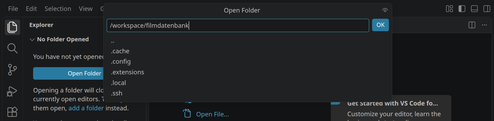
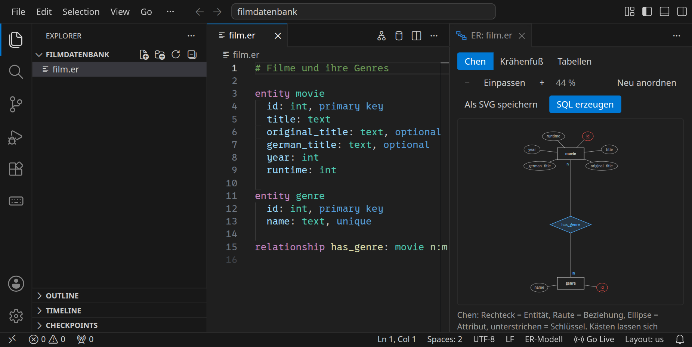
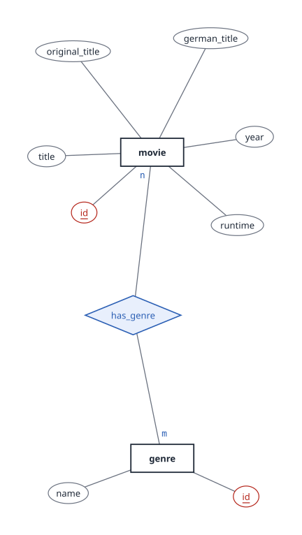
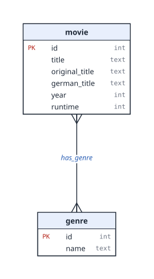
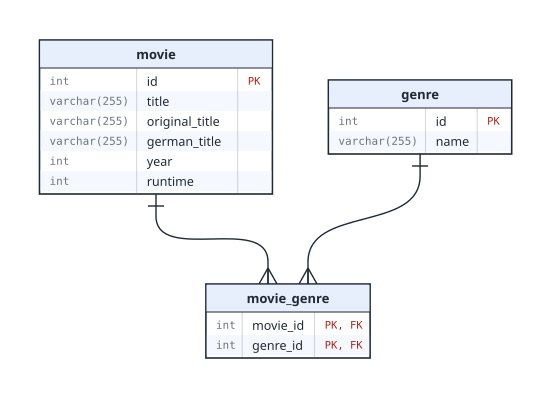
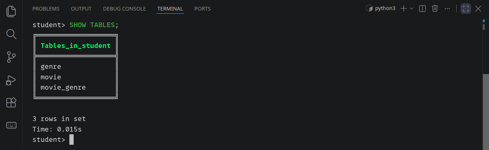
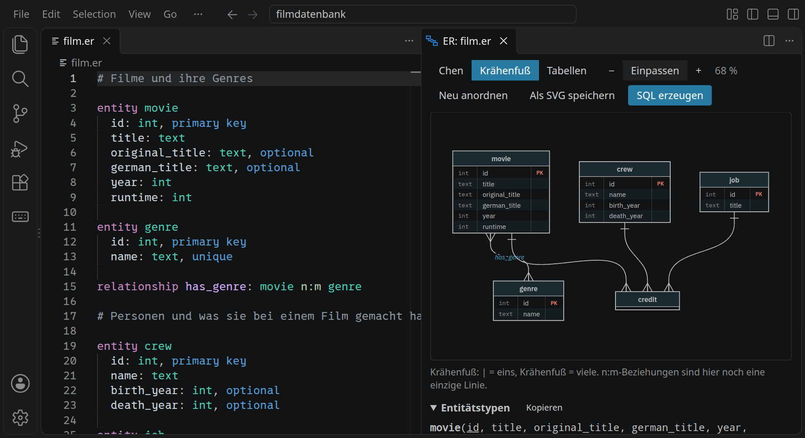
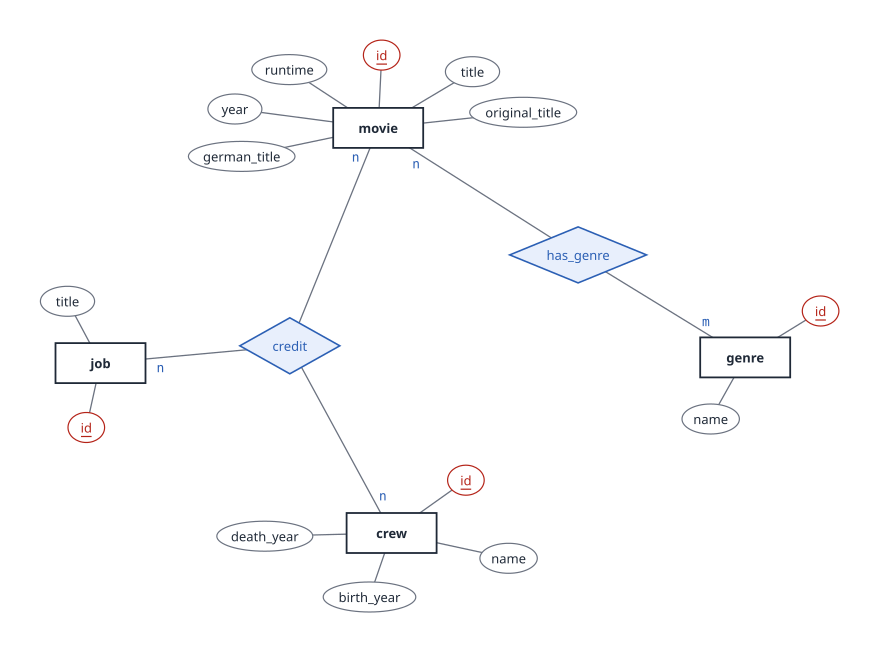
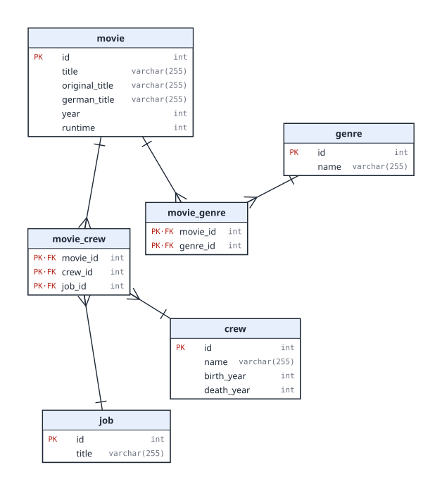

<div class='meta'>
image: er-crowfoot.webp
image_alt: "VS Code mit einem Datenmodell für Filme als Text links und dem daraus gezeichneten ER-Diagramm rechts"
kind: projekt
language: SQL
topic: databases
duration: 3 Doppelstunden
requires: [mysql]
reference: [er-modelle, sql, json, datensaetze]
</div>

<div
    class="autotoc-secondary-trigger"
    data-title="Auf dieser Seite"
    data-levels="h2,h3">
</div>

# Filmdatenbank mit MySQL

<p class='abstract'>
Du entwirfst eine Datenbank für Filme, ihre Genres und die Menschen, die an ihnen mitgearbeitet haben. Das Modell schreibst du als Text, die ER-Werkstatt in VS Code zeichnet daraus Diagramme und erzeugt das SQL für die Tabellen. Danach lädst du echte Filmdaten hinein und setzt mit <code>JOIN</code> wieder zusammen, was das Modell auf mehrere Tabellen verteilt hat.
</p>

In der »Einführung in SQL« hast du eine fertige Datenbank abgefragt. Jetzt baust du selbst eine: vom Modell über das Diagramm zu den Tabellen und dann zu den Abfragen. Alles, was du dabei schreibst, sind Dateien in deinem Workspace, die du behältst.

## Vom Datensatz zum Modell

### Ein Film als Datensatz

So könnte ein Film aussehen, wenn ein Programm ihn als JSON verschickt:

```json
{
  "id": 233,
  "title": "Back to the Future",
  "german_title": "Zurück in die Zukunft",
  "year": 1985,
  "runtime": 115,
  "genres": ["Adventure", "Comedy", "Sci-Fi"],
  "crew": {
    "director": ["Robert Zemeckis"],
    "actor": ["Michael J. Fox", "Christopher Lloyd", "Lea Thompson"],
    "composer": ["Alan Silvestri"]
  }
}
```

Für den Austausch ist das bequem: Alles über einen Film steht an einer Stelle. Für eine Datenbank, die viele Fragen beantworten soll, ist es ungünstig. »Welche Filme sind Sci-Fi?« hieße, in jedem Film die Liste `genres` zu durchsuchen. Und wer bei fünf Filmen Regie geführt hat, stünde fünfmal mit seinem Namen da, vielleicht einmal anders geschrieben.

_uses(json-aufbau)

In dem Datensatz stecken verschiedene Arten von Dingen: **Filme**, **Genres**, **Personen** und das, was eine Person bei einem Film gemacht hat, die **Tätigkeit**. In einer relationalen Datenbank bekommt jede Art ihre eigene Tabelle, und die Beziehungen zwischen ihnen werden eigens gespeichert.

_task(eine-spalte)

### Einen Ordner anlegen

Schließe zuerst einen geöffneten Ordner: <kbd>Strg</kbd><kbd>K</kbd>, dann <kbd>F</kbd>. Öffne dann mit <kbd>Strg</kbd><kbd>K</kbd> und <kbd>Strg</kbd><kbd>O</kbd> den Ordner `filmdatenbank`. Weil es ihn noch nicht gibt, fragt VS Code, ob er angelegt werden soll; bestätige mit <kbd>Enter</kbd>.

<!-- tutorial-screenshot
close-folder
press: Control+K
press: Control+O
wait-for-input-value: /workspace/
type: filmdatenbank
crop-bottom: 55%
-->



Lege im Ordner eine neue Datei `film.er` an: Klicke im Explorer auf das Symbol »Neue Datei« und tippe den Namen. Die Endung `.er` ist wichtig, an ihr erkennt VS Code ein ER-Modell.

### Das Modell als Text

Ein ER-Modell (Entity-Relationship-Modell) beschreibt, welche Dinge es gibt (**Entitäten**), welche Eigenschaften sie haben (**Attribute**) und wie sie zusammenhängen (**Beziehungen**). Du schreibst es als Text. Fang mit Filmen und Genres an:

```er
# Filme und ihre Genres

entity movie
  id: int, primary key
  title: text
  original_title: text, optional
  german_title: text, optional
  year: int
  runtime: int

entity genre
  id: int, primary key
  name: text, unique

relationship has_genre: movie n:m genre
```

So liest du das:

- `entity movie` legt die Entität `movie` an. Die eingerückten Zeilen darunter sind ihre Attribute: Name, Doppelpunkt, Typ.
- Typen: `int` für ganze Zahlen, `text` für Text bis 255 Zeichen. Es gibt auch `varchar(n)`, `decimal(p,s)`, `float`, `date`, `datetime` und `bool`.
- `primary key` markiert den **Primärschlüssel**: das Attribut, das jeden Film eindeutig bestimmt. Titel taugen dafür nicht, es gibt mehrere Filme mit demselben Titel. In SQL heißt er genauso, `PRIMARY KEY`.
- `optional` heißt: darf leer bleiben. Nicht jeder Film hat einen eigenen deutschen Titel.
- `unique` heißt: kein Wert darf doppelt vorkommen. Jedes Genre gibt es nur einmal.
- `relationship has_genre: movie n:m genre` verbindet Filme und Genres. `n:m` ist die **Kardinalität**: Ein Film hat mehrere Genres, und zu einem Genre gehören viele Filme. Weitere Möglichkeiten sind `1:1`, `1:n` und `n:1`.

Bezeichner schreibst du klein und englisch, ohne Leerzeichen und Umlaute; für mehrere Wörter nimmst du `_`. Die Namen sind nicht beliebig: Die Filmdaten, die du später lädst, erwarten genau diese Tabellen und Spalten.

_uses(attribute, beziehungen)

Während du tippst, unterstreicht VS Code Fehler rot und erklärt sie, wenn du mit der Maus darüberfährst. Alle Fehler stehen auch im Bereich »Probleme« (<kbd>Strg</kbd><kbd>Shift</kbd><kbd>M</kbd>).

_task(modell-filme)

### Dasselbe Modell als Diagramm

Klicke oben rechts im Editor auf »ER-Diagramm anzeigen« (oder <kbd>Strg</kbd><kbd>K</kbd>, dann <kbd>V</kbd>). Neben deinem Text erscheint das Modell als Diagramm, und es ändert sich mit, während du schreibst.

<!-- tutorial-screenshot
press: Enter
wait-for-text: create it
press: Enter
wait-for-text: filmdatenbank
write-file: filmdatenbank/film.er <- previous-code
open-file: film.er
close-tab: Welcome
hide-left-sidebar
press: Control+K
press: v
wait-for-text: Neu anordnen
sleep: 1
-->



Oben in der Vorschau wählst du zwischen drei Darstellungen desselben Modells.

**Chen.** Rechtecke sind Entitäten, Rauten Beziehungen, Ellipsen Attribute. Primärschlüssel sind unterstrichen. An den Linien steht die Kardinalität. Diese Darstellung findest du in vielen Schulbüchern.



_person(chen)

**Krähenfuß.** Jede Entität ist ein Kasten mit ihren Attributen. Das Linienende zeigt die Kardinalität: Der gespreizte Krähenfuß heißt »viele«, ein Querstrich heißt »eins«. Weil `has_genre` eine n:m-Beziehung ist, siehst du hier an beiden Enden einen Krähenfuß und keinen Strich.



**Tabellen.** So wird das Modell in der Datenbank gespeichert. Aus jeder Entität wird eine Tabelle. Die n:m-Beziehung wird zu einer eigenen Tabelle `movie_genre`: In ihr steht pro Zeile ein Paar aus Film und Genre, nur mit den beiden IDs.



Jetzt siehst du auch den Strich für »eins«: Die Linien führen von `movie_genre` zu `movie` und zu `genre`, mit dem Krähenfuß bei `movie_genre` und dem Strich am anderen Ende. Zu einem Film gehören viele Zeilen in `movie_genre`, aber jede Zeile gehört zu genau einem Film.

In `movie_genre` steht `PK·FK` hinter beiden Spalten:

- **FK**, Fremdschlüssel: `movie_id` verweist auf eine `id` in `movie`, `genre_id` auf eine `id` in `genre`. Die Datenbank lässt nur IDs zu, die es dort gibt.
- **PK**, Primärschlüssel: Beide Spalten **zusammen** bestimmen eine Zeile eindeutig. `movie_id` allein reicht nicht, ein Film hat mehrere Genres. Das nennt man einen zusammengesetzten Primärschlüssel.

Unter dem Diagramm stehen die Tabellen noch einmal als Liste und, aufgeklappt, »So wurde übersetzt«: Schritt für Schritt, was aus welchem Teil des Modells geworden ist.

Die Kästen kannst du mit der Maus verschieben. Die Positionen merkt sich die ER-Werkstatt in der versteckten Datei `.film.er.layout.json` neben deinem Modell; »Neu anordnen« ordnet alles wieder automatisch an.

_uses(uebersetzung, diagramme)

_task(vorhersage-n1)

## Vom Modell zur Datenbank

### Die Tabellen anlegen

Klicke in der Vorschau auf »SQL erzeugen«. Neben `film.er` entsteht die Datei `film.sql`:

```sql
-- Erzeugt aus film.er mit der ER-Werkstatt 0.1.0.
-- Nicht von Hand ändern: Beim nächsten Erzeugen wird diese Datei überschrieben.
-- Vorhandene Tabellen mit diesen Namen werden gelöscht, samt Inhalt.

SET FOREIGN_KEY_CHECKS = 0;
DROP TABLE IF EXISTS movie, genre, movie_genre;
SET FOREIGN_KEY_CHECKS = 1;

CREATE TABLE movie (
  id              INT NOT NULL,
  title           VARCHAR(255) NOT NULL,
  original_title  VARCHAR(255) NULL,
  german_title    VARCHAR(255) NULL,
  year            INT NOT NULL,
  runtime         INT NOT NULL,
  PRIMARY KEY (id)
);

CREATE TABLE genre (
  id    INT NOT NULL,
  name  VARCHAR(255) NOT NULL,
  PRIMARY KEY (id),
  UNIQUE (name)
);

CREATE TABLE movie_genre (
  movie_id  INT NOT NULL,
  genre_id  INT NOT NULL,
  PRIMARY KEY (movie_id, genre_id)
);

ALTER TABLE movie_genre
  ADD FOREIGN KEY (movie_id)
  REFERENCES movie (id);

ALTER TABLE movie_genre
  ADD FOREIGN KEY (genre_id)
  REFERENCES genre (id);
```

- `DROP TABLE IF EXISTS` löscht die Tabellen, falls es sie schon gibt. So kannst du ein geändertes Modell jederzeit mit demselben Befehl neu anlegen. Dabei geht ihr Inhalt verloren.
- `CREATE TABLE` legt eine Tabelle an. `NOT NULL` steht bei allem, was nicht `optional` ist.
- `PRIMARY KEY` legt den Primärschlüssel fest, `UNIQUE` verbietet doppelte Werte.
- `FOREIGN KEY … REFERENCES movie (id)` macht aus `movie_id` einen Fremdschlüssel auf `movie`.

Öffne ein Terminal (<kbd>Strg</kbd><kbd>J</kbd>) und gib die Datei an MySQL:

```bash
mysql < film.sql
```

Wenn alles klappt, gibt `mysql` nichts aus. Ob die Tabellen da sind, siehst du in `mycli`. Starte es und gib `SHOW TABLES;` ein:

```bash
mycli
```

```sql
SHOW TABLES;
```

<!-- tutorial-screenshot
click: selector:.editor-actions a[aria-label="SQL erzeugen"]
wait-for-file: filmdatenbank/film.sql
# mycli keeps rows free below its prompt for its menu. Without the status bar
# (never visible in a cropped terminal shot) the terminal has the one row more
# that SHOW TABLES with three tables needs to stay in view.
press: Control+Shift+P
type: Toggle Status Bar Visibility
wait-for-text: View: Toggle Status Bar Visibility
press: Enter
show-bottom-panel
terminal-open
terminal-maximize
terminal-run: clear
terminal-run: mysql < film.sql
terminal-wait-for-prompt
terminal-run: mycli
wait-for-text: student>
# No pager in the recipes (mycli's less would swallow the next steps);
# Control+L clears its answer. \n is nopager; a backslash command runs at once
# in multi-line mode. Students see the pager, the page explains it.
terminal-run: \n
sleep: 0.5
press: Control+L
type: SHOW TABLES;
press: Enter
wait-for-text: 3 rows in set
crop-terminal-lines: auto
crop-terminal-skip-bottom: 1
-->



_task(tabellen-filme)

### Filmdaten laden

Die Tabellen sind angelegt, aber leer. Beende `mycli` mit `exit` oder <kbd>Strg</kbd><kbd>D</kbd>. Lade dann die Filme, Genres und ihre Zuordnungen herunter:

```bash_copy
wget https://github.com/specht/workspace-files/raw/main/movie-archive/movies-data-films.sql
```

…und gib sie an MySQL:

```bash
mysql < movies-data-films.sql
```

Am Ende meldet MySQL für jede der drei Tabellen `OK`: Es hat sich angesehen, was jetzt darin steht, damit spätere Abfragen schnell sind.

Schau dir `movies-data-films.sql` ruhig an. Es sind lauter `INSERT`-Befehle, und jeder nennt die Spalten, in die er schreibt, zum Beispiel `INSERT INTO movie (id, title, original_title, …)`. Deshalb müssen die Namen in deinem Modell genau stimmen. Meldet MySQL `Unknown column` oder `Table … doesn't exist`, vergleiche die Namen in `film.er` mit der Meldung, erzeuge das SQL neu und fang mit `mysql < film.sql` wieder an.

<div class='hint'>
Die Filme stammen aus <a href='https://www.wikidata.org/'>Wikidata</a>, einer freien Wissensdatenbank, die jede und jeder weiterverwenden darf. Woher die Daten genau kommen, wie sie ausgewählt wurden und was jede Spalte bedeutet, beschreibt das Handbuch unter <a href='/reference/datensaetze#movies'>Datensätze</a>.
</div>

_task(daten-filme)

Starte wieder `mycli` und sieh dich um, wie in der »Einführung in SQL«:

```sql
SELECT * FROM movie LIMIT 5;
SELECT * FROM movie_genre LIMIT 5;
```

_task(anzahl-filme)

<div class='hint try'>
<strong>Ausprobieren:</strong> Die Schlüssel aus deinem Modell passen jetzt auf die Daten auf. <code>SELECT * FROM movie_genre WHERE movie_id = 233;</code> zeigt die Genres von »Back to the Future« als IDs. Trag eine dieser Zeilen ein zweites Mal ein, mit <code>INSERT INTO movie_genre (movie_id, genre_id) VALUES (233, …);</code>, und dann eine mit einem Genre, das es nicht gibt, etwa 99. Was meldet MySQL jeweils, und welcher Schlüssel steckt dahinter? Geht ein <code>INSERT</code> doch durch, nimm die Zeile mit <code>DELETE FROM movie_genre WHERE movie_id = 233 AND genre_id = …;</code> wieder heraus.
</div>

## JOIN: Beziehungen wieder zusammensetzen

In der »Einführung in SQL« kamen die Antworten aus einer Tabelle. Jetzt hast du die Daten mit Absicht verteilt. Welche Genres hat »Back to the Future«? `movie` kennt den Film, aber nicht seine Genres:

```sql
SELECT id, title, year
FROM movie
WHERE title = 'Back to the Future';
```

Die Zuordnung steht in `movie_genre`. Also verbindest du `movie` mit `movie_genre`:

```sql
SELECT movie.title, movie_genre.genre_id
FROM movie
JOIN movie_genre ON movie.id = movie_genre.movie_id
WHERE movie.title = 'Back to the Future';
```

`JOIN` verbindet Zeilen aus zwei Tabellen. `ON` sagt, welche Zeilen zusammengehören: die, bei denen `movie.id` und `movie_genre.movie_id` gleich sind. Weil es zwei Tabellen mit einer Spalte `id` geben kann, schreibst du den Tabellennamen davor, `movie.id`.

Jetzt hast du die IDs der Genres. Für ihre Namen folgst du der nächsten Linie im Tabellendiagramm, von `movie_genre` zu `genre`:

```sql
SELECT movie.title, genre.name
FROM movie
JOIN movie_genre ON movie.id = movie_genre.movie_id
JOIN genre ON movie_genre.genre_id = genre.id
WHERE movie.title = 'Back to the Future';
```

Was bei jedem `JOIN` passiert, zeigt der Query Stepper. Er führt die Abfrage Teil für Teil aus, so wie die Datenbank, auf denselben Filmdaten. Mit <kbd>←</kbd> und <kbd>→</kbd> siehst du, wie aus `movie` mit dem ersten `JOIN` eine breitere Tabelle wird, in der jeder Film so oft vorkommt, wie er Genres hat, und wie das zweite `JOIN` jede Zeile um den Namen des Genres ergänzt. Erst `WHERE` lässt dann die drei Zeilen übrig. Du kannst die Abfrage auch ändern.

<div class='query-stepper' data-stepper data-dataset='movies' data-query="SELECT movie.title, genre.name
FROM movie
JOIN movie_genre ON movie.id = movie_genre.movie_id
JOIN genre ON movie_genre.genre_id = genre.id
WHERE movie.title = 'Back to the Future';">
</div>

<script src='/include/query_stepper.js'></script>

<div class='hint'>
Jedes <code>JOIN … ON …</code> folgt einer Linie im Tabellendiagramm. Wenn du dort den Weg von einer Tabelle zur anderen findest, hast du die Abfrage schon fast. Vergisst du <code>ON</code>, verbindet MySQL jede Zeile mit jeder: Aus einigen tausend Filmen und Zuordnungen werden Millionen Zeilen.
</div>

_task(genres-film)

_task(animation)

<div class='hint try'>
<strong>Ausprobieren:</strong> Vergiss das <code>ON</code> einmal mit Absicht und zähle nur: <code>SELECT COUNT(*) FROM movie JOIN movie_genre;</code> Vergleiche das Ergebnis mit <code>SELECT COUNT(*) FROM movie;</code> und <code>SELECT COUNT(*) FROM movie_genre;</code>. Wie kommt die große Zahl zustande?
</div>

### Zählen pro Gruppe

Mit `COUNT(*)` zählst du Zeilen. Mit `GROUP BY` teilst du das Ergebnis vorher in Gruppen und zählst jede Gruppe für sich. Wie viele Genres hat jeder Film, hier die ersten fünf?

```sql
SELECT movie.title, COUNT(*)
FROM movie
JOIN movie_genre ON movie.id = movie_genre.movie_id
GROUP BY movie.id, movie.title
LIMIT 5;
```

Alle Zeilen mit demselben Film werden zu einer zusammengefasst, und `COUNT(*)` zählt, wie viele es waren: seine Genres. Gruppiert wird nach `movie.id`, weil zwei Filme denselben Titel haben können.

_task(filme-pro-genre)

## Menschen und Tätigkeiten

### Das Modell wächst

Bisher fehlt die `crew` aus dem Datensatz vom Anfang. Wer hat bei »Back to the Future« Regie geführt? In welchen Filmen hat eine Person mitgespielt? Dafür braucht das Modell Personen und ihre Tätigkeiten.

Überlege, bevor du weiterliest: Eine Person arbeitet an vielen Filmen, an einem Film arbeiten viele Personen. Und eine Person kann bei **einem** Film mehrere Tätigkeiten haben, etwa Regie führen und das Drehbuch schreiben. Zwischen welchen Entitäten besteht die Beziehung?

Sie verbindet drei Entitäten auf einmal: Film, Person und Tätigkeit. Ergänze `film.er` um zwei Entitäten und eine dreistellige Beziehung:

```er
# Personen und was sie bei einem Film gemacht haben

entity crew
  id: int, primary key
  name: text
  birth_year: int, optional
  death_year: int, optional

entity job
  id: int, primary key
  title: text, unique

relationship credit: movie, crew, job as movie_crew
```

- Eine Beziehung zwischen mehr als zwei Entitäten zählst du mit Kommas auf. Sie wird immer zu einer eigenen Tabelle.
- Ohne `as` hieße diese Tabelle `movie_crew_job`. Die Filmdaten erwarten `movie_crew`, deshalb gibst du den Namen mit `as movie_crew` vor.
- `job` enthält Tätigkeiten wie `actor`, `director` oder `composer`.

In der ER-Werkstatt, als Krähenfuß, hängt die Beziehung `credit` an allen drei Entitäten:

<!-- tutorial-screenshot
# Das ganze Modell in der ER-Werkstatt, als Krähenfuß. mycli from the
# picture with show-tables ends first: hidden, its terminal is too small.
terminal-run: quit
terminal-wait-for-prompt
check-task-fails: modell-crew
write-file: filmdatenbank/film.er <- file:film-2.er
check-task: modell-crew
open-file: film.er
hide-left-sidebar
hide-bottom-panel
click: Krähenfuß
sleep: 0.5
click: Einpassen
sleep: 1
-->





In der Tabellenansicht siehst du `movie_crew` mit drei Fremdschlüsseln, die zusammen den Primärschlüssel bilden. So kann dieselbe Person bei einem Film mehrere Tätigkeiten haben, aber dieselbe Kombination aus Film, Person und Tätigkeit nicht zweimal vorkommen.



_task(modell-crew)

Erzeuge das SQL neu, beende `mycli` und lege die Tabellen an. Weil `film.sql` mit `DROP TABLE` beginnt, sind danach auch `movie` und `genre` wieder leer. Lade deshalb danach beide Datendateien. Die neue musst du erst herunterladen:

```bash_copy
wget https://github.com/specht/workspace-files/raw/main/movie-archive/movies-data-crew.sql
```

```bash
mysql < film.sql
mysql < movies-data-films.sql
mysql < movies-data-crew.sql
```

<div class='hint'>
In einer echten Datenbank, deren Daten nirgends sonst liegen, würdest du nicht alles löschen und neu laden. Dort ergänzt man nur, was neu ist: <code>CREATE TABLE</code> für die neuen Tabellen, <code>ALTER TABLE</code> für neue Spalten. Hier liegen die Daten in Dateien, deshalb ist Neuanlegen der einfachere und sichere Weg.
</div>

_task(tabellen-crew)

### Durch mehrere Beziehungen zu einer Person

Jetzt hat die Datenbank sechs Tabellen. Kurz aufgeschrieben, eine Zeile pro Tabelle, der Primärschlüssel unterstrichen und jeder Fremdschlüssel mit einem ↑:

_schema(movies)

Starte wieder `mycli`. Wer hat bei »Back to the Future« Regie geführt? Im Tabellendiagramm führt der Weg von `movie` über `movie_crew` zu `crew`, und die Tätigkeit steht in `job`. Jeder Schritt wird ein `JOIN`:

```sql
SELECT crew.name
FROM movie
JOIN movie_crew ON movie.id = movie_crew.movie_id
JOIN crew ON movie_crew.crew_id = crew.id
JOIN job ON movie_crew.job_id = job.id
WHERE movie.title = 'Back to the Future' AND job.title = 'director';
```

_task(besetzung-film)

_task(nolan)

Mit `GROUP BY` zählst du auch hier. Und wenn du nur Gruppen sehen willst, die eine Bedingung erfüllen, schreibst du sie hinter `HAVING`. `WHERE` filtert Zeilen, bevor gruppiert wird, `HAVING` filtert die fertigen Gruppen:

```sql
SELECT genre.name, COUNT(*)
FROM genre
JOIN movie_genre ON genre.id = movie_genre.genre_id
GROUP BY genre.id, genre.name
HAVING COUNT(*) >= 100;
```

Im Query Stepper siehst du die Gruppen: Bei `GROUP BY` bekommt jedes Genre seine Farbe, und `HAVING` streicht ganze Gruppen, nicht einzelne Zeilen. Probier auch, die Bedingung mit `WHERE` zu schreiben; der Query Stepper sagt dir, warum das nicht geht.

<div class='query-stepper' data-stepper data-dataset='movies' data-query="SELECT genre.name, COUNT(*)
FROM genre
JOIN movie_genre ON genre.id = movie_genre.genre_id
GROUP BY genre.id, genre.name
HAVING COUNT(*) >= 100;">
</div>

_tool(query-stepper)

_task(viel-regie)

### Wer spielt mit wem?

Eine einfache Frage: Welche zwei Schauspielerinnen oder Schauspieler standen besonders oft gemeinsam vor der Kamera? Die Datenbank kann sie beantworten, aber die Abfrage braucht jede Tabelle zweimal, einmal für jede der beiden Personen:

```sql
SELECT a.name, b.name, COUNT(*) AS together
FROM movie_crew AS ma
JOIN movie_crew AS mb ON ma.movie_id = mb.movie_id
JOIN job AS ja ON ma.job_id = ja.id
JOIN job AS jb ON mb.job_id = jb.id
JOIN crew AS a ON ma.crew_id = a.id
JOIN crew AS b ON mb.crew_id = b.id
WHERE ja.title = 'actor' AND jb.title = 'actor' AND a.id < b.id
GROUP BY a.id, a.name, b.id, b.name
ORDER BY together DESC
LIMIT 10;
```

`AS ma` gibt einer Tabelle einen zweiten Namen, damit sie zweimal vorkommen kann. `a.id < b.id` sorgt dafür, dass jedes Paar nur einmal gezählt wird und niemand mit sich selbst. Du musst die Abfrage nicht Zeile für Zeile nachbauen; probier sie aus.

<div class='hint try'>
<strong>Ausprobieren:</strong> Frag nach Schauspiel und Regie: Ändere <code>jb.title = 'actor'</code> zu <code>jb.title = 'director'</code> und lass <code>AND a.id &lt; b.id</code> weg. Wer spielt am häufigsten bei derselben Regie mit? Warum muss <code>a.id &lt; b.id</code> dafür weg? Und warum steht jetzt in manchen Zeilen zweimal derselbe Name?
</div>

Fragen, die von Person zu Film zu Person und weiter wandern, werden in SQL schnell lang. Graphdatenbanken wie Neo4j speichern genau diese Wege und machen solche Fragen kurz.

_task(neue-frage)

## Zusammenfassung

- Ein **ER-Modell** beschreibt Entitäten, ihre Attribute und Beziehungen. In der ER-Werkstatt schreibst du es als Text in eine `.er`-Datei und siehst es als Chen-, Krähenfuß- oder Tabellendiagramm.
- Ein **Primärschlüssel** bestimmt eine Zeile eindeutig, ein **Fremdschlüssel** verweist auf eine Zeile einer anderen Tabelle.
- Eine **n:m-Beziehung** und jede Beziehung zwischen drei Entitäten wird eine eigene Tabelle mit einem **zusammengesetzten Primärschlüssel**.
- Aus dem Modell entsteht SQL (`CREATE TABLE`, `PRIMARY KEY`, `FOREIGN KEY`), das du mit `mysql < film.sql` ausführst.
- Mit `JOIN … ON …` setzt du verteilte Daten wieder zusammen, einen Schritt pro Linie im Tabellendiagramm. `GROUP BY` bildet Gruppen, `HAVING` filtert sie.

Im Handbuch: _uses(create-table, join, aggregieren)

Dein Modell `film.er`, das erzeugte `film.sql` und die Diagramme, die du mit »Als SVG speichern« sicherst, liegen in `/workspace/filmdatenbank`. Sie gehören dir; du kannst sie herunterladen oder in ein eigenes Repository legen.

<!-- tutorial-step
# Jede Aufgabe, die im Workspace oder in MySQL nachsieht, nimmt den Stand
# an, den die Seite beschreibt, und lehnt den Stand davor ab.
# The ER-Werkstatt's picture hid the terminal and ended mycli; in bash,
# quit is only an unknown command.
terminal-open
terminal-maximize
terminal-run: quit
terminal-wait-for-prompt
write-file: filmdatenbank/film.er <- file:film-1.er
check-task: modell-filme
terminal-run: sed -i 's/n:m/1:n/' film.er
check-task-fails: modell-filme
write-file: filmdatenbank/film.er <- file:film-1.er
# The terminal back to its normal height, the editor above it
click: selector:.part.panel [aria-label*="Restore Panel"]
open-file: film.er
click: selector:.editor-actions a[aria-label="SQL erzeugen"]
wait-for-file-newer: filmdatenbank/film.sql <- filmdatenbank/film.er
# Right after »SQL erzeugen« the terminal loses the first line it is sent
terminal-run: clear
terminal-wait-for-prompt
terminal-run: mysql -e 'DROP TABLE IF EXISTS movie_crew, crew, job, movie_genre, movie, genre' && touch dropped
wait-for-file: filmdatenbank/dropped
terminal-run: rm dropped
check-task-fails: tabellen-filme
terminal-run: mysql < film.sql
terminal-wait-for-prompt
check-task: tabellen-filme
check-task-fails: daten-filme
terminal-run: test -f movies-data-films.sql || wget -q https://github.com/specht/workspace-files/raw/main/movie-archive/movies-data-films.sql
terminal-wait-for-prompt: 60
terminal-run: mysql < movies-data-films.sql
terminal-wait-for-prompt: 60
check-task: daten-filme
check-task: anzahl-filme <- SELECT COUNT(*) FROM movie;
check-task-fails: anzahl-filme <- SELECT COUNT(*) FROM movie_genre;
check-task: genres-film <- SELECT genre.name FROM movie JOIN movie_genre ON movie.id = movie_genre.movie_id JOIN genre ON movie_genre.genre_id = genre.id WHERE movie.title = 'Back to the Future';
check-task-fails: genres-film <- SELECT genre_id FROM movie_genre JOIN movie ON movie.id = movie_genre.movie_id WHERE movie.title = 'Back to the Future';
check-task: animation <- SELECT movie.title, movie.year FROM movie JOIN movie_genre ON movie.id = movie_genre.movie_id JOIN genre ON movie_genre.genre_id = genre.id WHERE genre.name = 'Animation' ORDER BY movie.year;
check-task-fails: animation <- SELECT movie.title, movie.year FROM movie JOIN movie_genre ON movie.id = movie_genre.movie_id JOIN genre ON movie_genre.genre_id = genre.id WHERE genre.name = 'Animation' ORDER BY movie.title;
check-task: filme-pro-genre <- SELECT genre.name, COUNT(*) AS movies FROM genre JOIN movie_genre ON genre.id = movie_genre.genre_id GROUP BY genre.id, genre.name ORDER BY movies DESC;
check-task-fails: filme-pro-genre <- SELECT genre_id, COUNT(*) FROM movie_genre GROUP BY genre_id;
write-file: filmdatenbank/film.er <- file:film-2.er
check-task: modell-crew
open-file: film.er
click: selector:.editor-actions a[aria-label="SQL erzeugen"]
wait-for-file-newer: filmdatenbank/film.sql <- filmdatenbank/film.er
# Right after »SQL erzeugen« the terminal loses the first line it is sent
terminal-run: clear
terminal-wait-for-prompt
check-task-fails: tabellen-crew
terminal-run: test -f movies-data-crew.sql || wget -q https://github.com/specht/workspace-files/raw/main/movie-archive/movies-data-crew.sql
terminal-wait-for-prompt: 60
terminal-run: mysql < film.sql && mysql < movies-data-films.sql && mysql < movies-data-crew.sql
terminal-wait-for-prompt: 120
check-task: tabellen-crew
check-task: besetzung-film <- SELECT crew.name FROM movie JOIN movie_crew ON movie.id = movie_crew.movie_id JOIN crew ON movie_crew.crew_id = crew.id JOIN job ON movie_crew.job_id = job.id WHERE movie.title = 'Back to the Future' AND job.title = 'actor';
check-task-fails: besetzung-film <- SELECT crew.name FROM movie JOIN movie_crew ON movie.id = movie_crew.movie_id JOIN crew ON movie_crew.crew_id = crew.id WHERE movie.title = 'Back to the Future';
check-task: nolan <- SELECT movie.title, movie.year FROM crew JOIN movie_crew ON crew.id = movie_crew.crew_id JOIN job ON movie_crew.job_id = job.id JOIN movie ON movie_crew.movie_id = movie.id WHERE crew.name = 'Christopher Nolan' AND job.title = 'director' ORDER BY movie.year;
check-task-fails: nolan <- SELECT movie.title, movie.year FROM crew JOIN movie_crew ON crew.id = movie_crew.crew_id JOIN movie ON movie_crew.movie_id = movie.id WHERE crew.name = 'Christopher Nolan' ORDER BY movie.year;
check-task: viel-regie <- SELECT crew.name, COUNT(*) AS movies FROM crew JOIN movie_crew ON crew.id = movie_crew.crew_id JOIN job ON movie_crew.job_id = job.id WHERE job.title = 'director' GROUP BY crew.id, crew.name HAVING movies >= 5 ORDER BY movies DESC;
check-task-fails: viel-regie <- SELECT crew.name, COUNT(*) AS movies FROM crew JOIN movie_crew ON crew.id = movie_crew.crew_id GROUP BY crew.id, crew.name HAVING movies >= 5 ORDER BY movies DESC;
-->
