<div class='meta'>
image: fire.webp:73:0
image_alt: "Pixeliges Feuer, unten hellgelb, nach oben dunkelrot"
kind: projekt
language: Pixelflow Canvas / Ruby
</div>

<div
    class="autotoc-secondary-trigger"
    data-title="Auf dieser Seite"
    data-levels="h2,h3">
</div>

# Feueranimation

<p class='abstract'>
Du programmierst in Ruby ein Feuer aus Pixeln, das am unteren Rand glüht und nach oben lodert: zuerst einen Farbverlauf von Schwarz über Rot und Gelb bis Weiß, dann eine Animation und einen Filterkernel, der jedes Pixel aus seinen Nachbarn berechnet. Der Effekt stammt aus der Demoszene der 1990er Jahre, in der Leute kleine Programme mit spektakulärer Grafik und Musik schrieben, die das Letzte aus ihren Rechnern herausholten.
</p>

Stelle zuerst sicher, dass du keinen Ordner geöffnet hast. Um sicherzugehen, drücke einfach den Shortcut für »Ordner schließen«: <kbd>Strg</kbd><kbd>K</kbd> und dann <kbd>F</kbd>. Dein Workspace sollte jetzt ungefähr so aussehen:


<div class='hint books'>
Dieses Tutorial geht davon aus, dass du die Erweiterung Pixelflow Canvas und das Rubygem <code>pixelflow_canvas</code> schon installiert hast. Falls nicht, steht im Abschnitt »Vorbereitung« von <a href='/drawing#1-vorbereitung'>»Pixelgrafik mit Ruby«</a>, wie es geht.
</div>

## Farbverlauf erstellen

Der Feuereffekt basiert auf einem Farbverlauf von Schwarz über Rot, Orange und Gelb bis Weiß. Du verwendest das Pixelflow Canvas mit einer Palette von 64 Farben: Kleine Farbnummern stehen für kalte Pixel, große für heiße. Der Farbverlauf lässt sich in vier Abschnitte teilen:

- Schwarz bis Dunkelrot (Farben 0 bis 15)
- Dunkelrot bis Orange (Farben 16 bis 31)
- Orange bis Gelb (Farben 32 bis 47)
- Gelb bis Weiß (Farben 48 bis 63)

### Die Palette anzeigen

Am Anfang steht ein kleines Programm, das die ersten 64 Farben der Palette zeigt. So kannst du nach jedem Schritt kontrollieren, ob die Farben stimmen. Erstelle eine neue Datei namens `fire.rb` und füge folgenden Code ein:

```ruby
require 'pixelflow_canvas'

Pixelflow::Canvas.new(64, 1, :palette) do
    (0...64).each do |i|
        set_pixel(i, 0, i)
    end
end
```


Starte das Pixelflow Canvas, indem du <kbd>Strg</kbd><kbd>Shift</kbd><kbd>P</kbd> oder <kbd>F1</kbd> drückst und dann »Show Pixelflow Canvas« eingibst.
Führe das Programm aus, indem du im Terminal `ruby fire.rb` eingibst. Da standardmäßig die [VGA-Palette](https://specht.github.io/pixelflow_canvas_ruby/palettes.html#vga) verwendet wird, siehst du die ersten 64 Farben der VGA-Palette:

<!-- tutorial-screenshot
# Erweiterung, Gem und Zeichenfläche wie in »Zeichnen mit Pixelflow Canvas«
press: Control+p
type: ext install gymnasiumsteglitz.pixelflow-canvas
wait-for-text: Press Enter to install extension
press: Enter
wait-for-text: Trust Publisher & Install
click: Trust Publisher & Install
sleep: 10
press: F1
type: pixel
wait-for-text: Show Pixelflow Canvas
press: Enter
wait-for-text: Pixelflow Canvas
sleep: 2
terminal-open
terminal-run: gem install pixelflow_canvas
terminal-wait-for-prompt: 120
write-file: fire-steps/save_step.rb <- file:stufen/save_step.rb
# Die ersten 64 Farben der VGA-Palette
write-file: fire-steps/ramp0.rb <- file:stufen/ramp0.rb
terminal-run: ruby -C /workspace/fire-steps -r ./save_step.rb ramp0.rb
terminal-wait-for-prompt: 180
image-file: fire-steps/step.png 8
-->
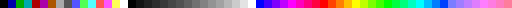

Diese 64 Farben ersetzt du jetzt durch den Farbverlauf. Sieh ihn dir im Einzelnen an; die drei Linien zeigen, wie viel Rot, Grün und Blau in jeder Farbe steckt:

<svg width="100%" viewBox="-0.3 -0.1 4.5 1.2">
    <defs>
        <linearGradient id="g0"><stop offset="0%" stop-color='#000' /><stop offset="100%" stop-color='#800' /></linearGradient>
        <linearGradient id="g1"><stop offset="0%" stop-color='#800' /><stop offset="100%" stop-color='#F80' /></linearGradient>
        <linearGradient id="g2"><stop offset="0%" stop-color='#F80' /><stop offset="100%" stop-color='#FF8' /></linearGradient>
        <linearGradient id="g3"><stop offset="0%" stop-color='#FF8' /><stop offset="100%" stop-color='#FFF' /></linearGradient>
    </defs>
    <path d="M0,1 l 1,0 0,-1 -1,0" stroke='none' fill='url(#g0)' />
    <path d="M1,1 l 1,0 0,-1 -1,0" stroke='none' fill='url(#g1)' />
    <path d="M2,1 l 1,0 0,-1 -1,0" stroke='none' fill='url(#g2)' />
    <path d="M3,1 l 1,0 0,-1 -1,0" stroke='none' fill='url(#g3)' />
    <path d="M0,0 l 0,1" stroke='#aaa' stroke-width='0.005' fill='none' />
    <path d="M1,0 l 0,1" stroke='#aaa' stroke-width='0.005' fill='none' />
    <path d="M2,0 l 0,1" stroke='#aaa' stroke-width='0.005' fill='none' />
    <path d="M3,0 l 0,1" stroke='#aaa' stroke-width='0.005' fill='none' />
    <path d="M4,0 l 0,1" stroke='#aaa' stroke-width='0.005' fill='none' />
    <path d="M0,0 l 4,0" stroke='#aaa' stroke-width='0.005' fill='none' />
    <path d="M0,0.5 l 4,0" stroke='#aaa' stroke-width='0.005' fill='none' />
    <path d="M0,1 l 4,0" stroke='#aaa' stroke-width='0.005' fill='none' />
    <path d="M0,1 L 1,0.5 2,0 3,0 4,0" stroke='#a00' stroke-width='0.01' fill='none'/>
    <path d="M0,1 L 1,1 2,0.5 3,0 4,0" stroke='#0a0' stroke-width='0.01' fill='none'/>
    <path d="M0,1 L 1,1 2,1 3,0.5 4,0" stroke='#00a' stroke-width='0.01' fill='none'/>
    <g transform='translate(-0.05,-0.05)'>
    <rect x='-0.1' y='1' width='0.1' height='0.1' rx='0.02' stroke='#a00' fill='#f00' stroke-width='0.01' />
    <rect x='0.0' y='1' width='0.1' height='0.1' rx='0.02' stroke='#0a0' fill='#0f0' stroke-width='0.01' />
    <rect x='0.1' y='1' width='0.1' height='0.1' rx='0.02' stroke='#00a' fill='#00f' stroke-width='0.01' />
    <rect x='1.0' y='0.5' width='0.1' height='0.1' rx='0.02' stroke='#a00' fill='#f00' stroke-width='0.01' />
    <rect x='0.95' y='1' width='0.1' height='0.1' rx='0.02' stroke='#0a0' fill='#0f0' stroke-width='0.01' />
    <rect x='1.05' y='1' width='0.1' height='0.1' rx='0.02' stroke='#00a' fill='#00f' stroke-width='0.01' />
    <rect x='2.0' y='0' width='0.1' height='0.1' rx='0.02' stroke='#a00' fill='#f00' stroke-width='0.01' />
    <rect x='2.0' y='0.5' width='0.1' height='0.1' rx='0.02' stroke='#0a0' fill='#0f0' stroke-width='0.01' />
    <rect x='2.0' y='1' width='0.1' height='0.1' rx='0.02' stroke='#00a' fill='#00f' stroke-width='0.01' />
    <rect x='2.95' y='0' width='0.1' height='0.1' rx='0.02' stroke='#a00' fill='#f00' stroke-width='0.01' />
    <rect x='3.05' y='0' width='0.1' height='0.1' rx='0.02' stroke='#0a0' fill='#0f0' stroke-width='0.01' />
    <rect x='3.0' y='0.5' width='0.1' height='0.1' rx='0.02' stroke='#00a' fill='#00f' stroke-width='0.01' />
    <rect x='3.9' y='0' width='0.1' height='0.1' rx='0.02' stroke='#a00' fill='#f00' stroke-width='0.01' />
    <rect x='4.0' y='0' width='0.1' height='0.1' rx='0.02' stroke='#0a0' fill='#0f0' stroke-width='0.01' />
    <rect x='4.1' y='0' width='0.1' height='0.1' rx='0.02' stroke='#00a' fill='#00f' stroke-width='0.01' />
    </g>
</svg>

### Schwarz bis Dunkelrot

Im ersten Abschnitt bleiben Grün und Blau auf 0, während Rot von 0 auf 50 % ansteigt. Da jeder Farbkanal einen Wert von 0 bis 255 annehmen kann, entspricht 50 % einem Wert von etwa 128. Der Farbverlauf beginnt also bei Schwarz (0, 0, 0) und endet bei Dunkelrot (128, 0, 0). Der erste Abschnitt umfasst 16 Farben, also erhöhst du den Rotwert in jedem Schritt um 8 und landest nach 16 Schritten bei 128. Ändere den Code wie folgt:

```ruby
require 'pixelflow_canvas'

Pixelflow::Canvas.new(64, 1, :palette) do
    (0...16).each do |i|
        set_palette(i, i * 8, 0, 0)
    end
    (0...64).each do |i|
        set_pixel(i, 0, i)
    end
end
```

<div class='hint books'>
Hinweis: Achte auf die drei Punkte im Bereich <code>(0...16)</code>. Der dritte Punkt schiebt die hintere Zahl aus dem Bereich heraus, sodass die Schleife nur von 0 bis 15 läuft. Du könntest auch <code>(0..15)</code> schreiben, mit zwei Punkten.
</div>

Dein Bild sollte jetzt so aussehen:

<!-- tutorial-screenshot
# Schwarz bis Dunkelrot
write-file: fire-steps/ramp1.rb <- file:stufen/ramp1.rb
terminal-run: ruby -C /workspace/fire-steps -r ./save_step.rb ramp1.rb
terminal-wait-for-prompt: 180
image-file: fire-steps/step.png 8
-->
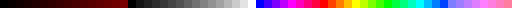

### Dunkelrot bis Orange

Im zweiten Abschnitt steigt der Grünwert von 0 auf 50% an, während Rot weiter von 50% auf 100% wächst. Blau bleibt weiterhin auf 0.
Der Farbverlauf geht also von Dunkelrot (128, 0, 0) zu Orange (255, 128, 0). Füge folgenden Code direkt hinter dem `set_palette`-Aufruf ein:

```ruby
set_palette(i + 16, i * 8 + 128, i * 8, 0)
```

_task(farbe-20)

Dein Farbverlauf sollte nun so aussehen:

<!-- tutorial-screenshot
# bis Orange
write-file: fire-steps/ramp2.rb <- file:stufen/ramp2.rb
terminal-run: ruby -C /workspace/fire-steps -r ./save_step.rb ramp2.rb
terminal-wait-for-prompt: 180
image-file: fire-steps/step.png 8
-->
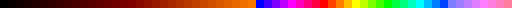

### Orange bis Gelb

Im dritten Abschnitt steigt der Grünwert von 50% auf 100% an, während Blau von 0 auf 50% ansteigt. Rot bleibt bei 100%. Der Farbverlauf geht also von Orange (255, 128, 0) zu Gelb (255, 255, 128). Füge folgenden Code ein:

```ruby
set_palette(i + 32, 255, i * 8 + 128, i * 8)
```

Dein Farbverlauf sollte nun so aussehen:

<!-- tutorial-screenshot
# bis Gelb
write-file: fire-steps/ramp3.rb <- file:stufen/ramp3.rb
terminal-run: ruby -C /workspace/fire-steps -r ./save_step.rb ramp3.rb
terminal-wait-for-prompt: 180
image-file: fire-steps/step.png 8
-->
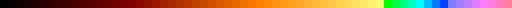

### Gelb bis Weiß

Im vierten Abschnitt steigt der Blauwert von 50% auf 100% an, während Rot und Grün bei 100% bleiben. Der Farbverlauf geht also von Gelb (255, 255, 128) zu Weiß (255, 255, 255). Füge folgenden Code ein:

```ruby
set_palette(i + 48, 255, 255, i * 8 + 128)
```

Geschafft! Dein Farbverlauf sollte nun so aussehen:

<!-- tutorial-screenshot
# bis Weiß
write-file: fire-steps/ramp4.rb <- file:stufen/ramp4.rb
terminal-run: ruby -C /workspace/fire-steps -r ./save_step.rb ramp4.rb
terminal-wait-for-prompt: 180
image-file: fire-steps/step.png 8
-->
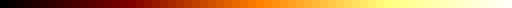

_task(blau-63)

## Animations-Loop

Jetzt baust du das Programm zum Gerüst einer Animation um: Bild für Bild zeichnet es am unteren Rand ein helles Rechteck, aus dem danach das Feuer aufsteigt. Ändere dein Programm so:

_include_file(draft1.rb, ruby)

Anmerkungen:

- In Zeile 3 steht die Größe der Animation, 256 × 128 Pixel.
- Zeile 5 schaltet »Double Buffering« ein: Du siehst nicht zu, wie ein Bild entsteht, sondern nur das fertige. Dafür ruft Zeile 22 `flip()` auf; erst dann zeigt die Zeichenfläche das neue Bild.
- In Zeile 16 beginnt eine Endlosschleife, die die Animation Bild für Bild zeichnet. Da das Programm sich nun nicht mehr von selbst beendet, musst du es manuell abbrechen, indem du <kbd>Strg</kbd><kbd>C</kbd> drückst.

Das sieht noch unspektakulär aus, aber am unteren Rand ist schon das helle Rechteck zu sehen. Auch wenn es nicht so aussieht: Die Schleife zeichnet schon laufend neue Bilder.

<!-- tutorial-screenshot
# Das Gerüst der Animation, nach 150 Bildern
write-file: fire-steps/draft1.rb <- file:draft1.rb
terminal-run: STEP_FRAMES=150 ruby -C /workspace/fire-steps -r ./save_step.rb draft1.rb
terminal-wait-for-prompt: 180
image-file: fire-steps/step.png 4
-->
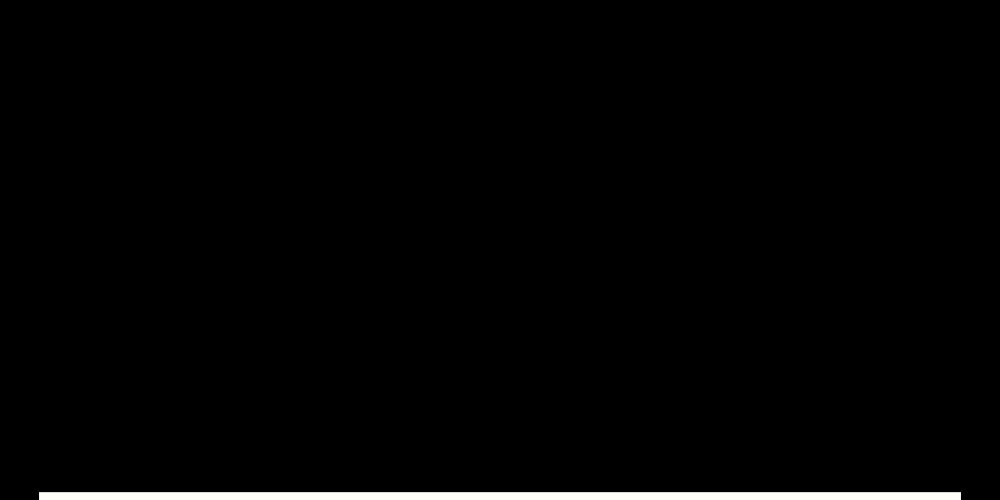

Für das Feuer brauchst du eine Technik aus der Bildbearbeitung, den »Filterkernel« (auch Faltungsmatrix, englisch *Convolution Matrix*).

## Filterkernel

Filterkernel werden für verschiedene Effekte verwendet, z. B. Weichzeichnen, Schärfen oder Kantenerkennung. Dabei wird ein kleines Quadrat von Pixeln um einen bestimmten Pixel herum betrachtet, und die Farben dieser Pixel werden mit einem bestimmten Gewicht multipliziert und addiert. Der resultierende Wert wird dann als neuer Farbwert für den betrachteten Pixel verwendet.

Hier siehst du ein paar Beispiele:

<style>
.kernel-picture {
    position: relative;
}
.kernel-picture img {
    display: block;
    width: 100%;
    image-rendering: pixelated;
}
.kernel {
    color: #000;
    position: absolute;
    left: 0;
    top: 0;
    bottom: 0;
    right: 0;
    display: flex;
    align-items: center;
    justify-content: center;
    font-family: 'IBM Plex Mono';
    flex-direction: column;
}
.kernel td {
    width: 1.5em;
    text-align: center;
}
[data-bs-theme=dark] {
    .kernel {
        color: #fff;
    }
    .kernel td {
        color: #fff;
    }
    .kernel_img {
        filter: invert(0.917);
    }
}
</style>

<div class='gallery columns-3'>
<figure>
    <div class='kernel-picture'>
        
        <div class='kernel'>
            <table>
                <tr><td>0</td><td>0</td><td>0</td></tr>
                <tr><td>0</td><td>1</td><td>0</td></tr>
                <tr><td>0</td><td>0</td><td>0</td></tr>
            </table>
        </div>
    </div>
    <figcaption>Identity</figcaption>
</figure>
<figure>
    <div class='kernel-picture'>
        
        <div class='kernel'>
            <table>
                <tr><td>1</td><td>1</td><td>1</td></tr>
                <tr><td>1</td><td>1</td><td>1</td></tr>
                <tr><td>1</td><td>1</td><td>1</td></tr>
            </table>
        </div>
    </div>
    <figcaption>Box blur</figcaption>
</figure>
<figure>
    <div class='kernel-picture'>
        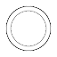
        <div class='kernel'>
            <table>
                <tr><td>0</td><td>-1</td><td>0</td></tr>
                <tr><td>-1</td><td>4</td><td>-1</td></tr>
                <tr><td>0</td><td>-1</td><td>0</td></tr>
            </table>
        </div>
    </div>
    <figcaption>Edge detection</figcaption>
</figure>
</div>

Im ersten Beispiel (»Identity«) wird der Pixelwert unverändert übernommen und alle umliegenden Pixel ignoriert. Im zweiten Beispiel (»Box blur«) wird der Pixelwert mit den Werten der umliegenden Pixel gemittelt, um einen Weichzeichnungseffekt zu erzielen. Im dritten Beispiel (»Edge detection«) wird der Pixelwert so berechnet, dass Kanten im Bild hervorgehoben werden.

### Der Filterkernel für Feuer

Wird ein Filterkernel wiederholt auf ein Bild angewendet, entsteht ein Effekt, der sich über die gesamte Bildfläche ausbreitet. Der Feuereffekt verwendet einen speziellen Filterkernel, der die Farben von Pixeln nach oben bewegt und dabei abkühlt. Der Filterkernel sieht folgendermaßen aus:

<div class='kernel-picture' style='max-width: 20em; margin-left: auto; margin-right: auto;'>
    
    <div class='kernel'>
        <table>
            <tr><td>0</td><td>0</td><td>0</td></tr>
            <tr><td>1</td><td>0</td><td>1</td></tr>
            <tr><td>0</td><td>2</td><td>0</td></tr>
        </table>
    </div>
</div>

Der Filterkernel ist also sehr ähnlich zu einem »Box blur«-Filter, jedoch wird hier der untere Pixel doppelt gewichtet und der obere Pixel weggelassen, so dass sich die Farbe minimal nach oben bewegt.

## Feueranimation

### Den Filterkernel anwenden

Für das Feuer wendet dein Programm den Filterkernel in jedem Bild auf jedes Pixel an. Füge folgenden Code über der `flip()`-Zeile ein:

```ruby
# Filterkernel auf jedes Pixel anwenden
(0...128).each do |y|
    (0...256).each do |x|
        # Farbwerte der Nachbarpixel einsammeln
        c = get_pixel(x, y + 1) * 2
        c += get_pixel(x - 1, y)
        c += get_pixel(x + 1, y)
        # Summe durch vier teilen
        c /= 4
        # Pixel setzen
        set_pixel(x, y, c)
    end
end
```

Das Programm geht Zeile für Zeile durch das Bild und in jeder Zeile durch jedes Pixel. Für jedes Pixel addiert es die Farbwerte der Nachbarn, das untere doppelt, und teilt die Summe durch 4. Dieser Mittelwert wird die neue Farbe des Pixels.

_task(kernel)

Deine Animation sollte nach einer kleinen Weile nun so aussehen:

<!-- tutorial-screenshot
# Mit dem Filterkernel
write-file: fire-steps/fire2.rb <- file:stufen/fire2.rb
terminal-run: STEP_FRAMES=150 ruby -C /workspace/fire-steps -r ./save_step.rb fire2.rb
terminal-wait-for-prompt: 180
image-file: fire-steps/step.png 4
-->
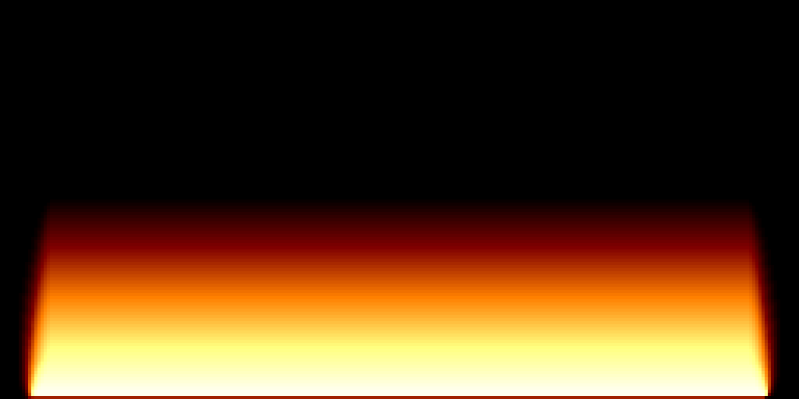

### Zufällige Variation

Die hellen Pixel wandern langsam nach oben und kühlen dabei ab, sie nehmen also andere Farben an. Nur ist das Ergebnis zu glatt und sieht noch nicht nach Feuer aus. Dagegen hilft ein wenig Zufall. Füge folgenden Code vor der `set_pixel`-Zeile ein:

```ruby
# Zufällige Variation hinzufügen
c += rand(7) - 3
```

`rand(7)` gibt eine zufällige Zahl von 0 bis 6 zurück; minus 3 ergibt Werte von −3 bis +3. Sie kommt zum Mittelwert dazu, und so weicht jedes Pixel ein wenig ab. Das sieht schon vielversprechender aus:

<!-- tutorial-screenshot
# Mit Zufall, noch ohne Grenzen
write-file: fire-steps/fire3.rb <- file:stufen/fire3.rb
terminal-run: STEP_FRAMES=150 ruby -C /workspace/fire-steps -r ./save_step.rb fire3.rb
terminal-wait-for-prompt: 180
image-file: fire-steps/step.png 4
-->
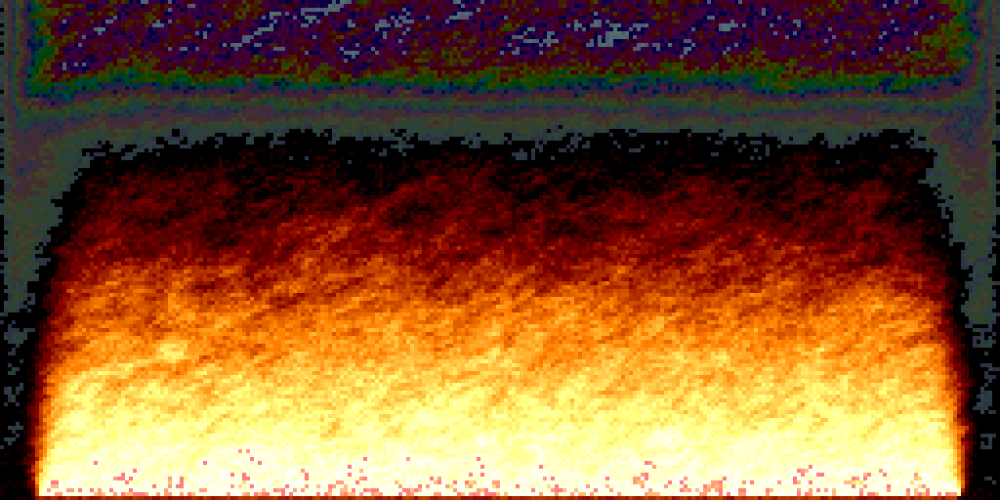

_task(begrenzen)

### Den Wertebereich begrenzen

Der Wert `c` ist direkt die Nummer einer Farbe in der Palette, aber nichts prüft, ob er zwischen 0 und 63 liegt. Mit dem Zufall wird aus einem schwarzen Pixel schnell −3 und aus einem weißen 66, und das sind keine Farben des Verlaufs. Füge darum vor der `set_pixel`-Zeile ein:

```ruby
# Wertebereich auf 0 bis 63 begrenzen
c = c.clamp(0, 63)
```

Dein Ergebnis sollte nun so aussehen:

<!-- tutorial-screenshot
# Auf 0 bis 63 begrenzt
write-file: fire-steps/fire4.rb <- file:stufen/fire4.rb
terminal-run: STEP_FRAMES=150 ruby -C /workspace/fire-steps -r ./save_step.rb fire4.rb
terminal-wait-for-prompt: 180
image-file: fire-steps/step.png 4
-->
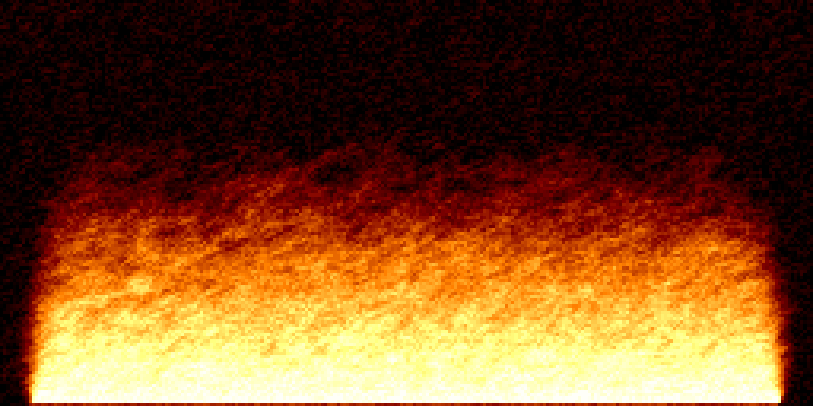

### Kalte Luft bleibt dunkel

Fast fertig: Noch glüht die ganze Luft ein wenig. Das verhinderst du, indem du den Zufall nur dazugibst, wenn das Pixel nicht schon ganz schwarz ist. Ändere die Zeile mit dem `rand`-Aufruf so:

```ruby
c += rand(7) - 3 if c > 0
```

<div class='hint books'>
In Ruby darf <code>if</code> auch hinter einer Anweisung stehen: Sie wird nur ausgeführt, wenn die Bedingung erfüllt ist. Das ist praktisch, wenn von der Bedingung nur eine einzige Anweisung abhängt.
</div>

Dein Feuereffekt sollte nun so aussehen:

<!-- tutorial-screenshot
# Das ganze Programm
write-file: fire-steps/fire.rb <- file:fire.rb
terminal-run: STEP_FRAMES=150 ruby -C /workspace/fire-steps -r ./save_step.rb fire.rb
terminal-wait-for-prompt: 180
image-file: fire-steps/step.png 4
-->
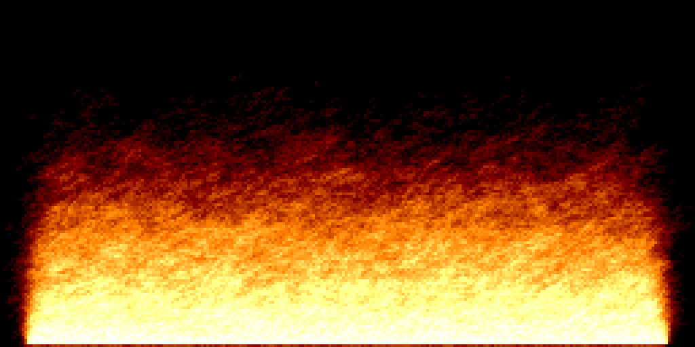

_task(feuer)

_task(kaelter)

<div class='hint try'>
<strong>Ausprobieren:</strong> Jetzt kannst du am Feuer drehen:
<ul>
<li>Probier auch <code>rand(7) - 2</code>: Wie hoch schlagen die Flammen jetzt?</li>
<li>Ändere die Glut: In <code>fire.rb</code> legen <code>set_color(63)</code> und <code>fill_rect(10, 126, 245, 127)</code> sie an den unteren Rand. Mit <code>fill_rect(100, 126, 155, 127)</code> wird sie schmaler, mit <code>set_color(40)</code> kühler. Wie sieht das Feuer dann aus?</li>
<li>Vertausche in den vier <code>set_palette</code>-Zeilen jeweils den Wert für Rot und den für Blau. Warum brennt das Feuer jetzt blau, obwohl du an der Animation nichts geändert hast?</li>
</ul>
</div>

### Das ganze Programm

Das gesamte Programm sieht nun so aus:

_include_file(fire.rb, ruby)

## Zusammenfassung

Du hast eine Feueranimation in Ruby programmiert: Ein Farbverlauf legt fest, wie heiß jede Farbe aussieht, und ein Filterkernel lässt die Hitze in jedem Bild ein Stück nach oben steigen und abkühlen. Filterkernel stecken auch hinter dem Weichzeichnen und dem Finden von Kanten in der Bildbearbeitung. Das Feuer war ein beliebter Effekt der Demoszene, und mit ein wenig Experimentieren machst du es noch besser.

Hier sind ein paar Vorschläge, wie du die Animation weiter verbessern könntest:

- Versuche, andere Muster zu zeichnen, um die Quelle des Feuers zu verändern.
- Experimentiere mit verschiedenen Farbverläufen und Filterkernels, um andere Effekte (z. B. einen Raucheffekt) zu erzielen.
