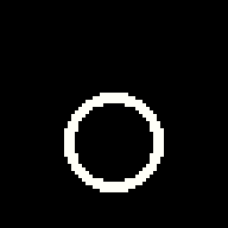
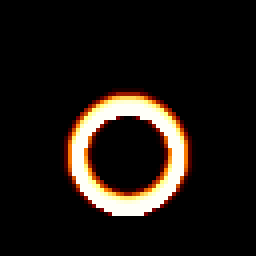
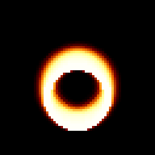
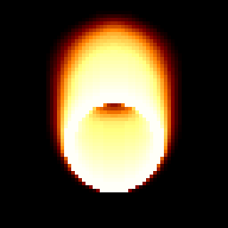
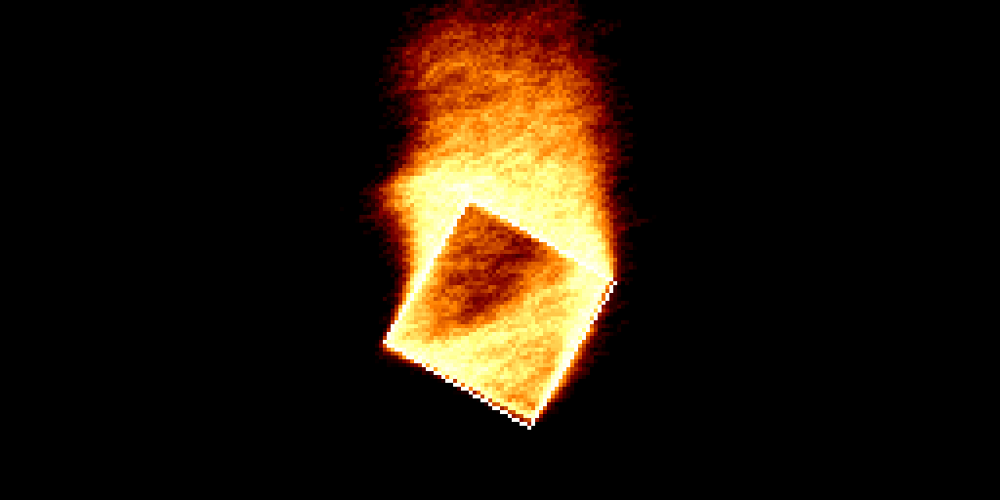
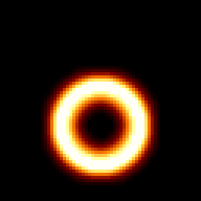
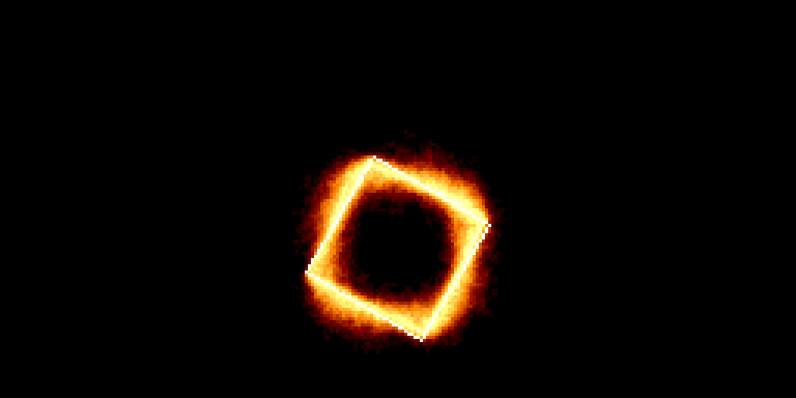
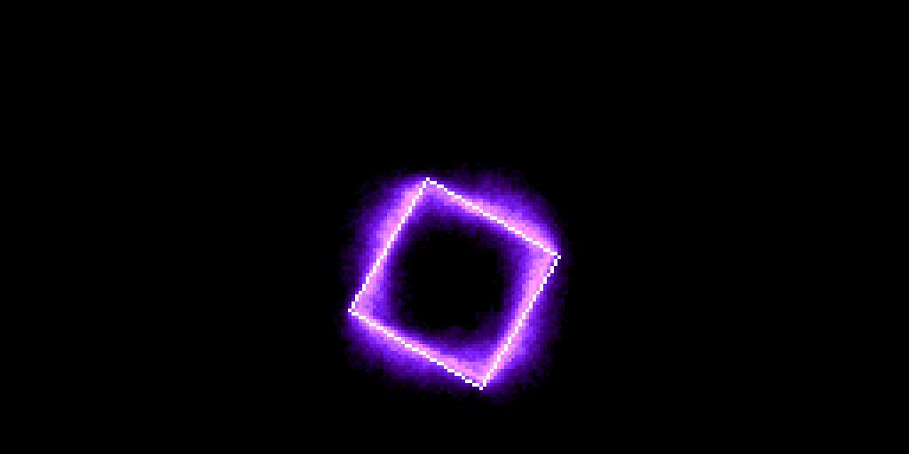

<div class='meta'>
image: fire.webp:73:0
image_alt: "Pixeliges Feuer, unten hellgelb, nach oben dunkelrot"
kind: projekt
duration: 2 Doppelstunden
language: Pixelflow Canvas / Ruby
</div>

<div
    class="autotoc-secondary-trigger"
    data-title="Auf dieser Seite"
    data-levels="h2,h3">
</div>

# Feueranimation

<p class='abstract'>
Du programmierst in Ruby ein Feuer aus Pixeln, das am unteren Rand glüht und nach oben lodert: zuerst einen Farbverlauf von Schwarz über Rot und Gelb bis Weiß, dann eine Animation und einen Filterkernel, der jedes Pixel aus seinen Nachbarn berechnet. Der Effekt stammt aus der Demoszene der 1990er Jahre, in der Leute kleine Programme mit spektakulärer Grafik und Musik schrieben, die das Letzte aus ihren Rechnern herausholten.
</p>

Stelle zuerst sicher, dass du keinen Ordner geöffnet hast. Um sicherzugehen, drücke einfach den Shortcut für »Ordner schließen«: <kbd>Strg</kbd><kbd>K</kbd> und dann <kbd>F</kbd>. Dein Workspace sollte jetzt ungefähr so aussehen:


<div class='hint books'>
Dieses Tutorial geht davon aus, dass du die Erweiterung Pixelflow Canvas und das Rubygem <code>pixelflow_canvas</code> schon installiert hast. Falls nicht, steht im Abschnitt »Vorbereitung« von <a href='/drawing#1-vorbereitung'>»Pixelgrafik mit Ruby«</a>, wie es geht.
</div>

## Farbverlauf erstellen

Der Feuereffekt basiert auf einem Farbverlauf von Schwarz über Rot, Orange und Gelb bis Weiß. Du verwendest das Pixelflow Canvas mit einer Palette von 64 Farben: Kleine Farbnummern stehen für kalte Pixel, große für heiße. Der Farbverlauf lässt sich in vier Abschnitte teilen:

- Schwarz bis Dunkelrot (Farben 0 bis 15)
- Dunkelrot bis Orange (Farben 16 bis 31)
- Orange bis Gelb (Farben 32 bis 47)
- Gelb bis Weiß (Farben 48 bis 63)

### Die Palette anzeigen

Am Anfang steht ein kleines Programm, das die ersten 64 Farben der Palette zeigt. So kannst du nach jedem Schritt kontrollieren, ob die Farben stimmen. Erstelle eine neue Datei namens `fire.rb` und füge folgenden Code ein:

```ruby
require 'pixelflow_canvas'

Pixelflow::Canvas.new(64, 1, :palette) do
    (0...64).each do |i|
        set_pixel(i, 0, i)
    end
end
```


Starte das Pixelflow Canvas, indem du <kbd>Strg</kbd><kbd>Shift</kbd><kbd>P</kbd> oder <kbd>F1</kbd> drückst und dann »Show Pixelflow Canvas« eingibst.
Führe das Programm aus, indem du im Terminal `ruby fire.rb` eingibst. Da standardmäßig die [VGA-Palette](https://specht.github.io/pixelflow_canvas_ruby/palettes.html#vga) verwendet wird, siehst du die ersten 64 Farben der VGA-Palette:

<!-- tutorial-screenshot
# Erweiterung, Gem und Zeichenfläche wie in »Zeichnen mit Pixelflow Canvas«
press: Control+p
type: ext install gymnasiumsteglitz.pixelflow-canvas
wait-for-text: Press Enter to install extension
press: Enter
wait-for-text: Trust Publisher & Install
click: Trust Publisher & Install
sleep: 10
press: F1
type: pixel
wait-for-text: Show Pixelflow Canvas
press: Enter
wait-for-text: Pixelflow Canvas
sleep: 2
terminal-open
terminal-run: gem install pixelflow_canvas
terminal-wait-for-prompt: 120
write-file: fire-steps/save_step.rb <- file:stufen/save_step.rb
# Die ersten 64 Farben der VGA-Palette
write-file: fire-steps/ramp0.rb <- file:stufen/ramp0.rb
terminal-run: ruby -C /workspace/fire-steps -r ./save_step.rb ramp0.rb
terminal-wait-for-prompt: 180
image-file: fire-steps/step.png 8
-->


Diese 64 Farben ersetzt du jetzt durch den Farbverlauf. Sieh ihn dir im Einzelnen an; die drei Linien zeigen, wie viel Rot, Grün und Blau in jeder Farbe steckt:

<svg width="100%" viewBox="-0.3 -0.1 4.5 1.2">
    <defs>
        <linearGradient id="g0"><stop offset="0%" stop-color='#000' /><stop offset="100%" stop-color='#800' /></linearGradient>
        <linearGradient id="g1"><stop offset="0%" stop-color='#800' /><stop offset="100%" stop-color='#F80' /></linearGradient>
        <linearGradient id="g2"><stop offset="0%" stop-color='#F80' /><stop offset="100%" stop-color='#FF8' /></linearGradient>
        <linearGradient id="g3"><stop offset="0%" stop-color='#FF8' /><stop offset="100%" stop-color='#FFF' /></linearGradient>
    </defs>
    <path d="M0,1 l 1,0 0,-1 -1,0" stroke='none' fill='url(#g0)' />
    <path d="M1,1 l 1,0 0,-1 -1,0" stroke='none' fill='url(#g1)' />
    <path d="M2,1 l 1,0 0,-1 -1,0" stroke='none' fill='url(#g2)' />
    <path d="M3,1 l 1,0 0,-1 -1,0" stroke='none' fill='url(#g3)' />
    <path d="M0,0 l 0,1" stroke='#aaa' stroke-width='0.005' fill='none' />
    <path d="M1,0 l 0,1" stroke='#aaa' stroke-width='0.005' fill='none' />
    <path d="M2,0 l 0,1" stroke='#aaa' stroke-width='0.005' fill='none' />
    <path d="M3,0 l 0,1" stroke='#aaa' stroke-width='0.005' fill='none' />
    <path d="M4,0 l 0,1" stroke='#aaa' stroke-width='0.005' fill='none' />
    <path d="M0,0 l 4,0" stroke='#aaa' stroke-width='0.005' fill='none' />
    <path d="M0,0.5 l 4,0" stroke='#aaa' stroke-width='0.005' fill='none' />
    <path d="M0,1 l 4,0" stroke='#aaa' stroke-width='0.005' fill='none' />
    <path d="M0,1 L 1,0.5 2,0 3,0 4,0" stroke='#a00' stroke-width='0.01' fill='none'/>
    <path d="M0,1 L 1,1 2,0.5 3,0 4,0" stroke='#0a0' stroke-width='0.01' fill='none'/>
    <path d="M0,1 L 1,1 2,1 3,0.5 4,0" stroke='#00a' stroke-width='0.01' fill='none'/>
    <g transform='translate(-0.05,-0.05)'>
    <rect x='-0.1' y='1' width='0.1' height='0.1' rx='0.02' stroke='#a00' fill='#f00' stroke-width='0.01' />
    <rect x='0.0' y='1' width='0.1' height='0.1' rx='0.02' stroke='#0a0' fill='#0f0' stroke-width='0.01' />
    <rect x='0.1' y='1' width='0.1' height='0.1' rx='0.02' stroke='#00a' fill='#00f' stroke-width='0.01' />
    <rect x='1.0' y='0.5' width='0.1' height='0.1' rx='0.02' stroke='#a00' fill='#f00' stroke-width='0.01' />
    <rect x='0.95' y='1' width='0.1' height='0.1' rx='0.02' stroke='#0a0' fill='#0f0' stroke-width='0.01' />
    <rect x='1.05' y='1' width='0.1' height='0.1' rx='0.02' stroke='#00a' fill='#00f' stroke-width='0.01' />
    <rect x='2.0' y='0' width='0.1' height='0.1' rx='0.02' stroke='#a00' fill='#f00' stroke-width='0.01' />
    <rect x='2.0' y='0.5' width='0.1' height='0.1' rx='0.02' stroke='#0a0' fill='#0f0' stroke-width='0.01' />
    <rect x='2.0' y='1' width='0.1' height='0.1' rx='0.02' stroke='#00a' fill='#00f' stroke-width='0.01' />
    <rect x='2.95' y='0' width='0.1' height='0.1' rx='0.02' stroke='#a00' fill='#f00' stroke-width='0.01' />
    <rect x='3.05' y='0' width='0.1' height='0.1' rx='0.02' stroke='#0a0' fill='#0f0' stroke-width='0.01' />
    <rect x='3.0' y='0.5' width='0.1' height='0.1' rx='0.02' stroke='#00a' fill='#00f' stroke-width='0.01' />
    <rect x='3.9' y='0' width='0.1' height='0.1' rx='0.02' stroke='#a00' fill='#f00' stroke-width='0.01' />
    <rect x='4.0' y='0' width='0.1' height='0.1' rx='0.02' stroke='#0a0' fill='#0f0' stroke-width='0.01' />
    <rect x='4.1' y='0' width='0.1' height='0.1' rx='0.02' stroke='#00a' fill='#00f' stroke-width='0.01' />
    </g>
</svg>

### Schwarz bis Dunkelrot

Im ersten Abschnitt bleiben Grün und Blau auf 0, während Rot von 0 auf 50 % ansteigt. Da jeder Farbkanal einen Wert von 0 bis 255 annehmen kann, entspricht 50 % einem Wert von etwa 128. Der Farbverlauf beginnt also bei Schwarz (0, 0, 0) und endet bei Dunkelrot (128, 0, 0). Der erste Abschnitt umfasst 16 Farben, also erhöhst du den Rotwert in jedem Schritt um 8 und landest nach 16 Schritten bei 128. Ändere den Code wie folgt:

```ruby
require 'pixelflow_canvas'

Pixelflow::Canvas.new(64, 1, :palette) do
    (0...16).each do |i|
        set_palette(i, i * 8, 0, 0)
    end
    (0...64).each do |i|
        set_pixel(i, 0, i)
    end
end
```

<div class='hint books'>
Hinweis: Achte auf die drei Punkte im Bereich <code>(0...16)</code>. Der dritte Punkt schiebt die hintere Zahl aus dem Bereich heraus, sodass die Schleife nur von 0 bis 15 läuft. Du könntest auch <code>(0..15)</code> schreiben, mit zwei Punkten.
</div>

Dein Bild sollte jetzt so aussehen:

<!-- tutorial-screenshot
# Schwarz bis Dunkelrot
write-file: fire-steps/ramp1.rb <- file:stufen/ramp1.rb
terminal-run: ruby -C /workspace/fire-steps -r ./save_step.rb ramp1.rb
terminal-wait-for-prompt: 180
image-file: fire-steps/step.png 8
-->


### Dunkelrot bis Orange

Im zweiten Abschnitt steigt der Grünwert von 0 auf 50% an, während Rot weiter von 50% auf 100% wächst. Blau bleibt weiterhin auf 0.
Der Farbverlauf geht also von Dunkelrot (128, 0, 0) zu Orange (255, 128, 0). Füge folgenden Code direkt hinter dem `set_palette`-Aufruf ein:

```ruby
set_palette(i + 16, i * 8 + 128, i * 8, 0)
```

_task(farbe-20)

Dein Farbverlauf sollte nun so aussehen:

<!-- tutorial-screenshot
# bis Orange
write-file: fire-steps/ramp2.rb <- file:stufen/ramp2.rb
terminal-run: ruby -C /workspace/fire-steps -r ./save_step.rb ramp2.rb
terminal-wait-for-prompt: 180
image-file: fire-steps/step.png 8
-->


### Orange bis Gelb

Im dritten Abschnitt steigt der Grünwert von 50% auf 100% an, während Blau von 0 auf 50% ansteigt. Rot bleibt bei 100%. Der Farbverlauf geht also von Orange (255, 128, 0) zu Gelb (255, 255, 128). Füge folgenden Code ein:

```ruby
set_palette(i + 32, 255, i * 8 + 128, i * 8)
```

Dein Farbverlauf sollte nun so aussehen:

<!-- tutorial-screenshot
# bis Gelb
write-file: fire-steps/ramp3.rb <- file:stufen/ramp3.rb
terminal-run: ruby -C /workspace/fire-steps -r ./save_step.rb ramp3.rb
terminal-wait-for-prompt: 180
image-file: fire-steps/step.png 8
-->


### Gelb bis Weiß

Im vierten Abschnitt steigt der Blauwert von 50% auf 100% an, während Rot und Grün bei 100% bleiben. Der Farbverlauf geht also von Gelb (255, 255, 128) zu Weiß (255, 255, 255). Füge folgenden Code ein:

```ruby
set_palette(i + 48, 255, 255, i * 8 + 128)
```

Geschafft! Dein Farbverlauf sollte nun so aussehen:

<!-- tutorial-screenshot
# bis Weiß
write-file: fire-steps/ramp4.rb <- file:stufen/ramp4.rb
terminal-run: ruby -C /workspace/fire-steps -r ./save_step.rb ramp4.rb
terminal-wait-for-prompt: 180
image-file: fire-steps/step.png 8
-->


_task(blau-63)

## Animations-Loop

Jetzt baust du das Programm zum Gerüst einer Animation um: Bild für Bild zeichnet es am unteren Rand ein helles Rechteck, aus dem danach das Feuer aufsteigt. Ändere dein Programm so:

_include_file(draft1.rb, ruby)

Anmerkungen:

- In Zeile 3 steht die Größe der Animation, 256 × 128 Pixel.
- Zeile 5 schaltet »Double Buffering« ein: Du siehst nicht zu, wie ein Bild entsteht, sondern nur das fertige. Dafür ruft Zeile 22 `flip()` auf; erst dann zeigt die Zeichenfläche das neue Bild.
- In Zeile 16 beginnt eine Endlosschleife, die die Animation Bild für Bild zeichnet. Da das Programm sich nun nicht mehr von selbst beendet, musst du es manuell abbrechen, indem du <kbd>Strg</kbd><kbd>C</kbd> drückst.

Das sieht noch unspektakulär aus, aber am unteren Rand ist schon das helle Rechteck zu sehen. Auch wenn es nicht so aussieht: Die Schleife zeichnet schon laufend neue Bilder.

<!-- tutorial-screenshot
# Das Gerüst der Animation, nach 150 Bildern
write-file: fire-steps/draft1.rb <- file:draft1.rb
terminal-run: STEP_FRAMES=150 ruby -C /workspace/fire-steps -r ./save_step.rb draft1.rb
terminal-wait-for-prompt: 180
image-file: fire-steps/step.png 4
-->


Für das Feuer brauchst du eine Technik aus der Bildbearbeitung, den »Filterkernel« (auch Faltungsmatrix, englisch *Convolution Matrix*).

## Filterkernel

<style>
.kernel-matrix {
    border-collapse: separate;
    border-spacing: 2px;
    font-family: 'IBM Plex Mono', monospace;
    margin: 0 auto;
}
.kernel-matrix td {
    width: 2.2em;
    height: 2.2em;
    text-align: center;
    vertical-align: middle;
    border-radius: 0.25em;
    background: rgba(var(--bs-body-color-rgb), 0.08);
}
.kernel-matrix td.zero {
    color: rgba(var(--bs-body-color-rgb), 0.4);
}
.kernel-example {
    display: flex;
    flex-wrap: wrap;
    align-items: center;
    justify-content: center;
    gap: 0.8em;
    margin: 1em 0;
}
.kernel-example .kernel-matrix {
    margin: 0;
}
.kernel-example .kernel-matrix td {
    box-shadow: inset 0 0 0 1px rgba(var(--bs-body-color-rgb), 0.25);
}
.kernel-example > span {
    font-size: 1.3em;
}
.kernel-figure img {
    display: block;
    width: 100%;
    margin-top: 0.6em;
    border-radius: 0.3em;
    image-rendering: pixelated;
}
</style>

Ein Filterkernel ist eine kleine Tabelle mit Gewichten, meist 3 × 3 Zahlen. Um die neue Farbe eines Pixels auszurechnen, legst du die Tabelle so auf das Bild, dass ihre Mitte auf diesem Pixel liegt. Jede Zahl sagt, wie stark das Pixel darunter zählt: Du multiplizierst jeden Farbwert mit seinem Gewicht, zählst alles zusammen und teilst durch die Summe der Gewichte. Heraus kommt ein gewichteter Mittelwert der Nachbarschaft, und der ist die neue Farbe des Pixels in der Mitte.

Ein Beispiel mit Farbnummern wie in deinem Feuer, 0 für Schwarz und 63 für Weiß. Der Kernel zählt alle neun Pixel gleich:

<div class='kernel-example' role='img' aria-label='Links neun Pixel: oben und links schwarz mit 0, unten rechts vier weiße mit 63, das Pixel in der Mitte ist eines davon. Daneben der Kernel mit neun Einsen. Rechts das Ergebnis für das Pixel in der Mitte: 28, ein dunkles Orange.'>
<table class='kernel-matrix'>
<tr><td style='background: #000; color: #fff'>0</td><td style='background: #000; color: #fff'>0</td><td style='background: #000; color: #fff'>0</td></tr>
<tr><td style='background: #000; color: #fff'>0</td><td style='background: #fffff8; color: #000; outline: 2px solid #e8590c'>63</td><td style='background: #fffff8; color: #000'>63</td></tr>
<tr><td style='background: #000; color: #fff'>0</td><td style='background: #fffff8; color: #000'>63</td><td style='background: #fffff8; color: #000'>63</td></tr>
</table>
<span>mit</span>
<table class='kernel-matrix'>
<tr><td>1</td><td>1</td><td>1</td></tr>
<tr><td>1</td><td>1</td><td>1</td></tr>
<tr><td>1</td><td>1</td><td>1</td></tr>
</table>
<span><i class='bi bi-arrow-right'></i></span>
<table class='kernel-matrix'>
<tr><td style='background: #e06000; color: #fff; outline: 2px solid #e8590c'>28</td></tr>
</table>
</div>

Die neun Werte ergeben zusammen 4 · 63 = 252, die neun Gewichte zusammen 9, und 252 / 9 = 28. Das weiße Pixel in der Mitte wird dunkelorange, weil die Hälfte seiner Nachbarschaft schwarz ist: Die harte Kante zwischen Weiß und Schwarz wird weich.

Das rechnest du für jedes Pixel des Bildes aus. Was dabei herauskommt, hängt allein an den Gewichten. Hier wirken drei Kernel auf einen weißglühenden Ring, gezeichnet in den Farben deines Feuers:

<div class='gallery columns-3'>
<figure>
<div class='kernel-figure'>
<table class='kernel-matrix'>
<tr><td class='zero'>0</td><td class='zero'>0</td><td class='zero'>0</td></tr>
<tr><td class='zero'>0</td><td>1</td><td class='zero'>0</td></tr>
<tr><td class='zero'>0</td><td class='zero'>0</td><td class='zero'>0</td></tr>
</table>

</div>
<figcaption>Identity: nur das Pixel selbst zählt, das Bild bleibt, wie es ist.</figcaption>
</figure>
<figure>
<div class='kernel-figure'>
<table class='kernel-matrix'>
<tr><td>1</td><td>1</td><td>1</td></tr>
<tr><td>1</td><td>1</td><td>1</td></tr>
<tr><td>1</td><td>1</td><td>1</td></tr>
</table>

</div>
<figcaption>Box blur: alle neun zählen gleich, die Ränder werden weich.</figcaption>
</figure>
<figure>
<div class='kernel-figure'>
<table class='kernel-matrix'>
<tr><td class='zero'>0</td><td>−1</td><td class='zero'>0</td></tr>
<tr><td>−1</td><td>4</td><td>−1</td></tr>
<tr><td class='zero'>0</td><td>−1</td><td class='zero'>0</td></tr>
</table>

</div>
<figcaption>Edge detection: nur an den Kanten bleibt etwas übrig.</figcaption>
</figure>
</div>

Der dritte Kernel ist ein besonderer: Seine Gewichte ergeben zusammen 0. Wo alle Pixel gleich hell sind, im Ring wie im Schwarz daneben, heben sich die vier abgezogenen Nachbarn und das vierfache Pixel genau auf. Nur wo sich die Helligkeit ändert, an den Rändern des Ringes, bleibt etwas übrig. Durch 0 teilen geht nicht; hier zählt einfach die Summe, ohne Vorzeichen.

### Der Filterkernel für Feuer

Für das Feuer zählt ein Pixel nicht selbst mit, aber sein linker und sein rechter Nachbar einfach und das Pixel darunter doppelt. Was darüber liegt, zählt gar nicht. Die Gewichte ergeben zusammen 4, also wird durch 4 geteilt:

<div class='kernel-figure' style='max-width: 16em; margin: 1em auto'>
<table class='kernel-matrix'>
<tr><td class='zero'>0</td><td class='zero'>0</td><td class='zero'>0</td></tr>
<tr><td>1</td><td class='zero'>0</td><td>1</td></tr>
<tr><td class='zero'>0</td><td>2</td><td class='zero'>0</td></tr>
</table>

</div>

Die neue Farbe eines Pixels kommt also zur Hälfte von dem Pixel darunter. Was unten heiß ist, ist einen Schritt später ein Stück weiter oben. Einmal angewendet, sieht man davon wenig. Dein Programm wendet den Kernel aber in jedem Bild wieder an und zeichnet dazu jedes Mal die Glut am unteren Rand neu. Bleibt der Ring genauso heiß, steigt die Hitze Schritt für Schritt nach oben:

<div class='gallery columns-3'>
<figure>

<figcaption>Nach 4 Schritten</figcaption>
</figure>
<figure>

<figcaption>Nach 12 Schritten</figcaption>
</figure>
<figure>

<figcaption>Nach 40 Schritten</figcaption>
</figure>
</div>

Mit jedem Schritt wandert die Hitze im Mittel ein halbes Pixel nach oben: Das Gewicht 2 von unten ist die Hälfte der 4. Abkühlen tut sie dabei nur langsam. Ruby rundet beim Teilen von ganzen Zahlen ab, `125 / 4` ist 31, und so verliert die Hitze bei vielen Schritten ein klein wenig.

## Feueranimation

### Den Filterkernel anwenden

Für das Feuer wendet dein Programm den Filterkernel in jedem Bild auf jedes Pixel an. Füge folgenden Code über der `flip()`-Zeile ein:

```ruby
# Filterkernel auf jedes Pixel anwenden
(0...128).each do |y|
    (0...256).each do |x|
        # Farbwerte der Nachbarpixel einsammeln
        c = get_pixel(x, y + 1) * 2
        c += get_pixel(x - 1, y)
        c += get_pixel(x + 1, y)
        # Summe durch vier teilen
        c /= 4
        # Pixel setzen
        set_pixel(x, y, c)
    end
end
```

Das Programm geht Zeile für Zeile durch das Bild und in jeder Zeile durch jedes Pixel. Für jedes Pixel addiert es die Farbwerte der Nachbarn, das untere doppelt, und teilt die Summe durch 4. Dieser Mittelwert wird die neue Farbe des Pixels.

_task(kernel)

Deine Animation sollte nach einer kleinen Weile nun so aussehen:

<!-- tutorial-screenshot
# Mit dem Filterkernel
write-file: fire-steps/fire2.rb <- file:stufen/fire2.rb
terminal-run: STEP_FRAMES=150 ruby -C /workspace/fire-steps -r ./save_step.rb fire2.rb
terminal-wait-for-prompt: 180
image-file: fire-steps/step.png 4
-->


### Zufällige Variation

Die hellen Pixel wandern langsam nach oben und kühlen dabei ab, sie nehmen also andere Farben an. Nur ist das Ergebnis zu glatt und sieht noch nicht nach Feuer aus. Dagegen hilft ein wenig Zufall. Füge folgenden Code vor der `set_pixel`-Zeile ein:

```ruby
# Zufällige Variation hinzufügen
c += rand(7) - 3
```

`rand(7)` gibt eine zufällige Zahl von 0 bis 6 zurück; minus 3 ergibt Werte von −3 bis +3. Sie kommt zum Mittelwert dazu, und so weicht jedes Pixel ein wenig ab. Das sieht schon vielversprechender aus:

<!-- tutorial-screenshot
# Mit Zufall, noch ohne Grenzen
write-file: fire-steps/fire3.rb <- file:stufen/fire3.rb
terminal-run: STEP_FRAMES=150 ruby -C /workspace/fire-steps -r ./save_step.rb fire3.rb
terminal-wait-for-prompt: 180
image-file: fire-steps/step.png 4
-->


_task(begrenzen)

### Den Wertebereich begrenzen

Der Wert `c` ist direkt die Nummer einer Farbe in der Palette, aber nichts prüft, ob er zwischen 0 und 63 liegt. Mit dem Zufall wird aus einem schwarzen Pixel schnell −3 und aus einem weißen 66, und das sind keine Farben des Verlaufs. Füge darum vor der `set_pixel`-Zeile ein:

```ruby
# Wertebereich auf 0 bis 63 begrenzen
c = c.clamp(0, 63)
```

Dein Ergebnis sollte nun so aussehen:

<!-- tutorial-screenshot
# Auf 0 bis 63 begrenzt
write-file: fire-steps/fire4.rb <- file:stufen/fire4.rb
terminal-run: STEP_FRAMES=150 ruby -C /workspace/fire-steps -r ./save_step.rb fire4.rb
terminal-wait-for-prompt: 180
image-file: fire-steps/step.png 4
-->


### Kalte Luft bleibt dunkel

Fast fertig: Noch glüht die ganze Luft ein wenig. Das verhinderst du, indem du den Zufall nur dazugibst, wenn das Pixel nicht schon ganz schwarz ist. Ändere die Zeile mit dem `rand`-Aufruf so:

```ruby
c += rand(7) - 3 if c > 0
```

<div class='hint books'>
In Ruby darf <code>if</code> auch hinter einer Anweisung stehen: Sie wird nur ausgeführt, wenn die Bedingung erfüllt ist. Das ist praktisch, wenn von der Bedingung nur eine einzige Anweisung abhängt.
</div>

Dein Feuereffekt sollte nun so aussehen:

<!-- tutorial-screenshot
# Das ganze Programm
write-file: fire-steps/fire.rb <- file:fire.rb
terminal-run: STEP_FRAMES=150 ruby -C /workspace/fire-steps -r ./save_step.rb fire.rb
terminal-wait-for-prompt: 180
image-file: fire-steps/step.png 4
-->


_task(feuer)

_task(kaelter)

<div class='hint try'>
<strong>Ausprobieren:</strong> Jetzt kannst du am Feuer drehen:
<ul>
<li>Probier auch <code>rand(7) - 2</code>: Wie hoch schlagen die Flammen jetzt?</li>
<li>Ändere die Glut: In <code>fire.rb</code> legen <code>set_color(63)</code> und <code>fill_rect(10, 126, 245, 127)</code> sie an den unteren Rand. Mit <code>fill_rect(100, 126, 155, 127)</code> wird sie schmaler, mit <code>set_color(40)</code> kühler. Wie sieht das Feuer dann aus?</li>
<li>Vertausche in den vier <code>set_palette</code>-Zeilen jeweils den Wert für Rot und den für Blau. Warum brennt das Feuer jetzt blau, obwohl du an der Animation nichts geändert hast?</li>
</ul>
</div>

### Das ganze Programm

Das gesamte Programm sieht nun so aus:

_include_file(fire.rb, ruby)

<!-- extra -->
## Eine Form, die brennt

Das Feuer brennt überall, wo heiße Pixel sind, nicht nur am unteren Rand. Zeichne etwas anderes in Weiß, und es geht in Flammen auf, auch wenn es sich bewegt. Hier ist es ein Quadrat, das sich um seine Mitte dreht.

Lösche dafür in `fire.rb` die Glut, also die beiden Zeilen mit `set_color(63)` und `fill_rect(10, 126, 245, 127)` samt ihrem Kommentar. Vor die Schleife kommt ein Winkel, der mit jedem Bild ein wenig wächst:

```ruby
~         set_palette(i + 48, 255, 255, i * 8 + 128)
~     end
~
    # Winkel der Form, wächst mit jedem Bild
    angle = 0.0

~     # Endlosschleife
~     loop do
```

Die vier Ecken des Quadrats liegen auf einem Kreis um die Mitte (128, 80) mit dem Radius 30, jede eine Vierteldrehung weiter als die vorige. Eine Vierteldrehung ist π/2, in Ruby `Math::PI / 2`. Für einen Punkt auf einem Kreis um (m<sub>x</sub>, m<sub>y</sub>) mit Radius r beim Winkel a gilt:

$$x = m\_x + r \cdot \cos a \qquad y = m\_y + r \cdot \sin a$$

Weil y auf dem Bildschirm nach unten wächst, dreht sich das Quadrat im Uhrzeigersinn, wenn `angle` größer wird.

<div class='hint own'>
<strong>Jetzt bist du dran:</strong> Berechne vor <code>flip()</code> die vier Ecken für den aktuellen Winkel, verbinde jede Ecke mit <code>draw_line</code> mit der nächsten und die letzte mit der ersten, alles mit Farbe 63. Danach erhöhst du <code>angle</code> um 0.03.
</div>

<!-- hint -->
Für die Ecke Nummer `k` (0 bis 3) ist der Winkel `angle + k * Math::PI / 2`. Setz ihn in die beiden Formeln ein: `Math.cos(…)` und `Math.sin(…)`.
<!-- /hint -->
<!-- hint -->
Sammle die vier Ecken in einem Array, dann kannst du für jedes `k` die Ecke `k` mit der Ecke `(k + 1) % 4` verbinden. Für `k = 3` ist das die Ecke 0.
<!-- /hint -->
<!-- hint -->
Ein Gerüst; die Lücken mit `…` füllst du:

```ruby
        corners = (0...4).map do |k|
            a = angle + k * …
            [128 + 30 * …, 80 + 30 * …]
        end
        (0...4).each do |k|
            x0, y0 = corners[k]
            x1, y1 = corners[…]
            draw_line(x0, y0, x1, y1)
        end
```
<!-- /hint -->

<!-- solution -->
```ruby
~                 set_pixel(x, y, c)
~             end
~         end
~
        # weißes Quadrat zeichnen, um seine Mitte gedreht
        set_color(63)
        corners = (0...4).map do |k|
            a = angle + k * Math::PI / 2
            [128 + 30 * Math.cos(a), 80 + 30 * Math.sin(a)]
        end
        (0...4).each do |k|
            x0, y0 = corners[k]
            x1, y1 = corners[(k + 1) % 4]
            draw_line(x0, y0, x1, y1)
        end
        angle += 0.03

~         # Bild anzeigen
~         flip()
```
<!-- /solution -->

Das Quadrat steht nach dem Kernel im Programm, direkt vor `flip()`. Zeichnest du es davor, verschmiert der Kernel es im selben Bild, und du siehst nur noch Flammen. So bleibt es als scharfe weiße Linie über seinen eigenen Flammen stehen, und im nächsten Bild steigt seine Hitze nach oben:

<!-- tutorial-screenshot
# Ein Quadrat, das sich dreht und brennt
write-file: fire-steps/form.rb <- file:stufen/form.rb
terminal-run: STEP_FRAMES=150 ruby -C /workspace/fire-steps -r ./save_step.rb form.rb
terminal-wait-for-prompt: 180
image-file: fire-steps/step.png 4
-->


<div class='hint try'>
<strong>Ausprobieren:</strong>
<ul>
<li>Ein Dreieck statt des Quadrats: drei Ecken, jede eine Dritteldrehung (<code>2 * Math::PI / 3</code>) weiter. Mit <code>fill_triangle(x0, y0, x1, y1, x2, y2)</code> brennt die ganze Fläche statt nur des Randes.</li>
<li>Ändere <code>angle += 0.03</code> in <code>angle += 0.2</code>: Wie sehen die Flammen aus, wenn sich die Form schneller dreht, als die Hitze aufsteigt?</li>
<li>Hol die Glut am unteren Rand zurück: Jetzt brennen Boden und Quadrat zusammen.</li>
</ul>
</div>

<!-- extra -->
## Glühen statt Brennen

Dass dein Feuer nach oben brennt, liegt allein am Kernel: Er holt die Hitze von unten. Zählt er dagegen alle vier Nachbarn gleich, oben, unten, links und rechts, hat die Hitze keine Richtung mehr. Sie breitet sich nach allen Seiten aus, und was heiß ist, glüht:

<div class='gallery columns-2'>
<figure>
<div class='kernel-figure'>
<table class='kernel-matrix'>
<tr><td class='zero'>0</td><td class='zero'>0</td><td class='zero'>0</td></tr>
<tr><td>1</td><td class='zero'>0</td><td>1</td></tr>
<tr><td class='zero'>0</td><td>2</td><td class='zero'>0</td></tr>
</table>

</div>
<figcaption>Brennen: die Hitze kommt von unten.</figcaption>
</figure>
<figure>
<div class='kernel-figure'>
<table class='kernel-matrix'>
<tr><td class='zero'>0</td><td>1</td><td class='zero'>0</td></tr>
<tr><td>1</td><td class='zero'>0</td><td>1</td></tr>
<tr><td class='zero'>0</td><td>1</td><td class='zero'>0</td></tr>
</table>

</div>
<figcaption>Glühen: die Hitze kommt von allen Seiten.</figcaption>
</figure>
</div>

Ändere in deinem Programm mit dem Quadrat die Zeilen, die die Nachbarn einsammeln. Die vier Gewichte ergeben wieder 4, das Teilen durch 4 bleibt:

```ruby
~                 # Farbwerte der Nachbarpixel einsammeln
                c = get_pixel(x, y - 1)
                c += get_pixel(x, y + 1)
                c += get_pixel(x - 1, y)
                c += get_pixel(x + 1, y)
~                 # Summe durch vier teilen
~                 c /= 4
```

<!-- tutorial-screenshot
# Derselbe Kernel in alle Richtungen: das Quadrat glüht
write-file: fire-steps/gluehen.rb <- file:stufen/gluehen.rb
terminal-run: STEP_FRAMES=150 ruby -C /workspace/fire-steps -r ./save_step.rb gluehen.rb
terminal-wait-for-prompt: 180
image-file: fire-steps/step.png 4
-->


Achte auf die Ecken, während sich das Quadrat dreht: Hinter jeder zieht ein Schweif her. Die Hitze braucht ein paar Bilder, bis sie verglüht, und das Quadrat ist dann schon ein Stück weitergedreht.

<!-- extra -->
## Geheimnisvolles Leuchten

Zwei Teile machen den Effekt: der Kernel, der bestimmt, wohin die Hitze geht, und die Palette, die bestimmt, wie sie aussieht. Beides kannst du tauschen. Damit das bequemer geht, schreibst du den Kernel als Tabelle, so wie in den Bildern oben. Über `Pixelflow::Canvas.new` kommt:

```ruby
~ require 'pixelflow_canvas'
~
# Der Filterkernel als Tabelle: die Gewichte der Nachbarn von oben links
# bis unten rechts, in der Mitte das Pixel selbst
KERNEL = [
    [1, 1, 1],
    [1, 0, 1],
    [1, 1, 1],
]
WEIGHT = KERNEL.flatten.sum

~ Pixelflow::Canvas.new(256, 128, :palette) do
```

`KERNEL.flatten` macht aus den drei Zeilen eine Liste mit neun Zahlen, `sum` zählt sie zusammen. Dieser Kernel zählt alle acht Nachbarn, auch die schrägen. Die Zeilen, die die Nachbarn einsammeln und durch 4 teilen, ersetzt du durch zwei Schleifen über die Tabelle. Die Zeile `row` und die Spalte `col` laufen von 0 bis 2; minus 1 gerechnet, ergeben sie den Abstand zum Pixel in der Mitte:

```ruby
~             (0...256).each do |x|
                # Nachbarn mit den Gewichten aus KERNEL zusammenzählen
                c = 0
                (0..2).each do |row|
                    (0..2).each do |col|
                        c += KERNEL[row][col] * get_pixel(x + col - 1, y + row - 1)
                    end
                end
                # durch die Summe der Gewichte teilen
                c /= WEIGHT
~
~                 # Zufällige Variation hinzufügen
```

Und eine neue Palette, von Schwarz über tiefes Blau und Violett bis zu einem blassen Rosa:

```ruby
~     # Farbverlauf von Schwarz über Violett bis Weiß
    (0...16).each do |i|
        set_palette(i, i * 4, 0, i * 8)
        set_palette(i + 16, i * 4 + 64, i * 2, i * 8 + 128)
        set_palette(i + 32, i * 8 + 128, i * 8 + 32, 255)
        set_palette(i + 48, 255, i * 8 + 128, 255)
    end
```

<!-- tutorial-screenshot
# Kernel als Tabelle, acht Nachbarn, Palette in Violett
write-file: fire-steps/leuchten.rb <- file:stufen/leuchten.rb
terminal-run: STEP_FRAMES=150 ruby -C /workspace/fire-steps -r ./save_step.rb leuchten.rb
terminal-wait-for-prompt: 180
image-file: fire-steps/step.png 4
-->


Für jedes Pixel liest das Programm jetzt neun Werte statt drei, darum läuft die Animation ein wenig langsamer.

<div class='hint try'>
<strong>Ausprobieren:</strong> Jetzt änderst du nur noch Zahlen.
<ul>
<li>Trag den Feuer-Kernel in die Tabelle ein, <code>[0, 0, 0]</code>, <code>[1, 0, 1]</code>, <code>[0, 2, 0]</code>: Brennt das Quadrat wieder, diesmal in Violett?</li>
<li>Dreh den Feuer-Kernel um, <code>[0, 2, 0]</code>, <code>[1, 0, 1]</code>, <code>[0, 0, 0]</code>. Wohin zieht die Hitze jetzt? Mit einer grünen Palette sieht das aus wie leuchtender Schleim, zum Beispiel <code>set_palette(i, 0, i * 6, i * 2)</code>, <code>set_palette(i + 16, 0, i * 8 + 96, i * 4 + 32)</code>, <code>set_palette(i + 32, i * 8, 224 + i * 2, i * 6 + 96)</code> und <code>set_palette(i + 48, i * 8 + 128, 255, i * 8 + 128)</code>.</li>
<li>Was ändert eine 1 in der Mitte der Tabelle, wenn das Pixel also selbst mitzählt? Und eine 4?</li>
</ul>
</div>

## Zusammenfassung

Du hast eine Feueranimation in Ruby programmiert: Ein Farbverlauf legt fest, wie heiß jede Farbe aussieht, und ein Filterkernel lässt die Hitze in jedem Bild ein Stück nach oben steigen und abkühlen. Filterkernel stecken auch hinter dem Weichzeichnen und dem Finden von Kanten in der Bildbearbeitung. Das Feuer war ein beliebter Effekt der Demoszene, und mit ein wenig Experimentieren machst du es noch besser.

Auch Spiele haben so gebrannt: In der Fassung von *Final DOOM* für die erste PlayStation lodert dasselbe Feuer über den Bildschirm, aus einer Palette von Schwarz bis Weiß, einer weißen untersten Zeile als Glut und Hitze, die mit ein wenig Zufall nach oben steigt und dabei abkühlt.

<div class='book'>
<i class='bi bi-file-earmark-text'></i>
<p><strong>How DOOM fire was done</strong>, Fabien Sanglard, 2018. Wie das Feuer von <em>DOOM</em> auf der PlayStation funktioniert, in wenigen Zeilen Code mit Bildern zu jedem Schritt; der Zufall lässt die Flammen dort zusätzlich nach links und rechts wehen: <a href='https://fabiensanglard.net/doom_fire_psx/'>fabiensanglard.net</a>.</p>
</div>

Hier sind ein paar Vorschläge, wie du die Animation weiter verbessern könntest:

- Lass einen Text brennen: `draw_text(68, 70, "FEUER", "8x13B", 3)` zeichnet ihn in der aktuellen Farbe, links oben bei (68, 70), dreimal so groß wie die Schrift.
- Rauch: eine zweite Palette in Grautönen und ein Kernel, der die Hitze langsamer nach oben trägt als das Feuer.
- Lass die Glut flackern, indem du sie in jedem Bild an zufälligen Stellen unterbrichst.
