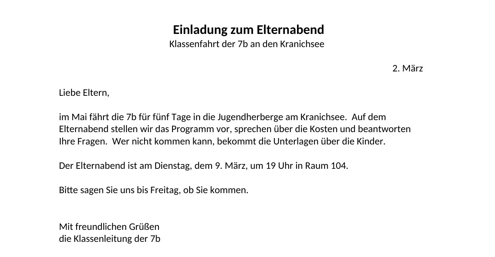
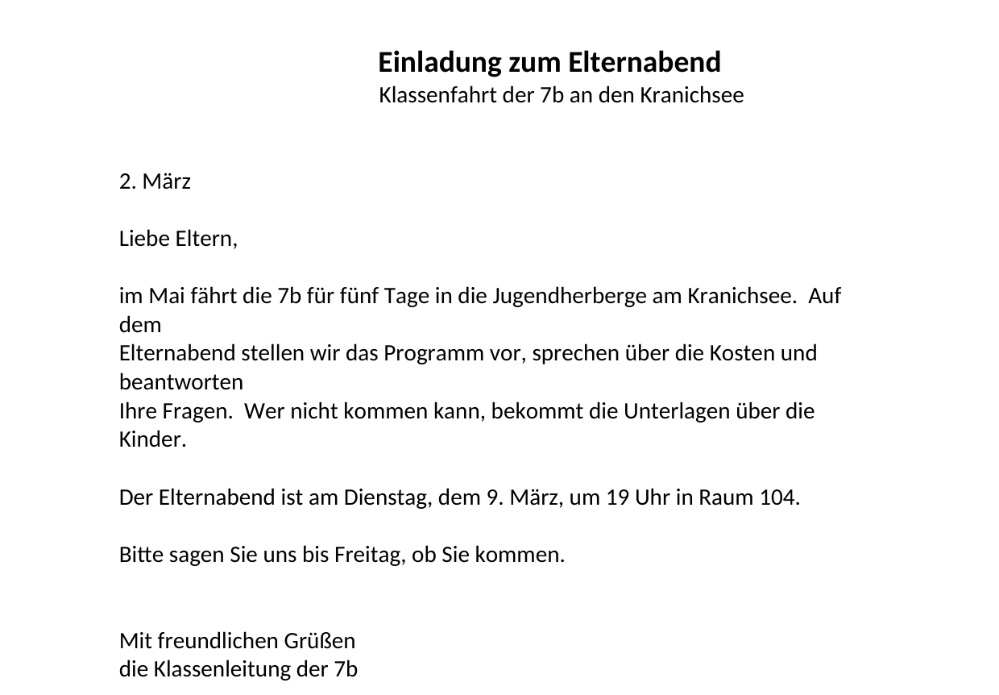
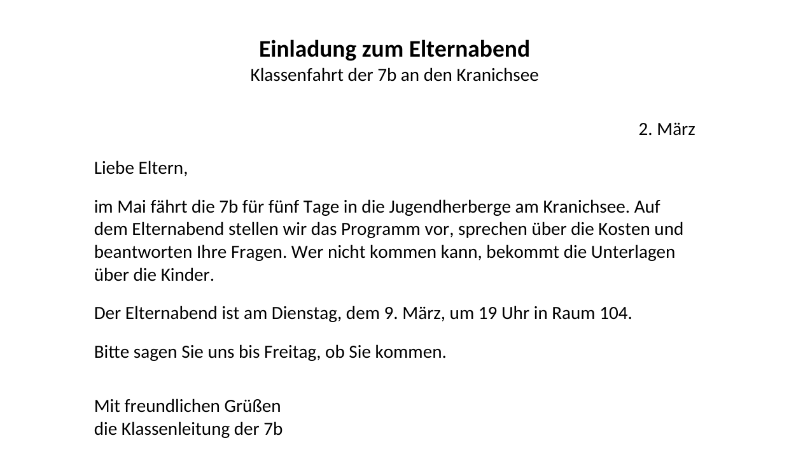

image: teaser.webp
image_alt: "Eine Einladung zum Elternabend der Klasse 7b, ausgedruckt: Überschrift in der Mitte, Datum rechts, darunter ein kurzer Brief"
kind: labor
duration: 1 Doppelstunde
curriculum: "Sek I: Standardsoftware (Umgang mit Textverarbeitungssoftware); Medienbildung: Produzieren (Herstellung von Medienprodukten)"
topics: [standardsoftware]
language: Word / LibreOffice / Nextcloud Office
languages: [word, libreoffice, nextcloud]
reference: []

# Was das Auge nicht sieht

Die Klassenleitung der 7b hat eine Einladung zum Elternabend getippt, in Eile,
kurz vor der Pause. Ausgedruckt sieht sie ordentlich aus: die Überschrift in
der Mitte, das Datum rechts, darunter ein kurzer Brief.

Wie ein Dokument gebaut ist, sieht man auf dem Papier nicht. Man merkt es erst,
wenn sich etwas ändert.

_task(groesser)

<!-- after: groesser -->
So sieht die Einladung aus, wenn die Schrift überall eine Stufe größer wird:

Die Überschrift stand nie in der Mitte. Vor ihr stehen 38 Leerzeichen, so
viele, bis sie bei 16 pt ungefähr in der Mitte aussah. Werden die Leerzeichen
breiter, schieben sie die Überschrift weiter nach rechts. Vor dem Datum stehen
148 Leerzeichen; mit größerer Schrift passen sie nicht mehr in die Zeile, und
das Datum rutscht in die nächste. Und der Brief bricht so seltsam um, weil am
Ende jeder Zeile ein Zeilenumbruch von Hand steht: Das Programm bricht die zu
lange Zeile um, und gleich danach kommt der Umbruch, den jemand getippt hat.
<!-- /after -->

## Unsichtbares sichtbar machen

Hol dir die Einladung und öffne sie:

<a class='document-starter btn btn-primary' href='/formatting-marks/01%20Einladung.docx' download><i class='bi bi-file-earmark-word' aria-hidden='true'></i>Vorlage herunterladen:01 Einladung.docx<i class='bi bi-download document-starter-get' aria-hidden='true'></i></a>

Jede Textverarbeitung kann die Zeichen zeigen, die nicht gedruckt werden. Sie
heißen **Formatierungszeichen**.

<!-- language: word -->
In Word schaltest du sie im Register *Start* mit dem Knopf **¶** ein
(»Alle anzeigen«).
<!-- /language -->
<!-- language: libreoffice -->
In LibreOffice schaltest du sie unter *Ansicht* <i class='bi bi-chevron-right' aria-hidden='true'></i> *Formatierungszeichen*
ein, oder mit <kbd>Strg</kbd>+<kbd>F10</kbd>.
<!-- /language -->
<!-- language: nextcloud -->
In Nextcloud Office schaltest du sie unter *Ansicht* <i class='bi bi-chevron-right' aria-hidden='true'></i>
*Formatierungszeichen* ein.
<!-- /language -->

Dann siehst du drei Zeichen, die vorher nicht da waren:

<table class='table'>
<tr><th>Zeichen</th><th>Bedeutung</th><th>Taste</th></tr>
<tr><td><strong>·</strong></td><td>ein Leerzeichen</td><td><kbd>Leertaste</kbd></td></tr>
<tr><td><strong>¶</strong></td><td>das Ende eines Absatzes</td><td><kbd>Enter</kbd></td></tr>
<tr><td><strong>↵</strong></td><td>ein Zeilenumbruch von Hand: neue Zeile, aber derselbe Absatz</td><td><kbd>Shift</kbd>+<kbd>Enter</kbd></td></tr>
</table>

Ein **Absatz** ist alles bis zum nächsten ¶, auch wenn er über mehrere Zeilen
geht. Innerhalb eines Absatzes bricht das Programm die Zeilen selbst um, dort,
wo die Zeile voll ist.

_task(absaetze)

_task(zeilenende)

## Mitte und Rand

Ob ein Absatz links, in der Mitte oder rechts steht, ist seine
**Ausrichtung**. Sie gehört zum Absatz, nicht zu den Leerzeichen davor: Ein
zentrierter Absatz bleibt in der Mitte, wie groß die Schrift auch wird.

<table class='table'>
<tr><th>Ausrichtung</th><th>Tasten</th></tr>
<tr><td>linksbündig</td><td><kbd>Strg</kbd>+<kbd>L</kbd></td></tr>
<tr><td>zentriert</td><td><kbd>Strg</kbd>+<kbd>E</kbd></td></tr>
<tr><td>rechtsbündig</td><td><kbd>Strg</kbd>+<kbd>R</kbd></td></tr>
</table>

<!-- language: word -->
Die Knöpfe dafür stehen in Word im Register *Start*, in der Gruppe *Absatz*.
<!-- /language -->
<!-- language: libreoffice -->
Die Knöpfe dafür stehen in LibreOffice in der Leiste oben, neben fett und
kursiv.
<!-- /language -->
<!-- language: nextcloud -->
Die Knöpfe dafür stehen in Nextcloud Office im Register *Start*, neben fett
und kursiv.
<!-- /language -->

**Jetzt bist du dran:** Lösch die Leerzeichen vor der Überschrift und vor der
Zeile darunter und zentriere beide Absätze. Lösch die Leerzeichen vor dem
Datum und richte es rechtsbündig aus. Der Cursor muss dafür nur irgendwo im
Absatz stehen; markieren musst du nichts.

<strong>Ausprobieren:</strong> Stell den Cursor in die Überschrift und drück abwechselnd <kbd>Strg</kbd>+<kbd>L</kbd>, <kbd>Strg</kbd>+<kbd>E</kbd> und <kbd>Strg</kbd>+<kbd>R</kbd>. Achte darauf, was mit den Punkten · vor dem Text passiert, solange sie noch da sind.

## Abstand statt leerer Absätze

Die Lücken in der Einladung sind leere Absätze: ein ¶ allein in einer Zeile.
Ein leerer Absatz ist so hoch wie eine Zeile seiner Schrift und wächst mit
ihr. Abstand zwischen zwei Absätzen gibst du besser dem Absatz selbst: Jeder
Absatz hat einen **Abstand davor** und einen **Abstand danach**, in Punkt (pt).
12 pt sind ungefähr eine Zeile.

<!-- language: word -->
In Word stellst du den Abstand im Register *Layout* ein, im Feld *Abstand:
Nach*.
<!-- /language -->
<!-- language: libreoffice -->
In LibreOffice stellst du den Abstand unter *Format* <i class='bi bi-chevron-right' aria-hidden='true'></i> *Absatz* <i class='bi bi-chevron-right' aria-hidden='true'></i>
*Einzüge und Abstände* ein, im Feld *Unter Absatz*.
<!-- /language -->
<!-- language: nextcloud -->
In Nextcloud Office stellst du den Abstand unter *Format* <i class='bi bi-chevron-right' aria-hidden='true'></i> *Absatz* ein,
im Feld *Unter Absatz*.
<!-- /language -->

**Jetzt bist du dran:** Lösch die leeren Absätze. Gib dann jedem Absatz, nach
dem eine Lücke war, Abstand danach: 12 pt nach »Liebe Eltern,«, nach dem Brief
und nach dem Satz zum Elternabend, mehr vor dem Gruß, zum Beispiel 24 pt nach
»Bitte sagen Sie uns …«. Zwischen »Mit freundlichen Grüßen« und der
Unterschrift bleibt kein Abstand.

<strong>Tipp:</strong> Markierst du mehrere Absätze, bekommen alle denselben Abstand auf einmal.

## Zeilen, die das Programm umbricht

Im Brief steht am Ende jeder Zeile ein ↵. Lösch beide und setz stattdessen ein
Leerzeichen, wo vorher keins war; dann bricht das Programm die Zeilen selbst
um.

Bleiben noch Leerzeichen, die doppelt stehen: nach einem Punkt hat jemand zwei
getippt, wie früher auf der Schreibmaschine. Die findest du nicht mit den
Augen, sondern mit **Suchen und Ersetzen** (<kbd>Strg</kbd>+<kbd>H</kbd>):
Such nach zwei Leerzeichen und ersetze sie durch eins, so lange, bis das
Programm keine mehr findet.

## Prüfen

Speichere die Einladung und lass sie prüfen. Die Prüfung liest, wie dein
Dokument gebaut ist, und markiert auf deiner Seite jede Stelle, an der noch
etwas fehlt. Prüfen kannst du, so oft du willst.

_task(einladung)

<!-- after: einladung -->

<strong>Ausprobieren:</strong> Mach die Schrift jetzt noch einmal überall eine Stufe größer, wie in der Vermutung oben. Achte darauf, wo die Überschrift und das Datum stehen und wo die Zeilen des Briefs umbrechen. Danach mach es mit <kbd>Strg</kbd>+<kbd>Z</kbd> rückgängig.

So sieht die gebaute Einladung mit größerer Schrift aus:

_task(ausdruck)
<!-- /after -->
