<div class='meta'>
image: teaser.webp
image_alt: "Die Strandhäuser in Farbe, von links nach rechts in Streifen aus buntem Rauschen über grobe Kästchen zum fertigen Foto"
kind: labor
language: Python
duration: 3 Doppelstunden
curriculum: "Oberstufe: Algorithmen und Datenstrukturen (Suche, Fixpunktiteration), Vertiefung Computergrafik (Bildkompression)"
topics: [digitale-bilder, kompression, bildalgorithmen]
requires: [kata-lists]
reference: [vektoren, bits-und-bytes]
</div>

<div
    class="autotoc-secondary-trigger"
    data-title="Auf dieser Seite"
    data-levels="h2,h3">
</div>

# Fraktale Bildkompression

<p class='abstract'>
Ein Foto, gespeichert ohne ein einziges Pixel: nur, welcher Teil des Bildes welchem anderen ähnlich sieht. Aus irgendeinem Startbild, grau, Rauschen oder einem ganz anderen Foto, wächst in wenigen Schritten wieder dasselbe Foto. Du schreibst den Encoder und den Decoder in Python mit numpy und vergleichst das Ergebnis mit JPEG.
</p>

## Ein Bild aus Kopien von sich selbst

Ein GIF speichert für jedes Pixel, welche Farbe es hat (<a href='/gif'>GIF</a>), ein JPEG für jeden Block von 8 × 8 Pixeln, wie viel von jeder Frequenz darin steckt (<a href='/jpeg'>JPEG</a>). In beiden Fällen steht das Bild in der Datei, nur geschickt gepackt. Die fraktale Kompression geht einen ganz anderen Weg: Sie speichert keine Farben, sondern nur, wo im Bild etwas einem anderen Teil ähnlich sieht. Den Anfang macht ein kleines Experiment, eine Kopiermaschine.

### Die Kopiermaschine

Eine Kopiermaschine verkleinert ein Bild auf die halbe Breite und Höhe und legt drei solche Kopien zu einem Dreieck zusammen: eine oben in die Mitte, zwei unten nebeneinander. Den Rest füllt sie weiß. Das Ergebnis legt sie wieder ein, und so weiter.

### Einrichten

Lege im Terminal einen Ordner an, installiere numpy und Pillow und hol die Fotos dieser Seite:

```bash_copy
mkdir -p ~/fraktal && cd ~/fraktal
pip install numpy pillow
wget ${web_root}/fraktal/strandhaeuser.png
wget ${web_root}/fraktal/moewen.png
wget ${web_root}/fraktal/skytree.png
wget ${web_root}/fraktal/kirschbluete.png
```

<!-- tutorial-step
terminal-run: mkdir -p ~/fraktal && cd ~/fraktal
terminal-run: pip install -q numpy pillow
terminal-wait-for-prompt: 180
write-file: fraktal/strandhaeuser.png <- file:beispiele/strandhaeuser.png
write-file: fraktal/moewen.png <- file:beispiele/moewen.png
write-file: fraktal/skytree.png <- file:beispiele/skytree.png
write-file: fraktal/kirschbluete.png <- file:beispiele/kirschbluete.png
-->

Alle vier Fotos haben 480 × 320 Pixel.

<p class='expl'>Fotos mit freundlicher Genehmigung von Ian Kobylanski (<a href='https://koby.photography/'>https://koby.photography/</a>)</p>

Lege im Ordner `fraktal` die Datei `kopiermaschine.py` an:

```python_copy
import sys

import numpy as np
from PIL import Image

N = 256


def shrink(image):
    h, w = image.shape[:2]
    return image.reshape(h // 2, 2, w // 2, 2, 3).mean(axis=(1, 3))


def copy_machine(image):
    small = shrink(image)
    h = N // 2
    new = np.full((N, N, 3), 255.0)
    new[0:h, h // 2:h // 2 + h] = small
    new[h:N, 0:h] = small
    new[h:N, h:N] = small
    return new


def main():
    start = sys.argv[1] if len(sys.argv) > 1 else 'strandhaeuser.png'
    if start == 'rauschen':
        image = np.random.default_rng(1).uniform(0, 255, (N, N, 3))
    else:
        image = np.asarray(Image.open(start).convert('RGB').resize((N, N)), dtype=float)
    for step in range(9):
        Image.fromarray(image.astype(np.uint8)).save(f'kopie-{step}.png')
        image = copy_machine(image)


if __name__ == '__main__':
    main()
```

Ein Bild ist hier ein numpy-Array mit drei Zahlen je Pixel, Rot, Grün und Blau, jede von 0 bis 255: `image[y, x]` sind die drei Zahlen des Pixels in Spalte `x` und Zeile `y`. `shrink` macht aus jedem Quadrat von 2 × 2 Pixeln eines mit ihrem Mittelwert, für jede Farbe: `reshape` teilt das Array in solche Quadrate, `mean` mittelt in jedem. `copy_machine` setzt die verkleinerte Kopie dreimal in ein weißes Bild. `main` lädt die Strandhäuser, auf 256 × 256 Pixel gebracht, und speichert das Bild und acht Runden der Maschine als `kopie-0.png` bis `kopie-8.png`.

```bash
python3 kopiermaschine.py
```

<div class='gallery columns-3'>
<figure>
<!-- tutorial-screenshot
write-file: fraktal/kopiermaschine.py <- file:stufen/kopiermaschine.py
terminal-run: cd /workspace/fraktal && python3 kopiermaschine.py
terminal-wait-for-prompt: 60
image-file: fraktal/kopie-0.png 2
-->

<figcaption>Runde 0: das Foto</figcaption></figure>
<figure>
<!-- tutorial-screenshot
image-file: fraktal/kopie-1.png 2
-->
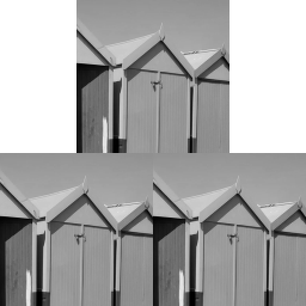
<figcaption>Runde 1</figcaption></figure>
<figure>
<!-- tutorial-screenshot
image-file: fraktal/kopie-2.png 2
-->
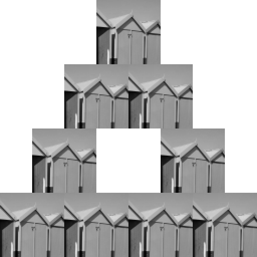
<figcaption>Runde 2</figcaption></figure>
</div>

Mit jeder Runde werden die Kopien kleiner und mehr. Lass das Programm noch einmal laufen, diesmal mit Rauschen statt mit dem Foto:

```bash
python3 kopiermaschine.py rauschen
```

_task(kopiermaschine)

<!-- after: kopiermaschine -->
<div class='gallery columns-2'>
<figure>
<!-- tutorial-screenshot
terminal-run: cd /workspace/fraktal && python3 kopiermaschine.py
terminal-wait-for-prompt: 60
image-file: fraktal/kopie-8.png 2
-->
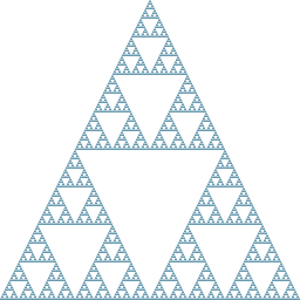
<figcaption>Runde 8, vom Foto aus</figcaption></figure>
<figure>
<!-- tutorial-screenshot
terminal-run: cd /workspace/fraktal && python3 kopiermaschine.py rauschen
terminal-wait-for-prompt: 60
image-file: fraktal/kopie-8.png 2
-->
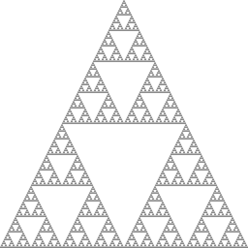
<figcaption>Runde 8, vom Rauschen aus</figcaption></figure>
</div>

Beide Male entsteht dieselbe Form, ein **Sierpinski-Dreieck**. Vom Startbild ist nichts mehr zu erkennen: Jede Runde verkleinert es auf die Hälfte, nach acht Runden auf 1/256, ein Pixel von 256. Was übrig bleibt, ist die Regel der Maschine, wohin die drei Kopien kommen. Nur eines vom Startbild hält sich, seine mittlere Farbe: Die Maschine mittelt beim Verkleinern und tut nichts dazu, darum ist das Dreieck vom Foto aus graublau und vom bunten Rauschen aus grau. Das Dreieck ist ihr **Fixpunkt**: Legt man es ein, kommt es unverändert wieder heraus, denn es besteht genau aus drei halb so großen Kopien von sich selbst.

Eine Kopiermaschine, deren Kopien kleiner sind als das Original, findet immer zu einem solchen Fixpunkt, egal womit man anfängt; der Mathematiker Stefan Banach hat das 1922 bewiesen (der **Fixpunktsatz von Banach**). Ein Bild, das aus verkleinerten Kopien von sich selbst besteht, heißt **Fraktal**.

_person(banach)
<!-- /after -->

<div class='hint try'>
<strong>Ausprobieren:</strong> Ändere in <code>copy_machine</code> den Ort der oberen Kopie, zum Beispiel <code>new[0:h, 0:h] = small</code>, links oben statt in der Mitte. Welches Bild entsteht jetzt nach acht Runden? Und was passiert, wenn du eine vierte Kopie nach rechts oben legst, <code>new[0:h, h:N] = small</code>? Stell die Zeilen danach wieder zurück.
</div>

_person(sierpinski)

### Die Idee für ein Foto

Ein Foto der Strandhäuser ist kein Fraktal. Aber es ist sich an vielen Stellen selbst ähnlich: Die Kante eines Dachs sieht im Kleinen aus wie dieselbe Kante ein Stück weiter, ein Brett der Tür wie das nächste, ein Stück Himmel wie ein größeres Stück Himmel. **Michael Barnsley** und sein Doktorand **Arnaud Jacquin** hatten um 1990 die Idee, ein Foto als Kopiermaschine zu speichern, die es selbst als Fixpunkt hat:

- Das Bild wird in kleine Blöcke zerlegt, 8 × 8 Pixel.
- Für jeden Block sucht der **Encoder** einen doppelt so großen Block irgendwo im selben Bild, der verkleinert so aussieht wie er, und merkt sich, wo der liegt, wie er gedreht ist und wie viel Kontrast und Helligkeit er dazu ändern muss.
- Der **Decoder** fängt mit irgendeinem Bild an und macht für jeden Block, was der Encoder gefunden hat, wieder und wieder. Wie bei der Kopiermaschine verschwindet das Startbild, und übrig bleibt das Foto.

In der Datei steht also kein einziges Pixel des Fotos, sondern nur, welcher Teil welchem anderen ähnlich sieht.

_person(barnsley)

## Blöcke und ihre Partner

### Das Foto als Zahlen

Wie JPEG trennt der Encoder die Helligkeit eines Fotos von seiner Farbe: Das Auge sieht Helligkeit viel feiner als Farbe (Handbuch, [Farbräume](/reference/farbraeume), YCbCr). Zuerst geht es nur um die Helligkeit, ein Bild in Graustufen; die Farbe kommt dazu, wenn Encoder und Decoder laufen. Lege im Ordner `fraktal` die Datei `fraktal.py` an. Sie wird über diese Seite der Encoder und der Decoder. Der Anfang lädt die Helligkeit eines Fotos und speichert ein Bild in Graustufen:

<!-- page-code: own -->
```python_copy
import sys
import time

import numpy as np
from PIL import Image

R = 8           # so breit und hoch ist ein Block, der ersetzt wird


def load(path):
    return np.asarray(Image.open(path).convert('L'), dtype=float)


def save(image, path):
    Image.fromarray(np.clip(image, 0, 255).round().astype(np.uint8)).save(path)


def shrink(block):
    ...


def main():
    photo = load('strandhaeuser.png')
    save(photo, 'grau.png')
    save(shrink(photo), 'klein.png')


if __name__ == '__main__':
    main()
```

`convert('L')` rechnet aus Rot, Grün und Blau die Helligkeit aus, mit denselben Gewichten wie das Y von JPEG. `load` gibt ein Array mit 320 Zeilen und 480 Spalten zurück, `photo[y, x]` ist die Helligkeit des Pixels in Spalte `x` und Zeile `y`. Mit `photo[y:y + 8, x:x + 8]` schneidest du einen Block von 8 × 8 Pixeln heraus, dessen linke obere Ecke bei `(x, y)` liegt. `save` begrenzt die Werte auf 0 bis 255, rundet sie und speichert ein PNG.

<div class='hint own' data-check='verkleinern'>
<strong>Jetzt bist du dran:</strong> Schreib die Funktion <code>shrink(block)</code>: Sie macht aus einem Array mit einer geraden Zahl von Zeilen und Spalten eines, das halb so breit und halb so hoch ist. Jedes Pixel des Ergebnisses ist der Mittelwert eines Quadrats von 2 × 2 Pixeln. Aus <code>[[0, 2], [4, 6]]</code> wird <code>[[3]]</code>.
</div>

<!-- hint -->
Die Kopiermaschine hat fast dieselbe Funktion, dort mit einer Achse mehr für die drei Farben. Was macht `reshape(h // 2, 2, w // 2, 2)` aus einem Array mit 4 × 4 Zahlen? Probier es in Python aus und schau dir `shape` an.
<!-- /hint -->
<!-- hint -->
Nach `reshape` hat das Array vier Achsen: Zeile des Quadrats, Zeile darin, Spalte des Quadrats, Spalte darin. Gemittelt wird über die Achsen 1 und 3, die innerhalb eines Quadrats.
<!-- /hint -->

<!-- solution -->
```python
def shrink(block):
    h, w = block.shape
    return block.reshape(h // 2, 2, w // 2, 2).mean(axis=(1, 3))
```
<!-- /solution -->

_task(verkleinern)

<!-- tutorial-scope -->
<!-- tutorial-screenshot
check-task-fails: verkleinern
write-file: fraktal/fraktal.py <- file:stufen/fraktal-1.py
check-task: verkleinern
terminal-run: cd /workspace/fraktal && python3 fraktal.py
terminal-wait-for-prompt: 60
image-file: fraktal/grau.png 2
-->

<!-- /tutorial-scope -->

### Ein Block und ein Partner

Ein Block von 8 × 8 Pixeln, der ersetzt werden soll, heißt im Fachjargon **Range-Block**; ein doppelt so großer Block, aus dem er gemacht werden soll, **Domain-Block**. Ein Domain-Block wird mit `shrink` auf 8 × 8 Pixel verkleinert, damit beide gleich groß sind. Damit mehr Partner in Frage kommen, darf er dazu gedreht und gespiegelt werden: Ein Quadrat hat acht Lagen, viermal um 90° gedreht und jede davon noch einmal gespiegelt.

```python
def turned(block, k):
    if k >= 4:
        block = np.fliplr(block)
    return np.rot90(block, k % 4)
```

`np.rot90` dreht ein Array um 90° gegen den Uhrzeigersinn, `k % 4`-mal; `np.fliplr` spiegelt es von links nach rechts. Mit `k` von 0 bis 7 kommen so alle acht Lagen heraus.

Selten sieht ein verkleinerter Block genau so aus wie der Range-Block. Oft passt er aber, wenn man ihn kontrastreicher oder blasser macht und heller oder dunkler: Jedes Pixel `d` des Domain-Blocks wird zu `s · d + o`. Der Faktor `s` ist der **Kontrast**: Bei 1 bleibt er, bei 0,5 halbiert er sich, bei −1 wird hell zu dunkel. Der Summand `o` (für *offset*) ist die **Verschiebung der Helligkeit**. Für einen Domain-Block `d` und einen Range-Block `t` sind die besten `s` und `o`, mit dem kleinsten Fehler

$$E = \sum (s \cdot d + o - t)^2,$$

diese (die Methode der kleinsten Quadrate):

$$s = \frac{\sum (d - \bar d)(t - \bar t)}{\sum (d - \bar d)^2} \qquad o = \bar t - s \cdot \bar d$$

\\(\bar d\\) und \\(\bar t\\) sind die Mittelwerte der beiden Blöcke. Die Summen laufen über alle 64 Pixel. Ein `s` größer als 1 lässt der Encoder nicht zu, er begrenzt es auf −1 bis 1. Warum, zeigt sich beim Decoder.

<div class='hint own' data-check='passen'>
<strong>Jetzt bist du dran:</strong> Schreib unter <code>turned</code> die Funktion <code>fit(domain, target)</code>. Beide sind Arrays mit 8 × 8 Zahlen. Sie gibt <code>s</code>, <code>o</code> und den Fehler <code>error</code> zurück, mit diesen Formeln; <code>s</code> ist auf −1 bis 1 begrenzt. Ist der Domain-Block überall gleich hell, wäre die Summe im Nenner 0: Nimm dann für sie eine winzige Zahl wie <code>1e-9</code>.
</div>

<!-- hint -->
Rechne zuerst `d = domain - domain.mean()` und `t = target - target.mean()`. Dann ist der Zähler `(d * t).sum()` und der Nenner `(d * d).sum()`: numpy rechnet `*` Zahl für Zahl.
<!-- /hint -->
<!-- hint -->
Ein Gerüst:

```python
def fit(domain, target):
    d = domain - domain.mean()
    t = target - target.mean()
    s = …                         # Zähler / Nenner, Nenner mindestens 1e-9
    s = min(max(s, -1.0), 1.0)
    o = …
    error = …                     # Summe der Quadrate von s * domain + o - target
    return s, o, error
```
<!-- /hint -->

<!-- solution -->
```python
def fit(domain, target):
    d = domain - domain.mean()
    t = target - target.mean()
    s = (d * t).sum() / max((d * d).sum(), 1e-9)
    s = min(max(s, -1.0), 1.0)
    o = target.mean() - s * domain.mean()
    error = ((s * domain + o - target) ** 2).sum()
    return s, o, error
```
<!-- /solution -->

_task(passen)

Jetzt kann das Programm für einen Range-Block alle Domain-Blöcke durchprobieren. Domain-Blöcke liegen alle 8 Pixel, in jeder Richtung; jeder wird verkleinert und in allen acht Lagen mit `fit` verglichen. Ersetze `main` durch diese Fassung, und schreib über `main` die Funktion `mark`: Sie zeichnet zwei Rahmen in das Foto, rot um den Range-Block, blau um seinen besten Partner, und speichert es doppelt so groß als `paar.png`.

```python_copy
def mark(image, boxes):
    picture = np.stack([np.clip(image, 0, 255)] * 3, axis=-1).astype(np.uint8)
    for x, y, size, color in boxes:
        for d in range(2):
            picture[y + d, x:x + size] = color
            picture[y + size - 1 - d, x:x + size] = color
            picture[y:y + size, x + d] = color
            picture[y:y + size, x + size - 1 - d] = color
    Image.fromarray(picture).resize((picture.shape[1] * 2, picture.shape[0] * 2), Image.NEAREST).save('paar.png')


def main():
    photo = load('strandhaeuser.png')
    x, y = 232, 96
    target = photo[y:y + R, x:x + R]
    best = None
    h, w = photo.shape
    for dy in range(0, h - 2 * R + 1, R):
        for dx in range(0, w - 2 * R + 1, R):
            small = shrink(photo[dy:dy + 2 * R, dx:dx + 2 * R])
            for k in range(8):
                s, o, error = fit(turned(small, k), target)
                if best is None or error < best[0]:
                    best = (error, dx, dy, k, s, o)
    error, dx, dy, k, s, o = best
    print(f'Block ({x}, {y}): am besten ({dx}, {dy}), Lage {k}, s = {s:.2f}, o = {o:.1f}, Fehler {error:.0f}')
    mark(photo, [(x, y, R, (220, 38, 38)), (dx, dy, 2 * R, (43, 95, 180))])
```

Der Block bei `(232, 96)` liegt auf der Kante des mittleren Dachs.

```bash
python3 fraktal.py
```

<!-- tutorial-scope -->
<!-- tutorial-screenshot
write-file: fraktal/fraktal.py <- file:stufen/fraktal-2.py
check-task: passen
terminal-run: cd /workspace/fraktal && python3 fraktal.py
terminal-wait-for-prompt: 120
image-file: fraktal/paar.png 1
-->
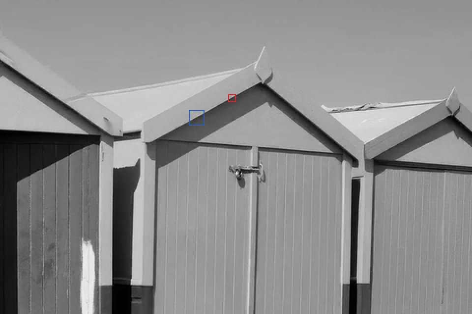
<!-- /tutorial-scope -->

Der beste Partner liegt ein Stück tiefer auf derselben Dachkante: Verkleinert sieht ein Stück Kante aus wie ein Stück Kante. Das Programm hat dafür 2301 Domain-Blöcke in je acht Lagen verglichen, 18 408 Mal `fit`.

<div class='hint try'>
<strong>Ausprobieren:</strong> Nimm einen anderen Block, zum Beispiel <code>x, y = 40, 16</code> im Himmel oder <code>x, y = 264, 224</code> auf den Brettern der Tür (beide Zahlen durch 8 teilbar). Wo liegt jetzt der Partner, und wie groß ist der Fehler? Bei welchem Block ist er am kleinsten?
</div>

## Der Encoder

### Alle Blöcke

Für das ganze Foto muss der Encoder das für jeden der 60 × 40 = 2400 Range-Blöcke tun. Mit `fit` in drei verschachtelten Schleifen wären das 2400 · 18 408, gut 44 Millionen Aufrufe, und das dauert in Python viele Minuten. numpy kann aber alle Domain-Blöcke auf einmal vergleichen, wenn sie als Zeilen eines großen Arrays vorliegen. Schreib unter `fit` diese beiden Funktionen:

```python_copy
def domains(image):
    blocks, places = [], []
    h, w = image.shape
    for y in range(0, h - 2 * R + 1, R):
        for x in range(0, w - 2 * R + 1, R):
            small = shrink(image[y:y + 2 * R, x:x + 2 * R])
            for k in range(8):
                blocks.append(turned(small, k).ravel())
                places.append((x, y, k))
    return np.array(blocks), places


def encode(image):
    blocks, places = domains(image)
    means = blocks.mean(axis=1)
    centred = blocks - means[:, None]
    spread = (centred * centred).sum(axis=1)
    code = []
    h, w = image.shape
    for y in range(0, h, R):
        for x in range(0, w, R):
            target = image[y:y + R, x:x + R].ravel()
            t = target - target.mean()
            dots = centred @ t
            s = np.clip(dots / np.maximum(spread, 1e-9), -1, 1)
            error = t @ t - 2 * s * dots + s * s * spread
            best = int(error.argmin())
            dx, dy, k = places[best]
            o = target.mean() - s[best] * means[best]
            code.append((x, y, dx, dy, k, s[best], o))
    return np.array(code)
```

`domains` macht aus jedem Domain-Block, verkleinert und in jeder Lage, eine Zeile mit 64 Zahlen (`ravel` legt die 8 × 8 Zahlen hintereinander), und merkt sich in `places`, woher sie kommt. Das Array `blocks` hat 18 408 Zeilen.

`encode` rechnet dann dasselbe wie `fit`, nur für alle Zeilen gleichzeitig: `means` sind die Mittelwerte aller Zeilen, `centred` die Zeilen ohne ihren Mittelwert (\\(d - \bar d\\)), `spread` die Nenner. Für jeden Range-Block gibt `centred @ t` mit einem Mal die 18 408 Zähler, und `s` ist ein Array mit 18 408 Kontrasten. Den Fehler rechnet die Zeile mit `error` aus, ohne die Blöcke noch einmal anzufassen: Ausmultipliziert ist

$$\sum \big(s (d - \bar d) - (t - \bar t)\big)^2 = \sum (t - \bar t)^2 - 2 s \sum (d - \bar d)(t - \bar t) + s^2 \sum (d - \bar d)^2,$$

und alle drei Summen sind schon da (\\(o\\) steckt darin: Mit dem besten \\(o\\) fallen die Mittelwerte heraus). `argmin` gibt die Zeile mit dem kleinsten Fehler. Für jeden Range-Block kommt ein Eintrag in den Code: wo er liegt (`x`, `y`), wo sein Partner liegt (`dx`, `dy`), dessen Lage `k`, `s` und `o`.

Ersetze `main` durch eine Fassung, die das Foto codiert und den Code als `code.npy` speichert:

```python_copy
def main():
    task = sys.argv[1] if len(sys.argv) > 1 else 'encode'
    if task == 'encode':
        photo = load(sys.argv[2] if len(sys.argv) > 2 else 'strandhaeuser.png')
        begin = time.time()
        code = encode(photo)
        np.save('code.npy', code)
        print(f'{len(code)} Blöcke in {time.time() - begin:.1f} s')
```

Die Funktion `mark` brauchst du nicht mehr; du kannst sie löschen.

```bash
python3 fraktal.py encode
```

<!-- stage: stufen/fraktal-3.py as fraktal.py -->
Das Programm schreibt, wie lange es gebraucht hat, je nach Rechner einige Sekunden:

<pre class='no-copy'>2400 Blöcke in 3.2 s</pre>

### Wie viel ist das?

Der Code hat 2400 Einträge mit je sieben Zahlen. Zwei davon, `x` und `y`, muss man nicht speichern: Die Range-Blöcke kommen immer in derselben Reihenfolge, Zeile für Zeile. Für den Rest reichen wenige Bits:

<div class='scroll-x'><table class='table table-sm'>
<thead><tr><th>Angabe</th><th>mögliche Werte</th><th>Bits</th></tr></thead>
<tbody>
<tr><td>welcher Domain-Block (<code>dx</code>, <code>dy</code>)</td><td>59 · 39 = 2301 Orte</td><td>12</td></tr>
<tr><td>Lage <code>k</code></td><td>8</td><td>3</td></tr>
<tr><td>Kontrast <code>s</code></td><td>32 Stufen von −1 bis 1</td><td>5</td></tr>
<tr><td>Helligkeit <code>o</code></td><td>128 Stufen</td><td>7</td></tr>
</tbody>
</table>
</div>

Für 64 Pixel braucht der Code also 27 Bits, statt 64 Bytes für die Pixel selbst. Wie fein `s` und `o` dafür gerundet werden müssen, und ob das Bild dabei schlechter wird, kannst du später selbst ausprobieren (unten, »Wie geht es weiter?«).

_task(bytes)

## Der Decoder

### Ein Schritt

Der Decoder kennt das Foto nicht. Er hat nur den Code und fängt mit einem grauen Bild an. In einem **Schritt** macht er für jeden Eintrag, was dort steht: den Domain-Block aus dem jetzigen Bild nehmen, verkleinern, in die Lage `k` drehen, mit `s` multiplizieren und `o` addieren, und das Ergebnis in den Range-Block eines neuen Bildes schreiben.

<div class='hint own' data-check='decodieren'>
<strong>Jetzt bist du dran:</strong> Schreib unter <code>encode</code> die Funktion <code>decode_step(image, code)</code>. Sie gibt ein neues Bild zurück, so groß wie <code>image</code>, in dem jeder Range-Block aus seinem Domain-Block in <code>image</code> gemacht ist. Die Zahlen in <code>code</code> sind Kommazahlen; für Indizes brauchst du <code>int(x)</code>.
</div>

<!-- hint -->
Ein neues, leeres Bild derselben Größe gibt `np.empty_like(image)`. Lies aus dem alten Bild, schreib in das neue: Sonst liest ein Block, was ein anderer in diesem Schritt schon geändert hat.
<!-- /hint -->
<!-- hint -->
Ein Gerüst:

```python
def decode_step(image, code):
    new = np.empty_like(image)
    for x, y, dx, dy, k, s, o in code:
        x, y, dx, dy, k = int(x), int(y), int(dx), int(dy), int(k)
        small = …                       # Domain-Block bei (dx, dy), 2R × 2R, verkleinert
        new[y:y + R, x:x + R] = …       # gedreht in Lage k, mal s, plus o
    return new
```
<!-- /hint -->

<!-- solution -->
```python
def decode_step(image, code):
    new = np.empty_like(image)
    for x, y, dx, dy, k, s, o in code:
        x, y, dx, dy, k = int(x), int(y), int(dx), int(dy), int(k)
        small = shrink(image[dy:dy + 2 * R, dx:dx + 2 * R])
        new[y:y + R, x:x + R] = s * turned(small, k) + o
    return new
```
<!-- /solution -->

_task(decodieren)

Hänge an `main` diesen Teil an. Er lädt den Code, rechnet die Größe des Bildes aus dem letzten Block aus, fängt mit Grau an und speichert jeden Schritt:

```python_copy
~         print(f'{len(code)} Blöcke in {time.time() - begin:.1f} s')
    elif task == 'decode':
        code = np.load('code.npy')
        h = int(code[:, 1].max()) + R
        w = int(code[:, 0].max()) + R
        image = np.full((h, w), 128.0)
        save(image, 'schritt-0.png')
        for step in range(1, 9):
            image = decode_step(image, code)
            save(image, f'schritt-{step}.png')
```

```bash
python3 fraktal.py decode
```

<div class='gallery columns-2'>
<figure>
<!-- tutorial-screenshot
check-task-fails: decodieren
write-file: fraktal/fraktal.py <- file:stufen/fraktal-4.py
check-task: decodieren
terminal-run: cd /workspace/fraktal && python3 fraktal.py encode && python3 fraktal.py decode
terminal-wait-for-prompt: 120
image-file: fraktal/schritt-1.png 1
-->
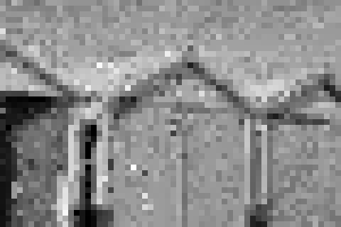
<figcaption>Schritt 1</figcaption></figure>
<figure>
<!-- tutorial-screenshot
image-file: fraktal/schritt-2.png 1
-->
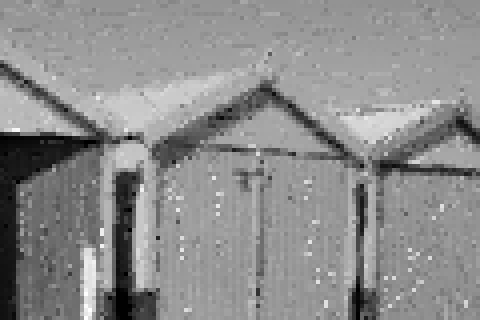
<figcaption>Schritt 2</figcaption></figure>
<figure>
<!-- tutorial-screenshot
image-file: fraktal/schritt-3.png 1
-->
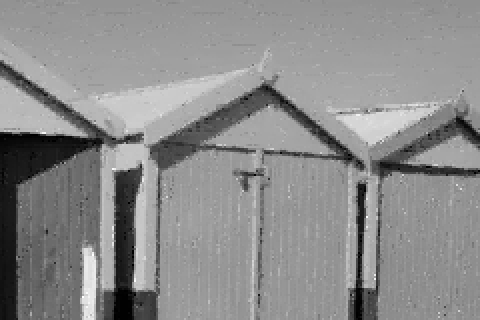
<figcaption>Schritt 3</figcaption></figure>
<figure>
<!-- tutorial-screenshot
image-file: fraktal/schritt-8.png 1
-->

<figcaption>Schritt 8</figcaption></figure>
</div>

Nach dem ersten Schritt sieht man schon grobe Kästchen: `o` verschiebt jeden Block auf ungefähr seine Helligkeit, und mehr gibt ein graues Bild noch nicht her. Die Kanten, die Bretter, die Linien der Dächer entstehen erst in den nächsten Schritten: Jeder Block holt sich die Kanten von seinem Partner, der sie gerade erst von seinem Partner geholt hat. Nach fünf, sechs Schritten ändert sich nichts mehr.

### Warum s höchstens 1 ist

Wie bei der Kopiermaschine verkleinert jeder Schritt, was das Startbild noch beiträgt: Zwei verschiedene Startbilder unterscheiden sich in einem Block nach dem Schritt um das `s`-fache ihres Unterschieds im verkleinerten Domain-Block, und mit `s` unter 1 werden die Unterschiede von Schritt zu Schritt kleiner. Wäre ein `s` größer als 1, könnte ein Unterschied wachsen, statt zu verschwinden, und das Bild flackerte oder liefe aus dem Ruder.

<div class='hint try'>
<strong>Ausprobieren:</strong> Ändere in <code>encode</code> die Grenze auf <code>np.clip(…, -2, 2)</code> und codiere neu. Wie sehen die Schritte jetzt aus? Stell die Grenze danach wieder auf −1 bis 1 und codiere noch einmal.
</div>

## In Farbe wie bei JPEG

### Helligkeit und zwei Farbanteile

Ein Farbfoto zerlegt der Encoder wie JPEG in drei Kanäle: **Y**, die Helligkeit, wie bisher, **Cb**, wie viel bläulicher oder gelblicher ein Pixel ist, und **Cr**, wie viel rötlicher oder grünlicher (Handbuch, [Farbräume](/reference/farbraeume), YCbCr). Pillow rechnet das mit `convert('YCbCr')` um. In Cb und Cr ist ein Foto fast überall ein gleichmäßiges Grau, und das Auge sieht dort Unterschiede ohnehin viel gröber als bei der Helligkeit. JPEG speichert Cb und Cr darum oft nur halb so breit und halb so hoch, einen Farbwert für vier Pixel; das heißt **Farbunterabtastung** (englisch *chroma subsampling*).

Der fraktale Encoder macht es genauso. Y codiert er wie bisher, Cb und Cr verkleinert er erst mit `shrink` auf 240 × 160 Pixel und codiert dann jeden mit derselben Funktion `encode`: Jeder Kanal ist für sich ein Bild in Graustufen, mit seinen eigenen Blöcken und Partnern. Schreib über `main` diese drei Funktionen:

```python_copy
def load_color(path):
    image = np.asarray(Image.open(path).convert('YCbCr'), dtype=float)
    return image[:, :, 0], image[:, :, 1], image[:, :, 2]


def save_color(y, cb, cr, path):
    cb = np.repeat(np.repeat(cb, 2, axis=0), 2, axis=1)
    cr = np.repeat(np.repeat(cr, 2, axis=0), 2, axis=1)
    ycbcr = np.clip(np.stack([y, cb, cr], axis=-1), 0, 255).round().astype(np.uint8)
    Image.fromarray(ycbcr, 'YCbCr').convert('RGB').save(path)


def picture_size(code):
    return int(code[:, 1].max()) + R, int(code[:, 0].max()) + R
```

`load_color` gibt die drei Kanäle als eigene Arrays zurück. `save_color` vergrößert Cb und Cr wieder auf die volle Größe: `np.repeat` verdoppelt jede Zeile und jede Spalte, so dass jeder Farbwert für vier Pixel gilt, wie im Decoder von <a href='/jpeg'>JPEG</a>. Dann legt `np.stack` die drei Kanäle zu einem Bild zusammen, und Pillow rechnet es in Rot, Grün und Blau zurück. `picture_size` rechnet die Größe eines Bildes aus seinem Code aus, wie bisher in `main`.

Ersetze `main` durch eine Fassung, die die drei Kanäle codiert, zusammen in einer Datei `code.npz`, und decodiert:

```python_copy
def main():
    task = sys.argv[1] if len(sys.argv) > 1 else 'encode'
    if task == 'encode':
        y, cb, cr = load_color(sys.argv[2] if len(sys.argv) > 2 else 'strandhaeuser.png')
        begin = time.time()
        np.savez('code.npz', y=encode(y), cb=encode(shrink(cb)), cr=encode(shrink(cr)))
        print(f'fertig in {time.time() - begin:.1f} s')
    elif task == 'decode':
        codes = np.load('code.npz')
        h, w = picture_size(codes['y'])
        images = {'y': np.full((h, w), 128.0), 'cb': np.full((h // 2, w // 2), 128.0), 'cr': np.full((h // 2, w // 2), 128.0)}
        save_color(images['y'], images['cb'], images['cr'], 'schritt-0.png')
        for step in range(1, 9):
            for name in images:
                images[name] = decode_step(images[name], codes[name])
            save_color(images['y'], images['cb'], images['cr'], f'schritt-{step}.png')
```

Der Decoder fängt in allen drei Kanälen mit 128 an. In Cb und Cr heißt 128: keine Farbe; das Startbild ist also grau. In jedem Schritt macht er für jeden Kanal einen Schritt mit dessen Code.

```bash
python3 fraktal.py encode
python3 fraktal.py decode
```

<div class='gallery columns-2'>
<figure>
<!-- tutorial-screenshot
write-file: fraktal/fraktal.py <- file:stufen/fraktal-5.py
terminal-run: cd /workspace/fraktal && python3 fraktal.py encode && python3 fraktal.py decode
terminal-wait-for-prompt: 120
image-file: fraktal/schritt-1.png 1
-->
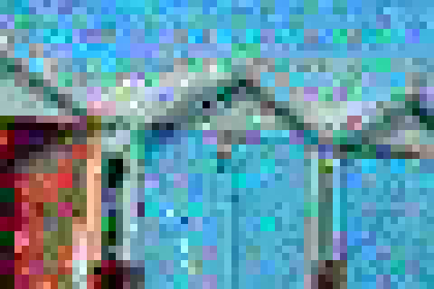
<figcaption>Schritt 1</figcaption></figure>
<figure>
<!-- tutorial-screenshot
image-file: fraktal/schritt-8.png 1
-->

<figcaption>Schritt 8</figcaption></figure>
</div>

### Was die Farbe kostet

Cb und Cr haben je 30 × 20 = 600 Blöcke, und ihre Domain-Blöcke liegen auf nur 29 · 19 = 551 Orten, die in 10 Bits passen. Mit 3 Bits für die Lage, 5 für `s` und 7 für `o` braucht ein Farbblock 25 Bits. Zusammen sind das

$$2400 \cdot 27 + 2 \cdot 600 \cdot 25 = 94\,800 \text{ Bits} \approx 11\,850 \text{ Bytes},$$

nur gut ein Drittel mehr als die Helligkeit allein, für ein Foto, das unkomprimiert 480 · 320 · 3 = 460 800 Bytes hat.

## Jedes Startbild führt zum selben Foto

Dass der Decoder mit Grau anfängt, ist nur eine Wahl. Der Code sagt nicht, welche Helligkeit oder Farbe ein Pixel hat, sondern nur, wie jeder Block aus einem anderen Block entsteht. Ändere `main` so, dass der Decoder mit einem Startbild deiner Wahl anfängt. Schreib dafür über `main` die Funktion `start_image`; sie macht ein Startbild in Rot, Grün und Blau und gibt es zerlegt in Y und die verkleinerten Cb und Cr zurück:

```python_copy
def start_image(name, h, w):
    if name == 'grau':
        rgb = np.full((h, w, 3), 128.0)
    elif name == 'verlauf':
        rgb = np.zeros((h, w, 3))
        rgb[:, :, 0] = np.linspace(0, 255, w)
        rgb[:, :, 2] = np.linspace(255, 0, w)
    elif name == 'rauschen':
        rgb = np.random.default_rng(1).uniform(0, 255, (h, w, 3))
    else:
        rgb = np.asarray(Image.open(name).convert('RGB').resize((w, h)), dtype=float)
    ycbcr = np.asarray(Image.fromarray(rgb.astype(np.uint8)).convert('YCbCr'), dtype=float)
    return ycbcr[:, :, 0], shrink(ycbcr[:, :, 1]), shrink(ycbcr[:, :, 2])
```

und nimm sie im Teil für `decode`:

```python_copy
~     elif task == 'decode':
~         codes = np.load('code.npz')
        start = sys.argv[2] if len(sys.argv) > 2 else 'grau'
~         h, w = picture_size(codes['y'])
        y, cb, cr = start_image(start, h, w)
        images = {'y': y, 'cb': cb, 'cr': cr}
~         save_color(images['y'], images['cb'], images['cr'], 'schritt-0.png')
```

`verlauf` geht von Blau links nach Rot rechts, `rauschen` ist jedes Pixel in jeder Farbe zufällig, und ein Dateiname nimmt ein anderes Foto. Der Code in `code.npz` bleibt derselbe: der der Strandhäuser. Fang mit dem Foto der Möwen an:

```bash
python3 fraktal.py decode moewen.png
```

Bevor du `schritt-1.png` öffnest:

_task(erster-schritt)

<!-- after: erster-schritt -->
Probier auch den Verlauf und das Rauschen:

```bash
python3 fraktal.py decode verlauf
python3 fraktal.py decode rauschen
```

<div class='gallery columns-3'>
<figure>
<!-- tutorial-screenshot
write-file: fraktal/fraktal.py <- file:stufen/fraktal-6.py
terminal-run: cd /workspace/fraktal && python3 fraktal.py decode moewen.png
terminal-wait-for-prompt: 120
image-file: fraktal/schritt-0.png 1
-->
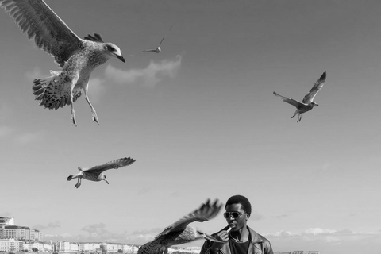
<figcaption>Ein anderes Foto, Schritt 0</figcaption></figure>
<figure>
<!-- tutorial-screenshot
image-file: fraktal/schritt-1.png 1
-->
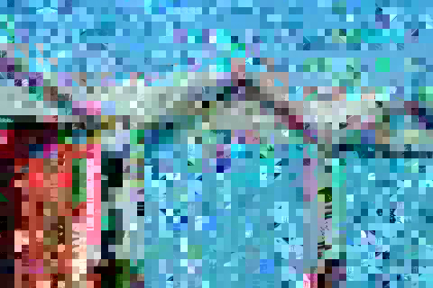
<figcaption>Schritt 1</figcaption></figure>
<figure>
<!-- tutorial-screenshot
image-file: fraktal/schritt-8.png 1
-->

<figcaption>Schritt 8</figcaption></figure>
<figure>
<!-- tutorial-screenshot
terminal-run: cd /workspace/fraktal && python3 fraktal.py decode verlauf
terminal-wait-for-prompt: 120
image-file: fraktal/schritt-0.png 1
-->
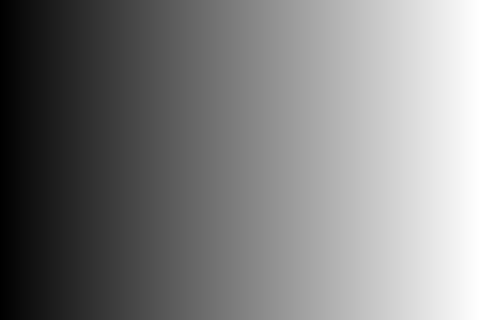
<figcaption>Verlauf, Schritt 0</figcaption></figure>
<figure>
<!-- tutorial-screenshot
image-file: fraktal/schritt-1.png 1
-->
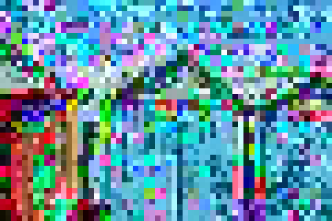
<figcaption>Schritt 1</figcaption></figure>
<figure>
<!-- tutorial-screenshot
image-file: fraktal/schritt-8.png 1
-->

<figcaption>Schritt 8</figcaption></figure>
<figure>
<!-- tutorial-screenshot
terminal-run: cd /workspace/fraktal && python3 fraktal.py decode rauschen
terminal-wait-for-prompt: 120
image-file: fraktal/schritt-0.png 1
-->
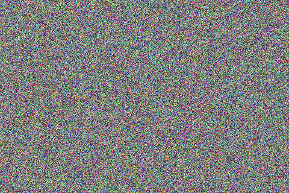
<figcaption>Rauschen, Schritt 0</figcaption></figure>
<figure>
<!-- tutorial-screenshot
image-file: fraktal/schritt-1.png 1
-->

<figcaption>Schritt 1</figcaption></figure>
<figure>
<!-- tutorial-screenshot
image-file: fraktal/schritt-8.png 1
-->

<figcaption>Schritt 8</figcaption></figure>
</div>

Nach einem Schritt steckt vom Startbild noch etwas in jedem Block: das verkleinerte Stück, das sein Partner dort sah, mit `s` gewichtet, dazu `o`. Darum sieht man nach einem Schritt aus den Möwen bunte Kästchen der Strandhäuser mit Resten der Möwen darin. Nach acht Schritten wird aus jedem Startbild dasselbe Foto, bis aufs Pixel. Das ist der große Unterschied zu GIF und JPEG: Dort steht in der Datei, welche Farbe ein Pixel hat oder welche Frequenzen ein Block enthält, und ohne diese Zahlen gäbe es kein Bild. Hier steht in der Datei für jeden Block, in jedem der drei Kanäle, nur, aus welchem anderen Block er gemacht wird und mit welchem Kontrast und welcher Verschiebung. Das Foto ist der Fixpunkt dieser Vorschrift; das Startbild verschwindet, weil jeder Schritt es mit `s` verkleinert, so wie die Kopiermaschine das Foto der Strandhäuser in ihrem Dreieck verschwinden ließ.
<!-- /after -->

## Größer als das Original

Der Code nennt keine Pixel, nur Blöcke und wie sie zusammenhängen. Nichts hindert den Decoder daran, dieselbe Vorschrift auf ein doppelt so großes Bild anzuwenden: jeder Range-Block 16 × 16 Pixel statt 8 × 8, jeder Domain-Block 32 × 32. Ändere `decode_step` so, dass es einen Faktor `scale` nimmt:

```python_copy
def decode_step(image, code, scale=1):
    new = np.empty_like(image)
    r = R * scale
    for x, y, dx, dy, k, s, o in code:
        x, y, dx, dy, k = int(x) * scale, int(y) * scale, int(dx) * scale, int(dy) * scale, int(k)
        small = shrink(image[dy:dy + 2 * r, dx:dx + 2 * r])
        new[y:y + r, x:x + r] = s * turned(small, k) + o
    return new
```

und in `main` den Faktor als dritte Angabe:

```python_copy
~         start = sys.argv[2] if len(sys.argv) > 2 else 'grau'
        scale = int(sys.argv[3]) if len(sys.argv) > 3 else 1
~         h, w = picture_size(codes['y'])
        y, cb, cr = start_image(start, h * scale, w * scale)
~         images = {'y': y, 'cb': cb, 'cr': cr}
~         save_color(images['y'], images['cb'], images['cr'], 'schritt-0.png')
~         for step in range(1, 9):
~             for name in images:
                images[name] = decode_step(images[name], codes[name], scale)
```

Für Cb und Cr wirkt der Faktor genauso: Ihre Blöcke liegen im halb so großen Bild, und es wird mit ihnen doppelt so groß.

```bash
python3 fraktal.py decode grau 2
```

<!-- tutorial-scope -->
<!-- tutorial-screenshot
write-file: fraktal/fraktal.py <- file:stufen/fraktal-7.py
terminal-run: cd /workspace/fraktal && python3 fraktal.py decode grau 2
terminal-wait-for-prompt: 180
image-file: fraktal/schritt-8.png 1
-->
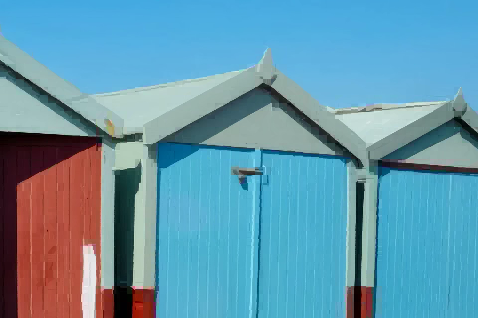
<!-- /tutorial-scope -->

Das Bild hat 960 × 640 Pixel, viermal so viele wie das Foto, und es ist nicht verschwommen wie ein einfach vergrößertes Foto: Die Kanten sind scharf, die Bretter fein. Die neuen Feinheiten hat der Decoder aber erfunden. Er setzt in jeden Block die verkleinerte Fassung eines größeren, auch dort, wo das echte Foto im Kleinen ganz anders aussähe. Für Kanten und Bretter passt das gut, für Gesichter oder Schrift nicht.

<div class='hint try'>
<strong>Ausprobieren:</strong> Vergrößere das Foto zum Vergleich einfach: <code>python3 -c "from PIL import Image; Image.open('strandhaeuser.png').resize((960, 640), Image.BICUBIC).save('bikubisch.png')"</code>. Öffne beide Bilder nebeneinander und vergrößere auf eine Dachkante und auf den Riegel der mittleren Tür. Wo ist das fraktale Bild besser, wo hat es sich etwas ausgedacht?
</div>

## Wie gut ist das?

### Wie man Fehler in Dezibel misst

Wie nah ein Bild an seinem Original ist, misst man meist in zwei Schritten. Zuerst der **mittlere quadrierte Fehler** (englisch *mean squared error*, MSE): für jedes Pixel und jede der drei Farben die Abweichung vom Original, quadriert, und von allen diesen Quadraten der Mittelwert. Ist jedes Pixel in jeder Farbe um genau 5 daneben, ist der MSE 5² = 25; ist die Hälfte um 10 daneben und der Rest genau, ist er (100 + 0) / 2 = 50. Das Quadrieren macht große Abweichungen teurer als viele kleine.

Dann vergleicht man den MSE mit dem größten möglichen Fehler, 255², und nimmt davon den Logarithmus. Heraus kommt das **PSNR** (*peak signal-to-noise ratio*), in **Dezibel** (dB):

$$\text{PSNR} = 10 \cdot \log\_{10} \frac{255^2}{\text{MSE}}$$

Je größer das PSNR, desto kleiner der Fehler. Durch den Logarithmus wird jeder Faktor 10 im Fehler zu einem gleich großen Schritt: **10 dB mehr heißt ein zehnmal kleinerer MSE**, 20 dB mehr ein hundertmal kleinerer. Etwa 6 dB mehr heißt, dass jedes Pixel im Mittel halb so weit danebenliegt (ein Viertel des MSE). So passen winzige und riesige Fehler auf eine Skala von etwa 20 bis 50 dB. Wie sich das anfühlt, zeigt dieselbe Ecke der Strandhäuser als JPEG, so stark gepackt, dass das ganze Foto auf das jeweilige PSNR kommt:

<div class='gallery columns-4'>
<figure>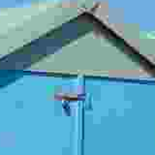<figcaption>etwa 25 dB</figcaption></figure>
<figure>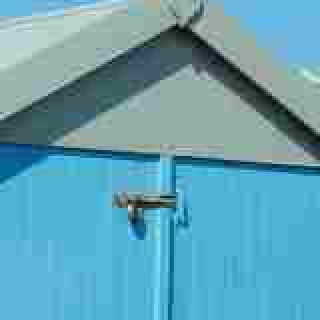<figcaption>etwa 30 dB</figcaption></figure>
<figure>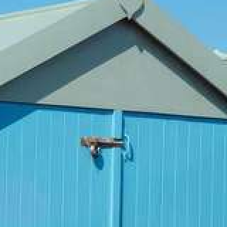<figcaption>etwa 35 dB</figcaption></figure>
<figure><figcaption>etwa 40 dB</figcaption></figure>
</div>

Unter 25 dB sieht man die Fehler sofort, um 30 dB beim genauen Hinsehen, ab etwa 35 dB kaum noch. Wie die Fehler aussehen, hängt aber vom Verfahren ab: JPEG macht Blöcke und Schlieren, die fraktale Kompression Kästchen und Flecken. Zwei Bilder mit gleichem PSNR können darum verschieden gut aussehen.

_task(dezibel)

### Fraktal gegen JPEG

Schreib die Funktion `psnr` über `main`:

```python_copy
def psnr(a, b):
    return 10 * np.log10(255 ** 2 / ((a - b) ** 2).mean())
```

und hänge an `main` einen Teil `vergleich` an, der das letzte decodierte Bild mit dem Foto vergleicht, in Rot, Grün und Blau:

```python_copy
~                 images[name] = decode_step(images[name], codes[name], scale)
~             save_color(images['y'], images['cb'], images['cr'], f'schritt-{step}.png')
    elif task == 'vergleich':
        photo = np.asarray(Image.open(sys.argv[2] if len(sys.argv) > 2 else 'strandhaeuser.png').convert('RGB'), dtype=float)
        image = np.asarray(Image.open(sys.argv[3] if len(sys.argv) > 3 else 'schritt-8.png').convert('RGB'), dtype=float)
        print(f'{psnr(image, photo):.1f} dB')
```

`vergleich` nimmt das Foto als zweite Angabe und als dritte ein Bild, das mit ihm verglichen wird, ohne sie das letzte decodierte.

```bash
python3 fraktal.py decode
python3 fraktal.py vergleich
```

Der Code der Strandhäuser braucht in Farbe etwa 11 850 Bytes. Wie gut ist ein JPEG, das genauso groß ist?

_task(gegen-jpeg)

<!-- after: gegen-jpeg -->
Speichere das Foto als JPEG mit der Qualität 43 und vergleiche:

```bash
python3 -c "from PIL import Image; Image.open('strandhaeuser.png').save('q43.jpg', quality=43)"
ls -l q43.jpg
python3 fraktal.py vergleich strandhaeuser.png q43.jpg
```

<div class='scroll-x'><table class='table table-sm'>
<thead><tr><th></th><th>Größe</th><th>PSNR</th></tr></thead>
<tbody>
<tr><td>unkomprimiert, 480 · 320 · 3</td><td>460 800 Bytes</td><td></td></tr>
<tr><td>fraktal, Blöcke 8 × 8, Farbe halb so groß</td><td>etwa 11 850 Bytes</td><td>31,7 dB</td></tr>
<tr><td>JPEG, Qualität 43</td><td>etwa 11 800 Bytes</td><td>33,6 dB</td></tr>
</tbody>
</table>
</div>

JPEG liegt knapp 2 dB vorn: Sein MSE ist etwa um ein Drittel kleiner. Beide packen das Foto auf etwa ein Vierzigstel. Bei diesem Foto hilft der fraktalen Kompression, dass es sich so oft wiederholt: drei Dächer, viele Bretter, viel gleichmäßiger Himmel.
<!-- /after -->

### Wo es schwer wird

Codiere zum Vergleich die anderen beiden Fotos:

```bash
python3 fraktal.py encode skytree.png && python3 fraktal.py decode && python3 fraktal.py vergleich skytree.png
python3 fraktal.py encode kirschbluete.png && python3 fraktal.py decode && python3 fraktal.py vergleich kirschbluete.png
```

<div class='gallery columns-2'>
<figure>
<!-- tutorial-screenshot
terminal-run: cd /workspace/fraktal && python3 fraktal.py encode skytree.png && python3 fraktal.py decode
terminal-wait-for-prompt: 120
image-file: fraktal/schritt-8.png 1
-->
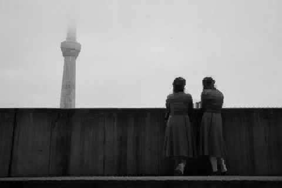
<figcaption>Skytree, decodiert</figcaption></figure>
<figure>
<!-- tutorial-screenshot
terminal-run: cd /workspace/fraktal && python3 fraktal.py encode kirschbluete.png && python3 fraktal.py decode
terminal-wait-for-prompt: 120
image-file: fraktal/schritt-8.png 1
-->
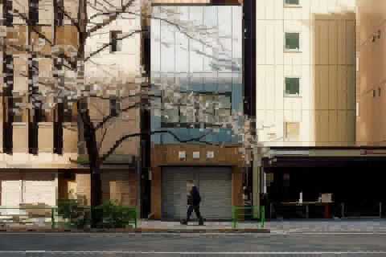
<figcaption>Kirschblüte, decodiert</figcaption></figure>
</div>

Vergrößere beide Bilder mit einem Klick und schau genau hin. Das Foto mit dem Skytree hat große ruhige Flächen, Nebel und Beton, und die beiden roten Mäntel sehen sich selbst ähnlich: Es kommt auf knapp 33 dB. Beim Kirschbaum sind aus der Nähe die Blüten verschwunden und die Äste zu Kästchen geworden: Für die feinen, wirren Äste und Blüten gibt es keinen größeren Block, der verkleinert so aussieht. Das Foto kommt nur auf gut 22 dB. Fraktale Kompression ist gut, wo ein Bild sich wiederholt, und schlecht bei feinen Einzelheiten, die es nur einmal gibt.

<!-- extra -->
## Große und kleine Blöcke

Ein Block im gleichmäßigen Himmel wäre auch als 16 × 16 gut getroffen, ein Block in den Ästen des Kirschbaums bräuchte 4 × 4. Eine Kompression mit festen 8 × 8 verschenkt an beiden Stellen Bits. Ein **Quadtree** (ein Baum, in dem jeder Knoten vier Kinder hat) passt die Größe an: Jeder Block beginnt mit 16 × 16. Ist sein Fehler zu groß, wird er in vier Blöcke von 8 × 8 geteilt, und jeder davon, wenn nötig, noch einmal in vier von 4 × 4.

Für jede Größe braucht der Encoder seine eigenen Domain-Blöcke, doppelt so groß wie die Range-Blöcke. Gib `domains` die Größe als Parameter:

```python
def domains(image, r=R):
    blocks, places = [], []
    h, w = image.shape
    for y in range(0, h - 2 * r + 1, r):
        for x in range(0, w - 2 * r + 1, r):
            small = shrink(image[y:y + 2 * r, x:x + 2 * r])
~             for k in range(8):
```

Der Encoder bekommt eine rekursive Funktion `encode_block`: Sie sucht den besten Partner wie `encode`, und ist der mittlere Fehler je Pixel größer als `limit`, ruft sie sich viermal selbst auf, für die vier Viertel des Blocks. Jeder Eintrag im Code bekommt als achte Zahl seine Größe. Schreib unter `decode_step`:

```python_copy
SIZES = (16, 8, 4)


def encode_quadtree(image, limit):
    pools = {}
    for size in SIZES:
        blocks, places = domains(image, size)
        means = blocks.mean(axis=1)
        centred = blocks - means[:, None]
        pools[size] = (centred, means, (centred * centred).sum(axis=1), places)
    code = []

    def encode_block(x, y, size):
        centred, means, spread, places = pools[size]
        target = image[y:y + size, x:x + size].ravel()
        t = target - target.mean()
        dots = centred @ t
        s = np.clip(dots / np.maximum(spread, 1e-9), -1, 1)
        error = t @ t - 2 * s * dots + s * s * spread
        best = int(error.argmin())
        if error[best] / (size * size) > limit and size > SIZES[-1]:
            half = size // 2
            for dy in (0, half):
                for dx in (0, half):
                    encode_block(x + dx, y + dy, half)
            return
        px, py, k = places[best]
        code.append((x, y, px, py, k, s[best], target.mean() - s[best] * means[best], size))

    h, w = image.shape
    for y in range(0, h, SIZES[0]):
        for x in range(0, w, SIZES[0]):
            encode_block(x, y, SIZES[0])
    return np.array(code)


def show_blocks(image, code):
    picture = np.stack([np.clip(image, 0, 255)] * 3, axis=-1).astype(np.uint8)
    for x, y, size in code[:, [0, 1, 7]].astype(int):
        picture[y, x:x + size] = (220, 38, 38)
        picture[y:y + size, x] = (220, 38, 38)
    Image.fromarray(picture).resize((picture.shape[1] * 2, picture.shape[0] * 2), Image.NEAREST).save('bloecke.png')
```

`show_blocks` zeichnet die linke und die obere Kante jedes Blocks rot ins Foto und speichert es doppelt so groß als `bloecke.png`. Der Decoder liest die Größe aus der achten Spalte, wenn es sie gibt:

```python
def decode_step(image, code, scale=1):
    new = np.empty_like(image)
    for row in code:
        x, y, dx, dy, k, s, o = row[:7]
        r = (int(row[7]) if len(row) > 7 else R) * scale
        x, y, dx, dy, k = int(x) * scale, int(y) * scale, int(dx) * scale, int(dy) * scale, int(k)
~         small = shrink(image[dy:dy + 2 * r, dx:dx + 2 * r])
```

`picture_size` rechnet die Größe des Bildes mit den Größen der Blöcke aus:

```python
def picture_size(code):
    sizes = code[:, 7] if code.shape[1] > 7 else R
    return int((code[:, 1] + sizes).max()), int((code[:, 0] + sizes).max())
```

Ein neuer Teil `quadtree` in `main` codiert die Helligkeit mit dem Quadtree und die Farbe wie bisher mit festen Blöcken; die Farbe ist ohnehin klein:

```python_copy
~             save_color(images['y'], images['cb'], images['cr'], f'schritt-{step}.png')
    elif task == 'quadtree':
        y, cb, cr = load_color(sys.argv[2] if len(sys.argv) > 2 else 'strandhaeuser.png')
        limit = float(sys.argv[3]) if len(sys.argv) > 3 else 60
        code = encode_quadtree(y, limit)
        np.savez('code.npz', y=code, cb=encode(shrink(cb)), cr=encode(shrink(cr)))
        show_blocks(y, code)
        counts = ', '.join(f'{int((code[:, 7] == size).sum())} mit {size}' for size in SIZES)
        print(f'{len(code)} Blöcke: {counts}')
~     elif task == 'vergleich':
```

```bash
python3 fraktal.py quadtree strandhaeuser.png 60
python3 fraktal.py decode && python3 fraktal.py vergleich
python3 fraktal.py quadtree kirschbluete.png 60
```

<div class='gallery columns-2'>
<figure>
<!-- tutorial-screenshot
write-file: fraktal/fraktal.py <- file:stufen/fraktal-8.py
terminal-run: cd /workspace/fraktal && python3 fraktal.py quadtree strandhaeuser.png 60
terminal-wait-for-prompt: 180
image-file: fraktal/bloecke.png 1
-->
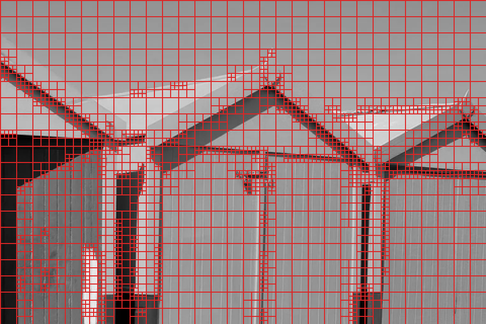
<figcaption>Strandhäuser: große Blöcke im Himmel, kleine an den Kanten</figcaption></figure>
<figure>
<!-- tutorial-screenshot
terminal-run: cd /workspace/fraktal && python3 fraktal.py quadtree kirschbluete.png 60
terminal-wait-for-prompt: 180
image-file: fraktal/bloecke.png 1
-->
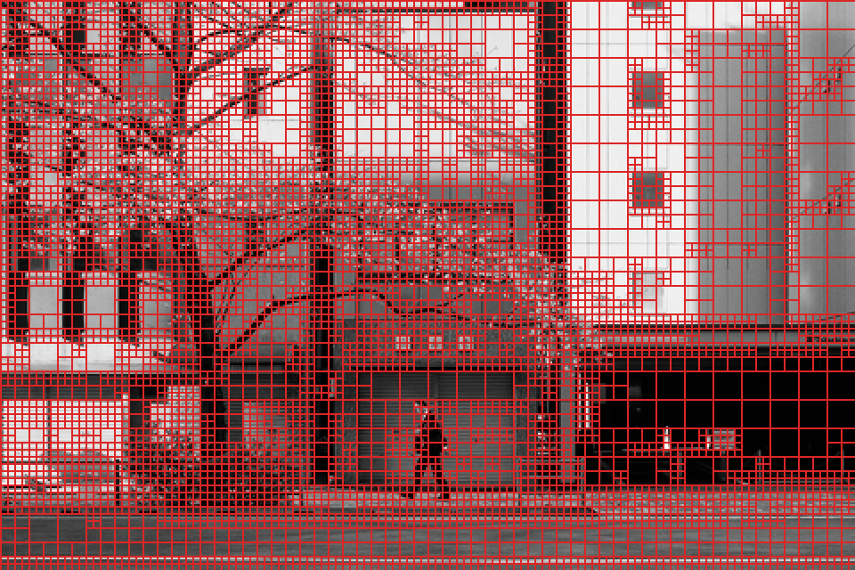
<figcaption>Kirschbaum: fast überall die kleinsten</figcaption></figure>
</div>

Mit den Strandhäusern ergibt das, je nach der Grenze für den mittleren Fehler eines Pixels (die Blöcke der Helligkeit, mit der Farbe zusammen):

<div class='scroll-x'><table class='table table-sm'>
<thead><tr><th>Blöcke der Helligkeit</th><th>Anzahl</th><th>etwa Bytes</th><th>PSNR</th></tr></thead>
<tbody>
<tr><td>fest 8 × 8</td><td>2400</td><td>11 850</td><td>31,7 dB</td></tr>
<tr><td>Quadtree 16, 8, 4, Grenze 150</td><td>1335</td><td>8400</td><td>31,5 dB</td></tr>
<tr><td>Quadtree 16, 8, 4, Grenze 60</td><td>1998</td><td>10 700</td><td>33,3 dB</td></tr>
<tr><td>JPEG, Qualität 36</td><td></td><td>10 700</td><td>32,9 dB</td></tr>
</tbody>
</table>
</div>

Mit der Grenze 150 erreicht der Quadtree fast dieselbe Qualität wie feste 8 × 8 mit gut zwei Dritteln der Bytes; mit der Grenze 60 ist er etwas besser als ein gleich großes JPEG. Die Bytes sind dabei grob gerechnet, 28 Bits je Block der Helligkeit, ein Bit mehr für die Teilung. Beim Kirschbaum teilt der Quadtree fast überall bis zur kleinsten Größe: 6402 Blöcke, fast dreimal so viele wie mit festen 8 × 8. Das Bild wird viel besser, knapp 28 dB statt 22, aber der Code auch mehr als doppelt so groß.

<div class='hint try'>
<strong>Ausprobieren:</strong> Codiere die Strandhäuser mit den Grenzen 20, 60, 150 und 400 und schreib dir jedes Mal die Zahl der Blöcke und das PSNR auf. Ab welcher Grenze siehst du Fehler im Bild, und wo zuerst?
</div>

## Wo es herkommt

Iterierte Funktionensysteme, Kopiermaschinen wie die vom Anfang, hat Michael Barnsley in den 1980er-Jahren an der Georgia Tech untersucht; berühmt ist sein Farn aus vier Kopien. 1987 gründete er mit Alan Sloan die Firma Iterated Systems, die das Verfahren patentierte. Ein Foto von Hand in Kopien zu zerlegen, dauerte damals Stunden. Den ersten Encoder, der das von selbst tut, schrieb Barnsleys Doktorand Arnaud Jacquin, veröffentlicht 1992: genau das Verfahren dieser Seite, Blöcke, Partner, Kontrast und Helligkeit.

<div class='book'>
<i class='bi bi-file-earmark-text'></i>
<p><strong>Image coding based on a fractal theory of iterated contractive image transformations</strong>, Arnaud E. Jacquin, IEEE Transactions on Image Processing 1(1), 1992. Der Aufsatz, in dem ein Programm zum ersten Mal selbst die Blöcke und ihre Partner findet. <a href='https://doi.org/10.1109/83.128028'>doi.org/10.1109/83.128028</a>, auf Englisch.</p>
</div>

Microsoft nahm das Verfahren in den 1990er-Jahren für die Bilder seiner Enzyklopädie Encarta auf CD-ROM.

### Warum heute kaum jemand fraktal komprimiert

Durchgesetzt hat es sich trotzdem nicht. Die Gründe hast du zum Teil selbst gesehen:

- **Der Encoder ist langsam.** Für jeden Block sucht er unter allen Domain-Blöcken; beide werden mit der Zahl der Pixel mehr, die Arbeit also mit ihrem Quadrat. Das Foto der Strandhäuser hat 153 600 Pixel und braucht einige Sekunden. Ein Foto vom Handy hat 12 Millionen, 78-mal so viele, und bräuchte mit dem Programm dieser Seite gut 6000-mal so lange, mehrere Stunden. Der Decoder ist dagegen schnell; nur nützt das wenig, wenn niemand Bilder erzeugen mag.
- **Es ist nicht besser.** Bei gleicher Größe war JPEG schon in deinem Vergleich knapp vorn, und bei Fotos mit feinen Einzelheiten weit vorn. Spätere Formate, JPEG 2000 mit Wavelets und heute WebP und AVIF, die aus Videocodecs stammen, sind noch einmal deutlich besser.
- **Es kostete Lizenzen.** Iterated Systems hielt die Patente; wer fraktal komprimieren wollte, musste die Firma bezahlen. JPEG war eine offene Norm, und eine Kamera, ein Browser und ein Bildprogramm konnten es bald alle. Ein Bildformat ist nur so viel wert wie die Zahl der Programme, die es öffnen.
- **Die Vergrößerung erfindet.** Ein Bild doppelt so groß zu decodieren, war das große Versprechen. Wie du gesehen hast, sind die neuen Feinheiten aber ausgedacht: gut für Kanten und Bretter, falsch für Gesichter und Schrift.

Geblieben ist die Idee, dass sich die Teile eines Bildes gegenseitig erklären. Programme, die das Rauschen aus einem Foto entfernen, suchen für jede Stelle ähnliche Stellen im selben Bild und mitteln sie (*Non-local Means*, 2005); Programme, die Lücken in einem Foto füllen, kopieren dafür passende Stücke aus dem Rest des Bildes.

<div class='book'>
<i class='bi bi-book'></i>
<p><strong>Fractal Image Compression: Theory and Application</strong>, Yuval Fisher (Hrsg.), Springer 1995. Das Standardwerk: Quadtrees, Rechtecke statt Quadrate, schnellere Suche, mit vielen Bildern. In Universitätsbibliotheken, beim Verlag: <a href='https://doi.org/10.1007/978-1-4612-2472-3'>doi.org/10.1007/978-1-4612-2472-3</a>, auf Englisch.</p>
</div>

## Wie geht es weiter?

- **Wirklich speichern.** Runde `s` auf 32 Stufen und `o` auf 128 Stufen, bevor der Decoder sie bekommt, und schreib den Code mit 27 Bits je Block in eine Datei. Wie groß ist sie, und wie viel schlechter wird das Bild? Wie man Bits zu Bytes packt, steht im Handbuch, [Bits und Bytes](/reference/bits-und-bytes).
- **Farbe ohne eigene Suche.** Cb und Cr suchen ihre Partner bisher selbst. Lass sie dieselben Partner nehmen wie Y, nur mit eigenem `s` und `o`: Wie viele Bytes spart das, und wie viel schlechter wird die Farbe? (<a href='/jpeg'>JPEG</a> geht noch weiter und speichert Cb und Cr oft gröber als hier.)
- **Schneller suchen.** Sortiere die Domain-Blöcke vorher in Klassen, etwa nach der Ecke, in der sie am hellsten sind, und suche für einen Range-Block nur in seiner Klasse.
- **Andere Formen.** Statt Quadraten Rechtecke, die an den Kanten des Bildes geteilt werden (HV-Partition), oder Dreiecke: Die Blöcke folgen dann dem Bild, statt einem festen Gitter.
- **Ein Fraktal zeichnen.** Barnsleys Farn entsteht aus vier Kopien, die nicht nur verkleinert, sondern auch gedreht und geschert sind, mit einer 2 × 2-Matrix und einer Verschiebung (Handbuch, [Matrizen](/reference/matrizen)).
