<div class='meta'>
image: teaser.webp
image_alt: "Die obere Hälfte eines roten Apfels, nah und fast von der Seite, der Stiel frei vor dem hellen Grund. Der Apfel besteht aus Splats mit scharfem Rand: lauter sich überdeckende Ellipsen in Rot, um den Stiel in Gelb und Braun, Weiß, wo das Licht glänzt"
kind: projekt
language: Python
duration: 3 Doppelstunden
curriculum: "Oberstufe: Vertiefung Computergrafik (Splats statt Dreiecke, Projektion mit einer Kamera, Sortieren nach der Tiefe, Alpha-Blending), Vertiefung Künstliche Intelligenz (Gradientenabstieg: ein Bild aus Splats lernen)"
topics: [computergrafik, ki]
requires: [webgl, kata-lists]
reference: [vektoren]
</div>

<div
    class="autotoc-secondary-trigger"
    data-title="Auf dieser Seite"
    data-levels="h2,h3">
</div>

# Gaussian Splatting

<p class='abstract'>
Eine Szene aus lauter kleinen, farbigen, durchscheinenden Splats: Das ist Gaussian Splatting, die Technik, mit der man seit 2023 aus Fotos eine Szene macht, in der man sich frei umsehen kann. Du programmierst es in Python mit numpy: erst einen Splat, dann ein Gemälde aus 500 Splats, die durch Gradientenabstieg selbst an ihren Platz wandern, und dann Splats im Raum, die du mit einer Kamera auf den Bildschirm bringst, nach der Tiefe sortierst und von vorne nach hinten mischst. Am Ende drehst du echte Szenen im Browser.
</p>

Ein Foto hat Pixel, ein 3D-Modell in einem Spiel hat Dreiecke. Eine Szene
beim Gaussian Splatting hat weder das eine noch das andere: Sie besteht aus
Zehntausenden bis Millionen **Splats** (englisch, etwa »Kleckse«), jeder ein
kleiner, weicher Farbklecks mit einer Lage, einer Form und einer
Durchsichtigkeit. Von nahem sieht man die Splats, von weitem eine
Topfpflanze. »Gaussian« heißen sie, weil jeder Splat nach außen so weich
wird wie die Glockenkurve von Carl Friedrich Gauß.

<div class='splat-viewer' data-scenes='[{"name": "Topfpflanze", "src": "szenen/potted-plant.splat", "credit": "aus den DX.GL-Datensätzen, nach einem Modell von Poly Haven, CC0"}]'></div>
<script src='/include/splat_viewer.js'></script>

<!-- tutorial-scope -->
<!-- tutorial-screenshot
# Bild für die Karte: der Apfel aus dem Viewer weiter unten, nah und fast
# von der Seite, der Stiel frei vor dem Grund, mit »Weichheit der Splats« ganz links: lauter Ellipsen
# mit scharfem Rand
open-site: /gaussian-splatting
tab: preview
viewport: 1280x900
hook: hide-footer
hook: scene Apfel 1000000
hook: camera 0.38 0.2 0.12
hook: softness 0
crop-element: #szenen .splat-viewer-stage
variants: dark
-->
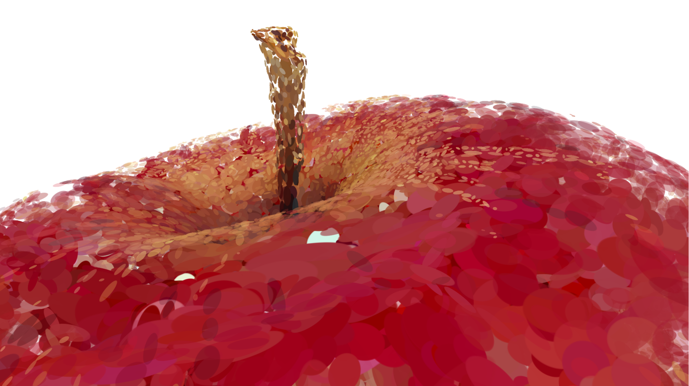

<!-- /tutorial-scope -->

Zieh mit der Maus oder drück die Pfeiltasten, um die Pflanze zu drehen; das
Mausrad oder zwei Finger zoomen. Schieb dann »Größe der Splats« ganz nach links: Jetzt sind die
Splats so klein, dass du siehst, woraus die Pflanze besteht. Schieb sie
zurück und »Weichheit der Splats« nach links: Aus den weichen Flecken werden
Ellipsen mit scharfem Rand, und du siehst, wie groß jeder Splat ist und wie
sie sich überdecken.

Wie das funktioniert, baust du selbst, in zwei Schritten. Zuerst in 2D: Ein
Gemälde aus 500 Splats, die ihren Platz, ihre Form und ihre Farbe selbst
lernen. Das ist der Kern von Gaussian Splatting, ohne die dritte Dimension.
Dann in 3D: Splats im Raum, eine Kamera, und die Frage, in welcher
Reihenfolge man sie malen muss.

## Einrichten

### Ein Ordner und zwei Bibliotheken

Du programmierst in Python mit zwei Bibliotheken: **numpy** rechnet mit ganzen
Tabellen von Zahlen auf einmal, also mit einem ganzen Bild in einer Zeile, und
**Pillow** speichert Bilder als PNG. Leg im Terminal einen Ordner an,
installiere beide und lade zwei Dateien herunter, ein Gemälde und eine Szene
aus Splats:

```bash_copy
mkdir -p ~/splatting
cd ~/splatting
pip install numpy pillow
wget https://raw.githubusercontent.com/specht/workspace-files/main/gaussian-splatting/pearl-earring.png
wget https://raw.githubusercontent.com/specht/workspace-files/main/gaussian-splatting/modern-arm-chair.ply
```

`pip install` legt die Bibliotheken in deinen Workspace; auch nach einem
Neustart des Workspace sind sie noch da.

<!-- tutorial-screenshot
hide-left-sidebar
terminal-open
terminal-maximize
terminal-run: mkdir -p ~/splatting && cd ~/splatting
terminal-run: pip install -q numpy pillow
terminal-wait-for-prompt: 240
terminal-run: wget -q https://raw.githubusercontent.com/specht/workspace-files/main/gaussian-splatting/pearl-earring.png
terminal-wait-for-prompt
terminal-run: wget -q https://raw.githubusercontent.com/specht/workspace-files/main/gaussian-splatting/modern-arm-chair.ply
terminal-wait-for-prompt
terminal-run: clear && ls -l
terminal-wait-for-prompt
crop-terminal-lines: auto
-->
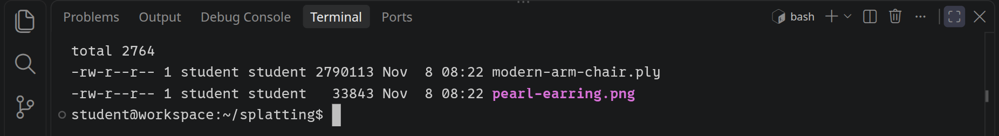

`pearl-earring.png` ist »Das Mädchen mit dem Perlenohrring« von Johannes
Vermeer, gemalt um 1665, klein, nur 128 Pixel breit. `modern-arm-chair.ply` ist
ein Sessel aus 49.817 Splats; um diese Datei geht es ab dem Kapitel
»Splats im Raum«.

### Bilder ansehen

Deine Programme speichern Bilder als PNG im Ordner `splatting`. Ein Bild
öffnest du mit einem Klick im Explorer links oder im Terminal mit
`code NAME.png`; VS Code zeigt es in einem eigenen Tab und lädt es neu, wenn
dein Programm es überschreibt.

## Ein Splat

### Die Glockenkurve

Ein Splat ist in der Mitte am kräftigsten und wird nach außen weich immer
schwächer, ohne Rand. Genau so verläuft die Glockenkurve von Carl Friedrich
Gauß:

$$g(x) = e^{-\frac{x^2}{2\sigma^2}}$$

Bei \\(x = 0\\) ist \\(g = 1\\), und je weiter \\(x\\) von 0 weg ist, desto
näher kommt \\(g\\) der 0. Die Zahl \\(\sigma\\) (Sigma) sagt, wie breit die
Glocke ist: Bei \\(x = \sigma\\) ist \\(g = e^{-1/2} \approx 0{,}61\\), und
ab etwa \\(3\sigma\\) ist sie kaum noch von 0 zu unterscheiden.

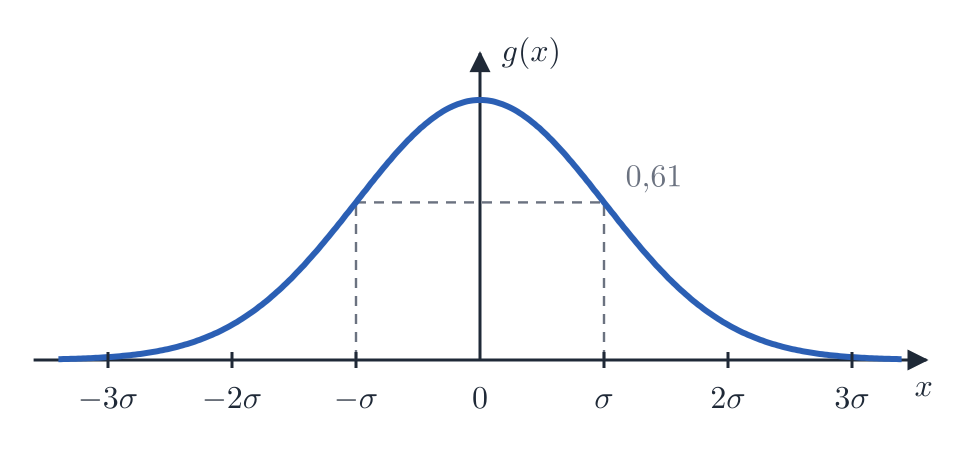

Für einen Splat in einem Bild brauchst du dieselbe Glocke in zwei Richtungen.
Liegt ein Pixel um \\(\Delta x\\) nach rechts und \\(\Delta y\\) nach unten
von der Mitte des Splats entfernt, ist sein Gewicht

$$g(\Delta x, \Delta y) = e^{-\frac{\Delta x^2 + \Delta y^2}{2\sigma^2}}$$

Im Zähler steht das Quadrat des Abstands zur Mitte: Alle Pixel mit demselben
Abstand haben dasselbe Gewicht, der Splat ist rund.

Leg im Ordner `splatting` die Datei `blobs.py` an, mit diesem Anfang:

<!-- page-code: own -->
```python
import numpy as np
from PIL import Image


def blob(dx, dy, sigma):
    ...   # hier: das Gewicht nach der Formel oben


def save(image, name):
    pixels = np.clip(image, 0, 1) * 255
    Image.fromarray(pixels.astype(np.uint8)).save(name)
```

`save` speichert ein Bild: Jede Zahl von 0 bis 1 wird ein Helligkeitswert von
0 bis 255 (`np.clip` schneidet alles unter 0 und über 1 ab), und Pillow
schreibt daraus eine PNG-Datei.

<div class='hint own' data-check='ein-splat'>
<strong>Jetzt bist du dran:</strong> Schreib die Funktion
<code>blob(dx, dy, sigma)</code>. Sie gibt das Gewicht eines Pixels zurück,
das um <code>dx</code> und <code>dy</code> von der Mitte entfernt ist. Nimm
<code>np.exp</code> für \(e^x\): Gleich bekommt die Funktion statt einzelner
Zahlen ganze Tabellen, und <code>np.exp</code> rechnet sie in einem Aufruf
aus.
</div>

<!-- hint -->
Rechne ein Beispiel von Hand: Bei `dx = 0`, `dy = 0` muss 1 herauskommen,
bei `dx = 1`, `dy = 0` und `sigma = 1` etwa 0,61, denn
\\(e^{-1/2} \approx 0{,}61\\).
<!-- /hint -->

<!-- hint -->
Python schreibt Potenzen mit `**`, aber `dx * dx` ist dasselbe wie `dx ** 2`.
Der Nenner ist `2 * sigma * sigma`; vergiss die Klammern um Zähler und Nenner
nicht, und das Minus vor dem Bruch.
<!-- /hint -->

<!-- solution -->
```python
def blob(dx, dy, sigma):
    return np.exp(-(dx * dx + dy * dy) / (2 * sigma * sigma))
```
<!-- /solution -->

_task(ein-splat)

### Ein Bild aus Zahlen

Ein Bild ist für numpy eine Tabelle: 120 Zeilen, 160 Spalten, in jeder Zelle
eine Helligkeit. Um für jedes Pixel `blob` auszurechnen, brauchst du für
jedes Pixel seine Spalte und seine Zeile. Das liefert `np.mgrid`:

```python
ys, xs = np.mgrid[0:120, 0:160]
```

`xs` ist eine Tabelle aus 120 × 160 Zahlen, in der jede Zelle ihre Spalte
enthält (0, 1, 2, … bis 159), `ys` eine, in der jede Zelle ihre Zeile
enthält. Rechnest du mit solchen Tabellen, rechnet numpy jede Zelle für sich:
`xs - 80` zieht von jeder Zelle 80 ab, und `blob(xs - 80, ys - 60, 15)` gibt
eine Tabelle zurück, in der für jedes Pixel sein Gewicht für einen Splat mit
der Mitte bei Spalte 80 und Zeile 60 steht. Eine Schleife über die Pixel
brauchst du nicht.

Schreib unter die beiden Funktionen:

```python
~     Image.fromarray(pixels.astype(np.uint8)).save(name)
~
~
if __name__ == '__main__':
    ys, xs = np.mgrid[0:120, 0:160]
    image = blob(xs - 80, ys - 60, 15)
    save(image, 'blob.png')
```

Der Teil unter `if __name__ == '__main__':` läuft nur, wenn du die Datei
selbst startest. Später lädt ein anderes Programm die Funktionen aus
`blobs.py`, und dann soll er nicht laufen. Starte das Programm und öffne
das Bild:

```bash
python3 blobs.py
code blob.png
```

<!-- tutorial-scope -->
<!-- tutorial-screenshot
write-file: splatting/blobs.py <- file:stufen/blobs-1.py
terminal-run: cd /workspace/splatting && python3 blobs.py
terminal-wait-for-prompt: 60
image-file: splatting/blob.png 3
-->
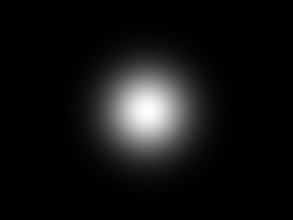

<!-- /tutorial-scope -->

<div class='hint try'>
<strong>Ausprobieren:</strong> Ändere die 15 in 5 und in 40. Bei welchem
Wert reicht der Splat bis an den Rand des Bildes? Vergleich mit der Regel
von oben: Ab etwa \(3\sigma\) ist die Glocke fast 0. Stell die 15 danach
wieder her.
</div>

### Gestreckt und gedreht

Ein runder Splat kann nur Rundes malen. Für eine Kante, einen Haarstrich
oder ein Stück Rahmen braucht ein Splat eine Richtung: Er soll in die eine
Richtung lang sein, in die andere schmal, und in einem Winkel liegen. Dafür
bekommt er statt eines \\(\sigma\\) zwei, \\(s\_x\\) und \\(s\_y\\), und einen
Winkel \\(\theta\\) (Theta).

Die Idee: Du drehst den Abstand eines Pixels zur Mitte erst in die Richtung
des Splats und teilst dann jede Richtung durch ihre eigene Breite:

$$u = \frac{\cos\theta \cdot \Delta x + \sin\theta \cdot \Delta y}{s\_x}$$

$$v = \frac{-\sin\theta \cdot \Delta x + \cos\theta \cdot \Delta y}{s\_y}$$

\\(u\\) ist der Abstand entlang der langen Achse des Splats, gemessen in
seinen eigenen Breiten, \\(v\\) der quer dazu. Das Gewicht ist dann dieselbe
Glocke wie vorher, mit \\(u\\) und \\(v\\) statt der Abstände geteilt durch
\\(\sigma\\):

$$g = e^{-\frac{u^2 + v^2}{2}}$$

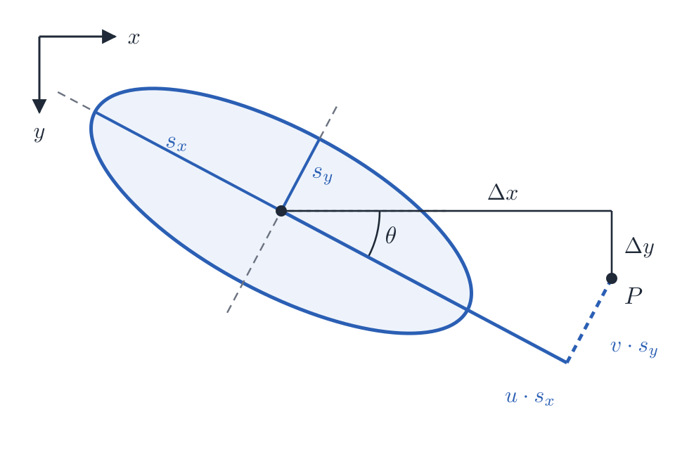

Weil auf dem Bildschirm \\(y\\) nach unten zeigt, dreht ein positiver Winkel
den Splat im Uhrzeigersinn. Ist \\(s\_x = s\_y = \sigma\\), ist der Winkel egal,
und es kommt genau `blob` heraus.

<div class='hint own' data-check='gedreht'>
<strong>Jetzt bist du dran:</strong> Schreib unter <code>blob</code> die
Funktion <code>weight(dx, dy, sx, sy, angle)</code>. Sie rechnet erst
<code>u</code> und <code>v</code> aus und gibt dann das Gewicht zurück. Auch
hier gilt: <code>np.cos</code>, <code>np.sin</code> und <code>np.exp</code>,
damit sie mit ganzen Tabellen geht.
</div>

<!-- hint -->
Probier es zuerst ohne Drehung: Bei `angle = 0` ist \\(\cos\theta = 1\\) und
\\(\sin\theta = 0\\), also `u = dx / sx` und `v = dy / sy`. Ein Pixel bei
`dx = 3`, `dy = 0` hat bei `sx = 3` dann `u = 1`, `v = 0` und das Gewicht
0,61.
<!-- /hint -->

<!-- hint -->
Ein Gerüst:

<!-- page-code: own -->
```python
def weight(dx, dy, sx, sy, angle):
    c = np.cos(angle)
    s = np.sin(angle)
    u = ...   # hier: die Formel für u
    v = ...   # hier: die Formel für v
    return np.exp(-(u * u + v * v) / 2)
```
<!-- /hint -->

<!-- solution -->
```python
def weight(dx, dy, sx, sy, angle):
    c = np.cos(angle)
    s = np.sin(angle)
    u = (c * dx + s * dy) / sx
    v = (-s * dx + c * dy) / sy
    return np.exp(-(u * u + v * v) / 2)
```
<!-- /solution -->

_task(gedreht)

## Viele Splats

### Splats addieren

Ein Splat allein ist grau. Für Farbe bekommt jedes Pixel drei Zahlen, Rot,
Grün und Blau, und das Bild wird eine Tabelle aus 120 × 160 × 3 Zahlen. Ein
farbiger Splat ist sein Gewicht multipliziert mit seiner Farbe: Wo das
Gewicht 1 ist, steht die volle Farbe, wo es 0,5 ist, die halbe.

Mehrere Splats malst du, indem du sie addierst. Ersetze den Teil unter
`if __name__ == '__main__':` durch drei Splats, einen langen orangen,
einen hohen blauen und einen runden grünen:

```python
if __name__ == '__main__':
    ys, xs = np.mgrid[0:120, 0:160]
    image = np.zeros((120, 160, 3))
    image += weight(xs - 50, ys - 60, 30, 8, 0.5)[:, :, None] * np.array([1.0, 0.3, 0.1])
    image += weight(xs - 100, ys - 50, 10, 25, 0.2)[:, :, None] * np.array([0.1, 0.5, 1.0])
    image += weight(xs - 110, ys - 85, 12, 12, 0.0)[:, :, None] * np.array([0.2, 0.9, 0.2])
    save(image, 'blobs.png')
```

`np.zeros((120, 160, 3))` ist ein schwarzes Bild. `weight(…)` gibt eine
Tabelle aus 120 × 160 Zahlen zurück; `[:, :, None]` gibt ihr eine dritte
Achse der Länge 1, und dann multipliziert numpy jedes Gewicht mit allen drei
Zahlen der Farbe. So wird aus einer Tabelle von Gewichten ein farbiges Bild.

_task(ueberlappen)

<!-- after: ueberlappen -->
<!-- tutorial-scope -->
<!-- tutorial-screenshot
write-file: splatting/blobs.py <- file:stufen/blobs-2.py
terminal-run: cd /workspace/splatting && python3 blobs.py
terminal-wait-for-prompt: 60
image-file: splatting/blobs.png 3
-->
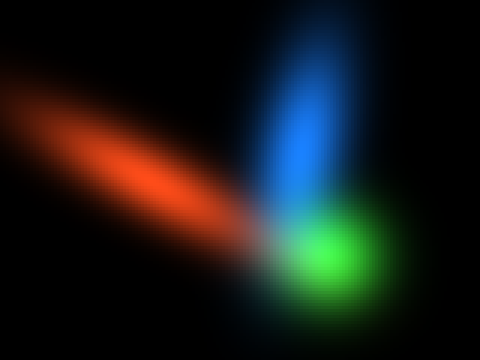

<!-- /tutorial-scope -->

Wo sich zwei Splats überlappen, addieren sich ihre Farben: Blau und Grün
ergeben ein helles Türkis. Die Reihenfolge, in der du die Splats addierst,
ist dabei egal, denn \\(a + b = b + a\\). Das merkst du dir: In 3D wird es
anders sein.
<!-- /after -->

### Wie gut passt das Bild?

Jetzt soll aus Splats das Gemälde von Vermeer werden. Das Programm, das
gleich die Splats an ihren Platz schiebt, braucht eine Zahl, die sagt, wie
weit sein Bild noch vom Gemälde entfernt ist. Je kleiner die Zahl, desto
besser.

Die übliche Zahl dafür ist der **mittlere quadratische Fehler**: Für jede
Zahl des Bildes (jedes Pixel hat drei) die Abweichung vom Gemälde, quadriert,
und davon der Mittelwert. Ist \\(b\\) das Bild aus Splats und \\(z\\) das
Ziel, das Gemälde, mit \\(n\\) Zahlen:

$$E = \frac{1}{n} \sum\_{i=1}^{n} (b\_i - z\_i)^2$$

Das Quadrat sorgt dafür, dass eine Abweichung nach oben genauso zählt wie
eine nach unten und dass große Abweichungen viel mehr zählen als kleine.

<div class='hint own' data-check='fehler'>
<strong>Jetzt bist du dran:</strong> Schreib unter <code>weight</code> die
Funktion <code>error(image, target)</code>. Sie bekommt zwei gleich große
Tabellen und gibt den mittleren quadratischen Fehler zurück. numpy hat dafür
fast alles: <code>image - target</code> zieht Zelle für Zelle ab, und
<code>np.mean</code> bildet den Mittelwert aller Zellen.
</div>

<!-- hint -->
Rechne ein kleines Beispiel von Hand: Ist das Bild `[0.5, 1.0]` und das Ziel
`[0.0, 1.0]`, sind die Abweichungen 0,5 und 0, die Quadrate 0,25 und 0, der
Mittelwert 0,125.
<!-- /hint -->

<!-- hint -->
Erst abziehen, dann quadrieren (`** 2`), dann `np.mean`. Nicht den Betrag
nehmen und nicht nur summieren.
<!-- /hint -->

<!-- solution -->
```python
def error(image, target):
    return np.mean((image - target) ** 2)
```
<!-- /solution -->

_task(fehler)

Damit das Gemälde ins Programm kommt, schreib unter `save` noch eine Funktion,
die ein Bild lädt, mit Zahlen von 0 bis 1:

```python
~     Image.fromarray(pixels.astype(np.uint8)).save(name)
~
~
def load(name):
    return np.asarray(Image.open(name).convert('RGB'), dtype=float) / 255
```

Ein erster Versuch ganz ohne Lernen: 200 Splats an zufälligen Stellen,
jeder in der Farbe des Gemäldes an seiner Mitte. Ersetze den Teil unter
`if __name__ == '__main__':`:

```python
if __name__ == '__main__':
    target = load('pearl-earring.png')
    H, W, _ = target.shape
    rng = np.random.default_rng(1)
    ys, xs = np.mgrid[0:H, 0:W]
    image = np.zeros((H, W, 3))
    for i in range(200):
        x = rng.random() * W
        y = rng.random() * H
        color = target[int(y), int(x)]
        image += weight(xs - x, ys - y, 6, 6, 0)[:, :, None] * color * 0.3
    save(image, 'random.png')
    print('Fehler:', error(image, target))
```

`target.shape` sind die Maße des Gemäldes, 152 Zeilen, 128 Spalten und 3
Farben. `rng` ist ein Zufallsgenerator mit festem Startwert, damit bei jedem
Start dieselben Splats herauskommen.

<!-- tutorial-scope -->
<!-- tutorial-screenshot
write-file: splatting/blobs.py <- file:stufen/blobs-3.py
terminal-run: cd /workspace/splatting && python3 blobs.py
terminal-wait-for-prompt: 60
image-file: splatting/random.png 3
-->
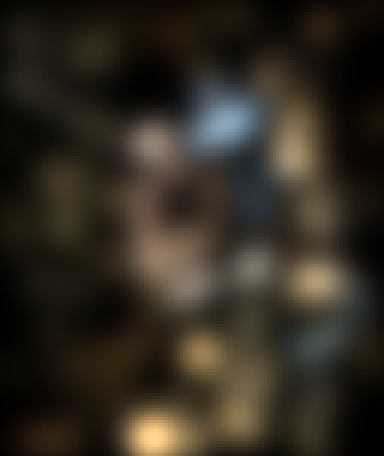

<!-- /tutorial-scope -->

Man ahnt das Kopftuch, mehr nicht, und das Programm schreibt einen Fehler von
etwa 0,034. Mit Raten kommt man nicht weiter. Die Splats müssen lernen.

## Bergab

### Ein Regler und ein Gefälle

Wie lernt ein Programm? Stell dir einen einzigen Regler vor, eine Zahl \\(c\\),
und einen Fehler, der davon abhängt, zum Beispiel \\(E(c) = (c - 0{,}7)^2\\).
Du siehst nicht, wo der Fehler am kleinsten ist, aber du kannst an jeder
Stelle fühlen, wie steil es bergab geht und in welche Richtung: Das ist die
Ableitung, hier \\(E'(c) = 2\\,(c - 0{,}7)\\). Ist sie positiv, wird der Fehler
größer, wenn \\(c\\) wächst, also machst du \\(c\\) kleiner, und umgekehrt.

Ein Schritt **Gradientenabstieg** geht ein Stück gegen die Steigung:

$$c \leftarrow c - \eta \cdot E'(c)$$

\\(\eta\\) (Eta) heißt **Lernrate**: Sie sagt, wie groß die Schritte sind.
Mehrere Regler auf einmal gehen genauso, jeder mit seiner eigenen Steigung;
alle Steigungen zusammen heißen **Gradient**.

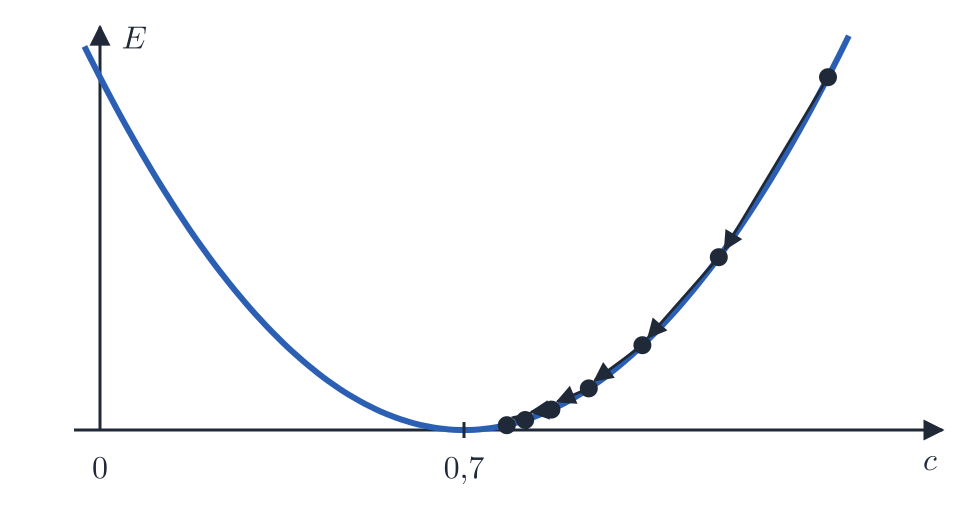

_task(erster-schritt)

### Die Farben lernen

Dasselbe mit dem Gemälde. Die Regler sind diesmal 500 Splats mit je einer
Lage, zwei Breiten, einem Winkel und einer Farbe. Zuerst darf das Programm
nur die Farben ändern; die Splats bleiben, wo sie zufällig liegen.

Wie ändert sich der Fehler, wenn ein Splat etwas mehr Rot bekommt? An jedem
Pixel, das er berührt, wird das Bild um sein Gewicht \\(g\\) röter. Ist das
Bild dort schon zu rot (die Abweichung \\(r = b - z\\) ist positiv), steigt
der Fehler, ist es zu wenig rot, sinkt er. Die Steigung für die Farbe eines
Splats ist darum die Summe über seine Pixel:

$$\frac{\partial E}{\partial \text{Farbe}} = \sum\_{\text{Pixel}} r \cdot g$$

(Für die Richtung ist es egal, ob man durch die Anzahl der Zahlen teilt und
den Faktor 2 der Ableitung mitnimmt; ohne beides sind die Zahlen
handlicher.)

Damit das schnell geht, zählt jeder Splat nur in einem Quadrat aus
21 × 21 Pixeln um seine Mitte. Weiter draußen ist ein Splat, der höchstens
3,5 Pixel breit ist, so schwach, dass man ihn nicht sieht. So rechnet das
Programm 500 · 441 Gewichte statt 500 · 19.456, eines für jedes Pixel.

Der Schritt selbst kommt als Funktion in deine `blobs.py`, gleich unter
`error`; das Programm, das lernt, in eine neue Datei.

<div class='hint own' data-check='schritt'>
<strong>Jetzt bist du dran:</strong> Schreib in <code>blobs.py</code> unter
<code>error</code> die Funktion <code>step(value, gradient, rate)</code>: ein
Schritt Gradientenabstieg nach der Formel aus dem letzten Abschnitt. Sie muss
mit einzelnen Zahlen gehen und mit ganzen Arrays, denn das Programm gibt ihr
gleich alle 500 Farben auf einmal.
</div>

<!-- hint -->
Gegen die Steigung heißt: Die Steigung, multipliziert mit der Lernrate, wird
abgezogen. Bei `value = 1.0`, `gradient = 2.0` und `rate = 0.1` kommt 0,8
heraus.
<!-- /hint -->

<!-- solution -->
```python
def step(value, gradient, rate):
    return value - rate * gradient
```
<!-- /solution -->

_task(schritt)

Leg jetzt die Datei `train.py` an. Sie holt sich `weight`, `error`, `step`,
`save` und `load` aus deiner `blobs.py`:

```python_copy
import numpy as np
from blobs import weight, error, step, save, load

target = load('pearl-earring.png')
H, W, _ = target.shape
N = 500        # so viele Splats
K = 21         # jeder Splat zählt nur in einem Quadrat aus K x K Pixeln

rng = np.random.default_rng(1)
x = rng.random(N) * W
y = rng.random(N) * H
sx = np.full(N, 3.0)
sy = np.full(N, 3.0)
angle = rng.random(N) * np.pi
color = np.full((N, 3), 0.1)

offsets = np.arange(K) - K // 2
oy, ox = [a.reshape(-1) for a in np.meshgrid(offsets, offsets, indexing='ij')]


def render():
    px = np.floor(x)[:, None] + ox             # die Pixel um jeden Splat: N x K²
    py = np.floor(y)[:, None] + oy
    inside = (px >= 0) & (px < W) & (py >= 0) & (py < H)
    index = (np.clip(py, 0, H - 1) * W + np.clip(px, 0, W - 1)).astype(int)
    dx = px + 0.5 - x[:, None]
    dy = py + 0.5 - y[:, None]
    g = weight(dx, dy, sx[:, None], sy[:, None], angle[:, None]) * inside
    image = np.zeros((H * W, 3))
    np.add.at(image, index.reshape(-1), (g[:, :, None] * color[:, None, :]).reshape(-1, 3))
    return image.reshape(H, W, 3), index, g, dx, dy


for t in range(201):
    image, index, g, dx, dy = render()
    if t % 50 == 0:
        print(f'Schritt {t:3d}: Fehler {error(image, target):.5f}')
    r = (image - target).reshape(-1, 3)[index]  # wie falsch jeder Pixel um jeden Splat ist
    color_gradient = (g[:, :, None] * r).sum(1)
    color = step(color, color_gradient, 0.01)

save(image, 'colors.png')
```

Was darin passiert:

- Jeder Splat hat seine Werte an derselben Stelle in den Arrays `x`, `y`,
  `sx`, `sy`, `angle` und `color`: Der Splat mit dem Index 7 liegt bei
  `x[7]`, `y[7]` und hat die Farbe `color[7]`.
- `render` rechnet für jeden Splat die Pixel in seinem Quadrat aus (`px`,
  `py`: 500 Zeilen mit je 441 Pixeln), ihren Abstand zur Mitte (`dx`, `dy`)
  und mit deiner Funktion `weight` ihr Gewicht `g`. `inside` setzt das
  Gewicht der Pixel außerhalb des Bildes auf 0.
- `index` ist für jedes dieser Pixel seine Nummer im Bild, Zeile mal Breite
  plus Spalte. `np.add.at` addiert jeden Beitrag auf das Pixel mit seiner
  Nummer, auch wenn mehrere Splats auf dasselbe Pixel fallen.
- In der Schleife holt `[index]` für jeden Splat die Abweichungen seiner
  Pixel heraus, und `(g[:, :, None] * r).sum(1)` ist die Summe von oben:
  für jeden Splat seine drei Steigungen, Rot, Grün und Blau, und dein
  `step` geht mit ihnen einen Schritt.

Starte das Programm mit `python3 train.py`. Es schreibt alle 50 Schritte den
Fehler und am Ende `colors.png`.

<!-- tutorial-scope -->
<!-- tutorial-screenshot
write-file: splatting/blobs.py <- file:stufen/blobs-4.py
write-file: splatting/train.py <- file:stufen/train-1.py
terminal-run: cd /workspace/splatting && python3 train.py
terminal-wait-for-prompt: 120
image-file: splatting/colors.png 3
-->
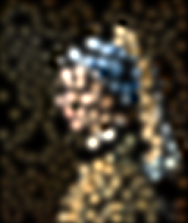

<!-- /tutorial-scope -->

Der Fehler fällt von 0,068 auf etwa 0,019: Jeder Splats hat die Farbe
gefunden, die an seiner Stelle am besten passt. Mehr geht nicht, solange die
Splats rund, gleich groß und fest an ihrem Platz sind.

_task(zu-schnell)

<!-- after: zu-schnell -->
Mit der Lernrate 0,02 wächst der Fehler schon nach 50 Schritten auf eine Zahl
mit fast 40 Stellen. Jeder Schritt schießt über den Tiefpunkt hinaus, und
weil viele Splats an denselben Pixeln ziehen, landet er weiter weg als
vorher, auf der anderen Seite. Der nächste Schritt ist darum noch größer, und
so weiter. Ist die Lernrate zu groß, lernt ein Programm nichts; ist sie zu
klein, lernt es sehr langsam.
<!-- /after -->

### Die Splats wandern lassen

Jetzt dürfen sich die Splats bewegen, strecken und drehen. Die Steigungen
dafür entstehen genauso wie die der Farbe: Wie ändert sich das Gewicht an
jedem Pixel, wenn der Splat ein Stück nach rechts rückt, breiter wird oder
sich dreht, und wie ändert das den Fehler? Die Formeln dafür leitet man mit
der Kettenregel aus \\(u\\), \\(v\\) und \\(g\\) her; das Programm unten
benutzt sie fertig. Eine Größe taucht darin überall auf:

$$e = g \cdot \sum\_{\text{Farben}} r \cdot \text{Farbe}$$

Sie sagt für jedes Pixel, ob der Splat es zu hell (\\(e > 0\\)) oder zu
dunkel (\\(e < 0\\)) macht. Ein Splat, der links zu hell macht und rechts zu
dunkel, wandert nach rechts.

Mit 500 Splats und sechs Arten von Werten reicht eine Lernrate für alles
nicht mehr: Lagen ändern sich in Pixeln, Winkel in Bogenmaß, Farben zwischen
0 und 1. Darum bekommt jeder Wert ein eigenes Tempo, nach dem Verfahren
**Adam**: Es merkt sich für jeden Wert, in welche Richtung er zuletzt
gegangen ist (`m`, wie Schwung) und wie groß seine Steigungen typisch sind
(`v`), und teilt den Schwung durch die typische Größe. So macht jeder Wert
Schritte von etwa gleicher Größe, egal wie groß seine Steigung gerade ist.
Fast alle Programme, die heute etwas lernen, nehmen Adam oder ein Verfahren
wie Adam.

Ergänze `train.py`: unter `render` die Klasse `Adam`, und die Schleife lernt
jetzt alles:

```python_copy
~     return image.reshape(H, W, 3), index, g, dx, dy
~
~
class Adam:
    def __init__(self, rate):
        self.rate = rate
        self.t = 0
        self.m = 0
        self.v = 0

    def step(self, value, gradient):
        self.t += 1
        self.m = 0.9 * self.m + 0.1 * gradient
        self.v = 0.999 * self.v + 0.001 * gradient ** 2
        m = self.m / (1 - 0.9 ** self.t)
        v = self.v / (1 - 0.999 ** self.t)
        return value - self.rate * m / (np.sqrt(v) + 1e-8)


adam = {'x': Adam(0.3), 'y': Adam(0.3), 'sx': Adam(0.05), 'sy': Adam(0.05),
        'angle': Adam(0.03), 'color': Adam(0.02)}
frames = []

for t in range(301):
    image, index, g, dx, dy = render()
    if t % 10 == 0:
        frames.append(Image.fromarray((np.clip(image, 0, 1) * 255).astype(np.uint8)).resize((W * 2, H * 2)))
    if t % 50 == 0:
        print(f'Schritt {t:3d}: Fehler {error(image, target):.5f}')
    r = (image - target).reshape(-1, 3)[index]  # wie falsch jeder Pixel um jeden Splat ist
    color_gradient = (g[:, :, None] * r).sum(1)

    c = np.cos(angle)[:, None]
    s = np.sin(angle)[:, None]
    u = (c * dx + s * dy) / sx[:, None]
    v = (-s * dx + c * dy) / sy[:, None]
    e = g * (r * color[:, None, :]).sum(2)     # macht der Splat hier zu hell (+) oder zu dunkel (−)?
    x_gradient = (e * (u * c / sx[:, None] - v * s / sy[:, None])).sum(1)
    y_gradient = (e * (u * s / sx[:, None] + v * c / sy[:, None])).sum(1)
    sx_gradient = (e * u * u).sum(1) / sx
    sy_gradient = (e * v * v).sum(1) / sy
    angle_gradient = (e * u * v * (sx[:, None] / sy[:, None] - sy[:, None] / sx[:, None])).sum(1)

    x = np.clip(adam['x'].step(x, x_gradient), 0, W - 0.01)
    y = np.clip(adam['y'].step(y, y_gradient), 0, H - 0.01)
    sx = np.clip(adam['sx'].step(sx, sx_gradient), 0.3, K / 6)
    sy = np.clip(adam['sy'].step(sy, sy_gradient), 0.3, K / 6)
    angle = adam['angle'].step(angle, angle_gradient)
    color = adam['color'].step(color, color_gradient)

save(image, 'learned.png')
frames[0].save('training.gif', save_all=True, append_images=frames[1:], duration=80, loop=0)
```

Die alte Schleife mit `colors.png` fällt weg; die neue ersetzt sie. Oben
braucht `train.py` noch Pillow für die Bilder des Films:

```python
~ import numpy as np
from PIL import Image
~ from blobs import weight, error, step, save, load
```

`np.clip` hält dabei jeden Splat im Bild und seine Breiten zwischen 0,3 und
3,5 Pixeln, damit er in sein Quadrat passt. Alle zehn Schritte legt das
Programm ein Bild in `frames`, und am Ende wird daraus `training.gif`, ein
kleiner Film vom Lernen.

_task(wandern)

<!-- after: wandern -->
<!-- tutorial-scope -->
<!-- tutorial-screenshot
write-file: splatting/blobs.py <- file:stufen/blobs-4.py
write-file: splatting/train.py <- file:stufen/train-2.py
terminal-run: cd /workspace/splatting && python3 train.py
terminal-wait-for-prompt: 180
image-file: splatting/learned.png 3
-->


<!-- /tutorial-scope -->

Nach 300 Schritten steht ein Fehler von etwa 0,0008 da, mehr als zwanzigmal
kleiner als mit festen Splats, und auf dem Bild ist das Mädchen mit dem
Perlenohrring. Öffne `training.gif` und schau zu: Am Anfang schieben sich
die Splats in großen Sprüngen zu den hellen Stellen, dann strecken sie sich
entlang der Kanten des Kopftuchs, und am Ende werden nur noch Kleinigkeiten
schärfer.
<!-- /after -->

<div class='hint try'>
<strong>Ausprobieren:</strong> Setz <code>N</code> auf 100 und auf 2000.
Wie viele Splats braucht es, bis du die Perle erkennst? Mit 2000 Splats
dauert jeder Schritt etwa viermal so lang. Stell danach 500 wieder ein.
</div>

### Splats haben keine Pixel

Das Bild hat 128 × 152 Pixel, so viele wie das Gemälde, denn nur so lässt
es sich Pixel für Pixel mit ihm vergleichen. Die Splats selbst sind aber
keine Pixel, sondern Zahlen: eine Lage, zwei Breiten, ein Winkel und eine
Farbe. Deshalb kannst du sie auf ein Bild jeder Größe malen. Häng unten an
`train.py` diese Funktion an:

```python
def paint(scale, sharpness):
    # dieselben Splats auf einem Bild, das scale-mal so groß ist; sharpness 1
    # ist die Glocke, je größer, desto schärfer der Rand
    big = np.zeros((H * scale, W * scale, 3))
    for i in range(N):
        r = 3 * max(sx[i], sy[i])                  # weiter weg ist der Splat fast 0
        x0, x1 = int(max(0, x[i] - r) * scale), int(min(W, x[i] + r) * scale)
        y0, y1 = int(max(0, y[i] - r) * scale), int(min(H, y[i] + r) * scale)
        ys, xs = np.mgrid[y0:y1, x0:x1]
        dx = (xs + 0.5) / scale - x[i]             # wo der Pixel im kleinen Bild läge
        dy = (ys + 0.5) / scale - y[i]
        c, s = np.cos(angle[i]), np.sin(angle[i])
        u = (c * dx + s * dy) / sx[i]
        v = (-s * dx + c * dy) / sy[i]
        big[y0:y1, x0:x1] += np.exp(-(u * u + v * v) ** sharpness / 2)[:, :, None] * color[i]
    return big


save(paint(4, 1), 'learned-large.png')
save(paint(4, 8), 'learned-sharp.png')
```

`paint` geht jeden Splat durch wie `render`, aber für jeden Pixel des großen
Bildes rechnet sie aus, wo er im kleinen läge: `(xs + 0.5) / scale`.
`sharpness` ändert die Glocke. Mit 1 ist es die von Gauß; mit 8 bleibt sie
innerhalb einer Breite fast bei 1 und fällt an ihrem Rand steil auf 0, und
jeder Splat wird eine Ellipse mit scharfem Rand.

<!-- tutorial-scope -->
<div class='gallery columns-2'>
<figure>
<!-- tutorial-screenshot
write-file: splatting/blobs.py <- file:stufen/blobs-4.py
write-file: splatting/train.py <- file:stufen/train-3.py
terminal-run: cd /workspace/splatting && python3 train.py
terminal-wait-for-prompt: 180
image-file: splatting/learned-large.png 1
-->
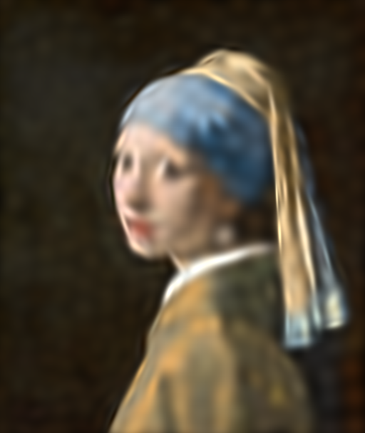
<figcaption>Viermal so groß gemalt</figcaption></figure>
<figure>
<!-- tutorial-screenshot
write-file: splatting/blobs.py <- file:stufen/blobs-4.py
write-file: splatting/train.py <- file:stufen/train-3.py
terminal-run: cd /workspace/splatting && python3 train.py
terminal-wait-for-prompt: 180
image-file: splatting/learned-sharp.png 1
-->
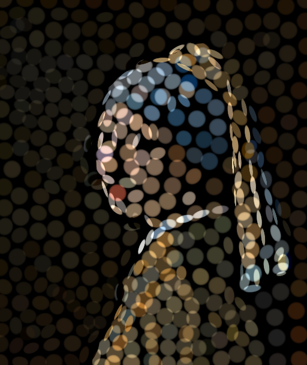
<figcaption>Mit scharfem Rand</figcaption></figure>
</div>
<!-- /tutorial-scope -->

Mit scharfem Rand siehst du, wie das Training die 500 Splats verteilt hat:
große, runde für den gleichmäßigen Grund, lange, schmale entlang der Kanten
des Kopftuchs, kleine dort, wo sich viel ändert. Die Lücken dazwischen füllt
sonst der weiche Rand. Im Viewer ganz oben macht »Weichheit der Splats«
dasselbe mit einer Szene im Raum.

Das ist schon fast alles, was Gaussian Splatting ausmacht: ein Bild aus
Splats, ein Fehler, der sagt, wie weit es vom Ziel weg ist, und
Gradientenabstieg, der jeden Splat ein Stück in die richtige Richtung
schiebt. In 3D kommen zwei Fragen dazu: Wie kommt ein Splat im Raum auf den
Bildschirm? Und was passiert, wenn ein Splat einen anderen verdeckt?

## Splats im Raum

### Ein Splat in 3D

Ein Splat im Raum hat dieselben Zutaten wie einer im Bild, nur eine Dimension
mehr: eine Lage \\((x, y, z)\\), drei Breiten (eine je Achse), eine Drehung im
Raum, eine Farbe und dazu eine **Deckkraft** \\(\alpha\\) (Alpha) zwischen 0
und 1. Bei 1 deckt der Splat in seiner Mitte alles dahinter ab, bei 0,3
scheint viel durch. In 2D haben sich Splats einfach addiert; im Raum liegen
sie voreinander, und vordere verdecken hintere.

Die Szene des Sessels steht in `modern-arm-chair.ply`: am Anfang ein paar
Zeilen Text, die sagen, welche Zahlen folgen, dann für jeden der 49.817
Splats 14 Zahlen. Leg die Datei `render3d.py` an und schreib diese Funktion
zum Lesen ab (oder kopier sie; an ihr gibt es nichts Neues):

```python_copy
import numpy as np


def read_ply(name):
    with open(name, 'rb') as f:
        names = []
        while True:
            line = f.readline().decode().strip()
            if line.startswith('element vertex'):
                count = int(line.split()[2])
            elif line.startswith('property'):
                names.append(line.split()[2])
            elif line == 'end_header':
                break
        data = np.frombuffer(f.read(), dtype=np.float32).reshape(count, len(names))
    p = {name: data[:, i] for i, name in enumerate(names)}
    position = np.stack([p['x'], p['y'], p['z']], 1)
    scale = np.exp(np.stack([p['scale_0'], p['scale_1'], p['scale_2']], 1))
    rotation = np.stack([p['rot_0'], p['rot_1'], p['rot_2'], p['rot_3']], 1)
    rotation /= np.linalg.norm(rotation, axis=1, keepdims=True)
    color = np.clip(0.5 + 0.2821 * np.stack([p['f_dc_0'], p['f_dc_1'], p['f_dc_2']], 1), 0, 1)
    opacity = 1 / (1 + np.exp(-p['opacity']))
    return position, scale, rotation, color, opacity


def rotation_matrix(q):
    w, x, y, z = q
    return np.array([
        [1 - 2 * (y * y + z * z), 2 * (x * y - w * z), 2 * (x * z + w * y)],
        [2 * (x * y + w * z), 1 - 2 * (x * x + z * z), 2 * (y * z - w * x)],
        [2 * (x * z - w * y), 2 * (y * z + w * x), 1 - 2 * (x * x + y * y)]])
```

Die Datei speichert manche Werte umgerechnet, so wie das Training sie
gelernt hat: die Breiten als Logarithmus (`np.exp` macht daraus wieder
Breiten, die nie negativ sind), die Deckkraft so, dass sie nach der Formel
in der vorletzten Zeile immer zwischen 0 und 1 liegt, und die Drehung als
**Quaternion**, vier Zahlen \\((w, x, y, z)\\), aus denen `rotation_matrix`
eine Drehmatrix macht: drei Zeilen mit je drei Zahlen, die einen Vektor drehen,
wenn man sie mit ihm multipliziert.

Statt drei Breiten und einer Drehung beschreibt man die Form eines Splats im
Raum mit einer einzigen Matrix, der **Kovarianzmatrix** \\(\Sigma\\) (groß
Sigma). Sie entsteht, wenn man sich eine Kugel denkt, sie mit der Matrix
\\(S\\) entlang der Achsen streckt (die Breiten auf der Diagonale, sonst
Nullen) und mit der Drehmatrix \\(R\\) dreht:

$$\Sigma = R \\, S \\, S^\top R^\top$$

Das hochgestellte \\(\top\\) heißt **transponiert**: Zeilen und Spalten
tauschen die Plätze. In numpy multipliziert `@` zwei Matrizen, und `.T` ist
die transponierte Matrix.

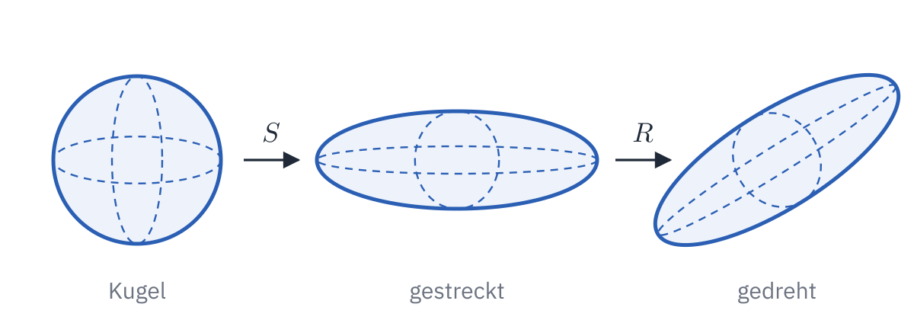

<div class='hint own' data-check='kovarianz'>
<strong>Jetzt bist du dran:</strong> Schreib unter <code>rotation_matrix</code>
die Funktion <code>covariance(scale, rotation)</code> für einen einzelnen
Splat: <code>scale</code> sind seine drei Breiten, <code>rotation</code> ist
seine Drehmatrix (3 × 3). <code>np.diag(scale)</code> macht aus den Breiten
die Matrix \(S\).
</div>

<!-- hint -->
Probier es ohne Drehung: Mit `rotation = np.eye(3)` (die Einheitsmatrix,
die nichts dreht) und den Breiten 1, 2 und 3 muss eine Matrix mit 1, 4 und 9
auf der Diagonale und sonst Nullen herauskommen: Jede Breite steht dort im
Quadrat.
<!-- /hint -->

<!-- hint -->
Die Formel von links nach rechts mit `@`: erst die Drehmatrix, dann zweimal
\\(S\\) (einmal transponiert), dann die transponierte Drehmatrix. Fehlt ein
\\(S\\), stehen die Breiten nicht im Quadrat da.
<!-- /hint -->

<!-- solution -->
```python
def covariance(scale, rotation):
    S = np.diag(scale)
    return rotation @ S @ S.T @ rotation.T
```
<!-- /solution -->

_task(kovarianz)

### Die Kamera

Eine Kamera steht an einer Stelle `eye` im Raum und schaut auf einen Punkt.
Für sie zählt nicht, wo ein Splat im Raum liegt, sondern wo er von ihr aus
liegt: wie weit rechts von ihr (\\(x\\)), wie weit darunter (\\(y\\), nach
unten, wie die Zeilen eines Bildes) und wie weit vor ihr (\\(z\\)). Diese
**Koordinaten der Kamera** bekommt man, indem man vom Splat die Lage der
Kamera abzieht und das Ergebnis auf ihre drei Richtungen projiziert, mit dem
Skalarprodukt (Handbuch, [Vektoren](/reference/vektoren)).

Dann die Frage, auf welches Pixel ein Punkt fällt. Wie bei einer Lochkamera:
Ein Punkt, der doppelt so weit weg ist, erscheint halb so weit von der Mitte
des Bildes. Mit der **Brennweite** \\(f\\) in Pixeln und einem Bild aus
\\(W \times H\\) Pixeln landet er bei

$$u = f \cdot \frac{x}{z} + \frac{W}{2}$$

$$v = f \cdot \frac{y}{z} + \frac{H}{2}$$

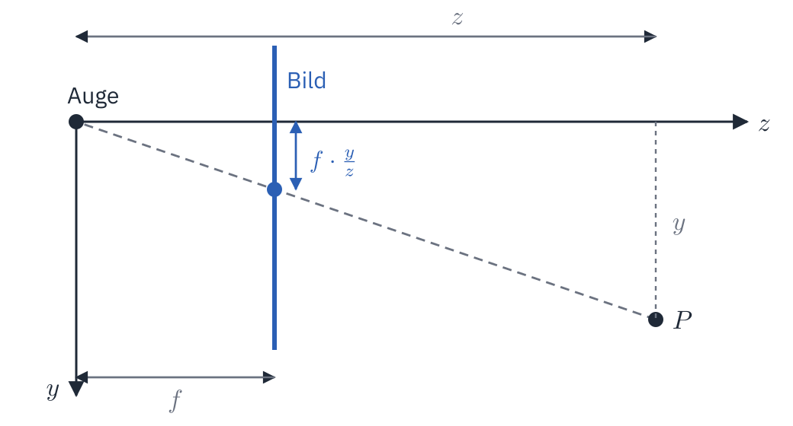

<div class='hint own' data-check='bildschirm'>
<strong>Jetzt bist du dran:</strong> Schreib die Funktion
<code>to_screen(x, y, z, f, W, H)</code>. Sie bekommt einen Punkt in den
Koordinaten der Kamera und gibt die Spalte <code>u</code> und die Zeile
<code>v</code> zurück, auf die er fällt, als Paar <code>return u, v</code>.
Sie soll auch mit ganzen Arrays von Punkten gehen.
</div>

<!-- hint -->
Ein Punkt genau vor der Kamera (`x = 0`, `y = 0`) landet in der Mitte des
Bildes, bei 640 × 480 Pixeln also bei `(320, 240)`, egal wie weit er weg ist.
<!-- /hint -->

<!-- solution -->
```python
def to_screen(x, y, z, f, W, H):
    return f * x / z + W / 2, f * y / z + H / 2
```
<!-- /solution -->

_task(bildschirm)

### Vom Ellipsoid zur Ellipse

Ein Splat im Raum ist ein Ellipsoid, auf dem Bildschirm eine Ellipse, und
die Glocke von vorhin macht daraus einen weichen Splat. Welche Ellipse das
ist, hängt von der Kamera ab: Von der Seite gesehen ist ein flacher Splat
schmal, von vorne breit, und je weiter er weg ist, desto kleiner ist er.

Die Formel dafür stammt aus dem Aufsatz
[»EWA Volume Splatting«](https://www.cs.umd.edu/~zwicker/publications/EWAVolumeSplatting-VIS01.pdf)
von Matthias Zwicker und anderen von 2001 und ist der Kern jedes Gaussian
Splatting:

$$\Sigma' = J \\, V \\, \Sigma \\, V^\top J^\top$$

\\(V\\) ist die Matrix aus den drei Richtungen der Kamera; \\(V \Sigma
V^\top\\) ist dasselbe Ellipsoid, gesehen von der Kamera aus. \\(J\\) sagt,
wie weit ein Punkt auf dem Bildschirm wandert, wenn er im Raum ein kleines
Stück rückt; es sind die Ableitungen von \\(u\\) und \\(v\\) aus dem letzten
Abschnitt, eine Matrix aus zwei Zeilen und drei Spalten. Heraus kommt
\\(\Sigma'\\), eine 2 × 2-Matrix: die Ellipse auf dem Bildschirm, mit deren
Zahlen \\(a\\), \\(b\\) und \\(c\\) das Gewicht eines Pixels wieder eine
Glocke ist. Du rechnest das nicht selbst; es steht gleich fertig im
Programm.

### Vorne zuerst

Liegen Splats voreinander, ist die Frage für jedes Pixel: Wie viel Licht
kommt noch von hinten durch? Am Anfang alles, die **Durchlässigkeit**
\\(T\\) ist 1. Der vorderste Splat hat an diesem Pixel die Deckkraft
\\(\alpha\\) (seine Deckkraft multipliziert mit seinem Gewicht dort): Er
trägt seine Farbe mit dem Anteil \\(T \cdot \alpha\\) bei und lässt nur noch
\\(T \cdot (1 - \alpha)\\) durch. Dann der nächste, mit dem, was übrig ist,
und so weiter, bis hinten der Hintergrund kommt:

$$\text{Farbe} \leftarrow \text{Farbe} + T \cdot \alpha \cdot c$$

$$T \leftarrow T \cdot (1 - \alpha)$$

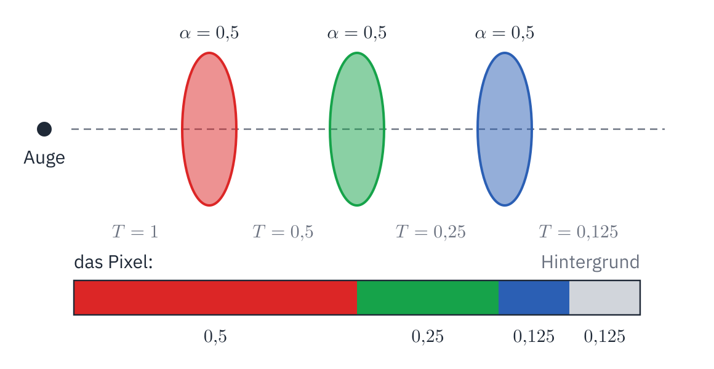

<div class='hint own' data-check='mischen'>
<strong>Jetzt bist du dran:</strong> Schreib die Funktion
<code>blend(colors, alphas, background)</code> für ein einzelnes Pixel. Sie
bekommt die Farben und Deckkräfte der Splats, die es treffen, von vorne
nach hinten sortiert, und die Farbe des Hintergrunds. Sie geht die Splats
mit einer Schleife durch und gibt die gemischte Farbe zurück.
</div>

<!-- hint -->
Ein Beispiel von Hand: Ein weißer Splat (Farbe 1) mit Deckkraft 0,5 vor
schwarzem Hintergrund (0) ergibt 0,5. Ein weißer vor einem schwarzen, beide
mit 0,5, ergibt auch 0,5; ein schwarzer vor einem weißen nur 0,25.
<!-- /hint -->

<!-- hint -->
Zwei Variablen vor der Schleife: die Farbe bisher (0) und die
Durchlässigkeit (1). `for c, a in zip(colors, alphas):` geht die Paare
durch. Nach der Schleife kommt der Hintergrund dazu, mit dem, was übrig ist.
<!-- /hint -->

<!-- solution -->
```python
def blend(colors, alphas, background):
    color = 0
    transmittance = 1
    for c, a in zip(colors, alphas):
        color += transmittance * a * c
        transmittance *= 1 - a
    return color + transmittance * background
```
<!-- /solution -->

_task(mischen)

<!-- stage: stufen/render3d-1.py as render3d.py -->

### Der Sessel

Jetzt kommt alles zusammen. Ergänze `render3d.py` um eine Kamera und den
Renderer:

```python_copy
~ import numpy as np
from PIL import Image
```

```python_copy
~     return color + transmittance * background
~
~
def look_at(eye, target):
    forward = target - eye
    forward = forward / np.linalg.norm(forward)
    right = np.cross(forward, [0, 1, 0])
    right = right / np.linalg.norm(right)
    down = np.cross(forward, right)
    return np.array([right, down, forward])


def render(splats, eye, W=640, H=480, f=680, background=1.0):
    position, scale, rotation, color, opacity = splats
    view = look_at(eye, np.zeros(3))
    x, y, z = ((position - eye) @ view.T).T          # in Koordinaten der Kamera
    u, v = to_screen(x, y, z, f, W, H)

    # jede Ellipse auf dem Bildschirm: Σ' = J V Σ Vᵀ Jᵀ
    image = np.zeros((H, W, 3))
    transmittance = np.ones((H, W))
    for i in np.argsort(z):                           # die nächsten Splats zuerst
        if z[i] < 0.1:
            continue
        sigma = covariance(scale[i], rotation_matrix(rotation[i]))
        J = np.array([[f / z[i], 0, -f * x[i] / z[i] ** 2],
                      [0, f / z[i], -f * y[i] / z[i] ** 2]])
        T = J @ view
        a, b, c = (T @ sigma @ T.T + 0.3 * np.eye(2))[[0, 0, 1], [0, 1, 1]]
        radius = 3 * np.sqrt(max(a, c))
        x0, x1 = max(0, int(u[i] - radius)), min(W, int(u[i] + radius) + 1)
        y0, y1 = max(0, int(v[i] - radius)), min(H, int(v[i] + radius) + 1)
        if x0 >= x1 or y0 >= y1:
            continue
        dx = np.arange(x0, x1) + 0.5 - u[i]
        dy = (np.arange(y0, y1) + 0.5 - v[i])[:, None]
        det = a * c - b * b
        q = (c * dx * dx - 2 * b * dx * dy + a * dy * dy) / det
        alpha = np.minimum(0.99, opacity[i] * np.exp(-q / 2))
        t = transmittance[y0:y1, x0:x1]
        image[y0:y1, x0:x1] += (t * alpha)[:, :, None] * color[i]
        t *= 1 - alpha
    return image + transmittance[:, :, None] * background


def save(image, name):
    pixels = np.clip(image, 0, 1) * 255
    Image.fromarray(pixels.astype(np.uint8)).save(name)


if __name__ == '__main__':
    splats = read_ply('modern-arm-chair.ply')
    save(render(splats, np.array([0.6, 0.35, 0.9])), 'armchair.png')
```

Du kennst fast jede Zeile:

- `look_at` baut die drei Richtungen der Kamera: nach vorne zum Ziel, nach
  rechts senkrecht dazu und zur Senkrechten im Raum (\\(y\\) zeigt in der
  Szene nach oben), nach unten senkrecht zu beiden. `np.cross` ist das
  Kreuzprodukt, das einen Vektor senkrecht zu zwei anderen liefert.
- Die Zeile mit `view.T` rechnet alle Splats auf einmal in die Koordinaten
  der Kamera um, und dein `to_screen` bringt sie auf den Bildschirm.
- `np.argsort(z)` gibt die Indizes der Splats nach ihrer Tiefe sortiert
  zurück, den nächsten zuerst. So geht die Schleife sie von vorne nach hinten
  durch.
- Für jeden Splat: deine Kovarianzmatrix, die Formel von Zwicker für die
  Ellipse (die `0.3` macht jede Ellipse mindestens etwa ein Pixel groß),
  dann ein Rechteck aus Pixeln um seine Mitte, so groß wie drei Breiten.
- Die letzten Zeilen der Schleife sind dein `blend`, nur für alle Pixel des
  Rechtecks auf einmal: `transmittance` merkt sich für jedes Pixel des Bildes,
  wie viel Licht noch durchkommt.

_task(ohne-sortieren)

<!-- after: ohne-sortieren -->
<!-- tutorial-scope -->
<!-- tutorial-screenshot
write-file: splatting/render3d.py <- file:stufen/vergleich-ohne-sortieren.py
terminal-run: cd /workspace/splatting && python3 render3d.py
terminal-wait-for-prompt: 120
image-file: splatting/armchair.png 1
-->
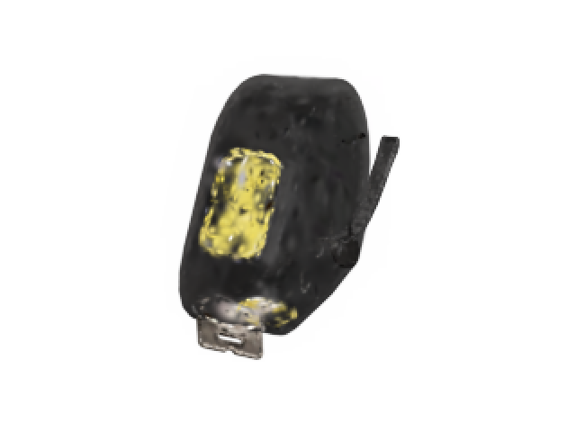

<!-- /tutorial-scope -->

So sieht der Sessel aus, wenn die Splats in der Reihenfolge der Datei
gemischt werden statt nach ihrer Tiefe: Der Rahmen aus Holz, der hinter der
Lehne liegt, malt sich über das Lederpolster, das ihn eigentlich verdeckt. Beim Addieren in 2D war die
Reihenfolge egal; beim Mischen nicht, denn jeder Splat nimmt den Splats
hinter ihm einen Teil des Lichts.
<!-- /after -->

Starte jetzt `python3 render3d.py` mit dem Programm von oben, das sortiert,
und öffne `armchair.png`. Für 49.817 Splats braucht es ein paar Sekunden.

<!-- tutorial-scope -->
<!-- tutorial-screenshot
write-file: splatting/render3d.py <- file:stufen/render3d-2.py
terminal-run: cd /workspace/splatting && python3 render3d.py
terminal-wait-for-prompt: 120
image-file: splatting/armchair.png 1
-->
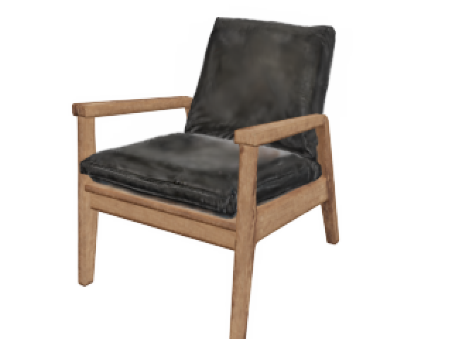

<!-- /tutorial-scope -->

<div class='hint try'>
<strong>Ausprobieren:</strong> Stell die Kamera woanders hin, etwa
<code>np.array([-0.8, 0.2, -0.6])</code> (von hinten links) oder
<code>np.array([0.0, 1.0, 0.1])</code> (fast von oben). Die Splats bleiben
dieselben; nur die Kamera und damit die Reihenfolge ändert sich.
</div>

<div class='hint try'>
<strong>Ausprobieren:</strong> Fünf weitere Szenen liegen im selben Ordner auf
GitHub: <code>potted-plant.ply</code>, <code>cash-register.ply</code>,
<code>drill.ply</code>, <code>fire-extinguisher.ply</code> und <code>apple.ply</code>. Lade eine mit <code>wget</code> wie oben und
setz ihren Namen statt <code>modern-arm-chair.ply</code> ein; die Kamera
musst du vielleicht näher heran- oder weiter wegstellen.
</div>

<div class='hint try'>
<strong>Ausprobieren:</strong> Ein Film, in dem sich der Sessel dreht:
Rendere in einer Schleife 24 kleine Bilder (<code>W=160, H=120, f=200</code>),
die Kamera jedes Mal auf einem Kreis um die Mitte ein Stück weiter, etwa bei
<code>[1.0 * np.sin(a), 0.35, 1.0 * np.cos(a)]</code> mit
<code>a = 2 * np.pi * k / 24</code>, und speichere sie wie in
<code>train.py</code> als GIF.
</div>

## Echte Szenen

Dein Renderer braucht für ein Bild ein paar Sekunden. Der Viewer unten
macht dasselbe, nur auf der Grafikkarte: Jeder Splat wird zu einer Ellipse
nach der Formel von Zwicker, die Splats werden nach ihrer Tiefe sortiert und
gemischt, viele Male in der Sekunde, so dass du die Szene flüssig drehen
kannst. Er mischt allerdings von hinten nach vorne: Jeder Splat deckt das,
was schon gemalt ist, so weit ab, wie er deckt. Das ergibt dasselbe Bild wie
von vorne nach hinten, aber die Grafikkarte speichert jede Farbe nur in 256
Stufen. Von vorne nach hinten würden die vielen schwachen Splats weiter
hinten so wenig beitragen, dass ihre Farbe auf 0 gerundet wird, und das Bild
würde dunkel und flau.

<div class='splat-viewer' id='szenen' data-scenes='[{"name": "Sessel", "src": "szenen/modern-arm-chair.splat", "credit": "aus den DX.GL-Datensätzen, nach einem Modell von Poly Haven, CC0"}, {"name": "Topfpflanze", "src": "szenen/potted-plant.splat", "credit": "aus den DX.GL-Datensätzen, nach einem Modell von Poly Haven, CC0"}, {"name": "Bohrmaschine", "src": "szenen/drill.splat", "credit": "aus den DX.GL-Datensätzen, nach einem Modell von Poly Haven, CC0"}, {"name": "Feuerlöscher", "src": "szenen/fire-extinguisher.splat", "credit": "aus den DX.GL-Datensätzen, nach einem Modell von Poly Haven, CC0"}, {"name": "Apfel", "src": "szenen/apple.splat", "credit": "aus den DX.GL-Datensätzen, nach einem Modell von Poly Haven, CC0"}, {"name": "Klassenzimmer", "src": "/dl/gaussian-splatting/classroom.csplat", "credit": "»Classroom of Class 6 Grade 9, China« von Hite Spive, CC BY 4.0, 1,2 Millionen Splats", "view": {"target": [-0.2, 0.5, -0.2], "distance": 0.3, "yaw": 0, "pitch": 0.05, "speed": 0.8, "look": true}, "spots": [{"name": "Vorne", "target": [-0.2, 0.5, -0.2], "distance": 0.3, "yaw": 0, "pitch": 0.05}, {"name": "Von hinten", "target": [0, 0.7, 2.2], "distance": 0.3, "yaw": 0, "pitch": 0.1}, {"name": "Aus der Ecke", "target": [-2.4, 1.0, -2.4], "distance": 0.3, "yaw": -2.6, "pitch": 0.2}, {"name": "Zur Rückwand", "target": [0, 0.6, -2.2], "distance": 0.3, "yaw": 3.14, "pitch": 0.1}, {"name": "Bildschirm", "target": [-0.2, 0.7, -1.9], "distance": 0.3, "yaw": 0.35, "pitch": 0}, {"name": "Unter den Tischen", "target": [-0.2, -0.4, 0], "distance": 0.3, "yaw": 0.4, "pitch": -0.1}, {"name": "Von außen", "target": [-0.2, 0.5, -0.2], "distance": 9, "yaw": 0.6, "pitch": 0.5}]}, {"name": "Artillery Passage (1,5 Mio. Splats, 24 MB)", "src": "/dl/gaussian-splatting/artillery-passage.csplat", "credit": "»Artillery Passage« von David Fletcher, CC BY 4.0, ausgedünnt auf 1,5 von 5 Millionen Splats", "view": {"target": [0, 0, 0], "distance": 0.3, "yaw": 0, "pitch": 0, "speed": 1.5, "look": true, "overfly": true}, "spots": [{"name": "Anfang", "target": [0, 0, 0], "distance": 0.3, "yaw": 0, "pitch": 0}, {"name": "Schaufenster", "target": [-1.3, 0.6, 25.2], "distance": 0.3, "yaw": 0, "pitch": 0.05}, {"name": "An der Straße", "target": [0.8, 2, 28], "distance": 0.3, "yaw": 0.05, "pitch": 0.35}, {"name": "Juwelier", "target": [-1.1, 0.3, -3.4], "distance": 0.3, "yaw": -1.55, "pitch": -0.33, "roll": 0.1}, {"name": "Hinter der Laterne", "target": [0.25, 4.6, -10.8], "distance": 0.3, "yaw": 0, "pitch": 0.45, "roll": -0.08}, {"name": "Aus dem Fenster", "target": [0, 3, -3], "distance": 0.3, "yaw": 0.2, "pitch": 0.9, "roll": 0.35}, {"name": "Über den Dächern", "target": [0, 0, 5], "distance": 12, "yaw": 0.3, "pitch": 1.15}, {"name": "Aus dem Laden", "target": [-2.5, 0.2, -2], "distance": 0.3, "yaw": -1.57, "pitch": 0}, {"name": "Von außen", "target": [0, 1, 5], "distance": 40, "yaw": 0, "pitch": 0.15}]}, {"name": "Artillery Passage, schärfer (5 Mio. Splats, 80 MB)", "src": "/dl/gaussian-splatting/artillery-passage-full.csplat", "credit": "»Artillery Passage« von David Fletcher, CC BY 4.0, fast alle 5 Millionen Splats", "view": {"target": [0, 0, 0], "distance": 0.3, "yaw": 0, "pitch": 0, "speed": 1.5, "look": true, "overfly": true}, "spots": [{"name": "Anfang", "target": [0, 0, 0], "distance": 0.3, "yaw": 0, "pitch": 0}, {"name": "Schaufenster", "target": [-1.3, 0.6, 25.2], "distance": 0.3, "yaw": 0, "pitch": 0.05}, {"name": "An der Straße", "target": [0.8, 2, 28], "distance": 0.3, "yaw": 0.05, "pitch": 0.35}, {"name": "Juwelier", "target": [-1.1, 0.3, -3.4], "distance": 0.3, "yaw": -1.55, "pitch": -0.33, "roll": 0.1}, {"name": "Hinter der Laterne", "target": [0.25, 4.6, -10.8], "distance": 0.3, "yaw": 0, "pitch": 0.45, "roll": -0.08}, {"name": "Aus dem Fenster", "target": [0, 3, -3], "distance": 0.3, "yaw": 0.2, "pitch": 0.9, "roll": 0.35}, {"name": "Über den Dächern", "target": [0, 0, 5], "distance": 12, "yaw": 0.3, "pitch": 1.15}, {"name": "Aus dem Laden", "target": [-2.5, 0.2, -2], "distance": 0.3, "yaw": -1.57, "pitch": 0}, {"name": "Von außen", "target": [0, 1, 5], "distance": 40, "yaw": 0, "pitch": 0.15}]}]'></div>

<div class='hint try'>
<strong>Ausprobieren:</strong> Wähl das Klassenzimmer, flieg mit »Zur
Rückwand« vor die bemalte Tafel und schieb »Größe der Splats« langsam nach
links. Achte darauf, wo die Splats klein und dicht liegen und wo wenige
große Splats eine Fläche malen.
</div>

### Eine Straße aus 1,5 Millionen Splats

Die Gegenstände vom Sessel bis zum Apfel hat ein Programm aus gerenderten
Bildern gelernt. Echt, aus Fotos trainiert, ist das
[Klassenzimmer einer neunten Klasse in China](https://superspl.at/scene/712d5b78)
von Hite Spive (CC BY 4.0). Durch das Klassenzimmer gehst du wie durch die
Gasse, mit eigenen Standorten.

Auch »Artillery Passage« ist echt: eine schmale Gasse im Londoner Stadtteil
Spitalfields, die David Fletcher aus 1.575 Fotos trainiert und unter
CC BY 4.0 auf [superspl.at](https://superspl.at/scene/f4897475)
veröffentlicht hat. Sein Original hat fast 5 Millionen Splats und ist
1,2 Gigabyte groß; für diese Seite sind es die 1,5 Millionen, die am meisten
zeigen, in 24 Megabyte. Wähl im Viewer »Artillery Passage (1,5 Mio. Splats, 24 MB)«: Die Kamera steht
mitten in der Gasse. Mit W, A, S, D gehst du die Gasse entlang (auf einem
Touchscreen mit den beiden Knöpfen), mit den Pfeiltasten oder durch Ziehen
schaust du dich um, und mit dem Mausrad gehst du dorthin, wohin du schaust. In Street View von Google geht das
nur in Sprüngen, von einem Aufnahmeort zum nächsten, denn dazwischen gibt es
kein Foto. Aus Splats lässt sich jedes Bild dazwischen ausrechnen, und du
gehst fließend.

Die Knöpfe unter »Standorte« fliegen dich durch die Gasse: zu einem
Schaufenster und an das andere Ende, wo sie auf eine Straße trifft, schräg
unter das Schild des Juweliers und hoch über die Dächer. Schieb dort die drei
Regler und achte darauf, wie groß die Splats an Schrift und Fensterrahmen
sind und wie groß auf einer glatten Wand. Die letzten beiden Standorte
zeigen, wo die Täuschung endet: in einem Laden, durch dessen Fassade du
hinaus auf die Gasse schaust, und weit draußen vor der Gasse. Dort zerfallen
die Fassaden an den Seiten in Schlieren, und nur in der Mitte bleibt die
Gasse: Alle Fotos wurden in der Gasse gemacht,
und was keine Kamera gesehen hat, hat das Training nie verbessert. Die
Fassung mit 5 Millionen Splats zeigt mehr, braucht aber 80 Megabyte und
einen Rechner mit eigener Grafikkarte.

Die Datei ist so sortiert, dass die Splats, die am meisten zeigen, vorne
stehen. »Anzahl der Splats« zeichnet nur die ersten davon:

<div class='gallery columns-2'>
<figure>
<!-- tutorial-screenshot
open-site: /gaussian-splatting
tab: preview
viewport: 1280x900
hook: hide-footer
hook: scene Artillery Passage (1,5 Mio. Splats, 24 MB) 1000
crop-element: #szenen .splat-viewer-stage
-->
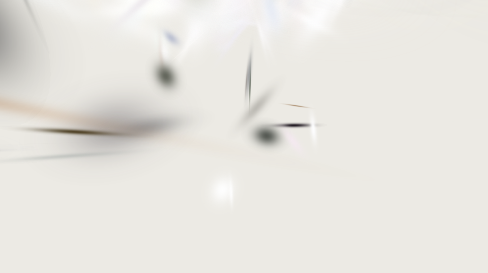
<figcaption>1.000 Splats</figcaption></figure>
<figure>
<!-- tutorial-screenshot
open-site: /gaussian-splatting
tab: preview
viewport: 1280x900
hook: hide-footer
hook: scene Artillery Passage (1,5 Mio. Splats, 24 MB) 10000
crop-element: #szenen .splat-viewer-stage
-->
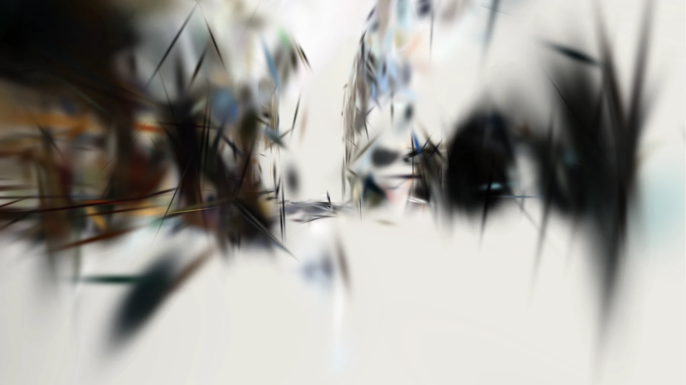
<figcaption>10.000 Splats</figcaption></figure>
<figure>
<!-- tutorial-screenshot
open-site: /gaussian-splatting
tab: preview
viewport: 1280x900
hook: hide-footer
hook: scene Artillery Passage (1,5 Mio. Splats, 24 MB) 100000
crop-element: #szenen .splat-viewer-stage
-->
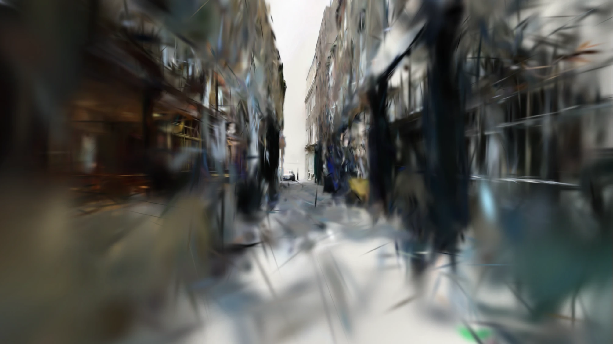
<figcaption>100.000 Splats</figcaption></figure>
<figure>
<!-- tutorial-screenshot
open-site: /gaussian-splatting
tab: preview
viewport: 1280x900
hook: hide-footer
hook: scene Artillery Passage (1,5 Mio. Splats, 24 MB) 1500000
crop-element: #szenen .splat-viewer-stage
-->
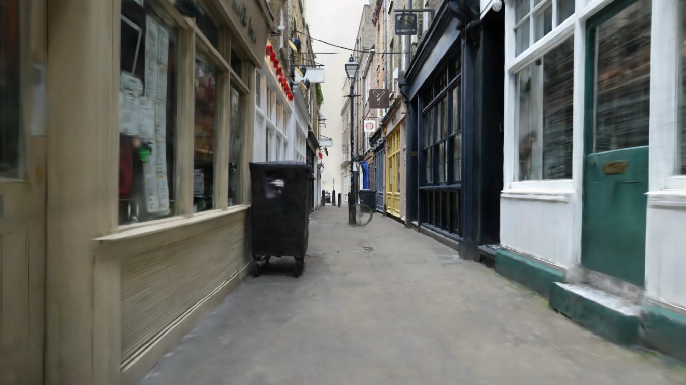
<figcaption>1.500.000 Splats</figcaption></figure>
</div>

Die ersten Splats sind groß und decken viel, aber jeder malt nur einen
groben Mittelwert dessen, was an seiner Stelle liegt. Erst die vielen
kleinen Splats danach bringen die Kanten, die Fenster und die Schrift.

<div class='hint try'>
<strong>Ausprobieren:</strong> Schieb »Anzahl der Splats« ganz nach links
und dann langsam nach rechts, erst in der Gasse, dann im Klassenzimmer.
Ab wie vielen Splats erkennst du, was du siehst?
</div>

### Wie so eine Szene entsteht

Die Szenen im Viewer hat ein Programm aus Bildern gelernt, genau so wie
deine Splats das Gemälde gelernt haben. Für jede Szene gibt es 196 Bilder
aus 196 Richtungen. Das Training beginnt mit Splats an Punkten der
Oberfläche, rendert sie aus der Richtung eines Bildes, wie dein
`render3d.py`, vergleicht mit dem Bild, rechnet den Gradienten für jeden Wert
jedes Splats aus und geht einen Schritt mit Adam. Dann das nächste Bild, und
so weiter; für die Szenen hier waren es 20.000 Schritte.

Gegenüber deinem 2D-Programm kommt dreierlei dazu:

- **Verdichten und Ausdünnen.** Wo ein Splat dauernd zwischen zwei
  Richtungen hin- und hergezogen wird, teilt ihn das Training in zwei; wo
  einer fast durchsichtig geworden ist, fällt er weg. So entstehen viele kleine
  Splats, wo eine Szene Einzelheiten hat, und wenige große, wo eine Fläche
  glatt ist.
- **Die Kameras.** Bei Fotos weiß man nicht, wo die Kamera stand. Ein
  eigenes Programm findet das vorher heraus, indem es dieselben Punkte auf
  vielen Fotos sucht (**Structure from Motion**, zum Beispiel mit
  [COLMAP](https://colmap.github.io/)).
- **Farbe, die von der Richtung abhängt.** Ein Glanzlicht auf dem Feuerlöscher
  sieht von jeder Seite anders aus. Darum hat ein Splat nach dem Training
  nicht eine Farbe, sondern 48 Zahlen, aus denen sich für jede Blickrichtung
  eine Farbe ergibt (**Kugelflächenfunktionen**, englisch *spherical
  harmonics*). Die Dateien dieser Seite haben nur die erste davon behalten,
  die Farbe, die aus allen Richtungen gleich ist; dein `read_ply` liest sie
  aus `f_dc_0` bis `f_dc_2`.

<div class='book'>
<i class='bi bi-file-earmark-text'></i>
<p><strong>3D Gaussian Splatting for Real-Time Radiance Field Rendering</strong>, Bernhard Kerbl, Georgios Kopanas, Thomas Leimkühler und George Drettakis, 2023. Der Aufsatz, mit dem Gaussian Splatting anfing: Splats im Raum, gelernt aus Fotos, sortiert und gemischt wie in deinem Renderer, schnell genug, um sich in Echtzeit in einer Szene umzusehen. Mit Videos und dem Code auf der <a href='https://repo-sam.inria.fr/fungraph/3d-gaussian-splatting/'>Seite des Projekts</a>.</p>
</div>

### Scharfe Kanten aus weichen Splats

Ein Splat hat keinen Rand. Wie bekommt eine Szene aus weichen Splats eine
scharfe Kante, etwa an einem Fensterrahmen oder einer Stufe? Durch die
Form: Ein Splat kann in eine Richtung lang und in die andere sehr schmal
sein, ein Strich statt eines Kleckses, oder flach wie eine Scheibe. Viele
schmale Splats, entlang der Kante gestreckt und nebeneinandergelegt, ergeben
einen Übergang, der schmaler ist als ein Pixel. Dasselbe hast du in 2D
gesehen: Deine Splats haben sich an den Rändern des Kopftuchs gestreckt und
gedreht. Das Training sorgt mit dem Verdichten dafür, dass es dort viele
kleine Splats gibt. Wo es zu wenige sind, bei feinen Mustern oder Schrift,
bleibt die Szene unscharf.

<div class='hint try'>
<strong>Ausprobieren:</strong> Flieg im Klassenzimmer mit »Vorne« vor die
Tafel, geh mit dem Mausrad nah an die Kreideschrift heran und schieb
»Weichheit der Splats« nach links. Achte darauf, welche Form die Splats an
den Rändern der Striche haben.
</div>

<div class='hint try'>
<strong>Ausprobieren:</strong> Flieg im Klassenzimmer zu »Bildschirm« und
schalt »Kamera pendelt« ein. Im schwarzen Bildschirm spiegelt sich das
Zimmer. Achte darauf, ob sich das Spiegelbild mit dem Rahmen des
Bildschirms bewegt oder anders als er. Schieb dann »Weichheit der Splats«
nach links.
</div>

Jeder Splat hat hier eine einzige Farbe, aus welcher Richtung man ihn auch
sieht. Ein Spiegelbild, das sich mit dem Blick verschiebt, kann das Training
deshalb nicht auf den Bildschirm malen. Es legt Splats hinter den
Bildschirm, wie ein zweites Zimmer hinter einem Fenster, und das Spiegelbild
liegt im Raum: Pendelt die Kamera, bewegt es sich wie etwas, das weiter
weg ist. Die Trainingsprogramme speichern für jeden Splat zwar auch, wie
sich seine Farbe mit der Richtung ändert; die Szenen hier haben nur die
Grundfarbe. Auch mit allen Werten legt das Training ein scharfes
Spiegelbild meist hinter die Fläche.

### Sortieren in jedem Bild

Die Reihenfolge der Splats hängt von der Kamera ab: Was von vorne gesehen
vorne liegt, liegt von hinten gesehen hinten. Dreht sich die Kamera, muss
der Viewer neu sortieren, für jedes Bild. Soll es flüssig aussehen, sind das
60 Bilder in der Sekunde, eines alle 16 Millisekunden.

Mit einem Verfahren, das vergleicht (Handbuch,
[Sortieren](/reference/sortieren)), dauern die 1,5 Millionen Splats der Gasse
auf dem Rechner, auf dem diese Seite entstanden ist, etwa 740 Millisekunden:
viel zu lange. Der Viewer zählt stattdessen. Er rechnet jede Tiefe in eine
ganze Zahl von 0 bis 65.535 um, zählt, wie oft jede Zahl vorkommt, und weiß
dann für jeden Splat, an welchen Platz er gehört (**Counting Sort**). Das
sind wenige Durchgänge durch alle Splats statt \\(n \log\_2 n\\) Vergleichen und
dauert auf demselben Rechner 23 Millisekunden, gut 40 Bilder in der Sekunde.
Andere Viewer sortieren deshalb nebenher in einem eigenen Thread und zeichnen
so lange mit der alten Reihenfolge weiter. Ganz genau ist es nicht: Zwei
Splats, deren Tiefen sich um weniger als ein 65.536stel des Bereichs
unterscheiden, bekommen dieselbe Zahl, und ihre Reihenfolge ist zufällig.
Sehen kann man das nicht.

Auch sonst ist das Sortieren eine Vereinfachung: Jeder Splat hat eine
einzige Tiefe, die seiner Mitte. Zwei große Splats, die einander
durchdringen, liegen aber an einer Stelle vorne und an einer anderen hinten;
beim Drehen springt dann manchmal einer nach vorne (englisch *popping*).
Das Programm aus dem Aufsatz von Kerbl sortiert darum auf der Grafikkarte
und für jede Kachel des Bildes aus 16 × 16 Pixeln für sich.

### Warum kein Z-Buffer?

Spiele mit Dreiecken sortieren nicht. Sie haben einen **Z-Buffer**: für jedes
Pixel die Tiefe des nächsten Dreiecks, das dort bisher gemalt wurde. Ein
neues Dreieck malt ein Pixel nur, wenn es näher liegt, und überschreibt es
dann. Damit ist die Reihenfolge der Dreiecke egal.

_task(z-buffer)

<!-- after: z-buffer -->
Ein Z-Buffer merkt sich für jedes Pixel nur eines, das Nächste. Ein
durchscheinender Splat soll aber mit dem mischen, was hinter ihm liegt, und
das ist bei einer beliebigen Reihenfolge oft noch gar nicht gemalt. Kommt
es später, verwirft der Z-Buffer es, weil es weiter weg ist, und hinter dem
halb durchsichtigen Splat bleibt ein Loch. Spiele haben dasselbe Problem mit
Glas, Rauch und Blättern: Sie malen zuerst alles, was deckt, mit dem
Z-Buffer, und danach das Durchscheinende, nach der Tiefe sortiert. Es gibt
auch Verfahren, die ohne Sortieren mischen; sie rechnen nur ungefähr.
<!-- /after -->

_task(warum-reihenfolge)

<!-- extra -->
## Eine eigene Szene

Eine eigene Szene zu trainieren braucht eine Grafikkarte und Zeit, meist
mehr, als ein Schulrechner hat; zu Hause am eigenen Rechner kann es gehen.
Das Programm [Brush](https://github.com/ArthurBrussee/brush) trainiert
Szenen unter Windows, macOS und Linux, mit Grafikkarten von NVIDIA, AMD und
Intel. Es braucht Bilder und die Lage der Kamera für jedes Bild, als Ordner
im Format von COLMAP oder von Nerfstudio.

Ohne eigene Fotos kannst du mit den Bildern üben, aus denen die Szenen dieser
Seite entstanden sind: Die
[DX.GL-Datensätze](https://huggingface.co/datasets/dxgl/multiview-datasets)
haben für jedes Objekt 196 Bilder mit der Lage der Kamera im Format von
Nerfstudio, gemeinfrei (CC0). So kannst du deine eigene Topfpflanze
mit der auf dieser Seite vergleichen.

Für eigene Fotos:

1. **Fotografieren.** Geh um ein Objekt herum und mach 50 bis 150 Fotos aus
   verschiedenen Höhen, jedes scharf, mit gleichem Licht und so, dass sich
   benachbarte Fotos zu großen Teilen überlappen. Glänzende, spiegelnde und
   durchsichtige Flächen und Bewegung im Bild machen es schwer.
2. **Die Kameras finden.** COLMAP berechnet aus den Fotos, wo die Kamera
   jedes Mal stand, mit »Automatic Reconstruction«.
3. **Trainieren.** Brush öffnet den Ordner mit den Fotos und dem Ergebnis von
   COLMAP und trainiert; in einem Fenster siehst du dabei zu, wie die Szene
   schärfer wird.
4. **Ansehen.** Brush speichert die Szene als `.ply`. Öffne sie oben im
   Viewer mit »Eigene Datei öffnen«: Der Viewer liest die Datei in deinem
   Browser, sie wird nirgends hochgeladen. Liegt die Szene auf der Seite oder
   steht sie auf dem Kopf, dreht »Aufrichten« sie jedes Mal um eine
   Vierteldrehung.

## Wie geht es weiter?

Dein Renderer und der Viewer sortieren Splats und mischen sie. Ein
[Raytracer](/raytracing) geht den umgekehrten Weg: Er schickt für jedes Pixel
einen Strahl in die Szene und fragt, was er trifft. Und was der Viewer auf
der Grafikkarte tut, schreibt man in einem Shader; wie das geht, steht in
[Shader in GLSL](/glsl).

Das Lernen mit Gradienten steckt in fast jeder künstlichen Intelligenz. Die
einfachste Form davon, ein Neuron, das aus Fehlern lernt, baust du in
[»Ein Neuron lernt«](/perzeptron).
