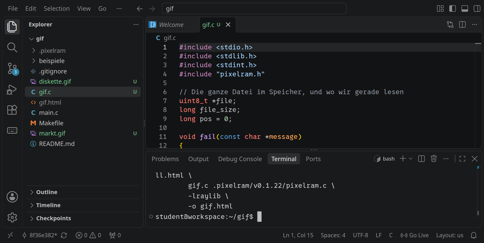
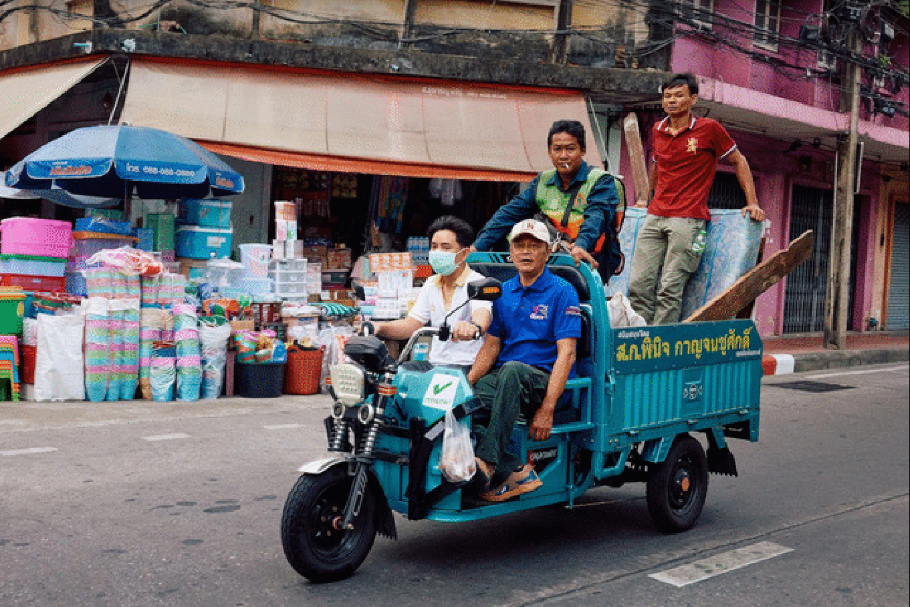

<div class='meta'>
image: title.webp
image_alt: "Ein Straßenfoto mit einem Lastendreirad; ein Gesicht ist vergrößert und zeigt grobe Farbpixel"
kind: labor
language: C
duration: 3 Doppelstunden
requires: [pixelram]
reference: [pixelram, workspace]
template: https://github.com/specht/pixelram-starter.git
template_name: des PixelRAM-Starters
</div>

<div
    class="autotoc-secondary-trigger"
    data-title="Auf dieser Seite"
    data-levels="h2,h3">
</div>

<style>
    :root {
        --color-m0: #ffe617;
        --color-m1: #f4951b;
        --color-m2: #bc2326;
        --color-m3: #f384ae;
        --color-m4: #7b67ae;
        --color-m5: #238acc;
        --color-m6: #12959f;
        --color-m7: #73a946;
        --color-m8: #bf9b6b;
        --color-mg: #ddd;
    }

    html[data-bs-theme="dark"] {
        --color-m0: #7a6a00;
        --color-m1: #8a4e00;
        --color-m2: #7a1618;
        --color-m3: #7a2f55;
        --color-m4: #4a3f7a;
        --color-m5: #165a8a;
        --color-m6: #0d646b;
        --color-m7: #4a6f2b;
        --color-m8: #6d5233;
        --color-mg: #555;
    }

    pre.spec {
        background: none;
        color: #333;
        line-height: 135%;
    }

    pre.hexdump {
        line-height: 135%;

        .m0, .m1, .m2, .m3, .m4, .m5, .m6, .m7, .m8, .mg {
            position: relative;
        }

        .m0::before, .m1::before, .m2::before,
        .m3::before, .m4::before, .m5::before,
        .m6::before, .m7::before, .m8::before, .mg::before {
            content: "";
            position: absolute;
            left: -0.2em;
            right: -0.2em;
            bottom: 0.05em;
            height: 1.2em;
            z-index: -1;
            border-radius: 0.25em;
            opacity: 0.75;
        }

        .m0::before { background-color: var(--color-m0); }
        .m1::before { background-color: var(--color-m1); }
        .m2::before { background-color: var(--color-m2); }
        .m3::before { background-color: var(--color-m3); }
        .m4::before { background-color: var(--color-m4); }
        .m5::before { background-color: var(--color-m5); }
        .m6::before { background-color: var(--color-m6); }
        .m7::before { background-color: var(--color-m7); }
        .m8::before { background-color: var(--color-m8); }
        .mg::before { background-color: var(--color-mg); }
    }

    p, td {
        .m0, .m1, .m2, .m3, .m4, .m5, .m6, .m7, .m8, .mg {
            padding: 0 0.25em;
            border-radius: 0.25em;
        }
        .m0 { background-color: color-mix(in srgb, var(--color-m0) 75%, transparent); }
        .m1 { background-color: color-mix(in srgb, var(--color-m1) 75%, transparent); }
        .m2 { background-color: color-mix(in srgb, var(--color-m2) 75%, transparent); }
        .m3 { background-color: color-mix(in srgb, var(--color-m3) 75%, transparent); }
        .m4 { background-color: color-mix(in srgb, var(--color-m4) 75%, transparent); }
        .m5 { background-color: color-mix(in srgb, var(--color-m5) 75%, transparent); }
        .m6 { background-color: color-mix(in srgb, var(--color-m6) 75%, transparent); }
        .m7 { background-color: color-mix(in srgb, var(--color-m7) 75%, transparent); }
        .m8 { background-color: color-mix(in srgb, var(--color-m8) 75%, transparent); }
        .mg { background-color: color-mix(in srgb, var(--color-mg) 75%, transparent); }
    }

    td {
        .m0, .m1, .m2, .m3, .m4, .m5, .m6, .m7, .m8, .mg {
            padding: 0.25em 0.5em;
            code {
                background: transparent;
                color: inherit;
            }
        }
    }

    /* Bytes in the first column of the explanation tables stay on one line. */
    table.bytes td:first-child {
        white-space: nowrap;
        width: 1%;
    }

    p.expl {
        font-style: italic;
        font-size: 0.9em;
        opacity: 0.6;
        margin: 0;
    }

    .swatch {
        display: inline-block;
        width: 1.2em;
        height: 1.2em;
        vertical-align: -0.2em;
        border: 1px solid #888;
        border-radius: 0.2em;
        margin-right: 0.4em;
    }

    /* The LZW stepper */
    .lzw-stepper {
        margin: 1em 0 1.5em;
    }
    .lzw-controls {
        display: flex;
        gap: 0.3em;
        align-items: center;
        margin-bottom: 0.8em;
    }
    .lzw-controls .lzw-count {
        margin-left: 0.6em;
        color: var(--bs-secondary-color);
    }
    /* The bit stream as a window that slides along it: the first byte on the
       right, as on the page above, read from right to left. */
    .lzw-bits {
        position: relative;
        overflow: hidden;
        margin-bottom: 0.2em;
        padding-bottom: 1.6em;
        mask-image: linear-gradient(to right, transparent, black 2.5em, black calc(100% - 2.5em), transparent);
    }
    .lzw-strip {
        display: flex;
        flex-direction: row-reverse;
        width: max-content;
        transition: transform 0.35s ease;
        position: relative;
    }
    .lzw-byte {
        display: flex;
        flex-direction: column;
        align-items: center;
        padding: 0 0.35em;
        border-left: 1px solid var(--bs-border-color);
    }
    .lzw-byte:last-child { border-left: none; }
    .lzw-hex {
        font-family: '0xProto Nerd Font Mono', monospace;
        font-size: 0.75em;
        color: var(--bs-secondary-color);
    }
    .lzw-cells { display: flex; }
    .lzw-cells span {
        font-family: '0xProto Nerd Font Mono', monospace;
        width: 0.95em;
        text-align: center;
        line-height: 1.6;
        transition: background-color 0.25s, opacity 0.25s;
    }
    /* Bits already read: pale, every second code on a tint, so the codes
       stay apart. */
    .lzw-cells .past { color: var(--bs-secondary-color); opacity: 0.6; }
    .lzw-cells .past.odd { background-color: color-mix(in srgb, var(--bs-secondary-color) 22%, transparent); }
    .lzw-cells .now { background-color: color-mix(in srgb, var(--color-m0) 80%, transparent); font-weight: 700; }
    .lzw-label {
        position: absolute;
        bottom: -1.5em;
        font-size: 0.8em;
        white-space: nowrap;
        transform: translateX(-50%);
        transition: left 0.35s ease;
        color: var(--bs-body-color);
    }
    .lzw-direction {
        font-size: 0.8em;
        color: var(--bs-secondary-color);
        margin-bottom: 0.8em;
    }
    .lzw-grid div.pop { animation: lzw-pop 0.35s ease-out; }
    .lzw-table div.new { animation: lzw-flash 0.9s ease-out; }
    @keyframes lzw-pop { from { transform: scale(0.2); opacity: 0; } }
    @keyframes lzw-flash { from { background-color: var(--color-m0); } }
    @media (prefers-reduced-motion: reduce) {
        .lzw-strip, .lzw-label, .lzw-cells span { transition: none; }
        .lzw-grid div.pop, .lzw-table div.new { animation: none; }
    }
    .lzw-main {
        display: flex;
        gap: 1.5em;
        align-items: flex-start;
        flex-wrap: wrap;
    }
    /* The 16 × 16 pixels: faint lines between the cells show where the
       pixels will go, also before any are there. */
    .lzw-grid {
        display: grid;
        grid-template-columns: repeat(16, 1.15em);
        grid-auto-rows: 1.15em;
        gap: 1px;
        padding: 1px;
        flex: none;
        background: color-mix(in srgb, var(--bs-secondary-color) 22%, transparent);
    }
    /* on a phone the grid takes the width there is, square cells */
    @media (max-width: 640px) {
        .lzw-grid {
            width: 100%;
            grid-template-columns: repeat(16, minmax(0, 1fr));
            grid-auto-rows: auto;
        }
        .lzw-grid div {
            aspect-ratio: 1;
        }
    }
    .lzw-grid div {
        font-size: 0.7em;
        display: flex;
        align-items: center;
        justify-content: center;
        background: var(--bs-body-bg);
    }
    .lzw-grid div.new {
        outline: 2px solid var(--color-m2);
        outline-offset: -1px;
    }
    .lzw-explain {
        flex: 1 1 16em;
        min-width: 0;
    }
    .lzw-explain pre {
        margin: 0.4em 0;
    }
    /* The table, from entry 0 on, in a column of its own to the right of
       the explanation; on a narrow screen it wraps below. */
    .lzw-table-column {
        flex: none;
        min-width: 9em;
    }
    .lzw-table-head {
        font-size: 0.85em;
        font-weight: 600;
        color: var(--bs-secondary-color);
    }
    .lzw-table {
        font-family: '0xProto Nerd Font Mono', monospace;
        font-size: 0.85em;
        max-height: 20em;
        overflow-y: auto;
        position: relative;
    }
    .lzw-special {
        color: var(--bs-secondary-color);
    }
    /* The index right-aligned in a column of its own, so the entries start
       in one line however many digits it has. */
    .lzw-index {
        display: inline-block;
        width: 3.5ch;
        text-align: right;
        margin-right: 0.5ch;
    }
    .lzw-table div.new {
        background-color: color-mix(in srgb, var(--color-m0) 60%, transparent);
    }
    .lzw-table div {
        line-height: 1.7;
    }
    .pixes {
        white-space: nowrap;
    }
    .pix {
        display: inline-block;
        width: 1.3em;
        text-align: center;
        border-radius: 0.2em;
        margin-right: 1px;
        /* a dark colour stays visible on a dark page */
        outline: 1px solid var(--bs-border-color);
        outline-offset: -1px;
    }

    html[data-bs-theme="dark"] {
        pre.spec {
            color: #ddd;
        }
        .m0, .m1, .m2, .m3, .m4, .m5, .m6, .m7, .m8, .mg {
            color: #fff;
        }
        pre, pre .w {
            background-color: transparent !important;
        }
    }
</style>

# Eine GIF-Datei decodieren

<p class='abstract'>
Das Graphics Interchange Format (GIF) stammt von 1987 und ist eines der ältesten Bildformate, die heute noch jeder Browser anzeigt. Ein GIF-Bild hat höchstens 256 Farben und ist verlustfrei mit LZW komprimiert: Ein Decoder bekommt jedes Pixel genau so zurück, wie es gespeichert wurde. In diesem Labor schreibst du in C einen Decoder, der eine GIF-Datei Byte für Byte liest, die Bilddaten entpackt und das Bild mit PixelRAM zeigt.
</p>

_person(wilhite)

## Grundlagen

Ein GIF-Bild speichert für jedes Pixel keine Farbe, sondern eine Nummer. Welche Farbe zu welcher Nummer gehört, steht einmal in einer **Farbtabelle** am Anfang der Datei, mit höchstens 256 Einträgen. Das kennst du aus PixelRAM: Im Modus `pixel_indexed8` ist jedes Pixel eine Nummer in der Palette. Ein GIF passt deshalb genau in diesen Modus.

_uses(paletten)

Die Nummern der Pixel sind mit **LZW** komprimiert, benannt nach Abraham Lempel, Jacob Ziv und Terry Welch. Während der Decoder liest, baut er sich eine Tabelle von Pixelfolgen, die schon einmal vorkamen, und genau dieselbe Tabelle hat vorher der Encoder gebaut. Mitgeschickt wird die Tabelle nie. Wie das geht, ist das Herzstück dieses Labors.

_person(lempel-ziv)

_person(welch)

Das Format ist in einem einzigen Text beschrieben, den die Firma CompuServe 1990 auf der Schreibmaschine verfasst hat: der [Spezifikation GIF89a](https://www.w3.org/Graphics/GIF/spec-gif89a.txt). Sie ist gut lesbar und erstaunlich kurz. Die Diagramme der Blöcke auf dieser Seite stammen von dort, und unter jeder Überschrift steht, wo der Block in der Spezifikation beschrieben ist.

## Vorbereitung

### Die PixelRAM-Vorlage

Dein Decoder ist ein Programm für PixelRAM. Klone die Vorlage im Terminal in einen eigenen Ordner `gif`; so kommt er dem Ordner aus [Echtzeitgrafik mit C](/pixelram) nicht in die Quere:

```bash_copy
git clone ${template} ~/gif
```

Öffne dann den Ordner `/workspace/gif` mit <kbd>Strg</kbd><kbd>K</kbd> <kbd>Strg</kbd><kbd>O</kbd>.

### Die Beispieldateien

Lade im Terminal drei GIF-Dateien in den Ordner `gif`:

```bash_copy
wget ${web_root}/gif/diskette.gif
wget ${web_root}/gif/markt.gif
wget ${web_root}/gif/markt-interlaced.gif
```

`diskette.gif` ist eine Diskette mit 16 × 16 Pixeln und 4 Farben, nur 106 Bytes groß. Sie ist so klein, dass die ganze Datei auf diese Seite passt, und an ihr gehen wir jeden Block durch. `markt.gif` ist ein Foto mit 640 × 427 Pixeln und 256 Farben, `markt-interlaced.gif` dasselbe Foto in einer anderen Reihenfolge der Zeilen. Die beiden brauchst du später.

Sieh dir die Diskette Byte für Byte an:

```bash
hexdump -C diskette.gif
```

<pre class='spec hexdump'>
00000000  <span class='m0'>47 49 46 38 39 61</span> <span class='m1'>10 00  10 00 91 00 00</span> <span class='m2'>10 10 20</span>  |GIF89a......... |
00000010  <span class='m2'>2a 6f b0 f4 f1 e8 c8 ce  d6</span> <span class='m3'>21 f9 04 00 00 00 00</span>  |*o.......!......|
00000020  <span class='m3'>00</span> <span class='m4'>21 fe 0a 48 61 63 6b  73 63 68 75 6c 65 00</span> <span class='m5'>2c</span>  |.!..Hackschule.,|
00000030  <span class='m5'>00 00 00 00 10 00 10 00  00</span> <span class='m6'>02 2d 8c 87 99 06 60</span>  |..........-....`|
00000040  <span class='m6'>a1 e2 73 47 c2 87 e3 38  f8 69 de 41 1a 12 96 66</span>  |..sG...8.i.A...f|
00000050  <span class='m6'>20 a4 ea 9a 62 ec 2b b8  67 fb c0 ac 1c ae ae ad</span>  | ...b.+.g.......|
00000060  <span class='m6'>ee 7c 5c fb 01 4f a5 02  00</span> <span class='m7'>3b</span>                    |.|\..O...;|
</pre>

Das sind alle 106 Bytes. Die Farben zeigen die Blöcke, aus denen eine GIF-Datei besteht: <span class='m0'>Header</span>, <span class='m1'>Logical Screen Descriptor</span>, <span class='m2'>Global Color Table</span>, <span class='m3'>Graphic Control Extension</span>, <span class='m4'>Comment Extension</span>, <span class='m5'>Image Descriptor</span>, <span class='m6'>Bilddaten</span> und <span class='m7'>Trailer</span>. Fast die Hälfte der Datei sind die komprimierten Bilddaten.

<div class='hint'>
<strong>Ein Hexdump</strong> zeigt immer 16 Bytes in einer Zeile. Vorne steht der Offset, die Position des ersten Bytes der Zeile, hexadezimal. Dann folgen die 16 Bytes, hexadezimal, mit einer kleinen Lücke nach 8 Bytes. Rechts stehen dieselben Bytes als Zeichen, und wo ein Byte kein druckbares Zeichen ist, steht ein Punkt. Deshalb kannst du dort gleich am Anfang <code>GIF89a</code> lesen und in der dritten Zeile einen Text.
</div>

### Das Programm

Lege im Ordner `gif` die Datei `gif.c` an. Der Anfang liest die ganze Datei in den Speicher, und drei kleine Funktionen lesen daraus, immer an der Stelle `pos`, die dabei weiterwandert:

<!-- page-code: own -->
```c_copy
#include <stdio.h>
#include <stdlib.h>
#include <stdint.h>
#include "pixelram.h"

// Die ganze Datei im Speicher, und wo wir gerade lesen
uint8_t *file;
long file_size;
long pos = 0;

void fail(const char *message)
{
    printf("Fehler bei Byte %ld: %s\n", pos, message);
    exit(1);
}

uint8_t read_byte(void)
{
    if (pos >= file_size)
        fail("Die Datei ist zu Ende.");
    return file[pos++];
}

// GIF speichert Zahlen mit zwei Bytes im Little Endian: das niedrige Byte zuerst
int read_word(void)
{
    int low = read_byte();
    int high = read_byte();
    return low | (high << 8);
}

void read_file(const char *path)
{
    FILE *f = fopen(path, "rb");
    if (!f)
    {
        printf("Kann %s nicht öffnen.\n", path);
        exit(1);
    }
    fseek(f, 0, SEEK_END);
    file_size = ftell(f);
    fseek(f, 0, SEEK_SET);
    file = malloc(file_size);
    fread(file, 1, file_size, f);
    fclose(f);
}

int main(int argc, char **argv)
{
    if (argc < 2)
    {
        printf("Welche Datei? make PROGRAM=gif ARGS=diskette.gif\n");
        return 1;
    }
    read_file(argv[1]);
    printf("%s: %ld Bytes\n", argv[1], file_size);
    return 0;
}
```

- `read_file` öffnet die Datei, springt mit `fseek` ans Ende, um mit `ftell` die Größe zu erfahren, und liest dann alles auf einmal in `file`.
- `read_byte` gibt das Byte an der Stelle `pos` zurück und rückt `pos` eins weiter. Ist die Datei schon zu Ende, bricht `fail` das Programm mit einer Meldung ab, statt hinter der Datei weiterzulesen.
- `read_word` liest zwei Bytes und setzt sie zu einer Zahl zusammen, das erste ist das niedrige. Darauf kommen wir gleich beim Logical Screen Descriptor zurück.

Übersetze das Programm mit dem Namen der Datei, die es lesen soll:

```bash
make PROGRAM=gif ARGS=diskette.gif
```

<!-- tutorial-screenshot
# Die Vorlage im Terminal nach gif klonen und den Ordner öffnen; gif.c ist hier
# schon der fertige Decoder, oben steht dasselbe wie im Gerüst
show-left-sidebar
terminal-open
terminal-run: git clone -q https://github.com/specht/pixelram-starter.git ~/gif && git -C ~/gif checkout -q 8f36e382554999421d77687c69f7541ca2c4afb7
press: Control+K
press: Control+O
wait-for-input-value: /workspace/
type: gif
press: Enter
wait-for-input-value: /workspace/gif/
press: Enter
wait-for-text: main.c
write-file: gif.c <- file:loesung/gif.c
write-file: diskette.gif <- file:beispiele/diskette.gif
write-file: markt.gif <- file:beispiele/markt.gif
open-file: gif.c
terminal-open
terminal-run: make PROGRAM=gif ARGS=diskette.gif
terminal-wait-for-prompt: 180
-->


`make` macht aus `gif.c` die Seite `gif.html`. Was hinter `ARGS=` steht, bekommt dein Programm als `argv[1]`, und PixelRAM lädt eine Datei dieses Namens aus demselben Ordner mit, damit `fopen` sie findet. Öffne `gif.html` mit »Go Live« und dann die Konsole: Fahre mit der Maus über das Bild und klicke unten rechts auf das Terminal-Symbol oder drücke <kbd>&#96;</kbd>. Dort steht `diskette.gif: 106 Bytes`.

<div class='hint'>
<strong>Eine andere Datei, ohne neu zu übersetzen:</strong> In der Konsole steht oben ein Feld mit den Argumenten. Tippe dort <code>markt.gif</code> und klicke auf »Run«: Das Programm startet neu, mit dieser Datei.
</div>

## Grober Ablauf eines GIF-Decoders

Eine GIF-Datei ist eine Folge von Blöcken, und dein Decoder liest sie der Reihe nach:

1. **Header**: Prüfe, ob die Datei mit `GIF87a` oder `GIF89a` beginnt.
2. **Logical Screen Descriptor**: Lies Breite und Höhe und öffne einen Bildschirm dieser Größe.
3. **Global Color Table**: Lies die Farben in die Palette von PixelRAM.
4. **Blöcke bis zum Ende**: Lies das erste Byte jedes Blocks. Eine Extension (`0x21`) überspringst du, auf einen Image Descriptor (`0x2C`) folgen Bilddaten, der Trailer (`0x3B`) beendet die Datei.
5. **Bilddaten**: Setze die Sub-blocks zusammen, lies daraus die Codes und entpacke sie mit LZW zu Pixelnummern.
6. **Pixel setzen**: Schreibe die Nummern Zeile für Zeile in den Bildschirm, bei Interlacing in einer anderen Reihenfolge der Zeilen.

Anders als JPEG speichert GIF Zahlen mit zwei Bytes im **Little Endian**: zuerst das niedrige Byte, dann das hohe. Auch die Bits der Codes werden andersherum gelesen als bei JPEG, vom niedrigsten Bit eines Bytes an. Beides war auf den PCs von 1987 die natürliche Reihenfolge.

## Die Blöcke der Datei

### Header

<p class='expl'>GIF89a, Abschnitt 17, Seite 7</p>

Jede GIF-Datei beginnt mit sechs Zeichen: der Signatur `GIF` und der Version, `87a` oder `89a`. Die Version sagt, welche Blöcke vorkommen können; ein Decoder für 89a liest auch jede Datei von 1987.

<pre class='spec'>
      7 6 5 4 3 2 1 0        Field Name                    Type
     +---------------+
   0 |               |       Signature                     3 Bytes
     +-             -+
   1 |               |
     +-             -+
   2 |               |
     +---------------+
   3 |               |       Version                       3 Bytes
     +-             -+
   4 |               |
     +-             -+
   5 |               |
     +---------------+
</pre>

**Beispiel:**

<pre class='spec hexdump'>
00000000  <span class='m0'>47 49 46</span> <span class='m1'>38 39 61</span> 10 00  10 00 91 00 00 10 10 20  |GIF89a......... |
</pre>

<div style='max-width: 100%; overflow-x: auto;'>
<table class='table bytes'>
<tr>
<td><span class='m0'><code>47 49 46</code></span></td>
<td>Signatur <code>GIF</code></td>
</tr>
<tr>
<td><span class='m1'><code>38 39 61</code></span></td>
<td>Version <code>89a</code></td>
</tr>
</table>
</div>

Ersetze in `main` die Zeile mit `printf` durch eine Prüfung: Sind die ersten drei Bytes nicht `'G'`, `'I'` und `'F'`, beendet `fail` das Programm mit »Das ist keine GIF-Datei.«. Die Version brauchst du nicht, also überspringst du ihre drei Bytes. Probier es aus, indem du statt `diskette.gif` einmal `Makefile` als Argument angibst.

### Logical Screen Descriptor

<p class='expl'>GIF89a, Abschnitt 18, Seite 8</p>

Der Logical Screen ist die Fläche, auf der die Bilder der Datei erscheinen. Meistens ist es ein einziges Bild, genau so groß wie die Fläche. Eine Animation besteht dagegen aus vielen Bildern, die nacheinander auf dieselbe Fläche gezeichnet werden, manche nur auf einen Teil davon.

<pre class='spec'>
      7 6 5 4 3 2 1 0        Field Name                    Type
     +---------------+
  0  |               |       Logical Screen Width          Unsigned
     +-             -+
  1  |               |
     +---------------+
  2  |               |       Logical Screen Height         Unsigned
     +-             -+
  3  |               |
     +---------------+
  4  | |     | |     |       &lt;Packed Fields&gt;               See below
     +---------------+
  5  |               |       Background Color Index        Byte
     +---------------+
  6  |               |       Pixel Aspect Ratio            Byte
     +---------------+

     &lt;Packed Fields&gt;  =      Global Color Table Flag       1 Bit
                             Color Resolution              3 Bits
                             Sort Flag                     1 Bit
                             Size of Global Color Table    3 Bits
</pre>

**Beispiel:**

<pre class='spec hexdump'>
00000000  47 49 46 38 39 61 <span class='m0'>10 00</span>  <span class='m1'>10 00</span> <span class='m2'>91</span> <span class='m3'>00</span> <span class='m4'>00</span> 10 10 20  |GIF89a......... |
</pre>

<div style='max-width: 100%; overflow-x: auto;'>
<table class='table bytes'>
<tr>
<td><span class='m0'><code>10 00</code></span></td>
<td>Breite: 0x0010 = 16 Pixel
<p class='expl'>
Das niedrige Byte steht zuerst: <code>10 00</code> ist 0x10 + 0x00 · 256 = 16. Eine Breite von 640 Pixeln steht als <code>80 02</code> in der Datei.
</p>
</td>
</tr>
<tr>
<td><span class='m1'><code>10 00</code></span></td>
<td>Höhe: 16 Pixel</td>
</tr>
<tr>
<td><span class='m2'><code>91</code></span></td>
<td>Packed Fields: 0x91 = <code>1 001 0 001</code>
<p class='expl'>
Ein Byte, in dem vier Felder stecken. Das höchste Bit ist 1: Es gibt eine Global Color Table. Die nächsten drei Bits (Color Resolution) sagen, wie viele Bits pro Farbe das Originalbild hatte; das brauchst du nicht. Das Sort Flag ist 0. Die letzten drei Bits sind die Größe der Farbtabelle, hier 1: Die Tabelle hat 2<sup>1+1</sup> = 4 Farben.
</p>
</td>
</tr>
<tr>
<td><span class='m3'><code>00</code></span></td>
<td>Background Color Index: Farbe 0
<p class='expl'>
Damit füllst du die Fläche, bevor das erste Bild kommt. Wo ein Bild die Fläche nicht ganz bedeckt, bleibt diese Farbe stehen.
</p>
</td>
</tr>
<tr>
<td><span class='m4'><code>00</code></span></td>
<td>Pixel Aspect Ratio: 0, quadratische Pixel</td>
</tr>
</table>
</div>

Die Farbtabelle hat immer 2<sup>n+1</sup> Farben, wenn n in den letzten drei Bits steht: 2, 4, 8 und so weiter bis 256. In C ist das `2 << n`. Jede Farbe sind drei Bytes, Rot, Grün und Blau.

_task(farben)

Lies den Logical Screen Descriptor in `main`, direkt nach dem Header, Feld für Feld mit `read_word` und `read_byte`. Dann öffnest du einen Bildschirm in derselben Größe, mit `screen_open(width, height, pixel_indexed8, argv[1])`.

Für die Packed Fields brauchst du einzelne Bits: `packed & 0x80` ist das höchste Bit, die Flagge für die Global Color Table, und `packed & 7` sind die letzten drei Bits, ihre Größe. Mit `&` behältst du von einer Zahl nur die Bits, die in der Maske gesetzt sind: 0x80 ist `1000 0000`, 7 ist `0000 0111`.

### Global Color Table

<p class='expl'>GIF89a, Abschnitt 19, Seite 10</p>

Direkt nach dem Logical Screen Descriptor folgt die Global Color Table, wenn die Flagge gesetzt ist: für jede Farbe drei Bytes, Rot, Grün und Blau.

<pre class='spec'>
      7 6 5 4 3 2 1 0        Field Name                    Type
     +===============+
  0  |               |       Red 0                         Byte
     +-             -+
  1  |               |       Green 0                       Byte
     +-             -+
  2  |               |       Blue 0                        Byte
     +-             -+
  3  |               |       Red 1                         Byte
     +-             -+
     |               |       Green 1                       Byte
     +-             -+
 up  |               |
     +-   . . . .   -+       ...
 to  |               |
     +-             -+
     |               |       Green 255                     Byte
     +-             -+
767  |               |       Blue 255                      Byte
     +===============+
</pre>

**Beispiel:**

<pre class='spec hexdump'>
00000000  47 49 46 38 39 61 10 00  10 00 91 00 00 <span class='m0'>10 10 20</span>  |GIF89a......... |
00000010  <span class='m1'>2a 6f b0</span> <span class='m2'>f4 f1 e8</span> <span class='m3'>c8 ce  d6</span> 21 f9 04 00 00 00 00  |*o.......!......|
</pre>

<div style='max-width: 100%; overflow-x: auto;'>
<table class='table bytes'>
<tr>
<td><span class='m0'><code>10 10 20</code></span></td>
<td><span class='swatch' style='background: #101020;'></span>Farbe 0: fast Schwarz, nur in der abgeschnittenen Ecke</td>
</tr>
<tr>
<td><span class='m1'><code>2a 6f b0</code></span></td>
<td><span class='swatch' style='background: #2a6fb0;'></span>Farbe 1: Blau, die Hülle der Diskette</td>
</tr>
<tr>
<td><span class='m2'><code>f4 f1 e8</code></span></td>
<td><span class='swatch' style='background: #f4f1e8;'></span>Farbe 2: das Etikett</td>
</tr>
<tr>
<td><span class='m3'><code>c8 ce d6</code></span></td>
<td><span class='swatch' style='background: #c8ced6;'></span>Farbe 3: der Metallschieber</td>
</tr>
</table>
</div>

Die Farben kommen gleich in die Palette von PixelRAM. Ein Image Descriptor kann später eine eigene Tabelle mitbringen, deshalb bekommt das Lesen eine eigene Funktion:

```c
void read_color_table(int count)
```

Sie liest `count` Farben, je drei Bytes, und gibt jeder ihre Nummer in der Palette, mit `set_palette(i, r, g, b)`. In `main` rufst du sie nach `screen_open` auf, wenn die Flagge gesetzt ist. Danach füllst du den Bildschirm mit `clear` in der Hintergrundfarbe.

### Extensions

<p class='expl'>GIF89a, Abschnitte 15, 23 und 24, Seiten 5, 15 und 17</p>

Mit der Version 89a kamen Extensions dazu: Blöcke, die einem Bild etwas hinzufügen, etwa eine Wartezeit für Animationen, eine durchsichtige Farbe oder einen Kommentar. Alle sind gleich gebaut. Sie beginnen mit dem Extension Introducer `0x21` und einem Label, das sagt, welche Extension es ist. Danach kommen ihre Daten in **Data Sub-blocks**: ein Byte mit einer Länge von 1 bis 255, dann so viele Bytes, dann wieder eine Länge, und so weiter, bis eine Länge 0 kommt, der Block Terminator.

<pre class='spec'>
      7 6 5 4 3 2 1 0        Field Name                    Type
     +---------------+
  0  |               |       Block Size                    Byte
     +---------------+
  1  |               |
     +-             -+
  2  |               |
     +-             -+
  3  |               |
     +-             -+
     |               |       Data Values                   Byte
     +-             -+
 up  |               |
     +-   . . . .   -+
 to  |               |
     +-             -+
     |               |
     +-             -+
255  |               |
     +---------------+
</pre>

Dank dieser Form kann ein Decoder jede Extension überspringen, auch eine, die es 1990 noch gar nicht gab: Er liest Längen und springt weiter, bis die 0 kommt. Die Diskette hat zwei Extensions:

<pre class='spec hexdump'>
00000010  2a 6f b0 f4 f1 e8 c8 ce  d6 <span class='m0'>21</span> <span class='m1'>f9</span> <span class='m2'>04</span> <span class='m3'>00 00 00 00</span>  |*o.......!......|
00000020  <span class='m4'>00</span> <span class='m0'>21</span> <span class='m1'>fe</span> <span class='m2'>0a</span> <span class='m3'>48 61 63 6b  73 63 68 75 6c 65</span> <span class='m4'>00</span> 2c  |.!..Hackschule.,|
</pre>

<div style='max-width: 100%; overflow-x: auto;'>
<table class='table bytes'>
<tr>
<td><span class='m0'><code>21</code></span></td>
<td>Extension Introducer</td>
</tr>
<tr>
<td><span class='m1'><code>f9</code></span></td>
<td>Label 0xF9: Graphic Control Extension
<p class='expl'>
Sie gilt für das nächste Bild und sagt, wie lange es stehen bleibt (Delay Time, in Hundertstelsekunden), was danach mit ihm passiert (Disposal Method) und ob eine seiner Farben durchsichtig ist (Transparent Color Index). Für ein einzelnes Bild ohne Transparenz ist alles 0.
</p>
</td>
</tr>
<tr>
<td><span class='m2'><code>04</code></span></td>
<td>ein Sub-block mit 4 Bytes</td>
</tr>
<tr>
<td><span class='m3'><code>00 00 00 00</code></span></td>
<td>Packed Fields, Delay Time (zwei Bytes), Transparent Color Index</td>
</tr>
<tr>
<td><span class='m4'><code>00</code></span></td>
<td>Block Terminator</td>
</tr>
<tr>
<td><span class='m0'><code>21</code></span> <span class='m1'><code>fe</code></span></td>
<td>Extension Introducer, Label 0xFE: Comment Extension</td>
</tr>
<tr>
<td><span class='m2'><code>0a</code></span></td>
<td>ein Sub-block mit 10 Bytes</td>
</tr>
<tr>
<td><span class='m3' style='white-space: nowrap;'><code>48 61 63</code> …</span></td>
<td>der Kommentar, als Text</td>
</tr>
<tr>
<td><span class='m4'><code>00</code></span></td>
<td>Block Terminator</td>
</tr>
</table>
</div>

_task(kommentar)

Für ein einzelnes Bild brauchst du keine Extension. Eine Funktion, die Sub-blocks liest, brauchst du trotzdem, denn auch die Bilddaten kommen gleich in Sub-blocks:

```c
long read_sub_blocks(uint8_t *data)
```

Sie liest eine Länge, dann so viele Bytes, dann wieder eine Länge, bis die Länge 0 kommt. Die Bytes schreibt sie hintereinander in den Speicher `data`, ohne die Längen, und gibt zurück, wie viele es insgesamt waren. Ist `data` gleich `NULL`, zählt sie nur. So kann dieselbe Funktion eine Extension überspringen und Bilddaten lesen.

### Image Descriptor

<p class='expl'>GIF89a, Abschnitte 20 und 21, Seiten 11 und 13</p>

Jedes Bild beginnt mit einem Image Descriptor: dem Image Separator `0x2C`, der Position des Bildes auf dem Logical Screen und seiner Größe.

<pre class='spec'>
      7 6 5 4 3 2 1 0        Field Name                    Type
     +---------------+
  0  |               |       Image Separator               Byte
     +---------------+
  1  |               |       Image Left Position           Unsigned
     +-             -+
  2  |               |
     +---------------+
  3  |               |       Image Top Position            Unsigned
     +-             -+
  4  |               |
     +---------------+
  5  |               |       Image Width                   Unsigned
     +-             -+
  6  |               |
     +---------------+
  7  |               |       Image Height                  Unsigned
     +-             -+
  8  |               |
     +---------------+
  9  | | | |   |     |       &lt;Packed Fields&gt;               See below
     +---------------+

     &lt;Packed Fields&gt;  =      Local Color Table Flag        1 Bit
                             Interlace Flag                1 Bit
                             Sort Flag                     1 Bit
                             Reserved                      2 Bits
                             Size of Local Color Table     3 Bits
</pre>

**Beispiel:**

<pre class='spec hexdump'>
00000020  00 21 fe 0a 48 61 63 6b  73 63 68 75 6c 65 00 <span class='m0'>2c</span>  |.!..Hackschule.,|
00000030  <span class='m1'>00 00</span> <span class='m2'>00 00</span> <span class='m3'>10 00</span> <span class='m4'>10 00</span>  <span class='m5'>00</span> 02 2d 8c 87 99 06 60  |..........-....`|
</pre>

<div style='max-width: 100%; overflow-x: auto;'>
<table class='table bytes'>
<tr>
<td><span class='m0'><code>2c</code></span></td>
<td>Image Separator</td>
</tr>
<tr>
<td><span class='m1'><code>00 00</code></span> <span class='m2'><code>00 00</code></span></td>
<td>links oben: x = 0, y = 0</td>
</tr>
<tr>
<td><span class='m3'><code>10 00</code></span> <span class='m4'><code>10 00</code></span></td>
<td>16 × 16 Pixel, so groß wie der Logical Screen</td>
</tr>
<tr>
<td><span class='m5'><code>00</code></span></td>
<td>Packed Fields: keine Local Color Table, kein Interlacing
<p class='expl'>
Ist das höchste Bit gesetzt, folgt eine Local Color Table, gebaut wie die globale, deren Größe in den letzten drei Bits steht. Sie gilt nur für dieses Bild. Das zweithöchste Bit (0x40) ist das Interlace Flag, dazu weiter unten mehr.
</p>
</td>
</tr>
</table>
</div>

### Table Based Image Data

<p class='expl'>GIF89a, Abschnitte 22 und 27, Seiten 14 und 23</p>

Hinter dem Image Descriptor (und einer Local Color Table, falls es eine gibt) stehen die Bilddaten: ein Byte, die **LZW Minimum Code Size**, und dann die komprimierten Daten in Sub-blocks. Nach dem letzten Bild steht der Trailer, ein einzelnes Byte `0x3B`.

<pre class='spec'>
      7 6 5 4 3 2 1 0        Field Name                    Type
     +---------------+
     |               |       LZW Minimum Code Size         Byte
     +---------------+

     +===============+
     |               |
     /               /       Image Data                    Data Sub-blocks
     |               |
     +===============+
</pre>

**Beispiel:**

<pre class='spec hexdump'>
00000030  00 00 00 00 10 00 10 00  00 <span class='m0'>02</span> <span class='m1'>2d</span> <span class='m2'>8c 87 99 06 60</span>  |..........-....`|
00000040  <span class='m2'>a1 e2 73 47 c2 87 e3 38  f8 69 de 41 1a 12 96 66</span>  |..sG...8.i.A...f|
00000050  <span class='m2'>20 a4 ea 9a 62 ec 2b b8  67 fb c0 ac 1c ae ae ad</span>  | ...b.+.g.......|
00000060  <span class='m2'>ee 7c 5c fb 01 4f a5 02</span>  <span class='m3'>00</span> <span class='m4'>3b</span>                    |.|\..O...;|
</pre>

<div style='max-width: 100%; overflow-x: auto;'>
<table class='table bytes'>
<tr>
<td><span class='m0'><code>02</code></span></td>
<td>LZW Minimum Code Size: 2
<p class='expl'>
So viele Bits braucht eine Pixelnummer mindestens: 2 Bits für die 4 Farben der Diskette, 8 Bits für 256 Farben. Die Codes der Bilddaten sind am Anfang ein Bit länger, hier also 3 Bits.
</p>
</td>
</tr>
<tr>
<td><span class='m1'><code>2d</code></span></td>
<td>ein Sub-block mit 0x2D = 45 Bytes</td>
</tr>
<tr>
<td><span class='m2' style='white-space: nowrap;'><code>8c 87 99</code> …</span></td>
<td>45 Bytes komprimierte Bilddaten
<p class='expl'>
Ein großes Bild hat viele Sub-blocks mit je 255 Bytes. Für das Entpacken setzt du sie zu einem einzigen Datenstrom zusammen; die Längen gehören nicht dazu.
</p>
</td>
</tr>
<tr>
<td><span class='m3'><code>00</code></span></td>
<td>Block Terminator</td>
</tr>
<tr>
<td><span class='m4'><code>3b</code></span></td>
<td>Trailer: Die Datei ist zu Ende.</td>
</tr>
</table>
</div>

Jetzt kann `main` alle Blöcke lesen, bis der Trailer kommt. Schreib dafür eine Schleife, die immer das erste Byte eines Blocks liest:

- `0x3B` ist der Trailer: Die Schleife ist fertig.
- `0x21` ist eine Extension: Lies das Label und überspringe die Sub-blocks.
- `0x2C` ist ein Image Descriptor: Ruf `read_image()` auf.
- Alles andere ist ein Fehler in der Datei; `fail` sagt, bei welchem Byte.

Die Funktion `void read_image(void)` liest den Rest des Image Descriptors, eine Local Color Table, falls es eine gibt, die LZW Minimum Code Size und die Bilddaten. Wie viel Speicher die Bilddaten brauchen, weißt du erst, wenn du sie gelesen hast. Lies die Sub-blocks deshalb zweimal: einmal nur zum Zählen, dann mit einem Speicher aus `malloc`, der groß genug ist. Dazwischen setzt du `pos` dorthin zurück, wo die Sub-blocks anfangen.

Lass `read_image` zum Schluss ausgeben, was es gelesen hat, und übersetze. In der Konsole sollte stehen:

```text
Bild 16 x 16 bei (0, 0), 45 Bytes Daten
```

Mit `markt.gif` im Feld der Argumente sind es über 200.000 Bytes, in 814 Sub-blocks.

## Vom Datenstrom zum Bild

### Codes lesen

Die Bilddaten sind eine Folge von **Codes**. Ein Code ist zu Anfang LZW Minimum Code Size + 1 Bits lang, bei der Diskette also 3 Bits. Später werden die Codes länger, bis höchstens 12 Bits. Codes halten sich nicht an Bytegrenzen: GIF füllt jedes Byte vom niedrigsten Bit an, und ein Code, der nicht mehr hineinpasst, geht im nächsten Byte weiter.

Am einfachsten siehst du das, wenn du die Bytes von rechts nach links schreibst, das erste Byte ganz rechts. Dann stehen die Bits in der Reihenfolge, in der sie gelesen werden, von rechts nach links, und jeder Code steht in einem Stück da:

<pre class='spec hexdump'>
Byte        06         99         87         8c
Bits     <span class='m8'>0000</span><span class='m7'>0110</span>   <span class='m6'>1001</span><span class='m5'>1001</span>   <span class='m4'>1000</span><span class='m3'>011</span><span class='m2'>1</span>   <span class='m2'>10</span><span class='m1'>001</span><span class='m0'>100</span>
</pre>

<p>Von rechts nach links gelesen: <span class='m0'>4</span>, <span class='m1'>1</span>, <span class='m2'>6</span>, <span class='m3'>3</span>, <span class='m4'>8</span>, <span class='m5'>9</span>, <span class='m6'>9</span>, <span class='m7'>6</span>, <span class='m8'>0</span>.</p>

Die ersten vier Codes haben 3 Bits, die nächsten 4 Bits. Warum sie länger werden, kommt gleich.

<div class='hint'>
JPEG liest die Bits andersherum, vom höchsten Bit eines Bytes an. Wenn du schon einen JPEG-Decoder geschrieben hast: Ein Bitleser von dort liefert hier nur Unsinn.
</div>

Schreib einen Bitleser:

```c
int read_code(int size)
```

Er liest die nächsten `size` Bits aus den Bilddaten und gibt sie als Zahl zurück. Dafür merkt er sich in einer Variablen `bit_pos`, beim wievielten Bit er ist. Bit Nummer `bit_pos` steht im Byte `bit_pos / 8` als Bit Nummer `bit_pos % 8`, und das erste gelesene Bit wird das niedrigste Bit des Codes. Prüf ihn an der Diskette: Mit 3 Bits muss er zuerst 4, dann 1, dann 6 liefern.

### LZW-Decodierung

<p class='expl'>GIF89a, Anhang F, Seite 30, und das Deckblatt</p>

Jeder Code steht für einen **Eintrag in einer Tabelle**, und jeder Eintrag ist eine Folge von Pixelnummern. Am Anfang enthält die Tabelle nur die einzelnen Farben, bei der Diskette die Einträge 0, 1, 2 und 3. Danach kommen zwei besondere Codes:

- **Clear Code**: 2<sup>n</sup>, wenn n die LZW Minimum Code Size ist, bei der Diskette 2<sup>2</sup> = 4. Die Tabelle beginnt von vorn, nur mit den Farben, und die Codes haben wieder ihre Anfangslänge. Ein Encoder schickt ihn als ersten Code.
- **End of Information**, eins mehr, bei der Diskette 5: Die Bilddaten sind zu Ende.

Der nächste freie Eintrag ist also 6. Den Rest baut der Decoder beim Lesen selbst, nach diesen Regeln:

1. Nach dem Clear Code steht ein Code für eine einzelne Farbe. Schreib sie hin. Er ist der **vorige Code** für den nächsten Schritt.
2. Steht der Code schon in der Tabelle, schreib seinen Eintrag hin. Der neue Eintrag in der Tabelle ist der Eintrag des vorigen Codes und dahinter das **erste Pixel** des jetzigen.
3. Steht der Code noch nicht in der Tabelle, ist er genau der Eintrag, der jetzt neu entsteht. Er ist der Eintrag des vorigen Codes und dahinter das erste Pixel **des vorigen**. Trag ihn ein und schreib ihn hin.
4. Hat die Tabelle danach 2<sup>Codelänge</sup> Einträge, wird die Codelänge um 1 größer, bis höchstens 12 Bits. Mit 3 Bits gibt es Codes bis 7. Sobald Eintrag 7 da ist, braucht der nächste Code 4 Bits.
5. Hat die Tabelle 4096 Einträge, kommen keine mehr dazu, bis ein Clear Code sie leert.

Regel 5 steht nicht im Text von 1990, sondern auf dem Deckblatt, das CompuServe nachgereicht hat: Ein Encoder muss bei voller Tabelle keinen Clear Code schicken, er darf mit der vollen Tabelle weitermachen. Viele Decoder kamen damit damals nicht zurecht.

Der Encoder hat beim Komprimieren dieselbe Tabelle gebaut, nach denselben Regeln, nur einen Schritt früher. Deshalb muss sie nicht in der Datei stehen. Und deshalb gibt es Regel 3: Der Encoder kann einen Eintrag benutzen, den er gerade erst angelegt hat und den der Decoder noch nicht kennt. Das passiert immer dann, wenn sich eine Folge gleich wiederholt, bei der Diskette schon beim dritten Code.

_task(neuer-code)

Probier es mit den Bytes der Diskette aus: Jeder Klick liest einen Code. Das Bild wächst dabei mit, die neuen Pixel sind umrandet. Die Zahlen in den Pixeln sind ihre Nummern in der Farbtabelle.

<div class='lzw-stepper' id='lzw-stepper' data-stepper data-bytes='8c 87 99 06 60 a1 e2 73 47 c2 87 e3 38 f8 69 de 41 1a 12 96 66 20 a4 ea 9a 62 ec 2b b8 67 fb c0 ac 1c ae ae ad ee 7c 5c fb 01 4f a5 02'>
<div class='lzw-controls'>
<button id='lzw-first' data-go='first' class='btn btn-sm btn-success' aria-label='Zum Anfang'><i class='bi bi-chevron-bar-left' style='margin-right: 0;'></i></button>
<button id='lzw-prev' data-go='prev' class='btn btn-sm btn-success' aria-label='Einen Code zurück'><i class='bi bi-chevron-left' style='margin-right: 0;'></i></button>
<button id='lzw-next' data-go='next' class='btn btn-sm btn-success' aria-label='Nächster Code'><i class='bi bi-chevron-right' style='margin-right: 0;'></i></button>
<button id='lzw-last' data-go='last' class='btn btn-sm btn-success' aria-label='Zum Ende'><i class='bi bi-chevron-bar-right' style='margin-right: 0;'></i></button>
<span class='lzw-count' id='lzw-count'></span>
</div>
<div class='lzw-bits' id='lzw-bits' aria-hidden='true'><div class='lzw-strip' id='lzw-strip'></div></div>
<div class='lzw-direction'>Gelesen wird von rechts nach links: das erste Byte steht rechts, und jeder Code steht in einem Stück da. Gelb ist der Code, den der Decoder gerade liest, blass sind die gelesenen Bits.</div>
<div class='lzw-main'>
<div class='lzw-grid' id='lzw-grid' role='img' aria-label='Die Pixel der Diskette, soweit sie entpackt sind'></div>
<div class='lzw-explain' id='lzw-text' aria-live='polite'></div>
<div class='lzw-table-column'><div class='lzw-table-head'>Tabelle</div><div class='lzw-table' id='lzw-table' aria-label='Die Tabelle des Decoders'></div></div>
</div>
</div>

Nach 66 Codes ist das Bild fertig: 256 Pixel aus 45 Bytes. Gegen Ende stehen in der Tabelle Einträge mit neun und zehn Pixeln, lange Stücke des Etiketts und der Hülle. Je länger ein Bild ist, desto mehr lange Folgen kennt die Tabelle, und desto besser komprimiert LZW.

### Die Tabelle im Speicher

Jetzt bist du dran: Schreib eine Funktion, die die Codes liest und die Pixelnummern in einen Speicher `pixels` schreibt.

```c
long decode_lzw(uint8_t *data, long data_size, int min_code_size, uint8_t *pixels, long pixel_count)
```

Die Tabelle braucht für 4096 Einträge nicht 4096 Listen. Ein neuer Eintrag ist immer ein Eintrag, den es schon gibt, und ein Pixel dahinter. Speichere also für jeden Eintrag `k` nur diese zwei Dinge, und dazu, was du beim Schreiben brauchst:

```c
int prefix[4096];      // der Eintrag davor, -1 bei den einzelnen Farben
uint8_t suffix[4096];  // das letzte Pixel
uint8_t first[4096];   // das erste Pixel
int length[4096];      // wie viele Pixel
```

Um den Eintrag `k` hinzuschreiben, gehst du die Kette rückwärts: `suffix[k]` ist das letzte Pixel, `suffix[prefix[k]]` das vorletzte, und so weiter. Weil `length[k]` sagt, wie lang der Eintrag ist, kannst du gleich an der richtigen Stelle von hinten nach vorn schreiben.

<div class='hint'>
<strong>Worauf es ankommt:</strong>
<ul>
<li>Initialisiere die Einträge 0 bis Clear Code − 1 als einzelne Farben, mit Länge 1.</li>
<li>Nach jedem Clear Code: nächster freier Eintrag Clear Code + 2, Codelänge LZW Minimum Code Size + 1, kein voriger Code.</li>
<li>Prüfe die Codelänge nach dem Eintragen, nicht davor, und nie über 12 Bits.</li>
<li>Schreib nie mehr als <code>pixel_count</code> Pixel, auch wenn die Datei kaputt ist.</li>
<li>Ein Code größer als der nächste freie Eintrag ist ein Fehler in der Datei.</li>
</ul>
</div>

In `read_image` rufst du `decode_lzw` nach dem Lesen der Sub-blocks auf, mit einem Speicher für `width * height` Pixel. Dann setzt du die Pixel Zeile für Zeile mit `set_pixel`. Denk an die Position des Bildes: Das Pixel in Spalte x und Zeile y des Bildes gehört nach `left + x`, `top + y`.

Wenn alles stimmt, siehst du nach `make` die Diskette:

<!-- tutorial-screenshot
go-live
tab: preview
viewport: 800x450
hook: open gif.html
crop-element: #canvas
-->


### Die Prüfsumme

Ob jedes Pixel stimmt, ist mit dem Auge schwer zu sagen, bei einem Foto erst recht. Deshalb rechnet dein Programm am Ende eine **Prüfsumme** über das ganze Bild aus: über Rot, Grün und Blau jedes Pixels, Zeile für Zeile, mit dem Verfahren Adler-32. Ändert sich nur ein Pixel, ändert sich die Prüfsumme. Schreib die Funktion über `main`:

```c_copy
// Adler-32 über Rot, Grün und Blau aller Pixel, Zeile für Zeile
uint32_t screen_checksum(void)
{
    uint32_t a = 1, b = 0;
    for (int y = 0; y < screen_height(); y++)
        for (int x = 0; x < screen_width(); x++)
        {
            uint8_t rgb[3];
            get_pixel_rgb(x, y, &rgb[0], &rgb[1], &rgb[2]);
            for (int i = 0; i < 3; i++)
            {
                a = (a + rgb[i]) % 65521;
                b = (b + a) % 65521;
            }
        }
    return (b << 16) | a;
}
~
~ int main(int argc, char **argv)
```

und gib sie am Ende von `main` aus, nach der Schleife über die Blöcke:

```c
    printf("%s: %d x %d, Prüfsumme %08x\n", argv[1], width, height, screen_checksum());
```

`get_pixel_rgb` schlägt die Farbe jedes Pixels in der Palette nach. So zählt auch, ob die Farbtabelle richtig gelesen ist.

_task(pruefsumme-diskette)

<div class='hint try'>
<strong>Ausprobieren:</strong> Verändere eine Kopie der Diskette, Byte für Byte, und sieh, was dein Decoder daraus macht. <code>cp diskette.gif kaputt.gif</code> legt die Kopie an. <code>printf '\xc0\x20\x20' | dd of=kaputt.gif bs=1 seek=16 conv=notrunc</code> schreibt drei Bytes ab Offset 16 (0x10) hinein, ohne den Rest der Datei anzufassen. Übersetze dann mit <code>make PROGRAM=gif ARGS=kaputt.gif</code>.
<ul>
<li>Ab Offset 16 steht die zweite Farbe der Global Color Table. Welche Pixel ändern sich, und warum genügen dafür drei Bytes?</li>
<li>Fang mit einer neuen Kopie an und schreib mit <code>printf '\x00' | dd of=kaputt.gif bs=1 seek=80 conv=notrunc</code> ein einziges Byte mitten in die Bilddaten. Ist jetzt nur ein Pixel falsch, oder alles danach? Probier auch andere Werte und Offsets zwischen 59 und 103.</li>
</ul>
</div>

### Ein Foto

Tippe in der Konsole `markt.gif` in das Feld der Argumente und klicke auf »Run«. Bei diesem Bild kommt alles vor, was die Diskette nicht braucht: 256 Farben, Codes von 9 bis 12 Bits, eine volle Tabelle und viele Clear Codes.

<!-- tutorial-screenshot
terminal-open
terminal-run: make PROGRAM=gif ARGS=markt.gif
terminal-wait-for-prompt: 180
tab: preview
viewport: 800x533
hook: open gif.html
crop-element: #canvas
-->


<p class='expl'>Foto mit freundlicher Genehmigung von Ian Kobylanski · <a href='https://koby.photography/' target='_blank'>https://koby.photography/</a></p>

_task(pruefsumme-markt)

Sieh dir das Bild aus der Nähe an. Hier ist ein Ausschnitt, achtmal vergrößert: links aus dem Original, einem JPEG, das für den Vergleich auf dieselben 640 Pixel Breite verkleinert ist, rechts aus `markt.gif`:


_task(koernig)

## Interlacing

<p class='expl'>GIF89a, Abschnitt 20, Seite 13, und Anhang E, Seite 29</p>

Über eine Telefonleitung von 1990 dauerte ein Bild wie `markt.gif` mehrere Minuten. Damit man früh sah, was kommt, kann ein GIF seine Zeilen in einer anderen Reihenfolge speichern: erst jede achte Zeile, dann die dazwischen, bis alle da sind. Ein Programm, das schon beim Laden zeichnet, zeigt so nach einem Achtel der Daten ein grobes Bild, das nach und nach schärfer wird. Gesetzt ist dafür das Interlace Flag im Image Descriptor, `packed & 0x40`.

<div style='max-width: 100%; overflow-x: auto;'>
<table class='table'>
<thead>
<tr><th>Durchgang</th><th>Zeilen im Bild</th></tr>
</thead>
<tbody>
<tr><td>1</td><td>0, 8, 16, 24, … (jede achte, ab 0)</td></tr>
<tr><td>2</td><td>4, 12, 20, 28, … (jede achte, ab 4)</td></tr>
<tr><td>3</td><td>2, 6, 10, 14, … (jede vierte, ab 2)</td></tr>
<tr><td>4</td><td>1, 3, 5, 7, … (jede zweite, ab 1)</td></tr>
</tbody>
</table>
</div>

An den Daten selbst ändert sich nichts: Die Pixel kommen wie immer heraus, nur gehört die i-te Zeile der Daten nicht in Zeile i des Bildes. Bei einem Bild mit 427 Zeilen hat Durchgang 1 die Zeilen 0 bis 424, das sind 54. Die 55. Zeile der Daten ist also Zeile 4 im Bild.

Schreib eine Funktion `int image_row(int i, int height, int interlaced)`, die für die i-te Zeile der Daten die Zeile im Bild ausrechnet, und benutze sie in `read_image` beim Setzen der Pixel.

_task(interlacing)

## Animationen

<p class='expl'>GIF89a, Abschnitte 23 und 26, Seiten 15 und 21</p>

Eine Animation ist eine GIF-Datei mit vielen Bildern. Vor jedem steht eine Graphic Control Extension, die sagt, wie lange es zu sehen ist und was danach mit ihm passiert. Lade eine:

```bash_copy
wget ${web_root}/gif/flug.gif
```


`flug.gif` hat 16 Bilder. Das erste ist die Landschaft, so groß wie der Logical Screen. Die übrigen sind nur 16 × 16 Pixel groß: jedes Mal die Diskette, an einer anderen Stelle. Das letzte bringt eine Local Color Table mit, in der die Diskette rot ist. Ganz vorn steht außerdem eine Application Extension mit dem Text `NETSCAPE2.0`: Sie sagt, dass die Animation sich endlos wiederholt. Erfunden hat sie 1995 der Browser Netscape, in der Spezifikation steht sie nicht. Dein Decoder überspringt sie wie jede Extension.

### Graphic Control Extension

<pre class='spec'>
      7 6 5 4 3 2 1 0        Field Name                    Type
     +---------------+
  0  |               |       Extension Introducer          Byte
     +---------------+
  1  |               |       Graphic Control Label         Byte
     +---------------+

     +---------------+
  0  |               |       Block Size                    Byte
     +---------------+
  1  |     |     | | |       &lt;Packed Fields&gt;               See below
     +---------------+
  2  |               |       Delay Time                    Unsigned
     +-             -+
  3  |               |
     +---------------+
  4  |               |       Transparent Color Index       Byte
     +---------------+

     +---------------+
  0  |               |       Block Terminator              Byte
     +---------------+

      &lt;Packed Fields&gt;  =     Reserved                      3 Bits
                             Disposal Method               3 Bits
                             User Input Flag               1 Bit
                             Transparent Color Flag        1 Bit
</pre>

**Beispiel:** das zweite Bild von `flug.gif`, die Diskette zum ersten Mal

<pre class='spec hexdump'>
00000220  00 00 <span class='m0'>21 f9</span> <span class='m1'>04</span> <span class='m2'>0d</span> <span class='m3'>08 00</span>  <span class='m4'>00</span> <span class='m5'>00</span> <span class='m6'>2c 02 00 08 00 10</span>  |..!.......,.....|
00000230  <span class='m6'>00 10 00 00</span> 04 32 30 c8  41 6b 95 00 c8 60 fb d6  |.....20.Ak...`..|
</pre>

<div style='max-width: 100%; overflow-x: auto;'>
<table class='table bytes'>
<tr>
<td><span class='m0'><code>21 f9</code></span></td>
<td>Extension Introducer, Label 0xF9: Graphic Control Extension</td>
</tr>
<tr>
<td><span class='m1'><code>04</code></span></td>
<td>ein Sub-block mit 4 Bytes</td>
</tr>
<tr>
<td><span class='m2'><code>0d</code></span></td>
<td>Packed Fields: 0x0D = <code>000 011 0 1</code>
<p class='expl'>
Disposal Method 3, kein User Input, und das Transparent Color Flag ist gesetzt: Eine Farbe des Bildes ist durchsichtig.
</p>
</td>
</tr>
<tr>
<td><span class='m3'><code>08 00</code></span></td>
<td>Delay Time: 8 Hundertstelsekunden</td>
</tr>
<tr>
<td><span class='m4'><code>00</code></span></td>
<td>Transparent Color Index: Farbe 0
<p class='expl'>
Das ist die abgeschnittene Ecke der Diskette. Pixel mit dieser Nummer zeichnet der Decoder nicht, dort bleibt die Landschaft zu sehen.
</p>
</td>
</tr>
<tr>
<td><span class='m5'><code>00</code></span></td>
<td>Block Terminator</td>
</tr>
<tr>
<td><span class='m6' style='white-space: nowrap;'><code>2c 02 00</code> …</span></td>
<td>Image Descriptor: 16 × 16 Pixel bei x = 2, y = 8</td>
</tr>
</table>
</div>

Die Disposal Method sagt, was mit einem Bild geschieht, wenn seine Zeit um ist und das nächste kommt:

<div style='max-width: 100%; overflow-x: auto;'>
<table class='table'>
<thead>
<tr><th>Wert</th><th>Bedeutung</th></tr>
</thead>
<tbody>
<tr><td>0</td><td>keine Angabe; wie 1</td></tr>
<tr><td>1</td><td>Das Bild bleibt stehen, das nächste wird darüber gezeichnet.</td></tr>
<tr><td>2</td><td>Die Fläche des Bildes wird mit der Hintergrundfarbe gefüllt.</td></tr>
<tr><td>3</td><td>Die Fläche bekommt zurück, was vor dem Bild dort zu sehen war.</td></tr>
</tbody>
</table>
</div>

Die Diskette in `flug.gif` hat Disposal Method 3: Die Landschaft unter ihr kommt zurück, bevor sie an der nächsten Stelle erscheint. Ohne das zöge sie eine Spur hinter sich her.

### Farben ohne Palette

Im Modus `pixel_indexed8` gibt es eine einzige Palette für den ganzen Bildschirm. Schreibst du die Local Color Table des letzten Bildes mit `set_palette` hinein, ändern sich auch alle Pixel, die schon dastehen: Der Himmel hat dieselbe Nummer wie die Hülle der Diskette und würde mit ihr rot. Für Animationen öffnest du den Bildschirm deshalb im Modus `pixel_rgb24`, in dem jedes Pixel seine Farbe selbst trägt. Die Farbtabellen hebst du in Arrays auf, etwa `uint8_t global_colors[256][3]`, und jedes Pixel bekommt mit `set_pixel_rgb` die Farbe aus der Tabelle, die für sein Bild gilt.

_uses(farben-direkt)

### Abspielen

Kopiere deinen Decoder und übersetze die Kopie mit der Animation:

```bash
cp gif.c animation.c
make PROGRAM=animation ARGS=flug.gif
```

Was `animation.c` zusätzlich braucht:

- **Die Graphic Control Extension lesen.** Ist das Label einer Extension 0xF9, liest `void read_graphic_control(void)` Disposal Method, Delay Time und, falls das Flag gesetzt ist, den Transparent Color Index. Die Werte gelten nur für das nächste Bild; danach setzt du sie zurück.
- **Durchsichtige Pixel auslassen.** Pixel mit dem Transparent Color Index setzt `read_image` nicht.
- **Zeigen und warten.** Nach jedem Bild zeigt `present()` den Bildschirm, `sleep_ms` wartet die Delay Time ab, in Millisekunden also das Zehnfache. Browser machen aus weniger als 2 Hundertstelsekunden 10; das ist eine gute Regel.
- **Wegräumen.** Danach gilt die Disposal Method. Für 3 musst du dir vor dem Zeichnen merken, was unter dem Bild war: Lies die Pixel seiner Fläche mit `get_pixel_rgb` in einen Speicher und schreib sie nach der Wartezeit zurück.
- **Von vorn.** Kommt der Trailer, springst du mit `pos` zurück zum ersten Block nach der Global Color Table. Die Schleife über die Blöcke läuft dann, solange `should_close()` falsch ist.

_task(animation)

### Ein Streit mit Bugs Bunny

Wie spricht man GIF aus? Steve Wilhite, der das Format bei CompuServe entworfen hat, sagte 2013 bei den Webby Awards: mit weichem G, wie die Erdnussbutter Jif. Viele sehen das anders. Im Netz streiten Bugs Bunny und Daffy Duck darüber, in einer Fan-Montage aus einem alten Looney-Tunes-Cartoon, die bei [Know Your Meme](https://knowyourmeme.com/photos/996256-gif-vs-jif-pronunciation-debate) liegt. Lade sie und spiel sie mit deinem Decoder ab:

```bash_copy
wget -O bugs.gif https://i.kym-cdn.com/photos/images/original/000/996/256/0eb.gif
```

Sie hat 45 Bilder mit 301 × 221 Pixeln, jedes so groß wie der Logical Screen und nur 3 Hundertstelsekunden lang. Das sind drei Millionen Pixel, und die Datei hat trotzdem keine 500 KB: Die meisten Bilder zeichnen nur die Pixel neu, die sich ändern, im Schnitt sind drei Viertel ihrer Fläche durchsichtig. Lass dir für jedes Bild ausgeben, wie viele seiner Pixel durchsichtig sind, und such die Stellen, an denen der Film einen Schnitt hat.

## Weiter geht's

Dein Decoder liest und spielt jetzt jedes GIF. Wer weitermachen will:

- **Ein Encoder**: Schreib das Ganze andersherum, ein Programm, das aus Pixeln eine GIF-Datei macht. Es braucht dieselben Blöcke und dieselbe Tabelle, und dein Decoder sagt dir, ob es funktioniert.
- **Plain Text Extension**: GIF89a kann Text enthalten, den der Decoder selbst in ein Raster aus Zeichenzellen zeichnen soll, in einer Schrift, die er sich aussucht (Abschnitt 25, Seite 18). Kaum ein Programm hat das je unterstützt. Bau eine Datei mit dieser Extension und zeig ihren Text an.
- **GIFs aus dem Netz**: Lade GIFs von irgendwoher und finde heraus, was dein Decoder noch nicht kann.

<script>
document.addEventListener('DOMContentLoaded', function() {
    // The LZW stepper: decodes the image data of diskette.gif in the
    // browser and shows each code with the rule that applies.
    const root = document.getElementById('lzw-stepper');
    if (!root) return;
    const bytes = root.dataset.bytes.split(' ').map((h) => parseInt(h, 16));
    const MIN_CODE_SIZE = 2;
    const WIDTH = 16, HEIGHT = 16;
    const PALETTE = ['#101020', '#2a6fb0', '#f4f1e8', '#c8ced6'];
    const INK = ['#fff', '#fff', '#333', '#333'];
    const clearCode = 1 << MIN_CODE_SIZE, endCode = clearCode + 1;
    const steps = [];
    let table, size, prev, pos = 0, pixelCount = 0;
    const reset = () => {
        table = [];
        for (let i = 0; i < clearCode; i++) table.push([i]);
        table.push(null, null);
        size = MIN_CODE_SIZE + 1;
        prev = null;
    };
    reset();
    while (pos + size <= bytes.length * 8) {
        const step = { start: pos, size: size, from: pixelCount };
        let code = 0;
        for (let i = 0; i < size; i++) {
            code |= ((bytes[pos >> 3] >> (pos & 7)) & 1) << i;
            pos++;
        }
        step.code = code;
        if (code === clearCode) {
            reset();
            step.kind = 'clear';
        } else if (code === endCode) {
            step.kind = 'end';
        } else {
            let entry;
            if (prev === null) {
                entry = table[code];
                step.kind = 'first';
            } else if (code < table.length) {
                entry = table[code];
                step.kind = 'known';
                step.added = prev.concat([entry[0]]);
            } else {
                entry = prev.concat([prev[0]]);
                step.kind = 'new';
                step.added = entry;
            }
            if (step.added && table.length < 4096) {
                step.addedIndex = table.length;
                table.push(step.added);
            }
            step.prev = prev;
            step.entry = entry;
            pixelCount += entry.length;
            prev = entry;
            if (table.length === (1 << size) && size < 12) {
                size++;
                step.grow = size;
            }
        }
        step.to = pixelCount;
        step.table = table.slice();
        steps.push(step);
        if (step.kind === 'end') break;
    }
    const pixels = [];
    steps.forEach((s) => { if (s.entry) pixels.push(...s.entry); });
    // The table is as wide as its longest entry will ever be, from the
    // first step on, so the column never jumps: the index (4ch), then one
    // pixel box per pixel (1.3em and 1px), and room for a scroll bar.
    const longest = Math.max(...steps.map((s) => Math.max(...s.table.map((e) => (e ? e.length : 0)))));
    document.getElementById('lzw-table').style.width = `calc(4ch + ${longest} * (1.3em + 1px) + 1.6em)`;
    const pix = (list) => `<span class='pixes'>` + list.map((p) => `<span class='pix' style='background: ${PALETTE[p]}; color: ${INK[p]};'>${p}</span>`).join('') + `</span>`;
    const grid = document.getElementById('lzw-grid');
    for (let i = 0; i < WIDTH * HEIGHT; i++) grid.append(document.createElement('div'));

    // The bit stream: one box per byte, its bits from bit 7 on the left to
    // bit 0 on the right, the first byte on the right. Which code each bit
    // belongs to, for the shading of the codes already read.
    const strip = document.getElementById('lzw-strip');
    const windowBox = document.getElementById('lzw-bits');
    const owner = new Array(bytes.length * 8).fill(-1);
    steps.forEach((s, k) => { for (let b = s.start; b < s.start + s.size; b++) owner[b] = k; });
    const cells = [];
    bytes.forEach((byte, i) => {
        const box = document.createElement('div');
        box.className = 'lzw-byte';
        const hex = document.createElement('div');
        hex.className = 'lzw-hex';
        hex.textContent = byte.toString(16).padStart(2, '0');
        const row = document.createElement('div');
        row.className = 'lzw-cells';
        for (let b = 7; b >= 0; b--) {
            const cell = document.createElement('span');
            cell.textContent = (byte >> b) & 1;
            cells[i * 8 + b] = cell;
            row.append(cell);
        }
        box.append(hex, row);
        strip.append(box);
    });
    const codeLabel = document.createElement('div');
    codeLabel.className = 'lzw-label';
    strip.append(codeLabel);
    let firstPaint = true;
    function slide(step) {
        cells.forEach((cell, bit) => {
            const now = bit >= step.start && bit < step.start + step.size;
            const past = bit < step.start;
            cell.className = now ? 'now' : past ? `past${owner[bit] % 2 ? ' odd' : ''}` : '';
        });
        // Bit start is the rightmost of the code, start + size - 1 the leftmost.
        const right = cells[step.start], left = cells[step.start + step.size - 1];
        // offsetLeft counts from the strip, the nearest positioned element
        const from = left.offsetLeft, to = right.offsetLeft + right.offsetWidth;
        const middle = (from + to) / 2;
        codeLabel.textContent = `Code ${step.code} · ${step.size} Bits`;
        // The window fades out at both sides (the mask, 2.5em): the ends of
        // the stream and the label stay clear of that.
        const fade = 3 * parseFloat(getComputedStyle(windowBox).fontSize);
        const w = windowBox.clientWidth;
        const shift = Math.min(fade, Math.max(w - strip.scrollWidth - fade, w / 2 - middle));
        const half = codeLabel.offsetWidth / 2;
        codeLabel.style.left = `${Math.max(-shift + fade + half, Math.min(-shift + w - fade - half, middle))}px`;
        if (firstPaint) strip.style.transition = 'none';
        strip.style.transform = `translateX(${shift}px)`;
        if (firstPaint) { strip.offsetWidth; strip.style.transition = ''; firstPaint = false; }
    }
    let current = 0, shownStep = -1;
    // what a step back still shows while it goes (cancelled by the next step)
    let going = [];
    const still = () => !matchMedia('(prefers-reduced-motion: reduce)').matches;
    function render() {
        const step = steps[current];
        document.getElementById('lzw-count').textContent = `Code ${current + 1} von ${steps.length}`;
        slide(step);
        const forward = current === shownStep + 1;
        // a step back is the step forward played backwards: the pixels of
        // the code shrink away, its entry lights up and goes
        const left = current === shownStep - 1 && still() ? steps[shownStep] : null;
        shownStep = current;
        for (const animation of going) animation.cancel();
        going = [];
        const paint = (cell, i) => {
            cell.style.background = PALETTE[pixels[i]];
            cell.style.color = INK[pixels[i]];
            cell.textContent = pixels[i];
        };
        const clear = (cell) => {
            cell.style.background = '';
            cell.style.color = '';
            cell.textContent = '';
        };
        grid.childNodes.forEach((cell, i) => {
            const leaving = left && i >= step.to && i < left.to;
            if (i < step.to || leaving) paint(cell, i);
            else clear(cell);
            cell.classList.toggle('new', i >= step.from && i < step.to);
            // One step forward: the new pixels pop up, as the code is read.
            cell.classList.remove('pop');
            if (forward && i >= step.from && i < step.to) { cell.offsetWidth; cell.classList.add('pop'); }
            if (leaving) {
                const shrink = cell.animate([{ transform: 'scale(1)', opacity: 1 }, { transform: 'scale(0.2)', opacity: 0 }], { duration: 350, easing: 'ease-in' });
                shrink.onfinish = () => clear(cell);
                going.push(shrink);
            }
        });
        const bits = step.code.toString(2).padStart(step.size, '0');
        let text = `<p>Bits ${step.start} bis ${step.start + step.size - 1}: <code>${bits}</code> = <strong>${step.code}</strong>, mit ${step.size} Bits gelesen.</p>`;
        if (step.kind === 'clear') {
            text += `<p>Das ist der <strong>Clear Code</strong> (CC). Die Tabelle hat nur die Einträge 0 bis 3 für die Farben, 4 für ihn selbst und 5 für End of Information (EOI); der nächste freie Eintrag ist 6. Die Codes haben ${MIN_CODE_SIZE + 1} Bits.</p>`;
        } else if (step.kind === 'end') {
            text += `<p>Das ist <strong>End of Information</strong> (EOI). Das Bild ist fertig: ${step.to} Pixel.</p>`;
        } else if (step.kind === 'first') {
            text += `<p>Code ${step.code} ist eine einzelne Farbe: ${pix(step.entry)}. Das kommt ins Bild. Es ist der erste Code nach dem Clear Code, darum entsteht noch kein Eintrag (Regel 1).</p>`;
        } else if (step.kind === 'known') {
            text += `<p>Code ${step.code} steht in der Tabelle: ${pix(step.entry)}. Das kommt ins Bild.</p>`;
            text += `<p>Neuer Eintrag ${step.addedIndex}: der vorige Eintrag ${pix(step.prev)} und das erste Pixel des jetzigen ${pix([step.entry[0]])} ergibt ${pix(step.added)} (Regel 2).</p>`;
        } else {
            text += `<p>Code ${step.code} steht noch nicht in der Tabelle: Er ist genau der Eintrag, der jetzt entsteht. Der vorige Eintrag ${pix(step.prev)} und dessen erstes Pixel ${pix([step.prev[0]])} ergibt ${pix(step.entry)}. Das kommt in die Tabelle und ins Bild (Regel 3).</p>`;
        }
        if (step.grow) {
            text += `<p>Die Tabelle hat jetzt ${1 << (step.grow - 1)} Einträge. Ab dem nächsten Code liest der Decoder <strong>${step.grow} Bits</strong> (Regel 4).</p>`;
        }
        document.getElementById('lzw-text').innerHTML = text;
        const tableBox = document.getElementById('lzw-table');
        // From entry 0 on: the colours, Clear and End, then what the decoder
        // has added. A new entry scrolls into view.
        // the new entry flashes on the way forward only
        const rows = (table, mark) => table.map((entry, index) => {
                const shown = index === clearCode ? "<span class='lzw-special' title='Clear Code'>(CC)</span>" :
                    index === endCode ? "<span class='lzw-special' title='End of Information'>(EOI)</span>" : pix(entry);
                return `<div class='${index === mark ? 'new' : ''}'><span class='lzw-index'>${index}:</span>${shown}</div>`;
            }).join('');
        let added = null;
        if (left && left.addedIndex !== undefined) {
            // back: the entry of the step undone lights up, then it goes
            tableBox.innerHTML = rows(left.table, -1);
            added = tableBox.children[left.addedIndex];
            const light = getComputedStyle(added).getPropertyValue('--color-m0').trim();
            const flash = added.animate([{ backgroundColor: 'transparent' }, { backgroundColor: light }], { duration: 900, easing: 'ease-in' });
            flash.onfinish = () => { tableBox.innerHTML = rows(step.table, -1); };
            going.push(flash);
        } else {
            tableBox.innerHTML = rows(step.table, forward ? step.addedIndex : -1);
            added = tableBox.querySelector('div.new');
        }
        tableBox.scrollTop = added ? added.offsetTop - tableBox.clientHeight + added.offsetHeight + 4 :
            step.table.length > clearCode + 2 ? tableBox.scrollHeight : 0;
        document.getElementById('lzw-first').disabled = current === 0;
        document.getElementById('lzw-prev').disabled = current === 0;
        document.getElementById('lzw-next').disabled = current === steps.length - 1;
        document.getElementById('lzw-last').disabled = current === steps.length - 1;
        // for the timeline (stepper_keys.js)
        const widget = document.getElementById('lzw-stepper');
        widget.dataset.step = current;
        widget.dataset.steps = steps.length;
    }
    const go = (k) => { current = Math.max(0, Math.min(steps.length - 1, k)); render(); };
    document.getElementById('lzw-stepper').stepperGo = go;
    document.getElementById('lzw-first').addEventListener('click', () => go(0));
    document.getElementById('lzw-prev').addEventListener('click', () => go(current - 1));
    document.getElementById('lzw-next').addEventListener('click', () => go(current + 1));
    document.getElementById('lzw-last').addEventListener('click', () => go(steps.length - 1));
    render();
});
</script>

<!-- tutorial-step
# Die Aufgaben mit Prüfsummen: Der fertige Decoder muss für jede Datei genau die
# Prüfsumme ausgeben, die die Aufgabe erwartet (tasks.yaml).
write-file: markt-interlaced.gif <- file:beispiele/markt-interlaced.gif
write-file: flug.gif <- file:beispiele/flug.gif
write-file: animation.c <- file:loesung/animation.c
terminal-open
terminal-run: clear
terminal-run: make PROGRAM=gif ARGS=diskette.gif
terminal-wait-for-prompt: 180
terminal-run: make PROGRAM=animation ARGS=flug.gif
terminal-wait-for-prompt: 180
-->

<!-- tutorial-step
# pruefsumme-diskette, pruefsumme-markt, interlacing, animation
tab: preview
hook: open gif.html
hook: expect-output diskette.gif: 16 x 16, Prüfsumme 8e1af5c5
hook: run markt.gif
hook: expect-output markt.gif: 640 x 427, Prüfsumme 4e5b2bc9
hook: run markt-interlaced.gif
hook: expect-output markt-interlaced.gif: 640 x 427, Prüfsumme 4e5b2bc9
hook: open animation.html
hook: expect-output Prüfsumme nach dem letzten Bild 54236d34
-->
