<div class='meta'>
image: git-logo.png
image_alt: "Das Logo von Git"
kind: grundlagen
duration: 3 Doppelstunden
reference: [workspace, terminal, git, gitlab]
</div>

<div
    class="autotoc-secondary-trigger"
    data-title="Auf dieser Seite"
    data-levels="h2,h3">
</div>

# Versionsverwaltung mit Git

<p class='abstract'>
Git ist ein Versionsverwaltungssystem, das von Linus Torvalds entwickelt wurde, also ein Werkzeug, mit dem Änderungen an Dateien über längere Zeit hinweg nachvollziehbar gespeichert werden können. Es wird zur Verwaltung von Quellcode in Softwareprojekten eingesetzt und gehört heute zu den bekanntesten und am weitesten verbreiteten Werkzeugen dieser Art.
Der eigentliche Nutzen von Git zeigt sich jedoch erst, wenn man selbst an größeren Texten oder Programmen arbeitet und dabei immer wieder Änderungen vornimmt. Oft möchte man etwas ausprobieren, eine Idee testen oder einen Fehler beheben – und merkt später, dass es doch nicht die richtige Lösung war. Ohne ein Werkzeug wie Git ist es dann schwierig, zu einem früheren, funktionierenden Stand zurückzukehren oder überhaupt noch nachzuvollziehen, was sich wann geändert hat.
</p>

_person(torvalds)


Git löst dieses Problem, indem es die Entwicklung eines Projekts als eine Abfolge von nachvollziehbaren Zwischenschritten speichert. Diese Zwischenschritte bilden eine Art Geschichte des Projekts, zu der man jederzeit zurückkehren kann. Auf diese Weise wird es möglich, Änderungen zu vergleichen, alternative Lösungswege auszuprobieren und Fehler rückgängig zu machen, ohne Angst haben zu müssen, etwas dauerhaft zu zerstören.

In diesem Tutorial lernst du Git Schritt für Schritt kennen. Wir beginnen ganz lokal auf deinem eigenen Rechner und schauen uns zunächst an, wie Git Änderungen speichert und organisiert. Erst später werden wir darauf eingehen, wie Git auch die Zusammenarbeit mehrerer Personen an einem gemeinsamen Projekt unterstützt.

## Vorbereitung

_include(workspace#terminal-oeffnen)

Erstelle als erstes ein Verzeichnis für dieses Tutorial, indem du im Terminal folgenden Befehl eingibst:

```bash
mkdir git-tutorial
```

Mit `ls -l` kannst du anschließend überprüfen, ob das Verzeichnis erstellt wurde (das `d` am Anfang der Zeile zeigt an, dass es sich um ein Verzeichnis handelt):

<!-- tutorial-screenshot
# Terminal öffnen: Handbuch »Workspace«, eingebunden oben
hide-left-sidebar
terminal-open
terminal-maximize
terminal-run: clear
terminal-run: mkdir git-tutorial
terminal-run: ls -l
terminal-wait-for-prompt
crop-terminal-lines: auto
-->

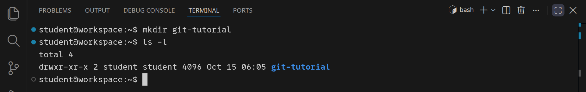

<div class='hint books'>
Falls du mehr über die Grundlagen der Kommandozeile erfahren möchtest, schau dir das <a href='/working-with-files'>Tutorial zu Dateien und Verzeichnissen</a> an.
</div>

Wechsle anschließend in das neu erstellte Verzeichnis und lege ein Verzeichnis namens `alice` für eine fiktive Person Alice an:

```bash
cd git-tutorial
mkdir alice
cd alice
```

## Alleine arbeiten

### Ein Repository anlegen

Initialisiere jetzt ein neues Git-Repository mit dem Befehl `git init`:

<!-- tutorial-screenshot
terminal-run: clear
terminal-run: cd git-tutorial
terminal-run: mkdir alice
terminal-run: cd alice
terminal-run: git init
terminal-wait-for-prompt
crop-terminal-lines: auto
-->

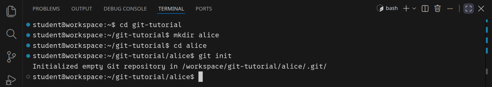

Mit dem Befehl `ls -la` kannst du sehen, dass ein verstecktes Verzeichnis namens `.git` erstellt wurde:

<!-- tutorial-screenshot
terminal-run: clear
terminal-run: ls -la
terminal-wait-for-prompt
crop-terminal-lines: auto
-->

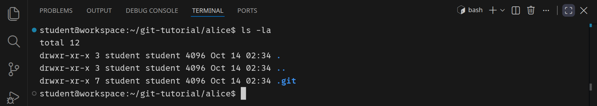

Das `.git`-Verzeichnis enthält alle Informationen, die Git benötigt, um die Versionsgeschichte deines Projekts zu verwalten. Darin befindet sich später die gesamte Historie deiner Änderungen.

<div class='hint danger'>
Das Vorhandensein eines <code>.git</code>-Verzeichnisses zeigt an, dass sich das aktuelle Verzeichnis in einem Git-Repository befindet. Wenn du ein Verzeichnis löschst, das ein <code>.git</code>-Verzeichnis enthält, verlierst du die gesamte Versionsgeschichte dieses Repositories und hast »nur noch« ein normales Verzeichnis ohne Versionskontrolle.
</div>

### Die erste Datei

Erstelle jetzt eine Datei namens `hello.txt` mit dem Befehl `echo`:

```bash
echo "Hello, world!" > hello.txt
```

Überzeuge dich mit dem Befehl `cat hello.txt`, dass die Datei den erwarteten Inhalt hat:

<!-- tutorial-screenshot
terminal-run: clear
terminal-run: echo "Hello, world!" > hello.txt
terminal-run: cat hello.txt
terminal-wait-for-prompt
crop-terminal-lines: auto
-->

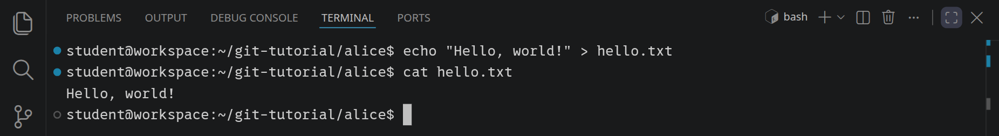

<div class='hint books'>
Der Befehl <code>echo</code> gibt den angegebenen Text im Terminal aus. Mit dem Zeichen <code>&gt;</code> leitest du die Ausgabe in eine Datei um. Wenn die Datei noch nicht existiert, wird sie erstellt. Wenn sie bereits existiert, wird ihr Inhalt überschrieben. Der Befehl <code>cat</code> zeigt den Inhalt einer Datei im Terminal an.
</div>

Verwende nun den Befehl `git status`, um den aktuellen Status des Repositories zu überprüfen:

<!-- tutorial-screenshot
terminal-run: clear
terminal-run: git status
terminal-wait-for-prompt
crop-terminal-lines: auto
-->

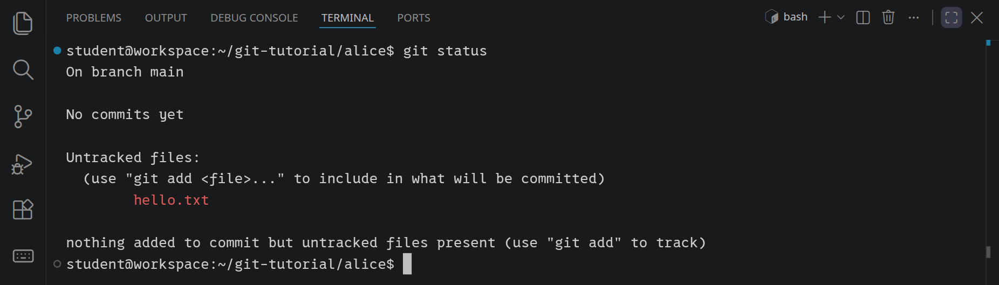

### Die Staging Area

Die Ausgabe von `git status` zeigt, dass die Datei `hello.txt` als »untracked« (nicht verfolgt) markiert ist. Das bedeutet, dass Git diese Datei noch nicht in die Versionskontrolle aufgenommen hat. Bei Git werden Änderungen nicht direkt zum Repository hinzugefügt, sondern zunächst in eine sogenannte »Staging Area« (auch »Index« genannt) kopiert. Verwende den Befehl `git add`, um die Datei zur Staging Area hinzuzufügen:

```bash
git add hello.txt
```

<div class='hint books'>
Durch <code>git add</code> sagen wir Git explizit, dass wir die Datei <code>hello.txt</code> in die nächste Commit-Änderung aufnehmen möchten. Dies gibt uns die Möglichkeit, Änderungen selektiv zu committen, anstatt alle Änderungen auf einmal zu übernehmen.
</div>

Überprüfe den Status erneut mit `git status`:

<!-- tutorial-screenshot
terminal-run: clear
terminal-run: git add hello.txt
terminal-run: git status
terminal-wait-for-prompt
crop-terminal-lines: auto
check-task-fails: erster-commit
-->

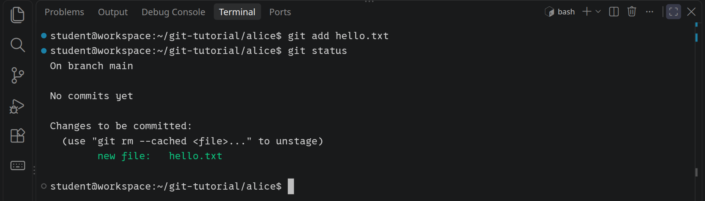

Die Ausgabe zeigt jetzt, dass die Datei `hello.txt` in der Staging Area bereitsteht, um committet zu werden.

_task(staging)

### Einen Commit erstellen

Um die Änderungen dauerhaft im Repository zu speichern, verwende den Befehl `git commit`. Füge die Option `-m` hinzu, um eine Commit-Nachricht anzugeben, die beschreibt, was du geändert hast (falls du die Nachricht weglässt, öffnet Git einen Texteditor, in dem du die Nachricht eingeben kannst):

```bash
git commit -m "initial commit"
```

Die Ausgabe zeigt, dass ein neuer Commit erstellt wurde:

<!-- tutorial-screenshot
terminal-run: clear
terminal-run: git commit -m "initial commit"
terminal-wait-for-prompt
crop-terminal-lines: auto
check-task: erster-commit
-->

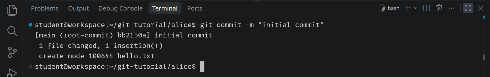

Im `.git`-Verzeichnis ist jetzt ein [gerichteter, azyklischer Graph (DAG)](https://en.wikipedia.org/wiki/Directed_acyclic_graph) entstanden, der mehrere Knoten enthält, wobei jeder Knoten durch eine eindeutige SHA-1-Hash-ID identifiziert wird. Diese Knoten repräsentieren die verschiedenen Objekte in Git: Blobs, Trees und Commits.

<!-- tutorial-screenshot
git-graph: git-tutorial/alice
-->

_include_svg(graph0.svg)

- **Blob**: Der Blob-Knoten mit der SHA1-ID `af5626b` repräsentiert den Inhalt »Hello, world!« (der Dateiname spielt dabei noch keine Rolle).
- **Tree**: Der Tree-Knoten mit der SHA1-ID `ec947e3` repräsentiert ein Verzeichnis, das die Datei `hello.txt` enthält, deren Inhalt durch den Blob `af5626b` repräsentiert wird.
- **Commit**: Der Commit-Knoten repräsentiert einen Snapshot des Repositories zu einem bestimmten Zeitpunkt. Er verweist auf den Tree `ec947e3`, der den Zustand des Verzeichnisses zum Zeitpunkt des Commits beschreibt. Der Commit enthält auch Metadaten wie den Autor, das Datum und die Commit-Nachricht.

<div class='hint info'>
Blobs und Trees haben bei dir dieselben IDs wie hier, denn ihre ID hängt nur vom Inhalt ab. Die IDs deiner Commits sind andere: In einen Commit fließen auch dein Name und die Uhrzeit ein.
</div>

Zusätzlich gibt es noch zwei Zeiger:

- **main**: Der Zeiger `main` zeigt auf den neuesten Commit im `main`-Branch.
- **HEAD**: Der Zeiger `HEAD` zeigt auf den aktuellen Branch (`main` in diesem Fall). Der daraus resultierende Commit ist der aktuelle Zustand des Repositories, also die Dateien, die sich gerade im Arbeitsverzeichnis befinden.

Die Ausgabe von `git status` zeigt außerdem an, dass wir keine lokalen Änderungen haben, die noch nicht committet wurden und unser Arbeitsverzeichnis »sauber« ist:

<!-- tutorial-screenshot
terminal-run: clear
terminal-run: git status
terminal-wait-for-prompt
crop-terminal-lines: auto
-->

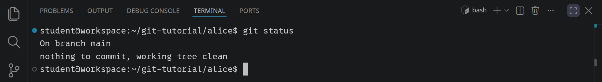

_task(erster-commit)

<div class='hint try'>
<strong>Ausprobieren:</strong> Git zeigt dir seine Objekte auch selbst.
<ul>
<li><code>git cat-file -p HEAD</code> zeigt deinen Commit so, wie Git ihn gespeichert hat. Welche ID steht hinter <code>tree</code>? Gib sie an <code>git cat-file -p</code> weiter, und danach die ID, die im Tree steht: Was kommt jeweils heraus?</li>
<li><code>git hash-object hello.txt</code> rechnet die ID einer Datei aus, ohne etwas zu speichern. Stimmt sie mit dem Blob oben überein? Dann <code>echo "Hello, World!" | git hash-object --stdin</code>, mit großem W: Wie viel von der ID ändert sich durch einen einzigen Buchstaben?</li>
</ul>
</div>

### Dateien umbenennen

Benenne die Datei `hello.txt` in `README.md` um, indem du den Befehl `git mv` verwendest:

```bash
git mv hello.txt README.md
```

<div class='hint info'>
<code>git mv</code> ist eine Abkürzung: Es benennt die Datei um wie <code>mv</code> und legt die Änderung gleich in die Staging Area. Mit <code>mv hello.txt README.md</code> und danach <code>git add -A</code> kommt genau derselbe Commit heraus. Git speichert nämlich gar keine Umbenennungen, sondern nur, welche Dateien mit welchem Inhalt es in einem Commit gibt. Dass <code>README.md</code> die alte <code>hello.txt</code> ist, erkennt Git erst beim Anzeigen am gleichen Inhalt.
</div>

Erzeuge anschließend einen neuen Commit:

```bash
git commit -m "rename hello.txt to README.md"
```

Die Ausgabe zeigt, dass ein neuer Commit erstellt wurde. Die `100%` hinter der Umbenennung sind die Ähnlichkeit, an der Git sie erkannt hat: Der Inhalt ist derselbe geblieben.

<!-- tutorial-screenshot
terminal-run: clear
terminal-run: git mv hello.txt README.md
terminal-run: git commit -m "rename hello.txt to README.md"
terminal-wait-for-prompt
crop-terminal-lines: auto
-->

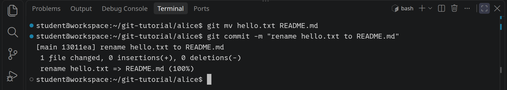 README.md (100%)«.'>

Der Git-Objektgraph sieht jetzt folgendermaßen aus:

<!-- tutorial-screenshot
git-graph: git-tutorial/alice
-->

_include_svg(graph1.svg)

Wie du siehst, sind die alten Objekte (Blob `af5626b` und Tree `ec947e3`) weiterhin vorhanden, da Git die gesamte Versionsgeschichte beibehält. Da die Datei jetzt einen neuen Namen hat, wurde ein neuer Tree-Knoten `ebfd749` erstellt, der die Datei `README.md` enthält, die auf den gleichen Blob `af5626b` verweist. Da sich der Inhalt der Datei nicht geändert hat, bleibt der Blob unverändert. Zusätzlich wurde ein neuer Commit-Knoten erstellt, der auf den neuen Tree `ebfd749` verweist und den vorherigen Commit als Vorgänger hat.

### Dateien ändern

Öffne jetzt das Verzeichnis `/workspace/git-tutorial/alice` in VS Code: Drücke <kbd>Strg</kbd><kbd>K</kbd> und dann <kbd>Strg</kbd><kbd>O</kbd>, wähle das Verzeichnis aus und klicke auf »OK«:

<!-- tutorial-screenshot
terminal-run: clear
press: Control+K
press: Control+O
wait-for-input-value: /workspace/
type: git-tutorial/alice/
wait-for-input-value: /workspace/git-tutorial/alice/
sleep: 0.5
crop-bottom: 75%
-->

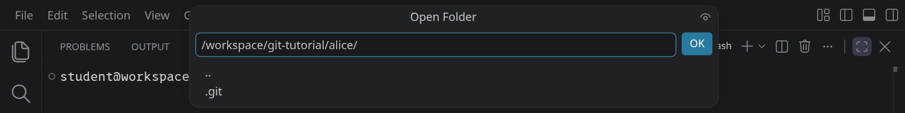

Öffne die Datei `README.md`, ändere `world` zu `planet` und füge eine neue Zeile hinzu, sodass in der Datei Folgendes steht:

```markdown
Hello, planet!

Git is awesome!
```

<!-- tutorial-screenshot
press: Enter
wait-for-text: README.md
write-file: git-tutorial/alice/README.md <- previous-code
open-file: README.md
sleep: 1
crop-bottom: 55%
-->

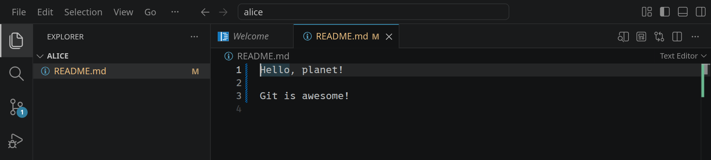

Speichere die Datei mit <kbd>Strg</kbd><kbd>S</kbd> und überprüfe den Status mit `git status` im Terminal:

<!-- tutorial-screenshot
hide-left-sidebar
terminal-open
terminal-maximize
terminal-run: clear
terminal-run: git status
terminal-wait-for-prompt
crop-terminal-lines: auto
check-task-fails: drei-commits
-->

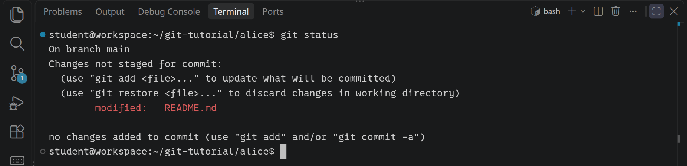

Überprüfe vor jedem Commit, welche Änderungen du vorgenommen hast, indem du den Befehl `git diff` ausführst:

<!-- tutorial-screenshot
terminal-run: clear
terminal-run: git diff
terminal-wait-for-prompt
crop-terminal-lines: auto
-->

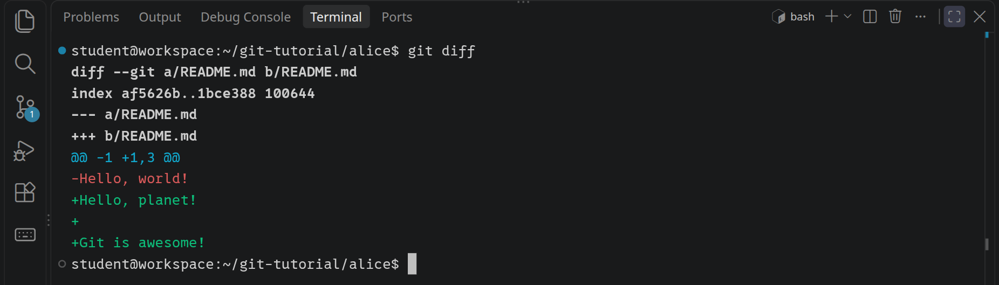

Du siehst jetzt die aktuellen Änderungen in deinem Arbeitsverzeichnis. Rote Zeilen (`–`) zeigen entfernte Zeilen an, während grüne Zeilen (`+`) hinzugefügte Zeilen darstellen.

Wenn du einen Commit erstellen möchtest, der alle Änderungen in deinem Arbeitsverzeichnis umfasst, kannst du den Befehl `git commit` mit der Option `-a` verwenden. Diese Option fügt automatisch alle geänderten und gelöschten Dateien zur Staging Area hinzu, bevor der Commit erstellt wird (du sparst dir so `git add`). Führe den folgenden Befehl aus, um die Änderungen zu committen:

```bash
git commit -a -m "updated README.md"
```

<div class='hint books'>
Die Option <code>-a</code> bei <code>git commit</code> ist praktisch, wenn du alle Änderungen in deinem Arbeitsverzeichnis auf einmal committen möchtest. Beachte jedoch, dass diese Option nur für bereits verfolgte Dateien gilt. Neue, untracked Dateien müssen weiterhin mit <code>git add</code> zur Staging Area hinzugefügt werden, bevor sie committet werden können.
</div>

Der Git-Objektgraph sieht jetzt folgendermaßen aus:

<!-- tutorial-screenshot
terminal-run: clear
terminal-run: git commit -a -m "updated README.md"
terminal-wait-for-prompt
git-graph: git-tutorial/alice
-->

_include_svg(graph2.svg)

Wie du sehen kannst, zeigen der `main`-Branch und `HEAD` jetzt auf den neuesten Commit, der die Datei `README.md` mit dem aktualisierten Inhalt enthält. Da der Inhalt verändert wurde, musste ein neuer Blob angelegt werden. Die alten Knoten bleiben weiterhin im Graphen erhalten.

_task(drei-commits)

### Zeitreise

Lass uns jetzt zu einem früheren Commit zurückkehren. Verwende den Befehl `git log`, um die Commit-Historie anzuzeigen:

<!-- tutorial-screenshot
# Three commits are 17 lines: in the default window git log would page
# them (less waits at »:«). No pager in this terminal; clear hides the line.
terminal-run: export GIT_PAGER=cat
terminal-run: clear
terminal-run: git log
terminal-wait-for-prompt
crop-terminal-lines: auto
check-task: drei-commits
-->

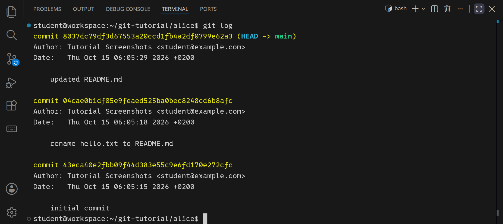

Du siehst eine Liste der Commits, beginnend mit dem neuesten Commit. Passt sie nicht ins Terminal, zeigt Git sie seitenweise, und unten steht ein Doppelpunkt: Mit den Pfeiltasten oder der Leertaste blätterst du weiter, mit <kbd>q</kbd> kommst du zurück zur Eingabe. Du siehst außerdem, dass der `main`-Branch auf den neuesten Commit zeigt und gerade ausgecheckt ist, da auch `HEAD` auf diesen Commit zeigt.

<div class='hint info'>
Was heißt »ausgecheckt«? In Git bedeutet »auschecken«, dass du den Zustand des Repositories zu einem bestimmten Commit wiederherstellst. Wenn du einen Commit auscheckst, ändert Git die Dateien in deinem Arbeitsverzeichnis so, dass sie dem Zustand entsprechen, der in diesem Commit gespeichert ist. Standardmäßig zeigt <code>HEAD</code> auf den neuesten Commit im aktuellen Branch. Wenn du jedoch einen älteren Commit auscheckst, verschiebst du <code>HEAD</code> auf diesen älteren Commit, und dein Arbeitsverzeichnis wird entsprechend aktualisiert.
</div>

_task(head-zwei)

Wir checken nun eine frühere Version des Repositories aus, nämlich die Version `HEAD~2`, also zwei Commits vor dem aktuellen `HEAD`:

```bash
git checkout HEAD~2
```

<!-- after: head-zwei -->
<!-- tutorial-screenshot
terminal-run: clear
terminal-run: git checkout HEAD~2
terminal-wait-for-prompt
crop-terminal-lines: auto
-->

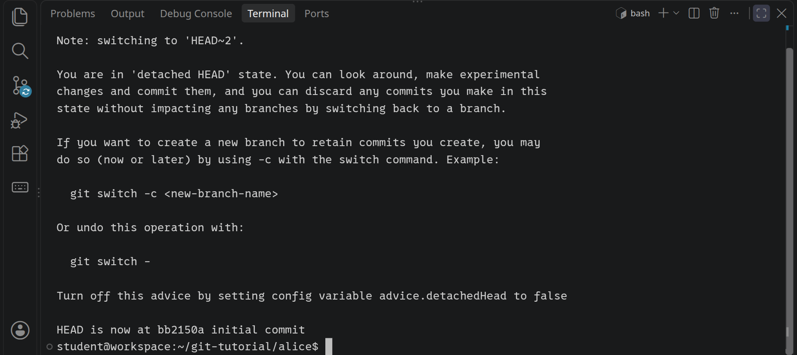

<div class='hint danger'>
Nachdem du einen älteren Commit ausgecheckt hast, befindest du dich in einem sogenannten »detached HEAD«-Zustand. In diesem Zustand zeigt <code>HEAD</code> nicht auf einen Branch, sondern direkt auf einen bestimmten Commit. Das heißt, dass es momentan keinen Branch gibt, der auf diesen Commit zeigt. Änderungen, die du in diesem Zustand vornimmst, werden daher auch nicht automatisch einem Branch zugeordnet. Wenn du später zu einem Branch zurückkehrst, gehen diese Änderungen verloren, sofern du sie nicht vorher in einem neuen Branch speicherst oder du dir die Commit-ID notierst.
</div>

Du siehst auch, dass die Datei `README.md` jetzt wieder `hello.txt` heißt und den ursprünglichen Inhalt »Hello, world!« hat:

<!-- tutorial-screenshot
terminal-run: clear
terminal-run: ls
terminal-run: cat hello.txt
terminal-wait-for-prompt
crop-terminal-lines: auto
-->

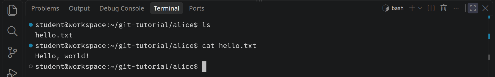
<!-- /after -->

Der Git-Objektgraph sieht jetzt folgendermaßen aus:

<!-- tutorial-screenshot
git-graph: git-tutorial/alice
-->

_include_svg(graph3.svg)

Du kannst sehen, dass der `main`-Branch unverändert bleibt und weiterhin auf den neuesten Commit zeigt. Allerdings zeigt `HEAD` jetzt auf den älteren Commit, den wir ausgecheckt haben (weshalb wir jetzt wieder den ursprünglichen Inhalt des Repositories sehen).

Um wieder zum `main`-Branch zurückzukehren, kannst du den Befehl `git checkout main` verwenden:

<!-- tutorial-screenshot
terminal-run: clear
terminal-run: git checkout main
terminal-wait-for-prompt
crop-terminal-lines: auto
-->

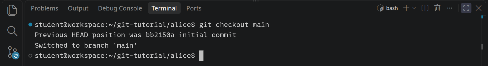

Damit sind wir wieder im neuesten Zustand des Repositories. Der Git-Objektgraph sieht jetzt wieder folgendermaßen aus:

<!-- tutorial-screenshot
git-graph: git-tutorial/alice
-->

_include_svg(graph4.svg)

## Branches

Kennst du die Situation, in der du eine neue Funktion zu deinem Projekt hinzufügen möchtest, aber nicht sicher bist, ob sie funktioniert? Mit Git kannst du einen neuen Branch erstellen, um an dieser Funktion zu arbeiten, ohne den Haupt-Branch zu beeinflussen. Wenn die Funktion fertig ist und gut funktioniert, kannst du sie wieder in den Haupt-Branch zusammenführen (mergen). Anderenfalls kannst du den Branch einfach löschen, ohne dass dein Haupt-Branch davon betroffen ist.

### Einen Branch anlegen

Wir erstellen jetzt einen neuen Branch namens `feature` und wechseln zu diesem Branch:

```bash
git branch feature
git checkout feature
```

<!-- tutorial-screenshot
terminal-run: clear
terminal-run: git branch feature
terminal-run: git checkout feature
terminal-wait-for-prompt
crop-terminal-lines: auto
-->

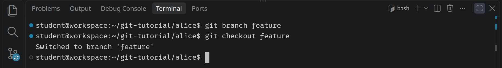

Der Git-Objektgraph sieht jetzt folgendermaßen aus:

<!-- tutorial-screenshot
git-graph: git-tutorial/alice
-->

_include_svg(graph5.svg)

Es ist also alles wie zuvor, nur dass `HEAD` jetzt auf den neuen Branch `feature` zeigt. Erstelle eine neue Datei namens `hello.c` mit folgendem Inhalt:

_include_file(hello.c, c)

Compiliere die Datei, um ein ausführbares Programm zu erhalten:

```bash
gcc -o hello hello.c
```

…und führe das Programm anschließend aus:

```bash
./hello
```

Du solltest die Meldung `Hello, World!` im Terminal sehen:

<!-- tutorial-screenshot
write-file: git-tutorial/alice/hello.c <- file:hello.c
open-file: hello.c
terminal-open
terminal-maximize
terminal-run: clear
terminal-run: gcc -o hello hello.c
terminal-run: ./hello
terminal-wait-for-prompt
crop-terminal-lines: auto
-->

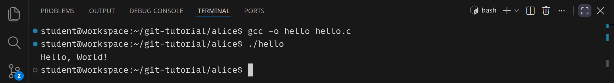

Überprüfe den Status mit `git status`:

<!-- tutorial-screenshot
terminal-run: clear
terminal-run: git status
terminal-wait-for-prompt
crop-terminal-lines: auto
-->

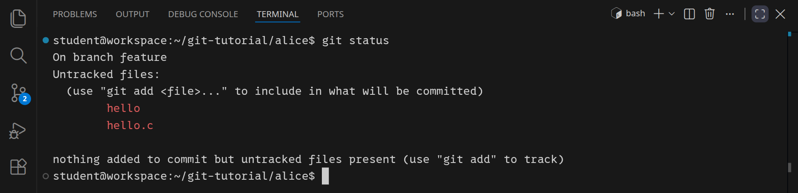

Es sind zwei neue Dateien vorhanden: `hello.c` und `hello` (die ausführbare Datei). Wir möchten nur die Quellcodedatei `hello.c` zur Versionskontrolle hinzufügen, nicht jedoch die ausführbare Datei `hello`.

_task(gitignore)

### Dateien ignorieren

<div class='hint warning'>
Es gibt bestimmte Arten von Dateien, die nicht in ein Git-Repository aufgenommen werden sollten, wie z.B. ausführbare Dateien, temporäre Dateien oder sensible Informationen wie Zugangsdaten oder API-Schlüssel. Um zu verhindern, dass solche Dateien versehentlich hinzugefügt werden, kannst du eine Datei namens <code>.gitignore</code> erstellen. In dieser Datei kannst du Muster definieren, die Git anweisen, bestimmte Dateien oder Verzeichnisse zu ignorieren. Und genau das machen wir jetzt.
</div>

Erstelle eine Datei namens `.gitignore` mit folgendem Inhalt:

```text
hello
```

<div class='hint info'>
Du kannst auch Platzhalter verwenden, um mehrere Dateien oder Verzeichnisse zu ignorieren. Zum Beispiel ignoriert <code>*.log</code> alle Dateien mit der Endung <code>.log</code>, und <code>temp/</code> ignoriert das gesamte Verzeichnis <code>temp</code>.
</div>

Speichere die Datei und überprüfe den Status erneut mit `git status`:

<!-- tutorial-screenshot
write-file: git-tutorial/alice/.gitignore <- previous-code
open-file: .gitignore
terminal-open
terminal-maximize
terminal-run: clear
terminal-run: git status
terminal-wait-for-prompt
crop-terminal-lines: auto
-->

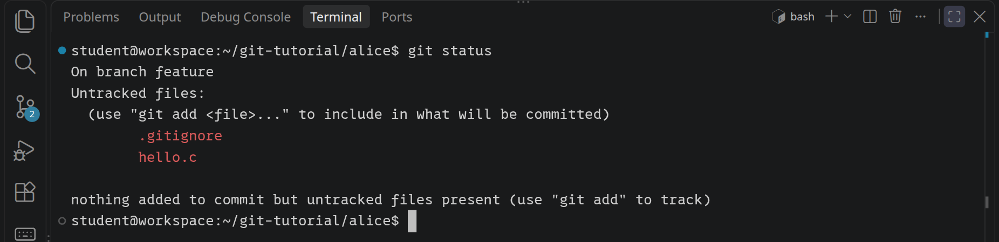

Jetzt wird nur noch die Datei `hello.c` als untracked angezeigt, während die ausführbare Datei `hello` ignoriert wird. Aber auch die Datei `.gitignore` selbst ist noch nicht zur Versionskontrolle hinzugefügt worden, was wir unbedingt nachholen sollten. Füge beide Dateien zur Staging Area hinzu:

```bash
git add .gitignore hello.c
```

Erstelle anschließend einen neuen Commit:

```bash
git commit -m "added hello.c"
```

<!-- tutorial-screenshot
terminal-run: clear
terminal-run: git add .gitignore hello.c
terminal-run: git commit -m "added hello.c"
terminal-wait-for-prompt
crop-terminal-lines: auto
-->

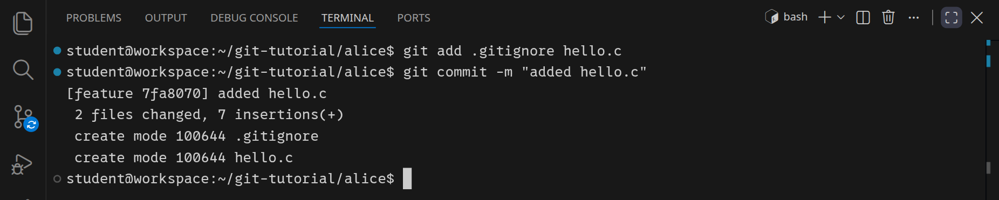

Der Git-Objektgraph sieht jetzt folgendermaßen aus:

<!-- tutorial-screenshot
git-graph: git-tutorial/alice
-->

_include_svg(graph6.svg)

Wie du sehen kannst, zeigt der `feature`-Branch jetzt auf den neuesten Commit, der die Dateien `hello.c` und `.gitignore` enthält. Der `main`-Branch bleibt unverändert und zeigt weiterhin auf den vorherigen Commit.

Wir können uns anzeigen lassen, welche Branches es gibt und auf welchen Commit sie zeigen, indem wir den Befehl `git branch` ausführen:

<!-- tutorial-screenshot
terminal-run: clear
terminal-run: git branch
terminal-wait-for-prompt
crop-terminal-lines: auto
-->

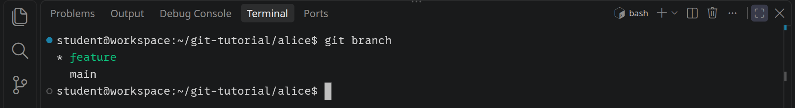

Wie du siehst, gibt es momentan zwei Branches: `main` und `feature`. Der Stern (*) zeigt an, dass wir uns gerade im `feature`-Branch befinden.

### In beiden Branches arbeiten

Wir wechseln jetzt zurück zum `main`-Branch:

```bash
git checkout main
```

Dort passen wir – unabhängig vom `feature`-Branch – die Datei `README.md` an und fügen am Ende einen Smiley hinzu:

```markdown
Hello, planet!

Git is awesome!

:)
```

<!-- tutorial-screenshot
terminal-run: clear
terminal-run: git checkout main
terminal-wait-for-prompt
write-file: git-tutorial/alice/README.md <- previous-code
open-file: README.md
hide-bottom-panel
move-mouse: selector:.monaco-editor .view-lines
sleep: 1
crop-bottom: 50%
-->

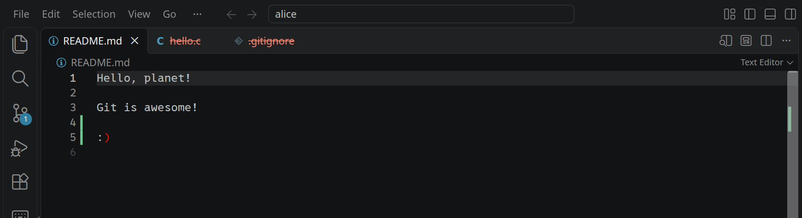

<div class='hint info'>
Wie du in der oberen Leiste sehen kannst, sind die Dateien <code>hello.c</code> und <code>.gitignore</code>, die gerade noch geöffnet waren, jetzt nicht mehr im Arbeitsverzeichnis vorhanden. Das liegt daran, dass wir zu einem anderen Branch gewechselt haben, in dem diese Dateien nicht existieren. Git passt das Arbeitsverzeichnis automatisch an den Zustand des ausgecheckten Branches an.
</div>

Es ist eine gute Angewohnheit, vor dem Committen die Änderungen mit `git diff` zu überprüfen:

<!-- tutorial-screenshot
terminal-open
terminal-maximize
terminal-run: clear
terminal-run: git diff
terminal-wait-for-prompt
crop-terminal-lines: auto
-->

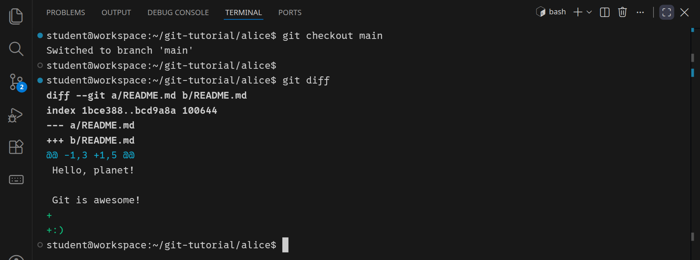

Wir erstellen jetzt einen neuen Commit:

```bash
git commit -a -m "added smiley"
```

<!-- tutorial-screenshot
terminal-run: clear
terminal-run: git commit -a -m "added smiley"
terminal-wait-for-prompt
crop-terminal-lines: auto
check-task-fails: gemergt
-->

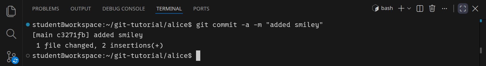

Der Git-Objektgraph sieht jetzt folgendermaßen aus:

<!-- tutorial-screenshot
git-graph: git-tutorial/alice
-->

_include_svg(graph7.svg)

<div class='hint info'>
Wir haben jetzt an beiden Branches unabhängig voneinander Änderungen vorgenommen. Der <code>main</code>-Branch enthält den neuesten Commit mit der aktualisierten <code>README.md</code>-Datei, während der <code>feature</code>-Branch den neuesten Commit mit der <code>hello.c</code>-Datei enthält.
</div>

### Branches zusammenführen

Wir könnten uns jetzt dazu entscheiden, die Änderungen aus dem `feature`-Branch zu verwerfen, indem wir den Branch einfach löschen. In diesem Fall würden die Änderungen an der Datei `hello.c` verloren gehen, da sie nur im `feature`-Branch existieren.

Wir möchten die Änderungen aus dem `feature`-Branch jedoch in den `main`-Branch übernehmen. Dazu verwenden wir den Befehl `git merge`, während wir uns im `main`-Branch befinden. Wie bei `git commit` gibst du mit `-m` die Nachricht für den Merge-Commit an; ohne `-m` öffnet Git dafür einen Editor:

```bash
git merge feature -m "merged feature into main"
```

<!-- tutorial-screenshot
terminal-run: clear
terminal-run: git merge feature -m "merged feature into main"
terminal-wait-for-prompt
crop-terminal-lines: auto
check-task: gemergt
-->

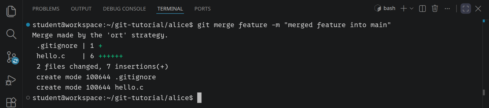

<div class='hint warning'>
Beim Mergen ist es wichtig, dass du dich im Ziel-Branch befindest, also in dem Branch, in den du die Änderungen übernehmen möchtest. In diesem Fall möchten wir die Änderungen aus dem <code>feature</code>-Branch in den <code>main</code>-Branch übernehmen, also müssen wir uns zuerst im <code>main</code>-Branch befinden, bevor wir den Merge-Befehl ausführen.
</div>

Der Git-Objektgraph sieht jetzt folgendermaßen aus:

<!-- tutorial-screenshot
git-graph: git-tutorial/alice
-->

_include_svg(graph8.svg)

Wie du sehen kannst, wurde ein neuer Merge-Commit erstellt, der zwei Vorgänger hat: den vormals neuesten Commit im `main`-Branch und den neuesten Commit im `feature`-Branch. Der Merge-Commit kombiniert die Änderungen aus beiden Branches.

Der `main`-Branch zeigt jetzt auf das aktuelle, vollständige Projekt und wir können den Feature-Branch löschen, da wir ihn nicht mehr benötigen:

```bash
git branch -d feature
```

<!-- tutorial-screenshot
terminal-run: clear
terminal-run: git branch -d feature
terminal-wait-for-prompt
crop-terminal-lines: auto
-->

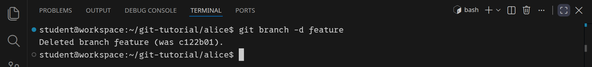

Der Git-Objektgraph sieht jetzt folgendermaßen aus:

<!-- tutorial-screenshot
git-graph: git-tutorial/alice
-->

_include_svg(graph9.svg)

Obwohl es nun keinen `feature`-Branch mehr gibt, sieht man immer noch Spuren davon im Graphen, da es Verzweigungen und Zusammenführungen in der Versionsgeschichte gibt. Der Vorteil des Feature-Branches war, dass wir isoliert an einer neuen Funktion arbeiten konnten, ohne den Haupt-Branch zu beeinflussen. Nachdem die Funktion fertig war, konnten wir sie problemlos in den Haupt-Branch integrieren.

_task(gemergt)

<div class='hint books'>
Wenn es dir wichtig ist, dass dein <code>main</code>-Branch stabil bleibt, solltest du den <code>feature</code>-Branch nicht ungeprüft in den <code>main</code>-Branch mergen. Hole vorher alle Änderungen aus dem <code>main</code>-Branch in deinen <code>feature</code>-Branch, teste alles gründlich und führe erst dann den Merge durch.
</div>

## Etwas Luxus im Terminal

Um die Arbeit im Terminal etwas zu vereinfachen, können wir zweierlei tun:

1. Bash-Completion für Git aktivieren
2. Einen Git-Prompt einrichten

Um den Git-Prompt zu installieren, klone das Repository `bash-git-prompt` in dein Home-Verzeichnis:

```bash_copy
git clone https://github.com/magicmonty/bash-git-prompt.git ~/.bash-git-prompt --depth=1
```

Öffne anschließend die Datei `/workspace/.bashrc` in VS Code und füge am Ende der Datei folgende Zeilen hinzu:

<!-- screenshot-code: bashrc -->
```bash_copy
# enable Bash completion for Git
source /usr/share/bash-completion/completions/git

# enable Git prompt
if [ -f "$HOME/.bash-git-prompt/gitprompt.sh" ]; then
    GIT_PROMPT_ONLY_IN_REPO=1
    GIT_PROMPT_VIRTUALENV=""
    source "$HOME/.bash-git-prompt/gitprompt.sh"
fi
```

Speichere die Datei und lade die Änderungen mit folgendem Befehl neu:

```bash
source ~/.bashrc
```

Jetzt hast du einen speziellen Git-Prompt, wenn du in einem Git-Repository arbeitest. Dieser Prompt zeigt dir immer den aktuellen Branch und den Status des Repositories an:

<!-- tutorial-screenshot
terminal-run: clear
terminal-run: git clone https://github.com/magicmonty/bash-git-prompt.git ~/.bash-git-prompt --depth=1
terminal-wait-for-prompt
write-file: .bashrc-git-prompt <- previous-code (bashrc)
terminal-run: cat ~/.bashrc-git-prompt >> ~/.bashrc && rm ~/.bashrc-git-prompt
terminal-wait-for-prompt
terminal-run: clear
terminal-run: source ~/.bashrc
terminal-wait-for-prompt
crop-terminal-lines: auto
-->

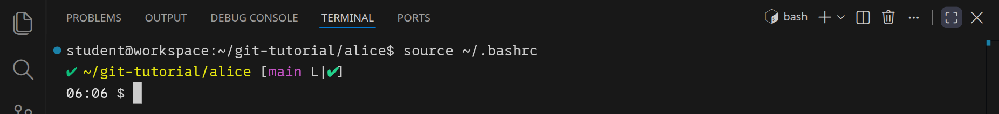

Links steht, ob der letzte Befehl geklappt hat (`✔`), dann das Verzeichnis und in eckigen Klammern der Branch und der Zustand: `✔` heißt, es gibt nichts zu committen. Darunter folgen die Uhrzeit und das `$`, hinter dem du tippst.

## Gemeinsam arbeiten

### Ein Remote anlegen

In einem echten Projekt arbeitest du wahrscheinlich nicht alleine, sondern im Team. Damit mehrere Personen an demselben Repository arbeiten können, verwenden wir sogenannte »Remotes«. Ein Remote ist eine Kopie deines Repositories, die an einer anderen Stelle – also normalerweise auf einem anderen Computer oder Server – gespeichert ist.

In diesem Tutorial werden wir jedoch anstelle eines Servers einfach ein lokales Verzeichnis verwenden, um das Konzept der Remotes zu demonstrieren – die Handhabung ist in beiden Fällen identisch.

Zuerst legen wir ein neues Verzeichnis namens `remote-repo` an, das unser Remote-Repository darstellen soll:

```bash
cd ~/git-tutorial
mkdir remote-repo
cd remote-repo
```

In diesem Verzeichnis initialisieren wir ein neues, leeres Git-Repository:

```bash
git init --bare
```

Im Terminal sollte jetzt Folgendes zu sehen sein:

<!-- tutorial-screenshot
terminal-run: clear
terminal-run: cd ~/git-tutorial
terminal-run: mkdir remote-repo
terminal-run: cd remote-repo
terminal-run: git init --bare
terminal-wait-for-prompt
crop-terminal-lines: auto
-->

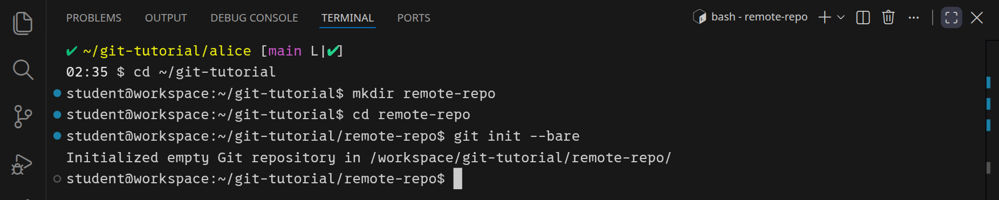

<div class='hint info'>
Ein »bare«-Repository ist ein spezieller Typ von Git-Repository, das kein Arbeitsverzeichnis enthält. Es wird hauptsächlich als zentrales Repository verwendet, auf das mehrere Entwickler zugreifen können, um ihre Änderungen zu pushen und zu pullen. In einem bare-Repository gibt es keine ausgecheckten Dateien, sondern nur die Git-Objekte und Metadaten.
</div>

Mit dem Befehl `ls -l` kannst du sehen, dass in diesem Verzeichnis die üblichen Git-Ordner und -Dateien vorhanden sind, die sonst im <code>.git</code>-Verzeichnis eines normalen Repositories zu finden sind:

<!-- tutorial-screenshot
terminal-run: clear
terminal-run: ls -l
terminal-wait-for-prompt
crop-terminal-lines: auto
-->

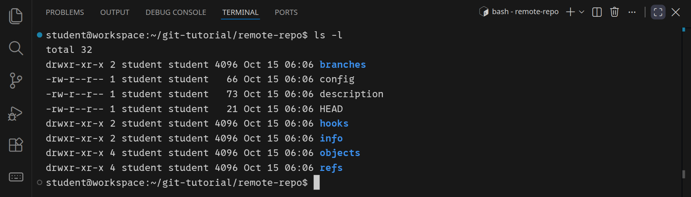

Wir wechseln jetzt zurück in das Verzeichnis von Alice, um unser Remote-Repository zu verknüpfen:

```bash
cd ~/git-tutorial/alice
git remote add origin ../remote-repo
```

Der Befehl bewirkt nur, dass das Remote-Repository verknüpft wird, es gibt keine Ausgabe im Terminal. Ein Blick in die Datei `.git/config` (`cat .git/config`) zeigt jedoch, dass das Remote-Repository jetzt konfiguriert ist:

<!-- tutorial-screenshot
terminal-run: clear
terminal-run: cd ~/git-tutorial/alice
terminal-run: git remote add origin ../remote-repo
terminal-run: cat .git/config
terminal-wait-for-prompt
crop-terminal-lines: auto
check-task-fails: gepusht
-->

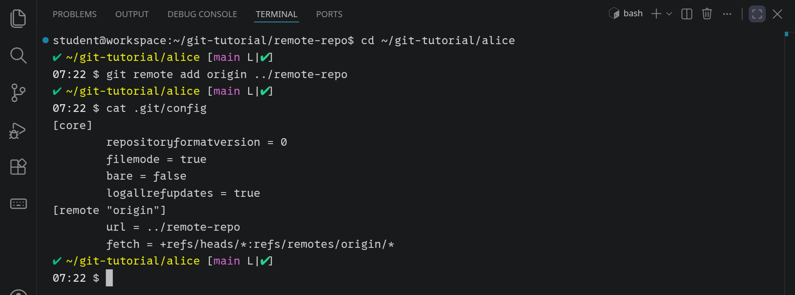

<div class='hint info'>
Der Befehl <code>git remote add</code> fügt ein neues Remote-Repository hinzu. In diesem Fall nennen wir das Remote <code>origin</code>, was der Standardname für das Haupt-Remote ist (wir könnten aber auch jeden anderen Namen wählen). Der Pfad <code>../remote-repo</code> gibt den Speicherort des Remote-Repositories an. In einem echten Szenario würde hier normalerweise eine URL zu einem entfernten Server stehen, die z. B. mit <code>https://</code> oder <code>git@</code> beginnt.
</div>

Jetzt können wir unsere Änderungen an das Remote-Repository pushen. Verwende den folgenden Befehl, um den `main`-Branch zum ersten Mal zu pushen:

```bash
git push -u origin main
```

<!-- tutorial-screenshot
terminal-run: clear
terminal-run: git push -u origin main
terminal-wait-for-prompt
crop-terminal-lines: auto
check-task: gepusht
-->

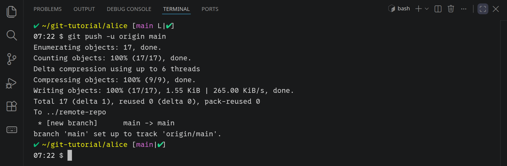

Die Option `-u` (oder `--set-upstream`) richtet eine Tracking-Verbindung zwischen dem lokalen `main`-Branch und dem Remote-Branch `origin/main` ein. Dadurch kannst du in Zukunft einfach `git push` oder `git pull` ausführen, ohne den Remote-Namen und den Branch-Namen angeben zu müssen (ansonsten müsstest du immer `git push origin main` schreiben).

_task(gepusht)

### Bob klont das Repository

Um zu demonstrieren, wie mehrere Personen an demselben Repository arbeiten können, erstellen wir jetzt ein neues Verzeichnis für eine fiktive Person namens Bob:

```bash
cd ~/git-tutorial
mkdir bob
cd bob
```

Bob kann jetzt das Remote-Repository klonen, das wir zuvor erstellt haben:

```bash
git clone ../remote-repo
```

Das Repository wird in ein neues Verzeichnis namens `remote-repo` geklont. Wechsle in dieses Verzeichnis:

```bash
cd remote-repo
```

<!-- tutorial-screenshot
terminal-run: clear
terminal-run: cd ~/git-tutorial
terminal-run: mkdir bob
terminal-run: cd bob
terminal-run: git clone ../remote-repo
terminal-run: cd remote-repo
terminal-wait-for-prompt
crop-terminal-lines: auto
-->

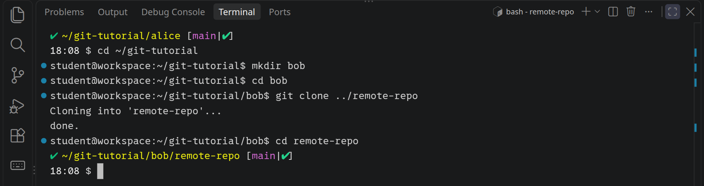

Bob hat jetzt eine vollständige Kopie des Repositories, einschließlich der gesamten Versionsgeschichte. Öffne die Datei `README.md` mit dem Editor `nano` und ergänze die letzte Zeile, sodass dort `:) (Bob was here)` steht:

```bash
nano README.md
```

<!-- tutorial-screenshot
terminal-run: clear
terminal-run: nano README.md
wait-for-text: GNU nano
press: ArrowDown
press: ArrowDown
press: ArrowDown
press: ArrowDown
press: End
press: Space
type: (Bob was here)
sleep: 0.5
crop-terminal-lines: 99
-->

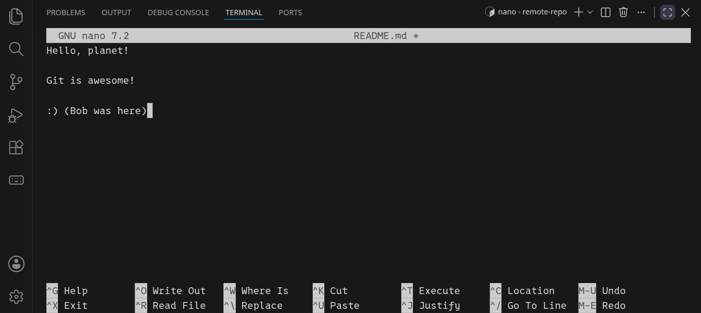

Speichere die Datei mit <kbd>Strg</kbd><kbd>O</kbd> und <kbd>Enter</kbd> und schließe den Editor mit <kbd>Strg</kbd><kbd>X</kbd>. Mit `git diff` kann Bob seine Änderungen überprüfen:

<!-- tutorial-screenshot
press: Control+O
wait-for-text: File Name to Write
press: Enter
wait-for-text: Wrote
press: Control+X
terminal-wait-for-prompt
terminal-run: clear
terminal-run: git diff
terminal-wait-for-prompt
crop-terminal-lines: auto
-->

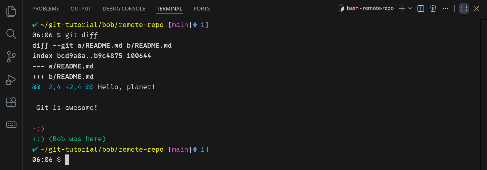

Wir haben nun drei Möglichkeiten, wie Bob seine Änderungen committen kann:

1. `git add README.md` und `git commit -m "Bob was here"`
2. `git commit -a -m "Bob was here"`
3. `git commit -a` – bei dieser Variante öffnet sich ein Texteditor, in dem Bob seine Commit-Nachricht eingeben kann.

<!-- tutorial-screenshot
terminal-run: clear
terminal-run: git commit -a -m "Bob was here"
terminal-wait-for-prompt
crop-terminal-lines: auto
check-task-fails: bob
-->

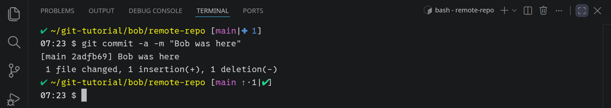

<div class='hint info'>
Achtung: Die Änderungen liegen immer noch komplett bei Bob lokal vor. Der Objektgraph in Bobs Repository ist gewachsen, aber das Remote-Repository hat davon noch nichts mitbekommen.
</div>

Um die Änderungen an das Remote-Repository zu senden, verwendet Bob den Befehl `git push`:

<!-- tutorial-screenshot
terminal-run: clear
terminal-run: git push
terminal-wait-for-prompt
crop-terminal-lines: auto
check-task: bob
-->

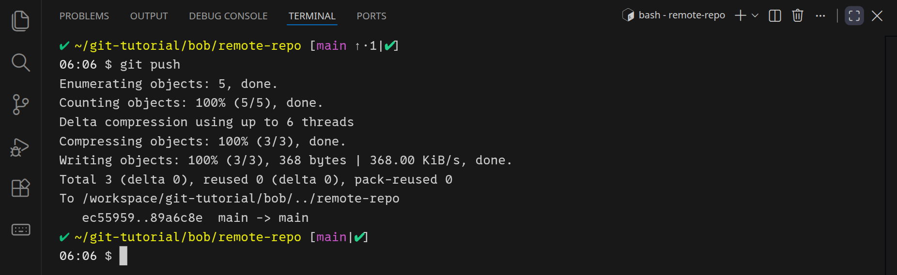

### Alice holt Bobs Änderung

Wechsle nun wieder in das Verzeichnis von Alice:

```bash
cd ~/git-tutorial/alice
```

Mit dem Befehl `git pull` kann Alice die Änderungen von Bob in ihr lokales Repository holen und mit ihrem aktuellen Stand zusammenführen:

<!-- tutorial-screenshot
terminal-run: clear
terminal-run: cd ~/git-tutorial/alice
terminal-run: git pull
terminal-wait-for-prompt
crop-terminal-lines: auto
-->


Alice sieht mit `cat README.md`, dass die Datei aktualisiert wurde und jetzt auch Bobs Änderung enthält:

<!-- tutorial-screenshot
terminal-run: clear
terminal-run: cat README.md
terminal-wait-for-prompt
crop-terminal-lines: auto
-->

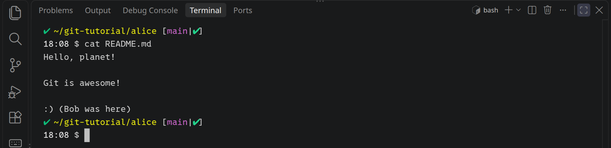

### Merge-Konflikte

Wenn Alice und Bob gleichzeitig an derselben Datei arbeiten und ihre Änderungen nicht kompatibel sind, entsteht ein Merge-Konflikt. Um dies zu demonstrieren, ändern wir die Datei `README.md` sowohl bei Alice als auch bei Bob.

Alice ändert die Datei `README.md`:

```bash
echo "HEYYYY" >> README.md
```

<div class='hint warning'>
Vorhin haben wir <code>&gt;</code> verwendet, um eine Ausgabe in eine Datei umzuleiten. Das <code>&gt;&gt;</code> fügt die Ausgabe am Ende der Datei hinzu, anstatt den Inhalt zu überschreiben. Achte also darauf, dass du <code>&gt;&gt;</code> verwendest, um die Zeile hinzuzufügen, ohne den bestehenden Inhalt zu löschen.
</div>

Überprüfe die Änderungen mit `cat` und `git diff`:

<!-- tutorial-screenshot
terminal-run: clear
terminal-run: echo "HEYYYY" >> README.md
terminal-run: cat README.md
terminal-run: git diff
terminal-wait-for-prompt
crop-terminal-lines: auto
-->

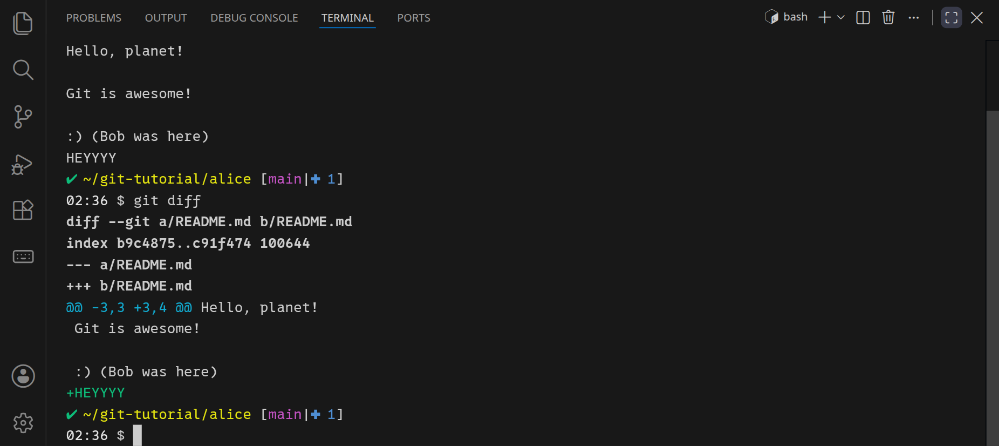

Alice committet ihre Änderungen und pusht sie zum Remote-Repository:

```bash
git commit -a -m "HEYYYY"
git push
```

<!-- tutorial-screenshot
terminal-run: clear
terminal-run: git commit -a -m "HEYYYY"
terminal-run: git push
terminal-wait-for-prompt
crop-terminal-lines: auto
-->

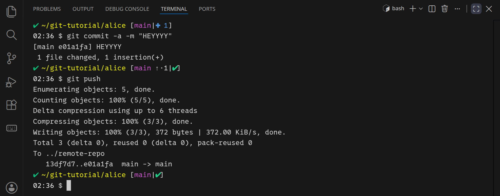

Wechsle jetzt in Bobs Verzeichnis:

```bash
cd ~/git-tutorial/bob/remote-repo
```

Bob ändert ebenfalls die Datei `README.md`:

```bash
echo "HOLAAA" >> README.md
```

Er überprüft seine Änderungen mit `git diff` und committet sie:

```bash
git diff
git commit -a -m "HOLAAA"
```

<!-- tutorial-screenshot
terminal-run: clear
terminal-run: cd ~/git-tutorial/bob/remote-repo
terminal-run: echo "HOLAAA" >> README.md
terminal-run: git diff
terminal-run: git commit -a -m "HOLAAA"
terminal-wait-for-prompt
crop-terminal-lines: auto
-->

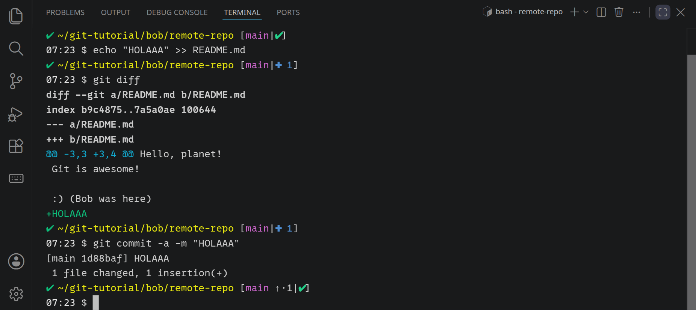

Wenn Bob jetzt versucht, seine Änderungen zu pushen, erhält er eine Fehlermeldung, da Alice bereits Änderungen gepusht hat, die Bob noch nicht in seinem lokalen Repository hat:

<!-- tutorial-screenshot
terminal-run: clear
terminal-run: git push
terminal-wait-for-prompt
crop-terminal-lines: auto
-->

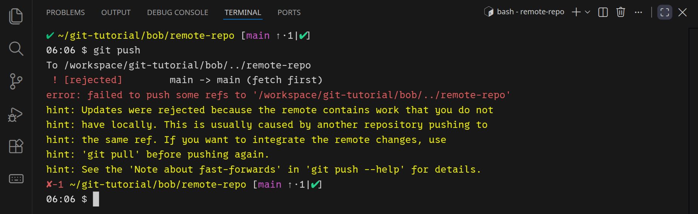

Um die Änderungen von Alice zu holen und mit seinen eigenen zusammenzuführen, führt Bob den Befehl `git pull` aus:

<!-- tutorial-screenshot
terminal-run: clear
terminal-run: git pull
terminal-wait-for-prompt
crop-terminal-lines: auto
-->

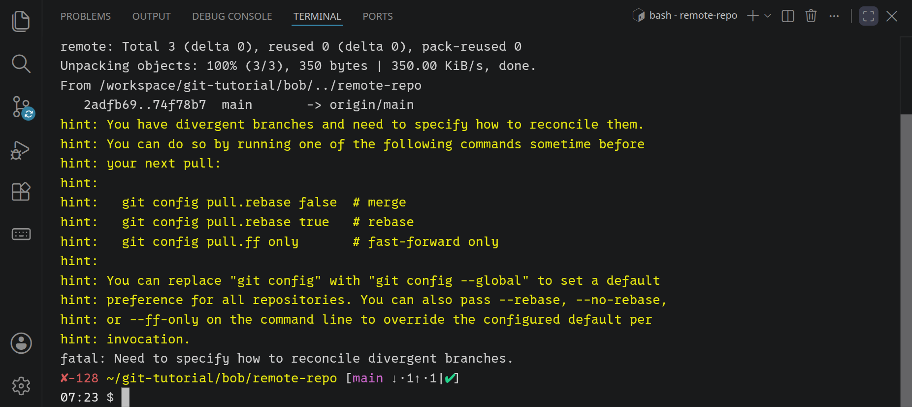

Auch hier erhält Bob eine Fehlermeldung: Sein Branch und der von Alice haben sich auseinanderentwickelt (»divergent branches«), weil beide gleichzeitig an derselben Datei gearbeitet haben. Git möchte wissen, wie es die beiden Stände in Zukunft zusammenführen soll, und bietet drei Strategien an, von denen wir eine als Voreinstellung für unser lokales Repository wählen sollen:

1. `git config pull.rebase false` – Standard-Merge-Strategie
2. `git config pull.rebase true` – Rebase-Strategie
3. `git config pull.ff only` – Nur Fast-Forward-Merges

<div class='hint info'>
Welche Strategie du wählst, hängt von deinem Workflow und deinen Präferenzen ab. Die Standard-Merge-Strategie ist einfach zu verstehen und zu verwenden, während die Rebase-Strategie eine sauberere Historie erzeugt. Die Fast-Forward-Strategie ist nützlich, wenn du eine lineare Historie bevorzugst und keine Merge-Commits erstellen möchtest.
</div>

Bob entscheidet sich für die Standard-Merge-Strategie und führt die folgenden Befehle aus:

```bash
git config pull.rebase false
git pull
```

<!-- tutorial-screenshot
terminal-run: clear
terminal-run: git config pull.rebase false
terminal-run: git pull
terminal-wait-for-prompt
crop-terminal-lines: auto
-->

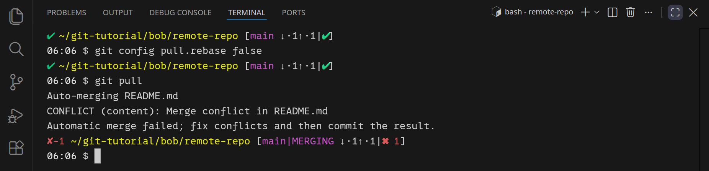

Wir sehen, dass Git den Merge-Konflikt in der Datei `README.md` markiert hat. Bob muss die Datei jetzt manuell bearbeiten, um den Konflikt zu lösen. Öffne die Datei `README.md` in einem Texteditor (`nano README.md`):

<!-- tutorial-screenshot
terminal-run: clear
terminal-run: nano README.md
wait-for-text: GNU nano
sleep: 0.5
crop-terminal-lines: 99
-->

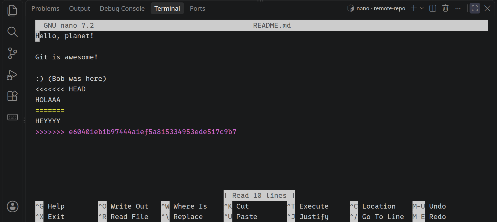

_task(konflikt)

Hier siehst du die Konfliktmarkierungen:

```text
<<<<<<< HEAD
HOLAAA
=======
HEYYYY
>>>>>>> ef91739…
```

Die Markierungen `<<<<<<<`, `=======` und `>>>>>>>` zeigen die Bereiche an, in denen der Konflikt aufgetreten ist. Der obere Abschnitt enthält Bobs lokale Änderungen, während der untere Abschnitt die Änderungen des Remote-Repository (also Alices Änderungen) enthält. Hinter `>>>>>>>` steht die ID von Alices Commit.

Bob muss sich jetzt entscheiden, wie er den Konflikt lösen möchte. Er könnte zum Beispiel beide Änderungen durch eine dritte ersetzen und die drei Markierungszeilen löschen, sodass in der Datei Folgendes steht:

```markdown
Hello, planet!

Git is awesome!

:) (Bob was here)
BONJOUR!
```

<div class='hint'>
Ganze Zeilen löschst du in <code>nano</code> am einfachsten mit <kbd>Entf</kbd> oder der Rücktaste. Die Tastenkombination <kbd>Strg</kbd><kbd>K</kbd>, mit der <code>nano</code> sonst eine Zeile ausschneidet, fängt im Workspace Visual Studio Code ab. Du kannst die Datei auch im Editor von Visual Studio Code öffnen und dort bearbeiten.
</div>

<!-- tutorial-screenshot
press: Control+X
terminal-wait-for-prompt
write-file: git-tutorial/bob/remote-repo/README.md <- previous-code
terminal-run: clear
terminal-run: nano README.md
wait-for-text: GNU nano
sleep: 0.5
crop-terminal-lines: 99
-->

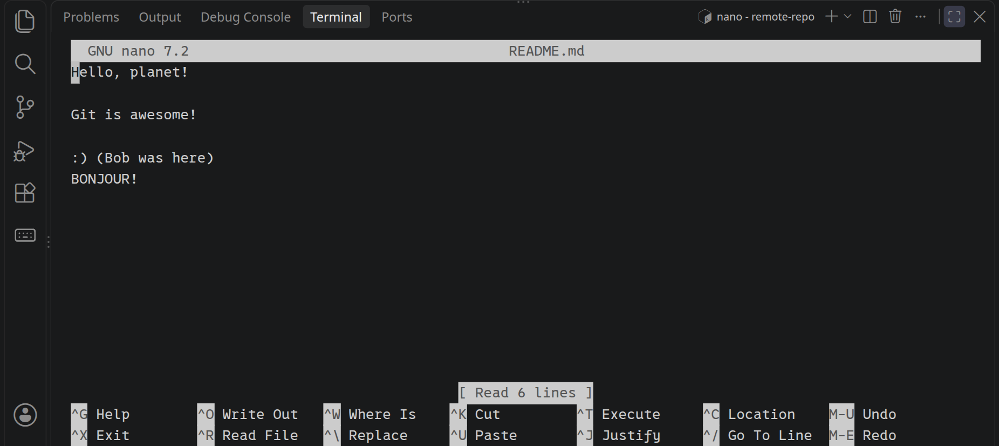

Speichere die Datei und beende den Editor. Bob muss den Konflikt nun als gelöst markieren, indem er die Datei mit `git add` zur Staging Area hinzufügt. Anschließend kann er den Merge-Commit, der durch den Pull-Vorgang erstellt wurde und zunächst aufgrund des Konflikts unvollständig war, abschließen und danach seine Änderungen pushen:

```bash
git add README.md
git commit -m "fixed merge conflict"
git push
```

<!-- tutorial-screenshot
press: Control+X
terminal-wait-for-prompt
terminal-run: clear
terminal-run: git add README.md
terminal-run: git commit -m "fixed merge conflict"
terminal-run: git push
terminal-wait-for-prompt
crop-terminal-lines: auto
-->

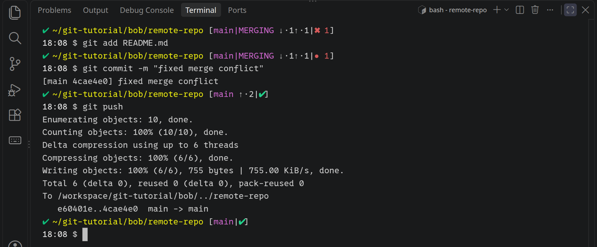

Alice hat von dem Merge-Konflikt nichts mitbekommen, da Bob den Konflikt lokal gelöst hat, bevor er seine Änderungen gepusht hat. Wenn Alice jetzt ihre Änderungen mit `git pull` holt, erhält sie die von Bob aktualisierte Datei `README.md`.

_task(bob)

<!-- tutorial-screenshot
terminal-run: clear
terminal-run: cd ~/git-tutorial/alice
terminal-run: git pull
terminal-wait-for-prompt
crop-terminal-lines: auto
-->

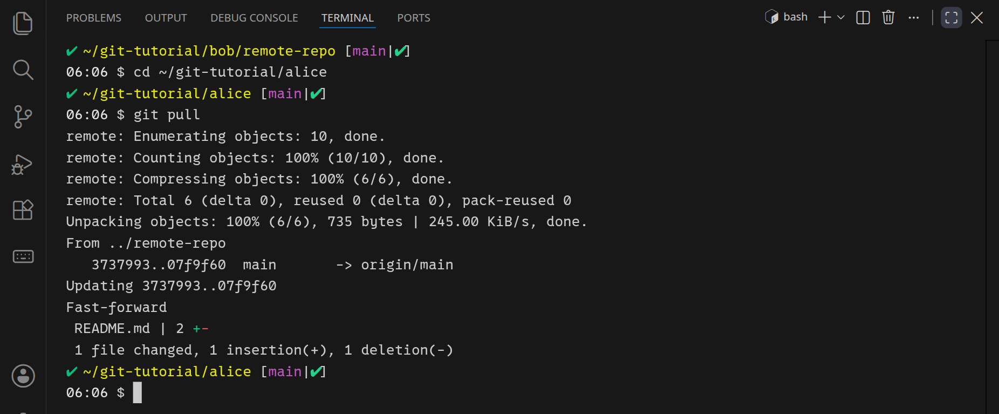

## Nützlich für später

### Tags

Tags sind eine Möglichkeit, bestimmte Punkte in der Versionsgeschichte zu markieren, z.B. für Releases oder wichtige Meilensteine. Wir erstellen jetzt einen Tag namens `v1.0` für den aktuellen Commit im `main`-Branch:

```bash
git tag -a v1.0 -m "v1.0 release"
```

<div class='hint info'>
Der Befehl <code>git tag -a</code> erstellt einen annotierten Tag. Annotierte Tags enthalten zusätzliche Informationen wie den Tag-Namen, die Commit-ID, den Autor und eine Nachricht. Dies ist nützlich, um wichtige Punkte in der Versionsgeschichte zu markieren.
</div>

Mit `git log --oneline --graph` siehst du die ganze Geschichte auf einen Blick, mit dem Tag und den Verzweigungen, die Alice und Bob hinterlassen haben:

<!-- tutorial-screenshot
terminal-run: clear
terminal-run: git tag -a v1.0 -m "v1.0 release"
terminal-run: clear
terminal-run: git log --oneline --graph
terminal-wait-for-prompt
crop-terminal-lines: auto
-->

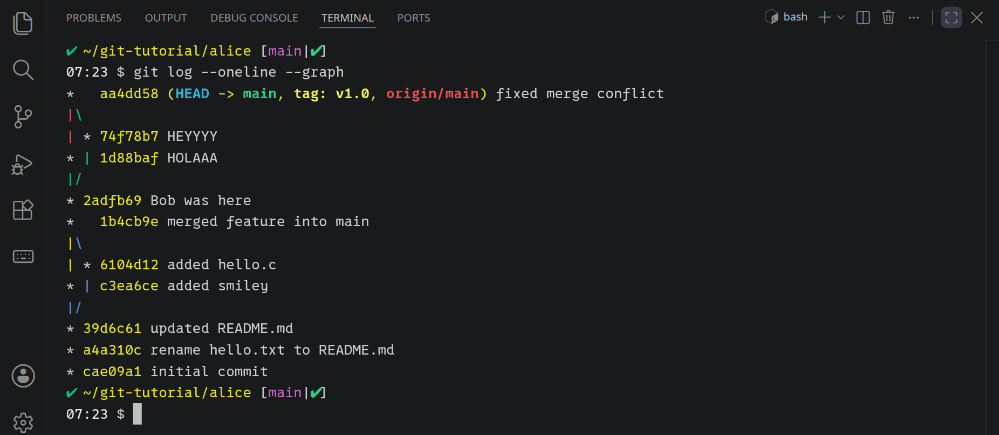

_task(tags)

So können wir später leicht zu diesem Punkt in der Geschichte zurückkehren, wenn wir z.B. ein Release erstellen möchten. Um Tags zu pushen, verwenden wir den Befehl `git push` mit dem Tag-Namen:

```bash
git push origin v1.0
```

…oder um alle Tags auf einmal zu pushen:

```bash
git push origin --tags
```

<div class='hint books'>
Branches werden beim Push normal mit übertragen, Tags aber nicht automatisch — deshalb muss man sie extra pushen.
</div>

### Zu einem Stand springen

Um zu einem bestimmten Branch oder Tag zurückzukehren, verwenden wir den Befehl `git checkout`. Du kannst also z. B. folgende Befehle verwenden:

- `git checkout main` – wechselt zum `main`-Branch
- `git checkout v1.0` – wechselt zum Tag `v1.0`
- `git checkout HEAD~2` – wechselt zu dem Commit, der zwei Commits vor dem aktuellen `HEAD` liegt

<div class='hint warning'>
Beachte, dass das Auschecken eines Tags oder eines älteren Commits dazu führt,
dass du dich in einem »detached HEAD«-Zustand befindest. In diesem Zustand kannst du keine neuen Commits zu einem Branch hinzufügen, da <code>HEAD</code> nicht auf einen Branch zeigt. Wenn du Änderungen vornehmen möchtest, solltest du stattdessen von dieser Stelle aus einen neuen Branch erstellen.
</div>

### Fehler rückgängig machen

Manchmal möchtest du vielleicht Änderungen an Dateien rückgängig machen. Welcher Befehl passt, hängt davon ab, wie weit die Änderung schon gekommen ist:

<table class='table table-sm'>
<tr><th>Die Änderung ist …</th><th>Befehl</th><th>Was passiert</th></tr>
<tr><td>nur im Arbeitsverzeichnis</td><td><code>git restore README.md</code></td><td>Die Datei ist wieder auf dem Stand des letzten Commits. Die Änderung ist weg.</td></tr>
<tr><td>mit <code>git add</code> bereitgelegt</td><td><code>git restore --staged README.md</code></td><td>Die Änderung kommt aus der Staging Area zurück ins Arbeitsverzeichnis; verloren geht nichts. Danach geht es weiter wie in der Zeile darüber.</td></tr>
<tr><td>schon committet</td><td><code>git revert HEAD</code></td><td>Ein neuer Commit hebt den letzten auf.</td></tr>
</table>

<div class='hint warning'>
Denke daran, dass Knoten im Git-Objektgraphen niemals gelöscht werden. Selbst wenn du einen Commit rückgängig machst, bleibt der ursprüngliche Commit weiterhin in der Versionsgeschichte erhalten – es wird nur ein neuer Commit erstellt, der die Änderungen des ursprünglichen Commits aufhebt.
</div>

_task(rueckgaengig)

<div class='hint try'>
<strong>Ausprobieren:</strong> Probier die Tabelle in <code>alice</code> aus, an einer Änderung, die du nicht brauchst. Sieh vorher mit <code>git status</code> nach, dass <code>README.md</code> dort nicht als geändert auftaucht, sonst verwirfst du am Ende mehr als nur den Versuch. Häng mit <code>echo "Eins" &gt;&gt; README.md</code> eine Zeile an (<code>&gt;&gt;</code> hängt an, statt zu überschreiben), lege sie mit <code>git add README.md</code> bereit und häng mit <code>echo "Zwei" &gt;&gt; README.md</code> noch eine an. Wie oft steht <code>README.md</code> jetzt in <code>git status</code>? Was zeigt <code>git diff</code>, und was <code>git diff --staged</code>? Mach danach beides rückgängig, mit den Befehlen aus der Tabelle, und sieh nach jedem Schritt mit <code>git status</code> und <code>cat README.md</code> nach, wo die beiden Zeilen gerade sind.
</div>

## Zusammenfassung

<table class='table table-sm'>
<tr><th>Alleine</th><td><code>git init</code>, <code>git status</code>, <code>git add</code>, <code>git commit -m</code>, <code>git commit -a</code>, <code>git mv</code>, <code>git diff</code>, <code>git log</code></td></tr>
<tr><th>Zeitreise</th><td><code>git checkout HEAD~2</code>, <code>git checkout main</code>, <code>git restore</code>, <code>git revert</code></td></tr>
<tr><th>Branches</th><td><code>git branch</code>, <code>git checkout</code>, <code>git merge</code>, <code>git branch -d</code>, <code>.gitignore</code></td></tr>
<tr><th>Gemeinsam</th><td><code>git init --bare</code>, <code>git remote add</code>, <code>git push -u</code>, <code>git clone</code>, <code>git pull</code>, <code>git config pull.rebase false</code></td></tr>
<tr><th>Markieren</th><td><code>git tag -a</code>, <code>git push origin --tags</code></td></tr>
</table>

Mit diesem Wissen kannst du Git für deine eigenen Projekte nutzen. Zum Nachschlagen stehen diese Befehle und ein paar weitere im Handbuch unter [Git: Versionen verwalten](/reference/git). Wie du mit einem Git-Server wie GitLab, Gitea oder GitHub arbeitest, steht im Handbuch unter [Git-Server: Zugang und Veröffentlichen](/reference/gitlab).

<div class='book'>
<i class='bi bi-book'></i>
<p><strong>Pro Git</strong>, Scott Chacon und Ben Straub, Apress, 2. Auflage 2014. Alles, was hier fehlt: Rebase, Git auf einem Server, die Arbeit mit GitHub und wie Git seine Commits intern speichert. Frei lesbar, auch auf Deutsch: <a href='https://git-scm.com/book/de/v2'>auf git-scm.com</a>.</p>
</div>
