<div class='meta'>
image: im-schwamm.webp
image_alt: "Ein dunkler, schief gekippter Gang aus Stein mit Löchern in vielen Größen, in den aus der Ferne kaltes Licht fällt"
kind: projekt
language: GLSL
duration: 4 Doppelstunden
reference: [glsl, prozedurale-texturen, workspace]
template: https://github.com/specht/glsl-starter.git
template_name: des GLSL-Starters
</div>

<div
    class="autotoc-secondary-trigger"
    data-title="Auf dieser Seite"
    data-levels="h2,h3">
</div>

# Shader in GLSL

<p class='abstract'>
Ein Shader ist ein kleines Programm, das die Grafikkarte für jeden Pixel gleichzeitig ausführt. Du schreibst Shader in GLSL, so wie auf Shadertoy: einen Farbverlauf, einen Kreis, leuchtende Kreise in Bewegung, ein Kaleidoskop, Wolken aus Rauschen, Tropfen, die in einem dunklen Studio ineinanderfließen und sich im schwarzen Boden spiegeln, und am Ende einen Würfel mit Löchern in Löchern, durch dessen endlose Gänge du fliegst. Es sind Strahlen wie im Raytracer, aber sie finden Formen, für die der Raytracer keine Formel hätte, und die Grafikkarte rechnet viele Bilder in der Sekunde.
</p>

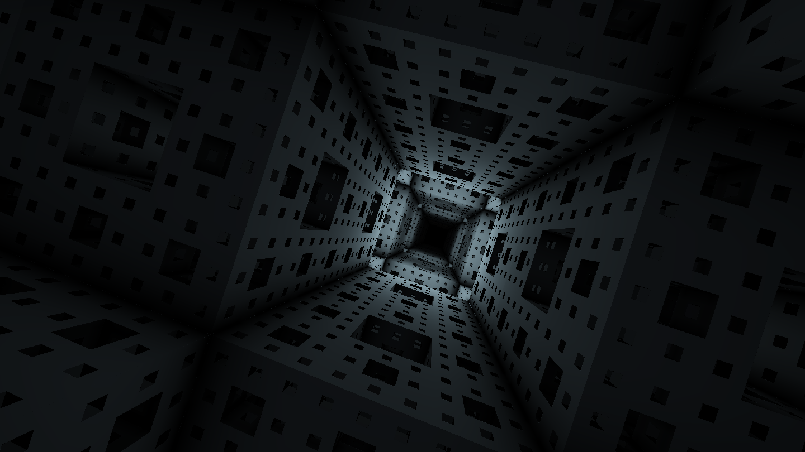

So sieht dein letzter Shader aus, und er bewegt sich: Die Kamera fliegt langsam und schief durch die Gänge eines Würfels, der aus Löchern in Löchern besteht, von Raum zu Raum, und nur in manchen brennt ein Licht. Das ganze Programm hat gut hundert Zeilen.

Bis hierher hat in der Hackschule bei Grafik immer der Prozessor gerechnet, ein Pixel nach dem anderen: in [Echtzeitgrafik mit C](/pixelram) in einer Schleife über alle Pixel, im [Raytracer](/raytracing) Durchgang für Durchgang, bis ein Bild glatt war. Jeder Rechner hat aber einen zweiten eingebaut, den Grafikchip. In Schulrechnern und Laptops sitzt er meist mit im Prozessor, und trotzdem hat er über hundert kleine Rechenwerke, eine große Grafikkarte Tausende. Sie führen alle dasselbe Programm aus, jedes für einen anderen Pixel, alle zugleich.

Dieses Programm heißt **Shader**, und du schreibst nur seinen Inhalt: was für einen Pixel passiert. Die Schleife über alle Pixel gibt es nicht mehr, der Grafikchip startet dein Programm für jeden Pixel selbst. Dafür weiß ein Pixel nichts von seinen Nachbarn und kann sich nichts merken: Er kennt nur seine eigene Position, die Größe des Bildes, die Uhrzeit und die Maus.

Shader schreibt man in **GLSL**, einer Sprache, die aussieht wie C. Du schreibst sie so wie auf [Shadertoy](https://www.shadertoy.com), einer Seite, auf der Zehntausende Shader zum Ansehen und Lernen stehen; Pol Jeremias und Íñigo Quílez haben sie 2013 gestartet. Vorwissen brauchst du nicht. Wer [Echtzeitgrafik mit C](/pixelram) oder den [Raytracer](/raytracing) kennt, wird vieles wiedererkennen. Die Typen und Funktionen von GLSL stehen im Handbuch unter [GLSL](/reference/glsl).

## Einrichten

### Die Vorlage klonen

Für diese Anleitung brauchst du die Vorlage des GLSL-Starters:

_include(workspace#repository-klonen)

Im Explorer siehst du jetzt den Ordner `glsl-starter`. Wichtig sind zwei Dateien darin: `index.html` zeigt einen Shader im ganzen Fenster, und `shader.frag` ist der Shader. An `index.html` änderst du nichts; du schreibst nur in `shader.frag`. Öffne die Datei mit einem Klick.

<!-- tutorial-screenshot
# Klonen wie im Handbuch »Workspace« (oben eingebunden), dann shader.frag
show-left-sidebar
clone-start: https://github.com/specht/glsl-starter.git @ 31b089183ed055bca5984330dd90efb64bc14e24
press: Enter
wait-for-input-value: /workspace/
press: Enter
wait-for-text: Would you like to open the repository?
click: Open
wait-for-text: shader.frag
open-file: shader.frag
sleep: 1
-->
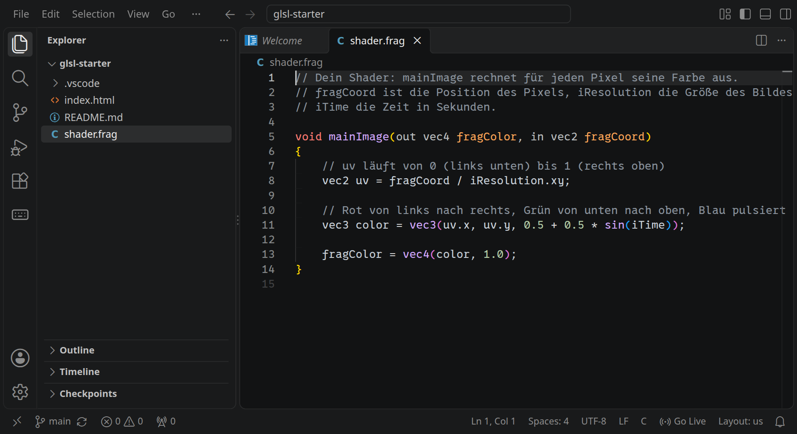

### Vorschau starten


Klicke unten rechts in der Statusleiste auf »Go Live«. Es öffnet sich ein neuer Tab mit der Vorschau, und dort läuft dein Shader:

<div style='clear: both;'></div>

<!-- tutorial-screenshot
go-live
tab: preview
viewport: 800x450
hook: open 2.5
crop-element: #canvas
-->
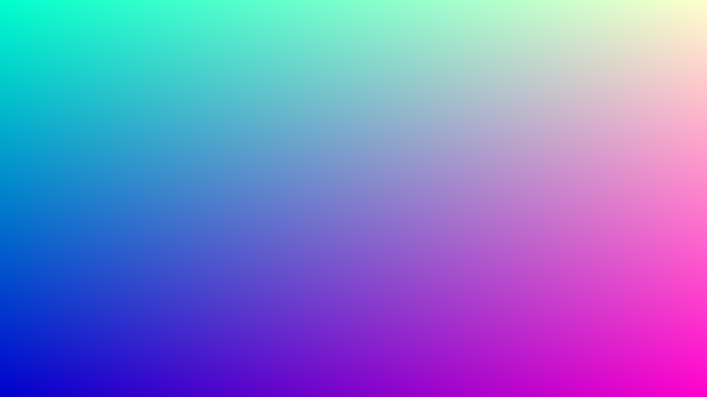

Ein Farbverlauf, und er lebt: Das Blau wird langsam stärker und schwächer. Jedes Mal, wenn du `shader.frag` speicherst, lädt die Vorschau neu und zeigt deine Änderung.

<div class='hint'>
Tipp: Leg den Workspace und die Vorschau nebeneinander. Oben rechts in der Vorschau steht, wie viele Bilder pro Sekunde dein Rechner schafft und wie viele Pixel er dafür rechnet. Hat dein Shader einen Fehler, steht er unten in der Vorschau, mit der Zeile in <code>shader.frag</code>.
</div>

## Ein Pixel, eine Farbe

### Was der Shader bekommt

So sieht `shader.frag` aus:

```glsl
// Dein Shader: mainImage rechnet für jeden Pixel seine Farbe aus.
// fragCoord ist die Position des Pixels, iResolution die Größe des Bildes,
// iTime die Zeit in Sekunden.

void mainImage(out vec4 fragColor, in vec2 fragCoord)
{
    // uv läuft von 0 (links unten) bis 1 (rechts oben)
    vec2 uv = fragCoord / iResolution.xy;

    // Rot von links nach rechts, Grün von unten nach oben, Blau pulsiert
    vec3 color = vec3(uv.x, uv.y, 0.5 + 0.5 * sin(iTime));

    fragColor = vec4(color, 1.0);
}
```

Die Funktion `mainImage` läuft für jeden Pixel einmal:

- `fragCoord` ist die Position des Pixels, in Pixeln gezählt, **von links unten**, nicht wie bei PixelRAM von links oben. Es ist ein `vec2`: zwei Kommazahlen, `fragCoord.x` und `fragCoord.y`.
- `iResolution` ist die Größe des Bildes in Pixeln. `iResolution.xy` nimmt davon die ersten beiden Zahlen, Breite und Höhe.
- `fragCoord / iResolution.xy` teilt beide Zahlen gleichzeitig, jede durch ihre eigene. `uv` läuft so in beiden Richtungen von 0 bis 1, egal wie groß das Fenster ist.
- Farben sind `vec3` aus Rot, Grün und Blau, jedes von 0 bis 1. `fragColor` bekommt eine vierte Zahl dazu, die Deckkraft, hier 1.
- `iTime` sind die Sekunden seit dem Start. `sin(iTime)` schwingt zwischen −1 und 1, `0.5 + 0.5 * sin(iTime)` also zwischen 0 und 1.

Im Handbuch steht vor jedem Shader noch `#version`, `precision` und eine Liste der `uniform`-Variablen. Das schreibt `index.html` für dich davor, so wie Shadertoy, und dahinter ein `main`, das `mainImage` aufruft. Kommazahlen schreibst du in GLSL immer mit Punkt: `1.0`, nicht `1`.

_task(ecke)

<div class='hint try'>
<strong>Ausprobieren:</strong> Schreib unter die Zeile mit <code>uv</code> die Zeile <code>uv = fract(uv * 4.0);</code> und speichere. <code>fract</code> behält von einer Zahl nur, was hinter dem Komma steht. Achte darauf, wie oft der Verlauf jetzt im Bild steht und warum er an den Kanten springt. Nimm die Zeile danach wieder heraus.
</div>

## Formen und Bewegung

### Ein Kreis

Einen Kreis zeichnet ein Shader nicht, er fragt jeden Pixel: Wie weit bist du von der Mitte weg? Ersetze den Inhalt von `shader.frag` durch dieses Programm:

```glsl
// Ein Kreis: Jeder Pixel fragt, wie weit er von der Mitte weg ist.

void mainImage(out vec4 fragColor, in vec2 fragCoord)
{
    // p: die Mitte ist (0, 0), oben ist 1, unten -1; nach links und rechts
    // so weit, wie das Bild breit ist, damit ein Kreis rund bleibt
    vec2 p = (2.0 * fragCoord - iResolution.xy) / iResolution.y;

    // so groß ist ein Pixel in diesen Koordinaten
    float pixel = 2.0 / iResolution.y;

    // der Abstand zur Mitte
    float d = length(p);

    // 1 im Kreis, 0 draußen, dazwischen ein weicher Rand über zwei Pixel
    float inside = 1.0 - smoothstep(0.5 - pixel, 0.5 + pixel, d);

    vec3 background = vec3(0.08, 0.1, 0.18) + 0.08 * p.y;
    vec3 disk = vec3(1.0, 0.6, 0.2);
    fragColor = vec4(mix(background, disk, inside), 1.0);
}
```

<!-- tutorial-screenshot
write-file: shader.frag <- file:stufen/02-kreis.frag
tab: preview
viewport: 800x450
hook: open 2.5
crop-element: #canvas
-->
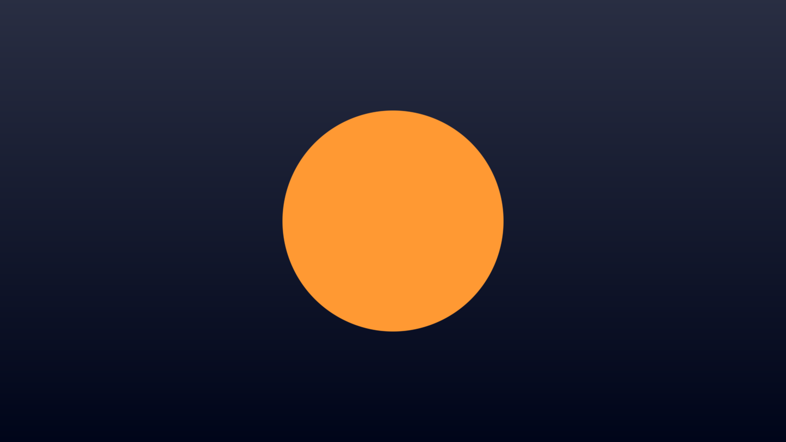

`p` ist die Position des Pixels, so verschoben, dass die Mitte des Bildes `(0, 0)` ist, und durch die **Höhe** geteilt. Oben ist dann 1, unten −1, und nach links und rechts reicht `p.x` so weit, wie das Bild breiter als hoch ist. Weil beide Richtungen durch dieselbe Zahl geteilt werden, bleibt ein Kreis rund. Der Raytracer rechnet in `ray_dir` genauso.

`length(p)` ist der Abstand zur Mitte. Wer näher als 0,5 ist, gehört zum Kreis. Ein hartes `if (d < 0.5)` gäbe Treppenstufen am Rand. `smoothstep(a, b, d)` ist 0, solange `d` kleiner als `a` ist, 1 ab `b`, und dazwischen steigt es weich an. Über die Breite von zwei Pixeln wird der Rand so ein Verlauf: glatte Kanten mit einer Rechnung, für die PixelRAM in »Glatte Kanten« jeden Pixel an den Kanten mehrfach fragen musste. `mix(a, b, t)` mischt zwei Farben: `t = 0` ergibt `a`, `t = 1` ergibt `b`.

_task(rand)

### Wenn etwas nicht stimmt

Früher oder später steht unten in der Vorschau eine rote Meldung. Der Grafikchip übersetzt deinen Shader beim Laden der Seite, und was er nicht versteht, meldet er mit der Zeile:

<!-- tutorial-screenshot
write-file: shader.frag <- file:bilder/fehler.frag
tab: preview
viewport: 800x450
hook: open 2.5 error
crop-element: #canvas
-->
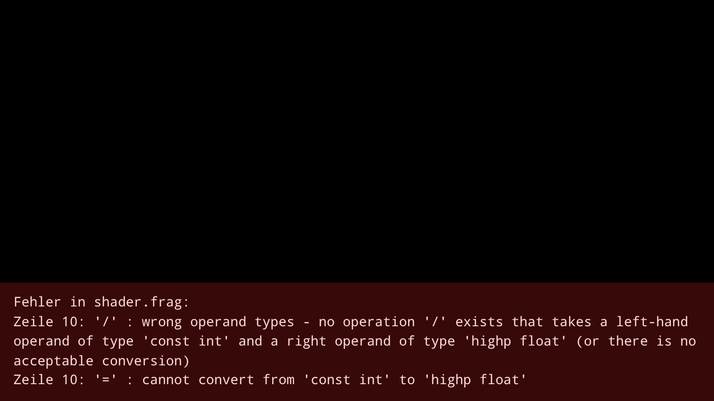

Hier steht in Zeile 10 `2 / iResolution.y`. `2` ist für GLSL eine ganze Zahl, ein `int`, und `iResolution.y` eine Kommazahl, ein `float`. Anders als C rechnet GLSL die beiden nicht von selbst um. Mit `2.0` ist der Fehler weg. Die häufigsten Fehler und wie man sie findet, stehen im Handbuch unter [Fehler finden](/reference/glsl#fehler).

### Kreise in Bewegung

Mit einer Schleife werden aus einem Kreis acht, und mit `iTime` bewegen sie sich:

```glsl
// Kreise in Bewegung, mit Farben aus einer Palette.

// eine Farbe für jede Zahl t: drei Kosinuswellen, gegeneinander verschoben
vec3 palette(float t)
{
    return 0.5 + 0.5 * cos(6.28318 * (t + vec3(0.0, 0.33, 0.67)));
}

void mainImage(out vec4 fragColor, in vec2 fragCoord)
{
    vec2 p = (2.0 * fragCoord - iResolution.xy) / iResolution.y;
    float pixel = 2.0 / iResolution.y;

    vec3 color = vec3(0.04, 0.05, 0.1);
    for (int i = 0; i < 8; i++)
    {
        float k = float(i);
        // jeder Kreis auf seiner eigenen Bahn
        float a = iTime * 0.5 + k * 0.785;
        vec2 center = 0.65 * vec2(cos(a), sin(1.3 * a));
        float d = length(p - center);
        vec3 c = palette(k / 8.0 + iTime * 0.05);
        // ein Schein um den Kreis, schwächer, je weiter weg
        color += c * 0.012 / d;
        // der Kreis selbst
        color = mix(color, c, 1.0 - smoothstep(0.15 - pixel, 0.15 + pixel, d));
    }
    fragColor = vec4(color, 1.0);
}
```

<!-- tutorial-screenshot
write-file: shader.frag <- file:stufen/03-bewegung.frag
tab: preview
viewport: 800x450
hook: open 2.5
crop-element: #canvas
-->
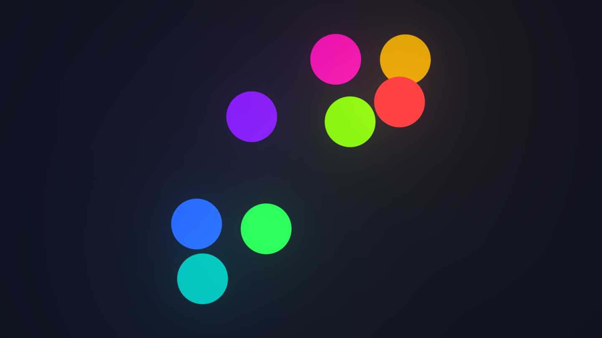

- `float(i)` macht aus der ganzen Zahl `i` eine Kommazahl. Wieder rechnet GLSL das nicht von selbst um.
- Jeder Kreis läuft auf einer eigenen Bahn: `cos(a)` nach links und rechts, `sin(1.3 * a)` nach oben und unten, etwas schneller. So entsteht keine Kreisbahn, sondern eine Schleife, die sich langsam verschiebt.
- `palette` macht aus einer Zahl eine Farbe: Rot, Grün und Blau sind drei Kosinuswellen, um ein Drittel gegeneinander verschoben. Íñigo Quílez hat diese Paletten [beschrieben](https://iquilezles.org/articles/palettes/); mit anderen Zahlen statt `0.0, 0.33, 0.67` entstehen ganz andere Farben.
- Jeder Kreis gibt seine Farbe als **Schein** dazu, `c * 0.012 / d`: dicht am Kreis viel, weiter weg immer weniger. Weil der Schein aller acht Kreise addiert wird, leuchtet es heller, wo sie sich nahe kommen.

_task(schein)

<div class='hint try'>
<strong>Ausprobieren:</strong> Mach aus <code>0.012</code> einmal <code>0.05</code> und lass den Kreis selbst weg (die Zeile mit <code>mix</code>). Achte darauf, wie aus den Scheiben leuchtende Kugeln werden, die heller werden, wenn sie sich überlagern.
</div>

## Muster

### Ein Kaleidoskop

Ein Kaleidoskop spiegelt ein kleines Stück eines Bildes immer wieder um die Mitte. Dafür fragt der Shader nicht mehr nach `x` und `y`, sondern nach Abstand und Winkel, den **Polarkoordinaten**:

```glsl
// Ein Kaleidoskop: Polarkoordinaten, gespiegelte Segmente und ein Muster
// aus Kacheln mit fract.

vec3 palette(float t)
{
    return 0.5 + 0.5 * cos(6.28318 * (t + vec3(0.0, 0.33, 0.67)));
}

void mainImage(out vec4 fragColor, in vec2 fragCoord)
{
    vec2 p = (2.0 * fragCoord - iResolution.xy) / iResolution.y;

    // Polarkoordinaten: wie weit von der Mitte, in welchem Winkel
    float r = length(p);
    float a = atan(p.y, p.x);

    // in 8 Segmente teilen und jedes zweite spiegeln, wie im Kaleidoskop
    float segment = 6.28318 / 8.0;
    a = mod(a, segment);
    a = abs(a - segment / 2.0);
    vec2 q = r * vec2(cos(a), sin(a));

    // das Muster wandert langsam nach außen
    q.x -= iTime * 0.15;

    // Kacheln: fract nimmt nur den Nachkommateil, jede Kachel hat ihre Mitte bei 0
    vec2 cell = fract(q * 3.0) - 0.5;
    vec2 id = floor(q * 3.0);
    float d = length(cell);

    vec3 color = palette(0.1 * id.x + 0.3 * r + iTime * 0.05);
    // Ringe in jeder Kachel
    color *= 0.6 + 0.4 * cos(30.0 * d - iTime * 2.0);
    // nach außen dunkler
    color *= smoothstep(1.6, 0.2, r);
    fragColor = vec4(color, 1.0);
}
```

<!-- tutorial-screenshot
write-file: shader.frag <- file:stufen/04-kaleidoskop.frag
tab: preview
viewport: 800x450
hook: open 2.5
crop-element: #canvas
-->
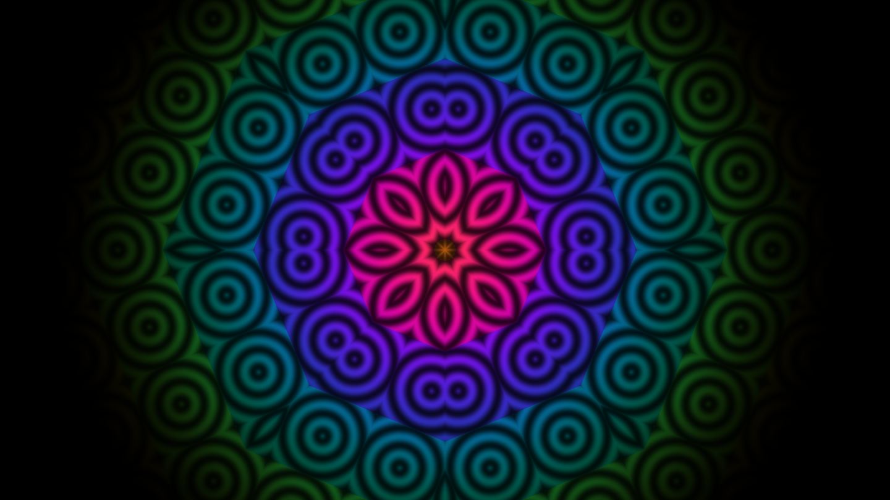

- `atan(p.y, p.x)` ist der Winkel des Pixels um die Mitte, von −π bis π.
- `mod(a, segment)` macht aus jedem Winkel einen im ersten Achtel des Kreises. Alle acht Segmente zeigen so dasselbe.
- `abs(a - segment / 2.0)` spiegelt die eine Hälfte des Segments auf die andere. Darum stoßen benachbarte Segmente ohne Kante aneinander, wie die Spiegel im Kaleidoskop.
- Aus Abstand und neuem Winkel wird wieder ein Punkt `q`, und auf den legt `fract` ein Gitter aus Kacheln: `fract(q * 3.0)` ist die Position in der Kachel, `floor(q * 3.0)` ihre Nummer. Jede Kachel bekommt mit ihrer Nummer eine eigene Farbe und Ringe um ihre Mitte.

<div class='hint try'>
<strong>Ausprobieren:</strong> Teile durch <code>6.0</code> oder <code>12.0</code> statt durch <code>8.0</code>. Achte auf die Mitte: Aus wie vielen Blättern besteht der Stern jetzt?
</div>

### Wolken aus Rauschen

Zufall gibt es auf dem Grafikchip nicht, jeder Pixel muss bei jedem Bild dasselbe ausrechnen. Wolken entstehen trotzdem, aus **Rauschen**: einer Zufallszahl für jeden Punkt eines Gitters, die immer dieselbe ist, und weichen Übergängen dazwischen.

Die Idee stammt von Ken Perlin. Nach der Arbeit an den Computerbildern für den Film *Tron* störte ihn, wie glatt und sauber alles aussah, was aus dem Computer kam, und 1985 beschrieb er das Rauschen, das heute seinen Namen trägt. Hier steht die einfachere Form, **Value Noise**: Auf den Gitterpunkten liegen Zahlen. Perlin legte dort Richtungen ab, das gibt ein gleichmäßigeres Rauschen.

_person(perlin)

<div class='book'>
<i class='bi bi-file-earmark-text'></i>
<p><strong>An Image Synthesizer</strong>, Ken Perlin, SIGGRAPH 1985. Der Aufsatz mit dem Rauschen, aus dem Marmor, Feuer und Wolken werden, alles aus wenigen Zeilen: <a href='https://doi.org/10.1145/325165.325247'>bei der ACM</a>.</p>
</div>

Wie das Rauschen genau geht, steht im Handbuch unter [Prozedurale Texturen](/reference/prozedurale-texturen); hier ist das ganze Programm:

```glsl_copy
// Rauschen: Zufall, der weich ist. Daraus Wolken über einem Himmel.

// eine Zufallszahl von 0 bis 1 für jeden Punkt eines Gitters, immer dieselbe
float hash(vec2 p)
{
    vec3 q = fract(vec3(p.xyx) * 0.1031);
    q += dot(q, q.yzx + 33.33);
    return fract((q.x + q.y) * q.z);
}

// Value Noise: zwischen den Gitterpunkten weich überblenden
float noise(vec2 p)
{
    vec2 i = floor(p);
    vec2 f = fract(p);
    vec2 u = f * f * (3.0 - 2.0 * f);   // weicher als geradlinig
    float a = hash(i);
    float b = hash(i + vec2(1.0, 0.0));
    float c = hash(i + vec2(0.0, 1.0));
    float d = hash(i + vec2(1.0, 1.0));
    return mix(mix(a, b, u.x), mix(c, d, u.x), u.y);
}

// fbm: Rauschen in mehreren Größen übereinander, jede Lage halb so groß und halb so stark
float fbm(vec2 p)
{
    float sum = 0.0;
    float amplitude = 0.5;
    for (int i = 0; i < 6; i++)
    {
        sum += amplitude * noise(p);
        p *= 2.0;
        amplitude *= 0.5;
    }
    return sum;
}

void mainImage(out vec4 fragColor, in vec2 fragCoord)
{
    vec2 p = (2.0 * fragCoord - iResolution.xy) / iResolution.y;

    // der Himmel: unten hell, oben tiefblau
    vec3 sky = mix(vec3(0.85, 0.9, 1.0), vec3(0.2, 0.4, 0.8), 0.5 + 0.5 * p.y);

    // die Wolken ziehen mit der Zeit nach links
    float clouds = fbm(p * 1.5 + vec2(iTime * 0.1, 0.0));
    clouds = smoothstep(0.45, 0.75, clouds);

    vec3 color = mix(sky, vec3(1.0), clouds);
    fragColor = vec4(color, 1.0);
}
```

<!-- tutorial-screenshot
write-file: shader.frag <- file:stufen/05-wolken.frag
tab: preview
viewport: 800x450
hook: open 2.5
crop-element: #canvas
-->
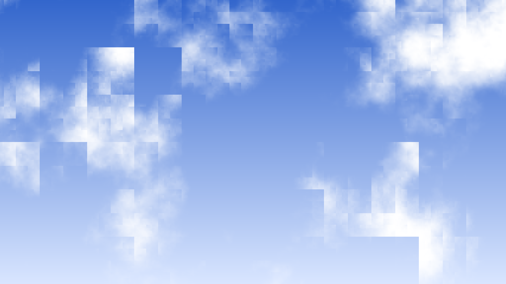

- `hash` macht aus einem Gitterpunkt eine Zahl, die zufällig aussieht, aber für denselben Punkt immer gleich ist. Sie ist dieselbe wie im Handbuch, von Dave Hoskins. Viele Beispiele im Netz nehmen stattdessen `fract(sin(…) * 43758.5)`; das gibt auf manchen Grafikchips Kästchen statt Wolken.
- `noise` liest die Zahlen der vier Gitterpunkte um `p` und mischt weich zwischen ihnen.
- `fbm` legt sechs Lagen Rauschen übereinander, jede doppelt so fein und halb so stark wie die vorige. Erst damit sehen die Ränder der Wolken ausgefranst aus.
- `smoothstep(0.45, 0.75, clouds)` macht daraus Wolken mit Lücken: Wo das Rauschen unter 0,45 bleibt, ist Himmel.

_task(lagen)

<div class='hint try'>
<strong>Ausprobieren:</strong> Lass in <code>fbm</code> die Schleife nur zweimal laufen statt sechsmal. Achte auf die Ränder der Wolken. Was fehlt?
</div>

## Eine Welt aus Abständen

### Strahlen wie im Raytracer

Jetzt wird es dreidimensional, mit derselben Idee wie im [Raytracer](/raytracing): Für jeden Pixel geht ein Strahl vom Auge durch den Pixel in die Szene, und die Farbe des Pixels ist die Farbe dessen, was der Strahl trifft. Der Raytracer rechnete für jede Kugel mit einer Formel aus, wo der Strahl sie trifft. Das geht für Kugeln und Ebenen gut, für die meisten anderen Formen nicht.

Ein Shader fragt die Szene etwas Einfacheres: Wie weit ist es von diesem Punkt bis zur nächsten Fläche, egal in welcher Richtung? Die Antwort gibt eine Funktion `map`. Für eine Kugel ist das leicht, der Abstand zum Mittelpunkt weniger den Radius, für den Boden bei `y = 0` ist es die Höhe `y`. Wenn bis zur nächsten Fläche noch `d` Platz ist, kann der Strahl `d` weit gehen, ohne etwas zu treffen. Dann fragt er wieder:

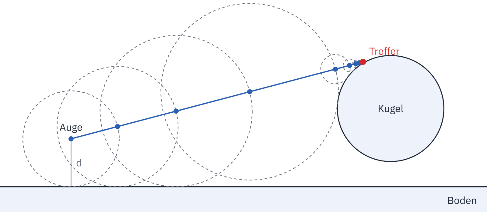

So tastet sich der Strahl vor: große Schritte im freien Raum, immer kleinere dicht an einer Fläche, bis der Abstand fast 0 ist. Das heißt **Raymarching**. Eine Formel für den Treffer braucht es nicht mehr, nur eine für den Abstand, und Abstände lassen sich kombinieren: Der Abstand zu zwei Dingen ist der kleinere der beiden Abstände.

<div class='book'>
<i class='bi bi-file-earmark-text'></i>
<p><strong>Sphere Tracing: A Geometric Method for the Antialiased Ray Tracing of Implicit Surfaces</strong>, John C. Hart, The Visual Computer, 1996. Der Aufsatz beschreibt, wie ein Strahl mit einer Abstandsfunktion vorangeht, in Schritten, die nie in eine Fläche hineinreichen. Hart nennt das Sphere Tracing, nach den Kugeln um jeden Punkt, in denen nichts liegt, im Bild oben die Kreise: <a href='https://doi.org/10.1007/s003710050084'>bei Springer</a>.</p>
</div>

### Eine Kugel

Ersetze `shader.frag` durch dieses Programm:

```glsl_copy
// Raymarching: eine Kugel in einem dunklen Studio

const vec3 LAMP = vec3(-0.32, 0.9, -0.3);   // Richtung zur Lampe über der Szene, Länge 1
const vec3 LEFT = vec3(-0.88, 0.30, -0.37);  // Richtung zum Leuchtstreifen links hinten, Länge 1
const vec3 RIGHT = vec3(0.86, 0.38, -0.34);   // Richtung zum Leuchtstreifen rechts hinten, Länge 1
const vec3 DARK = vec3(0.003, 0.004, 0.008); // die Farbe des Studios, wo kein Licht ist

// Abstand von p zur Kugel: zum Mittelpunkt, weniger den Radius
float ball(vec3 p)
{
    return length(p - vec3(0.0, 0.6, 0.0)) - 0.5;
}

// Abstand von p zur nächsten Oberfläche: die Kugel oder der Boden (y = 0)
float map(vec3 p)
{
    return min(ball(p), p.y);
}

// die Richtung, in der der Abstand am schnellsten wächst: die Normale
vec3 normal(vec3 p)
{
    vec2 e = vec2(0.001, 0.0);
    return normalize(vec3(map(p + e.xyy) - map(p - e.xyy),
                          map(p + e.yxy) - map(p - e.yxy),
                          map(p + e.yyx) - map(p - e.yyx)));
}

// das Studio: fast schwarz, links ein türkiser, rechts ein oranger Leuchtstreifen
vec3 studio(vec3 dir)
{
    vec3 color = DARK;
    color += vec3(0.1, 0.8, 1.0) * 4.0 * smoothstep(0.96, 0.985, dot(dir, LEFT));
    color += vec3(1.0, 0.45, 0.1) * 4.0 * smoothstep(0.96, 0.985, dot(dir, RIGHT));
    return color;
}

// das Licht der beiden Streifen auf einer Fläche, die in Richtung n zeigt
vec3 strips(vec3 n)
{
    return vec3(0.1, 0.8, 1.0) * 0.4 * max(dot(n, LEFT), 0.0)
         + vec3(1.0, 0.45, 0.1) * 0.4 * max(dot(n, RIGHT), 0.0);
}

// Raymarching: so weit gehen, wie der Abstand erlaubt; -1, wenn nichts kommt
float march(vec3 from, vec3 dir)
{
    float t = 0.0;
    for (int i = 0; i < 100; i++)
    {
        float d = map(from + dir * t);
        if (d < 0.001 * t) return t;
        t += d;
        if (t > 40.0) break;
    }
    return -1.0;
}

// die Farbe des Punktes q, den ein Strahl in Richtung dir trifft
vec3 shade(vec3 q, vec3 dir)
{
    vec3 n = normal(q);
    bool on_floor = ball(q) > q.y;
    vec3 albedo = on_floor ? vec3(0.04) : vec3(0.5);

    // die Lampe leuchtet einen Kreis auf dem Boden aus;
    // im Schatten, wenn ein Strahl zu ihr etwas trifft
    float lamp = max(dot(n, LAMP), 0.0) * smoothstep(2.6, 0.3, length(q.xz));
    if (march(q + n * 0.002, LAMP) > 0.0) lamp = 0.0;
    return albedo * (vec3(1.0, 0.95, 0.9) * 2.0 * lamp + strips(n));
}

void mainImage(out vec4 fragColor, in vec2 fragCoord)
{
    vec2 p = (2.0 * fragCoord - iResolution.xy) / iResolution.y;

    // die Kamera bei eye schaut auf die Kugel
    vec3 eye = vec3(0.0, 1.4, -3.6);
    vec3 forward = normalize(vec3(0.0, 0.5, 0.0) - eye);
    vec3 right = normalize(cross(vec3(0.0, 1.0, 0.0), forward));
    vec3 up = cross(forward, right);
    vec3 dir = normalize(p.x * right + p.y * up + 1.8 * forward);

    vec3 color = studio(dir);
    float t = march(eye, dir);
    if (t > 0.0)
    {
        color = shade(eye + dir * t, dir);

        // was weit weg ist, verschwindet im Dunkeln
        color = mix(color, DARK, smoothstep(6.0, 16.0, t));
    }

    fragColor = vec4(pow(color, vec3(1.0 / 2.2)), 1.0);
}
```

<!-- tutorial-screenshot
write-file: shader.frag <- file:stufen/06-raymarching.frag
tab: preview
viewport: 800x450
hook: open 2.5
crop-element: #canvas
-->
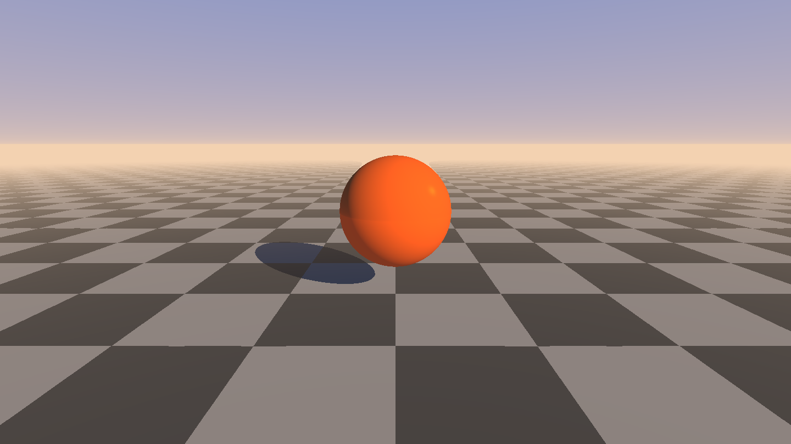

Vieles kennst du aus dem Raytracer, nur steht es hier in GLSL, wo `vec3` mit `+`, `*` und `dot` schon eingebaut ist. Die Welt sieht aber anders aus: kein Himmel und kein Schachbrett, sondern ein dunkles Studio, in dem nur Licht ist, wo eine Lampe hinleuchtet.

- **Die Kamera.** `forward` zeigt vom Auge zu dem Punkt, auf den die Kamera schaut. `right` steht quer dazu, waagrecht nach rechts: Das Kreuzprodukt `cross` zweier Richtungen steht auf beiden senkrecht. `up` steht auf `forward` und `right` senkrecht und zeigt nach oben. Der Strahl für den Pixel `p` geht `p.x` nach rechts, `p.y` nach oben und `1.8` nach vorn. Wer den Raytracer gebaut hat, kennt das aus »Vorne, rechts und oben«.
- **`march`** ist der Strahl aus dem Bild oben: Er fragt `map` und geht so weit, wie der Abstand erlaubt. Ist der Abstand fast 0, ist er angekommen, und `t` ist die Strecke bis dorthin. Wie »fast 0« ist, wächst mit `t` mit: Weit hinten muss ein Treffer nicht so genau sein, denn ein Pixel bedeckt dort viel mehr.
- **`normal`** braucht keine Formel für jede Form. Es fragt `map` an sechs Punkten dicht um den Treffer und sieht, in welche Richtung der Abstand am schnellsten wächst. Das ist die Richtung, in die die Fläche zeigt.
- **Das Licht.** Die Lampe hängt über der Szene, und `smoothstep(2.6, 0.3, length(q.xz))` lässt ihr Licht zum Rand hin auslaufen, wie bei einem Scheinwerfer: Ein Kreis auf dem Boden wird hell. Links und rechts hinter der Kamera leuchten zwei farbige Streifen, die `studio` zeigt, wenn ein Strahl in ihre Richtung geht, und `strips` gibt ihr Licht auf die Flächen. Darum hat die Kugel einen türkisen und einen orangen Rand.
- **Der Schatten** ist ein zweiter Strahl, vom Treffer zur Lampe. Kommt der irgendwo an, liegt etwas dazwischen.
- **`pow(color, vec3(1.0 / 2.2))`** am Ende hellt die dunklen Töne auf, so wie Bildschirme es erwarten. Darum steht für den Boden eine kleine Zahl wie `0.04`, die am Ende heller aussieht, als sie klingt.

_task(schritt)

### Tropfen, die ineinanderfließen

Mit einer Kugel ist der Shader nicht besser als der Raytracer. Raymarching kann aber, was der Raytracer nicht kann: Formen weich ineinanderfließen lassen. Dafür nimmt `map` nicht das kleinere von zwei Abständen, `min`, sondern ein **weiches Minimum**, `smin`. Wo zwei Formen weit auseinander sind, ist es dasselbe wie `min`. Wo beide fast gleich nah sind, wird es kleiner als beide, und zwischen den Formen wächst ein Hals, der sie verbindet.

Kugeln, die so ineinanderfließen, heißen **Metaballs**. Erfunden hat sie Jim Blinn um 1980, für Bilder von Atomen in einer Fernsehserie. Bei ihm hat jede Kugel ein Feld, das mit dem Abstand schwächer wird, so wie das Licht einer Lampe. Die Felder aller Kugeln werden addiert, und die Oberfläche liegt dort, wo die Summe einen bestimmten Wert erreicht. Kommen sich zwei Kugeln nahe, ist die Summe zwischen ihnen groß, und die Oberfläche wölbt sich hinüber. Das weiche Minimum macht dasselbe mit Abständen, so wie Raymarching sie braucht.

_person(blinn)

<div class='book'>
<i class='bi bi-file-earmark-text'></i>
<p><strong>A Generalization of Algebraic Surface Drawing</strong>, James F. Blinn, ACM Transactions on Graphics, 1982. Der Aufsatz, in dem die Blobby Objects zum ersten Mal beschrieben sind, mit Bildern von Molekülen: <a href='https://doi.org/10.1145/357306.357310'>bei der ACM</a>.</p>
</div>

Lösche die Funktion `ball` und schreib an ihre Stelle das weiche Minimum und sechs Tropfen:

```glsl
~ const vec3 LEFT = vec3(-0.88, 0.30, -0.37);  // Richtung zum Leuchtstreifen links hinten, Länge 1
~ const vec3 RIGHT = vec3(0.86, 0.38, -0.34);   // Richtung zum Leuchtstreifen rechts hinten, Länge 1
~ const vec3 DARK = vec3(0.003, 0.004, 0.008); // die Farbe des Studios, wo kein Licht ist
~
// glatte Vereinigung zweier Abstände: je größer k, desto weiter fließen sie ineinander
float smin(float a, float b, float k)
{
    float h = clamp(0.5 + 0.5 * (b - a) / k, 0.0, 1.0);
    return mix(b, a, h) - k * h * (1.0 - h);
}

// wo die sechs Tropfen gerade sind; mainImage rechnet es einmal für jeden Pixel aus
vec3 blob[6];

void move_blobs()
{
    for (int i = 0; i < 6; i++)
    {
        float f = float(i);
        float t = iTime * (0.4 + 0.1 * f) + f * 1.7;
        blob[i] = vec3(1.3 * sin(t), 0.6 + 0.12 * sin(t * 1.3 + f), 0.9 * cos(t * 0.9 + f));
    }
}

// die Farbe des Tropfens i
vec3 blob_paint(int i)
{
    if (i == 0) return vec3(0.9, 0.12, 0.005);
    if (i == 1) return vec3(0.0, 0.25, 0.32);
    if (i == 2) return vec3(0.6, 0.005, 0.12);
    if (i == 3) return vec3(0.9, 0.5, 0.005);
    if (i == 4) return vec3(0.05, 0.05, 0.5);
    return vec3(0.15, 0.45, 0.02);
}

// Abstand von p zu den Tropfen
float blobs(vec3 p)
{
    // weit weg genügt der Abstand zu einer Kugel, die alle Tropfen umschließt
    float bound = length(p - vec3(0.0, 0.6, 0.0)) - 2.2;
    if (bound > 0.5) return bound;

    float d = 100.0;
    for (int i = 0; i < 6; i++)
        d = smin(d, length(p - blob[i]) - 0.42, 0.6);
    return d;
}
~
~ // Abstand von p zur nächsten Oberfläche: die Tropfen oder der Boden (y = 0)
~ float map(vec3 p)
~ {
```

In `map` stehen jetzt die Tropfen statt der Kugel:

```glsl
~ float map(vec3 p)
~ {
    return min(blobs(p), p.y);
~ }
```

Jeder Tropfen hat seine eigene Farbe, und wo zwei ineinanderfließen, sollen auch die Farben ineinanderlaufen. Schreib unter `map`:

```glsl
~ {
~     return min(blobs(p), p.y);
~ }
~
// die Farbe der Tropfen bei p: jeder Tropfen färbt umso mehr, je näher er ist
vec3 blob_color(vec3 p)
{
    vec3 sum = vec3(0.0);
    float weight = 0.0;
    for (int i = 0; i < 6; i++)
    {
        float w = exp(-14.0 * (length(p - blob[i]) - 0.42));
        sum += w * blob_paint(i);
        weight += w;
    }
    return sum / weight;
}
~
~ // die Richtung, in der der Abstand am schnellsten wächst: die Normale
~ vec3 normal(vec3 p)
~ {
```

Die Schatten werden weich. Im Raytracer brauchte ein weicher Schatten viele Strahlen zu verschiedenen Punkten der Sonne, gemittelt über viele Durchgänge. Raymarching bekommt ihn fast umsonst: Der Strahl zur Lampe merkt sich, wie knapp er an etwas vorbeigekommen ist. Wer dicht an einem Tropfen vorbeiläuft, liegt im Halbschatten. Schreib unter `normal`:

```glsl
~                           map(p + e.yxy) - map(p - e.yxy),
~                           map(p + e.yyx) - map(p - e.yyx)));
~ }
~
// weicher Schatten: wie knapp läuft der Strahl zur Lampe an etwas vorbei?
float shadow(vec3 p)
{
    float light = 1.0;
    float t = 0.02;
    for (int i = 0; i < 48; i++)
    {
        float d = map(p + LAMP * t);
        light = min(light, 10.0 * d / t);
        t += clamp(d, 0.02, 0.2);
        // über allen Tropfen kann nichts mehr Schatten werfen
        if (light < 0.001 || p.y + LAMP.y * t > 1.5) break;
    }
    return clamp(light, 0.0, 1.0);
}
~
~ // das Studio: fast schwarz, links ein türkiser, rechts ein oranger Leuchtstreifen
~ vec3 studio(vec3 dir)
~ {
```

`shade` fragt jetzt die Tropfen und den weichen Schatten:

```glsl
// die Farbe des Punktes q, den ein Strahl in Richtung dir trifft
vec3 shade(vec3 q, vec3 dir)
{
    vec3 n = normal(q);
    bool on_floor = blobs(q) > q.y;
    vec3 albedo = on_floor
        ? vec3(0.04)
        : blob_color(q);

    // die Lampe leuchtet einen Kreis auf dem Boden aus, mit weichen Schatten
    float lamp = max(dot(n, LAMP), 0.0) * smoothstep(3.0, 0.3, length(q.xz)) * shadow(q + n * 0.002);
    return albedo * (vec3(1.0, 0.95, 0.9) * 2.0 * lamp + strips(n));
}
```

Zuletzt rechnet `mainImage` die Tropfen an ihren Platz, und die Kamera schwenkt:

```glsl
~ void mainImage(out vec4 fragColor, in vec2 fragCoord)
~ {
~     vec2 p = (2.0 * fragCoord - iResolution.xy) / iResolution.y;
    move_blobs();

    // die Kamera schwenkt vor den Tropfen hin und her
    // und schaut auf ihre Mitte
    float angle = 0.7 * sin(0.2 * iTime);
    vec3 eye = vec3(3.6 * sin(angle), 1.4, -3.6 * cos(angle));
    vec3 forward = normalize(vec3(0.0, 0.6, 0.0) - eye);
~     vec3 right = normalize(cross(vec3(0.0, 1.0, 0.0), forward));
~     vec3 up = cross(forward, right);
```

<!-- tutorial-screenshot
write-file: shader.frag <- file:stufen/07-tropfen.frag
tab: preview
viewport: 800x450
hook: open 10
crop-element: #canvas
-->
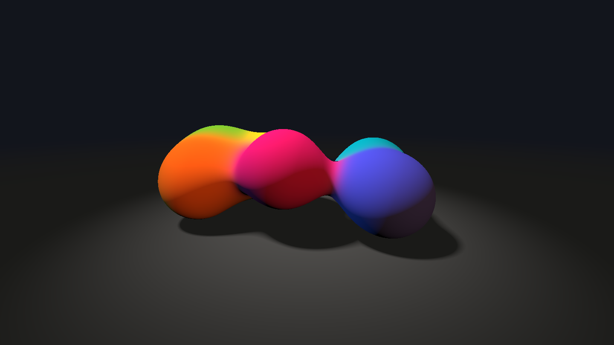

- **`smin`** mischt die beiden Abstände, wo sie weniger als `k` auseinanderliegen, und zieht dabei etwas ab. Darum wird der Abstand zwischen zwei nahen Tropfen kleiner, als jeder allein wäre: Dort ist schon Fläche, und es entsteht der Hals. Wie man darauf kommt, erklärt Íñigo Quílez in seinem Artikel über das [weiche Minimum](https://iquilezles.org/articles/smin/).
- **`blob`** ist ein Array mit den sechs Mittelpunkten. Sie hängen nur von der Zeit ab, also rechnet `move_blobs` sie einmal für jeden Pixel aus, statt bei jeder Frage an `map` wieder mit `sin` und `cos`. `map` wird für einen Pixel bis zu einige hundert Mal gefragt.
- **`bound`** spart noch mehr: Ist ein Punkt weit weg von allen Tropfen, reicht der Abstand zu einer großen Kugel um alle sechs. Er ist nie größer als der Abstand zu den Tropfen selbst, der Strahl springt also nie zu weit, und es müssen nicht sechs Tropfen gefragt werden.
- **`blob_color`** gewichtet die Farben der Tropfen: Ein Tropfen, dessen Oberfläche 0,1 weiter weg ist, zählt nur noch ein Viertel so viel, `exp(-14 · 0.1)`.
- **`shadow`** geht wie `march` zur Lampe, aber merkt sich in `light` das kleinste Verhältnis von Abstand zu Strecke. Läuft der Strahl knapp an einem Tropfen vorbei, ist es klein, und der Punkt liegt im Halbschatten. Die 10 bestimmt, wie weich: Mit 30 werden die Schatten härter. Mehr dazu bei Íñigo Quílez über [weiche Schatten](https://iquilezles.org/articles/rmshadows/).

_task(smin)

<div class='hint try'>
<strong>Ausprobieren:</strong> Ändere in <code>blobs</code> die <code>0.6</code> in <code>smin</code> auf <code>0.1</code> und dann auf <code>1.2</code>. Achte darauf, wann zwei Tropfen anfangen, einander entgegenzufließen, und wie dick der Hals zwischen ihnen wird.
</div>

### Glanz und ein schwarzer Spiegel

Drei Dinge fehlen noch: Glanz auf den Tropfen, ein Boden, in dem sie sich spiegeln, und dunklere Stellen, wo wenig Licht hinkommt, unter den Tropfen und in den Kehlen zwischen ihnen. Für das Letzte fragt der Shader `map` ein paar Mal entlang der Normale: Ist über der Fläche weniger Platz, als der Weg nach außen lang ist, liegt dort etwas, das Licht wegnimmt. Das heißt **Umgebungsverdeckung** (englisch Ambient Occlusion). Schreib unter `shadow`:

```glsl
~     }
~     return clamp(light, 0.0, 1.0);
~ }
~
// Umgebungsverdeckung: wie viel Platz ist über der Oberfläche?
float occlusion(vec3 p, vec3 n)
{
    float hidden = 0.0;
    for (int i = 1; i <= 5; i++)
    {
        float h = 0.03 + 0.1 * float(i);
        hidden += h - map(p + n * h);
    }
    return clamp(1.0 - 1.2 * hidden, 0.0, 1.0);
}
~
~ // das Studio: fast schwarz, links ein türkiser, rechts ein oranger Leuchtstreifen
~ vec3 studio(vec3 dir)
~ {
```

Dann wird `shade` noch einmal länger:

```glsl
// die Farbe des Punktes q, den ein Strahl in Richtung dir trifft
vec3 shade(vec3 q, vec3 dir)
{
    vec3 n = normal(q);
    bool on_floor = blobs(q) > q.y;
    vec3 albedo = on_floor
        ? vec3(0.04)
        : blob_color(q);

    // die Lampe leuchtet einen Kreis auf dem Boden aus, mit weichen Schatten
    float lamp = max(dot(n, LAMP), 0.0) * smoothstep(3.0, 0.3, length(q.xz)) * shadow(q + n * 0.002);
    float ao = occlusion(q, n);
    vec3 color = albedo * (vec3(1.0, 0.95, 0.9) * 2.0 * lamp + strips(n) * ao);

    if (!on_floor)
    {
        // Glanz: die Lampe als Lichtpunkt, das Studio gespiegelt, am Rand mehr
        vec3 h = normalize(LAMP - dir);
        float fresnel = 0.04 + 0.6 * pow(1.0 - max(dot(n, -dir), 0.0), 5.0);
        color += vec3(1.0, 0.95, 0.9) * pow(max(dot(n, h), 0.0), 120.0) * 2.0 * lamp;
        color = mix(color, studio(reflect(dir, n)) * ao, fresnel);
    }
    return color;
}
```

Der Boden spiegelt mit einem zweiten Strahl, so wie die Spiegelkugel im Raytracer. In `mainImage`:

```glsl
~     vec3 color = studio(dir);
~     float t = march(eye, dir);
~     if (t > 0.0)
~     {
        vec3 q = eye + dir * t;
        color = shade(q, dir);

        // der Boden ist schwarz poliert: ein zweiter Strahl, gespiegelt
        if (blobs(q) > q.y)
        {
            vec3 mirrored = reflect(dir, vec3(0.0, 1.0, 0.0));
            vec3 from = q + vec3(0.0, 0.002, 0.0);
            float s = march(from, mirrored);
            vec3 seen = s > 0.0 ? shade(from + mirrored * s, mirrored) : DARK;
            color = mix(color, seen, 0.5);
        }
~ 
~         // was weit weg ist, verschwindet im Dunkeln
~         color = mix(color, DARK, smoothstep(6.0, 16.0, t));
~     }
```

<!-- tutorial-screenshot
write-file: shader.frag <- file:stufen/08-glanz.frag
tab: preview
viewport: 800x450
hook: open 10
crop-element: #canvas
-->
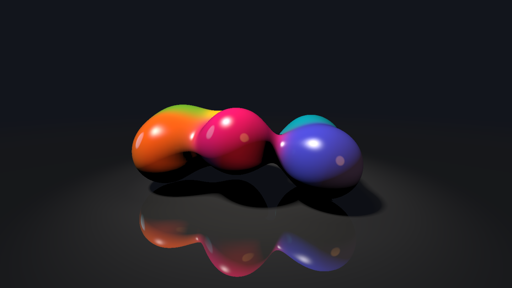

Vergleiche mit dem Bild davor, es ist derselbe Augenblick:

- **Der Glanzpunkt** ist die Lampe, auf der glatten Oberfläche gespiegelt: Er ist dort, wo die Normale genau zwischen Lampe und Auge zeigt, `h`, und die hohe Potenz `120.0` macht ihn klein und scharf. Diese Rechnung mit der Richtung dazwischen stammt von Jim Blinn, 1977.
- **Am Rand** spiegeln die Tropfen mehr vom Studio als in der Mitte, darum leuchten dort die farbigen Streifen auf. Das ist dieselbe Formel von Schlick, die im Raytracer unter »Lack« ausrechnet, wie viel eine lackierte Kugel spiegelt.
- **Der Boden** schickt einen zweiten Strahl los, gespiegelt an der Fläche nach oben, und mischt die Hälfte von dem dazu, was der sieht. Auf schwarzem Lack sieht man fast nur das Spiegelbild. Dafür braucht es kein neues Programm, `march` und `shade` gibt es schon.
- **`occlusion`** fragt `map` in fünf Abständen über der Fläche. Unter einem Tropfen ist dort weniger Platz als der Weg nach oben, und das Licht der Streifen wird schwächer.

<div class='hint try'>
<strong>Ausprobieren:</strong> Der gespiegelte Strahl kostet Rechenzeit. Schreib vor die Zeile <code>float s = march(from, mirrored);</code> zwei Schrägstriche und darunter <code>float s = -1.0;</code>. Dann spiegelt der Boden nichts mehr. Achte auf die Bilder pro Sekunde oben rechts, mit und ohne. Zeigt dein Rechner beide Male so viel, wie der Bildschirm kann, zieh das Vorschaufenster so groß wie möglich. Nimm die Änderung danach wieder zurück.
</div>

### Mit der Maus

Zum Schluss steuerst du die Kamera selbst. Solange die Maus gedrückt ist, ist `iMouse.z` größer als 0, und `iMouse.xy` ist ihre Position in Pixeln. Ersetze in `mainImage` die Zeilen für `angle` und `eye`:

```glsl
~     move_blobs();
~ 
    // die Kamera schwenkt vor den Tropfen hin und her; mit gedrückter Maus
    // bestimmt die Maus, von wo sie schaut: links und rechts einmal ganz herum,
    // oben und unten die Höhe
    float angle = 0.7 * sin(0.2 * iTime);
    float height = 1.4;
    if (iMouse.z > 0.0)
    {
        angle = 6.28318 * iMouse.x / iResolution.x;
        height = 0.3 + 4.0 * iMouse.y / iResolution.y;
    }
    vec3 eye = vec3(3.6 * sin(angle), height, -3.6 * cos(angle));
~     vec3 forward = normalize(vec3(0.0, 0.6, 0.0) - eye);
```

<!-- tutorial-screenshot
write-file: shader.frag <- file:stufen/09-maus.frag
tab: preview
viewport: 800x450
hook: open 10
hook: drag 0.1 0.25
crop-element: #canvas
-->
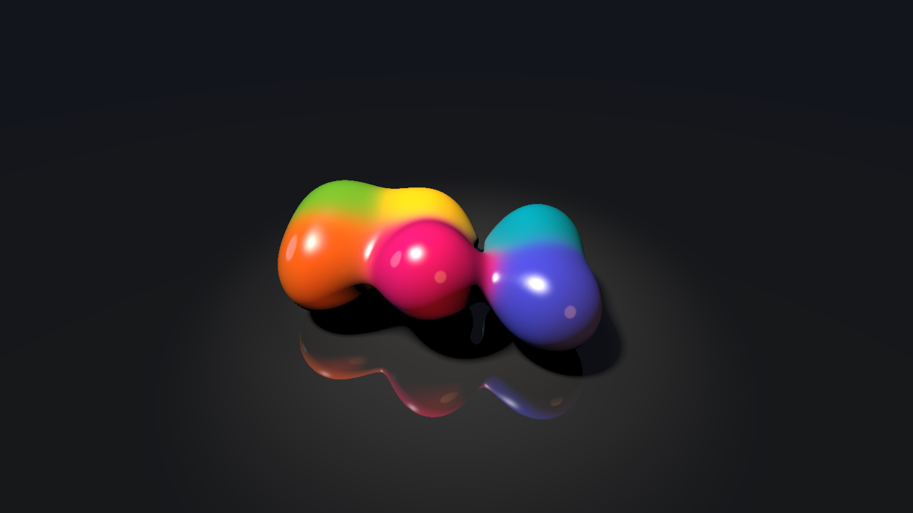

Zieh mit gedrückter Maus nach links und rechts, dann fliegt die Kamera um die Tropfen herum, nach oben und unten steigt und sinkt sie. Lässt du los, schwenkt sie wieder von selbst.

## Löcher in Löchern

### Ein Teppich aus Quadraten

Raymarching kann mehr, als Formen verschmelzen. Es kann eine Form ohne Ende wiederholen, und jede Wiederholung noch einmal in klein. Bevor es dreidimensional wird, erst einmal in der Ebene: Nimm ein Quadrat, teile es in drei mal drei Kacheln und mach die mittlere zu einem Loch. Mit jeder der acht anderen Kacheln machst du dasselbe, mit deren Kacheln wieder, ohne Ende. Das ist der **Sierpinski-Teppich**, 1916 von Wacław Sierpiński beschrieben.

_person(sierpinski)

Ersetze `shader.frag` durch dieses Programm:

```glsl_copy
// Der Sierpinski-Teppich: ein Quadrat, aus dem die Mitte fehlt, und aus jedem
// der acht Quadrate drumherum wieder die Mitte, immer weiter

// 1 auf dem Teppich, 0 in einem Loch; p läuft im Quadrat von 0 bis 1
float carpet(vec2 p, int steps)
{
    for (int i = 0; i < 6; i++)
    {
        if (i >= steps) break;
        // in drei mal drei Kacheln teilen: welche Kachel, und wo darin?
        p *= 3.0;
        vec2 cell = floor(p);
        p = fract(p);
        // die mittlere Kachel ist ein Loch
        if (cell.x == 1.0 && cell.y == 1.0) return 0.0;
    }
    return 1.0;
}

void mainImage(out vec4 fragColor, in vec2 fragCoord)
{
    vec2 p = (2.0 * fragCoord - iResolution.xy) / iResolution.y;

    // jede Sekunde eine Stufe mehr: 1, 2, 3, 4, 5, dann von vorn
    int steps = 1 + int(mod(iTime, 5.0));

    // das Quadrat von -0.9 bis 0.9 auf 0 bis 1 bringen
    vec2 q = (p + 0.9) / 1.8;

    vec3 color = vec3(0.01, 0.012, 0.018);
    if (q.x > 0.0 && q.x < 1.0 && q.y > 0.0 && q.y < 1.0)
    {
        vec3 stone = vec3(0.45, 0.5, 0.55) * (0.85 + 0.15 * q.y);
        vec3 hole = vec3(0.02, 0.03, 0.04);
        color = mix(hole, stone, carpet(q, steps));
    }
    fragColor = vec4(pow(color, vec3(1.0 / 2.2)), 1.0);
}
```

<div class='gallery columns-2'>
<figure>
<!-- tutorial-screenshot
write-file: shader.frag <- file:stufen/10-teppich.frag
tab: preview
viewport: 800x450
hook: open 0.5
crop-element: #canvas
-->
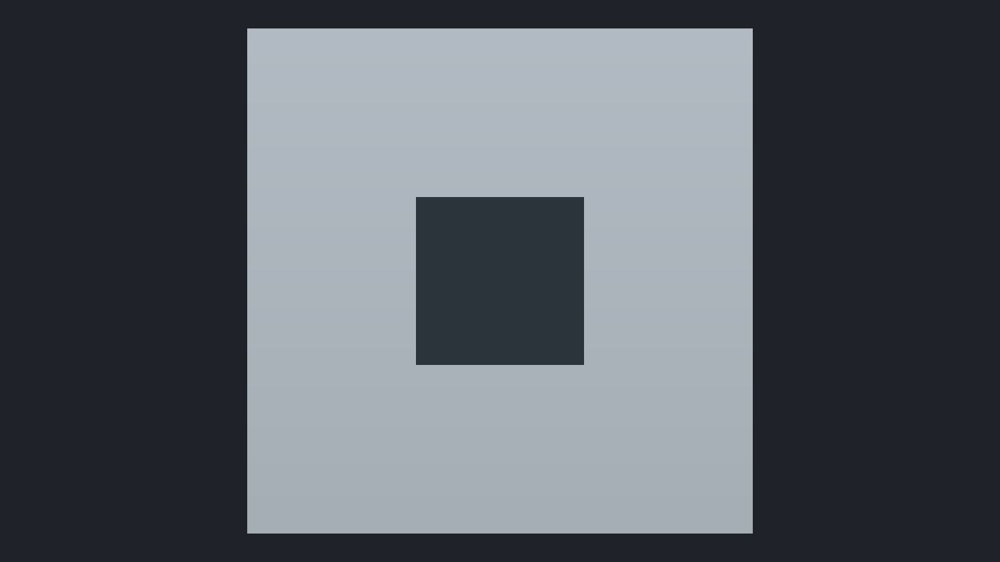
<figcaption>Eine Stufe</figcaption>
</figure>
<figure>
<!-- tutorial-screenshot
tab: preview
viewport: 800x450
hook: open 1.5
crop-element: #canvas
-->
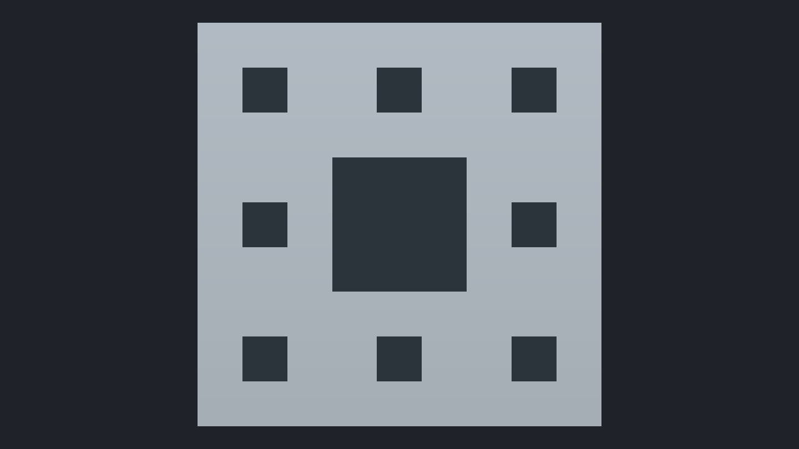
<figcaption>Zwei Stufen</figcaption>
</figure>
<figure>
<!-- tutorial-screenshot
tab: preview
viewport: 800x450
hook: open 2.5
crop-element: #canvas
-->
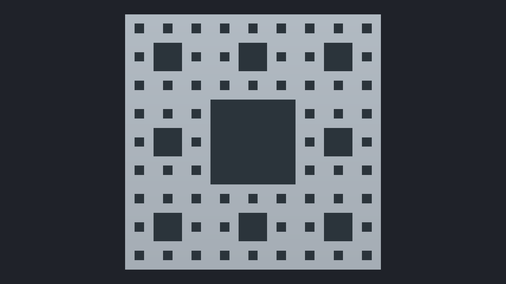
<figcaption>Drei Stufen</figcaption>
</figure>
<figure>
<!-- tutorial-screenshot
tab: preview
viewport: 800x450
hook: open 3.5
crop-element: #canvas
-->
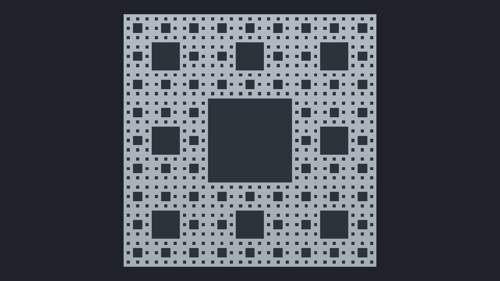
<figcaption>Vier Stufen</figcaption>
</figure>
</div>

Jede Sekunde kommt eine Stufe dazu, nach fünf beginnt es von vorn:

- **`p *= 3.0`** macht aus dem Quadrat von 0 bis 1 eines von 0 bis 3. `floor(p)` ist dann die Nummer der Kachel, 0, 1 oder 2 in jeder Richtung, und `fract(p)` die Lage in ihr, wieder von 0 bis 1. Das kennst du vom Kaleidoskop.
- **Die mittlere Kachel** hat die Nummer `(1, 1)`. Liegt der Pixel darin, ist er in einem Loch, und die Schleife ist fertig.
- **Sonst** geht es mit der Lage in der Kachel weiter, als wäre sie das ganze Quadrat: Die nächste Runde teilt sie wieder in neun, eine Stufe feiner. So entstehen Löcher in Löchern, mit einer Schleife aus vier Zeilen.
- **`if (i >= steps) break;`** hält die Schleife nach `steps` Runden an. Die Grenze in `for` muss in GLSL eine feste Zahl sein, darum steht dort 6 und die eigentliche Grenze innen.

_task(teppich)

### Ein Schwamm aus Würfeln

Dasselbe geht mit einem Würfel. Teile ihn in drei mal drei mal drei kleinere Würfel und nimm sieben davon weg: den in der Mitte und die sechs in der Mitte jeder Seite. Zusammen sind sie ein Kreuz aus drei Balken, die quer durch den Würfel gehen. Jeder der übrigen Würfel bekommt dasselbe Kreuz, und so weiter. Das ist der **Menger-Schwamm**, 1926 von Karl Menger beschrieben.

_person(menger)

Ersetze `shader.frag` durch dieses Programm:

```glsl_copy
// Der Menger-Schwamm: ein Würfel, aus dem in jeder Stufe ein Kreuz aus drei Balken
// fehlt, und aus jedem der 20 Würfel drumherum wieder, immer kleiner

// Abstand von p zu einem Würfel mit der halben Kantenlänge 1 um den Nullpunkt
float box(vec3 p)
{
    vec3 q = abs(p) - 1.0;
    return length(max(q, 0.0)) + min(max(q.x, max(q.y, q.z)), 0.0);
}

// Abstand zu drei unendlich langen Balken entlang x, y und z durch den Nullpunkt,
// jeder w breit nach jeder Seite
float bars(vec3 p, float w)
{
    vec3 a = abs(p);
    return min(max(a.y, a.z), min(max(a.x, a.z), max(a.x, a.y))) - w;
}

// der Schwamm: der Würfel, weniger die Balken jeder Stufe
float sponge(vec3 p)
{
    float d = box(p);
    float size = 2.0;   // die Kantenlänge der Würfel dieser Stufe
    for (int i = 0; i < 4; i++)
    {
        // die Lage im Würfel dieser Stufe, seine Mitte bei 0: mod wiederholt ihn
        vec3 q = mod(p + size / 2.0, size) - size / 2.0;
        // durch seine Mitte ein Kreuz ein Drittel so breit wie er wegnehmen
        d = max(d, -bars(q, size / 6.0));
        size /= 3.0;
    }
    return d;
}

mat2 rotate(float a)
{
    return mat2(cos(a), sin(a), -sin(a), cos(a));
}

// der Schwamm dreht sich langsam und steht schräg
vec3 turn(vec3 p)
{
    p.xz = rotate(0.25 * iTime) * p.xz;
    p.yz = rotate(0.6) * p.yz;
    p.xy = rotate(0.5) * p.xy;
    return p;
}

float map(vec3 p)
{
    return sponge(turn(p));
}

vec3 normal(vec3 p)
{
    vec2 e = vec2(0.0005, 0.0);
    return normalize(vec3(map(p + e.xyy) - map(p - e.xyy),
                          map(p + e.yxy) - map(p - e.yxy),
                          map(p + e.yyx) - map(p - e.yyx)));
}

// Umgebungsverdeckung: tief in den Löchern kommt wenig Licht an
float occlusion(vec3 p, vec3 n)
{
    float hidden = 0.0;
    for (int i = 1; i <= 5; i++)
    {
        float h = 0.01 + 0.04 * float(i);
        hidden += (h - map(p + n * h)) / float(i);
    }
    return clamp(1.0 - 3.0 * hidden, 0.0, 1.0);
}

// weicher Schatten in Richtung l, höchstens bis zur Entfernung far
float shadow(vec3 p, vec3 l, float far)
{
    float light = 1.0;
    float t = 0.01;
    for (int i = 0; i < 32; i++)
    {
        float d = map(p + l * t);
        light = min(light, 16.0 * d / t);
        t += clamp(d, 0.01, 0.2);
        if (light < 0.001 || t > far) break;
    }
    return clamp(light, 0.0, 1.0);
}

void mainImage(out vec4 fragColor, in vec2 fragCoord)
{
    vec2 p = (2.0 * fragCoord - iResolution.xy) / iResolution.y;

    // von leicht unten: der Würfel ragt über der Kamera auf
    vec3 eye = vec3(0.0, -1.0, -3.9);
    vec3 forward = normalize(vec3(0.0, 0.05, 0.0) - eye);
    vec3 right = normalize(cross(vec3(0.0, 1.0, 0.0), forward));
    vec3 up = cross(forward, right);
    vec3 dir = normalize(p.x * right + p.y * up + 1.7 * forward);

    float t = 0.0;
    bool hit = false;
    float haze = 0.0;
    for (int i = 0; i < 110; i++)
    {
        float d = map(eye + dir * t);
        // Dunst: je knapper der Strahl am Würfel vorbeiläuft, desto mehr leuchtet die Luft
        haze += 0.004 / (1.0 + 80.0 * d * d);
        if (d < 0.0005 * t) { hit = true; break; }
        t += d;
        if (t > 8.0) break;
    }

    // fast schwarz, oben ein Hauch von kaltem Licht
    vec3 color = vec3(0.003, 0.004, 0.007) + vec3(0.006, 0.012, 0.02) * smoothstep(-0.2, 1.0, p.y);
    if (hit)
    {
        vec3 q = eye + dir * t;
        vec3 n = normal(q);
        float ao = occlusion(q, n);

        // dunkler Stein, ein kaltes Licht von oben, ein schwacher Rand
        vec3 stone = vec3(0.12, 0.13, 0.15);
        vec3 top = normalize(vec3(-0.3, 1.0, -0.2));
        float light = max(dot(n, top), 0.0) * shadow(q + n * 0.001, top, 3.0);
        color = stone * vec3(0.55, 0.75, 1.0) * 2.0 * light * ao;
        color += stone * vec3(0.05, 0.07, 0.1) * ao;
        float rim = pow(1.0 - max(dot(n, -dir), 0.0), 5.0);
        color += vec3(0.3, 0.55, 0.8) * rim * 0.25 * ao;

        // aus dem Kern dringt eisblaues Licht: je näher an der Mitte, desto heller
        vec3 inside = turn(q);
        float core = exp(-6.0 * dot(inside, inside));
        color += vec3(0.25, 0.8, 1.0) * 4.5 * core * (0.3 + 0.7 * max(dot(n, -normalize(inside)), 0.0));
    }
    color += vec3(0.2, 0.45, 0.6) * haze * 0.25;

    // zum Rand dunkler, und sanft begrenzen statt abschneiden
    color *= 1.0 - 0.4 * dot(p * 0.6, p * 0.6);
    color = 1.0 - exp(-color * 1.3);
    fragColor = vec4(pow(color, vec3(1.0 / 2.2)), 1.0);
}
```

<!-- tutorial-screenshot
write-file: shader.frag <- file:stufen/11-schwamm.frag
tab: preview
viewport: 800x450
hook: open 2
crop-element: #canvas
-->
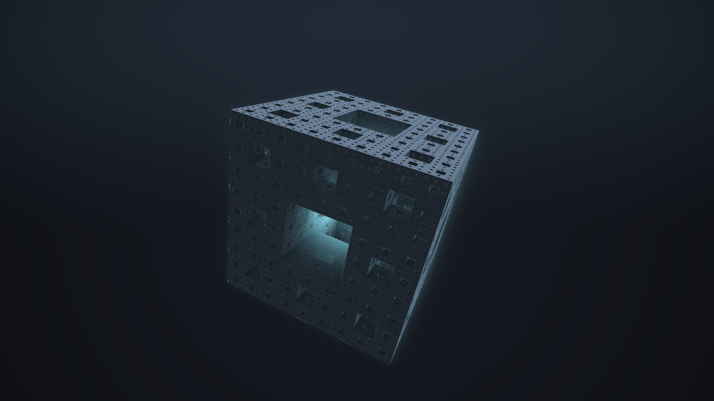

- **`box`** ist der Abstand zu einem Würfel, so wie `length(p) - r` der zu einer Kugel ist. Die Formeln für viele andere Formen hat Íñigo Quílez [gesammelt](https://iquilezles.org/articles/distfunctions/).
- **`bars`** ist der Abstand zu dem Kreuz aus drei Balken. Ein Balken entlang x ist alles, was in y und z nahe an der Mitte liegt: `max(a.y, a.z) - w`.
- **`max(d, -bars(q, …))`** nimmt das Kreuz aus dem Würfel heraus. `min` vereinigt zwei Formen, `max` mit einem Minus davor zieht eine Form von der anderen ab.
- **`mod(p + size / 2.0, size) - size / 2.0`** ist dasselbe wie `fract` im Teppich: Es macht aus jedem Punkt die Lage im kleinen Würfel dieser Stufe. So bekommt jeder Würfel sein Kreuz, ohne dass das Programm sie einzeln kennt. Mit jeder Runde wird `size` dreimal kleiner.
- **`turn`** dreht den Schwamm mit Drehmatrizen, `rotate`, langsam um die senkrechte Achse und schräg gestellt.
- **Das Licht im Inneren** hängt nur davon ab, wie nah ein Punkt an der Mitte des Würfels ist. Nach außen dringt es nur durch die großen Löcher, die bis in die Mitte reichen.
- **`haze`** sammelt beim Marschieren, wie knapp der Strahl am Würfel vorbeikommt, und lässt die Luft um ihn herum leuchten. Das kostet nichts extra: Die Abstände sind ohnehin da.

_task(schwamm)

<div class='hint try'>
<strong>Ausprobieren:</strong> Lass die Schleife in <code>sponge</code> nur einmal laufen, dann zweimal, dann dreimal (<code>i &lt; 1</code>, <code>i &lt; 2</code>, …). Achte darauf, ab welcher Stufe du die feinsten Löcher in der Vorschau gar nicht mehr siehst.
</div>

### Im Schwamm

Was passiert, wenn der Würfel fehlt? Ohne `box` ist überall Stein, und die Balken jeder Stufe fressen Gänge hinein, in alle Richtungen und ohne Ende. Wo sich drei Gänge kreuzen, entsteht ein Raum, und die kleineren Löcher werden zu einem Muster aus Platten an seinen Wänden. Ersetze `shader.frag` durch dieses Programm:

```glsl_copy
// Im Menger-Schwamm: ohne den äußeren Würfel füllt der Schwamm den ganzen Raum.
// Aus den Löchern werden Gänge, wo sie sich kreuzen, Räume

// Abstand zu drei unendlich langen Balken entlang x, y und z durch den Nullpunkt,
// jeder w breit nach jeder Seite
float bars(vec3 p, float w)
{
    vec3 a = abs(p);
    return min(max(a.y, a.z), min(max(a.x, a.z), max(a.x, a.y))) - w;
}

// der Schwamm ohne Würfel: überall Stein, weniger die Balken jeder Stufe
float sponge(vec3 p)
{
    float d = -100.0;
    float size = 6.0;   // die Kantenlänge der Würfel dieser Stufe: ein Raum alle 6 Einheiten
    for (int i = 0; i < 4; i++)
    {
        // die Lage im Würfel dieser Stufe, seine Mitte bei 0: mod wiederholt ihn
        vec3 q = mod(p + size / 2.0, size) - size / 2.0;
        // durch seine Mitte ein Kreuz ein Drittel so breit wie er wegnehmen
        d = max(d, -bars(q, size / 6.0));
        size /= 3.0;
    }
    return d;
}

mat2 rotate(float a)
{
    return mat2(cos(a), sin(a), -sin(a), cos(a));
}

float map(vec3 p)
{
    return sponge(p);
}

vec3 normal(vec3 p)
{
    vec2 e = vec2(0.0005, 0.0);
    return normalize(vec3(map(p + e.xyy) - map(p - e.xyy),
                          map(p + e.yxy) - map(p - e.yxy),
                          map(p + e.yyx) - map(p - e.yyx)));
}

// Umgebungsverdeckung: tief in den Löchern kommt wenig Licht an
float occlusion(vec3 p, vec3 n)
{
    float hidden = 0.0;
    for (int i = 1; i <= 5; i++)
    {
        float h = 0.04 + 0.12 * float(i);
        hidden += (h - map(p + n * h)) / float(i);
    }
    return clamp(1.0 - 1.5 * hidden, 0.0, 1.0);
}

// eine Zufallszahl von 0 bis 1 für jeden Punkt, immer dieselbe
float hash(vec3 p)
{
    p = fract(p * 0.1031);
    p += dot(p, p.zyx + 31.32);
    return fract((p.x + p.y) * p.z);
}

// das Licht eines Raums mit der Mitte c auf einer Fläche bei q mit der Normale n:
// nur in manchen Räumen brennt eines, kalt, ganz selten warm
vec3 room(vec3 c, vec3 q, vec3 n)
{
    float r = hash(c * 0.37 + 11.0);
    if (r < 0.7) return vec3(0.0);
    vec3 tint = r < 0.95 ? vec3(0.55, 0.85, 1.0) : vec3(1.0, 0.6, 0.25);
    vec3 to = c - q;
    float d2 = dot(to, to);
    return tint * 8.0 * max(dot(n, to / sqrt(d2)), 0.0) / (1.0 + 0.6 * d2 * d2 / 9.0);
}

void mainImage(out vec4 fragColor, in vec2 fragCoord)
{
    vec2 p = (2.0 * fragCoord - iResolution.xy) / iResolution.y;

    // die Kamera ist gekippt, um gut 15 Grad, und schwankt langsam
    float roll = 0.27 + 0.05 * sin(iTime * 0.21);
    p = rotate(roll) * p;

    // langsam durch einen Gang, von Raum zu Raum
    vec3 eye = vec3(0.15 * sin(iTime * 0.3), 0.1 * cos(iTime * 0.23), iTime * 0.6);
    vec3 dir = normalize(vec3(p, 1.3));
    dir.xz = rotate(0.12 * sin(iTime * 0.17)) * dir.xz;

    float t = 0.0;
    bool hit = false;
    for (int i = 0; i < 120; i++)
    {
        float d = map(eye + dir * t);
        if (d < 0.0005 * t) { hit = true; break; }
        t += d;
        if (t > 30.0) break;
    }

    vec3 color = vec3(0.0);
    if (hit)
    {
        vec3 q = eye + dir * t;
        vec3 n = normal(q);
        float ao = occlusion(q, n);

        // das Licht des eigenen Raums und der sechs Nachbarn, durch die Gänge
        vec3 home = floor(q / 6.0 + 0.5) * 6.0;
        vec3 light = room(home, q, n);
        light += room(home + vec3(6.0, 0.0, 0.0), q, n) + room(home - vec3(6.0, 0.0, 0.0), q, n);
        light += room(home + vec3(0.0, 6.0, 0.0), q, n) + room(home - vec3(0.0, 6.0, 0.0), q, n);
        light += room(home + vec3(0.0, 0.0, 6.0), q, n) + room(home - vec3(0.0, 0.0, 6.0), q, n);

        color = (vec3(0.004, 0.006, 0.008) + light) * 0.6 * ao * ao;
        // was weit weg ist, verschwindet im Dunkeln
        color *= exp(-0.12 * t);
    }

    color *= 1.0 - 0.3 * dot(p * 0.6, p * 0.6);
    color = 1.0 - exp(-color * 1.2);
    fragColor = vec4(pow(color, vec3(1.0 / 2.2)), 1.0);
}
```

<!-- tutorial-screenshot
write-file: shader.frag <- file:stufen/12-im-schwamm.frag
tab: preview
viewport: 1067x600
hook: open 9 ss=3
crop-element: #canvas
-->


- **`d = -100.0`** am Anfang von `sponge` heißt: überall Stein. Es bleibt nur, was die Balken wegnehmen. Die ersten Balken stehen alle 6 Einheiten, so groß ist ein Raum.
- **Die Kamera** fliegt mit `iTime` die z-Achse entlang, genau in der Mitte eines Gangs, und schwankt dabei ein wenig.
- **`p = rotate(roll) * p`** kippt das ganze Bild um gut 15 Grad, bevor der Strahl losgeht. Mit schiefem Horizont wirkt ein Bild unheimlich, auch wenn sonst nichts geschieht.
- **`room`** gibt jedem Raum mit `hash` eine Zufallszahl, die für ihn immer gleich bleibt. Nur wo sie über 0,7 liegt, brennt ein Licht, kalt, ganz selten warm. Jeder Punkt fragt seinen eigenen Raum und die sechs Nachbarn, durch deren Gänge ihr Licht hereinfällt; mit der Entfernung wird es schnell schwächer, und der Rest bleibt dunkel.

<div class='hint try'>
<strong>Ausprobieren:</strong> Setze <code>roll</code> auf 0 und sieh dir den Flug noch einmal an. Ändere dann in <code>room</code> die <code>0.7</code> auf <code>0.3</code>: Achte darauf, ob der Schwamm mit mehr Licht noch genauso wirkt.
</div>

## Schnell genug für jeden Rechner

Der Raytracer brauchte für ein glattes Bild viele Durchgänge. Dein Shader rechnet ein ganzes Bild, so oft der Bildschirm es zeigen kann, auf einem Grafikchip, der mit im Prozessor sitzt. Wie viel Arbeit das ist, kann man abschätzen: Für jeden Pixel geht ein Strahl mit bis zu 100 Schritten, dazu ein Strahl zur Lampe, die Normale, die Umgebungsverdeckung und auf dem Boden noch ein gespiegelter Strahl. `map` wird so für einen Pixel bis zu einige hundert Mal gefragt, und ein Fenster so groß wie ein Full-HD-Bildschirm hat zwei Millionen Pixel.

Die Anzeige oben rechts zeigt, was dein Rechner schafft. Schafft er weniger als 40 Bilder in der Sekunde, rechnet die Seite weniger Pixel, bis zur halben Breite und Höhe, und streckt das Bild aufs Fenster. Es wird etwas weicher, bleibt aber flüssig. Mit `index.html?scale=0.5` in der Adresszeile legst du das selbst fest, mit `?scale=1` rechnet sie immer jeden Pixel.

Was du selbst tun kannst, wenn ein Shader ruckelt:

- **Weniger fragen.** Was teuer ist, einmal ausrechnen, so wie `move_blobs` die Mittelpunkte. Weit weg genügt eine grobe Antwort, so wie `bound`.
- **Weniger Schritte.** 100 Schritte für `march` und 48 für den Schatten reichen hier. Wo der Strahl am Horizont den Boden streift, braucht er die meisten: Der Boden ist dort immer nah, und die Schritte bleiben klein.
- **Weniger Strahlen.** Der gespiegelte Strahl ist auf dem Boden noch einmal ein ganzer Strahl, mit Schatten und Umgebungsverdeckung an seinem Ziel. Wie viel er kostet, kannst du unter »Glanz und ein schwarzer Spiegel« ausprobieren.

## Dein eigener Shader

Jetzt bist du dran. Ein paar Ideen:

- **Eine eigene Welt.** Íñigo Quílez hat die Abstandsfunktionen für viele Formen [gesammelt](https://iquilezles.org/articles/distfunctions/): Quader, Ringe, Kapseln, Zylinder. Setz eine Szene aus ihnen zusammen, mit `min` für harte und `smin` für weiche Übergänge.
- **Stein mit Flecken.** Nimm `fbm` aus den Wolken und misch damit die Farbe des Steins im Schwamm: Die Wände bekommen Flecken, als wären sie alt.
- **Andere Fraktale.** Nimm statt des Kreuzes aus Balken eine Kugel aus jedem Würfel heraus, oder teile in jeder Stufe in zwei statt in drei.
- **Ein Muster, das tanzt.** Baue das Kaleidoskop um: andere Kacheln, eine andere Palette, Ringe, die mit der Maus wachsen.

_task(abgabe)

## Wie geht es weiter?

Dein Shader hat für jeden Pixel des Bildes einen Strahl losgeschickt, viele Male in der Sekunde. Grafikchips sind dafür eigentlich nicht gebaut: Sie zeichnen Dreiecke, und ein Fragment-Shader rechnet die Farbe der Pixel eines Dreiecks aus. Dein `index.html` zeichnet genau zwei Dreiecke, die zusammen das Fenster bedecken, und lässt den Rest von deinem Shader rechnen. Íñigo Quílez hat diesen Trick 2008 in seinem Vortrag [Rendering Worlds with Two Triangles](https://iquilezles.org/articles/nvscene2008/) beschrieben.

- In der [Klötzchenwelt](/raylib) zeichnet der Grafikchip Dreiecke auf die übliche Art, und unter »Ein Shader rechnet das Licht« steht, wie ein Vertex- und ein Fragment-Shader die Klötze beleuchten.
- Im Handbuch stehen [GLSL](/reference/glsl) mit allen Typen und Funktionen und [Prozedurale Texturen](/reference/prozedurale-texturen) mit Rauschen, Marmor, Holz und Zellen.
- [The Book of Shaders](https://thebookofshaders.com/?lan=de) von Patricio Gonzalez Vivo und Jen Lowe führt Schritt für Schritt durch Fragment-Shader, auch auf Deutsch.
- Auf [Shadertoy](https://www.shadertoy.com) stehen Zehntausende Shader mit ihrem Code. Weil dein Shader dieselbe `mainImage` hat, laufen viele davon auch in deinem `shader.frag`: alle, die nur `iResolution`, `iTime` und `iMouse` verwenden und keine Bilder, Töne oder weiteren Puffer.
- In der Demoszene passen ganze Welten aus Raymarching in Programme von 4 Kilobyte. [elevated](https://www.pouet.net/prod.php?which=52938) von Rgba und TBC zeigte 2009 eine Gebirgslandschaft im Flug, die ganze Datei war 4096 Byte groß.
