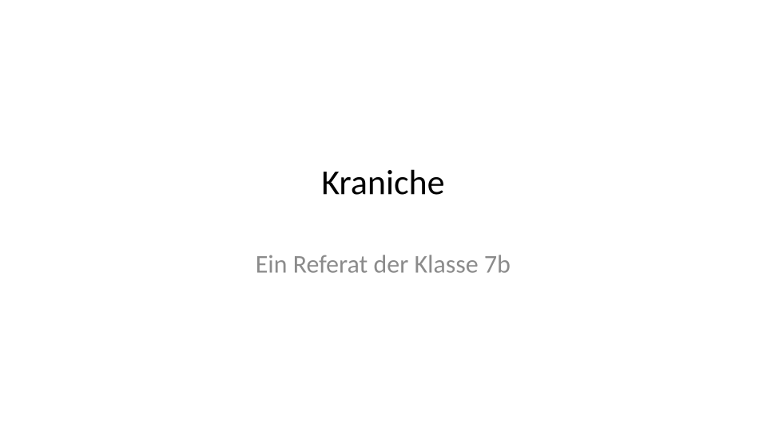
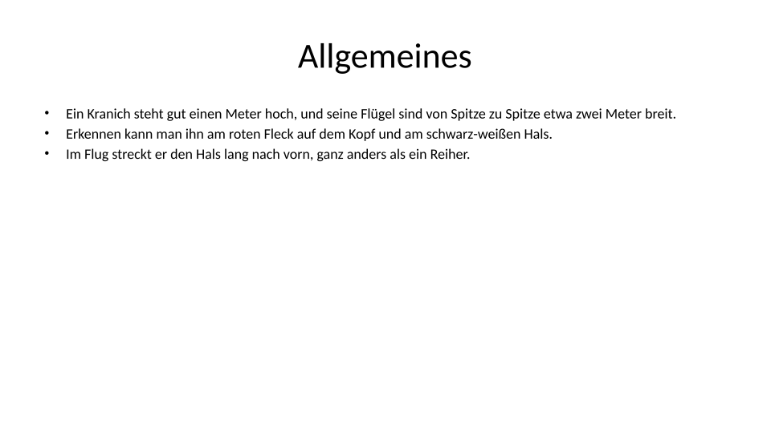
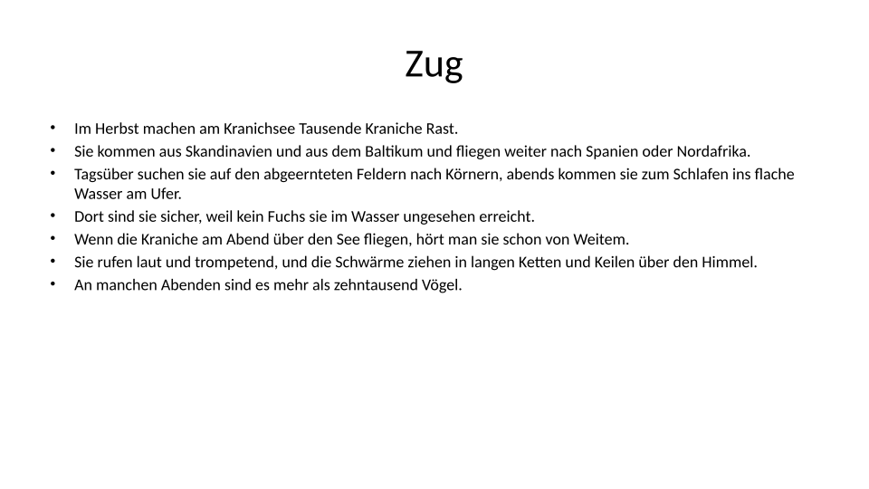
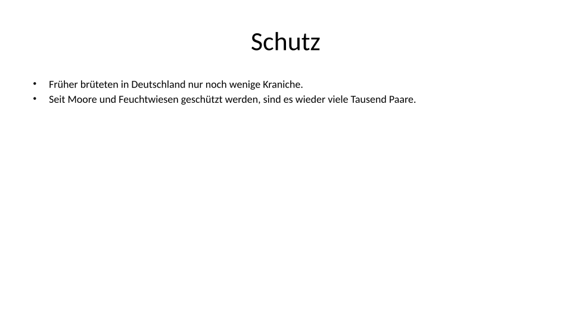
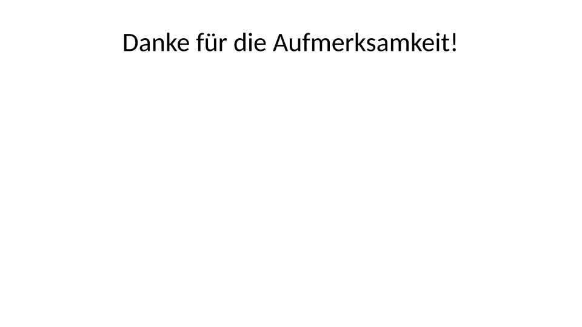
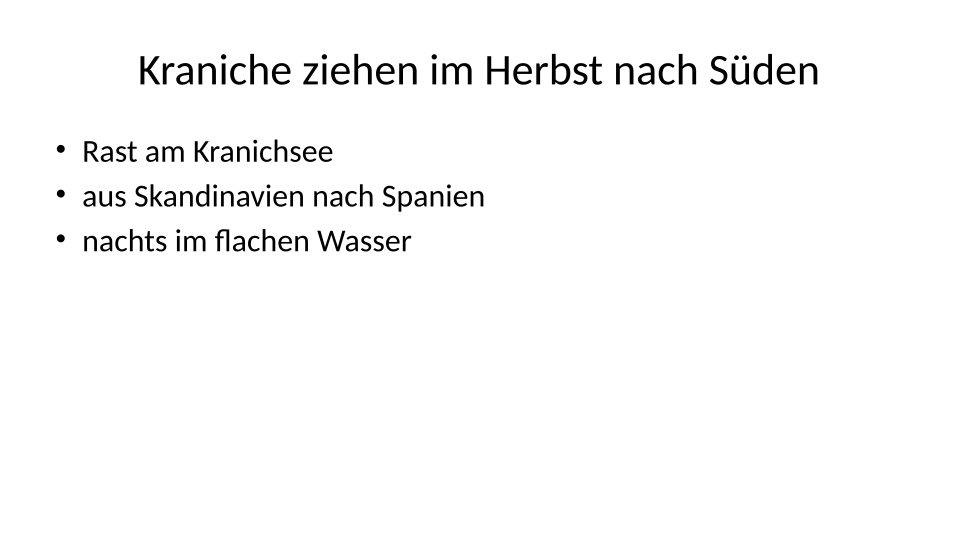

image: teaser.webp
image_alt: "Zwei Folien zum Kranich nebeneinander: links eine Folie voller ganzer Sätze in kleiner Schrift unter dem Titel »Zug«, rechts eine Folie mit dem Titel »Kraniche ziehen im Herbst nach Süden« und drei Stichwörtern"
kind: labor
duration: 1 Stunde (45 Minuten)
curriculum: "Sek I: Standardsoftware (Präsentation); Medienbildung: Präsentieren (Medienspezifische Gestaltungsprinzipien)"
topics: [standardsoftware]
language: LibreOffice / PowerPoint / Nextcloud Office
languages: [libreoffice, word, nextcloud]
office: slides
requires: []
reference: []

# Eine Folie, ein Gedanke

Du machst aus einem Referat voller Sätze Folien, denen man beim Zuhören folgen kann: ein Gedanke pro Folie, ein Titel, der ihn sagt, Stichwörter auf der Folie, groß genug für die letzte Reihe, und ein Spickzettel in den Notizen.

In der 7b hält jemand ein Referat über die Kraniche vom Kranichsee. Die
Folien sind schnell entstanden: Die Sätze aus dem Artikel der Klassenzeitung
stehen einfach darauf, Satz für Satz. So sieht das Referat aus:

<figure><figcaption>Folie 1</figcaption></figure>
<figure><figcaption>Folie 2</figcaption></figure>
<figure><figcaption>Folie 3</figcaption></figure>
<figure><figcaption>Folie 4</figcaption></figure>
<figure><figcaption>Folie 5</figcaption></figure>

Hol dir die Präsentation und öffne sie:

<!-- language: libreoffice -->

<a class='document-starter btn btn-primary' href='/good-slides/01%20Kraniche.odp' download><i class='bi bi-file-earmark-slides' aria-hidden='true'></i>Vorlage herunterladen:01 Kraniche.odp</a>

<!-- /language -->
<!-- language: word -->

<a class='document-starter btn btn-primary' href='/good-slides/01%20Kraniche.pptx' download><i class='bi bi-file-earmark-ppt' aria-hidden='true'></i>Vorlage herunterladen:01 Kraniche.pptx</a>

<!-- /language -->
<!-- language: nextcloud -->

<a class='document-starter btn btn-primary' href='/good-slides/01%20Kraniche.odp' download><i class='bi bi-file-earmark-slides' aria-hidden='true'></i>Vorlage herunterladen:01 Kraniche.odp</a>

<!-- /language -->

## Lesen oder zuhören

Stell dir vor, du stehst vorn und zeigst die dritte Folie.

_task(publikum)

<!-- after: publikum -->
Probier es selbst: Lies das Referat so, wie es dein Publikum an der Wand
liest, Folie für Folie. Danach siehst du, wie lange es dauert, dieselben
Wörter zu sagen.

<ul>
<li>Ein Kranich steht gut einen Meter hoch, und seine Flügel sind von Spitze zu Spitze etwa zwei Meter breit.</li>
<li>Erkennen kann man ihn am roten Fleck auf dem Kopf und am schwarz-weißen Hals.</li>
<li>Im Flug streckt er den Hals lang nach vorn, ganz anders als ein Reiher.</li>
</ul>

<ul>
<li>Im Herbst machen am Kranichsee Tausende Kraniche Rast.</li>
<li>Sie kommen aus Skandinavien und aus dem Baltikum und fliegen weiter nach Spanien oder Nordafrika.</li>
<li>Tagsüber suchen sie auf den abgeernteten Feldern nach Körnern, abends kommen sie zum Schlafen ins flache Wasser am Ufer.</li>
<li>Dort sind sie sicher, weil kein Fuchs sie im Wasser ungesehen erreicht.</li>
<li>Wenn die Kraniche am Abend über den See fliegen, hört man sie schon von Weitem.</li>
<li>Sie rufen laut und trompetend, und die Schwärme ziehen in langen Ketten und Keilen über den Himmel.</li>
<li>An manchen Abenden sind es mehr als zehntausend Vögel.</li>
</ul>

<ul>
<li>Früher brüteten in Deutschland nur noch wenige Kraniche.</li>
<li>Seit Moore und Feuchtwiesen geschützt werden, sind es wieder viele Tausend Paare.</li>
</ul>

Steht ein ganzer Text auf der Folie, liest das Publikum ihn, ob es will oder
nicht. Lesen geht schneller als Sprechen: Wer fertig gelesen hat, wartet,
bis du aufholst, und hört dir dabei nicht mehr richtig zu. Und wer noch liest,
während du weitersprichst, bekommt von deinen Worten wenig mit. Die Folie
macht dir Konkurrenz.
<!-- /after -->

## Was auf eine Folie gehört

Eine Folie hilft dem Publikum, dir zu folgen. Sie ersetzt deinen Vortrag
nicht, sie zeigt, worum es gerade geht. Daraus folgen drei Regeln:

- **Ein Gedanke pro Folie.** Die Folie »Zug« erzählt zwei: wie die Kraniche
  im Herbst ziehen und wie man sie am Abend hört. Daraus werden zwei Folien.
- **Der Titel sagt den Gedanken.** »Zug« nennt nur ein Thema. Ein Titel wie
  »Kraniche ziehen im Herbst nach Süden« sagt, was man sich merken soll. Wer
  nur die Titel liest, kennt schon den Kern deines Vortrags.
- **Stichwörter statt Sätze.** Auf der Folie stehen ein paar Stichwörter,
  mit dem Titel höchstens 25 Wörter. Die ganzen Sätze sagst du.

Noch besser als Stichwörter ist oft ein Bild mit ganz wenig Text: ein Foto
der Kraniche am Abendhimmel sagt mehr als »Ketten und Keile am Himmel«. Um
Bilder auf Folien geht es auf einem späteren Blatt; hier kommt zuerst der
Text von der Folie herunter.

_task(titel)

<strong>Ein Wort pro Folie.</strong> Der japanische Programmierer Masayoshi Takahashi bereitete einen kurzen Vortrag für die RubyConf vor, eine Konferenz über die Programmiersprache Ruby. Auf seine Folien schrieb er nur ein oder zwei kurze Wörter, in riesiger Schrift, ohne Bilder und ohne Diagramme. So eine Folie ist in einem Augenblick gelesen, und danach hört das Publikum wieder zu. Auf Konferenzen von Entwicklerinnen und Entwicklern halten seitdem viele ihre Vorträge so; man nennt es die Takahashi-Methode. Für dein Referat ist ein Wort pro Folie zu wenig, aber die Methode zeigt, wie wenig auf einer Folie stehen muss.

## Ein Spickzettel in den Notizen

Die ganzen Sätze kommen von der Folie herunter; was in ihnen steht, erzählst
du frei. Damit du nichts vergisst, gibt es unter jeder Folie die
**Notizen**. Das Publikum sieht sie nicht, du siehst sie beim Üben und beim
Vortrag auf deinem eigenen Bildschirm. In die Notizen gehören ein paar
Stichpunkte, die dich erinnern, was du erzählen willst, wie auf einem
Spickzettel. Ganze Sätze gehören nicht hinein: Wer abliest, schaut auf den
Bildschirm statt ins Publikum und klingt wie vorgelesen.

<figure class='slide-with-notes'>

NotizenTausende rasten am See Skandinavien, Baltikum: weiter nach Spanien, Nordafrika tagsüber Körner auf den Feldern im Wasser sicher vor dem Fuchs

<figcaption>Die erste Hälfte der Folie »Zug«: oben, was das Publikum sieht, unten der Spickzettel für dich.</figcaption>
</figure>

<!-- language: libreoffice -->
In LibreOffice zeigt *Ansicht* <i class='bi bi-chevron-right' aria-hidden='true'></i> *Notizen* die Folie mit dem Feld für die Notizen darunter; *Ansicht* <i class='bi bi-chevron-right' aria-hidden='true'></i> *Normal* führt zurück. Eine Folie verdoppelst du mit *Folie* <i class='bi bi-chevron-right' aria-hidden='true'></i> *Folie doppeln*.
<!-- /language -->
<!-- language: word -->
In PowerPoint öffnet *Notizen* unten in der Statusleiste das Feld unter der Folie. Eine Folie verdoppelst du mit einem Rechtsklick auf sie in der Leiste links und *Folie duplizieren*.
<!-- /language -->
<!-- language: nextcloud -->
In Nextcloud Office zeigt *Ansicht* <i class='bi bi-chevron-right' aria-hidden='true'></i> *Notizen* die Folie mit dem Feld für die Notizen darunter. Eine Folie verdoppelst du mit einem Rechtsklick auf sie in der Leiste links und *Folie doppeln*.
<!-- /language -->

**Jetzt bist du dran:** Mach aus der Folie »Zug« zwei Folien, eine zum Zug
und eine zu den Rufen. Lösch auf jeder Folie die ganzen Sätze; auf die Folie
schreibst du drei Stichwörter und einen Titel, der den Gedanken sagt. Was
du darüber hinaus erzählen willst, kommt als Stichpunkte in die Notizen,
damit nichts verloren geht. Danach kommen »Allgemeines« und »Schutz« dran.

## Groß genug für die letzte Reihe

Die Sätze der Vorlage sind 18 pt groß; jemand hat sie kleiner gemacht, damit
alles auf die Folie passt. Das Layout sieht für den Text 28 bis 32 pt vor,
und das hat einen Grund: Die Folie hängt vorn an der Wand, und auch die
letzte Reihe soll sie lesen können. Wenige Stichwörter brauchen wenig Platz
und dürfen groß sein. Halte dich an mindestens **24 pt**.

Passt zu viel Text nicht in den Rahmen, macht das Programm die Schrift oft
kleiner, ohne zu fragen. Die Prüfung misst die Schrift so, wie sie auf der
Folie zu sehen ist; kleiner gemachter Text zählt mit seiner kleinen Größe.

<strong>Ausprobieren:</strong> Zeig eine Folie mit 18 pt und eine mit 28 pt am Beamer und setz dich in die letzte Reihe. Achte darauf, welche Wörter du ohne Mühe lesen kannst.

## Prüfen

Speichere deine Präsentation und lass sie prüfen. Die Prüfung liest jede
Folie: ihren Titel, wie viele Wörter auf ihr stehen, wie groß die Schrift
ist, ob Text aus seinem Rahmen läuft, ob alles, was du erzählen willst,
noch auf den Folien oder in den Notizen steht, und ob die Notizen ein
Spickzettel geblieben sind.

_task(folien)
