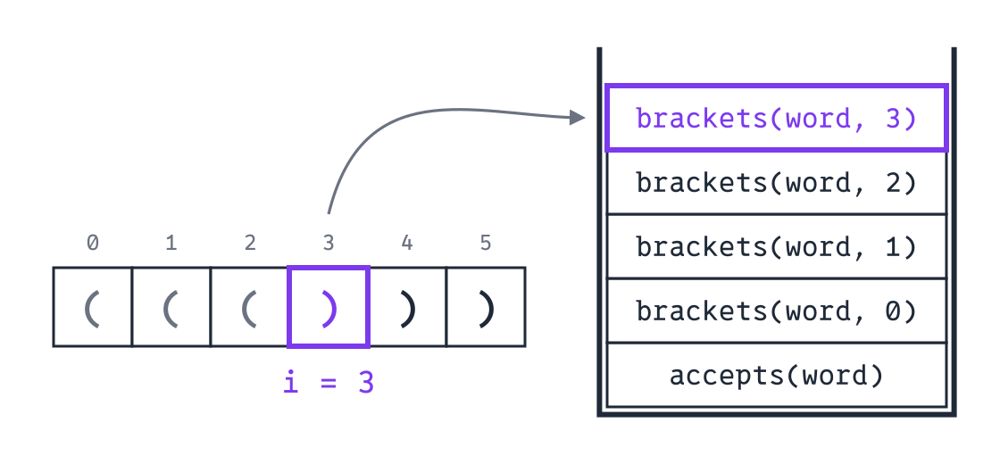
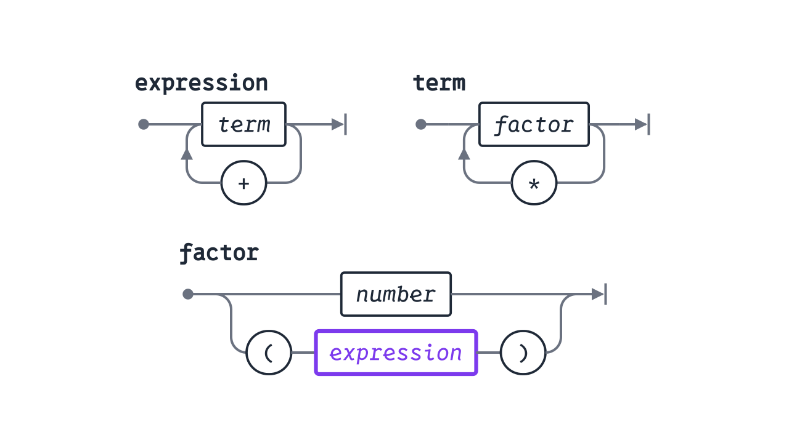

<div class='meta'>
image: teaser.webp
image_alt: "Drei Syntaxdiagramme in grauen Linien: expression mit einem Kasten term und einem Weg zurück über ein +, term mit einem Kasten factor und einem Weg zurück über ein *, darunter factor mit zwei Wegen, einer durch number, einer durch eine runde Klammer auf, einen violetten Kasten expression und eine runde Klammer zu."
kind: projekt
language: Ruby / Python
languages: [ruby, python]
duration: 2 Doppelstunden
curriculum: "Oberstufe: Syntax und Semantik (Grammatik, EBNF, Syntaxdiagramme, Syntaxbaum, rekursiver Abstieg), Sprachen und Automaten (natürliche und formale Sprachen, kontextfreie Grammatiken), Vertiefung Theoretische Informatik (Chomsky-Hierarchie, Mehrdeutigkeit)"
requires: [kellerautomat]
reference: [automaten, listen, ruby-python]
</div>

<div
    class="autotoc-secondary-trigger"
    data-title="Auf dieser Seite"
    data-levels="h2,h3">
</div>

<script src='/include/syntax_diagram.js'></script>

# Grammatiken

<p class='abstract'>
Woher weiß Python, dass <code>print((1 + 2) * 3)</code> ein Programm ist und <code>print((1 + 2) *)</code> nicht? Hinter jeder Programmiersprache stehen Regeln, die festlegen, welche Texte dazugehören: eine Grammatik. Du liest und schreibst Grammatiken in EBNF und als Syntaxdiagramme und baust in Ruby oder Python aus einer Grammatik ein Programm, das Ausdrücke wie <code>2+3*(4+5)</code> prüft, mit einer Funktion für jede Regel.
</p>

In [Kellerautomaten](/kellerautomat) hast du Klammern mit einer Maschine geprüft: Sie liest ein Wort Zeichen für Zeichen, legt Klammern auf einen Stack und sagt am Ende Ja oder Nein. Eine **Grammatik** beschreibt eine Sprache von der anderen Seite: mit Regeln, nach denen man alle Wörter der Sprache bauen kann. Jede Programmiersprache hat eine. Für Python steht sie vollständig in der Dokumentation, unter [Full Grammar specification](https://docs.python.org/3/reference/grammar.html), und das Datenformat JSON ist auf [json.org](https://www.json.org/json-de.html) ganz als Bilder solcher Regeln beschrieben, als Syntaxdiagramme.

## Einrichten

Lege im Terminal (<kbd>Strg</kbd><kbd>J</kbd>) einen Ordner an und öffne ihn mit <kbd>Strg</kbd><kbd>K</kbd> <kbd>Strg</kbd><kbd>O</kbd>:

```bash
mkdir /workspace/grammatiken
```

<!-- language: ruby -->
Alle Dateien dieser Aktivität kommen in diesen Ordner. Ein Programm startest du im Terminal mit `ruby` und dem Namen der Datei.
<!-- /language -->
<!-- language: python -->
Alle Dateien dieser Aktivität kommen in diesen Ordner. Ein Programm startest du im Terminal mit `python3` und dem Namen der Datei.
<!-- /language -->

## Regeln, die Sätze bauen

Eine Grammatik für eine winzige Sprache, deren Sätze aus drei Wörtern bestehen:

```ebnf
sentence = subject verb object
subject  = "Pip" | "Bello"
verb     = "findet" | "sucht"
object   = "Bello" | "die Lampe" | "den Weg"
```

Jede Zeile ist eine **Regel**. Links vom `=` steht ein Name, ein **Nichtterminal**: Es steht für einen Teil des Satzes, der noch gebaut werden muss. In Anführungszeichen stehen **Terminale**, die so, wie sie sind, im Satz landen. `|` heißt »oder«. Die erste Regel ist die, mit der man anfängt; ihr Name heißt **Startsymbol**. Die Namen im Code sind englisch, so wie die Namen der Funktionen, die du gleich daraus machst.

Einen Satz baut man, indem man beim Startsymbol beginnt und immer ein Nichtterminal durch das ersetzt, was rechts in seiner Regel steht, bei `|` durch eine der Möglichkeiten. Sind nur noch Terminale übrig, ist der Satz fertig. Diese Kette heißt **Ableitung**:

```ebnf
sentence
⇒ subject verb object
⇒ "Pip" verb object
⇒ "Pip" "findet" object
⇒ "Pip" "findet" "die Lampe"
```

Alle Sätze, die sich so ableiten lassen, sind die **Sprache** der Grammatik.

_task(saetze)

Dieselbe Ableitung als Baum heißt **Syntaxbaum**. Oben steht das Startsymbol, darunter, wodurch es ersetzt wurde. Nichtterminale stehen in eckigen Kästen, Terminale in runden; von links nach rechts gelesen ergeben die runden Kästen den Satz:

```syntaxbaum
sentence(subject("Pip") verb("findet") object("die Lampe"))
```

Die Grammatik erlaubt auch »Bello findet Bello«. Der Satz ist richtig gebaut, aber ob er etwas Sinnvolles sagt, steht nicht in der Grammatik. Wie ein Text gebaut ist, heißt seine **Syntax**, was er bedeutet, seine **Semantik**. In Programmen ist es genauso: `print(1 / 0)` ist nach der Grammatik von Python ein richtiges Programm, und erst beim Ausführen stellt sich heraus, dass es nichts bedeutet, was der Rechner tun könnte.

Diese Schreibweise geht auf John Backus zurück. 1959 schlug er sie vor, um die Programmiersprache ALGOL festzulegen, und Peter Naur benutzte sie 1960 im Bericht über ALGOL 60, den er herausgab. Seitdem heißt sie **Backus-Naur-Form**, kurz BNF.

_person(backus)

_person(naur)

<div class='book'>
<i class='bi bi-file-earmark-text'></i>
<p><strong>Report on the Algorithmic Language ALGOL 60</strong>, herausgegeben von Peter Naur, Communications of the ACM, 1960. Der Bericht, der eine ganze Programmiersprache auf wenigen Seiten in BNF festlegt; unter seinen Autoren sind auch Bauer und Samelson, die den Keller erfanden. <a href='https://doi.org/10.1145/367236.367262'>Bei der ACM</a>, und die überarbeitete Fassung von 1963 <a href='https://www.masswerk.at/algol60/report.htm'>zum Lesen im Browser</a>.</p>
</div>

## Wörter ohne Ende

Die Sprache der Sätze oben hat nur endlich viele Wörter. Für eine Programmiersprache reicht das nicht: Es gibt unendlich viele Programme. Dafür hat die Schreibweise drei Klammern, mit denen auch [Ein Rechner für Ausdrücke](/calculator) arbeitet:

<table class='table' style='width: auto;'>
<tr><th>In der Regel</th><th>heißt</th></tr>
<tr><td><code>{ … }</code></td><td>beliebig oft, auch keinmal</td></tr>
<tr><td><code>[ … ]</code></td><td>einmal oder keinmal</td></tr>
<tr><td><code>( … )</code></td><td>zusammen, etwa <code>( "+" | "-" )</code> für ein Plus oder ein Minus</td></tr>
</table>

Weil die Klammern zur Schreibweise gehören, steht eine Klammer, die selbst im Wort vorkommt, in Anführungszeichen: `"("` ist ein Terminal, `(` gehört zur Regel. Mit diesen Klammern heißt die Schreibweise **EBNF**, erweiterte Backus-Naur-Form; vorgeschlagen hat sie Niklaus Wirth 1977.

<div class='book'>
<i class='bi bi-file-earmark-text'></i>
<p><strong>What can we do about the unnecessary diversity of notation for syntactic definitions?</strong>, Niklaus Wirth, Communications of the ACM, 1977. Darin schlägt Wirth EBNF vor, mit <code>{ }</code>, <code>[ ]</code> und <code>( )</code>, weil fast jedes Buch über Programmiersprachen seine eigene Schreibweise für Grammatiken hatte: <a href='https://doi.org/10.1145/359863.359883'>bei der ACM</a>.</p>
</div>

Die Klammerwörter aus dem Kellerautomaten, `()`, `(())()` und so weiter, beschreibt eine einzige Regel:

```ebnf
brackets = { "(" brackets ")" }
```

Ein Klammerwort ist eine Reihe von Klammerpaaren, beliebig viele, und in jedem Paar steht wieder ein Klammerwort. Die Regel benutzt sich selbst, sie ist **rekursiv**. So beschreibt eine Grammatik mit einer einzigen Zeile unendlich viele Wörter. Der Syntaxbaum von `(())()`: Das äußere `brackets` nimmt zwei Paare, das linke enthält ein Paar, alle anderen keins.

```syntaxbaum
brackets("(" brackets("(" brackets ")") ")" "(" brackets ")")
```

## Syntaxdiagramme

Niklaus Wirth hat Grammatiken auch gezeichnet, zuerst für seine Sprache Pascal. Ein **Syntaxdiagramm** liest man von links nach rechts, die Linien entlang: Wo sich ein Weg teilt, wählst du einen. Ein runder Kasten ist ein Terminal, das so im Wort steht. Ein eckiger ist ein Nichtterminal: Dort gehst du durch dessen eigenes Diagramm und kommst danach zurück. So sieht eine Grammatik für Zahlen aus:

```ebnf
number = digit { digit }
digit  = "0" | "1" | … | "9"
```

```syntaxdiagramm
number = digit { digit }
digit  = "0" | "1" | … | "9"
```

Bei `number` geht es einmal durch `digit` und danach unten zurück, so oft du willst. So zeichnete Wirth `x { x }`: Ein Pfeil auf dem Weg zurück zeigt die Richtung. Die `…` stehen für die Ziffern 2 bis 8, die das Bild auslässt.

_person(wirth)

Ein Syntaxdiagramm und eine Regel in EBNF sagen dasselbe; man kann jedes in das andere übersetzen. Diese Zahlen haben ein Vorzeichen, wenn man will, und ein Komma, wie man sie im Deutschen schreibt:

```syntaxdiagramm
decimal = [ "-" ] digit { digit } [ "," digit { digit } ]
```

_task(diagramm-lesen)

Jetzt in die andere Richtung. Dieses Diagramm beschreibt Listen von Zahlen zwischen spitzen Klammern, mit Semikolons dazwischen:

```syntaxdiagramm
list = "<" [ number { ";" number } ] ">"
```

_task(diagramm-ebnf)

## Ein Programm für jede Regel

Aus einer Grammatik lässt sich fast von selbst ein Programm machen, das prüft, ob ein Wort zur Sprache gehört. Jede Regel wird eine Funktion. Sie bekommt das Wort und einen Index `i` und liest ab dort, was ihre Regel erlaubt. Zurück gibt sie den Index hinter dem, was sie gelesen hat, und wenn das Wort an der Stelle nicht passt, nichts. Ein Nichtterminal in der Regel wird ein Aufruf seiner Funktion. Eine kleine Hilfsfunktion `peek` zeigt das nächste Zeichen, ohne es zu lesen; am Ende des Worts gibt sie einen leeren String zurück.

So wird jedes Stück einer Regel zu Code:

<table class='table' style='width: auto;'>
<tr><th>In der Regel</th><th>In der Funktion</th></tr>
<tr><td>ein Terminal, etwa <code>"("</code></td><td>Ist <code>peek(word, i)</code> genau dieses Zeichen, geht es bei <code>i + 1</code> weiter; sonst passt das Wort nicht.</td></tr>
<tr><td>ein Nichtterminal, etwa <code>brackets</code></td><td><code>i = brackets(word, i)</code>; passt es nicht, passt auch das Ganze nicht.</td></tr>
<tr><td><code>{ … }</code></td><td>eine Schleife: solange das nächste Zeichen eines ist, mit dem <code>…</code> anfangen kann</td></tr>
<tr><td><code>[ … ]</code></td><td>ein <code>if</code> mit derselben Frage</td></tr>
<tr><td><code>a | b</code></td><td><code>if</code> und <code>else</code>: Das nächste Zeichen entscheidet, ob <code>a</code> oder <code>b</code> kommt.</td></tr>
</table>

<!-- language: ruby -->
Lege `brackets.rb` an:

```ruby
# Wörter aus Klammerpaaren, nach der Grammatik
#   brackets = { "(" brackets ")" }
# Jede Funktion liest ab dem Index i, was ihre Regel erlaubt, und gibt den
# Index dahinter zurück, oder nil, wenn das Wort dort nicht passt.

# Das Zeichen am Index i, am Ende des Worts ein leerer String
def peek(word, i)
    word[i] || ''
end

# brackets = { "(" brackets ")" }
def brackets(word, i)
    while peek(word, i) == '('
        i = brackets(word, i + 1)
        return nil if i.nil? || peek(word, i) != ')'
        i += 1
    end
    i
end

# Das Wort gehört dazu, wenn brackets es bis zum Ende liest
def accepts(word)
    brackets(word, 0) == word.length
end

['(())()', '(()', '())', ''].each do |word|
    puts "#{word.inspect} #{accepts(word)}"
end
```

`word[i]` ist hinter dem Ende des Worts `nil`, darum gibt `peek` dort `''` zurück. Die Schleife in `brackets` ist das `{ … }` der Regel: Solange eine `(` kommt, liest sie ein Paar. Nach der `(` ruft `brackets` sich selbst auf, für das Klammerwort im Paar, und danach muss eine `)` kommen. Starte es mit `ruby brackets.rb`:
<!-- /language -->
<!-- language: python -->
Lege `brackets.py` an:

```python
# Wörter aus Klammerpaaren, nach der Grammatik
#   brackets = { "(" brackets ")" }
# Jede Funktion liest ab dem Index i, was ihre Regel erlaubt, und gibt den
# Index dahinter zurück, oder None, wenn das Wort dort nicht passt.

# Das Zeichen am Index i, am Ende des Worts ein leerer String
def peek(word, i):
    return word[i] if i < len(word) else ''


# brackets = { "(" brackets ")" }
def brackets(word, i):
    while peek(word, i) == '(':
        i = brackets(word, i + 1)
        if i is None or peek(word, i) != ')':
            return None
        i += 1
    return i


# Das Wort gehört dazu, wenn brackets es bis zum Ende liest
def accepts(word):
    return brackets(word, 0) == len(word)


for word in ['(())()', '(()', '())', '']:
    print(repr(word), accepts(word))
```

`word[i]` gäbe hinter dem Ende des Worts einen Fehler, darum fragt `peek` erst nach der Länge. Die Schleife in `brackets` ist das `{ … }` der Regel: Solange eine `(` kommt, liest sie ein Paar. Nach der `(` ruft `brackets` sich selbst auf, für das Klammerwort im Paar, und danach muss eine `)` kommen. Starte es mit `python3 brackets.py`:
<!-- /language -->

```text
"(())()" true
"(()" false
"())" false
"" true
```

Bei `())` liest `brackets` ein Paar und hört vor der zweiten `)` auf, weil danach keine `(` mehr kommt. Es gibt 2 zurück, das Wort ist aber 3 Zeichen lang: Darum prüft `accepts`, ob das ganze Wort gelesen ist.

_task(tiefe)

<!-- after: tiefe -->
Vier. Bei der ersten `)`, am Index 3, ist jeder Aufruf, der eine `(` gelesen hat, noch offen und wartet auf seine `)`, und der Aufruf für das innerste Klammerwort liest gerade:



Wie viele Aufrufe offen sind, merkt sich das Programm auf dem **Stack der Aufrufe**: Jeder Aufruf, der noch nicht fertig ist, liegt darauf, bis er zurückkehrt. Das ist der Stack des Kellerautomaten, nur dass jetzt Aufrufe darauf liegen statt Klammern. Eine Regel, die sich selbst aufruft, braucht ihn; ein endlicher Automat hat keinen.
<!-- /after -->

### Jetzt du: Zahlen

<!-- language: ruby -->
Lege `number.rb` mit diesem Anfang an; `peek` kopierst du aus `brackets.rb`:

<!-- page-code: own -->
```ruby
# Zahlen aus Ziffern, nach der Grammatik
#   number = digit { digit }
#   digit  = "0" | "1" | … | "9"

# Das Zeichen am Index i, am Ende des Worts ein leerer String
def peek(word, i)
    word[i] || ''
end

# hier: digit und number

p number('123', 0)
p number('12a', 0)
p number('a1', 0)
```

<div class='hint own' data-check='number'>
<strong>Jetzt bist du dran:</strong> Schreib die Funktionen <code>digit(word, i)</code> und <code>number(word, i)</code> nach ihren Regeln. <code>digit</code> liest eine Ziffer, <code>number</code> so viele Ziffern, wie hintereinander kommen, mindestens eine. Beide geben den Index dahinter zurück, oder <code>nil</code>. Am Ende soll das Programm <code>3</code>, <code>2</code> und <code>nil</code> ausgeben.
</div>

<!-- hint -->
Geh `12a` von Hand durch, ab dem Index 0: Am Index 0 steht eine Ziffer, am Index 1 auch, am Index 2 keine mehr. Also hört `number` vor dem Index 2 auf und gibt 2 zurück. Bei `a1` steht am Index 0 keine Ziffer; dann ist es keine Zahl.
<!-- /hint -->
<!-- hint -->
Ob ein Zeichen eine Ziffer ist, sagt `peek(word, i).between?('0', '9')`; für den leeren String am Ende ist das `false`. `number = digit { digit }` heißt: einmal `digit`, und wenn das `nil` gibt, `nil` zurückgeben; danach eine Schleife, solange die nächste Ziffer kommt, wie in `brackets`.
<!-- /hint -->
<!-- hint -->
Ein Gerüst:

```ruby
def digit(word, i)
    return nil unless …
    i + 1
end

def number(word, i)
    i = digit(word, i)
    return nil if i.nil?
    i = digit(word, i) while …
    i
end
```
<!-- /hint -->

<!-- solution -->
```ruby
# digit = "0" | "1" | … | "9"
def digit(word, i)
    return nil unless peek(word, i).between?('0', '9')
    i + 1
end

# number = digit { digit }
def number(word, i)
    i = digit(word, i)
    return nil if i.nil?
    i = digit(word, i) while peek(word, i).between?('0', '9')
    i
end
```
<!-- /solution -->
<!-- /language -->
<!-- language: python -->
Lege `number.py` mit diesem Anfang an; `peek` kopierst du aus `brackets.py`:

<!-- page-code: own -->
```python
# Zahlen aus Ziffern, nach der Grammatik
#   number = digit { digit }
#   digit  = "0" | "1" | … | "9"

# Das Zeichen am Index i, am Ende des Worts ein leerer String
def peek(word, i):
    return word[i] if i < len(word) else ''


# hier: digit und number

print(number('123', 0))
print(number('12a', 0))
print(number('a1', 0))
```

<div class='hint own' data-check='number'>
<strong>Jetzt bist du dran:</strong> Schreib die Funktionen <code>digit(word, i)</code> und <code>number(word, i)</code> nach ihren Regeln. <code>digit</code> liest eine Ziffer, <code>number</code> so viele Ziffern, wie hintereinander kommen, mindestens eine. Beide geben den Index dahinter zurück, oder <code>None</code>. Am Ende soll das Programm <code>3</code>, <code>2</code> und <code>None</code> ausgeben.
</div>

<!-- hint -->
Geh `12a` von Hand durch, ab dem Index 0: Am Index 0 steht eine Ziffer, am Index 1 auch, am Index 2 keine mehr. Also hört `number` vor dem Index 2 auf und gibt 2 zurück. Bei `a1` steht am Index 0 keine Ziffer; dann ist es keine Zahl.
<!-- /hint -->
<!-- hint -->
Ob ein Zeichen eine Ziffer ist, sagt `'0' <= peek(word, i) <= '9'`; für den leeren String am Ende ist das `False`. `number = digit { digit }` heißt: einmal `digit`, und wenn das `None` gibt, `None` zurückgeben; danach eine Schleife, solange die nächste Ziffer kommt, wie in `brackets`.
<!-- /hint -->
<!-- hint -->
Ein Gerüst:

```python
def digit(word, i):
    if not …:
        return None
    return i + 1


def number(word, i):
    i = digit(word, i)
    if i is None:
        return None
    while …:
        i = digit(word, i)
    return i
```
<!-- /hint -->

<!-- solution -->
```python
# digit = "0" | "1" | … | "9"
def digit(word, i):
    if not '0' <= peek(word, i) <= '9':
        return None
    return i + 1


# number = digit { digit }
def number(word, i):
    i = digit(word, i)
    if i is None:
        return None
    while '0' <= peek(word, i) <= '9':
        i = digit(word, i)
    return i
```
<!-- /solution -->
<!-- /language -->

_task(number)

## Ausdrücke

Jetzt eine Sprache, die schon nach Programmieren aussieht: Ausdrücke aus Zahlen mit `+`, `*` und runden Klammern, ohne Leerzeichen, etwa `2+3*4` oder `(1+2)*3`.

```ebnf
expression = term { "+" term }
term       = factor { "*" factor }
factor     = number | "(" expression ")"
```

```syntaxdiagramm
expression = term { "+" term }
term       = factor { "*" factor }
factor     = number | "(" expression ")"
```

Ein Ausdruck ist eine Summe aus Termen, ein Term ein Produkt aus Faktoren, und ein Faktor ist eine Zahl oder wieder ein ganzer Ausdruck in Klammern. Dass Multiplizieren stärker bindet als Plus, steht damit in der Grammatik selbst: Ein Term sammelt alle Faktoren mit `*` ein, bevor das nächste `+` drankommt. Der Syntaxbaum von `2+3*4` zeigt es: Das `*` hängt tiefer, in einem Term, und wird zuerst gerechnet.

```syntaxbaum
expression(term(factor(number("2"))) "+" term(factor(number("3")) "*" factor(number("4"))))
```

Die Zahlen sind hier Blätter; ihre Ziffern bis hinunter zu `digit` lässt der Baum weg.

<!-- language: ruby -->
Kopiere `number.rb` nach `expression.rb`, zum Beispiel mit `cp number.rb expression.rb` im Terminal, und ersetze die Zeilen am Ende durch diese:

```ruby
['2+3*4', '(1+2)*3', '2+', '(1+2', '2*+3'].each do |word|
    puts "#{word.inspect} #{accepts(word)}"
end
```
<!-- /language -->
<!-- language: python -->
Kopiere `number.py` nach `expression.py`, zum Beispiel mit `cp number.py expression.py` im Terminal, und ersetze die Zeilen am Ende durch diese:

```python
for word in ['2+3*4', '(1+2)*3', '2+', '(1+2', '2*+3']:
    print(repr(word), accepts(word))
```
<!-- /language -->

_task(ausdruck)

<!-- language: ruby -->
<div class='hint try'>
<strong>Ausprobieren:</strong> Schreib die Regel für Ausdrücke einmal anders, so wie man es sagen würde: Ein Ausdruck ist ein Ausdruck, ein <code>+</code> und ein Term, also <code>expression = expression "+" term | term</code>. Lass dazu <code>expression</code> als Erstes <code>expression(word, i)</code> aufrufen und starte das Programm. Achte darauf, welcher Fehler kommt und welche Funktion in den Zeilen darüber immer wieder steht. Stell <code>expression</code> danach wieder zurück.
</div>
<!-- /language -->
<!-- language: python -->
<div class='hint try'>
<strong>Ausprobieren:</strong> Schreib die Regel für Ausdrücke einmal anders, so wie man es sagen würde: Ein Ausdruck ist ein Ausdruck, ein <code>+</code> und ein Term, also <code>expression = expression "+" term | term</code>. Lass dazu <code>expression</code> als Erstes <code>expression(word, i)</code> aufrufen und starte das Programm. Achte darauf, welcher Fehler kommt und welche Funktion in den Zeilen darüber immer wieder steht. Stell <code>expression</code> danach wieder zurück.
</div>
<!-- /language -->

Eine Funktion, die sich als Erstes selbst aufruft, mit demselben Index, kommt nie zu einem Zeichen: Sie ruft sich auf, bis der Stack der Aufrufe voll ist. Darum schreibt man solche Regeln in EBNF mit `{ … }`, als Schleife. Ein Programm, das so für jede Regel eine Funktion hat und die Funktionen sich gegenseitig aufrufen lässt, heißt **rekursiver Abstieg**: Es steigt von der Regel für das Ganze zu den Regeln für die Teile hinab.

## Ein Ausdruck, zwei Bäume

Warum so umständlich mit `term` und `factor`? Kürzer ginge es so:

```ebnf
expression = expression "+" expression | expression "*" expression | number
```

_task(baeume)

<!-- after: baeume -->
Zwei. In dem einen hängt das `*` tiefer, wie es sein soll:

```syntaxbaum
expression(expression(number("2")) "+" expression(expression(number("3")) "*" expression(number("4"))))
```

Im anderen hängt das `+` tiefer, und wer diesen Baum ausrechnet, rechnet erst 2 + 3 und dann mal 4, also 20 statt 14:

```syntaxbaum
expression(expression(expression(number("2")) "+" expression(number("3"))) "*" expression(number("4")))
```

Eine Grammatik, nach der ein Wort zwei verschiedene Syntaxbäume haben kann, heißt **mehrdeutig**. Für eine Programmiersprache ist das schlecht: Der Baum entscheidet, was ein Programm tut. Die Grammatik mit `term` und `factor` erzeugt dieselben Wörter, aber für jedes nur einen Baum, den mit Punkt vor Strich.
<!-- /after -->

## Grammatiken und Automaten

Noam Chomsky, ein Sprachwissenschaftler, hat 1956 Grammatiken danach geordnet, was ihre Regeln dürfen. Jede Stufe passt zu einer Art von Automaten, der genau ihre Sprachen erkennt:

<table class='table' style='width: auto;'>
<tr><th>Typ</th><th>Die Regeln</th><th>Erkennt sie</th><th>Zum Beispiel</th></tr>
<tr><td>3, regulär</td><td>Rechts steht ein Terminal, höchstens gefolgt von einem Nichtterminal, etwa <code>a = "x" b</code>. In EBNF geht dasselbe mit Schleifen <code>{ … }</code>, solange keine Regel sich selbst mittendrin enthält, auch nicht über andere Regeln.</td><td>ein <a href='/automata'>endlicher Automat</a></td><td>Zahlen, Namen, Zahlenschlösser</td></tr>
<tr><td>2, kontextfrei</td><td>Links steht ein einzelnes Nichtterminal, rechts beliebig viel, auch das Nichtterminal selbst mittendrin.</td><td>ein <a href='/kellerautomat'>Kellerautomat</a></td><td>Klammern, Ausdrücke, Programmiersprachen</td></tr>
<tr><td>1, kontextsensitiv</td><td>Links dürfen mehrere Zeichen stehen, sodass eine Regel nur in einer bestimmten Umgebung gilt; ein Wort wird dabei nie kürzer.</td><td>eine Turingmaschine, deren Band nicht länger ist als das Wort</td><td>a<sup>n</sup>b<sup>n</sup>c<sup>n</sup></td></tr>
<tr><td>0</td><td>beliebige Regeln</td><td>eine <a href='/turingmaschine'>Turingmaschine</a></td><td>alles, was ein Programm überhaupt erkennen kann</td></tr>
</table>

Diese Ordnung heißt **Chomsky-Hierarchie**. Jede Stufe enthält die darunter: Eine reguläre Grammatik ist auch kontextfrei. Alle Grammatiken auf dieser Seite sind kontextfrei; was Programmiersprachen brauchen, liegt auf Stufe 2.

_person(chomsky)

_task(welcher-typ)

<!-- after: welcher-typ -->
In `factor` steht `expression` zwischen zwei Klammern, also mitten in einer Regel, die über `term` und `expression` wieder bei `factor` landet. Ohne diese Klammern wären Ausdrücke eine reguläre Sprache, Zahlen mit `+` und `*` dazwischen, und ein endlicher Automat könnte sie prüfen. Mit ihnen muss sich ein Programm merken, wie viele Klammern offen sind, ohne Grenze, und dafür braucht es einen Stack.
<!-- /after -->

## Zusammenfassung

- Eine **Grammatik** besteht aus Regeln. **Nichtterminale** werden ersetzt, **Terminale** stehen im Wort, das **Startsymbol** ist die Regel, mit der man anfängt. Eine **Ableitung** ersetzt so lange, bis nur Terminale übrig sind; als Baum heißt sie **Syntaxbaum**.
- **EBNF** schreibt Regeln mit `|`, `{ … }`, `[ … ]` und `( … )`. Ein **Syntaxdiagramm** zeichnet dieselbe Regel: runde Kästen für Terminale, eckige für Nichtterminale.
- Die Grammatik legt die **Syntax** fest, wie ein Text gebaut ist, nicht die **Semantik**, was er bedeutet.
- **Rekursiver Abstieg:** Jede Regel wird eine Funktion, jedes Nichtterminal ein Aufruf, `{ … }` eine Schleife. Wie tief die Aufrufe gerade gehen, merkt sich der Stack der Aufrufe.
- Eine Grammatik, nach der ein Wort zwei Syntaxbäume hat, ist **mehrdeutig**.
- Die **Chomsky-Hierarchie** ordnet Grammatiken: reguläre zu endlichen Automaten, kontextfreie zu Kellerautomaten, beliebige zu Turingmaschinen.

## Wie geht es weiter?

- **Ein Rechner für Ausdrücke.** In [Ein Rechner für Ausdrücke](/calculator) bekommt dieselbe Grammatik noch `-` und `/`. Die Funktionen geben dort nicht nur zurück, ob ein Ausdruck passt, sondern bauen seinen Syntaxbaum, und am Ende rechnet der Rechner ihn aus.
- **Eine echte Grammatik lesen.** Auf [json.org](https://www.json.org/json-de.html) steht das Datenformat JSON ganz als Syntaxdiagramme. Versuch, ein Stück JSON aus dem Handbuch unter [JSON](/reference/json) mit dem Finger auf den Diagrammen nachzufahren.

<div class='book'>
<i class='bi bi-book'></i>
<p><strong>Compiler Construction</strong>, Niklaus Wirth, 1996, überarbeitet 2017. Das Buch fängt mit Terminalen, Nichtterminalen und Startsymbol an, kommt über reguläre Sprachen zum rekursiven Abstieg und baut damit einen ganzen Compiler für eine kleine Sprache, bis zu den Befehlen eines Prozessors. Wirth stellt es auf seiner Seite an der ETH Zürich <a href='https://people.inf.ethz.ch/wirth/CompilerConstruction/index.html'>frei zum Lesen</a> bereit.</p>
</div>



<!-- tutorial-step
# Die Musterlösungen aus loesung/ lösen jede Programmieraufgabe, in beiden Sprachen
write-file: grammatiken/brackets.rb <- file:stufen/brackets.rb
write-file: grammatiken/brackets.py <- file:stufen/brackets.py
write-file: grammatiken/number.rb <- file:loesung/number.rb
write-file: grammatiken/number.py <- file:loesung/number.py
write-file: grammatiken/expression.rb <- file:loesung/expression.rb
write-file: grammatiken/expression.py <- file:loesung/expression.py
check-task: number
check-task: number ruby
check-task: ausdruck
check-task: ausdruck ruby
-->
