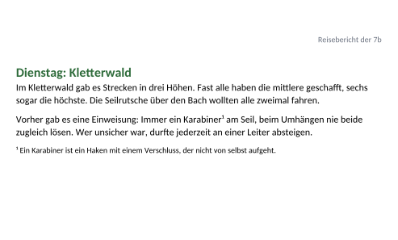
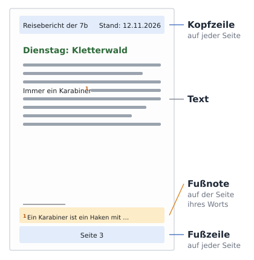
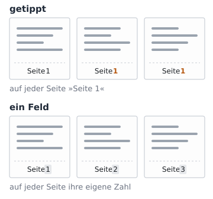
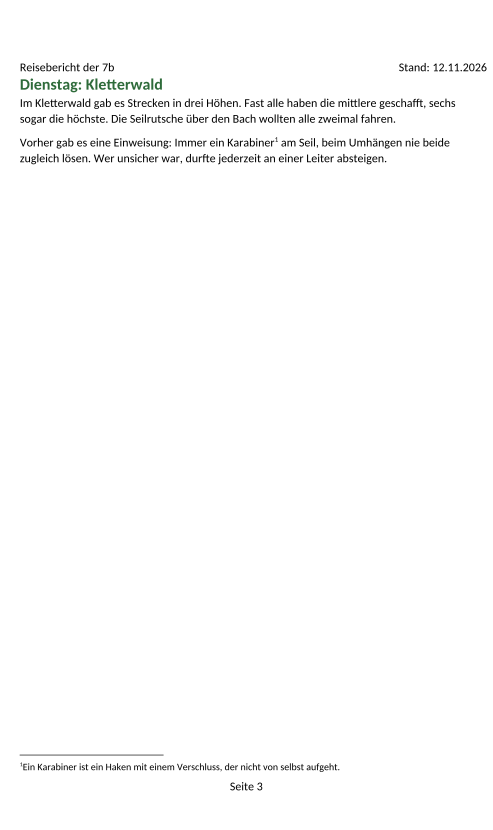

image: teaser.webp
image_alt: "Der Anfang einer Seite des Reiseberichts: oben rechts klein »Reisebericht der 7b«, getippt, darunter »Dienstag: Kletterwald« und ein Absatz mit »Karabiner¹«"
kind: labor
duration: 1 Stunde (45 Minuten)
curriculum: "Sek I: Standardsoftware (Umgang mit Textverarbeitungssoftware); Medienbildung: Produzieren (Gestaltung von Medienproduktionen)"
topics: [standardsoftware]
language: Word / LibreOffice / Nextcloud Office
languages: [word, libreoffice, nextcloud]
requires: [pages-and-contents]
reference: []

# Kopfzeile, Fußzeile, Fußnoten

Der Reisebericht der 7b hat jetzt Seitenumbrüche und ein Inhaltsverzeichnis.
Oben auf jeder Seite steht klein »Reisebericht der 7b«, unten »Seite 1«, und
zwei Wörter haben eine Anmerkung mit einer kleinen Zahl. Das alles hat jemand
von Hand getippt:

_task(kopf)

<!-- after: kopf -->
Die Kopfzeile ist auf jeder Seite dieselbe. Was du in die Kopfzeile einer
Seite schreibst, steht darum auf allen Seiten, auf der ersten genauso wie auf
der letzten.
<!-- /after -->

## Was oben und unten auf jeder Seite steht

Über und unter dem Text hat jede Seite einen eigenen Bereich: oben die
**Kopfzeile**, unten die **Fußzeile**. Sie gehören nicht zum Text, sondern zur
Seite. Was dort steht, steht auf jeder Seite, und wenn der Text länger wird,
bleibt es oben und unten. Hol dir den Bericht:

<a class='document-starter btn btn-primary' href='/headers-and-footnotes/08%20Reisebericht.docx' download><i class='bi bi-file-earmark-word' aria-hidden='true'></i>Vorlage herunterladen:08 Reisebericht.docx</a>

_task(getippt)

<!-- language: word -->
In Word klickst du doppelt in den oberen Rand einer Seite; dann bist du in
der Kopfzeile. Mit einem Doppelklick in den Text kommst du zurück.
<!-- /language -->
<!-- language: libreoffice -->
In LibreOffice schaltest du die Kopfzeile unter *Einfügen* <i class='bi bi-chevron-right' aria-hidden='true'></i> *Kopf-/Fußzeile* <i class='bi bi-chevron-right' aria-hidden='true'></i> *Kopfzeile*
ein und wählst die Seitenvorlage deines Dokuments, meist *Standard*. Dann
klickst du in den Bereich über dem Text.
<!-- /language -->
<!-- language: nextcloud -->
In Nextcloud Office schaltest du die Kopfzeile unter *Einfügen* <i class='bi bi-chevron-right' aria-hidden='true'></i>
*Kopf-/Fußzeile* <i class='bi bi-chevron-right' aria-hidden='true'></i> *Kopfzeile* ein und wählst die Seitenvorlage deines Dokuments,
meist *Standard*. Dann klickst du in den Bereich über dem Text.
<!-- /language -->

**Jetzt bist du dran:** Schreib »Reisebericht der 7b« in die Kopfzeile und lösch
die getippten Zeilen oben auf den Seiten. Steht ein Tag danach nicht mehr oben
auf einer neuen Seite, setz mit <kbd>Strg</kbd>+<kbd>Enter</kbd> wieder einen
Seitenumbruch davor, wie im letzten Blatt.

## Felder: die Seitenzahl und das Datum

Unten auf jeder Seite steht »Seite 1«, auch auf der letzten. Die Fußzeile ist
auf jeder Seite dieselbe; wer dort eine Zahl tippt, bekommt sie auf jede Seite.
Die Seitenzahl ist darum ein **Feld**, wie die Nummer einer Bildunterschrift:
Das Programm setzt auf jeder Seite ihre eigene Zahl ein.

<!-- language: word -->
In Word klickst du doppelt in die Fußzeile, löschst die getippte 1 und wählst
im Register *Einfügen* <i class='bi bi-chevron-right' aria-hidden='true'></i> *Seitenzahl* <i class='bi bi-chevron-right' aria-hidden='true'></i> *Aktuelle Position* eine einfache Zahl.
<!-- /language -->
<!-- language: libreoffice -->
In LibreOffice klickst du in die Fußzeile, löschst die getippte 1 und wählst
*Einfügen* <i class='bi bi-chevron-right' aria-hidden='true'></i> *Feldbefehl* <i class='bi bi-chevron-right' aria-hidden='true'></i> *Seitennummer*.
<!-- /language -->
<!-- language: nextcloud -->
In Nextcloud Office klickst du in die Fußzeile, löschst die getippte 1 und
wählst *Einfügen* <i class='bi bi-chevron-right' aria-hidden='true'></i> *Feldbefehl* <i class='bi bi-chevron-right' aria-hidden='true'></i> *Seitennummer*.
<!-- /language -->

Ein Bericht, der noch wächst, braucht oben einen **Stand**: an welchem Tag
jemand ihn zuletzt angesehen hat. Auch das Datum kann ein Feld sein.

_task(datum)

<!-- after: datum -->
Das Datum als Feld zeigt immer den Tag, an dem jemand das Dokument öffnet oder
druckt. Ein getipptes Datum ist morgen schon alt. Manche Programme fügen auch
ein festes Datum als Feld ein; das bleibt, wie es am Tag des Einfügens war,
und hilft hier nicht.
<!-- /after -->

<!-- language: word -->
In Word wählst du in der Kopfzeile im Register *Einfügen* *Datum und Uhrzeit*,
nimmst ein Format wie 12.11.2026 und setzt den Haken bei *Automatisch
aktualisieren*.
<!-- /language -->
<!-- language: libreoffice -->
In LibreOffice wählst du in der Kopfzeile *Einfügen* <i class='bi bi-chevron-right' aria-hidden='true'></i> *Feldbefehl* <i class='bi bi-chevron-right' aria-hidden='true'></i>
*Weitere Feldbefehle…*, im Register *Dokument* den Typ *Datum* und darunter
*Datum*, nicht *Datum (fix)*, dann *Einfügen*.
<!-- /language -->
<!-- language: nextcloud -->
In Nextcloud Office wählst du in der Kopfzeile *Einfügen* <i class='bi bi-chevron-right' aria-hidden='true'></i> *Feldbefehl* <i class='bi bi-chevron-right' aria-hidden='true'></i>
*Weitere Feldbefehle…*, im Register *Dokument* den Typ *Datum* und darunter
*Datum*, nicht *Datum (fix)*, dann *Einfügen*.
<!-- /language -->

**Jetzt bist du dran:** Mach aus der getippten 1 in der Fußzeile ein Feld.
Schreib in die Kopfzeile hinter »Reisebericht der 7b« »Stand:« und füg
dahinter das Datum als Feld ein.

## Fußnoten

Zwei Wörter im Bericht haben eine Anmerkung: eine kleine Zahl hinter dem Wort
und darunter ein Satz, der es erklärt. Getippt bleibt beides, wo es steht.
Kommt weiter vorn eine Anmerkung dazu, stimmen die Nummern nicht mehr.

Eine **Fußnote**, die das Programm einfügt, setzt die Zahl selbst hinter das
Wort und die Anmerkung unten auf die Seite, über die Fußzeile. Es zählt die
Fußnoten von vorn nach hinten.

_task(wandert)

<!-- after: wandert -->
Das Programm hält jede Fußnote auf der Seite ihres Worts. Eine getippte
Anmerkung bleibt dagegen, wo sie steht, und landet auf der falschen Seite.
<!-- /after -->

<!-- language: word -->
In Word stellst du den Cursor hinter das Wort und wählst im Register
*Referenzen* *Fußnote einfügen*. Der Cursor springt nach unten; dort schreibst
du die Anmerkung.
<!-- /language -->
<!-- language: libreoffice -->
In LibreOffice stellst du den Cursor hinter das Wort und wählst *Einfügen* <i class='bi bi-chevron-right' aria-hidden='true'></i>
*Fuß-/Endnote* <i class='bi bi-chevron-right' aria-hidden='true'></i> *Fußnote*. Der Cursor springt nach unten; dort schreibst du die
Anmerkung.
<!-- /language -->
<!-- language: nextcloud -->
In Nextcloud Office stellst du den Cursor hinter das Wort und wählst
*Einfügen* <i class='bi bi-chevron-right' aria-hidden='true'></i> *Fuß-/Endnote* <i class='bi bi-chevron-right' aria-hidden='true'></i> *Fußnote*. Der Cursor springt nach unten;
dort schreibst du die Anmerkung.
<!-- /language -->

**Jetzt bist du dran:** Lösch beim Karabiner die getippte ¹ und die getippte
Anmerkung darunter und füg an derselben Stelle eine Fußnote mit dem Satz ein.
Mach dasselbe beim Moorpfad.

## Prüfen

_task(bericht)

<!-- after: bericht -->

<strong>Ausprobieren:</strong> Füg im Montag hinter »Jugendherberge« noch eine Fußnote ein: »Eine Jugendherberge ist ein günstiges Haus zum Übernachten für Gruppen.« Achte auf die Nummern beim Karabiner und beim Moorpfad.

<!-- /after -->
