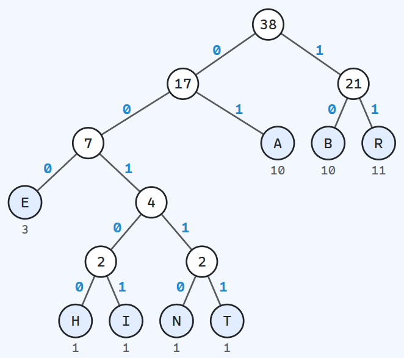

<div class='meta'>
image: teaser.webp:contain
image_alt: "Ein Huffman-Baum mit der Wurzel 38, die Kanten mit 0 und 1 beschriftet, unten die Buchstaben mit ihrer Häufigkeit"
kind: labor
language: Ruby / Python
languages: [ruby, python]
duration: 2 Doppelstunden
</div>

<div
    class="autotoc-secondary-trigger"
    data-title="Auf dieser Seite"
    data-levels="h2,h3">
</div>

<style>
    .hf-stepper {
        margin: 1em 0 1.5em;
    }
    .hf-stepper select {
        font-family: '0xProto Nerd Font Mono', monospace;
        margin-bottom: 0.6em;
    }
    .hf-controls {
        display: flex;
        gap: 0.3em;
        align-items: center;
        flex-wrap: wrap;
        margin-bottom: 0.6em;
    }
    .hf-controls .hf-count {
        margin-left: 0.6em;
        color: var(--bs-secondary-color);
    }
    .hf-say {
        min-height: 3em;
    }
    /* the tree and, at the end, its table beside it, or under it when the
       tree is too wide (its width set by the script) */
    .hf-body {
        display: flex;
        flex-wrap: wrap;
        gap: 0.6em 2.5em;
        align-items: flex-start;
    }
    .hf-forest {
        flex: 0 1 auto;
        max-width: 100%;
        overflow-x: auto;
        margin-bottom: 0.6em;
    }
    .hf-codes {
        flex: 1 1 18em;
        min-width: 0;
    }
    .hf-codes:empty {
        display: none;
    }
    .hf-stepper {
        --hf-accent: #6741d9;
    }
    html[data-bs-theme="dark"] .hf-stepper {
        --hf-accent: #b197fc;
    }
    .hf-forest svg {
        display: block;
        width: 100%;
        height: auto;
    }
    .hf-forest path.edge {
        fill: none;
        stroke: var(--bs-secondary-color);
        stroke-width: 1.5;
    }
    .hf-forest circle.node, .hf-forest circle.leaf {
        fill: var(--bs-body-bg);
        stroke: var(--bs-body-color);
        stroke-width: 1.5;
    }
    .hf-forest circle.leaf {
        fill: color-mix(in srgb, var(--bs-primary) 12%, var(--bs-body-bg));
    }
    .hf-forest circle.pick {
        fill: none;
        stroke: var(--hf-accent);
        stroke-width: 3;
    }
    .hf-forest text {
        fill: var(--bs-body-color);
        font-family: '0xProto Nerd Font Mono', monospace;
        font-size: 13px;
        text-anchor: middle;
        dominant-baseline: central;
    }
    .hf-forest text.bit {
        fill: #238acc;
        font-weight: bold;
    }
    .hf-forest text.weight {
        font-size: 11px;
        fill: var(--bs-secondary-color);
    }
    .hf-table td, .hf-table th {
        font-family: '0xProto Nerd Font Mono', monospace;
    }
    .hf-table th {
        font-family: inherit;
    }
    .hf-table {
        max-width: 36em;
    }
</style>

# Komprimieren mit Huffman

<p class='abstract'>
Im Morsecode ist E ein einziger kurzer Ton und Q ein langes Lang-lang-kurz-lang, weil E so viel häufiger vorkommt. Huffman-Codes machen dasselbe mit Bytes, aber so, dass man keine Pausen braucht, um zu wissen, wo ein Code aufhört. Du baust den Baum, aus dem die Codes kommen, in Ruby oder Python, codierst und decodierst damit und findest heraus, wie JPEG seine Huffman-Tabellen mit ein paar Bytes speichert.
</p>

## Kurze Codes für häufige Zeichen

Jedes Byte hat 8 Bits, ob es ein »e« ist, in einem deutschen Text etwa jeder sechste Buchstabe, oder ein »q«, das kaum vorkommt. Das ist bequem, aber verschwenderisch. Samuel Morse und Alfred Vail haben das schon in den 1830er Jahren besser gemacht: Im Morsecode ist E ein einziger kurzer Ton (·), T ein langer (−), und seltene Buchstaben wie Q (−−·−) sind lang. Im Mittel wird eine Nachricht so kürzer.

Der Morsecode braucht dafür Pausen zwischen den Buchstaben: Ohne sie könnte ·· ein I sein oder zweimal E. Ein Computer soll ohne Pausen auskommen. Das geht, wenn kein Code der Anfang eines anderen ist. Dann heißt die Codetabelle **präfixfrei**: Wer Bit für Bit liest, weiß in dem Moment, in dem ein Code vollständig ist, dass er zu Ende ist.

<div style='max-width: 100%; overflow-x: auto;'>
<table class='table hf-table'>
<thead><tr><th>Zeichen</th><th>Code</th></tr></thead>
<tbody>
<tr><td>A</td><td>0</td></tr>
<tr><td>B</td><td>10</td></tr>
<tr><td>R</td><td>110</td></tr>
<tr><td>C</td><td>1110</td></tr>
<tr><td>D</td><td>1111</td></tr>
</tbody>
</table>
</div>

Mit dieser Tabelle ist `0101100` eindeutig: `0` ist A, dann `10` ist B, `110` ist R, `0` ist A. Kein Code beginnt mit einem anderen, also gibt es keine zweite Möglichkeit.

_task(praefix)

## Der Baum

Wie findet man die besten Codes, also die, mit denen ein Text so wenige Bits wie möglich braucht? Diese Frage stellte Robert Fano 1951 seinen Studierenden am MIT als Hausarbeit, statt einer Prüfung. Er selbst kannte nur ein Verfahren, das gute, aber nicht immer die besten Codes findet. David Huffman fand nach Monaten eins, das immer die besten findet, und es ist erstaunlich einfach:

1. Zähle, wie oft jedes Byte vorkommt. Jedes Byte ist ein Baum aus einem einzigen Blatt, und seine Häufigkeit ist das Gewicht des Baums.
2. Nimm die beiden leichtesten Bäume und häng sie unter einen neuen Knoten. Sein Gewicht ist die Summe ihrer Gewichte.
3. Wiederhole Schritt 2, bis nur noch ein Baum übrig ist.

Den Code eines Bytes liest du auf dem Weg von oben zu seinem Blatt ab: links eine 0, rechts eine 1. Seltene Bytes werden früh zusammengefasst und landen tief unten, mit langen Codes; häufige kommen spät dazu und bleiben oben, mit kurzen. Und weil jedes Byte an einem Blatt hängt und nie auf dem Weg zu einem anderen liegt, ist die Tabelle von selbst präfixfrei.

_person(huffman)

<div class='book'>
<i class='bi bi-file-earmark-text'></i>
<p><strong>A Method for the Construction of Minimum-Redundancy Codes</strong>, David A. Huffman, Proceedings of the IRE, 1952. Auf vier Seiten der Baum, den du hier von unten baust, immer aus den beiden seltensten Zeichen: <a href='http://compression.ru/download/articles/huff/huffman_1952_minimum-redundancy-codes.pdf'>PDF</a>, auch beim <a href='https://doi.org/10.1109/JRPROC.1952.273898'>IEEE</a>.</p>
</div>

Probier es aus, mit einem der Texte oben. Lila umrandet sind die beiden Bäume, die als nächste zusammenkommen. Es zählen nur die Gewichte oben an den Bäumen: Sind zwei Bäume zusammengefasst, zählt ihre Summe, und ihre eigenen Zahlen werden blass.

<div class='hf-stepper' id='hf-stepper' data-stepper>
<select class='form-select' id='hf-input' aria-label='Text für den Huffman-Baum'><option selected>RHABARBERBARBARA</option><option>MISSISSIPPI</option><option>ANANAS</option><option>KOKOSNUSS</option><option>FISCHERS FRITZ FISCHT FRISCHE FISCHE</option></select>
<div class='hf-controls'>
<button class='btn btn-sm btn-success' data-go='first' aria-label='Zum Anfang'><i class='bi bi-chevron-bar-left' style='margin-right: 0;'></i></button>
<button class='btn btn-sm btn-success' data-go='prev' aria-label='Einen Schritt zurück'><i class='bi bi-chevron-left' style='margin-right: 0;'></i></button>
<button class='btn btn-sm btn-success' data-go='next' aria-label='Nächster Schritt'><i class='bi bi-chevron-right' style='margin-right: 0;'></i></button>
<button class='btn btn-sm btn-success' data-go='last' aria-label='Zum Ende'><i class='bi bi-chevron-bar-right' style='margin-right: 0;'></i></button>
<span class='hf-count'></span>
</div>
<div class='hf-say' aria-live='polite'></div>
<div class='hf-body'>
<div class='hf-forest' role='img' aria-label='Die Bäume dieses Schritts'></div>
<div class='hf-codes'></div>
</div>
</div>

Haben zwei Bäume dasselbe Gewicht, ist es egal, welchen man nimmt. Die Codes sehen dann anders aus, manche sind sogar anders lang, aber der Text braucht insgesamt genau gleich viele Bits.

_task(von-hand)

## Einrichten

Lege im Terminal (<kbd>Strg</kbd><kbd>J</kbd>) einen Ordner an und öffne ihn mit <kbd>Strg</kbd><kbd>K</kbd> <kbd>Strg</kbd><kbd>O</kbd>:

```bash
mkdir /workspace/huffman
```

<!-- language: ruby -->
Lege darin die Datei `huffman.rb` an:

```ruby
# Huffman-Codes: häufige Bytes bekommen kurze Codes, seltene lange.
#
# Ein Baum ist entweder ein Blatt, das Byte selbst (eine Zahl), oder ein
# Knoten, ein Array [links, rechts]. Links steht für 0, rechts für 1.

# Wie oft jedes Byte vorkommt: {65 => 5, 66 => 2, ...}
def frequencies(data)
end

# Immer die beiden leichtesten Bäume zusammenfassen, bis einer übrig ist.
def build_tree(counts)
end

# Der Code jedes Bytes als String aus 0 und 1: {65 => '0', 66 => '10', ...}
def code_table(tree)
end

# Der ganze Text als String aus 0 und 1
def encode(data, table)
end

# Aus den Bits und dem Baum wieder die Bytes
def decode(bits, tree)
end

p frequencies('ABRACADABRA')
```

<!-- tutorial-step
# Das Gerüst von der Seite läuft, und noch löst es keine Aufgabe (ruby)
write-file: huffman/huffman.rb <- previous-code
check-task-fails: zaehlen
check-task-fails: baum
check-task-fails: decodieren
check-task-fails: kanonisch
-->
<!-- /language -->
<!-- language: python -->
Lege darin die Datei `huffman.py` an:

```python
# Huffman-Codes: häufige Bytes bekommen kurze Codes, seltene lange.
#
# Ein Baum ist entweder ein Blatt, das Byte selbst (eine Zahl), oder ein
# Knoten, ein Tupel (links, rechts). Links steht für 0, rechts für 1.


def frequencies(data):
    """Wie oft jedes Byte vorkommt: {65: 5, 66: 2, ...}"""


def build_tree(counts):
    """Immer die beiden leichtesten Bäume zusammenfassen, bis einer übrig ist."""


def code_table(tree):
    """Der Code jedes Bytes als String aus 0 und 1: {65: '0', 66: '10', ...}"""


def encode(data, table):
    """Der ganze Text als String aus 0 und 1"""


def decode(bits, tree):
    """Aus den Bits und dem Baum wieder die Bytes"""


print(frequencies(b'ABRACADABRA'))
```

<!-- tutorial-step
# Das Gerüst von der Seite läuft, und noch löst es keine Aufgabe (python)
write-file: huffman/huffman.py <- previous-code
check-task-fails: zaehlen python
check-task-fails: baum python
check-task-fails: decodieren python
check-task-fails: kanonisch python
-->

`b'ABRACADABRA'` sind Bytes, keine Zeichen; alle Methoden bekommen und liefern Bytes.
<!-- /language -->

Die Bits schreiben wir der Einfachheit halber als String aus den Zeichen `0` und `1`. Echte Programme packen je 8 davon in ein Byte, wie GIF und JPEG es tun; gezählt wird hier trotzdem in Bits.

## Zählen

<!-- language: ruby -->
Schreib `frequencies`. Es gibt einen Hash zurück, der für jedes Byte des Texts sagt, wie oft es vorkommt.
<!-- /language -->
<!-- language: python -->
Schreib `frequencies`. Es gibt ein `dict` zurück, das für jedes Byte des Texts sagt, wie oft es vorkommt.
<!-- /language -->

<!-- language: ruby -->
- `data.each_byte { |byte| … }` geht die Bytes durch, als Zahlen.
- `Hash.new(0)` ist ein Hash, der für jeden Schlüssel, den es noch nicht gibt, 0 liefert. Damit kannst du gleich `counts[byte] += 1` schreiben.
<!-- /language -->
<!-- language: python -->
- `for byte in data:` geht die Bytes durch, als Zahlen.
- `counts.get(byte, 0)` liefert 0, wenn es das Byte noch nicht gibt. Damit kannst du gleich `counts[byte] = counts.get(byte, 0) + 1` schreiben.
<!-- /language -->

_task(zaehlen)

## Den Baum bauen

<!-- language: ruby -->
Schreib `build_tree` nach den drei Schritten von oben. Ein Blatt ist das Byte selbst, eine Zahl; ein Knoten ist ein Array aus seinen beiden Kindern. Für »ABRACADABRA« könnte der Baum so aussehen: `[65, [[67, 68], [66, 82]]]`.
<!-- /language -->
<!-- language: python -->
Schreib `build_tree` nach den drei Schritten von oben. Ein Blatt ist das Byte selbst, eine Zahl; ein Knoten ist ein Tupel aus seinen beiden Kindern. Für »ABRACADABRA« könnte der Baum so aussehen: `(65, ((67, 68), (66, 82)))`.
<!-- /language -->

<!-- language: ruby -->
- Beim Bauen brauchst du zu jedem Baum sein Gewicht. Halte deshalb eine Liste von Paaren `[weight, tree]`, am Anfang eines für jedes Byte.
- `sort_by! { |weight, _| weight }` sortiert die Liste nach dem Gewicht, `shift` nimmt das erste Element heraus. Zweimal `shift` nach dem Sortieren gibt dir die beiden leichtesten.
- Am Ende ist ein einziges Paar übrig, und sein Baum ist das Ergebnis.
<!-- /language -->
<!-- language: python -->
- Beim Bauen brauchst du zu jedem Baum sein Gewicht. Halte deshalb eine Liste von Paaren `(weight, tree)`, am Anfang eines für jedes Byte.
- `trees.sort(key=lambda pair: pair[0])` sortiert die Liste nach dem Gewicht, `trees.pop(0)` nimmt das erste Element heraus. Zweimal `pop(0)` nach dem Sortieren gibt dir die beiden leichtesten.
- Am Ende ist ein einziges Paar übrig, und sein Baum ist das Ergebnis.
<!-- /language -->

<!-- language: ruby -->
Dann `code_table`: Es geht den Baum von oben durch und merkt sich den Weg. Am einfachsten ist das mit einer Methode, die sich selbst aufruft, für das linke Kind mit einer `0` mehr im Weg, für das rechte mit einer `1`. Kommt sie an ein Blatt, also an eine Zahl (`tree.is_a?(Integer)`), ist der Weg bis dorthin der Code dieses Bytes. Eine Methode darf dafür weitere Parameter mit Standardwerten haben, etwa `def code_table(tree, prefix = '', table = {})`.
<!-- /language -->
<!-- language: python -->
Dann `code_table`: Es geht den Baum von oben durch und merkt sich den Weg. Am einfachsten ist das mit einer Funktion, die sich selbst aufruft, für das linke Kind mit einer `0` mehr im Weg, für das rechte mit einer `1`. Kommt sie an ein Blatt, also an eine Zahl (`isinstance(tree, int)`), ist der Weg bis dorthin der Code dieses Bytes. Eine Funktion darf dafür weitere Parameter mit Standardwerten haben, etwa `def code_table(tree, prefix='')`; `table.update(…)` nimmt die Einträge eines anderen `dict` dazu.
<!-- /language -->

Ein Sonderfall: Besteht der Text aus einem einzigen Byte, immer wieder, ist der Baum nur ein Blatt, und der Weg dorthin ist leer. Gib diesem Byte dann den Code `0`.

_task(baum)

## Codieren und decodieren

<!-- language: ruby -->
`encode` ist kurz: Für jedes Byte der Code aus der Tabelle, alle hintereinander. `join` hängt eine Liste von Strings aneinander.
<!-- /language -->
<!-- language: python -->
`encode` ist kurz: Für jedes Byte der Code aus der Tabelle, alle hintereinander. `''.join(…)` hängt Strings aneinander.
<!-- /language -->

<!-- language: ruby -->
`decode` liest die Bits einzeln und geht dabei im Baum nach unten, bei `0` nach links (`node[0]`), bei `1` nach rechts (`node[1]`). Kommt es an ein Blatt, hat es ein Byte gefunden, merkt es sich und beginnt wieder oben. Wie bei LZW macht `pack('C*')` am Schluss aus den Zahlen einen String. Denk auch hier an den Baum, der nur ein Blatt ist.
<!-- /language -->
<!-- language: python -->
`decode` liest die Bits einzeln und geht dabei im Baum nach unten, bei `0` nach links (`node[0]`), bei `1` nach rechts (`node[1]`). Kommt es an ein Blatt, hat es ein Byte gefunden, merkt es sich und beginnt wieder oben. Wie bei LZW macht `bytes(…)` am Schluss aus den Zahlen Bytes. Denk auch hier an den Baum, der nur ein Blatt ist.
<!-- /language -->

_task(decodieren)

<!-- language: ruby -->
<div class='hint try'>
<strong>Ausprobieren:</strong> Was passiert, wenn unterwegs ein einziges Bit kippt? Codiere einen längeren Satz, etwa <code>data = 'Fischers Fritz fischt frische Fische, frische Fische fischt Fischers Fritz.'</code>, mit <code>tree = build_tree(frequencies(data))</code> und <code>bits = encode(data, code_table(tree))</code>. Dreh dann ein Bit um, mit <code>bits[100] = bits[100] == '0' ? '1' : '0'</code>, und gib <code>decode(bits, tree)</code> aus. Ist nur ein Zeichen falsch oder alles danach? Probier auch andere Stellen als 100: Findet <code>decode</code> wieder in den Text zurück, und warum?
</div>
<!-- /language -->
<!-- language: python -->
<div class='hint try'>
<strong>Ausprobieren:</strong> Was passiert, wenn unterwegs ein einziges Bit kippt? Codiere einen längeren Satz, etwa <code>data = b'Fischers Fritz fischt frische Fische, frische Fische fischt Fischers Fritz.'</code>, mit <code>tree = build_tree(frequencies(data))</code> und <code>bits = encode(data, code_table(tree))</code>. Dreh dann ein Bit um, mit <code>bits = bits[:100] + ('1' if bits[100] == '0' else '0') + bits[101:]</code>, und gib <code>decode(bits, tree)</code> aus. Ist nur ein Zeichen falsch oder alles danach? Probier auch andere Stellen als 100: Findet <code>decode</code> wieder in den Text zurück, und warum?
</div>
<!-- /language -->

## Wie gut ist das?

Lade die Spezifikation von GIF in den Ordner, einen Text von 1990 mit 83.003 Bytes, und ein Foto als JPEG:

```bash_copy
wget ${web_root}/lzw/spec-gif89a.txt
wget ${web_root}/jpeg/44-baseline.jpg
```

<!-- language: ruby -->
`File.binread('spec-gif89a.txt')` liest sie Byte für Byte. Lass dein Programm ausgeben, wie viele Bits `encode` daraus macht, und probier gleich, ob `decode` die Datei wieder genau herausgibt.
<!-- /language -->
<!-- language: python -->
`open('spec-gif89a.txt', 'rb').read()` liest sie als Bytes; das `b` in `'rb'` ist wichtig. Lass dein Programm ausgeben, wie viele Bits `encode` daraus macht, und probier gleich, ob `decode` die Datei wieder genau herausgibt.
<!-- /language -->

_task(spec)

<!-- language: ruby -->
<div class='hint try'>
<strong>Ausprobieren:</strong> Sieh dir die Tabelle für die Spezifikation an. <code>table.sort_by { |byte, code| code.length }.first(5).each { |byte, code| p [byte.chr, code] }</code> gibt die fünf Bytes mit den kürzesten Codes aus. Welche sind es, und überrascht dich das erste? Mit <code>last(5)</code> statt <code>first(5)</code> siehst du die längsten: Wie oft kommen diese Bytes wohl im Text vor?
</div>
<!-- /language -->
<!-- language: python -->
<div class='hint try'>
<strong>Ausprobieren:</strong> Sieh dir die Tabelle für die Spezifikation an. <code>for byte, code in sorted(table.items(), key=lambda item: len(item[1]))[:5]: print(repr(chr(byte)), code)</code> gibt die fünf Bytes mit den kürzesten Codes aus. Welche sind es, und überrascht dich das erste? Mit <code>[-5:]</code> statt <code>[:5]</code> siehst du die längsten: Wie oft kommen diese Bytes wohl im Text vor?
</div>
<!-- /language -->

<div style='max-width: 100%; overflow-x: auto;'>
<table class='table'>
<thead>
<tr><th><code>spec-gif89a.txt</code></th><th>Bytes</th></tr>
</thead>
<tbody>
<tr><td>Original</td><td>83.003</td></tr>
<tr><td>Huffman</td><td>dein Ergebnis</td></tr>
<tr><td><a href='/lzw'>LZW</a>, mit wachsender Breite der Codes</td><td>28.813</td></tr>
<tr><td><code>gzip -9</code></td><td>20.271</td></tr>
</tbody>
</table>
</div>

Huffman sieht jedes Byte einzeln an: Es weiß, dass »e« häufig ist, aber nicht, dass nach »sc« fast immer ein »h« kommt. LZW findet genau solche Folgen und schlägt Huffman bei diesem Text deutlich. Am besten ist, beides zu verbinden: `gzip` sucht erst Wiederholungen, mit LZ77, einem Verwandten von LZW, und codiert das Ergebnis dann mit Huffman. JPEG macht es ähnlich: Erst werden die Zahlen eines Bildes so umgerechnet, dass viele Nullen entstehen, dann codiert Huffman, was übrig bleibt.

_task(foto)

## Die Tabelle mitschicken

Wer decodieren will, braucht die Codes. Anders als bei LZW lassen sie sich nicht beim Lesen erraten; die Tabelle muss mit in die Datei. Den ganzen Baum zu speichern, wäre aufwendig. Es geht mit viel weniger: Es genügt, für jedes Byte die **Länge** seines Codes zu speichern, wenn beide Seiten die Codes nach derselben festen Regel daraus berechnen. Solche Codes heißen **kanonisch**:

1. Sortiere die Bytes nach der Länge ihres Codes, bei gleicher Länge nach dem Byte.
2. Das erste Byte bekommt lauter Nullen, so viele, wie sein Code lang ist.
3. Jedes weitere bekommt den Code des vorigen plus 1. Ist sein Code länger als der vorige, kommen hinten Nullen dazu, bis die Länge stimmt.

Aus den Längen A: 2, B: 2, C: 2, D: 3, E: 3 werden so die Codes A = `00`, B = `01`, C = `10`, D = `110` (`10` + 1 = `11`, mit einer Null dahinter), E = `111`. Die Längen sind dieselben wie vorher, also braucht der Text genauso viele Bits, nur die Codes selbst haben sich geändert.

Genau so speichert JPEG seine Huffman-Tabellen im [DHT-Segment](/jpeg), in zwei Arrays mit den Namen aus der JPEG-Norm: `bits` mit 16 Zahlen, wie viele Codes es mit 1, 2, … 16 Bits gibt, und `huffval` mit den Symbolen in der Reihenfolge von Schritt 1. Für das Beispiel oben:

```text
bits    = [0, 3, 2, 0, 0, 0, 0, 0, 0, 0, 0, 0, 0, 0, 0, 0]
huffval = [A, B, C, D, E]
```

Keine Codes mit einem Bit, drei mit zwei Bits (A, B, C), zwei mit drei Bits (D, E). Daraus berechnet der Decoder die Codes, mit derselben Regel. Ein Code darf bei JPEG höchstens 16 Bits haben; ein Encoder, dessen Baum tiefer wird, muss ihn so umbauen, dass kein Code länger ist.

<!-- language: ruby -->
Schreib `canonical(lengths)`: Es bekommt einen Hash mit der Länge jedes Bytes und gibt einen Hash mit den kanonischen Codes zurück, als Strings aus 0 und 1. `code.to_s(2)` schreibt eine Zahl als Binärzahl, `rjust(length, '0')` füllt vorn mit Nullen auf, und `<<` schiebt eine Zahl nach links, hängt also hinten Nullen an: `0b10 << 1` ist `0b100`.
<!-- /language -->
<!-- language: python -->
Schreib `canonical(lengths)`: Es bekommt ein `dict` mit der Länge jedes Bytes und gibt ein `dict` mit den kanonischen Codes zurück, als Strings aus 0 und 1. `format(code, 'b')` schreibt eine Zahl als Binärzahl, `rjust(length, '0')` füllt vorn mit Nullen auf, und `<<` schiebt eine Zahl nach links, hängt also hinten Nullen an: `0b10 << 1` ist `0b100`. `sorted(lengths.items(), key=lambda item: (item[1], item[0]))` sortiert nach Länge und dann nach Byte.
<!-- /language -->

_task(kanonisch)

## Weiter geht's

_person(shannon)

- **JPEG**: In [Eine JPEG-Datei decodieren](/jpeg) liest du die Huffman-Tabellen aus einem DHT-Segment und decodierst damit Bit für Bit die Koeffizienten eines Fotos.
<!-- language: ruby -->
- **Bits packen**: Schreib `encode` so um, dass es echte Bytes liefert, mit `[bits].pack('B*')`, und `decode` passend dazu. Wie erkennt `decode`, wo die Bits zu Ende sind, wenn das letzte Byte nicht voll ist?
<!-- /language -->
<!-- language: python -->
- **Bits packen**: Schreib `encode` so um, dass es echte Bytes liefert, mit `int(bits[i:i + 8].ljust(8, '0'), 2)` für je 8 Bits, und `decode` passend dazu. Wie erkennt `decode`, wo die Bits zu Ende sind, wenn das letzte Byte nicht voll ist?
<!-- /language -->
- **Bruchteile von Bits**: Ein Byte, das 90 % eines Texts ausmacht, bekommt bei Huffman mindestens ein ganzes Bit, obwohl ihm nach der Rechnung von Claude Shannon gut ein Siebtel Bit genügen würde. Die arithmetische Codierung kommt dem näher; such heraus, wie sie funktioniert.

<script>
document.addEventListener('DOMContentLoaded', function() {
    // The Huffman stepper: counts the bytes of the text in the input, merges
    // the two lightest trees step by step and draws the forest as SVG.
    // Ties go to the tree that was made first (leaves by byte value), so the
    // same text always gives the same tree.
    const root = document.getElementById('hf-stepper');
    if (!root) return;
    const input = document.getElementById('hf-input');
    const label = (b) => b === 32 ? '␣' : (b > 32 && b < 127 ? String.fromCharCode(b) : b.toString(16).padStart(2, '0'));
    const esc = (s) => s.replace(/&/g, '&amp;').replace(/</g, '&lt;').replace(/>/g, '&gt;');

    function build(data) {
        const counts = new Map();
        data.forEach((b) => counts.set(b, (counts.get(b) || 0) + 1));
        let made = 0;
        let forest = [...counts.keys()].sort((a, b) => a - b).map((b) => ({ weight: counts.get(b), byte: b, made: made++ }));
        const order = (list) => list.slice().sort((a, b) => a.weight - b.weight || a.made - b.made);
        const steps = [{ forest: order(forest), pick: [] }];
        while (forest.length > 1) {
            const sorted = order(forest);
            const [left, right] = sorted;
            steps[steps.length - 1].pick = [left, right];
            const node = { weight: left.weight + right.weight, left: left, right: right, made: made++ };
            forest = sorted.slice(2).concat([node]);
            steps.push({ forest: order(forest), pick: [], made: node });
        }
        // The trees stand in the order their leaves have in the finished
        // tree: the two that come together are always neighbours, and no
        // tree ever has to pass another (the rings say which are lightest)
        const last = steps[steps.length - 1].forest[0];
        const rank = new Map();
        (function leaves(n) { if (n.left) { leaves(n.left); leaves(n.right); } else rank.set(n.made, rank.size); })(last);
        const first = (n) => (n.left ? first(n.left) : rank.get(n.made));
        for (const step of steps) step.forest = step.forest.slice().sort((a, b) => first(a) - first(b));
        return { counts, steps };
    }

    function leaves(t) { return t.left ? leaves(t.left) + leaves(t.right) : 1; }

    const DX = 46, DY = 54, TOP = 26, GAP = 12;
    const key = (n) => n.made;
    const depth = (t) => (t.left ? 1 + Math.max(depth(t.left), depth(t.right)) : 1);
    // Where every node of a forest stands: leaves left to right, a node
    // above the middle of its children, the trees side by side and standing
    // on one line at the bottom (tall: as many rows as the final tree has).
    // A new node then always appears above both trees it joins, and the
    // lower one rises to meet it; nothing has to move down.
    function layout(forestList, tall) {
        const pos = new Map();
        let x0 = 0, height = 0;
        forestList.forEach((t) => {
            let next = 0;
            const lift = tall - depth(t);
            const place = (n, d) => {
                let x;
                if (!n.left) x = x0 + (next++ + 0.5) * DX;
                else { place(n.left, d + 1); place(n.right, d + 1); x = (pos.get(key(n.left)).x + pos.get(key(n.right)).x) / 2; }
                pos.set(key(n), { x: x, y: TOP + (lift + d) * DY, node: n });
                height = Math.max(height, TOP + (lift + d) * DY + 42);
            };
            place(t, 0);
            x0 += leaves(t) * DX + GAP;
        });
        return { pos: pos, width: Math.max(x0 - GAP, 0), height: height };
    }

    // One step drawn into an SVG that is never shown; the visible one moves
    // to it (stepper_motion.js): every node, edge and label keeps its key,
    // so that a tree glides to its new place. A new node grows in right
    // above the two trees it joins, where they stand, with their sum; its
    // edges sprout from it and snap onto their roots; only then does the
    // forest close up (show, between). The two lightest trees, which come
    // together next, wear the purple ring of the other widgets.
    const SVG = 'http://www.w3.org/2000/svg';
    const make = (tag, attrs, text) => {
        const node = document.createElementNS(SVG, tag);
        for (const [k, v] of Object.entries(attrs)) node.setAttribute(k, v);
        if (text !== undefined) node.textContent = text;
        return node;
    };
    // lift: the nodes of a tree that passes over others on its way, and how
    // high it rises (data-lift, stepper_motion.js)
    function draw(svg, placed, picks, size, lift = null) {
        svg.replaceChildren();
        const up = (k) => (lift && lift.keys.has(k) ? { 'data-lift': lift.by } : {});
        // Only the weights of the roots count: a number under a node that has
        // been joined is pale, its sum above it is what counts now (it fades
        // while the sum appears, opacity moves)
        const joined = new Set();
        placed.pos.forEach((p) => { if (p.node.left) { joined.add(key(p.node.left)); joined.add(key(p.node.right)); } });
        const counts = (k) => (joined.has(k) ? { opacity: 0.3 } : {});
        placed.pos.forEach((p) => {
            const n = p.node;
            if (!n.left) return;
            [[n.left, '0'], [n.right, '1']].forEach(([c, bit]) => {
                const q = placed.pos.get(key(c));
                svg.appendChild(make('path', { 'data-key': `edge-${key(n)}-${key(c)}`, 'data-ends': `node-${key(n)} node-${key(c)}`, class: 'edge', d: `M${p.x} ${p.y} L${q.x} ${q.y}` }));
                svg.appendChild(make('text', { 'data-key': `bit-${key(c)}`, ...up(key(c)), class: 'bit', x: (p.x + q.x) / 2 + (bit === '0' ? -8 : 8), y: (p.y + q.y) / 2 - 4 }, bit));
            });
        });
        placed.pos.forEach((p) => {
            const n = p.node;
            const k = key(n);
            svg.appendChild(make('circle', { 'data-key': `node-${k}`, 'data-grow': '', ...up(k), class: n.left ? 'node' : 'leaf', cx: p.x, cy: p.y, r: n.left ? 14 : 15 }));
            // the label comes with its node
            svg.appendChild(make('text', { 'data-key': `label-${k}`, 'data-grow': '', ...up(k), ...(n.left ? counts(k) : {}), x: p.x, y: p.y }, n.left ? String(n.weight) : label(n.byte)));
            // the count under a leaf, clear of the ring around it
            if (!n.left) svg.appendChild(make('text', { 'data-key': `weight-${k}`, ...up(k), ...counts(k), class: 'weight', x: p.x, y: p.y + 33 }, String(n.weight)));
        });
        // the rings in front, staying on their node while they fade
        picks.forEach((t) => {
            const p = placed.pos.get(key(t));
            svg.appendChild(make('circle', { 'data-key': `pick-${key(t)}`, 'data-follow': `node-${key(t)}`, class: 'pick', cx: p.x, cy: p.y, r: 20 }));
        });
        // the same size for every step of a text: the picture does not jump
        svg.setAttribute('viewBox', `0 0 ${size.width} ${size.height}`);
    }
    // between: where everything stands for a moment after two trees were
    // joined: the new node right above the two, all else still in place;
    // the step moves there first and only then to its own layout
    let live = null;
    let step2 = 0;
    function show(box, placed, picks, size, animate, between, lift, back = false) {
        if (!live || live.parentNode !== box) {
            box.replaceChildren();
            live = make('svg', { class: 'hf-svg' });
            box.appendChild(live);
            animate = false;
        }
        live.style.maxWidth = `${size.width}px`;
        // as wide as drawn, so that the table can stand beside it
        box.style.width = `${size.width}px`;
        const next = make('svg', {});
        draw(next, placed, picks, size, lift);
        step2 += 1;
        if (!window.StepperMotion) { live.setAttribute('viewBox', next.getAttribute('viewBox')); live.replaceChildren(...next.childNodes); return; }
        if (!animate || !between) { window.StepperMotion.morph(live, next, { duration: animate ? 550 : 0, reverse: back }); return; }
        const first = make('svg', {});
        draw(first, between, [], size);
        const mine = step2;
        // the second movement only if no other step came in between; back,
        // both played backwards (StepperMotion, reverse)
        window.StepperMotion.morph(live, first, { duration: 550, reverse: back, done: () => { if (mine === step2) window.StepperMotion.morph(live, next, { duration: 550, reverse: back }); } });
    }

    function codes(t, prefix, table) {
        if (!t.left) { table.set(t.byte, prefix || '0'); return table; }
        codes(t.left, prefix + '0', table);
        codes(t.right, prefix + '1', table);
        return table;
    }

    let built = { steps: [] }, current = 0, size = null;
    // animate: a step forward or back moves, a jump shows the step at once
    function render(animate = false, forward = false) {
        const step = built.steps[current];
        const count = built.steps.length;
        root.querySelector('.hf-count').textContent = count ? `Schritt ${current + 1} von ${count}` : '';
        const say = root.querySelector('.hf-say');
        const forest = root.querySelector('.hf-forest');
        const table = root.querySelector('.hf-codes');
        if (!step) { say.textContent = 'Wähle oben einen Text.'; forest.innerHTML = ''; live = null; table.innerHTML = ''; return; }
        const name = (t) => t.left ? `der Baum mit Gewicht ${t.weight}` : `»${esc(label(t.byte))}« (${t.weight})`;
        if (step.pick.length) {
            say.innerHTML = current === 0
                ? `Jedes Byte ist ein Blatt, mit seiner Häufigkeit als Gewicht. Die beiden leichtesten sind ${name(step.pick[0])} und ${name(step.pick[1])}.`
                : `Ein neuer Knoten mit Gewicht ${step.made.weight}. Als Nächstes kommen ${name(step.pick[0])} und ${name(step.pick[1])} zusammen.`;
        } else {
            say.innerHTML = count === 1
                ? 'Nur ein einziges Byte: Der Baum ist ein Blatt, und sein Code ist 0.'
                : `Fertig: ein einziger Baum. Die Codes stehen auf den Wegen von oben zu den Blättern.`;
        }
        // forward after a merge: first the new node above the two trees;
        // back, the same played backwards (the merge of the step after)
        let between = null;
        const made = forward ? step.made : built.steps[current + 1] && built.steps[current + 1].made;
        if (animate && made) {
            const before = layout(built.steps[forward ? current - 1 : current].forest, size.tall);
            const [a, b] = [before.pos.get(key(made.left)), before.pos.get(key(made.right))];
            between = { pos: new Map([...before.pos, [key(made), { x: (a.x + b.x) / 2, y: Math.min(a.y, b.y) - DY, node: made }]]) };
        }
        show(forest, layout(step.forest, size.tall), step.pick, size, animate, between, null, animate && !forward);
        if (!step.pick.length) {
            const tree = step.forest[0];
            const table_ = codes(tree, '', new Map());
            const rows = [...table_.entries()].sort((a, b) => built.counts.get(b[0]) - built.counts.get(a[0]) || a[0] - b[0]);
            let total = 0;
            const body = rows.map(([b, c]) => {
                const n = built.counts.get(b);
                total += n * c.length;
                return `<tr><td>${esc(label(b))}</td><td>${n}</td><td>${c}</td><td>${n * c.length}</td></tr>`;
            }).join('');
            const bytes = [...built.counts.values()].reduce((a, b) => a + b, 0);
            table.innerHTML = `<table class='table table-sm hf-table'><thead><tr><th>Byte</th><th>Anzahl</th><th>Code</th><th>Bits</th></tr></thead><tbody>${body}</tbody></table>` +
                `<p>Zusammen ${total} Bits statt ${bytes * 8}, etwa ${Math.round(100 * total / (bytes * 8))} %.</p>`;
        } else {
            table.innerHTML = '';
        }
        root.querySelector("[data-go='first']").disabled = current <= 0;
        root.querySelector("[data-go='prev']").disabled = current <= 0;
        root.querySelector("[data-go='next']").disabled = current >= count - 1;
        root.querySelector("[data-go='last']").disabled = current >= count - 1;
        // for the timeline (stepper_keys.js)
        root.dataset.step = current;
        root.dataset.steps = count;
    }
    const go = (k) => { const before = current; current = Math.max(0, Math.min(built.steps.length - 1, k)); render(Math.abs(current - before) === 1, current > before); };
    // a jump to a step, without movement (the timeline, stepper_keys.js)
    root.stepperGo = (k) => { current = Math.max(0, Math.min(built.steps.length - 1, k)); render(false); };
    root.querySelector("[data-go='first']").addEventListener('click', () => go(0));
    root.querySelector("[data-go='prev']").addEventListener('click', () => go(current - 1));
    root.querySelector("[data-go='next']").addEventListener('click', () => go(current + 1));
    root.querySelector("[data-go='last']").addEventListener('click', () => go(built.steps.length - 1));
    function refresh() {
        const data = Array.from(new TextEncoder().encode(input.value.slice(0, 200)));
        built = data.length ? build(data) : { steps: [], counts: new Map() };
        current = 0;
        // the largest picture of all steps, kept for this text
        const tall = Math.max(1, ...built.steps.map((s) => Math.max(...s.forest.map(depth))));
        const all = built.steps.map((s) => layout(s.forest, tall));
        size = { tall, width: Math.max(1, ...all.map((l) => l.width)), height: Math.max(1, ...all.map((l) => l.height)) };
        render(false);   // a new text: no motion from the old forest
    }
    input.addEventListener('input', refresh);
    refresh();
});
</script>

<!-- tutorial-step
# Die Musterlösungen aus loesung/ lösen jede Programmieraufgabe, in beiden Sprachen
write-file: huffman/huffman.rb <- file:loesung/huffman.rb
write-file: huffman/huffman.py <- file:loesung/huffman.py
check-task: zaehlen
check-task: zaehlen python
check-task: baum
check-task: baum python
check-task: decodieren
check-task: decodieren python
check-task: kanonisch
check-task: kanonisch python
-->

<!-- tutorial-screenshot
# Das Bild für die Karte: der fertige Huffman-Baum für den Text, den auch
# die LZW-Seite nimmt
open-site: /huffman
tab: preview
viewport: 1280x1000
variants: dark
hook: widget .hf-stepper last RHABARBERBARBARABARBARBARENBARTBARBIER
crop-element: .hf-forest svg
-->

