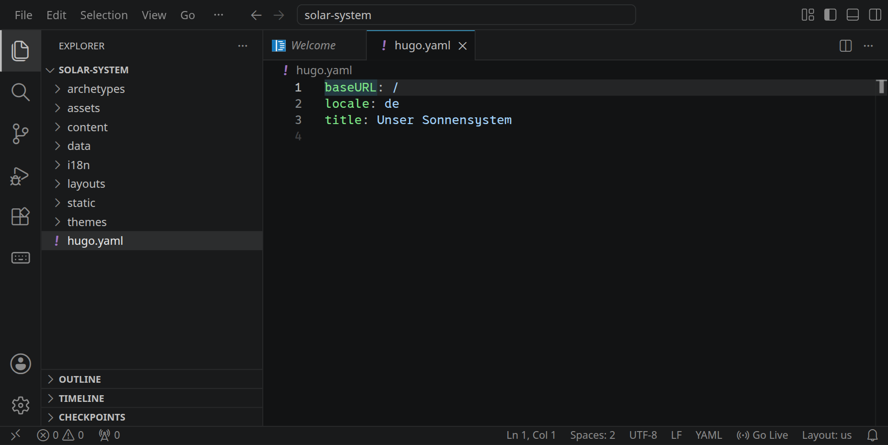
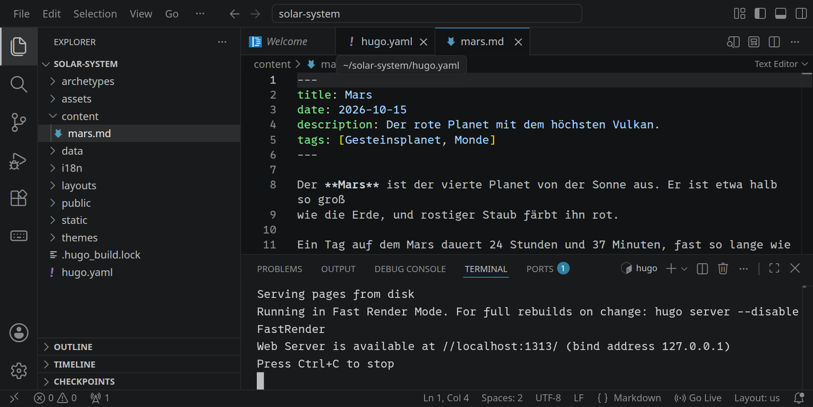
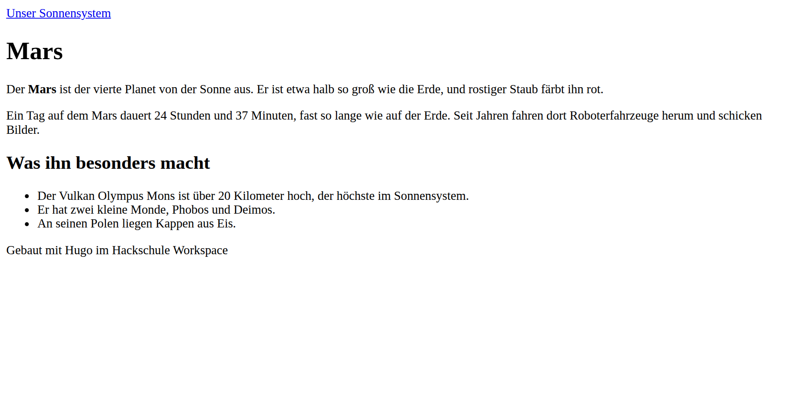
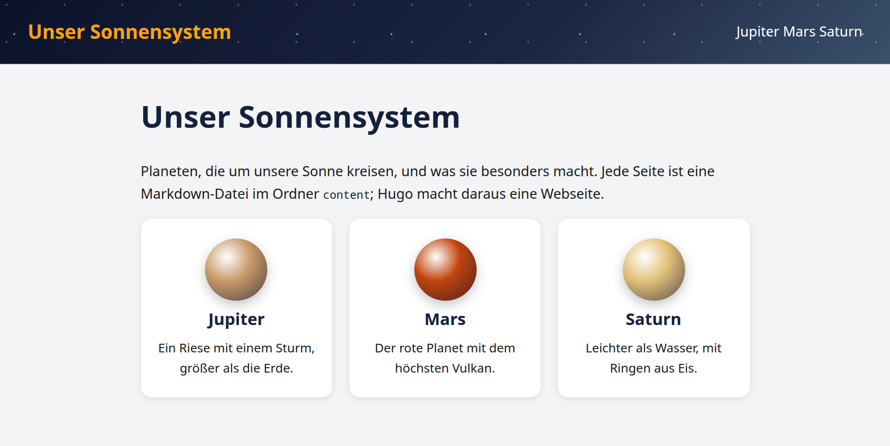
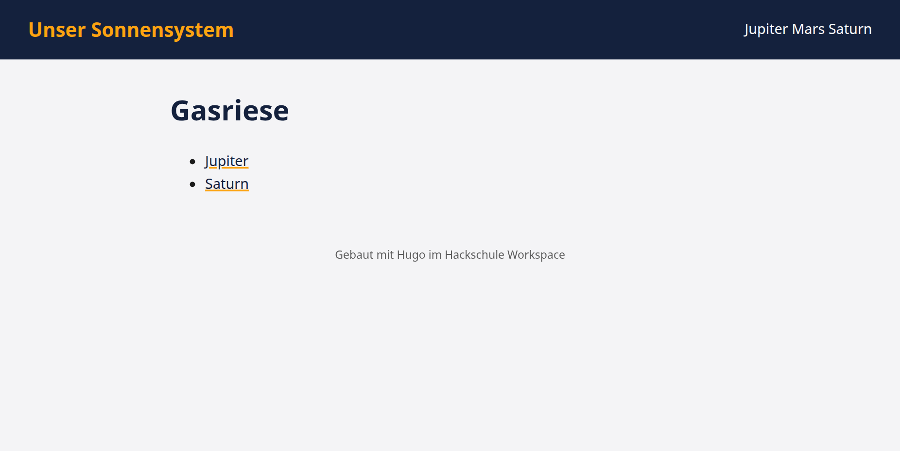
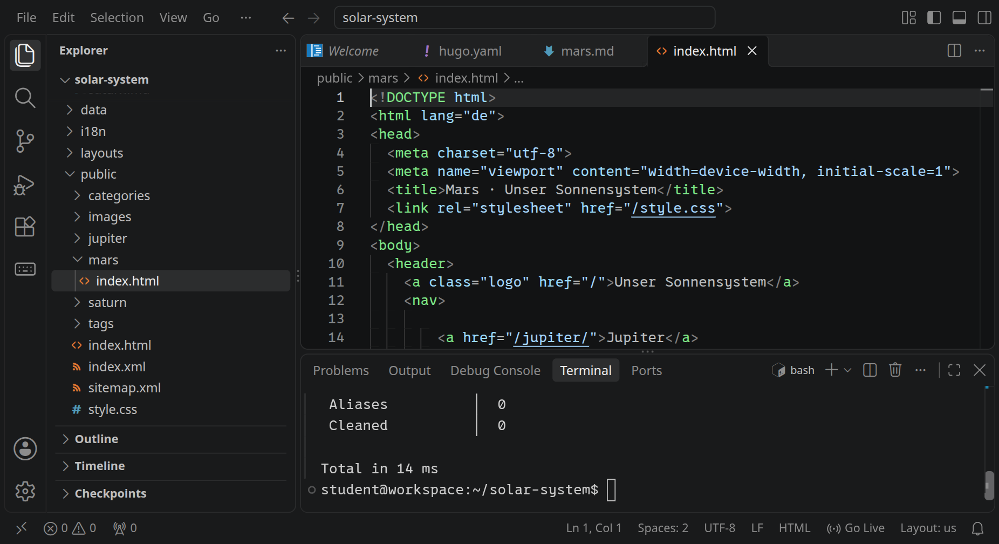

<div class='meta'>
image: startseite.webp
kind: projekt
language: Hugo
topic: web
duration: 2 Doppelstunden
requires: [static-website]
reference: [yaml, html, css]
</div>

<div
    class="autotoc-secondary-trigger"
    data-title="Auf dieser Seite"
    data-levels="h2,h3">
</div>

# Eine Website mit Hugo

<p class='abstract'>
Eine einzelne Webseite schreibt man von Hand. Bei zehn Seiten, die alle denselben Kopf, dieselbe Navigation und denselben Fuß haben, wird das mühsam. Mit Hugo schreibst du die Inhalte in Markdown und das Aussehen einmal als Vorlage; Hugo macht daraus eine fertige Website aus lauter HTML-Dateien. Du baust ein kleines Lexikon über die Planeten mit Navigation, Startseite und Schlagwörtern und veröffentlichst es.
</p>

## Warum Hugo?

In [Statische Webseiten mit HTML & CSS](/static-website) hast du eine einzelne Seite gebaut. Stell dir vor, du schreibst ein kleines Lexikon über die Planeten: eine Seite für den Mars, eine für den Jupiter, eine für den Saturn. Jede Seite braucht denselben Kopf mit derselben Navigation, die zu allen anderen Seiten führt. Kommt ein vierter Planet dazu, musst du die Navigation in allen Seiten ändern, und vergisst du eine, fehlt dort der Link.

Ein **Static Site Generator** wie Hugo trennt zwei Dinge:

- Die **Inhalte**: Für jede Seite eine Markdown-Datei, nur mit dem, was auf dieser Seite steht.
- Das **Layout**: Einmal HTML für alles, was auf jeder Seite gleich ist, mit Lücken für das, was sich ändert.

Hugo setzt beides zusammen und schreibt für jede Seite eine fertige HTML-Datei. Das Ergebnis ist eine ganz normale statische Website wie deine Seite aus »Statische Webseiten«: Dateien, die jeder Webserver ausliefern kann.

## Eine neue Website

Lege im Terminal eine neue Website an:

```bash
cd /workspace
hugo new site solar-system --format yaml
```

Öffne dann den neuen Ordner `/workspace/solar-system` mit <kbd>Strg</kbd><kbd>K</kbd> <kbd>Strg</kbd><kbd>O</kbd>. Hugo hat ein paar Ordner angelegt; vier davon brauchst du:

- `content`: die Inhalte, eine Markdown-Datei pro Seite.
- `layouts`: die Vorlagen aus HTML.
- `static`: Dateien, die Hugo unverändert übernimmt, etwa CSS und Bilder.
- `hugo.yaml`: die Einstellungen der Website.

Die Einstellungen stehen in YAML. Ersetze den Inhalt von `hugo.yaml` durch:

```yaml
baseURL: /
locale: de
title: Unser Sonnensystem
```

- `baseURL: /` sagt Hugo, dass die Website ganz oben auf ihrem Server liegt. Alle Adressen beginnen dann mit `/`, und die Seite funktioniert in der Vorschau genauso wie später auf deiner Subdomain.
- `locale: de` ist die Sprache der Website.
- `title` ist ihr Name; er erscheint gleich auf jeder Seite.

<!-- tutorial-screenshot
# Neue Website im Terminal, dann den Ordner öffnen
terminal-open
terminal-run: cd /workspace && hugo new site solar-system --format yaml
terminal-wait-for-prompt
write-file: solar-system/hugo.yaml <- file:stufen/solar-system/hugo.yaml
press: Control+j
press: Control+k
press: Control+o
wait-for-text: Open Folder
press: Control+a
type: /workspace/solar-system/
press: Enter
sleep: 5
wait-for-text: hugo.yaml
open-file: hugo.yaml
sleep: 1
check-task: einstellungen
-->


_uses(yaml-aufbau)

_task(einstellungen)

## Die erste Seite

Eine Seite ist eine Markdown-Datei in `content`. Lege `content/mars.md` an:

```markdown_copy
---
title: Mars
date: 2026-10-15
description: Der rote Planet mit dem höchsten Vulkan.
tags: [Gesteinsplanet, Monde]
---

Der **Mars** ist der vierte Planet von der Sonne aus. Er ist etwa halb so groß
wie die Erde, und rostiger Staub färbt ihn rot.

Ein Tag auf dem Mars dauert 24 Stunden und 37 Minuten, fast so lange wie auf
der Erde. Seit Jahren fahren dort Roboterfahrzeuge herum und schicken Bilder.

## Was ihn besonders macht

- Der Vulkan Olympus Mons ist über 20 Kilometer hoch, der höchste im
  Sonnensystem.
- Er hat zwei kleine Monde, Phobos und Deimos.
- An seinen Polen liegen Kappen aus Eis.
```

Oben steht zwischen zwei Zeilen `---` die **Front Matter**, Angaben über die Seite in YAML: ihr Titel, ein Datum, eine kurze Beschreibung und Schlagwörter (`tags`). Darunter steht der Inhalt in Markdown, wie in einer README-Datei: `**fett**`, `## Überschrift`, `- Liste`.

_uses(front-matter)

Starte Hugos eigenen Webserver:

```bash
hugo server
```

Hugo meldet sich mit einigen Warnungen, darunter diese:

```text
WARN  found no layout file for "html" for kind "page"
```

Hugo hat die Seite gelesen, weiß aber noch nicht, wie daraus HTML werden soll: Es gibt noch kein Layout.

_task(yaml-titel)

## Ein Layout für alle Seiten

Ein Layout ist HTML mit Lücken. Die Lücken stehen in doppelten geschweiften Klammern, `{{ … }}`, und Hugo füllt sie für jede Seite. Lege zuerst das Grundgerüst an, das jede Seite bekommt, `layouts/baseof.html`:

```html_copy
<!DOCTYPE html>
<html lang="de">
<head>
  <meta charset="utf-8">
  <meta name="viewport" content="width=device-width, initial-scale=1">
  <title>{{ .Title }} · {{ site.Title }}</title>
</head>
<body>
  <header>
    <a class="logo" href="{{ "/" | relURL }}">{{ site.Title }}</a>
  </header>
  <main>
    {{ block "main" . }}{{ end }}
  </main>
  <footer>Gebaut mit Hugo im Hackschule Workspace</footer>
</body>
</html>
```

und dann `layouts/page.html`, was eine einzelne Seite in dieses Gerüst schreibt:

```html
{{ define "main" }}
  <h1>{{ .Title }}</h1>
  {{ .Content }}
{{ end }}
```

- `{{ .Title }}` ist der Titel der Seite aus ihrer Front Matter, `{{ site.Title }}` der Titel der Website aus `hugo.yaml`.
- `{{ .Content }}` ist der Inhalt der Markdown-Datei, von Hugo in HTML übersetzt: Aus `## Was er kann` wird `<h2>Was er kann</h2>`.
- `{{ block "main" . }}{{ end }}` in `baseof.html` ist eine Lücke mit dem Namen `main`. `{{ define "main" }} … {{ end }}` in `page.html` füllt sie. So steht der Rahmen nur einmal da, und jede Art von Seite füllt nur ihre Mitte.
- `{{ "/" | relURL }}` ist die Adresse der Startseite. Der senkrechte Strich gibt `"/"` an die Funktion `relURL` weiter, die die passende Adresse daraus macht.

_uses(grundgeruest)

Hugo merkt jede gespeicherte Datei und baut die Website neu. Öffne die Adresse von Port 1313 aus dem Reiter »Ports« (»Forwarded Address«) im Browser und hänge `mars/` an:

<!-- tutorial-screenshot
# Die erste Seite mit dem einfachen Layout, Hugo läuft
write-file: solar-system/content/mars.md <- file:stufen/solar-system/content/mars.md
write-file: solar-system/layouts/baseof.html <- file:stufen/baseof-1.html
write-file: solar-system/layouts/page.html <- file:stufen/page-1.html
open-file: content/mars.md
terminal-open
terminal-run: hugo server
sleep: 4
check-task-fails: navigation
check-task-fails: tags
terminal-expect-no-text: ERROR
-->


<!-- tutorial-screenshot
preview-port: 1313 /mars/
tab: preview
wait-for-text: Was ihn besonders macht
sleep: 1
-->


Noch ohne CSS, aber eine Seite: Der Kopf mit »Unser Sonnensystem« und der Fuß kommen aus `baseof.html`, die Überschrift aus `page.html`, alles andere aus `mars.md`. Lade die Vorschau nach dem Speichern neu, um eine Änderung zu sehen.

_task(content)

<div class='hint try'>
<strong>Ausprobieren:</strong> Bau den Fehler aus der Aufgabe »Ein Doppelpunkt zu viel« absichtlich ein: Ändere in <code>content/mars.md</code> den Titel zu <code>title: Mars: der rote Planet</code> und speichere. Was meldet <code>hugo server</code> im Terminal, und woran erkennst du, in welcher Datei und Zeile der Fehler steckt? Was zeigt die Vorschau nach dem Neuladen? Setz den Titel danach in Anführungszeichen, <code>title: "Mars: der rote Planet"</code>, und dann wieder auf <code>title: Mars</code>.
</div>

## Mehr Seiten und eine Navigation

Jetzt zeigt sich, wofür das gut ist. Lege zwei weitere Seiten an, `content/jupiter.md`:

```markdown_copy
---
title: Jupiter
date: 2026-10-15
description: Ein Riese mit einem Sturm, größer als die Erde.
tags: [Gasriese, Monde]
---

Der **Jupiter** ist der größte Planet des Sonnensystems. Er hat mehr als
doppelt so viel Masse wie alle anderen Planeten zusammen und keine feste
Oberfläche: Er besteht vor allem aus Wasserstoff und Helium.

## Was ihn besonders macht

- Der Große Rote Fleck ist ein Sturm, in den die ganze Erde passen würde. Man
  beobachtet ihn seit mehr als 150 Jahren.
- Ein Tag dauert nur knapp zehn Stunden.
- Er hat mehr als 90 Monde; auf dem Mond Io brechen Vulkane aus.
```

und `content/saturn.md`:

```markdown_copy
---
title: Saturn
date: 2026-10-15
description: Leichter als Wasser, mit Ringen aus Eis.
tags: [Gasriese, Ringe]
---

Der **Saturn** ist der zweitgrößte Planet. Wie Jupiter ist er ein Gasriese aus
Wasserstoff und Helium, aber so leicht, dass er in einer riesigen Wanne voll
Wasser schwimmen würde.

## Was ihn besonders macht

- Seine Ringe bestehen aus unzähligen Brocken aus Eis und Gestein. Sie sind
  breiter als der Planet selbst, aber an vielen Stellen nur wenige Dutzend
  Meter dick.
- Sein größter Mond Titan hat eine dichte Lufthülle und Seen aus flüssigem
  Methan.
- Ein Tag dauert etwas mehr als zehn Stunden.
```

Beide bekommen sofort denselben Kopf und Fuß, ohne dass du dafür HTML schreibst. Fehlt noch die Navigation zu allen Seiten. Ergänze in `layouts/baseof.html` unter dem Link mit `site.Title`:

```html
~ <body>
~   <header>
~     <a class="logo" href="{{ "/" | relURL }}">{{ site.Title }}</a>
    <nav>
      {{ range site.RegularPages }}
        <a href="{{ .RelPermalink }}">{{ .Title }}</a>
      {{ end }}
    </nav>
~   </header>
~   <main>
~     {{ block "main" . }}{{ end }}
```

`{{ range site.RegularPages }} … {{ end }}` ist eine Schleife über alle Seiten der Website. Was dazwischen steht, schreibt Hugo für jede Seite einmal hin; der Punkt steht darin für die Seite, um die es gerade geht. `.RelPermalink` ist ihre Adresse, `.Title` ihr Titel.

_task(neue-seite)

_task(navigation)

<div class='hint try'>
<strong>Ausprobieren:</strong> Schreib in die Front Matter von <code>content/saturn.md</code> die Zeile <code>draft: true</code> (ein Entwurf) und speichere. Wo ist der Saturn jetzt noch zu finden, in der Navigation, unter <code>/saturn/</code>? Nimm die Zeile wieder heraus und setz stattdessen <code>date</code> beim Saturn auf ein Datum in der Zukunft, etwa <code>2030-01-01</code>: Was passiert jetzt, und wozu könnte das gut sein? Stell danach das alte Datum wieder her.
</div>

## Die Startseite

Die Startseite ist eine besondere Seite: `content/_index.md`. Der Unterstrich sagt Hugo, dass sie zum ganzen Ordner gehört, nicht zu einem einzelnen Planeten:

```markdown
---
title: Unser Sonnensystem
---

Planeten, die um unsere Sonne kreisen, und was sie besonders macht. Jede Seite
ist eine Markdown-Datei im Ordner `content`; Hugo macht daraus eine Webseite.
```

Sie bekommt ein eigenes Layout, `layouts/home.html`, das unter ihrem Text eine Karte für jeden Planeten zeigt:

```html
{{ define "main" }}
  <h1>{{ .Title }}</h1>
  {{ .Content }}
  <ul class="cards">
    {{ range site.RegularPages }}
      <li>
        <a href="{{ .RelPermalink }}">
          <strong>{{ .Title }}</strong>
          <span>{{ .Description }}</span>
        </a>
      </li>
    {{ end }}
  </ul>
{{ end }}
```

`{{ .Description }}` ist die Beschreibung aus der Front Matter jeder Seite. Wer einen neuen Planeten anlegt, bekommt die Karte auf der Startseite und den Link in der Navigation dazu, ohne eine Zeile HTML.

## Aussehen mit CSS

Was in `static` liegt, übernimmt Hugo unverändert in die fertige Website. Lege `static/style.css` an:

```css_copy
body {
  margin: 0;
  font-family: system-ui, sans-serif;
  line-height: 1.6;
  color: #1b1b1b;
  background: #f4f4f6;
}

header {
  display: flex;
  flex-wrap: wrap;
  align-items: center;
  gap: 1em;
  padding: 1em 2em;
  background: #14213d;
}

header a {
  color: #ffffff;
  text-decoration: none;
}

.logo {
  font-size: 1.4em;
  font-weight: bold;
  margin-right: auto;
  color: #fca311;
}

main {
  max-width: 40em;
  margin: 2em auto;
  padding: 0 1em;
}

h1 {
  color: #14213d;
}

main a {
  color: #14213d;
  text-decoration-color: #fca311;
  text-decoration-thickness: 2px;
}

.tags a {
  display: inline-block;
  padding: 0.1em 0.6em;
  border-radius: 1em;
  background: #fca311;
  color: #14213d;
  text-decoration: none;
  font-size: 0.9em;
}

.cards {
  list-style: none;
  padding: 0;
  display: grid;
  grid-template-columns: repeat(auto-fit, minmax(12em, 1fr));
  gap: 1em;
}

.cards a {
  display: block;
  height: 100%;
  padding: 1em;
  border-radius: 0.5em;
  background: white;
  color: inherit;
  text-decoration: none;
  border-top: 4px solid #fca311;
  box-shadow: 0 0.1em 0.4em rgba(20, 33, 61, 0.12);
}

.cards span {
  display: block;
  font-size: 0.9em;
}

footer {
  text-align: center;
  padding: 2em;
  font-size: 0.8em;
  opacity: 0.7;
}
```

und binde die Datei in `layouts/baseof.html` im `<head>` ein, unter dem `<title>`:

```html
~   <meta charset="utf-8">
~   <meta name="viewport" content="width=device-width, initial-scale=1">
~   <title>{{ .Title }} · {{ site.Title }}</title>
  <link rel="stylesheet" href="{{ "style.css" | relURL }}">
~ </head>
~ <body>
~   <header>
```

Eine Zeile in einem Layout, und jede Seite der Website sieht so aus:

<!-- tutorial-screenshot
# Alle Seiten, die Startseite und das CSS
write-file: solar-system/content/jupiter.md <- file:stufen/solar-system/content/jupiter.md
write-file: solar-system/content/saturn.md <- file:stufen/solar-system/content/saturn.md
write-file: solar-system/content/_index.md <- file:stufen/solar-system/content/_index.md
write-file: solar-system/layouts/baseof.html <- file:stufen/solar-system/layouts/baseof.html
write-file: solar-system/layouts/home.html <- file:stufen/solar-system/layouts/home.html
write-file: solar-system/static/style.css <- file:stufen/solar-system/static/style.css
preview-port: 1313
tab: preview
wait-for-text: Leichter als Wasser
sleep: 1
check-task: navigation
terminal-expect-no-text: ERROR
-->


_uses(regeln, selektoren)

## Schlagwörter

In der Front Matter jeder Seite stehen schon Schlagwörter, `tags: [Gasriese, Ringe]`. Hugo legt dafür von selbst Seiten an: eine Liste aller Schlagwörter unter `/tags/` und für jedes Schlagwort eine Seite mit allen Planeten, die es tragen, zum Beispiel `/tags/gasriese/`. Damit sie zu sehen sind, brauchen sie ein Layout. `layouts/list.html` gilt für alle Seiten, die andere Seiten auflisten:

```html
{{ define "main" }}
  <h1>{{ .Title }}</h1>
  <ul>
    {{ range .Pages }}
      <li><a href="{{ .RelPermalink }}">{{ .LinkTitle }}</a></li>
    {{ end }}
  </ul>
{{ end }}
```

Dann zeigt jede Planetenseite ihre Schlagwörter als Links. Ersetze in `layouts/page.html` die Zeile mit `<h1>` durch:

```html
~ {{ define "main" }}
  <h1>{{ .Title }}</h1>
  <p class="tags">
    {{ range .GetTerms "tags" }}
      <a href="{{ .RelPermalink }}">{{ .LinkTitle }}</a>
    {{ end }}
  </p>
~   {{ .Content }}
~ {{ end }}
```

`.GetTerms "tags"` sind die Schlagwörter der Seite, jedes mit seiner eigenen Adresse.

<!-- tutorial-screenshot
# Schlagwörter: Planetenseite mit Tags, dann die Seite eines Tags
write-file: solar-system/layouts/list.html <- file:stufen/solar-system/layouts/list.html
write-file: solar-system/layouts/page.html <- file:stufen/solar-system/layouts/page.html
preview-port: 1313 /tags/gasriese/
tab: preview
wait-for-text: Saturn
sleep: 1
check-task: tags
terminal-expect-no-text: ERROR
-->


_task(tags)

## Die fertige Website

`hugo server` hält die Website für die Vorschau bereit. Die fertige Website, die du veröffentlichst, baut der Befehl `hugo` allein. Beende den Server mit <kbd>Strg</kbd><kbd>C</kbd> und baue die Website neu, nachdem du den alten Stand gelöscht hast:

```bash
rm -rf public
hugo
```

Hugo schreibt alles in den Ordner `public`: `public/index.html` ist die Startseite, `public/mars/index.html` die Seite des Mars, `public/style.css` dein CSS, und unter `public/tags/` stehen die Seiten der Schlagwörter. Öffne eine der HTML-Dateien: Es ist ganz normales HTML, mit der Navigation darin, als hättest du sie von Hand geschrieben.

<!-- tutorial-screenshot
# hugo baut public, die Startseite ist offen
terminal-open
press: Control+c
sleep: 1
terminal-run: clear
terminal-run: rm -rf public && hugo
terminal-wait-for-prompt
open-file: public/mars/index.html
move-mouse: selector:.terminal
sleep: 2
terminal-expect-no-text: ERROR
check-task: public
-->


_task(public)

### Zeigen

_include(workspace#live-apps)

### Veröffentlichen

Den Inhalt von `public` kopierst du auf deine Hackschule-Subdomain, genau wie eine selbst geschriebene Website. Wie du eine Subdomain bekommst und einrichtest, steht in der [Anleitung zum eigenen Webspace](/custom-subdomain); hochladen geht dann mit `rsync`, von `public` aus. Ersetze `max` und `cobolultras` durch deinen Benutzernamen und deine Subdomain:

```bash
rsync -avz public/ max@cobolultras.hackschule.de:cobolultras
```

Der Schrägstrich hinter `public/` ist wichtig: Er kopiert den Inhalt des Ordners, nicht den Ordner selbst. Nach jeder Änderung baust du mit `hugo` neu und lädst noch einmal hoch; `rsync` überträgt nur, was sich geändert hat.

_task(abgabe)

## Deine Website

Jetzt ist es deine Website. Ein paar Ideen:

- **Ein eigenes Thema:** Ersetze die Planeten durch etwas, das dich interessiert: Bücher, Spiele, Orte, eine Sportart. `title` in `hugo.yaml` und die Seiten in `content` ändern, die Layouts bleiben.
- **Bilder:** Lege Bilder in `static` ab und binde sie in Markdown ein: ``.
- **Eine Reihenfolge:** Mit `weight: 1`, `weight: 2` … in der Front Matter bestimmst du, in welcher Reihenfolge die Seiten in der Navigation stehen.
- **Teile auslagern:** Lege den Kopf als eigene Datei `layouts/_partials/header.html` an und binde ihn mit `{{ partial "header.html" . }}` ein.
- **Bereiche:** Ein Unterordner `content/monde/` wird ein eigener Bereich mit eigener Liste unter `/monde/`.

_task(generator)

## Wie geht es weiter?

Hugo kann noch viel mehr: Bilder verkleinern, mehrere Sprachen, Seiten aus Daten in YAML oder JSON. Alles steht in der [Dokumentation von Hugo](https://gohugo.io/documentation/). Statt eigener Layouts gibt es auch fertige Themes; mit deinen eigenen weißt du aber genau, was auf jeder Seite passiert.

Andere Generatoren wie Jekyll, Eleventy oder Astro funktionieren nach demselben Prinzip: Inhalte und Layout getrennt, am Ende statische Dateien. Viele Websites von Projekten, Vereinen und Dokumentationen entstehen so.
