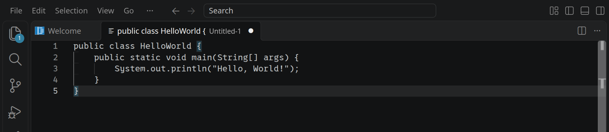
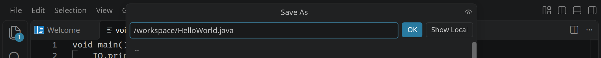
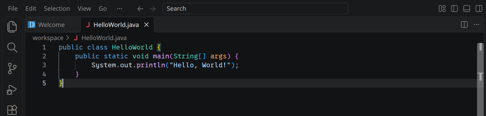
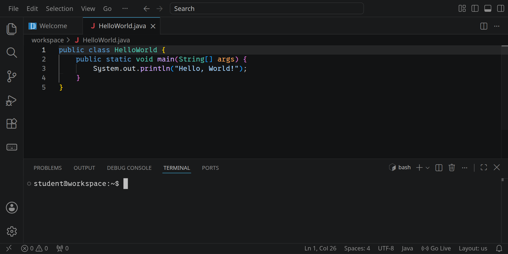
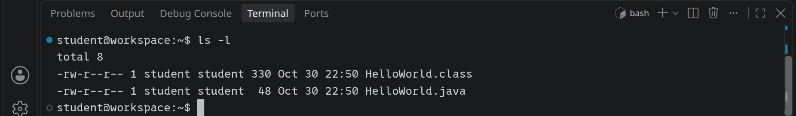
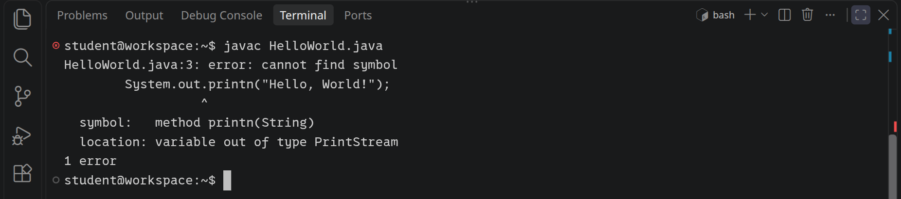
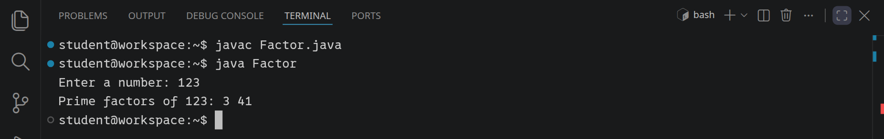
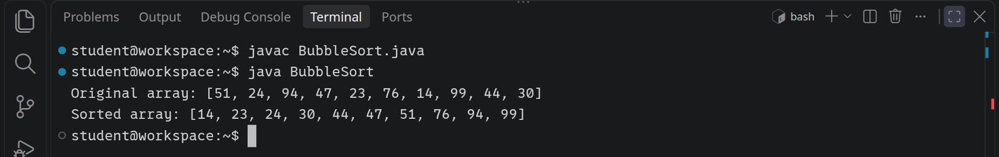

<div class='meta'>
image: Java-Logo.png
kind: steckbrief
curriculum: "Oberstufe: Algorithmen und Softwareentwicklung (ein Programm übersetzen, Fehlermeldungen lesen, einfache Datentypen, Bubblesort ändern)"
topics: [programmiersprachen]
</div>

<div
    class="autotoc-secondary-trigger"
    data-title="Auf dieser Seite"
    data-levels="h2,h3">
</div>

# Java <span style='font-size: 80%;'>(1991)</span>

<p class='abstract'>
Java, ab 1991 entwickelt von James Gosling und seinem Team bei Sun Microsystems, zuerst unter dem Namen Oak, und 1995 veröffentlicht, ist eine objektorientierte Programmiersprache, die für ihre Plattformunabhängigkeit bekannt ist.
</p>

_person(gosling)

Java wird häufig für die Entwicklung von Unternehmensanwendungen, mobilen Anwendungen (insbesondere Android-Apps), Webanwendungen und großen Systemen verwendet. Bekannte Beispiele für Anwendungen und Plattformen, die in Java entwickelt wurden, sind viele Apps für Android, das Framework Apache Hadoop für Big Data und Server von Unternehmen wie LinkedIn und Netflix. Heutzutage ist Java immer noch äußerst relevant und weit verbreitet, da es eine robuste, skalierbare und sichere Umgebung für die Entwicklung bietet und eine große Entwickler-Community sowie eine Vielzahl von Bibliotheken und Frameworks unterstützt.

## Hello, world!

Java-Programme werden in Textdateien mit der Endung `.java` geschrieben. Diese Dateien werden dann mit dem Java-Compiler `javac` kompiliert, um ausführbare Dateien zu erzeugen. Diese ausführbaren Dateien haben die Endung `.class` und können mit dem Java-Interpreter `java` ausgeführt werden.

### Quelltext schreiben

_include(workspace#neue-datei)

<!-- tutorial-step
# Wie im Handbuch »Workspace« (oben eingebunden): kein Ordner offen,
# »New File...«, »Text File«
show-left-sidebar
click: New File...
wait-for-text: Text File
sleep: 0.5
-->

Schreibe nun den folgenden Code in die Datei:

_include_file(HelloWorld.java, java)

Da Visual Studio Code noch nicht weiß, dass es sich um Java-Quelltext handelt, ist dein Programm momentan noch einfarbig, aber das wird sich gleich ändern. An dem weißen Punkt erkennst du, dass deine Änderungen noch nicht gespeichert sind.

<!-- tutorial-screenshot
# Das Programm in eine noch namenlose Datei
press: Enter
sleep: 1
hide-left-sidebar
type: <- file:HelloWorld.java
sleep: 0.5
crop-bottom: 60%
-->



Drücke nun <kbd>Strg</kbd><kbd>S</kbd>, um die Datei zu speichern. Gib `HelloWorld.java` ein – der vollständige Pfad zu deiner Datei lautet dann `/workspace/HelloWorld.java`.

<!-- tutorial-screenshot
press: Control+s
wait-for-text: Save As
press: Control+a
type: /workspace/HelloWorld.java
sleep: 0.5
crop-bottom: 82%
-->



Sobald du die Datei gespeichert hast, wird sie automatisch als Java-Datei erkannt und die Syntax wird hervorgehoben.

<!-- tutorial-screenshot
press: Enter
wait-for-file: HelloWorld.java
sleep: 1.5
crop-bottom: 56%
-->



Das Programm beginnt bei `main`, und `IO.println` gibt eine Zeile aus. So kurz geht es seit Java 25. In älteren Büchern und im Netz steht um dasselbe noch eine Klasse herum, mit `public static void main(String[] args)` und `System.out.println`; auch das übersetzt `javac` weiterhin:

```java
public class HelloWorld {
    public static void main(String[] args) {
        System.out.println("Hello, World!");
    }
}
```

_task(hallo)

### Kompilieren und ausführen

Bevor wir das Programm ausführen können, müssen wir es kompilieren.
Dadurch wird der Quelltext des Programms in Bytecode übersetzt, den die Java Virtual Machine (JVM) ausführen kann.

Öffne dazu ein Terminal, indem du entweder <kbd>Strg</kbd><kbd>J</kbd> drückst oder das Panel-Symbol  rechts oben drückst. Dein Fenster sollte jetzt ungefähr so aussehen:

<!-- tutorial-screenshot
hide-left-sidebar
terminal-open
sleep: 0.5
-->



Wir rufen jetzt den Java-Compiler `javac` auf, um das Programm zu übersetzen:

```bash
javac HelloWorld.java
```

<div class='hint'>
Du musst nicht den vollständigen Dateinamen schreiben. Schreib einfach <code>javac He</code> und drücke <kbd>Tab</kbd>, um den Dateinamen automatisch zu <code>HelloWorld.java</code> vervollständigen zu lassen.
</div>

Wenn du keinen Fehler gemacht hast, wird das Programm erfolgreich kompiliert und die Datei `HelloWorld.class` wird im selben Verzeichnis erstellt. Du kannst dies überprüfen, indem du dir die Dateien im aktuellen Verzeichnis mit `ls` oder `ls -l` anzeigen lässt:

<!-- tutorial-screenshot
press: Control+l
terminal-run: javac HelloWorld.java
terminal-wait-for-prompt
terminal-run: ls -l
terminal-wait-for-prompt
crop-terminal-lines: auto
-->



Die Datei `HelloWorld.class` ist die ausführbare Datei. Sie kann allerdings nicht direkt vom Computer ausgeführt werden, sondern muss von der Java Virtual Machine (JVM) ausgeführt werden.
Um das Programm auszuführen, gib folgenden Befehl ein:

```bash
java HelloWorld
```

Das Programm sollte die Nachricht `Hello, World!` im Terminal ausgeben. Du kannst beide Schritte auch in einem Befehl kombinieren:

```bash
javac HelloWorld.java && java HelloWorld
```

<div class='hint'>
Die Zeichenkombination <code>&amp;&amp;</code> sorgt dafür, dass der zweite Befehl nur ausgeführt wird, wenn der erste erfolgreich war.
</div>

Java kennt zwei Wege, ein Programm zu starten:

- **Übersetzen, dann starten:** `javac HelloWorld.java` schreibt den Bytecode in `HelloWorld.class`, und `java HelloWorld` startet ihn, so oft du willst, ohne neu zu übersetzen. So arbeiten größere Programme.
- **Gleich starten:** `java HelloWorld.java` übersetzt die Datei bei jedem Start im Speicher und führt sie sofort aus; eine `.class`-Datei entsteht dabei nicht. Seit Java 22 geht das auch, wenn das Programm aus mehreren Dateien im selben Ordner besteht.

Für die kleinen Programme auf dieser Seite gehen beide Wege. Die nächste Aufgabe will die Datei `HelloWorld.class` sehen, also übersetze mindestens einmal mit `javac`.


_task(uebersetzt)

### Fehler finden und beheben

Wenn du einen Fehler im Code machst, wird der Compiler eine Fehlermeldung ausgeben. Versuche zum Beispiel, statt `println` das Wort `printn` zu schreiben:

```java
~ void main() {
    IO.printn("Hello, World!");
~ }
```

Speichere die Datei und führe den Compiler erneut aus:

```bash
javac HelloWorld.java
```

<div class='hint'>
Nutze die Pfeiltaste hoch <kbd>↑</kbd>, um den letzten Befehl erneut einzugeben. So kannst du schnell dein Programm testen, nachdem du es verändert hast.
</div>

_task(fehler)

Der Compiler sollte eine Fehlermeldung ausgeben, die dir hilft, den Fehler zu finden:

<!-- tutorial-screenshot
# Der Fehler aus dem Text; die lange Meldung braucht das ganze Terminal
write-file: HelloWorld.java <- file:error-HelloWorld.java
terminal-maximize
press: Control+l
terminal-run: javac HelloWorld.java
terminal-wait-for-prompt
crop-terminal-lines: auto
-->



Es lohnt sich, die Fehlermeldungen genau zu lesen, um den Fehler zu finden und zu beheben. Achte auf die Zeilennummer (in diesem Beispiel 2) und den Text, der dir sagt, was falsch ist. Denke daran, den Fehler wieder zu beheben, bevor du das nächste Beispiel ausprobierst.

## Primfaktorzerlegung

Im zweiten Beispiel wollen wir eine Zahl in ihre Primfaktoren zerlegen.
Wir erreichen dies mit einem sehr einfachen Algorithmus, der einfach alle Zahlen von 2 bis zur eingegebenen Zahl durchprobiert und dabei diejenigen Zahlen ausgibt, bei denen die Division ohne Rest möglich ist. Außerdem wird die eingegebene Zahl durch jeden gefundenen Primfaktor geteilt, um die Schleife möglichst schnell zu beenden. An diesem Beispiel kannst du sehen, wie man in Java Benutzereingaben verarbeitet und Schleifen verwendet.
Erstelle eine neue Datei mit <kbd>Strg</kbd><kbd>Alt</kbd><kbd>N</kbd> und schreibe den folgenden Code hinein:

_include_file(Factor.java, java)

Speichere die Datei unter dem Namen `Factor.java`. Kompiliere das Programm:

```bash
javac Factor.java
```

Falls du keine Fehlermeldung erhältst, kannst du das Programm ausführen und testen:

<!-- tutorial-screenshot
write-file: Factor.java <- file:Factor.java
terminal-maximize
press: Control+l
terminal-run: javac Factor.java
terminal-wait-for-prompt
terminal-run: java Factor
wait-for-text: number:
terminal-run: 123
terminal-wait-for-prompt
crop-terminal-lines: auto
-->



Das Programm hat die Zahl 123 in ihre Primfaktoren zerlegt und ausgegeben.

_task(int-grenze)

<!-- after: int-grenze -->
`IO.readln` liest den Text, den du eintippst, und `Integer.parseInt` macht daraus ein `int`: 32 Bit, höchstens 2147483647. 3000000000 passt nicht hinein. Anders als C rechnet Java dann nicht mit einer falschen Zahl weiter, sondern bricht mit einer Exception ab und nennt die Eingabe, die nicht passte.
<!-- /after -->

<div class='hint try'>
<strong>Ausprobieren:</strong> Ändere die Zeile mit <code>Integer.parseInt</code> zu <code>long number = Long.parseLong(IO.readln("Enter a number: "));</code>, übersetze neu und probier <code>3000000000</code> noch einmal. Was ist bei <code>long</code> anders als bei <code>int</code>?
</div>

## Bubblesort

Im dritten Beispiel wollen wir eine Liste von 10 Zufallszahlen sortieren. Dafür verwenden wir den [Bubblesort-Algorithmus](https://de.wikipedia.org/wiki/Bubblesort), der zwar nicht besonders effizient ist, aber sehr einfach zu verstehen und zu implementieren. Der Bubblesort-Algorithmus funktioniert, indem er die Liste mehrmals durchläuft und benachbarte Elemente vertauscht, wenn sie in der falschen Reihenfolge sind.

An diesem Beispiel kannst du sehen, wie man in Java Arrays verwendet, Funktionen verwendet und Schleifen verschachtelt.

Erstelle eine neue Datei und schreibe den folgenden Code hinein:

_include_file(BubbleSort.java, java)

Anders als `HelloWorld.java` und `Factor.java` steht dieses Programm in einer Klasse, `class BubbleSort`. So können auch andere Programme seine Methode aufrufen, als `BubbleSort.bubbleSort(…)`; ein Programm ohne Klasse hat keinen Namen, unter dem man es von außen ansprechen könnte. `static` heißt, dass die Methoden zur Klasse gehören und kein Objekt brauchen. Und eine Klasse braucht `import` für das, was sie aus anderen Paketen nimmt (`Arrays`, `Random`); ein Programm ohne Klasse bekommt alles aus den Grundpaketen von Java (dem Modul `java.base`) von selbst.

Speichere die Datei unter dem Namen `BubbleSort.java`. Kompiliere das Programm:

```bash
javac BubbleSort.java
```
Falls du keine Fehlermeldung erhältst, kannst du das Programm ausführen und testen:

<!-- tutorial-screenshot
write-file: BubbleSort.java <- file:BubbleSort.java
press: Control+l
terminal-run: javac BubbleSort.java
terminal-wait-for-prompt
terminal-run: java BubbleSort
terminal-wait-for-prompt
crop-terminal-lines: auto
-->



Das Programm hat eine Liste von 10 Zufallszahlen sortiert.

_task(absteigend)

<div class='hint try'>
<strong>Ausprobieren:</strong> Ändere <code>BubbleSort.java</code>, übersetze neu und starte das Programm:
<ul>
<li>Sortiere 100 Zahlen statt 10. Warum musst du dafür nur eine einzige Zahl ändern?</li>
<li>Ändere in <code>generateRandomArray</code> die Bedingung <code>i &lt; size</code> zu <code>i &lt;= size</code>. Was meldet Java beim Ausführen? Stell die Bedingung danach wieder her.</li>
</ul>
</div>

## Zusammenfassung

In diesem Kapitel hast du an drei Beispielen gesehen, wie man ein einfaches Java-Programm schreiben, kompilieren und ausführen kann. Das ist natürlich nur ein erster Eindruck. Um Java wirklich zu beherrschen, musst du noch viel mehr lernen – am besten, indem du eigene Programme schreibst und ausprobierst. Die Buchhandlungen, Bibliotheken und Youtube sind voll von Material für dich. Viel Spaß beim Programmieren!

Was in Java anders aussieht als in Dart, und wie dasselbe in beiden geht, steht im Handbuch unter [Dart und Java](/reference/dart-java).
