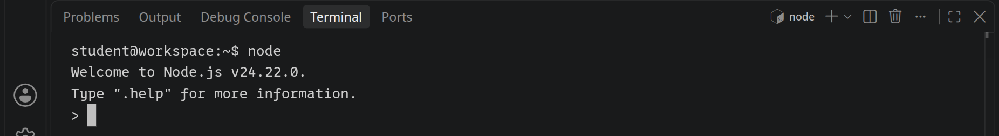
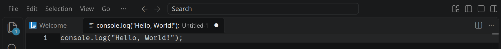
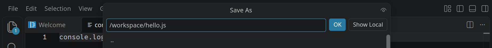
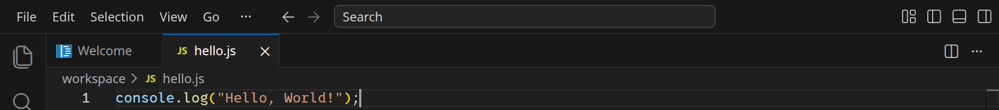
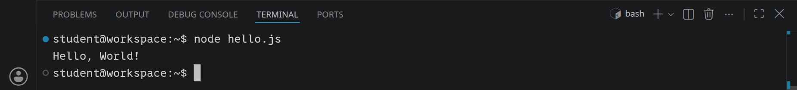
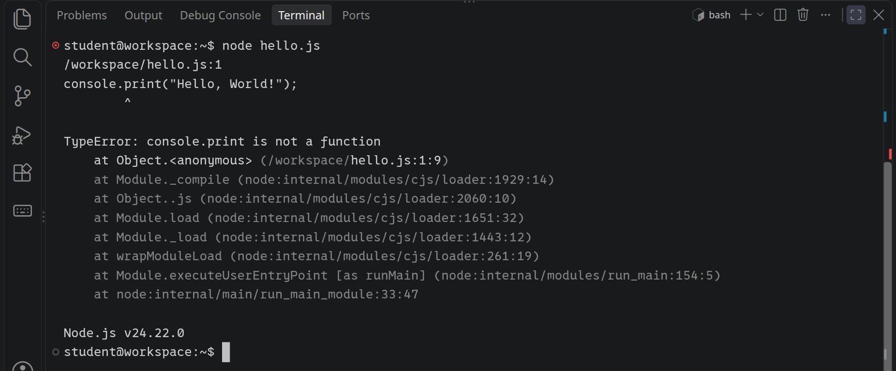
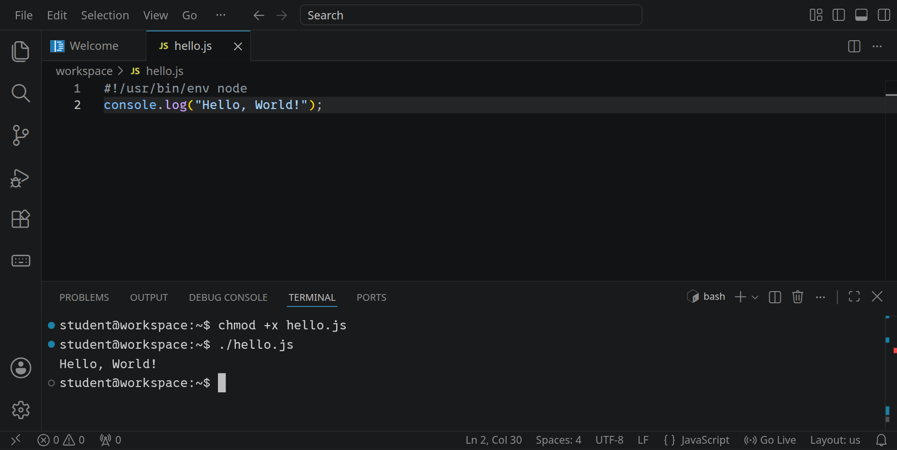
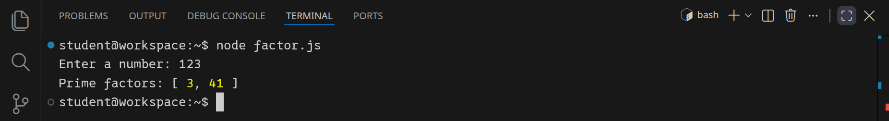
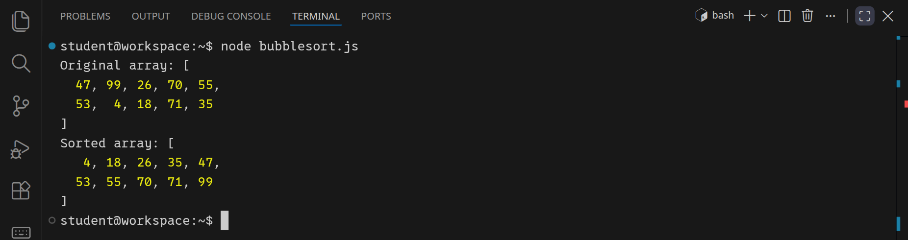

<div class='meta'>
image: js-logo.png
kind: steckbrief
curriculum: "Oberstufe: Syntax und Semantik (Interpreter)"
</div>

<div
    class="autotoc-secondary-trigger"
    data-title="Auf dieser Seite"
    data-levels="h2,h3">
</div>

# JavaScript <span style='font-size: 80%;'>(1995)</span>

<p class='abstract'>
JavaScript, entwickelt 1995 von Brendan Eich bei Netscape, ist eine dynamische Programmiersprache, die ursprünglich zur Erstellung interaktiver und dynamischer Inhalte auf Webseiten verwendet wurde.
</p>

_person(eich)

JavaScript wird häufig für die Frontend-Webentwicklung eingesetzt, wobei bekannte Beispiele wie die Benutzeroberflächen von Google Maps, Facebook und YouTube hervorzuheben sind. Mit der Einführung von Node.js hat sich JavaScript auch auf die Backend-Entwicklung ausgeweitet, was es ermöglicht, serverseitige Anwendungen zu erstellen. Heutzutage ist JavaScript äußerst relevant und weit verbreitet, da es eine zentrale Rolle im modernen Web spielt und eine Vielzahl von Frameworks und Bibliotheken wie React, Angular und Vue.js bietet, die die Entwicklung von Webanwendungen erheblich erleichtern.

## Hello, world!

JavaScript wird in der Regel in Webbrowsern ausgeführt, um die Interaktion mit Webseiten zu ermöglichen. Du kannst JavaScript-Code direkt in der Entwicklerkonsole deines Browsers ausführen oder in einer HTML-Datei speichern und dann im Browser öffnen.

In diesem Kapitel wollen wir uns jedoch auf JavaScript außerhalb des Browsers konzentrieren. Dazu verwenden wir Node.js, eine serverseitige JavaScript-Laufzeitumgebung, die die Ausführung von JavaScript-Code auf einem Server ermöglicht. JavaScript ist eine Skriptsprache, was bedeutet, dass der Code zur Laufzeit interpretiert wird. Du hast zwei Möglichkeiten, JavaScript-Code auszuführen:

1. Du kannst JavaScript-Code direkt in der Node.js-Shell ausführen.
2. Du kannst JavaScript-Code in einer Textdatei speichern und dann ausführen.

**Möglichkeit 1:** JavaScript-Code in der Node.js-Shell ausführen

Öffne dazu ein Terminal, indem du entweder <kbd>Strg</kbd><kbd>J</kbd> drückst oder das Panel-Symbol  rechts oben drückst. Dein Fenster sollte jetzt ungefähr so aussehen:

<!-- tutorial-screenshot
# Ein frischer Workspace ohne Ordner, das Terminal offen
hide-left-sidebar
terminal-open
sleep: 0.5
-->


Starte nun die Node.js-Shell, indem du `node` eingibst und dann <kbd>Enter</kbd> drückst. Du solltest eine Ausgabe wie diese sehen:

<!-- tutorial-screenshot
press: Control+l
terminal-run: node
wait-for-text: Welcome to Node.js
sleep: 0.5
crop-terminal-lines: auto
-->



Jetzt kannst du JavaScript-Code direkt in der Shell eingeben und ausführen. Schreibe einfach `console.log("Hello, world!");` und drücke <kbd>Enter</kbd>. Du solltest die Ausgabe `Hello, world!` sehen.

Du kannst die Node.js-Shell wieder beenden, indem du <kbd>Strg</kbd><kbd>D</kbd> drückst.

**Möglichkeit 2:** JavaScript-Code in einer Textdatei speichern und ausführen

JavaScript-Programme werden in Textdateien mit der Endung `.js` geschrieben. Der Node.js-Interpreter liest anschließend den Quelltext und führt ihn aus.

Stelle zuerst sicher, dass du keinen Ordner geöffnet hast. Um sicherzugehen, drücke einfach den Shortcut für »Ordner schließen«: <kbd>Strg</kbd><kbd>K</kbd> und dann <kbd>F</kbd>. Dein Workspace sollte jetzt ungefähr so aussehen:

<!-- tutorial-screenshot
# Die Shell wieder verlassen, das Terminal schließen
press: Control+d
terminal-wait-for-prompt
press: Control+l
press: Control+j
show-left-sidebar
sleep: 0.5
-->


### Quelltext schreiben

Klicke auf »New File« und wähle als Dateityp »Text File« (oder bestätige einfach mit <kbd>Enter</kbd>).

<!-- tutorial-screenshot
click: New File...
wait-for-text: Text File
sleep: 0.5
crop-bottom: 77%
-->


Schreibe nun den folgenden Code in die Datei:

_include_file(hello.js, js)

Da Visual Studio Code noch nicht weiß, dass es sich um JavaScript-Quelltext handelt, ist dein Programm momentan noch einfarbig, aber das wird sich gleich ändern. An dem weißen Punkt erkennst du, dass deine Änderungen noch nicht gespeichert sind.

<!-- tutorial-screenshot
# Das Programm in eine noch namenlose Datei
press: Enter
sleep: 1
hide-left-sidebar
type: <- file:hello.js
sleep: 0.5
crop-bottom: 82%
-->



Drücke nun <kbd>Strg</kbd><kbd>S</kbd>, um die Datei zu speichern. Gib `hello.js` ein – der vollständige Pfad zu deiner Datei lautet dann `/workspace/hello.js`.

<!-- tutorial-screenshot
press: Control+s
wait-for-text: Save As
press: Control+a
type: /workspace/hello.js
sleep: 0.5
crop-bottom: 82%
-->



Sobald du die Datei gespeichert hast, wird sie automatisch als JavaScript-Datei erkannt und die Syntax wird hervorgehoben.

<!-- tutorial-screenshot
press: Enter
wait-for-file: hello.js
sleep: 1.5
crop-bottom: 78%
-->



### Skript ausführen

Um unser Programm auszuführen, müssen wir den Node.js-Interpreter aufrufen und ihm den Dateinamen unseres Programms übergeben.

Öffne dazu ein Terminal, indem du <kbd>Strg</kbd><kbd>J</kbd> drückst und gib folgenden Befehl ein:

```bash
node hello.js
```

<div class='hint'>
Du musst nicht den vollständigen Dateinamen schreiben. Schreib einfach <code>node he</code> und drücke <kbd>Tab</kbd>, um den Dateinamen automatisch zu <code>hello.js</code> vervollständigen zu lassen. Du kannst danach ganz normal weiterschreiben.
</div>

Das Programm sollte die Nachricht `Hello, World!` im Terminal ausgeben:

<!-- tutorial-screenshot
hide-left-sidebar
terminal-open
press: Control+l
terminal-run: node hello.js
terminal-wait-for-prompt
crop-terminal-lines: auto
-->



_task(hallo)

### Fehler finden und beheben

Wenn du einen Fehler im Code machst, wird Node.js eine Fehlermeldung ausgeben. Versuche zum Beispiel, statt `log` das Wort `print` zu schreiben:

```js
console.print("Hello, World!");
```

Speichere die Datei und führe das Skript erneut aus:

```bash
node hello.js
```

<div class='hint'>
Nutze die Pfeiltaste hoch <kbd>↑</kbd>, um den letzten Befehl erneut einzugeben. So kannst du schnell dein Programm testen, nachdem du es verändert hast.
</div>

Node.js sollte eine Fehlermeldung ausgeben, die dir hilft, den Fehler zu finden. Lies sie in deinem Terminal:

_task(fehler)

<!-- after: fehler -->

<!-- tutorial-screenshot
# Der Fehler aus dem Text; die lange Meldung braucht das ganze Terminal
write-file: hello.js <- file:hello-error.js
terminal-maximize
press: Control+l
terminal-run: node hello.js
terminal-wait-for-prompt
crop-terminal-lines: auto
-->



Es lohnt sich, die Fehlermeldungen genau zu lesen, um den Fehler zu finden und zu beheben. Achte auf die Zeilennummer (in diesem Beispiel 1) und den Text, der dir sagt, was falsch ist. Denke daran, den Fehler wieder zu beheben, bevor du das nächste Beispiel ausprobierst.

<!-- /after -->

### Shebang `#!`

Bisher musst du, um dein Skript auszuführen, immer den Node.js-Interpreter explizit aufrufen. Wenn du dein Skript wie ein normales Programm ausführen möchtest, kannst du ein sogenanntes Shebang am Anfang deiner Datei hinzufügen. Das Shebang besteht aus einer Raute `#` gefolgt von einem Ausrufezeichen `!` und dem Pfad zum Interpreter, hier Node.js. In unserem Fall sieht das so aus:

```js
#!/usr/bin/env node
~ console.log("Hello, World!");
```

Füge diese Zeile ganz oben in deinem Skript ein und speichere die Datei. Bevor wir das Skript ausführen können, müssen wir es noch ausführbar machen. Das machen wir mit dem Befehl `chmod`:

```bash
chmod +x hello.js
```
Jetzt können wir das Skript direkt ausführen:

```bash
./hello.js
```

<!-- tutorial-screenshot
# Das Shebang über dem Programm; Editor und Terminal zusammen
write-file: hello.js <- file:hello-shebang.js
click: selector:.part.panel [aria-label*="Restore Panel"]
open-file: hello.js
terminal-open
press: Control+l
terminal-run: chmod +x hello.js
terminal-wait-for-prompt
terminal-run: ./hello.js
terminal-wait-for-prompt
move-mouse: selector:.part.statusbar
sleep: 0.5
-->



_task(ausfuehrbar)

## Primfaktorzerlegung

Im zweiten Beispiel wollen wir eine Zahl in ihre Primfaktoren zerlegen.
An diesem Beispiel kannst du sehen, wie man in JavaScript Benutzereingaben verarbeitet und Schleifen verwendet.
Erstelle eine neue Datei mit <kbd>Strg</kbd><kbd>Alt</kbd><kbd>N</kbd> und schreibe den folgenden Code hinein:

_include_file(factor.js, js)

Speichere die Datei unter dem Namen `factor.js` und führe sie aus:

<!-- tutorial-screenshot
write-file: factor.js <- file:factor.js
terminal-maximize
press: Control+l
terminal-run: node factor.js
wait-for-text: number:
terminal-run: 123
terminal-wait-for-prompt
crop-terminal-lines: auto
-->



Das Programm hat die Zahl 123 in ihre Primfaktoren zerlegt und ausgegeben. Anders als andere Programmiersprachen kann JavaScript auch die Zahl 3000000000 in Sekundenbruchteilen zerlegen. Falls du auf eine Zahl stoßen solltest, die so groß ist, dass das Programm sehr lange braucht, kannst du das Programm mit <kbd>Strg</kbd><kbd>C</kbd> abbrechen.

_task(grosse-zahl)

<!-- after: grosse-zahl -->

`node` zeigt `123456789123456780`: Die letzte Ziffer ist verloren. JavaScript speichert jede Zahl als Gleitkommazahl mit 64 Bit, und genau sind ganze Zahlen damit nur bis 9007199254740991.

<div class='hint try'>
<strong>Ausprobieren:</strong> Gib <code>123456789123456789</code> in <code>factor.js</code> ein. Die Zahl endet auf 9, ist also ungerade: Warum steht trotzdem eine 2 in der Liste? Und was zeigt <code>node</code> bei <code>123456789123456789n</code>, mit einem <code>n</code> am Ende? Mit <kbd>Strg</kbd><kbd>D</kbd> beendest du <code>node</code>.
</div>

<!-- /after -->

## Bubblesort

Im dritten Beispiel wollen wir eine Liste von 10 Zufallszahlen sortieren. Dafür verwenden wir den [Bubblesort-Algorithmus](https://de.wikipedia.org/wiki/Bubblesort), der zwar nicht besonders effizient ist, aber sehr einfach zu verstehen und zu implementieren. Der Bubblesort-Algorithmus funktioniert, indem er die Liste mehrmals durchläuft und benachbarte Elemente vertauscht, wenn sie in der falschen Reihenfolge sind.

An diesem Beispiel kannst du sehen, wie man in JavaScript Listen verwendet, Funktionen verwendet und Schleifen verschachtelt.

Erstelle eine neue Datei und schreibe den folgenden Code hinein:

_include_file(bubblesort.js, js)

Speichere das Skript unter dem Namen `bubblesort.js` und führe es aus:

<!-- tutorial-screenshot
write-file: bubblesort.js <- file:bubblesort.js
press: Control+l
terminal-run: node bubblesort.js
terminal-wait-for-prompt
crop-terminal-lines: auto
-->



Das Programm hat eine Liste von 10 Zufallszahlen sortiert.

<div class='hint try'>
<strong>Ausprobieren:</strong> Ändere <code>bubblesort.js</code> und starte das Programm noch einmal:
<ul>
<li>Sortiere 100 Zahlen statt 10: Welche Zahl musst du dafür ändern?</li>
<li>JavaScript kann Arrays auch selbst sortieren. Gib in <code>node</code> <code>[10, 9, 100, 25, 3].sort()</code> ein. Was fällt dir am Ergebnis auf, und woran könnte das liegen?</li>
</ul>
</div>

_task(absteigend)

## Zusammenfassung

In diesem Kapitel hast du an drei Beispielen gesehen, wie man ein einfaches JavaScript-Programm schreiben und ausführen kann. Das ist natürlich nur ein erster Eindruck. Um JavaScript wirklich zu beherrschen, musst du noch viel mehr lernen – am besten, indem du eigene Skripte schreibst und ausprobierst. Die Buchhandlungen, Bibliotheken und Youtube sind voll von Material für dich. Viel Spaß beim Programmieren!

<div class='book'>
<i class='bi bi-book'></i>
<p><strong>Eloquent JavaScript</strong>, Marijn Haverbeke, vierte Auflage 2024. Ein Buch über JavaScript und das Programmieren überhaupt, mit Projekten zwischen den Kapiteln: ein Roboter, eine eigene kleine Programmiersprache, ein Jump-and-Run-Spiel im Browser. Es ist frei <a href='https://eloquentjavascript.net/'>online zu lesen</a>.</p>
</div>
