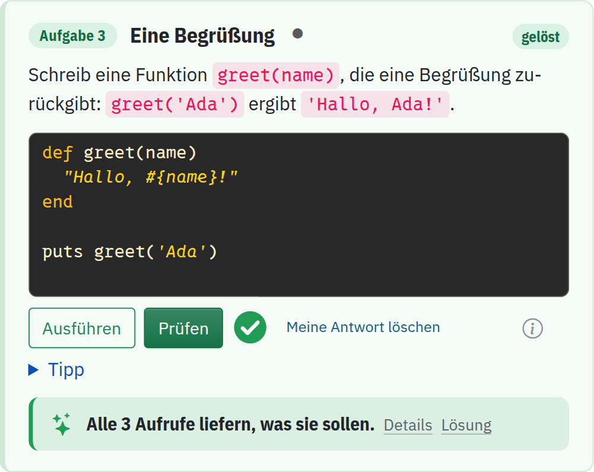

<div class='meta'>
image: teaser.webp:50:20
kind: uebung
duration: 1 Doppelstunde
languages: [ruby, python, javascript]
</div>

# Katas: Erste Funktionen

<p class='abstract'>
Du schreibst kleine Funktionen direkt hier auf der Seite: Sie bekommen Zahlen
oder Texte und geben ein Ergebnis zurück. Ohne Terminal und ohne Dateien, mit
einem Knopf zum Ausprobieren und einem zum Prüfen.
</p>

<!-- tutorial-screenshot
# Die Karte für den Katalog: die Begrüßung, gelöst und geprüft
open-site: /kata-functions
tab: preview
viewport: 640x900
hook: solve greet
sleep: 2
crop-element: .task-card[data-task="kata-functions/greet"]:visible
variants: dark
-->


## Eine Funktion

Eine Funktion bekommt Werte, rechnet damit und gibt ein Ergebnis zurück. Diese
hier bekommt eine Zahl und gibt ihr Dreifaches zurück:

<!-- language: ruby -->
```ruby
def triple(n)
  3 * n
end

puts triple(14)
```

In Ruby ist das Ergebnis der Wert der letzten Zeile; `return 3 * n` schreibt
es ausdrücklich hin. `puts` ruft die Funktion zum Ausprobieren auf und schreibt
ihr Ergebnis, `42`, ins Terminal.
<!-- /language -->
<!-- language: python -->
```python
def triple(n):
    return 3 * n

print(triple(14))
```

`return` gibt das Ergebnis zurück. `print` ruft die Funktion zum Ausprobieren
auf und schreibt ihr Ergebnis, `42`, ins Terminal.
<!-- /language -->
<!-- language: javascript -->
```javascript
function triple(n) {
  return 3 * n;
}

console.log(triple(14));
```

`return` gibt das Ergebnis zurück. `console.log` ruft die Funktion zum
Ausprobieren auf und schreibt ihr Ergebnis, `42`, in die Ausgabe. Namen aus
mehreren Wörtern schreibt man in JavaScript zusammen, jedes weitere Wort groß:
`rectangleArea`.
<!-- /language -->

In jeder Karte unten schreibst du eine solche Funktion. **Ausführen** startet
deinen Code einmal und zeigt, was er ausgibt. **Prüfen** ruft deine Funktion
mit verschiedenen Werten auf und vergleicht, was herauskommt. Die Punkte
neben dem Titel sagen, wie schwer eine Kata ist: einer für den Einstieg, zwei
für die Übung, drei für eine Knobelei. Du darfst springen.

## Einstieg

_task(add)

_task(double)

_task(greet)

_task(rectangle)

<div class='hint try'>
<strong>Ausprobieren:</strong> Ruf eine deiner Funktionen in der letzten Zeile
mit anderen Werten auf, etwa mit einem Text statt einer Zahl, und drück
<em>Ausführen</em>. Was meldet dein Programm?
</div>

## Übung

Jetzt rechnen die Funktionen ein wenig mehr. Achte darauf, was zuerst
gerechnet wird, und darauf, ob eine ganze Zahl oder eine Kommazahl
herauskommt.

_task(fahrenheit)

_task(clock)

_task(average)

_task(price)

## Knobelei

Hier brauchst du einen Plan, bevor du schreibst. Rechne ein Beispiel von
Hand, und schreib dir auf, welche Schritte du dabei gemacht hast.

_task(clock-after)

_task(last-digit)

<!-- extra -->
## Extras

Für alle, die schon fertig sind: zwei Katas, die nicht mitzählen.

_task(reverse-digits)

_task(duration)

Weiter geht es mit Entscheidungen: Funktionen, die je nach Wert etwas
anderes tun.
