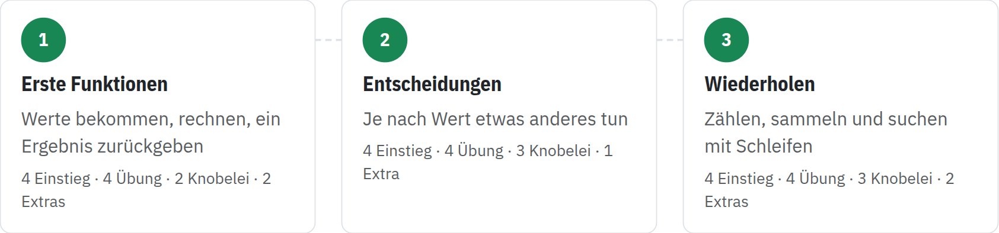

image: teaser.webp:contain
kind: uebung
duration: je Übung 1 Doppelstunde

# Katas

Kleine Programmieraufgaben, die du direkt auf der Seite schreibst, in Ruby,
Python oder JavaScript: ohne Terminal und Dateien, mit einem Knopf zum
Ausprobieren und einem zum Prüfen. Hier siehst du alle Übungen und wie weit
du schon bist.

<!-- tutorial-screenshot
# Das Bild für den Katalog: der Weg durch die Übungen
open-site: /katas
tab: preview
viewport: 1100x1000
hook: guest
sleep: 1
crop-element: .kata-map
variants: dark
-->

Eine Kata ist eine kleine Übung, die man so oft macht, bis sie sitzt: Das Wort
kommt aus den Kampfkünsten, und Programmiererinnen und Programmierer haben es
übernommen. Jede Übung hier dreht sich um eine Idee des Programmierens, und
die Übungen bauen aufeinander auf. Fang mit der ersten an, oder dort, wo deine
Lehrkraft es sagt; springen darfst du immer.

In jeder Übung stehen die Katas nach Schwierigkeit: ein Punkt für den
Einstieg, zwei für die Übung, drei für eine Knobelei. Die Extras am Ende
zählen nicht mit; sie sind für alle, die schon fertig sind.
