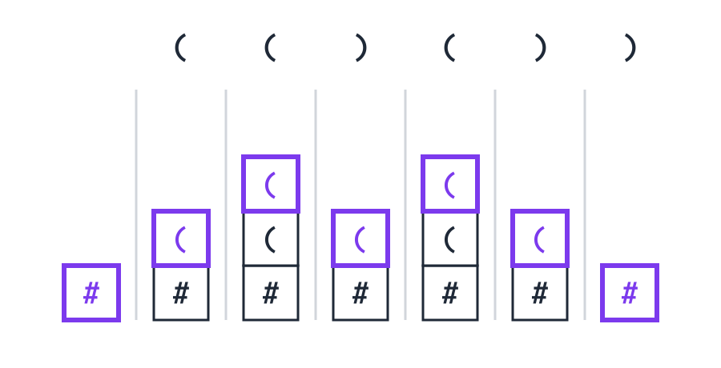
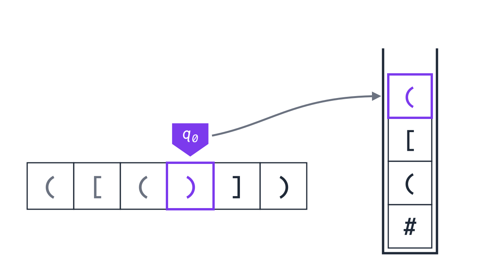

<div class='meta'>
image: teaser.webp:70:50
image_alt: "Ein Wort aus Klammern in einer Reihe von Feldern, über der vierten, einer schließenden runden Klammer, steht ein violetter Kopf mit q0. Ein grauer Pfeil führt zu einem Stack rechts daneben: unten #, darüber eine runde, eine eckige und oben, violett, wieder eine runde öffnende Klammer."
kind: projekt
language: Ruby / Python
languages: [ruby, python]
duration: 2 Doppelstunden
curriculum: "Oberstufe: Sprachen und Automaten (formale Sprachen, Kellerautomaten, Grenzen endlicher Automaten), Vertiefung Theoretische Informatik (Kellerautomaten, Schubfachprinzip)"
topics: [kellerautomaten]
requires: [automata]
reference: [automaten, listen, ruby-python]
</div>

<div
    class="autotoc-secondary-trigger"
    data-title="Auf dieser Seite"
    data-levels="h2,h3">
</div>

# Kellerautomaten

<p class='abstract'>
Stehen in <code>x = (a[1] + b) * {2}</code> alle Klammern richtig? Ein endlicher Automat kann das nicht prüfen, ein Zähler auch nicht. Du gibst einem Automaten einen Stack als Gedächtnis und baust damit in Ruby oder Python einen Kellerautomaten, der Klammern prüft und Wörter wie aaabbb erkennt. Dann findest du heraus, warum ein endlicher Automat an aaabbb scheitern muss, egal wie viele Zustände er hat.
</p>

Bevor es um Begriffe geht, sieh einem Kellerautomaten bei der Arbeit zu. Er prüft, ob die runden Klammern in `(()())` richtig stehen, und liest dazu das Wort Zeichen für Zeichen von links. Rechts daneben hat er einen **Stack**, einen Stapel, auf den er oben etwas legen und von dem er oben etwas herunternehmen kann; ganz unten liegt `#`. Schalte Schritt für Schritt weiter und achte darauf, was bei jeder `(` und bei jeder `)` mit dem Stack passiert.

<div class='automaton-stepper' data-stepper data-fixed data-title='Ein Kellerautomat bei der Arbeit' data-kind='pushdown' data-states='q0' data-start='q0' data-accept='q0' data-rules='q0 ( # #( q0; q0 ( ( (( q0; q0 ) ( ε q0' data-input='(()())'></div>
<script src='/include/automaton_layout.js'></script>
<script src='/include/automaton_stepper.js'></script>

_task(vorhersage-stack)

In [Endliche Automaten](/automata) hast du gesehen, was ein Automat mit endlich vielen Zuständen kann: Drehkreuze, Zahlenschlösser, Teilbarkeit. Am Ende stand eine Grenze. Was er sich merken müsste, ohne dass es eine feste Obergrenze gibt, kann er nicht. Klammern sind so ein Fall: In `((((…))))` können beliebig viele Klammern offen sein, bevor die erste zugeht.

Jeder Compiler und jeder Editor, der dir eine fehlende Klammer rot markiert, löst genau dieses Problem. Er braucht dafür mehr als Zustände, nämlich einen **Stack**. Ein endlicher Automat mit einem Stack heißt **Kellerautomat**, nach dem deutschen Wort, das Friedrich L. Bauer und Klaus Samelson dem Stack gaben: dem Keller.

## Einrichten

Lege im Terminal (<kbd>Strg</kbd><kbd>J</kbd>) einen Ordner an und öffne ihn mit <kbd>Strg</kbd><kbd>K</kbd> <kbd>Strg</kbd><kbd>O</kbd>:

```bash
mkdir /workspace/kellerautomat
```

<!-- language: ruby -->
Alle Dateien dieser Aktivität kommen in diesen Ordner. Ein Programm startest du im Terminal mit `ruby` und dem Namen der Datei.
<!-- /language -->
<!-- language: python -->
Alle Dateien dieser Aktivität kommen in diesen Ordner. Ein Programm startest du im Terminal mit `python3` und dem Namen der Datei.
<!-- /language -->

## Klammern zählen

Für runde Klammern allein reicht ein Zähler. Jede `(` zählt eins hoch, jede `)` eins herunter. Fällt der Zähler unter 0, schließt eine Klammer, die nie geöffnet wurde. Am Ende muss er wieder bei 0 sein.

<!-- language: ruby -->
Lege `count.rb` an:

```ruby
# Stehen die runden Klammern richtig? Ein Zähler merkt sich, wie viele
# Klammern gerade offen sind.
def balanced(word)
    depth = 0
    word.each_char do |symbol|
        if symbol == '('
            depth += 1
        elsif symbol == ')'
            depth -= 1
            return false if depth < 0
        end
    end
    depth == 0
end

['(()())', '(()', '())(', ''].each do |word|
    puts "#{word.inspect} #{balanced(word)}"
end
```

```bash
ruby count.rb
```

```text
"(()())" true
"(()" false
"())(" false
"" true
```
<!-- /language -->
<!-- language: python -->
Lege `count.py` an:

```python
# Stehen die runden Klammern richtig? Ein Zähler merkt sich, wie viele
# Klammern gerade offen sind.
def balanced(word):
    depth = 0
    for symbol in word:
        if symbol == '(':
            depth += 1
        elif symbol == ')':
            depth -= 1
            if depth < 0:
                return False
    return depth == 0


for word in ['(()())', '(()', '())(', '']:
    print(repr(word), balanced(word))
```

```bash
python3 count.py
```

```text
'(()())' True
'(()' False
'())(' False
'' True
```
<!-- /language -->

Das leere Wort, ganz ohne Klammern, ist auch richtig: Es gibt nichts, das offen bleibt. Ein Zähler kann beliebig groß werden, darum ist er schon mehr, als ein endlicher Automat hat. Aber reicht er auch, wenn es mehrere Sorten von Klammern gibt?

_task(zaehler)

<!-- after: zaehler -->
Zwei Zähler wissen, wie viele Klammern jeder Sorte offen sind, aber nicht, in welcher Reihenfolge sie geöffnet wurden. Genau darauf kommt es an: Die zuletzt geöffnete Klammer muss als erste zugehen.
<!-- /after -->

## Ein Stack für die Klammern

Ein **Stack** ist eine Liste, an der man nur an einem Ende arbeitet, oben: `push` legt einen Wert oben drauf, `pop` nimmt den obersten wieder herunter. Was zuletzt hineinkam, kommt als Erstes wieder heraus, wie bei einem Stapel Teller. Wie ein Stack aufgebaut ist, steht im Handbuch unter [Der Stack](/reference/listen#stack).

_person(bauer-samelson)

Für die Klammern heißt das: Jede öffnende Klammer kommt auf den Stack. Kommt eine schließende Klammer, muss oben die passende öffnende liegen; sie wird heruntergenommen. Liegt oben eine andere, oder ist der Stack leer, stimmt das Wort nicht. Am Ende muss der Stack leer sein.

<!-- language: ruby -->
In Ruby ist ein Array schon ein Stack: `stack.push(x)` legt `x` oben drauf, `stack.pop` nimmt den obersten Wert herunter und gibt ihn zurück, `stack.last` zeigt ihn, ohne ihn wegzunehmen.

Lege `brackets.rb` an. Diese Zeilen kommen ans Ende, darüber schreibst du `balanced`:

```ruby
['([]{})', '([)]', '((', ''].each do |word|
    puts "#{word.inspect} #{balanced(word)}"
end
```
<!-- /language -->
<!-- language: python -->
In Python ist eine Liste schon ein Stack: `stack.append(x)` legt `x` oben drauf, `stack.pop()` nimmt den obersten Wert herunter und gibt ihn zurück, `stack[-1]` zeigt ihn, ohne ihn wegzunehmen.

Lege `brackets.py` an. Diese Zeilen kommen ans Ende, darüber schreibst du `balanced`:

```python
for word in ['([]{})', '([)]', '((', '']:
    print(repr(word), balanced(word))
```
<!-- /language -->

_task(stack)

<div class='hint try'>
<strong>Ausprobieren:</strong> Lass <code>balanced</code> nach jedem Zeichen den Stack ausgeben und starte es mit <code>([)]</code>. Achte darauf, was oben liegt, wenn die <code>)</code> kommt.
</div>

## Ein Kellerautomat

Dein `balanced` ist ein Programm mit Schleifen und Vergleichen. Ein **Kellerautomat** wie der vom Anfang der Seite schafft dasselbe nur mit einer Tabelle, wie ein endlicher Automat. Er hat Zustände, liest das Wort Zeichen für Zeichen und hat dazu einen Stack. Bei jedem Zeichen sieht er in seiner Tabelle nach, und zwar mit drei Angaben: seinem Zustand, dem gelesenen Zeichen und dem obersten Zeichen des Stacks. Die Tabelle sagt ihm den neuen Zustand und was er an die Stelle des obersten Zeichens legt: nichts, dasselbe Zeichen wieder oder mehrere Zeichen.

Ganz unten im Stack liegt am Anfang ein `#`. So erkennt der Automat, dass sein Stack leer ist: wenn `#` oben liegt. Nimmt er ein Wort an, ist er am Ende in einem akzeptierenden Zustand, und auf dem Stack liegt nur noch `#`. Fehlt für ein Paar aus Zeichen und oberstem Zeichen ein Übergang, lehnt er das Wort ab.

<!-- language: ruby -->
Lege `pda.rb` an. PDA steht für *pushdown automaton*, das englische Wort für Kellerautomat.

```ruby
# Ein Kellerautomat prüft runde Klammern. Er liest das Wort Zeichen für
# Zeichen und hat einen Stack; ganz unten liegt #, das Zeichen für »leer«.
START = 'q0'
ACCEPTING = ['q0']
# [Zustand, gelesenes Zeichen, oberstes Zeichen des Stacks]
#   => [neuer Zustand, was an dessen Stelle auf den Stack kommt]
# Der Stack wird von unten nach oben geschrieben: '#(' heißt, # bleibt
# liegen und ( kommt oben drauf; '' heißt, das oberste Zeichen ist weg.
TRANSITIONS = {
    ['q0', '(', '#'] => ['q0', '#('],
    ['q0', '(', '('] => ['q0', '(('],
    ['q0', ')', '('] => ['q0', ''],
}

def accepts(word, trace: false)
    state = START
    stack = ['#']
    puts "      #{state}  #{stack.join}" if trace
    word.each_char do |symbol|
        top = stack.pop
        move = TRANSITIONS[[state, symbol, top]]
        # kein Übergang: der Fehlerzustand, das Wort ist abgelehnt
        return false if move.nil?
        state, push = move
        stack.concat(push.chars)
        puts "#{symbol.ljust(5)} #{state}  #{stack.join}" if trace
    end
    ACCEPTING.include?(state) && stack == ['#']
end

accepts('(()())', trace: true)
['(()())', '(()', '())(', ''].each do |word|
    puts "#{word.inspect} #{accepts(word)}"
end
```

`accepts` nimmt bei jedem Zeichen das oberste Zeichen mit `pop` vom Stack und schlägt mit Zustand, Zeichen und diesem obersten Zeichen in `TRANSITIONS` nach. Was dort steht, kommt mit `concat` wieder oben drauf, Zeichen für Zeichen. Starte es mit `ruby pda.rb`.
<!-- /language -->
<!-- language: python -->
Lege `pda.py` an. PDA steht für *pushdown automaton*, das englische Wort für Kellerautomat.

```python
# Ein Kellerautomat prüft runde Klammern. Er liest das Wort Zeichen für
# Zeichen und hat einen Stack; ganz unten liegt #, das Zeichen für »leer«.
START = 'q0'
ACCEPTING = {'q0'}
# (Zustand, gelesenes Zeichen, oberstes Zeichen des Stacks)
#   -> (neuer Zustand, was an dessen Stelle auf den Stack kommt)
# Der Stack wird von unten nach oben geschrieben: '#(' heißt, # bleibt
# liegen und ( kommt oben drauf; '' heißt, das oberste Zeichen ist weg.
TRANSITIONS = {
    ('q0', '(', '#'): ('q0', '#('),
    ('q0', '(', '('): ('q0', '(('),
    ('q0', ')', '('): ('q0', ''),
}


def accepts(word, trace=False):
    state = START
    stack = ['#']
    if trace:
        print(f'      {state}  {"".join(stack)}')
    for symbol in word:
        top = stack.pop()
        move = TRANSITIONS.get((state, symbol, top))
        # kein Übergang: der Fehlerzustand, das Wort ist abgelehnt
        if move is None:
            return False
        state, push = move
        stack.extend(push)
        if trace:
            print(f'{symbol:<5} {state}  {"".join(stack)}')
    return state in ACCEPTING and stack == ['#']


accepts('(()())', trace=True)
for word in ['(()())', '(()', '())(', '']:
    print(repr(word), accepts(word))
```

`accepts` nimmt bei jedem Zeichen das oberste Zeichen mit `pop` vom Stack und schlägt mit Zustand, Zeichen und diesem obersten Zeichen in `TRANSITIONS` nach. Was dort steht, kommt mit `extend` wieder oben drauf, Zeichen für Zeichen. Starte es mit `python3 pda.py`.
<!-- /language -->

Als Bild hat dieser Kellerautomat einen einzigen Zustand q<sub>0</sub>, und alle drei Übergänge führen zu ihm zurück. Jede Zeile am Pfeil ist ein Übergang aus `TRANSITIONS`:

<div class='automaton-drawing' role='img' aria-label='Ein Zustand q0 mit Startpfeil und doppeltem Rand, ein Pfeil führt im Bogen zu ihm zurück. Daran stehen untereinander drei Übergänge: »(, # / #(«, »(, ( / ((« und »), ( / ε«.' data-states='q0' data-start='q0' data-accept='q0' data-arrows='q0 | (, # / #( | q0; q0 | (, ( / (( | q0; q0 | ), ( / ε | q0'></div>
<script src='/include/automaton_layout.js'></script>

Weil hier die Zeichen selbst Klammern sind, liest sich das schwer. Vor dem Komma steht das gelesene Zeichen, zwischen Komma und Schrägstrich das oberste Zeichen des Stacks, hinter dem Schrägstrich, was danach an seiner Stelle liegt, von unten nach oben geschrieben. ε heißt: dort liegt nichts mehr, wie `''` in der Tabelle.

<table class='table' style='width: auto;'>
<tr><th>Am Pfeil</th><th>gelesen</th><th>oben auf dem Stack</th><th>danach an seiner Stelle</th><th>in Worten</th></tr>
<tr><td><code>(, # / #(</code></td><td><code>(</code></td><td><code>#</code></td><td><code>#(</code></td><td>Keine Klammer ist offen, eine geht auf: <code>(</code> kommt auf <code>#</code>.</td></tr>
<tr><td><code>(, ( / ((</code></td><td><code>(</code></td><td><code>(</code></td><td><code>((</code></td><td>Noch eine Klammer geht auf: <code>(</code> kommt auf die offene <code>(</code>.</td></tr>
<tr><td><code>), ( / ε</code></td><td><code>)</code></td><td><code>(</code></td><td>nichts</td><td>Eine Klammer geht zu: Die oberste <code>(</code> verschwindet.</td></tr>
</table>

Die Ausgabe mit `trace` zeigt nach jedem Zeichen den Zustand und den Stack, von unten nach oben gelesen. So sieht der Stack beim Wort `(()())` aus, das oberste Zeichen hervorgehoben:



Die Höhe des Stacks ist der Zähler aus `count`. Der Stack kann sich aber mehr merken als eine Zahl: welche Klammern in welcher Reihenfolge offen sind.

_task(eckig)

<!-- language: ruby -->
<div class='hint try'>
<strong>Ausprobieren:</strong> Nimm aus <code>TRANSITIONS</code> den Übergang heraus, der eine <code>)</code> liest, und starte <code>accepts('()', trace: true)</code>. Achte auf die Zeile, nach der die Ausgabe aufhört. Welche Wörter nimmt der Automat jetzt noch an? Setz den Übergang danach wieder ein.
</div>
<!-- /language -->
<!-- language: python -->
<div class='hint try'>
<strong>Ausprobieren:</strong> Nimm aus <code>TRANSITIONS</code> den Übergang heraus, der eine <code>)</code> liest, und starte <code>accepts('()', trace=True)</code>. Achte auf die Zeile, nach der die Ausgabe aufhört. Welche Wörter nimmt der Automat jetzt noch an? Setz den Übergang danach wieder ein.
</div>
<!-- /language -->

## Erst a, dann gleich viele b

Die Sprache a<sup>n</sup>b<sup>n</sup> ist die einfachste Sprache, an der endliche Automaten scheitern: alle Wörter aus einer Reihe a und dahinter genauso vielen b. Dazu gehören das leere Wort, `ab`, `aabb` und `aaabbb`, nicht aber `aab`, `abb` oder `abab`. Sie sieht aus wie die Klammern mit a für `(` und b für `)`, mit einer Regel mehr: Nach dem ersten b kommt kein a mehr.

<!-- language: ruby -->
Kopiere `pda.rb` nach `anbn.rb`, zum Beispiel mit `cp pda.rb anbn.rb` im Terminal. Leere dort `TRANSITIONS` und ersetze die Zeilen am Ende:

```ruby
accepts('aabb', trace: true)
['ab', 'aabb', 'aab', 'abab', 'ba', ''].each do |word|
    puts "#{word.inspect} #{accepts(word)}"
end
```
<!-- /language -->
<!-- language: python -->
Kopiere `pda.py` nach `anbn.py`, zum Beispiel mit `cp pda.py anbn.py` im Terminal. Leere dort `TRANSITIONS` und ersetze die Zeilen am Ende:

```python
accepts('aabb', trace=True)
for word in ['ab', 'aabb', 'aab', 'abab', 'ba', '']:
    print(repr(word), accepts(word))
```
<!-- /language -->

Auf den Stack darf jedes Zeichen außer `#`, auch eines, das im Wort gar nicht vorkommt, etwa ein großes `A` für jedes gelesene a.

_task(anbn)

## Warum ein endlicher Automat es nicht kann

Kellerautomaten können also mehr als endliche Automaten. Aber vielleicht hat nur noch niemand den richtigen endlichen Automaten für a<sup>n</sup>b<sup>n</sup> gefunden, einen mit sehr vielen Zuständen? Dass es ihn nicht geben kann, zeigt eine Überlegung, die mit Briefen und Fächern anfängt: Steckst du 5 Briefe in 4 Fächer, landen in einem Fach mindestens zwei. Das heißt **Schubfachprinzip**.

_task(schubfach)

<!-- after: schubfach -->
Für einen Automaten heißt das: Hat er k Zustände und liest er k a, war er in k + 1 Zuständen, mit dem Startzustand. Also war er zweimal im selben Zustand, sagen wir nach i a und nach j a, mit i kleiner als j.

Von da an weiß der Automat nicht mehr, ob er i oder j a gelesen hat; er ist ja im selben Zustand. Liest er jetzt i b, macht er in beiden Fällen dasselbe und landet im selben Zustand. Er nimmt also a<sup>i</sup>b<sup>i</sup> und a<sup>j</sup>b<sup>i</sup> beide an oder beide nicht. Richtig wäre aber, das erste anzunehmen und das zweite nicht. Das gilt für jedes k, also für jeden endlichen Automaten: Keiner prüft a<sup>n</sup>b<sup>n</sup>.

Der Weg vom Zustand nach i a zum selben Zustand nach j a ist eine Schleife im Automaten. Man kann sie beliebig oft durchlaufen, »aufpumpen«, ohne dass er es merkt. Daher hat der Satz, der diese Überlegung für alle Sprachen fasst, seinen Namen: **Pumping-Lemma**.
<!-- /after -->

_task(welche-sprache)

## Wo Stacks arbeiten

Klammern sind überall, wo Text eine Struktur hat, die in sich verschachtelt ist. HTML-Tags wie `<ul>` und `</ul>` sind Klammern mit Namen. In Ruby sind `def` und `end` ein Paar, in Python die Einrückung. Jede Sprache, in der man etwas so tief verschachteln kann, wie man will, braucht zum Prüfen einen Stack. Solche Sprachen beschreibt man mit **kontextfreien Grammatiken**, und für jede kontextfreie Grammatik gibt es einen Kellerautomaten, der ihre Wörter prüft.

<div class='book'>
<i class='bi bi-file-earmark-text'></i>
<p><strong>Sequential Formula Translation</strong>, Klaus Samelson und Friedrich L. Bauer, Communications of the ACM, 1960. Wie ein Rechner eine Formel mit Klammern in seine Befehle übersetzt, mit einem Keller für alles, was noch offen ist; die englische Fassung des Aufsatzes von 1959, der den Keller bekannt machte: <a href='https://doi.org/10.1145/366959.366968'>bei der ACM</a>.</p>
</div>

_task(grammatik)

## Zusammenfassung

- Ein **Stack** gibt zuerst heraus, was zuletzt hineinkam. Mit ihm prüft man Klammern mehrerer Sorten; Zähler reichen dafür nicht.
- Ein **Kellerautomat** ist ein endlicher Automat mit einem Stack. Jeder Übergang hängt vom Zustand, vom gelesenen Zeichen und vom obersten Zeichen des Stacks ab und ersetzt dieses oberste Zeichen.
- Kellerautomaten erkennen Sprachen wie a<sup>n</sup>b<sup>n</sup> und richtig gesetzte Klammern, die kein endlicher Automat erkennt.
- Ein endlicher Automat mit k Zuständen war nach k Zeichen schon einmal im selben Zustand. Darum kann er nicht beliebig weit zählen; das ist die Idee hinter dem **Pumping-Lemma**.

## Wie geht es weiter?

- **Ein Band statt eines Stacks.** Auch Kellerautomaten haben eine Grenze: a<sup>n</sup>b<sup>n</sup>c<sup>n</sup>, gleich viele a, b und c, prüft keiner. Was dafür fehlt, ist ein Gedächtnis, in dem man überall lesen und schreiben kann. Das hat die [Turingmaschine](/turingmaschine).
- **Regeln statt einer Maschine.** In [Grammatiken](/grammatiken) beschreibst du Sprachen wie die Klammerwörter mit Regeln, zeichnest sie als Syntaxdiagramme und machst aus jeder Regel eine Funktion. Die Klammern prüft dann der Stack der Funktionsaufrufe.
- **Ein Rechner für Ausdrücke.** In [Ein Rechner für Ausdrücke](/calculator) baust du aus einer Grammatik ein Programm, das `2 + 3 * (4 - 1)` versteht und ausrechnet.



<!-- tutorial-step
# Die Musterlösungen aus loesung/ lösen jede Programmieraufgabe, in beiden Sprachen
write-file: kellerautomat/brackets.rb <- file:loesung/brackets.rb
write-file: kellerautomat/brackets.py <- file:loesung/brackets.py
write-file: kellerautomat/pda.rb <- file:loesung/pda.rb
write-file: kellerautomat/pda.py <- file:loesung/pda.py
write-file: kellerautomat/anbn.rb <- file:loesung/anbn.rb
write-file: kellerautomat/anbn.py <- file:loesung/anbn.py
check-task: stack
check-task: stack ruby
check-task: eckig
check-task: eckig ruby
check-task: anbn
check-task: anbn ruby
-->
