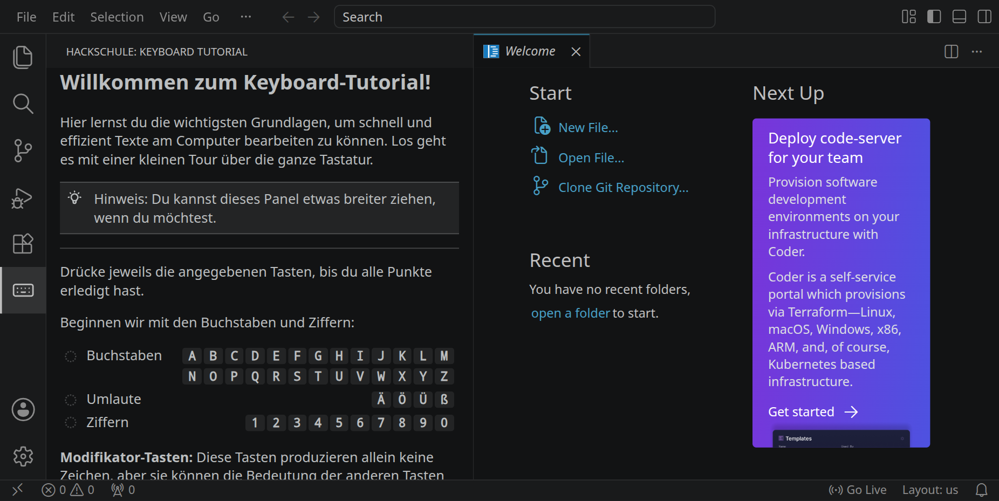
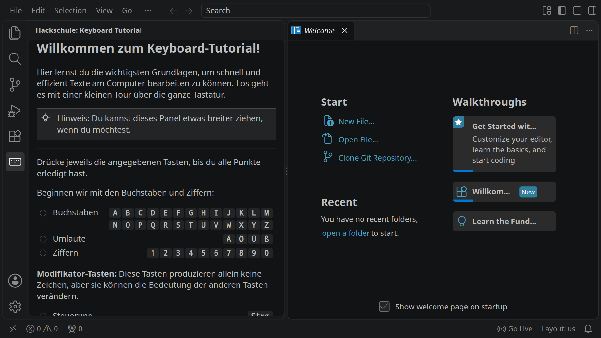
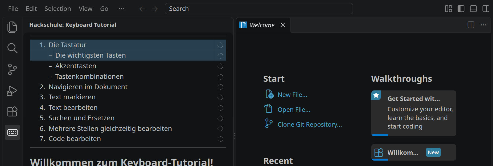

image: teaser.webp
image_alt: "VS Code mit dem Keyboard-Tutorial in der Seitenleiste: Buchstaben, Umlaute und Ziffern zum Abhaken"
kind: uebung
reference: [shortcuts]
duration: 2 bis 3 Doppelstunden
curriculum: "Sek I: Informatiksysteme (Bedienen von Hard- und Software: Tastatur und Editor); Oberstufe: Grundlagen informatischen Arbeitens (Arbeitsumgebung)"
topics: [betriebssystem]

# Keyboard-Tutorial

Wer die Tastatur beherrscht, schreibt, markiert und verschiebt Text schneller, als wenn er für jeden Schritt zur Maus greift. Das Keyboard-Tutorial ist im Workspace schon installiert: In sieben Kapiteln übst du direkt in Visual Studio Code, und jede Übung merkt selbst, wenn du sie geschafft hast.

## Das Tutorial öffnen

Klicke links in der Aktivitätsleiste auf das Tastatur-Symbol. Daneben öffnet sich das Keyboard-Tutorial:

<!-- tutorial-screenshot
# Das Keyboard-Tutorial in der Seitenleiste
# wie ein Klick auf das Tastatur-Symbol in der Aktivitätsleiste
press: Control+Shift+P
wait-for-input-value: >
type: View: Show Hackschule
sleep: 1
press: Enter
wait-for-text: Willkommen zum Keyboard-Tutorial
left-sidebar-width: 440
move-mouse: selector:.part.editor
sleep: 1
hook: scroll-to Willkommen zum Keyboard-Tutorial
sleep: 0.5
-->

<!-- tutorial-scope -->
<!-- tutorial-screenshot
# Bild für die Karte der Aktivität: dasselbe Fenster in 16:9, so dass
# die Karte nichts abschneidet
viewport: 1029x579
sleep: 1
-->

<!-- /tutorial-scope -->

Beginne mit dem ersten Kapitel und arbeite die Übungen der Reihe nach durch. Jede Übung sagt dir, was du tun sollst, und erkennt am Ergebnis, ob es geklappt hat: wo der Cursor steht, was markiert ist, was in der Datei steht. Erledigte Schritte bekommen einen grünen Haken. Dein Fortschritt bleibt gespeichert, du kannst also jederzeit aufhören und später an derselben Stelle weitermachen.

Du kannst die Seitenleiste mit dem Tutorial breiter ziehen, wenn du möchtest. Die Übungsdateien öffnet das Tutorial selbst; du musst vorher keinen Ordner öffnen.

## Die Kapitel

Ganz oben im Tutorial stehen die sieben Kapitel mit ihren Schritten. Ein Klick auf einen Schritt bringt dich dorthin; die Kreise rechts werden zu grünen Haken, sobald du einen Schritt geschafft hast.

<!-- tutorial-screenshot
hook: scroll-top
sleep: 0.5
crop-bottom: 38%
-->

Unter jedem Kapitel hier kannst du nachsehen lassen, ob du alle seine Schritte erledigt hast. Der Workspace liest dafür nur die Datei, in der das Tutorial deine Haken speichert.

### Die Tastatur

Buchstaben, Ziffern und Sonderzeichen finden, die wichtigsten Tasten wie <kbd>Enter</kbd>, <kbd>Tab</kbd>, <kbd>Esc</kbd> und die Rücktaste, Tastenkombinationen mit <kbd>Strg</kbd>, <kbd>Shift</kbd>, <kbd>Alt</kbd> und <kbd>AltGr</kbd>, Akzente wie in »café«.

_task(tastatur)

### Navigieren im Dokument

Mit Pfeiltasten, wortweise mit <kbd>Strg</kbd>, mit <kbd>Pos1</kbd> und <kbd>Ende</kbd>, seitenweise und an Anfang und Ende der Datei springen, zu einer bestimmten Zeile gehen und lange Zeilen umbrechen.

_uses(bewegen)

_task(navigieren)

<strong>Ausprobieren:</strong> Geh in eine eingerückte Zeile, ans Ende, und drück <kbd>Pos1</kbd>. Wo steht der Cursor? Drück <kbd>Pos1</kbd> gleich noch einmal: Wohin springt er jetzt? Beim Programmieren sparst du dir damit viele Pfeiltasten.

### Text markieren

Mit der Maus und mit <kbd>Shift</kbd> und den Pfeiltasten markieren, Wörter, Zeilen und alles auf einmal auswählen.

_uses(markieren)

_task(markieren)

### Text bearbeiten

Löschen, ersetzen, rückgängig machen, kopieren, ausschneiden und einfügen, ganze Zeilen verschieben und verdoppeln, mehrere Zeilen einrücken und speichern.

_task(kopieren-ohne-markierung)

<!-- after: kopieren-ohne-markierung -->
Ohne Markierung kopiert <kbd>Strg</kbd><kbd>C</kbd> in Visual Studio Code die ganze Zeile, in der der Cursor steht. <kbd>Strg</kbd><kbd>V</kbd> fügt sie dann als eigene Zeile über der Zeile ein, in der der Cursor gerade steht, egal, wo in der Zeile er ist. So verdoppelst du schnell eine Zeile; mit <kbd>Strg</kbd><kbd>X</kbd> verschiebst du sie.
<!-- /after -->

_uses(bearbeiten, zeilen)

_task(bearbeiten)

### Suchen und Ersetzen

Mit <kbd>Strg</kbd><kbd>F</kbd> suchen, Groß- und Kleinschreibung beachten, mit <kbd>Strg</kbd><kbd>H</kbd> einzelne oder alle Treffer ersetzen.

_uses(suchen)

_task(suchen)

### Mehrere Stellen gleichzeitig bearbeiten

Mehrere Cursor untereinander setzen, mit <kbd>Strg</kbd><kbd>D</kbd> das nächste gleiche Wort dazunehmen und an vielen Stellen auf einmal tippen.

_uses(mehrere-cursor)

_task(mehrere-stellen)

### Code bearbeiten

Zeilen auskommentieren, Blöcke einrücken, verschieben und kopieren, ohne die Einrückung zu zerstören, und am Ende einen kaputten Codeabschnitt reparieren. Die Beispiele sind in verschiedenen Programmiersprachen; du musst keine davon kennen.

_uses(code)

_task(code)

## Und danach?

Alle Shortcuts aus dem Tutorial stehen zum Nachschlagen im Handbuch unter [Shortcuts](/reference/shortcuts). Wenn du alle Kapitel geschafft hast, kannst du auf Seiten wie [keybr.com](https://www.keybr.com/) deine Tippgeschwindigkeit trainieren. Die Tastenkürzel brauchst du ab jetzt in jeder Aktivität: in den [Grundlagen](/basics) zum Beispiel, oder wenn du in der [Filmdatenbank](/filmdatenbank) lange SQL-Abfragen umbaust.
