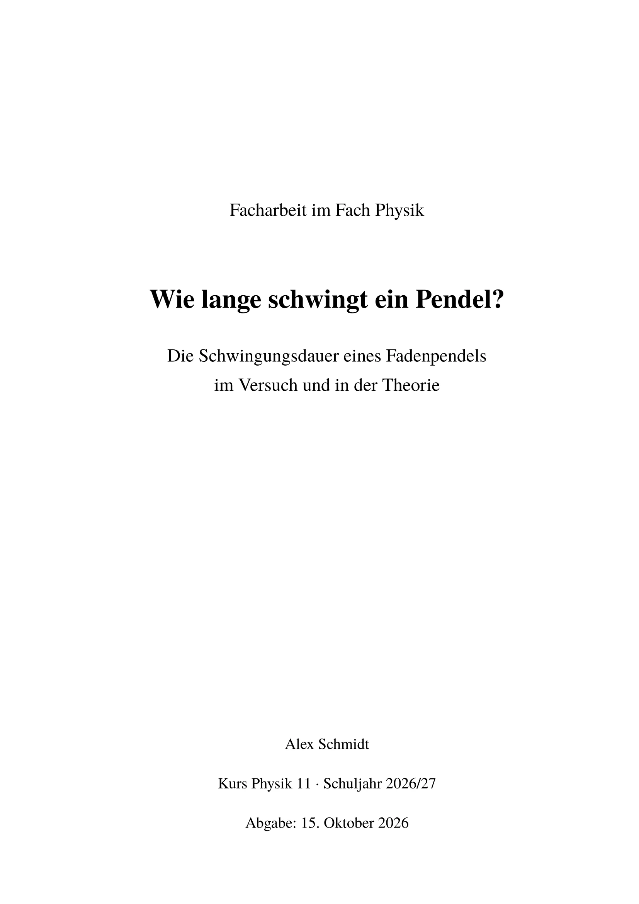
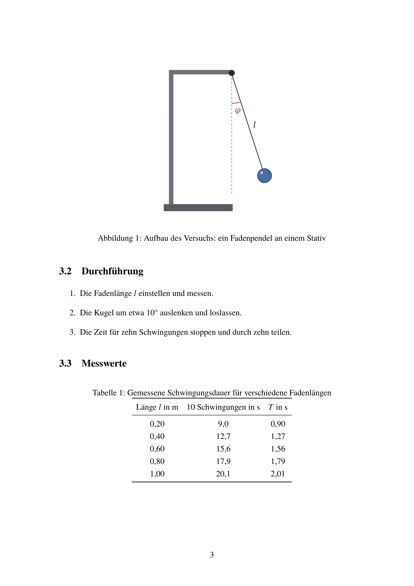
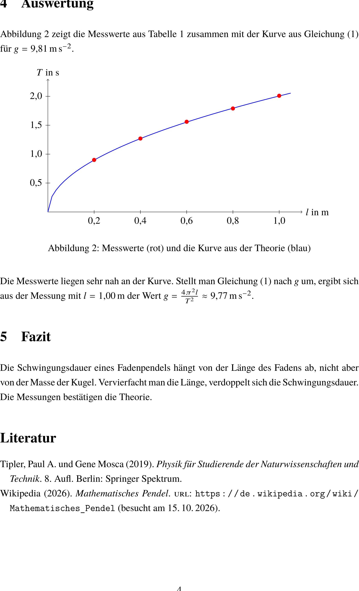
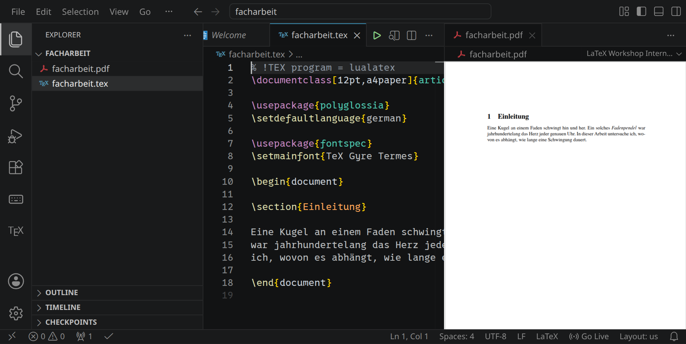
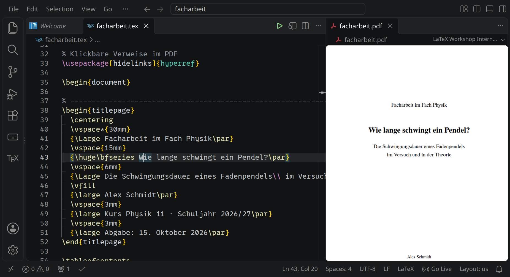
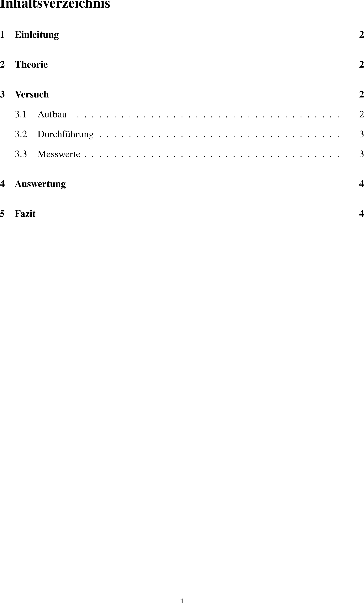
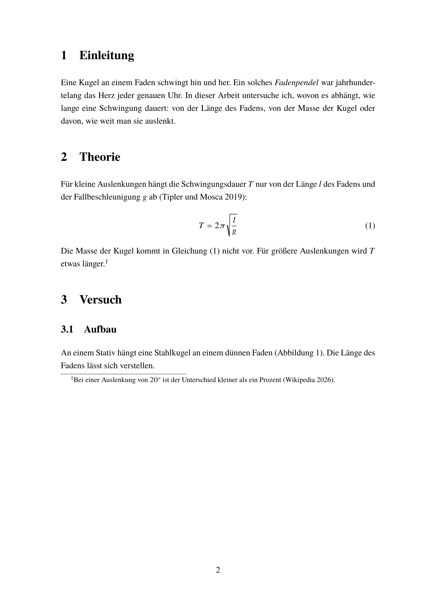

<div class='meta'>
image: facharbeit-fertig.webp
image_alt: "VS Code mit dem LaTeX-Quelltext einer Facharbeit links und dem fertigen Titelblatt als PDF rechts"
kind: projekt
language: LaTeX
topic: writing
duration: 3 Doppelstunden
reference: [latex]
</div>

<div
    class="autotoc-secondary-trigger"
    data-title="Auf dieser Seite"
    data-levels="h2,h3">
</div>

# Eine Facharbeit mit LaTeX

<p class='abstract'>
Du schreibst eine kurze Facharbeit über ein Fadenpendel, von der leeren Datei bis zum fertigen PDF: mit Titelseite, Inhaltsverzeichnis, Kapiteln, einer Formel, einem Bild, einer Messwerttabelle, einem Diagramm, Quellenangaben und der Selbstständigkeitserklärung. Alles, was du dabei lernst, brauchst du später wieder: für Facharbeit oder Seminararbeit, für Protokolle und im Studium.
</p>

<div class='gallery'>
<figure><figcaption>Die Titelseite</figcaption></figure>
<figure><figcaption>Abbildung, Liste und Tabelle</figcaption></figure>
<figure><figcaption>Diagramm und Quellen</figcaption></figure>
</div>

## Warum LaTeX?

In einem Textprogramm wie Word formatierst du, während du schreibst: Du markierst eine Überschrift und machst sie groß und fett, du verschiebst ein Bild, bis es passt. Bei einer langen Arbeit wird das mühsam. Fügst du ein Kapitel ein, stimmen Nummern, Inhaltsverzeichnis und Verweise nicht mehr, und ein verschobenes Bild bringt die Seiten durcheinander.

In LaTeX schreibst du, **was** etwas ist: `\section{Theorie}` ist eine Überschrift, `\caption{…}` die Unterschrift einer Abbildung, `\parencite{…}` eine Quellenangabe. Wie es aussieht, entscheidet LaTeX, für das ganze Dokument einheitlich. Nummern, Inhaltsverzeichnis, Literaturverzeichnis und Verweise wie »siehe Tabelle 1« stimmen immer, und Formeln sehen aus wie im Mathebuch. Deshalb schreibt man an Universitäten in Mathematik, Naturwissenschaften und Informatik fast alles mit LaTeX.

_person(knuth-lamport)

Deine Facharbeit ist eine reine Textdatei. LaTeX macht daraus ein PDF. Alle Befehle aus dieser Aktivität und viele mehr findest du im [Handbuch LaTeX](/reference/latex).

## Einrichten

### LaTeX Workshop

_include(latex#latex-workshop)

### Ein Ordner für die Facharbeit

Lege im Terminal (<kbd>Strg</kbd><kbd>J</kbd>) einen Ordner an:

```bash
mkdir /workspace/facharbeit
```

Öffne ihn dann mit <kbd>Strg</kbd><kbd>K</kbd> <kbd>Strg</kbd><kbd>O</kbd>: Tippe `/workspace/facharbeit/` und bestätige mit <kbd>Enter</kbd> und »OK«. Lege darin mit einem Klick auf »New File…« im Explorer die Datei `facharbeit.tex` an.

## Das erste Dokument

Schreibe in `facharbeit.tex`:

```tex_copy
% !TEX program = lualatex
\documentclass[12pt,a4paper]{article}

\usepackage{polyglossia}
\setdefaultlanguage{german}

\usepackage{fontspec}
\setmainfont{TeX Gyre Termes}

\begin{document}

\section{Einleitung}

Eine Kugel an einem Faden schwingt hin und her. Ein solches \emph{Fadenpendel}
war jahrhundertelang das Herz jeder genauen Uhr. In dieser Arbeit untersuche
ich, wovon es abhängt, wie lange eine Schwingung dauert.

\end{document}
```

Speichere mit <kbd>Strg</kbd><kbd>S</kbd>. LaTeX Workshop übersetzt die Datei dabei von selbst, und neben `facharbeit.tex` erscheint `facharbeit.pdf`. Mit <kbd>Strg</kbd><kbd>Alt</kbd><kbd>V</kbd> siehst du das PDF neben dem Quelltext:

<!-- tutorial-screenshot
# LaTeX Workshop installieren, dann den Ordner facharbeit mit dem ersten Entwurf
sharp-canvas
press: Control+Shift+X
sleep: 2
type: @id:james-yu.latex-workshop
sleep: 2
click: selector:.extensions-viewlet .extension-action.install:not(.hide)
wait-for-text: Do you trust the publisher
click: Trust Publisher & Install
wait-for-text: Uninstall
press: Control+K
press: KeyW
sleep: 1
write-file: facharbeit/facharbeit.tex <- file:stufen/entwurf.tex
press: Control+K
press: Control+O
wait-for-input-value: /workspace/
type: facharbeit
press: Enter
wait-for-input-value: /workspace/facharbeit/
press: Enter
wait-for-text: facharbeit.tex
open-file: facharbeit.tex
sleep: 1
press: Control+Alt+B
wait-for-file-newer: facharbeit/facharbeit.pdf <- facharbeit/facharbeit.tex
sleep: 2
press: Control+Alt+V
wait-for-text: Einleitung
move-mouse: selector:.editor-group-container .monaco-editor .view-lines
sleep: 2
check-task-fails: gliederung
check-task-fails: quellen
-->


Die Datei hat zwei Teile:

- Die **Präambel** bis `\begin{document}` sagt, was für ein Dokument es ist: ein Artikel in 12 pt auf A4, auf Deutsch (für die Silbentrennung und Wörter wie »Inhaltsverzeichnis«), in der Schrift »TeX Gyre Termes«, die aussieht wie Times. Die erste Zeile sorgt dafür, dass LaTeX Workshop mit LuaLaTeX übersetzt, das moderne Schriften versteht.
- Zwischen `\begin{document}` und `\end{document}` steht der Text. `\section{…}` ist eine Überschrift, die LaTeX selbst nummeriert, `\emph{…}` hebt ein Wort hervor.

Wo eine Zeile im Quelltext endet, ist LaTeX egal; es setzt den Absatz selbst und trennt Wörter richtig. Einen neuen Absatz beginnst du mit einer **Leerzeile**.

_task(erstes-pdf)

Ein paar Zeichen haben in LaTeX eine eigene Bedeutung: `%` beginnt einen Kommentar, `&` trennt Spalten in Tabellen, `$` beginnt eine Formel. Willst du sie im Text haben, schreibst du einen `\` davor: `50 \%`. Mehr dazu unter [Sonderzeichen](/reference/latex#sonderzeichen).

_task(sonderzeichen)

## Gliederung

Eine Facharbeit beginnt mit einer Titelseite und einem Inhaltsverzeichnis. Ersetze `\section{Einleitung}` durch:

```tex_copy
~ \begin{document}
~
\begin{titlepage}
  \centering
  \vspace*{30mm}
  {\Large Facharbeit im Fach Physik\par}
  \vspace{15mm}
  {\huge\bfseries Wie lange schwingt ein Pendel?\par}
  \vspace{6mm}
  {\Large Die Schwingungsdauer eines Fadenpendels\\ im Versuch und in der Theorie\par}
  \vfill
  {\large Alex Schmidt\par}
  \vspace{3mm}
  {\large Kurs Physik 11 · Schuljahr 2026/27\par}
  \vspace{3mm}
  {\large Abgabe: 15. Oktober 2026\par}
\end{titlepage}

\tableofcontents
\newpage
\section{Einleitung}
~
~ Eine Kugel an einem Faden schwingt hin und her. Ein solches \emph{Fadenpendel}
```

- In `titlepage` gestaltest du die Titelseite selbst. `\centering` zentriert alles, `\vspace` macht Abstand, `\vfill` schiebt den Rest ganz nach unten. `\Large`, `\huge` und `\bfseries` machen die Schrift größer und fett, bis zur schließenden Klammer.
- `\tableofcontents` setzt das Inhaltsverzeichnis. Es braucht einen zweiten Durchlauf von LaTeX, um die Seitenzahlen zu kennen; LaTeX Workshop übersetzt deshalb von selbst so oft wie nötig.

Unter die Einleitung kommen die anderen Kapitel. Schreib die Überschriften jetzt schon hin, den Text füllen wir Kapitel für Kapitel:

```tex
~ war jahrhundertelang das Herz jeder genauen Uhr. In dieser Arbeit untersuche
~ ich, wovon es abhängt, wie lange eine Schwingung dauert.
~
\section{Theorie}

\section{Versuch}
\subsection{Aufbau}
\subsection{Durchführung}
\subsection{Messwerte}

\section{Auswertung}

\section{Fazit}
~
~ \end{document}
```

`\subsection` ist eine Überschrift eine Stufe tiefer: 3.1, 3.2, 3.3. Ändere den Titel, deinen Namen und das Datum auf der Titelseite in deine eigenen.

_task(gliederung)

_task(nummern)

## Eine Formel

Im Kapitel Theorie steht die Formel, um die es geht:

```tex
~ war jahrhundertelang das Herz jeder genauen Uhr. In dieser Arbeit untersuche
~ ich, wovon es abhängt, wie lange eine Schwingung dauert.
~
~ \section{Theorie}

Für kleine Auslenkungen hängt die Schwingungsdauer~$T$ nur von der Länge~$l$
des Fadens und der Fallbeschleunigung~$g$ ab \parencite{tipler2019}:
\begin{equation}
  T = 2\pi \sqrt{\frac{l}{g}}
  \label{eq:schwingungsdauer}
\end{equation}
Die Masse der Kugel kommt in Gleichung~\eqref{eq:schwingungsdauer} nicht vor.
Für größere Auslenkungen wird $T$ etwas länger.\footnote{Bei einer Auslenkung
von \ang{20} ist der Unterschied kleiner als ein Prozent \parencite{pendel}.}
~
~ \section{Versuch}
~ \subsection{Aufbau}
```

- Zwischen zwei `$` steht eine Formel im Satz: `$T$` setzt das *T* kursiv, wie Variablen in Formeln üblich sind. `~` ist ein Leerzeichen, an dem LaTeX keine Zeile umbricht.
- `equation` setzt eine Formel in eine eigene Zeile, mit einer Nummer am Rand. `\frac{l}{g}` ist ein Bruch, `\sqrt{…}` eine Wurzel, `\pi` das π.
- `\label{eq:schwingungsdauer}` gibt der Formel einen Namen. `\eqref{eq:schwingungsdauer}` schreibt dann ihre Nummer, »(1)«. Kommt später eine Formel davor dazu, ändern sich Nummer und Verweis von selbst.
- `\footnote{…}` macht eine Fußnote.
- `\parencite{…}` gibt eine Quelle an. Das kennt LaTeX erst, wenn das Kapitel [Quellen](#9-quellen) eingerichtet ist: Lass die beiden `\parencite{…}` bis dahin weg, sonst meldet LaTeX »Undefined control sequence«.

Damit Formeln zur Schrift passen und `\ang{20}` funktioniert (der Winkel 20°), brauchen sie Pakete. Ergänze die Präambel:

```tex
~ \setdefaultlanguage{german}
~
~ \usepackage{fontspec}
~ \setmainfont{TeX Gyre Termes}
\usepackage{unicode-math}
\setmathfont{TeX Gyre Termes Math}
\usepackage[locale=DE]{siunitx}
~
~ \begin{document}
```

`siunitx` setzt Zahlen und Einheiten richtig, mit Komma und dem richtigen Abstand. Die Formelzeichen, die du sonst noch brauchst, stehen im Handbuch unter [Formelzeichen](/reference/latex#formelzeichen).

_task(formel)

_task(schwingungsdauer)

## Ein Bild

Eine Facharbeit zeigt, wie der Versuch aufgebaut war. Lege dafür ein Bild `aufbau.png` (oder `.jpg`) in den Ordner `facharbeit`: ein Foto von deinem Versuch, eine eigene Zeichnung, zum Beispiel aus dem [2D Game Studio](https://2d.hackschule.de/) (»Funktionen« › »Sprite« › »Als Bild speichern«), oder ein Bild aus dem Internet, dessen Quelle du angibst. Ziehe die Datei aus deinem Download-Ordner einfach in den Explorer des Workspace.

```tex
~ von \ang{20} ist der Unterschied kleiner als ein Prozent \parencite{pendel}.}
~
~ \section{Versuch}
~ \subsection{Aufbau}

An einem Stativ hängt eine Stahlkugel an einem dünnen Faden
(Abbildung~\ref{fig:aufbau}). Die Länge des Fadens lässt sich verstellen.

\begin{figure}[H]
  \centering
  \includegraphics[width=0.45\textwidth]{aufbau.png}
  \caption{Aufbau des Versuchs: ein Fadenpendel an einem Stativ}
  \label{fig:aufbau}
\end{figure}
~ \subsection{Durchführung}
~ \subsection{Messwerte}
```

- `\includegraphics` setzt das Bild, mit `width=0.45\textwidth` knapp halb so breit wie der Text.
- `figure` macht daraus eine **Abbildung** mit Nummer: `\caption` schreibt »Abbildung 1: …« darunter, `\label` gibt ihr einen Namen, auf den `\ref{fig:aufbau}` im Text verweist.
- `[H]` heißt: genau hier. Ohne diese Angabe sucht LaTeX selbst einen guten Platz für die Abbildung, oft oben auf einer Seite. Das ist in Büchern erwünscht, verwirrt aber am Anfang.

Für Bilder und `[H]` braucht die Präambel noch:

```tex
~ \usepackage{unicode-math}
~ \setmathfont{TeX Gyre Termes Math}
~ \usepackage[locale=DE]{siunitx}
\usepackage{graphicx}
\usepackage{float}
~
~ \begin{document}
```

_task(bild)

<div class='hint try'>
<strong>Ausprobieren:</strong> Lösch <code>[H]</code> hinter <code>\begin{figure}</code> und speichere: Wo setzt LaTeX die Abbildung jetzt, und stimmt der Verweis »Abbildung 1« im Text trotzdem? Ändere auch <code>width=0.45\textwidth</code> in <code>width=\textwidth</code>. Stell danach beides wieder her.
</div>

## Eine Tabelle

Die Durchführung ist eine Liste von Schritten, und die Messwerte gehören in eine Tabelle:

```tex
~   \label{fig:aufbau}
~ \end{figure}
~ \subsection{Durchführung}

\begin{enumerate}
  \item Die Fadenlänge~$l$ einstellen und messen.
  \item Die Kugel um etwa \ang{10} auslenken und loslassen.
  \item Die Zeit für zehn Schwingungen stoppen und durch zehn teilen.
\end{enumerate}
~ \subsection{Messwerte}
```

Unter `\subsection{Messwerte}` kommt die Tabelle:

```tex_copy
~ \end{enumerate}
~
~ \subsection{Messwerte}

\begin{table}[H]
  \centering
  \caption{Gemessene Schwingungsdauer für verschiedene Fadenlängen}
  \label{tab:messwerte}
  \begin{tabular}{ccc}
    \toprule
    Länge $l$ in \unit{\metre} & 10 Schwingungen in \unit{\second} & $T$ in \unit{\second} \\
    \midrule
    0,20 &  9,0 & 0,90 \\
    0,40 & 12,7 & 1,27 \\
    0,60 & 15,6 & 1,56 \\
    0,80 & 17,9 & 1,79 \\
    1,00 & 20,1 & 2,01 \\
    \bottomrule
  \end{tabular}
\end{table}
~
~ \section{Auswertung}
```

- `enumerate` nummeriert die Einträge, jeder beginnt mit `\item`. Für Punkte statt Nummern nimmst du `itemize`.
- `tabular` ist die Tabelle selbst. `{ccc}` heißt: drei Spalten, alle zentriert (`l` wäre links, `r` rechts). `&` trennt die Zellen einer Zeile, `\\` beendet die Zeile.
- `\toprule`, `\midrule` und `\bottomrule` sind waagerechte Linien in drei Stärken. Senkrechte Linien lässt man in gesetzten Tabellen weg.
- `\unit{\metre}` setzt die Einheit Meter, `\unit{\second}` Sekunden, mit `siunitx`.
- Bei Tabellen steht die `\caption` über der Tabelle.

Die Linien kommen aus einem Paket. Ergänze die Präambel um:

```tex
~ \usepackage[locale=DE]{siunitx}
~ \usepackage{graphicx}
~ \usepackage{float}
\usepackage{booktabs}
~
~ \begin{document}
```

_task(tabelle)

## Ein Diagramm

Messwerte versteht man am besten in einem Diagramm. Mit dem Paket TikZ zeichnest du es in LaTeX selbst, mit Koordinaten statt mit der Maus. Das Kapitel Auswertung:

```tex_copy
~     \bottomrule
~   \end{tabular}
~ \end{table}
~
~ \section{Auswertung}

Abbildung~\ref{fig:diagramm} zeigt die Messwerte aus Tabelle~\ref{tab:messwerte}
zusammen mit der Kurve aus Gleichung~\eqref{eq:schwingungsdauer} für
$g = \qty{9,81}{\metre\per\second\squared}$.

\begin{figure}[H]
  \centering
  \begin{tikzpicture}[x=10cm, y=2.5cm]
    % Achsen mit Beschriftung
    \draw[->] (0,0) -- (1.1,0) node[right] {$l$ in \unit{\metre}};
    \draw[->] (0,0) -- (0,2.3) node[above] {$T$ in \unit{\second}};
    \foreach \x in {0.2, 0.4, 0.6, 0.8, 1.0}
      \draw (\x,0.03) -- (\x,-0.03) node[below] {\num{\x}};
    \foreach \y in {0.5, 1.0, 1.5, 2.0}
      \draw (0.01,\y) -- (-0.01,\y) node[left] {\num{\y}};
    % Theorie: T = 2 pi sqrt(l / g)
    \draw[thick, blue, domain=0:1.05, samples=60]
      plot (\x, {2*pi*sqrt(\x/9.81)});
    % Messwerte
    \foreach \l/\t in {0.2/0.90, 0.4/1.27, 0.6/1.56, 0.8/1.79, 1.0/2.01}
      \fill[red] (\l,\t) circle (2.5pt);
  \end{tikzpicture}
  \caption{Messwerte (rot) und die Kurve aus der Theorie (blau)}
  \label{fig:diagramm}
\end{figure}

Die Messwerte liegen sehr nah an der Kurve. Stellt man
Gleichung~\eqref{eq:schwingungsdauer} nach $g$ um, ergibt sich aus der Messung
mit $l = \qty{1,00}{\metre}$ der Wert $g = \frac{4\pi^2 l}{T^2}
\approx \qty{9,77}{\metre\per\second\squared}$.
~
~ \section{Fazit}
```

- `[x=10cm, y=2.5cm]` legt den Maßstab fest: Ein Meter Fadenlänge sind 10 cm auf dem Papier, eine Sekunde sind 2,5 cm.
- `\draw[->] (0,0) -- (1.1,0)` zeichnet eine Achse mit Pfeil, `node[right] {…}` schreibt die Beschriftung daneben.
- `\foreach` wiederholt eine Zeile für jeden Wert der Liste: für die Striche an den Achsen und für die Messpunkte. Bei `\l/\t` gehören immer zwei Werte zusammen, Länge und Schwingungsdauer.
- `plot` zeichnet die Kurve der Formel. In Koordinaten und Rechnungen schreibst du Kommazahlen mit Punkt: `9.81`, nicht `9,81`.
- `\qty{9,81}{\metre\per\second\squared}` setzt Zahl und Einheit: 9,81 m/s².

Ergänze die Präambel:

```tex
~ \usepackage{graphicx}
~ \usepackage{float}
~ \usepackage{booktabs}
\usepackage{tikz}
~
~ \begin{document}
```

_task(diagramm)

<div class='hint try'>
<strong>Ausprobieren:</strong> Das Diagramm ist Code, du kannst daran drehen:
<ul>
<li>Ändere in der Zeile mit <code>plot</code> die <code>9.81</code> in <code>1.62</code>, die Fallbeschleunigung auf dem Mond. Wohin wandert die blaue Kurve, und was heißt das für ein Pendel auf dem Mond?</li>
<li>Ändere den Maßstab <code>[x=10cm, y=2.5cm]</code> in <code>[x=5cm, y=2.5cm]</code>. Was wird schmaler, und was bleibt so groß wie vorher?</li>
</ul>
Stell beides danach wieder her.
</div>

Zum Schluss fehlt noch das Fazit:

```tex
~ Gleichung~\eqref{eq:schwingungsdauer} nach $g$ um, ergibt sich aus der Messung
~ mit $l = \qty{1,00}{\metre}$ der Wert $g = \frac{4\pi^2 l}{T^2}
~ \approx \qty{9,77}{\metre\per\second\squared}$.
~
~ \section{Fazit}

Die Schwingungsdauer eines Fadenpendels hängt von der Länge des Fadens ab,
nicht aber von der Masse der Kugel. Vervierfacht man die Länge, verdoppelt
sich die Schwingungsdauer. Die Messungen bestätigen die Theorie.
~
~ \end{document}
```

## Quellen

Jede Facharbeit gibt an, woher ihr Wissen kommt. In LaTeX stehen die Quellen in einer eigenen Datei. Lege neben `facharbeit.tex` die Datei `literatur.bib` an:

```bibtex_copy
@book{tipler2019,
  author    = {Tipler, Paul A. and Mosca, Gene},
  title     = {Physik für Studierende der Naturwissenschaften und Technik},
  edition   = {8},
  publisher = {Springer Spektrum},
  location  = {Berlin},
  year      = {2019}
}

@online{pendel,
  author  = {{Wikipedia}},
  title   = {Mathematisches Pendel},
  url     = {https://de.wikipedia.org/wiki/Mathematisches_Pendel},
  urldate = {2026-10-15}
}
```

Jeder Eintrag beginnt mit seiner Art: `@book` für ein Buch, `@online` für eine Webseite. Danach kommt ein **Schlüssel**, ein kurzer Name, mit dem du den Eintrag zitierst, hier `tipler2019` und `pendel`. Bei einer Webseite gehört das Datum dazu, an dem du sie gelesen hast (`urldate`), denn Webseiten ändern sich.

In der Präambel sagst du LaTeX, wo die Quellen stehen und wie sie aussehen sollen. `authoryear` zitiert mit Name und Jahr:

```tex
~ \usepackage{float}
~ \usepackage{booktabs}
~ \usepackage{tikz}
\usepackage[style=authoryear, backend=biber]{biblatex}
\addbibresource{literatur.bib}
~
~ \begin{document}
```

Jetzt kannst du die Quellen im Text zitieren: Setze die beiden `\parencite{…}` im Kapitel Theorie ein, wie im Code-Beispiel dort. `\parencite{tipler2019}` wird zu »(Tipler und Mosca 2019)«. Damit das Literaturverzeichnis erscheint, schreibst du nach dem Fazit:

```tex
~ nicht aber von der Masse der Kugel. Vervierfacht man die Länge, verdoppelt
~ sich die Schwingungsdauer. Die Messungen bestätigen die Theorie.
~
\printbibliography
~
~ \end{document}
```

Im Verzeichnis stehen nur die Quellen, die du zitiert hast, alphabetisch sortiert und einheitlich gesetzt, mit Autor, Titel, Verlag und Jahr. Willst du lieber Nummern wie [1], schreibst du `style=numeric`. Frag deine Lehrkraft, welche Form sie erwartet.

_task(quellen)

Mit derselben Idee verweist du auch im Text: `Abbildung~\ref{fig:aufbau}` schreibt die Nummer der Abbildung, `Tabelle~\ref{tab:messwerte}` die der Tabelle. Füge im Kapitel Aufbau und in der Auswertung solche Verweise ein, wie oben in den Code-Beispielen.

_task(querverweis)

## Das Seitenlayout

Schulen geben für Facharbeiten oft vor, wie die Seiten aussehen: Schriftgröße 12 pt, anderthalbfacher Zeilenabstand, links ein breiterer Rand für Korrekturen. Ergänze die Präambel nach den Schriften:

```tex
~ \setmainfont{TeX Gyre Termes}
~ \usepackage{unicode-math}
~ \setmathfont{TeX Gyre Termes Math}
\usepackage[left=30mm, right=25mm, top=25mm, bottom=25mm]{geometry}
\usepackage{setspace}
\onehalfspacing
\setlength{\parindent}{0pt}
\setlength{\parskip}{6pt}
~ \usepackage[locale=DE]{siunitx}
~ \usepackage{graphicx}
~ \usepackage{float}
```

`\parindent` und `\parskip` sorgen dafür, dass Absätze nicht eingerückt, sondern durch etwas Abstand getrennt werden. Damit die Verweise im PDF anklickbar sind, kommt als letztes Paket in die Präambel:

```tex
~ \usepackage{tikz}
~ \usepackage[style=authoryear, backend=biber]{biblatex}
~ \addbibresource{literatur.bib}
\usepackage[hidelinks]{hyperref}
~
~ \begin{document}
```

Am Ende einer Facharbeit steht fast immer eine **Selbstständigkeitserklärung**. Sie kommt nach dem Literaturverzeichnis, auf eine eigene Seite und ohne Nummer, darum `\section*` mit Stern:

```tex_copy
~ \printbibliography
~
\newpage
\section*{Selbstständigkeitserklärung}

Ich erkläre, dass ich diese Facharbeit selbstständig angefertigt und nur die
angegebenen Quellen und Hilfsmittel verwendet habe.

\vspace{20mm}
\rule{60mm}{0.4pt}\\
Ort, Datum, Unterschrift
~
~ \end{document}
```

Hier ist die ganze Facharbeit, wie sie jetzt aussehen sollte. Die Pakete stehen hier nach Themen geordnet und mit Kommentaren; bei dir dürfen sie in anderer Reihenfolge stehen, nur `hyperref` kommt zuletzt:

```tex_copy
% !TEX program = lualatex
\documentclass[12pt,a4paper]{article}

% Sprache: deutsche Silbentrennung, »Inhaltsverzeichnis«, »Abbildung«
\usepackage{polyglossia}
\setdefaultlanguage{german}

% Schrift für Text und Formeln
\usepackage{fontspec}
\usepackage{unicode-math}
\setmainfont{TeX Gyre Termes}
\setmathfont{TeX Gyre Termes Math}

% Seitenränder, Zeilenabstand, Absätze
\usepackage[left=30mm, right=25mm, top=25mm, bottom=25mm]{geometry}
\usepackage{setspace}
\onehalfspacing
\setlength{\parindent}{0pt}
\setlength{\parskip}{6pt}

% Tabellen, Einheiten, Bilder, Diagramme
\usepackage{booktabs}
\usepackage[locale=DE]{siunitx}
\usepackage{graphicx}
\usepackage{float}
\usepackage{tikz}

% Quellen
\usepackage[style=authoryear, backend=biber]{biblatex}
\addbibresource{literatur.bib}

% Klickbare Verweise im PDF
\usepackage[hidelinks]{hyperref}

\begin{document}

% ------------------------------------------------------------ Titelseite
\begin{titlepage}
  \centering
  \vspace*{30mm}
  {\Large Facharbeit im Fach Physik\par}
  \vspace{15mm}
  {\huge\bfseries Wie lange schwingt ein Pendel?\par}
  \vspace{6mm}
  {\Large Die Schwingungsdauer eines Fadenpendels\\ im Versuch und in der Theorie\par}
  \vfill
  {\large Alex Schmidt\par}
  \vspace{3mm}
  {\large Kurs Physik 11 · Schuljahr 2026/27\par}
  \vspace{3mm}
  {\large Abgabe: 15. Oktober 2026\par}
\end{titlepage}

\tableofcontents
\newpage

% ------------------------------------------------------------ Text
\section{Einleitung}

Eine Kugel an einem Faden schwingt hin und her. Ein solches \emph{Fadenpendel}
war jahrhundertelang das Herz jeder genauen Uhr. In dieser Arbeit untersuche
ich, wovon es abhängt, wie lange eine Schwingung dauert: von der Länge des
Fadens, von der Masse der Kugel oder davon, wie weit man sie auslenkt.

\section{Theorie}

Für kleine Auslenkungen hängt die Schwingungsdauer~$T$ nur von der Länge~$l$
des Fadens und der Fallbeschleunigung~$g$ ab \parencite{tipler2019}:
\begin{equation}
  T = 2\pi \sqrt{\frac{l}{g}}
  \label{eq:schwingungsdauer}
\end{equation}
Die Masse der Kugel kommt in Gleichung~\eqref{eq:schwingungsdauer} nicht vor.
Für größere Auslenkungen wird $T$ etwas länger.\footnote{Bei einer Auslenkung
von \ang{20} ist der Unterschied kleiner als ein Prozent \parencite{pendel}.}

\section{Versuch}

\subsection{Aufbau}

An einem Stativ hängt eine Stahlkugel an einem dünnen Faden
(Abbildung~\ref{fig:aufbau}). Die Länge des Fadens lässt sich verstellen.

\begin{figure}[H]
  \centering
  \includegraphics[width=0.45\textwidth]{aufbau.png}
  \caption{Aufbau des Versuchs: ein Fadenpendel an einem Stativ}
  \label{fig:aufbau}
\end{figure}

\subsection{Durchführung}

\begin{enumerate}
  \item Die Fadenlänge~$l$ einstellen und messen.
  \item Die Kugel um etwa \ang{10} auslenken und loslassen.
  \item Die Zeit für zehn Schwingungen stoppen und durch zehn teilen.
\end{enumerate}

\subsection{Messwerte}

\begin{table}[H]
  \centering
  \caption{Gemessene Schwingungsdauer für verschiedene Fadenlängen}
  \label{tab:messwerte}
  \begin{tabular}{ccc}
    \toprule
    Länge $l$ in \unit{\metre} & 10 Schwingungen in \unit{\second} & $T$ in \unit{\second} \\
    \midrule
    0,20 &  9,0 & 0,90 \\
    0,40 & 12,7 & 1,27 \\
    0,60 & 15,6 & 1,56 \\
    0,80 & 17,9 & 1,79 \\
    1,00 & 20,1 & 2,01 \\
    \bottomrule
  \end{tabular}
\end{table}

\section{Auswertung}

Abbildung~\ref{fig:diagramm} zeigt die Messwerte aus Tabelle~\ref{tab:messwerte}
zusammen mit der Kurve aus Gleichung~\eqref{eq:schwingungsdauer} für
$g = \qty{9,81}{\metre\per\second\squared}$.

\begin{figure}[H]
  \centering
  \begin{tikzpicture}[x=10cm, y=2.5cm]
    % Achsen mit Beschriftung
    \draw[->] (0,0) -- (1.1,0) node[right] {$l$ in \unit{\metre}};
    \draw[->] (0,0) -- (0,2.3) node[above] {$T$ in \unit{\second}};
    \foreach \x in {0.2, 0.4, 0.6, 0.8, 1.0}
      \draw (\x,0.03) -- (\x,-0.03) node[below] {\num{\x}};
    \foreach \y in {0.5, 1.0, 1.5, 2.0}
      \draw (0.01,\y) -- (-0.01,\y) node[left] {\num{\y}};
    % Theorie: T = 2 pi sqrt(l / g)
    \draw[thick, blue, domain=0:1.05, samples=60]
      plot (\x, {2*pi*sqrt(\x/9.81)});
    % Messwerte
    \foreach \l/\t in {0.2/0.90, 0.4/1.27, 0.6/1.56, 0.8/1.79, 1.0/2.01}
      \fill[red] (\l,\t) circle (2.5pt);
  \end{tikzpicture}
  \caption{Messwerte (rot) und die Kurve aus der Theorie (blau)}
  \label{fig:diagramm}
\end{figure}

Die Messwerte liegen sehr nah an der Kurve. Stellt man
Gleichung~\eqref{eq:schwingungsdauer} nach $g$ um, ergibt sich aus der Messung
mit $l = \qty{1,00}{\metre}$ der Wert $g = \frac{4\pi^2 l}{T^2}
\approx \qty{9,77}{\metre\per\second\squared}$.

\section{Fazit}

Die Schwingungsdauer eines Fadenpendels hängt von der Länge des Fadens ab,
nicht aber von der Masse der Kugel. Vervierfacht man die Länge, verdoppelt
sich die Schwingungsdauer. Die Messungen bestätigen die Theorie.

\printbibliography

\newpage
\section*{Selbstständigkeitserklärung}

Ich erkläre, dass ich diese Facharbeit selbstständig angefertigt und nur die
angegebenen Quellen und Hilfsmittel verwendet habe.

\vspace{20mm}
\rule{60mm}{0.4pt}\\
Ort, Datum, Unterschrift

\end{document}
```

<!-- tutorial-screenshot
# Die fertige Facharbeit mit Quellen und Bild, übersetzt und daneben das PDF
sharp-canvas
write-file: facharbeit/facharbeit.tex <- file:stufen/facharbeit.tex
write-file: facharbeit/literatur.bib <- file:stufen/literatur.bib
write-file: facharbeit/aufbau.png <- file:stufen/aufbau.png
press: Control+1
open-file: facharbeit.tex
sleep: 1
press: Control+Alt+B
wait-for-file-newer: facharbeit/facharbeit.pdf <- facharbeit/facharbeit.tex
sleep: 3
press: Control+Alt+V
wait-for-text: Facharbeit im Fach Physik
hide-left-sidebar
# Der Quelltext breiter als das PDF, der Cursor im Titel, den das PDF zeigt
press: Control+1
press: Control+Shift+P
wait-for-input-value: >
type: View: Increase Editor Width
sleep: 1
press: Enter
sleep: 0.5
press: Control+Shift+P
wait-for-input-value: >
type: View: Increase Editor Width
sleep: 1
press: Enter
sleep: 0.5
press: Control+G
type: 43:20
press: Enter
sleep: 0.5
move-mouse: selector:.part.statusbar
sleep: 2
check-task: erstes-pdf
check-task: gliederung
check-task: formel
check-task: bild
check-task: tabelle
check-task: diagramm
check-task: quellen
-->


So sehen die Seiten aus:

<div class='gallery'>
<!-- tutorial-screenshot
pdf-page-full: facharbeit/facharbeit.pdf 1 Wie lange schwingt ein Pendel?
-->
<figure><figcaption>Titelseite</figcaption></figure>
<!-- tutorial-screenshot
pdf-page-full: facharbeit/facharbeit.pdf 2 Inhaltsverzeichnis
-->
<figure><figcaption>Inhaltsverzeichnis</figcaption></figure>
<!-- tutorial-screenshot
pdf-page-full: facharbeit/facharbeit.pdf 3 Theorie
-->
<figure><figcaption>Einleitung, Theorie, Formel, Fußnote</figcaption></figure>
<!-- tutorial-screenshot
pdf-page-full: facharbeit/facharbeit.pdf 4 Messwerte
-->
<figure><figcaption>Abbildung, Liste, Tabelle</figcaption></figure>
<!-- tutorial-screenshot
pdf-page-full: facharbeit/facharbeit.pdf 5 Auswertung
-->
<figure><figcaption>Diagramm, Fazit, Literatur</figcaption></figure>
<!-- tutorial-screenshot
pdf-page-full: facharbeit/facharbeit.pdf 6 Selbstständigkeitserklärung
-->
<figure><figcaption>Selbstständigkeitserklärung</figcaption></figure>
</div>

## Deine eigene Arbeit

Gib deine Facharbeit als PDF ab. Wenn du magst, mach sie zu deiner: ein anderes Thema aus Physik, Bio, Erdkunde oder Geschichte, eigene Messwerte, ein eigenes Foto, eine andere [Schrift](/reference/latex#schriftarten). Das Gerüst bleibt dasselbe.

_task(abgabe)

_task(word-oder-latex)

## Wie geht es weiter?

- Im [Handbuch LaTeX](/reference/latex) steht alles zum Nachschlagen, von Formelzeichen über Seitenlayout bis zu den häufigsten Fehlermeldungen.
- Dort findest du auch fertige **Vorlagen**: eine Bewerbung für ein Praktikum, einen Lebenslauf und eine Ausarbeitung.
- An Universitäten schreiben viele mit [Overleaf](https://www.overleaf.com/), einem LaTeX-Editor im Browser, in dem mehrere Leute gemeinsam an einem Text arbeiten. Alles, was du hier gelernt hast, funktioniert dort genauso.
