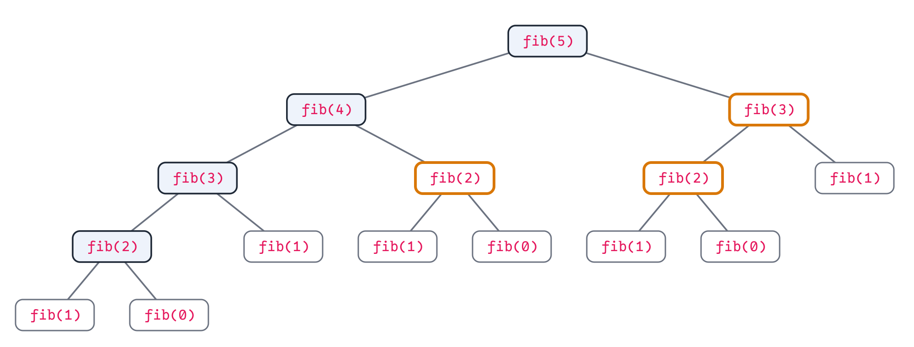
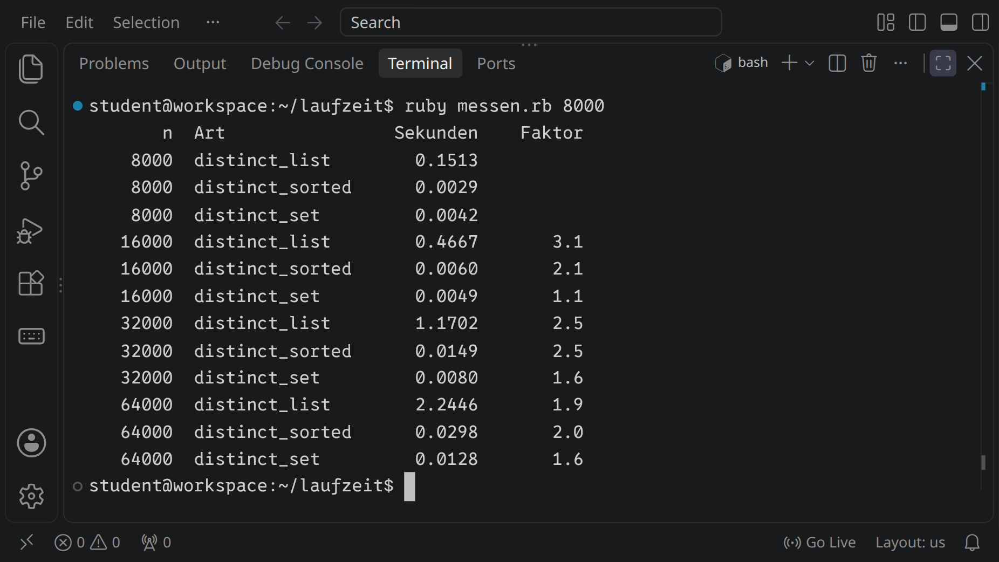

<div class='meta'>
image: teaser.webp
image_alt: "Ein Terminal, in dem messen.rb läuft: eine Tabelle mit der Zahl der Straßennamen, den drei Arten zu zählen und ihren Zeiten; die Liste braucht für 64 000 Namen zwei Sekunden, die Menge ein Hundertstel davon"
kind: projekt
language: Ruby / Python / Dart / Java
languages: [ruby, python, dart, java]
duration: 3 Doppelstunden
curriculum: "Oberstufe: Algorithmen und Datenstrukturen (Aufwand, Laufzeit messen und abschätzen, Mengen und Dictionaries), Vertiefung Theoretische Informatik (Komplexität, P und NP)"
topics: [suchen-sortieren, datenstrukturen, berechenbarkeit]
requires: [kata-dicts, kata-recursion]
age: Oberstufe
reference: [terminal]
</div>

<div
    class="autotoc-secondary-trigger"
    data-title="Auf dieser Seite"
    data-levels="h2,h3">
</div>

# Wie lange dauert das? Laufzeit und Aufwand

<p class='abstract'>
Wie viele verschiedene Straßennamen hat Berlin? Du beantwortest die Frage
auf drei Arten, die alle richtig sind, und misst, wie lange jede braucht.
Dann zählst du Schritte statt Sekunden, siehst, wie schnell manche
Programme unbrauchbar werden, machst langsame schnell und planst eine
Rundfahrt zu Berlins Sehenswürdigkeiten, für die es keine schnelle Lösung
gibt, die jemand kennt.
</p>

## Einrichten

Leg einen Ordner an und hol die Straßen Berlins, aus dem Datensatz des
[Routenplaners](/routenplaner): eine Zeile für jedes Stück Straße, mit
seinem Namen in der dritten Spalte. `cut` schneidet diese Spalte heraus,
`grep` lässt die Stücke ohne Namen weg:

```bash_copy
mkdir -p /workspace/laufzeit
cd /workspace/laufzeit
wget https://github.com/specht/workspace-files/raw/main/street-archive/berlin.tsv.gz
gunzip berlin.tsv.gz
cut -f3 berlin.tsv | grep -v '^$' > strassen.txt
wc -l strassen.txt
```

`strassen.txt` hat 102 763 Zeilen: Jede Straße steht so oft darin, wie sie
Stücke hat, und manche Namen gibt es in mehreren Bezirken.

<!-- language: ruby -->
Deine Funktionen schreibst du in `laufzeit.rb`.
<!-- /language -->
<!-- language: python -->
Deine Funktionen schreibst du in `laufzeit.py`.
<!-- /language -->
<!-- language: dart -->
Deine Funktionen schreibst du in `laufzeit.dart`.
<!-- /language -->
<!-- language: java -->
Deine Methoden schreibst du in `Laufzeit.java`, in eine Klasse `Laufzeit`.
Oben in die Datei gehört `import java.util.*;`, für Listen, Mengen und Maps.
<!-- /language -->

## Dreimal dieselbe Frage

Wie viele verschiedene Straßennamen sind es? Die erste Art ist die, die
man sich selbst ausdenkt: eine Liste der Namen, die man schon kennt, und
bei jedem Namen nachsehen, ob er darin steht.

_task(distinct-list)

Die zweite Art sortiert zuerst. Danach muss niemand mehr suchen: Gleiche
Namen stehen nebeneinander, und es genügt, jeden mit dem davor zu
vergleichen.

_task(distinct-sorted)

Die dritte Art nimmt eine **Menge**, die jeden Namen nur einmal enthält. Wie
ein Dictionary findet sie einen Namen, ohne die anderen anzusehen: Sie
rechnet aus dem Namen aus, wo er liegen müsste, und schaut nur dort nach.

_task(distinct-set)

## Messen und zählen

### Messen

Alle drei geben dieselbe Zahl. Aber wie lange brauchen sie? Bevor du misst:

_task(verdoppeln)

<!-- after: verdoppeln -->
Bei jedem neuen Namen fragt die erste Art ihre Liste, und die Liste sieht
jeden Namen an, den sie schon hat. Bei doppelt so vielen Namen sind es
doppelt so viele Fragen, und jede dauert doppelt so lange, weil die Liste
doppelt so lang ist: zusammen viermal so lange.
<!-- /after -->

`messen` ruft deine drei Funktionen für die ersten 1000 Namen auf, dann für
2000, 4000 und so weiter, und schreibt jede Zeit auf. Der »Faktor« sagt, um
wie viel die Zeit gewachsen ist, seit die Zahl der Namen das letzte Mal
verdoppelt wurde:

<!-- language: ruby -->
```bash_copy
wget ${web_root}/laufzeit/starter/messen.rb
ruby messen.rb
```
<!-- /language -->
<!-- language: python -->
```bash_copy
wget ${web_root}/laufzeit/starter/messen.py
python3 messen.py
```
<!-- /language -->
<!-- language: dart -->
```bash_copy
wget ${web_root}/laufzeit/starter/messen.dart
dart run messen.dart
```
<!-- /language -->
<!-- language: java -->
```bash_copy
wget ${web_root}/laufzeit/starter/Messen.java
java Messen.java
```
<!-- /language -->

_task(beobachtung)

<!-- after: beobachtung -->
Am Anfang ist fast jeder Name neu, und die Liste wächst mit: viermal so
lange. Aber Berlin hat nur 11 772 verschiedene Straßennamen. Sind die
meisten erst einmal in der Liste, wird sie kaum noch länger, und jeder neue
Name kostet ungefähr gleich viel: doppelt so viele Namen, doppelt so lange.
Wie viel ein Verfahren kostet, hängt also auch von den Daten ab. Mit 64 000
Namen braucht die Liste trotzdem rund hundertmal so lange wie die Menge.
<!-- /after -->

<div class='hint try'>
<strong>Ausprobieren:</strong> Eine Messung schwankt: Läuft gerade etwas
anderes, dauert es länger, und ein Programm ist beim zweiten Mal oft
schneller als beim ersten. <code>hyperfine</code> lässt ein Programm mehrmals laufen
und sagt, wie lange es im Mittel braucht und wie sehr das schwankt,
<!-- language: ruby -->
etwa <code>hyperfine 'ruby messen.rb'</code>.
<!-- /language -->
<!-- language: python -->
etwa <code>hyperfine 'python3 messen.py'</code>.
<!-- /language -->
<!-- language: dart -->
etwa <code>hyperfine 'dart run messen.dart'</code>.
<!-- /language -->
<!-- language: java -->
etwa <code>hyperfine 'java Messen.java'</code>.
<!-- /language -->
Achte darauf, wie weit die einzelnen Läufe auseinanderliegen.
<!-- language: dart, java -->
Bei den ersten, kleinen Zeilen von <code>messen</code> ist der Faktor oft
seltsam, manchmal kleiner als 1: Ein Programm in dieser Sprache wird beim
Laufen noch einmal übersetzt, und Code, der oft läuft, wird dabei schneller.
<!-- /language -->
</div>

### Zählen statt messen

Sekunden hängen vom Rechner ab, von der Sprache und davon, was nebenher
läuft. Wie viele Schritte ein Programm macht, hängt nur vom Programm und
seiner Eingabe ab. Man zählt darum Schritte, zum Beispiel, wie oft eine
Zeile in der innersten Schleife läuft:

_task(schritte)

<!-- after: schritte -->
Für `i = 0` läuft die innere Schleife gar nicht, für `i = 1` einmal, für
`i = 999` 999-mal: zusammen 0 + 1 + … + 999 = 999 · 1000 / 2 = 499 500. Das
ist rund die Hälfte von n², und bei doppelt so großem n wieder viermal so
viel.
<!-- /after -->

Auf die genaue Zahl kommt es selten an, nur darauf, wie sie mit n wächst.
Man schreibt dafür **O(n²)**, gesprochen »O von n Quadrat«: höchstens so
schnell wie n², bis auf einen festen Faktor. Die Hälfte von n² ist auch
O(n²), und O(n²) heißt immer: doppelt so viel Eingabe, viermal so viel
Arbeit.

<!-- language: ruby, python -->
<table class='table'>
<tr><th>Aufwand</th><th>woran man ihn erkennt</th><th>Beispiel</th></tr>
<tr><td>O(1)</td><td>keine Schleife über die Eingabe</td><td>in einer Menge nachsehen</td></tr>
<tr><td>O(log n)</td><td>bei jedem Schritt bleibt die Hälfte</td><td>binäre Suche</td></tr>
<tr><td>O(n)</td><td>eine Schleife über die Eingabe</td><td><code>distinct_set</code></td></tr>
<tr><td>O(n log n)</td><td>gutes Sortieren</td><td><code>distinct_sorted</code></td></tr>
<tr><td>O(n²)</td><td>eine Schleife in einer Schleife</td><td><code>distinct_list</code>, wenn alle Namen verschieden sind</td></tr>
<tr><td>O(2ⁿ)</td><td>jede Teilmenge ausprobieren, zwei Aufrufe in jeder Rekursion</td><td><code>fib</code> ohne Gedächtnis</td></tr>
<tr><td>O(n!)</td><td>jede Reihenfolge ausprobieren</td><td>die Rundfahrt unten</td></tr>
</table>
<!-- /language -->
<!-- language: dart, java -->
<table class='table'>
<tr><th>Aufwand</th><th>woran man ihn erkennt</th><th>Beispiel</th></tr>
<tr><td>O(1)</td><td>keine Schleife über die Eingabe</td><td>in einer Menge nachsehen</td></tr>
<tr><td>O(log n)</td><td>bei jedem Schritt bleibt die Hälfte</td><td>binäre Suche</td></tr>
<tr><td>O(n)</td><td>eine Schleife über die Eingabe</td><td><code>distinctSet</code></td></tr>
<tr><td>O(n log n)</td><td>gutes Sortieren</td><td><code>distinctSorted</code></td></tr>
<tr><td>O(n²)</td><td>eine Schleife in einer Schleife</td><td><code>distinctList</code>, wenn alle Namen verschieden sind</td></tr>
<tr><td>O(2ⁿ)</td><td>jede Teilmenge ausprobieren, zwei Aufrufe in jeder Rekursion</td><td><code>fib</code> ohne Gedächtnis</td></tr>
<tr><td>O(n!)</td><td>jede Reihenfolge ausprobieren</td><td>die Rundfahrt unten</td></tr>
</table>
<!-- /language -->

### Wie schnell der Aufwand wächst

Wie groß der Unterschied wird, siehst du hier. Schieb n größer und schau,
in welcher Zeile die Zeit zuerst unbrauchbar wird:

<div class='growth-widget'></div>
<script src='/include/growth_widget.js'></script>

_task(hochrechnen)

<!-- after: hochrechnen -->
Zehnmal so viel Eingabe heißt bei n² hundertmal so viel Arbeit: 100
Sekunden. Bei n wären es zehn Sekunden, bei 2ⁿ wäre das Programm für 10 000
Namen nie fertig geworden.
<!-- /after -->

## Schneller machen

Ein langsames Programm wird selten schneller, weil der Rechner schneller
wird: Bei n² heißt ein doppelt so schneller Rechner nur, dass n um gut 40
Prozent größer sein darf. Schneller wird es, wenn es weniger tut. Zwei
Tricks helfen oft: sich merken, was man schon ausgerechnet hat, und eine
Menge oder ein Dictionary statt einer Liste, in der man sucht.

Die Fibonacci-Zahlen aus den [Katas zur Rekursion](/kata-recursion), so
wie man sie zuerst schreibt:

<!-- language: ruby -->
```ruby
def fib(n)
  return n if n < 2
  fib(n - 1) + fib(n - 2)
end
```
<!-- /language -->
<!-- language: python -->
```python
def fib(n):
    if n < 2:
        return n
    return fib(n - 1) + fib(n - 2)
```
<!-- /language -->
<!-- language: dart -->
```dart
int fib(int n) {
  if (n < 2) {
    return n;
  }
  return fib(n - 1) + fib(n - 2);
}
```
<!-- /language -->
<!-- language: java -->
```java
public static long fib(int n) {
    if (n < 2) {
        return n;
    }
    return fib(n - 1) + fib(n - 2);
}
```
<!-- /language -->

`fib(40)` ruft `fib(39)` und `fib(38)` auf, `fib(39)` wieder `fib(38)`, und
so rechnet das Programm dieselben Zahlen viele Millionen Mal aus. Probier
`fib(30)`, `fib(35)` und `fib(40)` aus und achte darauf, um wie viel es
jedes Mal länger dauert.

Schon bei `fib(5)` sieht man es: 15 Aufrufe, und drei davon rechnen etwas aus,
das schon einmal ausgerechnet wurde, mit allem, was unter ihnen hängt.

<div class='gallery single'>
<figure><figcaption>Die Aufrufe von <code>fib(5)</code>; orange, was schon einmal ausgerechnet wurde, grau die Fälle <code>n &lt; 2</code></figcaption></figure>
</div>

_task(fib-memo)

_task(pair-with-sum)

## Ein schweres Problem

### Eine Rundfahrt durch Berlin

Jetzt ein Problem, für das niemand eine schnelle Lösung kennt: Du willst
mehrere Sehenswürdigkeiten besuchen und am Ende wieder am Anfang sein. In
welcher Reihenfolge ist die Rundfahrt am kürzesten? Das ist das **Problem
des Handlungsreisenden**. Der [Routenplaner](/routenplaner) löst es auf den
echten Straßen; hier geht es um die Luftlinie, und darum, wie die Zeit
wächst.

Die Entfernung zweier Orte in Kilometern, aus ihrer Länge und Breite:

<!-- language: ruby -->
```ruby
def distance(a, b)
  dx = (b[1] - a[1]) * 111.32 * Math.cos((a[2] + b[2]) / 2 * Math::PI / 180)
  dy = (b[2] - a[2]) * 110.57
  Math.hypot(dx, dy)
end
```
<!-- /language -->
<!-- language: python -->
```python
def distance(a, b):
    dx = (b[1] - a[1]) * 111.32 * math.cos((a[2] + b[2]) / 2 * math.pi / 180)
    dy = (b[2] - a[2]) * 110.57
    return math.hypot(dx, dy)
```

Dazu steht `import math` oben in der Datei.
<!-- /language -->
<!-- language: dart -->
Ein Ort ist ein Record aus Namen, Länge und Breite, mit einem Namen für
seinen Typ:

```dart
typedef Place = ({String name, double lon, double lat});

double distance(Place a, Place b) {
  final dx = (b.lon - a.lon) * 111.32 * cos((a.lat + b.lat) / 2 * pi / 180);
  final dy = (b.lat - a.lat) * 110.57;
  return sqrt(dx * dx + dy * dy);
}
```

Dazu steht `import 'dart:math';` oben in der Datei.
<!-- /language -->
<!-- language: java -->
Ein Ort ist ein Record aus Namen, Länge und Breite; beides gehört in die
Klasse `Laufzeit`:

```java
public record Place(String name, double lon, double lat) {}

public static double distance(Place a, Place b) {
    double dx = (b.lon() - a.lon()) * 111.32 * Math.cos((a.lat() + b.lat()) / 2 * Math.PI / 180);
    double dy = (b.lat() - a.lat()) * 110.57;
    return Math.hypot(dx, dy);
}
```
<!-- /language -->

Ein Grad Breite ist überall etwa 110,6 km lang, ein Grad Länge in Berlin nur
knapp 68 km, weil die Längenkreise zu den Polen hin zusammenlaufen; darum der
Kosinus.

_task(tour-length)

_task(best-tour)

`rundfahrt` holt die Sehenswürdigkeiten aus dem Datensatz der Orte und plant
mit deinen Funktionen eine Rundfahrt zu den ersten n davon, auf beide Arten,
mit der Zeit, die jede braucht:

<!-- language: ruby -->
```bash_copy
wget https://github.com/specht/workspace-files/raw/main/street-archive/berlin-places.tsv
wget ${web_root}/laufzeit/starter/rundfahrt.rb
ruby rundfahrt.rb 8
```
<!-- /language -->
<!-- language: python -->
```bash_copy
wget https://github.com/specht/workspace-files/raw/main/street-archive/berlin-places.tsv
wget ${web_root}/laufzeit/starter/rundfahrt.py
python3 rundfahrt.py 8
```
<!-- /language -->
<!-- language: dart -->
```bash_copy
wget https://github.com/specht/workspace-files/raw/main/street-archive/berlin-places.tsv
wget ${web_root}/laufzeit/starter/rundfahrt.dart
dart run rundfahrt.dart 8
```
<!-- /language -->
<!-- language: java -->
```bash_copy
wget https://github.com/specht/workspace-files/raw/main/street-archive/berlin-places.tsv
wget ${web_root}/laufzeit/starter/Rundfahrt.java
java Rundfahrt.java 8
```
<!-- /language -->
<!-- language: dart -->
`rundfahrt` ruft auch `nearestTour` auf, die du erst gleich schreibst, und
ohne sie lässt es sich nicht übersetzen. Bis dahin genügt eine, die die
kürzeste zurückgibt:

```dart
List<int> nearestTour(List<Place> places) => bestTour(places);
```
<!-- /language -->
<!-- language: java -->
`Rundfahrt.java` ruft auch `nearestTour` auf, die du erst gleich schreibst,
und ohne sie lässt es sich nicht übersetzen. Die Prüfung übersetzt jede
Java-Datei im Ordner, also auch diese. Bis dahin genügt eine, die die
kürzeste zurückgibt:

```java
public static List<Integer> nearestTour(List<Place> places) {
    return bestTour(places);
}
```
<!-- /language -->

Noch fehlt die zweite Art. Vorher:

_task(fakultaet)

<!-- after: fakultaet -->
<!-- language: ruby, python -->
Bei 11 Orten sind es zehnmal so viele Reihenfolgen wie bei 10, bei 12 noch
einmal elfmal so viele, bei 13 zwölfmal. Dazu hat jede Rundfahrt 13 statt
10 Strecken, die zusammengezählt werden: 10 · 11 · 12 · 13 / 10, also
11 · 12 · 13 = 1716-mal so viel Arbeit,
1,5 s · 1716, rund 43 Minuten. Mit 20 Orten wären es Zehntausende
Jahre. O(n!) wächst schneller als alles in der Tabelle oben.
<!-- /language -->
<!-- language: dart -->
Bei 11 Orten sind es zehnmal so viele Reihenfolgen wie bei 10, bei 12 noch
einmal elfmal so viele, bei 13 zwölfmal. Dazu hat jede Rundfahrt 13 statt
10 Strecken, die zusammengezählt werden: 10 · 11 · 12 · 13 / 10, also
11 · 12 · 13 = 1716-mal so viel Arbeit,
0,5 s · 1716, rund eine Viertelstunde. Mit 20 Orten wären es Zehntausende
Jahre. O(n!) wächst schneller als alles in der Tabelle oben.
<!-- /language -->
<!-- language: java -->
Bei 11 Orten sind es zehnmal so viele Reihenfolgen wie bei 10, bei 12 noch
einmal elfmal so viele, bei 13 zwölfmal. Dazu hat jede Rundfahrt 13 statt
10 Strecken, die zusammengezählt werden: 10 · 11 · 12 · 13 / 10, also
11 · 12 · 13 = 1716-mal so viel Arbeit,
1 s · 1716, rund eine halbe Stunde. Mit 20 Orten wären es Zehntausende
Jahre. O(n!) wächst schneller als alles in der Tabelle oben.
<!-- /language -->
<!-- /after -->

_task(nearest-tour)

<!-- after: nearest-tour -->
So sehen beide Rundfahrten für die ersten zehn Orte aus, beide vom
Brandenburger Tor aus. Wer immer zum nächsten Ort geht, lässt Schloss
Charlottenburg im Westen bis zuletzt liegen und muss am Ende den ganzen Weg
zurück.

<div class='gallery single'>
<figure><figcaption>Oben alle Reihenfolgen ausprobiert, unten immer zum nächsten Ort</figcaption></figure>
</div>
<!-- /after -->

<div class='hint try'>
<strong>Ausprobieren:</strong> Vergleiche beide Arten für 8, 9 und 10 Orte.
Achte darauf, um wie viel die Rundfahrt zum nächsten Ort länger ist als die
kürzeste, und wie viel schneller sie fertig ist.
</div>

_task(grenze)

### Schnell prüfen, langsam finden

Bei der Rundfahrt fällt etwas auf: Ob eine Rundfahrt kürzer als 20 km ist,
prüft man in einem Augenblick: Man rechnet ihre Länge aus. Eine zu finden, ist
schwer. Das gilt für viele Probleme: einen Stundenplan ohne
Überschneidungen, ein Sudoku, die beste Packung eines Koffers. Eine Lösung
zu prüfen geht schnell, in **polynomieller** Zeit, O(n²) oder O(n³) etwa.
Probleme mit dieser Eigenschaft heißen **NP**. Die, die sich auch schnell
lösen lassen, heißen **P**.

Ob jedes Problem aus NP auch in P liegt, ob also jede Lösung, die sich
schnell prüfen lässt, sich auch schnell finden lässt, weiß niemand. Die
meisten Fachleute glauben es nicht. Gefragt hat es zuerst Stephen Cook 1971,
und heute ist es eine der sieben Fragen, für deren Antwort das Clay
Mathematics Institute eine Million Dollar ausgesetzt hat. Bis dahin hilft,
was du mit der Rundfahrt zum nächsten Ort gebaut hast: eine Lösung, die gut
genug ist, statt der besten.

<!-- extra -->
## Schneller geht es nicht

Manchmal lässt sich beweisen, dass es nicht schneller geht. Ein Verfahren,
das nur durch Vergleichen sortiert, muss unter allen n! möglichen
Reihenfolgen die richtige finden, und jeder Vergleich teilt die
Möglichkeiten höchstens in zwei Hälften. Nach k Vergleichen bleiben also
mindestens n! / 2ᵏ, und erst wenn das 1 ist, ist es fertig: k ist
mindestens log₂(n!), und das wächst wie n log n. Schneller als O(n log n)
sortiert darum kein Verfahren, das nur vergleicht.

Und manche Fragen lassen sich gar nicht beantworten, so viel Zeit man auch
hat: ob ein Programm irgendwann anhält oder für immer läuft, entscheidet
kein Programm für alle Programme. Warum, zeigt das Halteproblem in
[Turingmaschinen](/turingmaschine).

## Zum Nachschlagen

- [Sortieren](/reference/sortieren) im Handbuch: die Verfahren und ihr
  Aufwand.
- [Die Sortier-Sandbox](/sandbox-sortieren): Sortierverfahren beim Arbeiten
  zusehen und ihre Schritte zählen.
- [Ein Routenplaner für Berlin](/routenplaner): Wege und Rundfahrten auf
  den echten Straßen.

<!-- tutorial-scope -->
<!-- tutorial-screenshot
# Bild für die Karte der Aktivität: messen.rb im Terminal, in 16:9; dabei
# prüft es jede Aufgabe mit Code an der Lösung
write-file: laufzeit/laufzeit.rb <- file:loesung/laufzeit.rb
write-file: laufzeit/laufzeit.py <- file:loesung/laufzeit.py
write-file: laufzeit/messen.rb <- file:starter/messen.rb
viewport: 1029x579
zoom: 1.25
hide-left-sidebar
terminal-maximize
terminal-run: cd /workspace/laufzeit && clear
terminal-run: wget -q https://github.com/specht/workspace-files/raw/main/street-archive/berlin.tsv.gz && gunzip -f berlin.tsv.gz && cut -f3 berlin.tsv | grep -v '^$' > strassen.txt && clear
terminal-run: ruby messen.rb 8000
wait-for-text: 64000  distinct_set
sleep: 1
check-task: distinct-list
check-task: distinct-sorted
check-task: distinct-set
check-task: fib-memo
check-task: pair-with-sum
check-task: tour-length
check-task: best-tour
check-task: nearest-tour
check-task: distinct-list python
check-task: distinct-sorted python
check-task: distinct-set python
check-task: fib-memo python
check-task: pair-with-sum python
check-task: tour-length python
check-task: best-tour python
check-task: nearest-tour python
-->


<!-- /tutorial-scope -->
