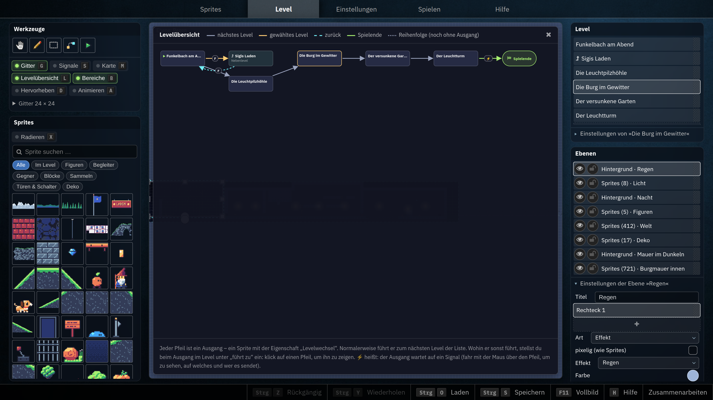
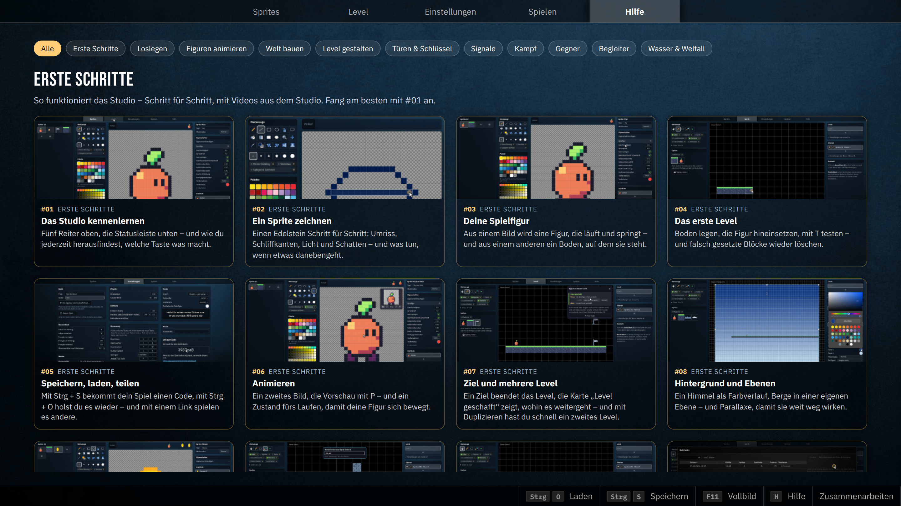

image: game-studio-level.webp

# Spiele bauen, Regeln denken

Im 2D Game Studio gestalten Kinder und Jugendliche eigene Jump-’n’-Run-Spiele: Sie
zeichnen Figuren in Pixel-Art, animieren sie, bauen Level und verknüpfen Schalter,
Türen und Gegner zu Rätseln. Programmiert wird dabei keine Zeile – gedacht wird aber
sehr viel: in Eigenschaften, Ereignissen und Regeln.

**Ausprobieren:** [2d.hackschule.de](https://2d.hackschule.de/) ·
**Stand der Bilder:** [`0435398`](https://github.com/specht/2d/commit/04353988d8d684096376b39d244337e5ff516d5e) (12.10.2026)

<table class='table'>
<tr><th>Voraussetzungen</th><td>keine – das Studio läuft im Browser, auch auf Tablets</td></tr>
<tr><th>Konten</th><td>keine: Spiele werden über einen Code geteilt</td></tr>
<tr><th>Die Lernenden …</th><td>zeichnen, animieren, bauen Level, verknüpfen Spielregeln und testen gegenseitig ihre Spiele</td></tr>
<tr><th>Die Lehrkraft …</th><td>kann Playtesting-Runden mit Fragebogen durchführen, Fehlerberichte einsehen und moderieren (mit Zugang zum Server)</td></tr>
</table>

## Die Idee: Eigenschaften statt Code

Im Studio bekommt jede Zeichnung **Eigenschaften**: Dieses Sprite ist die Spielfigur,
jenes ein Gegner, dieses ein Block, auf dem man stehen kann, jenes eine Münze zum
Einsammeln, eine Leiter, eine Tür. Erst durch diese Eigenschaften wird aus einem Bild
ein Spielelement – und die Kinder merken schnell, dass ein Spiel ein System aus
Regeln ist, das man entwerfen, ausprobieren und verbessern kann.

Alle Bilder in diesem Artikel zeigen das Demospiel **„Pip und das letzte Licht“**: Der
Leuchtturm über dem Dorf Funkelbach ist dunkel, und Pip muss durch eine Pilzhöhle, eine
Burg im Gewitter und einen versunkenen Garten, um den Zauberschlüssel zu holen. Das Spiel
hat fünf Level und einen Laden und zeigt fast alles, was das Studio kann. Es eignet sich
hervorragend als Einstieg: erst spielen, dann nachsehen, wie es gemacht ist.

## Welten bauen und Regeln verknüpfen

Im **Level-Editor** setzen die Lernenden ihre Sprites in Ebenen auf ein Raster. Daraus
entstehen Plattformen, Leitern, Wasser, Förderbänder, Aufzüge, Fallen, Gegner, Türen,
Schlüssel und Checkpoints. Hintergründe mit Parallaxe, Wetter und Licht geben der Welt
Atmosphäre.

Spannend wird es mit den **Signalen**. Ein Schalter, eine Druckplatte, ein Schlüssel, ein
besiegter Gegner oder das Betreten eines Bereichs **sendet** einen Code; Türen,
Plattformen, Ebenen, Hinweisschilder oder Ausgänge **reagieren** darauf. Die Ansicht
**Signale** zeigt alle Regeln eines Levels in Sätzen der Form „Wenn das passiert – dann
das“ und zeichnet ihre Verbindungen ins Level. Hier die Burg aus dem Demospiel: Ein
besiegter Wächter öffnet das Burgtor, eine Druckplatte öffnet ein anderes Tor nur für
kurze Zeit.

<!-- tutorial-screenshot
terminal-open
terminal-run: cd /workspace && git clone -q https://github.com/specht/2d.git && cd 2d && git checkout -q 04353988d8d684096376b39d244337e5ff516d5e
terminal-wait-for-prompt
terminal-run: cd /workspace/2d/rezepte/tools && npm ci --no-audit --no-fund && npm run demo
terminal-wait-for-prompt
wait-for-file: 2d/src/static/rezepte/spiele/demo-letztes-licht.json
preview-url: https://2d.hackschule.de/
tab: preview
viewport: 1600x900
wait-for-text: Werkzeuge
preview-load-game: 2d/src/static/rezepte/spiele/demo-letztes-licht.json
click: selector:#mi_level
sleep: 2
click: selector:#menu_levels > ._dnd_item:not(.add) >> nth=3
sleep: 2
click: selector:#tool_menu_level_settings .view-toggle:has-text("Signale")
move-mouse: selector:#mi_level
sleep: 2
-->

Hinter den Signalen steckt mehr Informatik, als man zunächst denkt. Mehrere Sender mit
demselben Code wirken im einfachsten Fall wie ein **Oder**. Ein **Zähler** sendet erst, wenn eine
bestimmte Anzahl von Signalen angekommen ist – drei Hebel öffnen ein Tor also nur
gemeinsam, ein **Und**. Eine Tür kann sich beim Signal öffnen, offen bleiben, *solange*
das Signal an ist, oder bei jedem Signal umschalten: der Unterschied zwischen einem
Ereignis und einem Zustand. Verzögerungen machen Zeit zum Gestaltungsmittel.

<strong>Unterrichtsimpuls: Ein Rätsel in drei Stufen.</strong> (1) Ein Hebel öffnet ein
Tor. (2) Drei Hebel öffnen das Tor – aber nur alle zusammen. (3) Eine Druckplatte öffnet
das Tor nur für drei Sekunden: Schafft man den Weg? Danach erklären die Lernenden ihr
Rätsel anhand der Signal-Übersicht in eigenen Worten: Wenn …, dann … .

## Testen, beobachten, verbessern

Mit der Taste <kbd>T</kbd> startet das Level an der Stelle, auf die die Maus zeigt –
so lässt sich eine knifflige Passage hundertmal hintereinander ausprobieren, ohne
jedes Mal von vorn zu beginnen. Neben dem laufenden Spiel zeigt das Studio, welche Signale
gerade gesendet werden, und ein **Spiel-Check** weist auf typische Denkfehler hin.

<!-- tutorial-screenshot
tab: preview
viewport: 1600x900
click: selector:#tool_menu_level_settings .view-toggle:has-text("Signale")
move-mouse: selector:#level
press: KeyT
sleep: 8
-->

<strong>Zum Weiterdenken:</strong> Der Spiel-Check kennt Fälle wie diesen: Ein Ausgang,
den man auch einsammeln kann, führt nie in das nächste Level – denn das Einsammeln wird
zuerst geprüft, und danach ist der Ausgang verschwunden. Eine Münze, die von allen Seiten
massiv ist, wird nie berührt und damit nie eingesammelt. Warum ist das so? Solche Fälle
führen direkt zu einer zentralen Frage der Informatik: Was passiert, wenn mehrere Regeln
gleichzeitig gelten, und in welcher Reihenfolge werden sie angewendet?

Das wichtigste Werkzeug sind aber die anderen Kinder. **Playtesting** – jemand spielt
ohne Erklärung, jemand beobachtet und notiert – zeigt schonungslos, ob ein Ziel
verständlich und eine Stelle fair ist.

<strong>Unterrichtsimpuls: Stummes Playtesting.</strong> Eine Person spielt das Spiel
einer anderen, die Erbauerin schaut nur zu und darf nichts sagen. Wo bleibt die
Spielerin hängen? Wo ist unklar, was zu tun ist? Daraus entsteht eine konkrete Änderung –
und eine zweite Testrunde, in der sich zeigt, ob sie geholfen hat.

## Figuren zeichnen und zum Leben erwecken

Im **Sprite-Editor** zeichnen die Lernenden Pixelbilder mit Stift, Formen, Füllen,
Spiegeln, Umfärben und Onion Skinning. Eine Figur hat mehrere **Zustände** mit eigenen
Animationen: stehen, laufen, springen, fallen, klettern, getroffen werden. Welcher
Zustand wann gezeigt wird, entscheidet das Spiel anhand der Rolle, die man dem Zustand
gibt. Wer nicht alles selbst zeichnen möchte, findet im Sprite-Katalog fertige Figuren und
Welten.

<!-- tutorial-screenshot
tab: preview
viewport: 1600x900
click: selector:#mi_sprites
sleep: 1
click: selector:#sprite_library_filter input
type: Pip
sleep: 1
click: selector:#menu_sprites > ._dnd_item:not(.add):visible >> nth=0
move-mouse: selector:#sprite_column_title
sleep: 2
-->

Über Eigenschaften werden aus Figuren Spielfiguren, Begleiter oder Gegner. Gegner können
patrouillieren, wachen, jagen, lauern, stampfen, hüpfen, flattern oder als Angsthase
fliehen; mit der Eigenschaft **Intelligenz** lernen sie zusätzlich, über Lücken zu
springen oder Leitern zu klettern. Dazu kommen Nah- und Fernkampf, Waffen, ein Vorrat
für Heiltränke und Läden, in denen man einkaufen kann.

<strong>Zum Weiterdenken:</strong> Ein Jäger verfolgt die Spielfigur, sobald er sie
sieht, und gibt nach einiger Zeit auf. Wie könnte man dieses Verhalten als Zustände
beschreiben – patrouillieren, verfolgen, suchen – und was löst den Wechsel zwischen ihnen
aus? Hier lässt sich das Prinzip eines Zustandsautomaten am eigenen Gegner entdecken.

## Die Spielwelt als Netz

Ausgänge verbinden Level miteinander – nicht nur der Reihe nach, sondern auch zu
Nebenleveln wie Sigis Laden im Demospiel, aus denen man wieder zurückkehrt. Die
**Levelübersicht** zeigt diese Verbindungen als Karte aller Level und warnt, wenn ein Level
nie erreicht wird oder man aus einem Level nicht mehr herauskommt.

<!-- tutorial-screenshot
tab: preview
viewport: 1600x900
click: selector:#mi_level
sleep: 2
click: selector:#tool_menu_level_settings .view-toggle:has-text("Levelübersicht")
move-mouse: selector:#mi_level
sleep: 2
-->

Für ältere Lernende ist das ein anschaulicher Zugang zu **Graphen**: Level sind Knoten,
Ausgänge gerichtete Kanten. „Kann man jedes Level erreichen?“ und „Kommt man aus jedem
Level wieder heraus?“ sind Fragen nach Erreichbarkeit, die das Studio selbst beantwortet –
und die man zuerst von Hand beantworten lassen kann.

## Selbstständig lernen mit der Hilfe

Der Reiter **Hilfe** enthält zwölf *Erste Schritte* und über sechzig **Rezepte** – vom
ersten Sprung über Schlüssel und Zähler bis zu klugen Gegnern. Jedes Rezept zeigt eine
Aufnahme aus der echten Spiel-Engine, erklärt Schritt für Schritt und lässt sich direkt als
Beispielszene im Studio öffnen und untersuchen.

<!-- tutorial-screenshot
tab: preview
viewport: 1600x900
click: selector:#mi_help
sleep: 4
-->

Für den Unterricht heißt das: Wer schneller ist, sucht sich das nächste Rezept selbst
aus, und die Lehrkraft gewinnt Zeit für die Gruppen, die Unterstützung brauchen. Eine
gute Hausaufgabe lautet: „Baue eine Mechanik aus einem Rezept in dein eigenes Spiel ein
und verändere sie so, dass sie zu deiner Geschichte passt.“

## Vorschlag für einen dreitägigen Workshop

1. **Tag 1 – Spielen und Figur:** Das Demospiel spielen und besprechen: Was macht es
   verständlich, was macht es spannend? Danach eine eigene Spielfigur mit Lauf- und
   Sprunganimation zeichnen und in einem ersten, kleinen Level ausprobieren.
2. **Tag 2 – Welt und Regeln:** Ein Level mit Hindernissen, Gegnern, etwas zum Sammeln
   und einem Ausgang bauen; mindestens ein Rätsel mit Signalen; ein zweites Level oder
   ein Nebenlevel anschließen.
3. **Tag 3 – Testen und Zeigen:** Playtesting in mehreren Runden, Rückmeldungen
   umsetzen, zum Abschluss stellen sich alle ihre Spiele gegenseitig vor.

Über eine längere Unterrichtsreihe lässt sich jeder dieser Schritte vertiefen – etwa mit
einer Spielidee auf Papier am Anfang, einer Geschichte, die sich durch die Level zieht,
oder Gegnern mit durchdachtem Verhalten.

## Organisation

- **Ohne Konten:** Beim Speichern entsteht ein Code, über den das Spiel geöffnet, geteilt
  und weitergeführt werden kann. Jede Speicherung ist eine neue, unveränderliche Version;
  die Versionsgeschichte lässt sich als Stammbaum ansehen.
- **Öffentlich sichtbar:** Gespeicherte Spiele erscheinen in der Liste *Spiel laden*.
  Es lohnt sich, mit der Klasse vorab zu vereinbaren, dass in Titeln, Texten und als
  Autorenname keine vollständigen echten Namen stehen.
- **Gemeinsam arbeiten:** Über einen geheimen Sitzungscode können mehrere Lernende
  gleichzeitig an einem Spiel arbeiten; jede Person sperrt dabei das Sprite oder Level,
  an dem sie gerade arbeitet.
- **Remix erwünscht:** *Als eigenes Spiel weiterführen* macht aus jedem Spiel den
  Ausgangspunkt eines neuen – zum Beispiel aus dem Demospiel.
- **Für Lehrkräfte mit Serverzugang:** Skripte für Playtesting-Runden (die Kinder testen
  sich zugeloste Spiele und füllen einen Fragebogen aus; die Rückmeldungen gibt es als
  PDF zum Ausdrucken), für Fehlerberichte und zur Moderation.

Das Studio ist für Bildschirme ab etwa 1366 × 768 Pixeln ausgelegt und funktioniert auch
auf Tablets im Querformat.

[Projektdokumentation](https://github.com/specht/2d/blob/04353988d8d684096376b39d244337e5ff516d5e/README.md) ·
[Rezepte und Demospiel](https://github.com/specht/2d/blob/04353988d8d684096376b39d244337e5ff516d5e/rezepte/README.md)
