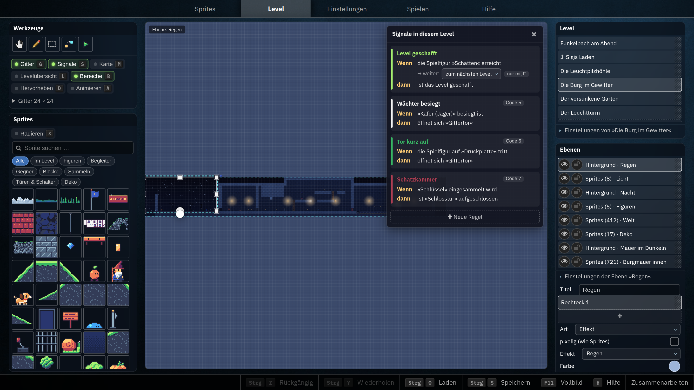
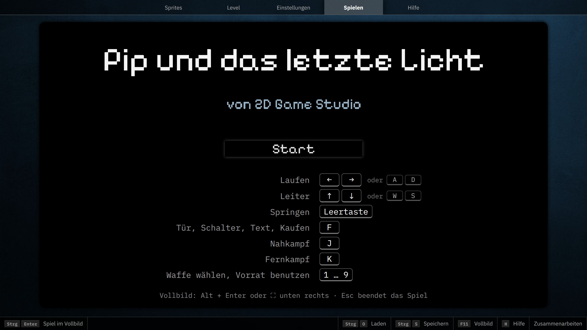
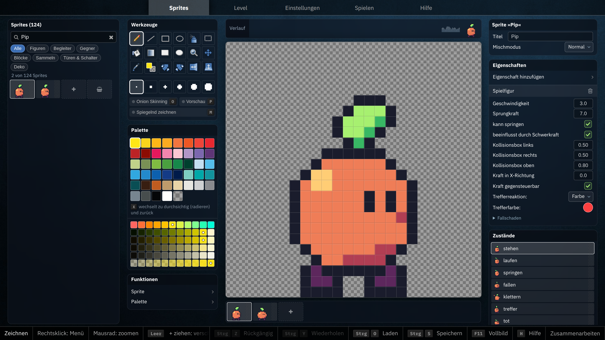

image: game-studio-level.webp

# Eigene Computerspiele gestalten — 2D Game Studio

Mit dem 2D Game Studio gestalten Kinder und Jugendliche ohne Programmierkenntnisse
eigene Pixel-Art-Figuren, Animationen und spielbare Level. Eigenschaften und
Signale machen aus gezeichneten Bildern interaktive Spielwelten.

**Ausprobieren:** [2d.hackschule.de](https://2d.hackschule.de/) ·
**Dokumentierter Stand:** [`04353988d8d684096376b39d244337e5ff516d5e`](https://github.com/specht/2d/commit/04353988d8d684096376b39d244337e5ff516d5e)
(12.10.2026). Die Screenshots laden **„Pip und das letzte Licht“** aus dem
[Demospiel-Quelltext dieses Commits](https://github.com/specht/2d/blob/04353988d8d684096376b39d244337e5ff516d5e/rezepte/demo/letztes-licht.yaml):
Das Spiel wird lokal aus dem festgehaltenen Stand gebaut, anschließend **nur
im Screenshot-Browser** geöffnet. Es wird **nicht gespeichert** und nicht mit
einem veränderlichen Eintrag der öffentlichen Spieleliste verwechselt. Damit
ist auch die verwendete *Spielversion* an den Git-Stand gebunden; die laufende
Webanwendung selbst kann inzwischen neuer sein.

## 1. Level gestalten und Spielmechaniken kombinieren

Im Level-Editor werden Sprites in Ebenen auf einem Raster platziert. Daraus
entstehen Plattformen, Leitern, Wasser, Förderbänder, bewegliche Plattformen,
Gegner, Sammelobjekte, Türen, Schlüssel und Checkpoints. Hintergrund, Wetter,
Licht und Parallax-Effekte verleihen der Welt Atmosphäre. Einzelne Level können
zu einer größeren Spielwelt verknüpft werden.

**„Pip und das letzte Licht“** erzählt von einem dunklen Leuchtturm: Pip
sucht einen Schlüssel, besucht eine Burg und einen Laden und muss das Licht
wieder entzünden. Das vollständige Demospiel hat **fünf Level und einen Laden**.
Es zeigt viele Mechaniken, die man mit Lernenden selbst nachbauen kann.

<!-- tutorial-screenshot
terminal-open
terminal-run: cd /workspace && git clone -q https://github.com/specht/2d.git && cd 2d && git checkout -q 04353988d8d684096376b39d244337e5ff516d5e
terminal-wait-for-prompt
terminal-run: cd /workspace/2d/rezepte/tools && npm ci --no-audit --no-fund && npm run demo
terminal-wait-for-prompt
wait-for-file: 2d/src/static/rezepte/spiele/demo-letztes-licht.json
preview-url: https://2d.hackschule.de/
tab: preview
viewport: 1600x900
wait-for-text: Werkzeuge
preview-load-game: 2d/src/static/rezepte/spiele/demo-letztes-licht.json
click: selector:#mi_level
sleep: 3
-->

**Unterrichtsimpuls:** Ein Stück des Demolevels nachbauen: erst Boden und
Spielfigur, dann Hindernisse, Gegenstände und einen Ausgang. Dabei zwischen
bloßer Darstellung und tatsächlichem Spielverhalten unterscheiden.

## 2. Das Spiel spielen und überprüfen

Die Lernenden können den aktuellen Level sofort testen. So werden
Kollisionen, Sprungweiten, Gegnerverhalten, Kamera, Leben und Inventar
als Eigenschaften eines selbst entworfenen Systems erlebbar. **Playtesting**
mit Rückmeldungen anderer Kinder hilft, Schwierigkeit und Verständlichkeit zu
verbessern.

<!-- tutorial-screenshot
tab: preview
viewport: 1600x900
click: selector:#mi_play
sleep: 5
-->

**Unterrichtsimpuls:** Eine Person spielt ohne Erklärung, die andere
beobachtet. Wo wird klar, was das Ziel ist? Wo stockt der Spielfluss?
Das Feedback führt zu einer konkreten Änderung und einer zweiten Testrunde.

## 3. Sprites, Animationen und Signale

Im Sprite-Editor malen die Lernenden Pixelbilder, erstellen **Animationszustände**,
spiegeln oder färben Bilder um. Eigenschaften legen fest, ob eine Figur
beispielsweise Spielfigur, Gegner, Begleiter oder ein Gegenstand ist. **Signale**
verbinden Auslöser und Reaktionen: Eine Druckplatte öffnet eine Tür; ein
Schalter setzt eine Plattform in Bewegung; ein Zähler steuert ein Ereignis.
So lassen sich einfache ereignisgesteuerte Systeme modellieren – ohne Code.

<!-- tutorial-screenshot
tab: preview
viewport: 1600x900
click: selector:#mi_sprites
sleep: 3
-->

Die integrierte **Hilfe** bietet eine Reihe von Erste-Schritte-Anleitungen
und ausführliche **Rezepte** mit aus dem wirklichen Editor aufgezeichneten
Demonstrationen. Rezept-Szenen lassen sich direkt zur Untersuchung im Studio
öffnen. Spiele werden ohne Benutzerkonto über Codes und unveränderliche
Versionen weitergegeben; gemeinsames Bearbeiten ist über einen Sitzungscode
möglich.

## Vorschlag für die Arbeit mit einer Klasse

1. Ein fertiges Spiel spielen: Was macht es verständlich und interessant?
2. Eigene Spielfigur und zwei Animationen entwerfen.
3. Ein spielbares Level mit Kollisionen, Sammelobjekt und Ausgang bauen.
4. Signal und Reaktion hinzufügen, dann Level zu einer Welt verknüpfen.
5. Gegenseitig spielen, Feedback protokollieren und überarbeiten.

Für einen **dreitägigen Workshop** bietet sich an, am ersten Tag Sprites und
die grundlegende Steuerung zu gestalten, am zweiten Tag Spielmechaniken und
Levelverbindungen zu entwickeln und am dritten Tag zu testen, zu verbessern
und die Spiele vorzustellen. Das System benötigt für Schülerinnen und Schüler
keine Accounts.

[Projektdokumentation](https://github.com/specht/2d/blob/04353988d8d684096376b39d244337e5ff516d5e/README.md) ·
[Rezepte und Demospiel](https://github.com/specht/2d/blob/04353988d8d684096376b39d244337e5ff516d5e/rezepte/README.md).
